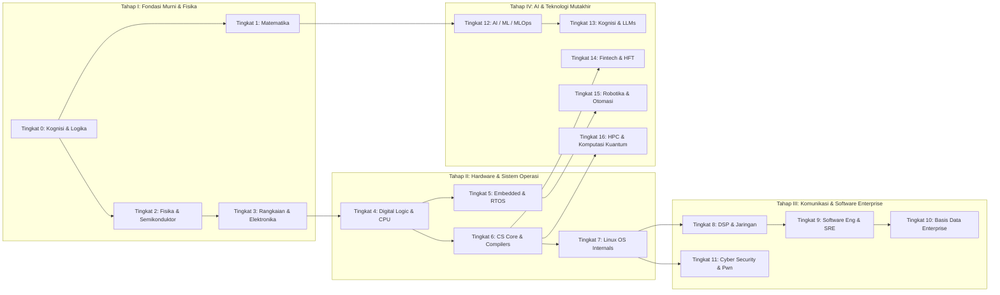

# 🌌 Ultimate Learning Paths: Master Engineering & Science Encyclopedia

Selamat datang di **Ultimate Learning Paths** — sebuah sistem kurikulum sains komputasi, rekayasa perangkat keras, dan sistem rekayasa perangkat lunak paling komprehensif, terstruktur, dan mendalam. 

Kurikulum ini dirancang dari **prinsip pertama murni (first principles)** dari kondisi dasar mutlak ("seperti bayi baru lahir") hingga tingkat mahir/profesional ("mentok / production-grade"), mencakup **17 Tingkat (Tiers)** dan **232 Modul Teknis Lengkap** tanpa ada bagian yang terpotong atau terlewatkan.

---

## 🏛️ Akses Cepat & Navigasi Utama

- 📖 **[MASTER INDEX: Katalog Lengkap 232 Topik](./INDEX.md)** — Direktori sentral seluruh modul pembelajaran.
- 🗺️ **[Prerequisites Directed Acyclic Graph (DAG)](./roadmaps/prerequisites-dag.md)** — Peta jalur belajar linear dan spesialisasi karier.
- 📘 **[Panduan Metodologi Pembelajaran (ID)](./GUIDEBOOK-ID.md)** — Filosofi kognisi, active recall, dan Feynman technique.
- 📂 **[Arsip Kurikulum Domain Lama (Side-by-Side)](./domains/)** — Materi rangkuman domain terdahulu yang tetap dipertahankan.

---

## 📐 Arsitektur Kurikulum: 17 Tingkat (Tingkat 0 s/d 16)



| Tingkat | Nama Disiplin Kurikulum | Jangkauan Modul | Fokus Inti |
|:---:|---|:---:|---|
| **0** | [Fondasi Kognitif, Logika Murni & Berpikir Ilmiah](./curriculum/00-fondasi-kognitif-logika/README.md) | Modul 001 - 005 | Meta-learning, first-principles, systems thinking, falsifikasi Karl Popper, logika formal. |
| **1** | [Fondasi Matematika Komprehensif Dari Nol](./curriculum/01-fondasi-matematika/README.md) | Modul 006 - 023 | Himpunan, aljabar linier, kalkulus multivariabel, ODE/PDE, probabilitas, optimasi, game theory. |
| **2** | [Fisika Klasik, Elektromagnetisme & Kimia Semikonduktor](./curriculum/02-fisika-semikonduktor/README.md) | Modul 024 - 037 | Mekanika Newton, termodinamika, persamaan Maxwell, optik, struktur atom, pita energi, silikon. |
| **3** | [Rangkaian Listrik, Elektronika & Microelectronics](./curriculum/03-rangkaian-mikroelektronika/README.md) | Modul 038 - 052 | Rangkaian DC/AC, BJT, MOSFET CMOS, Op-Amp, SMPS, ADC/DAC, VLSI FinFET, PCB multi-layer, SI/PI. |
| **4** | [Logika Digital, Computer Engineering & Arsitektur Komputer](./curriculum/04-logika-digital-arsitektur-komputer/README.md) | Modul 053 - 069 | Gerbang Boolean, Verilog RTL, FPGA, DRAM, RISC-V ISA, pipelining, cache MESI, MMU, akselerator GPU. |
| **5** | [Embedded Systems, Firmware Bare-Metal & RTOS / IoT](./curriculum/05-embedded-rtos-iot/README.md) | Modul 070 - 087 | ARM Cortex-M bare-metal C, linker script, DMA, FreeRTOS, Zephyr, bus CAN, Embedded Linux, TinyML. |
| **6** | [Computer Science Core, Struktur Data, Algoritma & Compiler](./curriculum/06-cs-core-dsa-compiler/README.md) | Modul 088 - 109 | Big-O, struktur data linier & pohon, graf lanjut, automata formal, Turing computability, LLVM. |
| **7** | [Operating Systems Internals & Penguasaan Penuh Linux](./curriculum/07-os-internals-linux/README.md) | Modul 110 - 124 | CPU rings, syscall dispatcher, proses fork/COW, scheduler CFS/EEVDF, VFS, io_uring, eBPF, kontainer. |
| **8** | [Pemrosesan Sinyal Digital, Telekomunikasi & Network Engineering](./curriculum/08-dsp-telekomunikasi-jaringan/README.md) | Modul 125 - 139 | LTI, FFT Cooley-Tukey, filter FIR/IIR, OSI, TCP/IP, BGP-4 routing, QUIC HTTP/3, SDN P4. |
| **9** | [Software Engineering, Front-End, Back-End & Cloud/SRE](./curriculum/09-software-engineering-cloud-sre/README.md) | Modul 140 - 156 | Git DAG, SOLID, arsitektur hexagonal, React Fiber, API gRPC, Kafka, Kubernetes internals, SRE. |
| **10** | [Basis Data, Data Engineering & Sistem Informasi Enterprise](./curriculum/10-basis-data-enterprise/README.md) | Modul 157 - 167 | Aljabar relasional, BCNF, B+Tree vs LSM-Tree, ACID MVCC, NoSQL, Raft konsensus, Apache Spark. |
| **11** | [Cyber Security, Kriptografi & Reverse Engineering](./curriculum/11-cybersecurity-reverse-engineering/README.md) | Modul 168 - 182 | AES-GCM, TLS 1.3, pasca-kuantum Kyber, OWASP Top 10, Ghidra reverse engineering, ROP stack pwn. |
| **12** | [Data Science, AI, Machine Learning, Deep Learning & MLOps](./curriculum/12-ai-machine-learning-mlops/README.md) | Modul 183 - 195 | Vektorisasi BLAS, regresi, autodiff PyTorch, ResNet, YOLO, Diffusion, CUDA programming, ZeRO-3. |
| **13** | [Sains Kognitif, Neuroengineering & Computational Linguistics](./curriculum/13-sains-kognitif-nlp/README.md) | Modul 196 - 206 | David Marr, Hodgkin-Huxley, BCI EEG, AlphaFold, Transformer Multi-Head Attention, RoPE, LLM RLHF. |
| **14** | [Fintech, Financial Engineering, HFT & Blockchain](./curriculum/14-fintech-hft-blockchain/README.md) | Modul 207 - 216 | Buku besar immutable, Black-Scholes, LOB matching engine, zero-allocation C++, kernel-bypass DPDK. |
| **15** | [Mekatronika, Robotika, Teori Kendali & Otomasi Industri](./curriculum/15-mekatronika-robotika-kendali/README.md) | Modul 217 - 226 | Motor BLDC FOC, sensor LiDAR, kinematika DH/Jacobian, kendali PID/LQR, Kalman Filter, ROS 2, PLC. |
| **16** | [Komputasi Performa Tinggi, Multimedia & Komputasi Kuantum](./curriculum/16-hpc-multimedia-kuantum/README.md) | Modul 227 - 232 | Grafika 3D Vulkan PBR, game engine ECS, codec video AV1, OpenMP/MPI klaster, qubit & algoritma Shor. |

---

## 💎 Standar Kualitas Modul (Template 7 Lapis)

Setiap modul dari 232 topik yang ada di repositori ini mematuhi standar format 7 lapis yang ketat:
1. **Lapis 1: Intuisi Dasar Bebas Jargon ("Seperti Bayi Baru Lahir")** — Analogi sederhana yang membumi.
2. **Lapis 2: Fondasi Teoretis & Aksiomatik / Matematis** — Rumus eksak, teorema pembuktian, dan batasan teoretis.
3. **Lapis 3: Anatomi Teknis & Cara Kerja Internal** — Mekanisme tingkat rendah, alur eksekusi, dan diagram Mermaid.
4. **Lapis 4: Implementasi Praktis & Kode / Simulasi Riil** — Kode kerja standar industri (C, Rust, Python, Verilog, SQL).
5. **Lapis 5: Miskonsepsi & Jebakan Industri** — Kesalahan umum, edge cases kritis, dan skenario crash di dunia nyata.
6. **Lapis 6: Proyek Latihan & Rubrik Penilaian Mandiri** — 3 tingkatan tantangan (Dasar, Menengah, Mahir).
7. **Lapis 7: Rekomendasi Sumber Belajar Standar Emas** — Buku teks universitas standar emas dan paper seminal klasik.

---

## 🛠️ Verifikasi Integritas Kurikulum

Untuk memastikan 100% dari 232 file topik dan link navigasi valid secara matematis, jalankan skrip verifikasi otomatis:
```bash
python scripts/verify_curriculum.py
```

---
*Dikelola dengan standar rekayasa tertinggi untuk pembelajar autodidak, ilmuwan, dan insinyur profesional masa depan.*