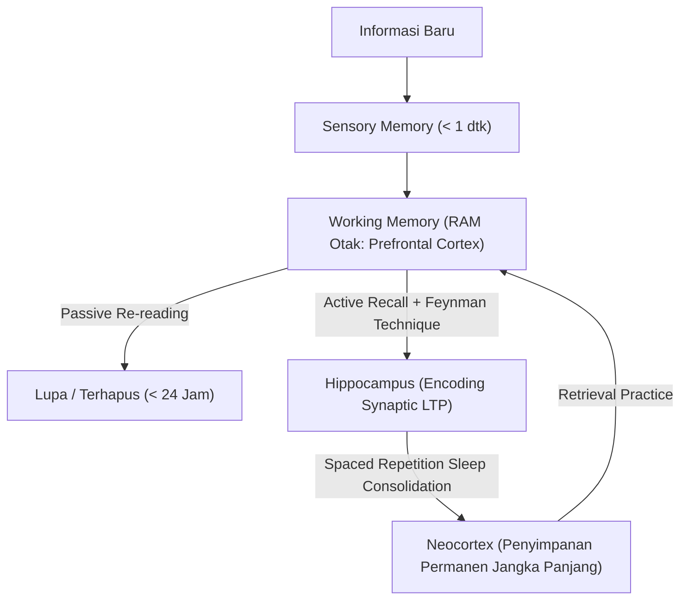

# Modul 001: Meta-Learning & Kognisi Belajar (Spaced Repetition, Feynman Technique, Retensi Memori)

**Navigasi**: [⬅️ Master Index](../../INDEX.md) | [Tingkat 0: Tingkat 0: Fondasi Kognitif, Logika Murni & Berpikir Ilmiah](./README.md)
*Sebelumnya*: *Awal Kurikulum* | *Berikutnya*: [002. first-principles-thinking](./002-first-principles-thinking.md)

---

## 1. Intuisi Dasar Tanpa Jargon ("Seperti Bayi Baru Lahir")
Bayangkan otak Anda seperti sebuah komputer dengan RAM terbatas (Working Memory: 4-7 bongkah informasi) dan hard drive raksasa (Long-Term Memory). Ketika Anda hanya membaca ulang buku (*passive reading*) atau menandai teks dengan stabilo (*highlighting*), Anda hanya meletakkan informasi di RAM sementara. Tanpa proses pemindahan terstruktur, 80% informasi tersebut akan terhapus dalam waktu kurang dari 24 jam (Kurva Lupa Ebbinghaus).

Meta-learning adalah sains merancang "BIOS dan algoritma kompresi data" untuk otak Anda. Alih-alih belajar secara acak, Anda menggunakan **Active Recall** (memaksa otak menarik data dari ketiadaan) dan **Spaced Repetition** (mengulang tepat saat memori hampir pudar) sehingga sinapsis saraf mengalami *Long-Term Potentiation (LTP)* permanen.

## 2. Fondasi Teoretis & Aksiomatik / Matematis
### 1. Kurva Retensi Memori Ebbinghaus & Spaced Repetition
Retensi memori dimodelkan secara matematis dengan fungsi eksponensial negatif:
$$R(t) = e^{-\frac{t}{S}}$$
Di mana:
- $R(t)$ adalah probabilitas mengingat (*retrieval probability*) pada interval waktu $t$.
- $S$ adalah stabilitas memori (*memory stability*), yang melonjak setiap kali proses penarikan aktif (*active retrieval*) berhasil dilakukan tepat saat $R(t) \approx 0.90$:
$$S_{n+1} = S_n \cdot (1 + a \cdot e^{-b \cdot R})$$

### 2. Algoritma SM-2 (SuperMemo-2)
Perhitungan interval hari pengulangan $I(n)$ dan faktor kemudahan (*Ease Factor* $EF$):
$$EF' = EF + (0.1 - (5 - q) \cdot (0.08 + (5 - q) \cdot 0.02)), \quad EF' \ge 1.3$$
$$I(1) = 1, \quad I(2) = 6, \quad I(n) = I(n-1) \times EF'$$
Di mana $q \in [0, 5]$ adalah nilai kualitas penarikan memori pengguna.
[📚 Pelajari Teori SM-2: SuperMemo Official Algorithm](https://www.supermemo.com/en/blog/application-of-a-computer-to-improve-the-results-of-obtaining-photographic-memory)

## 3. Anatomi Teknis & Cara Kerja Internal

Proses *Long-Term Potentiation (LTP)* melibatkan aktivasi reseptor NMDA post-sinaptik akibat ion kalsium $Ca^{2+}$, memicu kaskade enzim CaMKII yang menanamkan lebih banyak reseptor AMPA pada membran sinaptik, membuat jalur neuron tersebut semakin konduktif dan permanen.

## 4. Implementasi Praktis & Kode / Simulasi Riil
```python
import math
from dataclasses import dataclass

@dataclass
class FlashcardReview:
    repetition: int
    interval_days: float
    ease_factor: float

def calculate_sm2(quality: int, card: FlashcardReview) -> FlashcardReview:
    """
    Implementasi murni algoritma SuperMemo-2 (SM-2) untuk Spaced Repetition.
    quality: 0 (blackout total) s/d 5 (sempurna tanpa jeda)
    """
    if not (0 <= quality <= 5):
        raise ValueError("Skor kualitas harus antara 0 dan 5.")
        
    new_ef = card.ease_factor + (0.1 - (5 - quality) * (0.08 + (5 - quality) * 0.02))
    new_ef = max(1.3, new_ef)
    
    if quality < 3:
        return FlashcardReview(repetition=0, interval_days=1.0, ease_factor=new_ef)
    else:
        if card.repetition == 0:
            next_interval = 1.0
        elif card.repetition == 1:
            next_interval = 6.0
        else:
            next_interval = math.ceil(card.interval_days * new_ef)
            
        return FlashcardReview(
            repetition=card.repetition + 1,
            interval_days=next_interval,
            ease_factor=new_ef
        )

# Simulasi jadwal review
card = FlashcardReview(repetition=0, interval_days=1.0, ease_factor=2.5)
for day, score in enumerate([4, 5, 4, 5], 1):
    card = calculate_sm2(score, card)
    print(f"Review {day}: Nilai={score} -> Interval Berikutnya: {card.interval_days:.0f} hari (EF={card.ease_factor:.2f})")
```

## 5. Miskonsepsi & Jebakan Industri
1. **The Fluency Illusion**: Mengira sudah paham materi hanya karena teks atau video terasa familiar saat dibaca ulang.
2. **Cramming (Begadang Semalam Suntuk)**: Memadatkan 10 jam dalam 1 malam memicu memori dangkal yang hilang 85% dalam 72 jam karena tidak melewati siklus tidur REM untuk konsolidasi memori.
3. **Passive Highlighting**: Menggarisbawahi buku secara pasif tidak melatih jalur penarikan sinaptik (*retrieval pathways*).

## 6. Proyek Latihan & Rubrik Penilaian Mandiri
### Level 1 (Dasar)
Ambil konsep teknis (misal: "Pointer C" atau "Hukum Ohm"), lalu jelaskan secara tertulis menggunakan analogi anak usia 10 tahun tanpa satu pun istilah teknis (Teknik Feynman).

### Level 2 (Menengah)
Bangun program CLI Python flashcard yang menyimpan status kartu ke file JSON dan menghitung interval hari berikutnya berdasarkan algoritma SM-2.

### Level 3 (Mahir)
Rancang arsitektur sistem manajemen pengetahuan pribadi (PKM) menggunakan Obsidian / Zettelkasten dengan prinsip keterhubungan dua arah (*bi-directional links*) dan integrasi audit pengujian harian otomatis.

## 7. Rekomendasi Sumber Belajar Standar Emas
- [Buku Standar: Make It Stick - Peter C. Brown](https://www.hup.harvard.edu/books/9780674729018)
- [Kuliah Terbuka: Learning How to Learn - Dr. Barbara Oakley (Coursera/UC San Diego)](https://www.coursera.org/learn/learning-how-to-learn)
- [Paper Seminal: The Spacing Effect: A Case Study in the Failure to Apply the Results of Psychological Research - Frank N. Dempster (1988)](https://journals.sagepub.com/doi/10.3102/00346543058004627)
- [Software Open-Source: Anki Spaced Repetition Engine Documentation](https://faqs.ankiweb.net/what-algorithm-does-anki-use.html)

---
*Navigasi Cepat*: [Ke Tingkat 0](./README.md) | [Ke Master Index](../../INDEX.md) | *Sebelumnya*: *Awal Kurikulum* | *Berikutnya*: [002. first-principles-thinking](./002-first-principles-thinking.md)
