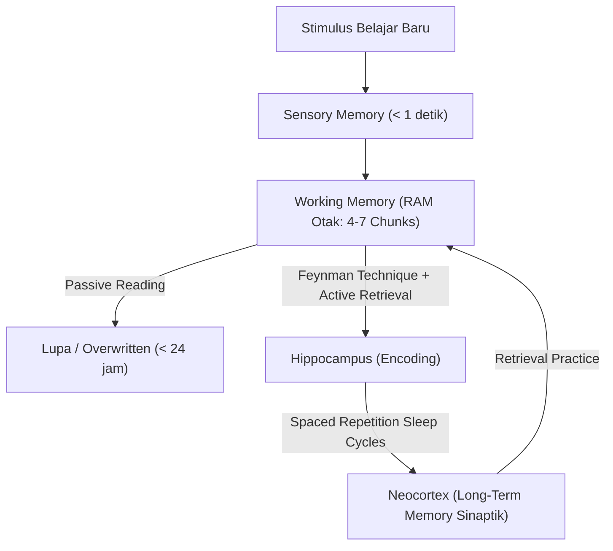

# Modul 001: Meta-Learning & Kognisi Belajar (Spaced Repetition, Feynman Technique, Retensi Memori)

**Navigasi**: [⬅️ Master Index](../../INDEX.md) | [Tingkat 0: Tingkat 0: Fondasi Kognitif, Logika Murni & Berpikir Ilmiah](./README.md)
*Sebelumnya*: *Awal Kurikulum* | *Berikutnya*: [002. first-principles-thinking](./002-first-principles-thinking.md)

---

## 1. Intuisi Dasar Tanpa Jargon ("Seperti Bayi Baru Lahir")
Bayangkan otak Anda seperti sebuah komputer dengan RAM terbatas dan hard drive yang sangat besar. Ketika Anda membaca buku atau menonton video tutorial, informasi baru hanya masuk ke "RAM sementara" (working memory). Jika RAM tidak segera disimpan ke hard drive permanen (Long-Term Memory) melalui metode yang tepat, informasi tersebut akan lenyap tersapu dalam waktu kurang dari 24 jam (Fenomena Ebbinghaus Forgetting Curve).

Meta-learning adalah ilmu tentang "bagaimana cara merancang BIOS dan algoritma kompresi data terbaik untuk otak Anda sendiri". Bukannya menghafal secara pasif (re-reading) yang menimbulkan ilusi kompetensi (*illusion of explanatory depth*), meta-learning memaksa otak melakukan penarikan informasi aktif (*active recall*) dan konsolidasi sinapsis terencana.

## 2. Fondasi Teoretis & Aksiomatik / Matematis
### 1. Kurva Retensi Ebbinghaus & Spaced Repetition
Retensi memori manusia dimodelkan secara matematis dengan fungsi eksponensial negatif:
$$R(t) = e^{-\frac{t}{S}}$$
Di mana:
- $R(t)$ adalah probabilitas mengingat kembali (*retrieval probability*) pada waktu $t$.
- $S$ adalah kekuatan memori (*memory stability*), yang berbanding lurus dengan jumlah pengulangan aktif pada interval waktu yang tepat.

Ketika pengulangan dilakukan tepat saat $R(t) \approx 0.9$, kekuatan stabilitas baru $S_{n+1}$ melonjak secara eksponensial:
$$S_{n+1} = S_n \cdot (1 + a \cdot e^{-b \cdot R})$$

### 2. Algoritma SM-2 (SuperMemo-2)
Algoritma penjadwalan kartu memori Spaced Repetition mendasarkan perhitungan interval $I(n)$ dan faktor kemudahan (*Ease Factor* $EF$):
$$EF' = EF + (0.1 - (5 - q) \cdot (0.08 + (5 - q) \cdot 0.02))$$
$$I(1) = 1, \quad I(2) = 6, \quad I(n) = I(n-1) \times EF$$
Di mana $q \in [0, 5]$ adalah skor kualitas penarikan memori pengguna.

## 3. Anatomi Teknis & Cara Kerja Internal

Proses biologis konsolidasi memori bergantung pada **Long-Term Potentiation (LTP)** di mana reseptor NMDA diaktifkan, memicu masuknya ion kalsium $Ca^{2+}$, yang menginstruksikan sintesis protein untuk memperkuat koneksi sinapsis antar neuron.

## 4. Implementasi Praktis & Kode / Simulasi Riil
```python
import math
from dataclasses import dataclass

@dataclass
class FlashcardReview:
    repetition: int
    interval_days: float
    ease_factor: float

def calculate_sm2(quality: int, card: FlashcardReview) -> FlashcardReview:
    """
    Implementasi murni algoritma SuperMemo-2 (SM-2) untuk spaced repetition.
    quality: 0 (blackout total) s/d 5 (sempurna tanpa jeda)
    """
    if quality < 0 or quality > 5:
        raise ValueError("Skor kualitas harus antara 0 dan 5.")
        
    # Perbarui Ease Factor
    new_ef = card.ease_factor + (0.1 - (5 - quality) * (0.08 + (5 - quality) * 0.02))
    new_ef = max(1.3, new_ef)  # Batas bawah stabilitas SM-2
    
    if quality < 3:
        # Gagal mengingat: reset siklus repetisi
        return FlashcardReview(repetition=0, interval_days=1.0, ease_factor=new_ef)
    else:
        # Berhasil mengingat
        if card.repetition == 0:
            next_interval = 1.0
        elif card.repetition == 1:
            next_interval = 6.0
        else:
            next_interval = math.ceil(card.interval_days * new_ef)
            
        return FlashcardReview(
            repetition=card.repetition + 1,
            interval_days=next_interval,
            ease_factor=new_ef
        )

# Contoh Simulasi Pembelajaran 4 Putaran
card = FlashcardReview(repetition=0, interval_days=1.0, ease_factor=2.5)
ratings = [4, 5, 4, 5]
print("Simulasi Penjadwalan Pengulangan (Spaced Repetition):")
for day_idx, score in enumerate(ratings, 1):
    card = calculate_sm2(score, card)
    print(f"Sesi {day_idx}: Nilai={score} -> Interval Berikutnya: {card.interval_days:.0f} hari (EF={card.ease_factor:.2f})")
```

## 5. Miskonsepsi & Jebakan Industri
1. **The Highlighting / Re-reading Trap**: Menstabilkan teks buku atau menonton video ulang berulang kali hanya memicu *fluency illusion* (merasa paham karena konten tampak familiar, padahal neuron otak tidak mampu merekonstruksi konsep tersebut tanpa melihat teks).
2. **Cramming (Belajar Semalam Suntuk)**: Menumpuk 10 jam dalam 1 malam menciptakan spiking memori instan yang akan terhapus 85% dalam 72 jam karena tidak ada fase konsolidasi tidur REM dan *slow-wave sleep*.
3. **Chunking Failure**: Mencoba menghafal detail mikroskopis sebelum memahami kerangka pohon pengetahuan (*knowledge tree*) secara holistik.

## 6. Proyek Latihan & Rubrik Penilaian Mandiri
### Level 1 (Dasar)
Gunakan teknik Feynman untuk menjelaskan konsep `Pointer di Bahasa C` atau `Resistansi Listrik` kepada anak berusia 10 tahun tanpa menggunakan istilah teknis sama sekali. Tulis dalam 3 paragraf sederhana.

### Level 2 (Menengah)
Bangun sistem pelacakan Spaced Repetition mandiri menggunakan Python CLI atau Anki deck yang mengimplementasikan pemisahan kartu memori menjadi "Konsep Teoretis", "Algoritma", dan "Perintah Shell".

### Level 3 (Mahir)
Rancang arsitektur sistem *knowledge retrieval engine* pribadi berbasis Obsidian / Markdown berkoneksi dua arah (bi-directional linking / Zettelkasten) yang mengintegrasikan pengujian aktif harian otomatis via skrip Python.

## 7. Rekomendasi Sumber Belajar Standar Emas
- Brown, P. C., Roediger, H. L., & McDaniel, M. A. (2014). *Make It Stick: The Science of Successful Learning*. Harvard University Press.
- Oakley, B. (2014). *A Mind for Numbers: How to Excel at Math and Science*. TarcherPerigee.
- Wozniak, P. A. (1990). *Optimization of learning: A new approach to spaced repetition*. University of Technology in Poznan.

---
*Navigasi Cepat*: [Ke Tingkat 0](./README.md) | [Ke Master Index](../../INDEX.md) | *Sebelumnya*: *Awal Kurikulum* | *Berikutnya*: [002. first-principles-thinking](./002-first-principles-thinking.md)
