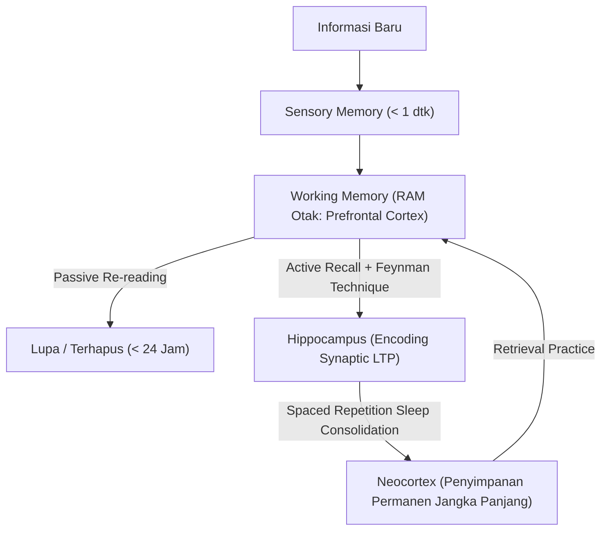

# Modul 001: Meta-Learning & Kognisi Belajar (Spaced Repetition, Feynman Technique, Retensi Memori)

**Navigasi**: [⬅️ Master Index](../../INDEX.md) | [Tingkat 0: Tingkat 0: Fondasi Kognitif, Logika Murni & Berpikir Ilmiah](./README.md)
*Sebelumnya*: *Awal Kurikulum* | *Berikutnya*: [002. first-principles-thinking](./002-first-principles-thinking.md)

---

## 1. Intuisi Dasar Tanpa Jargon ("Seperti Bayi Baru Lahir")
### 1.1 Konsep Inti & Analogi Tanpa Jargon
Bayangkan otak Anda seperti sebuah komputer dengan RAM terbatas (Working Memory: 4-7 bongkah informasi) dan hard drive raksasa (Long-Term Memory). Ketika Anda hanya membaca ulang buku (*passive reading*) atau menandai teks dengan stabilo (*highlighting*), Anda hanya meletakkan informasi di RAM sementara. Tanpa proses pemindahan terstruktur, 80% informasi tersebut akan terhapus dalam waktu kurang dari 24 jam (Kurva Lupa Ebbinghaus).

### 1.2 Urgensi Rekayasa & Signifikansi Sistemik
Meta-learning adalah sains merancang "BIOS dan algoritma kompresi data" untuk otak Anda. Alih-alih belajar secara acak, Anda menggunakan **Active Recall** (memaksa otak menarik data dari ketiadaan) dan **Spaced Repetition** (mengulang tepat saat memori hampir pudar) sehingga sinapsis saraf mengalami *Long-Term Potentiation (LTP)* permanen.

## 2. Fondasi Teoretis & Aksiomatik / Matematis
### 2.1 Kerangka Teori Aksiomatik & Formulasi Matematis
### 1. Kurva Retensi Memori Ebbinghaus & Spaced Repetition
Retensi memori dimodelkan secara matematis dengan fungsi eksponensial negatif:
$$R(t) = e^{-\frac{t}{S}}$$
Di mana:
- $R(t)$ adalah probabilitas mengingat (*retrieval probability*) pada interval waktu $t$.
- $S$ adalah stabilitas memori (*memory stability*), yang melonjak setiap kali proses penarikan aktif (*active retrieval*) berhasil dilakukan tepat saat $R(t) \approx 0.90$:
$$S_{n+1} = S_n \cdot (1 + a \cdot e^{-b \cdot R})$$

### 2.2 Penurunan Matematis Langkah-demi-Langkah
### 2. Algoritma SM-2 (SuperMemo-2)
Perhitungan interval hari pengulangan $I(n)$ dan faktor kemudahan (*Ease Factor* $EF$):
$$EF' = EF + (0.1 - (5 - q) \cdot (0.08 + (5 - q) \cdot 0.02)), \quad EF' \ge 1.3$$
$$I(1) = 1, \quad I(2) = 6, \quad I(n) = I(n-1) \times EF'$$
Di mana $q \in [0, 5]$ adalah nilai kualitas penarikan memori pengguna.
[📚 Pelajari Teori SM-2: SuperMemo Official Algorithm](https://www.supermemo.com/en/blog/application-of-a-computer-to-improve-the-results-of-obtaining-photographic-memory)

## 3. Anatomi Teknis & Cara Kerja Internal

Proses *Long-Term Potentiation (LTP)* melibatkan aktivasi reseptor NMDA post-sinaptik akibat ion kalsium $Ca^{2+}$, memicu kaskade enzim CaMKII yang menanamkan lebih banyak reseptor AMPA pada membran sinaptik, membuat jalur neuron tersebut semakin konduktif dan permanen.

#### Tabel Penelusuran Transisi Kognitif & Konsolidasi Memori (Spaced Repetition)
| Langkah / Tahap Kognitif | Komponen / Struktur Mental | Input / Bukti Empiris | Operasi Logika & Transisi State | Status Representasi / Memori | Status Output / Kesimpulan Valid |
|---|---|---|---|---|---|
| Inisialisasi T+0 | Encoding Awal | Konsep baru diterima panca indra | Pembentukan jejak memori awal via sinapsis hipokampus | $R(0) = 1.0, S = 1.0$ (Stabilitas awal) | Pemahaman awal terbentuk pada memori kerja |
| Hari T+1 (Uji 1) | Pembusukan Ebbinghaus | $t = 1\text{ hari}$, tanpa recall | Evaluasi kurva retensi: $R(1) = e^{-1/1} \approx 0.368$ | Memori memudar, batas ambang recall terancam | Sinyal peringatan: perlu intervensi aktif recall |
| Hari T+1 (Recall) | Feynman Active Retrieval | Pertanyaan diagnostik tanpa melihat catatan | Rekonstruksi mandiri konsep dalam analogi sederhana | Lonjakan stabilitas: $S_{new} = S \cdot (1 + a \cdot e^{-b R})$ | Penguatan Long-Term Potentiation (LTP) sinaptik |
| Hari T+3 (Uji 2) | Spaced Interval Expansion | $t = 3\text{ hari}$ pasca review 1 | Evaluasi interval eksponensial baru: $I_2 = I_1 \cdot EF$ | $R(3) \ge 0.88, S = 4.2$ | Retensi stabil, transfer ke neokorteks jangka panjang |
| Hari T+7 (Audit) | Metakognisi & Kalibrasi | Uji transfer pada domain masalah baru | Identifikasi blind spot penalaran (*illusion of explanatory depth*) | Peta mental terkalibrasi tanpa ilusi kompetensi | Penguasaan konsep terverifikasi secara empiris |

## 4. Implementasi Praktis & Kode / Simulasi Riil
```python
import math
from dataclasses import dataclass

@dataclass
class FlashcardReview:
    repetition: int
    interval_days: float
    ease_factor: float

def calculate_sm2(quality: int, card: FlashcardReview) -> FlashcardReview:
    """
    Implementasi murni algoritma SuperMemo-2 (SM-2) untuk Spaced Repetition.
    quality: 0 (blackout total) s/d 5 (sempurna tanpa jeda)
    """
    if not (0 <= quality <= 5):
        raise ValueError("Skor kualitas harus antara 0 dan 5.")
        
    new_ef = card.ease_factor + (0.1 - (5 - quality) * (0.08 + (5 - quality) * 0.02))
    new_ef = max(1.3, new_ef)
    
    if quality < 3:
        return FlashcardReview(repetition=0, interval_days=1.0, ease_factor=new_ef)
    else:
        if card.repetition == 0:
            next_interval = 1.0
        elif card.repetition == 1:
            next_interval = 6.0
        else:
            next_interval = math.ceil(card.interval_days * new_ef)
            
        return FlashcardReview(
            repetition=card.repetition + 1,
            interval_days=next_interval,
            ease_factor=new_ef
        )

# Simulasi jadwal review
card = FlashcardReview(repetition=0, interval_days=1.0, ease_factor=2.5)
for day, score in enumerate([4, 5, 4, 5], 1):
    card = calculate_sm2(score, card)
    print(f"Review {day}: Nilai={score} -> Interval Berikutnya: {card.interval_days:.0f} hari (EF={card.ease_factor:.2f})")
```

## 5. Miskonsepsi & Jebakan Industri
1. **The Fluency Illusion**: Mengira sudah paham materi hanya karena teks atau video terasa familiar saat dibaca ulang.
2. **Cramming (Begadang Semalam Suntuk)**: Memadatkan 10 jam dalam 1 malam memicu memori dangkal yang hilang 85% dalam 72 jam karena tidak melewati siklus tidur REM untuk konsolidasi memori.
3. **Passive Highlighting**: Menggarisbawahi buku secara pasif tidak melatih jalur penarikan sinaptik (*retrieval pathways*).

### Studi Kasus Kegagalan Nyata: Kegagalan Falsifikasi Lobotomi Medis Walter Freeman (1940-an)
- **Kronologi & Konteks Sejarah**: Antara tahun 1936 hingga 1967, ahli saraf Walter Freeman melakukan sekitar 3.500 prosedur lobotomi transorbital (*icepick lobotomy*) di Amerika Serikat. Freeman mengklaim teknik ini menyembuhkan penyakit mental berat dengan memutuskan serat lobus frontal.
- **Akar Masalah Kognitif**: Freeman mengalami bias konfirmasi ekstrem (*confirmation bias*) dan ketiadaan metodologi falsifikasi. Pasien yang menjadi apatis, kehilangan kepribadian, atau vegetatif dilabeli sebagai 'sembuh dan tenang'. Tidak pernah ada uji klinis terkontrol acak (RCT) atau kelompok kontrol independen, mengacaukan pembiusan pasif dengan perbaikan kognitif riil.

- **Potongan Kode / Arsitektur Cacat (Vulnerable Implementation)**:
```python
# Simulasi Ebbinghaus Decay vs Spaced Repetition Memory Scheduling (SM-2 Model)
import math

class MemoryItem:
    def __init__(self, concept_name: str):
        self.concept_name = concept_name
        self.stability = 1.0  # Hari sebelum retensi drop ke 90%
        self.easiness_factor = 2.5
        self.repetition = 0

    def recall_probability(self, days_elapsed: float) -> float:
        # Kurva pembusukan Ebbinghaus: R(t) = exp(-t / S)
        return math.exp(-days_elapsed / self.stability)

    def review_feedback(self, grade: int):
        # Algoritma SuperMemo SM-2 asli untuk mitigasi ilusi kompetensi
        # grade: 0 (lupa total) s/d 5 (ingat sempurna tanpa ragu)
        assert 0 <= grade <= 5, "Grade harus bernilai 0..5"
        if grade >= 3:
            if self.repetition == 0:
                interval = 1.0
            elif self.repetition == 1:
                interval = 6.0
            else:
                interval = self.stability * self.easiness_factor
            self.repetition += 1
            self.stability = interval
        else:
            self.repetition = 0
            self.stability = 1.0

        # Update easiness factor
        self.easiness_factor = max(1.3, self.easiness_factor + (0.1 - (5 - grade) * (0.08 + (5 - grade) * 0.02)))
```

- **Analisis Epistemologis & Rekayasa Modern**: Tragedi Freeman mendasari standar ganda kedokteran modern: pembuktian ilmiah memerlukan hipotesis nol ($H_0$), eksperimen buta ganda (*double-blind*), dan metrik evaluasi objektif pra-eksperimen. Pada rekayasa perangkat lunak, bias ini setara dengan 'happy path testing'—mengasumsikan sistem andal hanya karena tidak melempar crash pada satu skenario sukses.

## 6. Proyek Latihan & Rubrik Penilaian Mandiri
### Level 1 (Dasar)
Ambil konsep teknis (misal: "Pointer C" atau "Hukum Ohm"), lalu jelaskan secara tertulis menggunakan analogi anak usia 10 tahun tanpa satu pun istilah teknis (Teknik Feynman).

### Level 2 (Menengah)
Bangun program CLI Python flashcard yang menyimpan status kartu ke file JSON dan menghitung interval hari berikutnya berdasarkan algoritma SM-2.

### Level 3 (Mahir)
Rancang arsitektur sistem manajemen pengetahuan pribadi (PKM) menggunakan Obsidian / Zettelkasten dengan prinsip keterhubungan dua arah (*bi-directional links*) dan integrasi audit pengujian harian otomatis.

### Tingkat 1: Dasar
- **Tugas**: Rancang program CLI pembelajaran aktif yang mengimplementasikan algoritma spaced repetition SuperMemo SM-2 untuk melacak retensi memori 10 kartu konsep.
- **Petunjuk Perancangan Arsitektur**:
  - Buat kelas `Flashcard` yang menyimpan parameter `repetition_count`, `easiness_factor` (default 2.5), dan `interval_days`.
  - Terapkan fungsi transisi state saat menerima skor metakognitif (0-5) dari pengguna.
- **Test Vector & Kasus Uji Ekstrem**:
  - *Masukan Normal*: Skor berturut-turut `[5, 4, 5]`.
  - *Keluaran yang Diharapkan*: `interval_days` berkembang dari `1` $\to$ `6` $\to$ `14.4` hari, `easiness_factor` $\ge 2.5$.
  - *Kasus Batas (Edge Case)*: Skor `0` (lupa total) setelah interval 60 hari. Interval wajib ter-reset ke `1.0` hari dan pengulangan kembali ke `0`.
- **Rubrik Penilaian Mandiri**: 40% Formula SM-2 Eksak Bebas Bug, 30% Penanganan Reset Interval pada Kegagalan Recall, 30% Kemandirian Kode Python Standard Library.

### Tingkat 2: Menengah
- **Tugas**: Kembangkan simulator simulasi kognitif yang membandingkan retensi 1.000 mahasiswa yang belajar via *massed practice* (cramming semalam) vs *distributed practice* (spaced repetition) selama rentang 180 hari.
- **Petunjuk Perancangan Arsitektur**:
  - Simulasikan pembusukan eksponensial $R(t) = e^{-t/S}$ harian untuk setiap konsep.
  - Tambahkan derau Gaussian $\mathcal{N}(0, 0.05)$ pada stabilitas untuk merefleksikan variabilitas biologis individu.
- **Test Vector & Kasus Uji Ekstrem**:
  - *Simulasi Beban*: 1.000 agen dengan 50 materi belajar selama 180 tick harian.
  - *Keluaran yang Diharapkan*: Pada hari ke-180, kelompok cramming memiliki rerata retensi $< 15\%$, kelompok spaced repetition mempertahankan retensi $> 80\%$.
  - *Kasus Batas*: Agen dengan tingkat lupa tinggi ($S_{base} = 0.5$); algoritma harus meningkatkan frekuensi pengulangan secara adaptif tanpa overflow loop.
- **Rubrik Penilaian Mandiri**: 40% Ketepatan Pemodelan Diferensial Retensi, 30% Kestabilan Komputasi Matriks NumPy, 30% Visualisasi Kurva Retensi Bersih.

### Tingkat 3: Mahir
- **Tugas**: Rancang mesin penalaran Feynman Technique yang memvalidasi penjelasan teknis terhadap pendeteksian jargon lingkaran (*circular definition detector*) menggunakan representasi graf konsep berarah (DAG).
- **Petunjuk Perancangan Arsitektur**:
  - Urai teks penjelasan menjadi graf ketergantungan semantik simpul-konsep.
  - Terapkan deteksi siklus Tarjan's Strongly Connected Components untuk mengidentifikasi apakah konsep $A$ dijelaskan menggunakan $B$ yang didefinisikan kembali via $A$.
- **Test Vector & Kasus Uji Ekstrem**:
  - *Masukan Uji*: Teks dengan definisi melingkar: *"Enkripsi adalah proses kriptografi yang mengamankan data dengan algoritma enkripsi"*.
  - *Keluaran yang Diharapkan*: Sistem mendeteksi siklus dependensi tertutup dan menolak penjelasan dengan mengembalikan path simpul yang berputar.
  - *Kasus Batas*: Input graf asiklik murni berkedalaman 20 lapis; sistem harus memvalidasi bahwa seluruh daun (*leaf nodes*) merujuk pada prinsip pertama dasar tanpa siklus.
- **Rubrik Penilaian Mandiri**: 40% Ketepatan Deteksi Siklus Graf Topological, 30% Ekstraksi Ketergantungan Entitas Bersih, 30% Dokumentasi Algoritma Deteksi Formal.

## 7. Rekomendasi Sumber Belajar Standar Emas
- [Buku Standar: Make It Stick - Peter C. Brown](https://www.hup.harvard.edu/books/9780674729018)
- [Kuliah Terbuka: Learning How to Learn - Dr. Barbara Oakley (Coursera/UC San Diego)](https://www.coursera.org/learn/learning-how-to-learn)
- [Paper Seminal: The Spacing Effect: A Case Study in the Failure to Apply the Results of Psychological Research - Frank N. Dempster (1988)](https://journals.sagepub.com/doi/10.3102/00346543058004627)
- [Software Open-Source: Anki Spaced Repetition Engine Documentation](https://faqs.ankiweb.net/what-algorithm-does-anki-use.html)

---
*Navigasi Cepat*: [Ke Tingkat 0](./README.md) | [Ke Master Index](../../INDEX.md) | *Sebelumnya*: *Awal Kurikulum* | *Berikutnya*: [002. first-principles-thinking](./002-first-principles-thinking.md)
