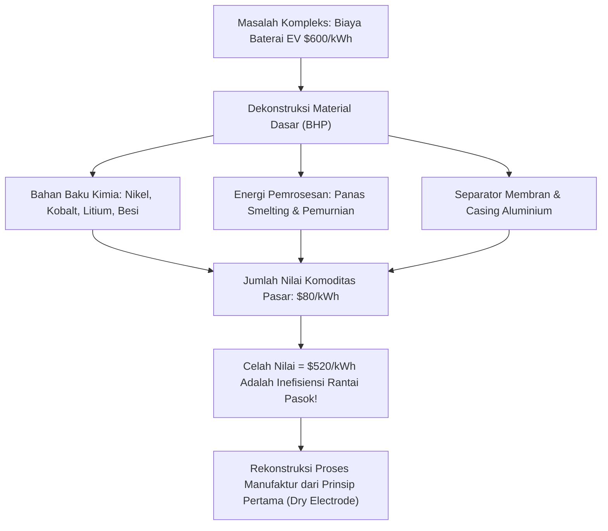

# Modul 002: First-Principles Thinking (Penalaran Prinsip Pertama & Dekonstruksi Masalah)

**Navigasi**: [⬅️ Master Index](../../INDEX.md) | [Tingkat 0: Tingkat 0: Fondasi Kognitif, Logika Murni & Berpikir Ilmiah](./README.md)
*Sebelumnya*: [001. meta-learning-kognisi](./001-meta-learning-kognisi.md) | *Berikutnya*: [003. systems-thinking](./003-systems-thinking.md)

---

## 1. Intuisi Dasar Tanpa Jargon ("Seperti Bayi Baru Lahir")
### 1.1 Konsep Inti & Analogi Tanpa Jargon
Bayangkan Anda ingin membuat kue bolu. Kebanyakan orang menggunakan 'penalaran dengan analogi': mereka melihat koki lain menggunakan tepung terigu merk X dan memanggang 30 menit, lalu menirunya tanpa paham alasannya. Jika tepung merk X habis, mereka panik dan berhenti.

### 1.2 Urgensi Rekayasa & Signifikansi Sistemik
Sebaliknya, **First-Principles Thinking (Penalaran Prinsip Pertama)** membongkar kue tersebut hingga ke level kimia dasar:
- Apa fungsi tepung? Menyediakan protein gluten untuk membentuk jaring penahan gas.
- Apa fungsi telur? Emulsifier (lesitin) dan protein koagulan saat panas.
- Apa fungsi ragi/baking powder? Menghasilkan gas $CO_2$.
- Apa fungsi panas? Denaturasi protein dan gelatinisasi pati.

Ketika Anda memahami hukum dasar termodinamika dan biokimiawi kue, Anda tidak terikat resep siapa pun. Anda bisa mengganti gandum dengan tepung almond + xanthan gum, atau mendesain roket SpaceX dari bahan baku baja mentah alih-alih membeli modul kedirgantaraan seharga jutaan dolar yang dijual kontraktor militer.
[📖 Pelajari: Feynman's First Principles Lecture](https://www.feynmanlectures.caltech.edu/)

## 2. Fondasi Teoretis & Aksiomatik / Matematis
### 2.1 Dekonstruksi Aksiomatik & Reduksi Cartesian ([Stanford Encyclopedia: Scientific Reduction](https://plato.stanford.edu/entries/scientific-reduction/))
Penalaran prinsip pertama memformalkan suatu masalah kompleks ke dalam graf dependensi terarah (DAG) aksioma dasar:
Setiap proposisi $P$ diuji keabsahannya dengan membuktikan bahwa $P$ diturunkan dari himpunan aksioma fundamental $\mathcal{A} = \{A_1, A_2, \dots, A_n\}$ melalui aturan inferensi valid $\vdash$:
$$\mathcal{A} \vdash P$$
Jika terdapat proposisi antara $Q$ yang dipercaya hanya karena konsensus sosial atau tradisi tanpa bukti $\mathcal{A} \vdash Q$, maka $Q$ diklasifikasikan sebagai *analogi spekulatif* dan harus dieliminasi.

### 2.2 Dekonstruksi Biaya dan Batas Fisika Landauer ([Landauer Limit Paper: IBM Journal](https://doi.org/10.1147/rd.53.0183))
Batas teoritis mutlak efisiensi suatu proses ditentukan oleh hukum kekekalan massa, energi, dan termodinamika. Batas disipasi energi minimum untuk menghapus 1 bit informasi pada suhu $T$:
$$E_{\min} = k_B T \ln 2$$
Di mana:
- $k_B = 1.380649 \times 10^{-23} \text{ J/K}$ (Konstanta Boltzmann)
- $T$ adalah suhu absolut dalam Kelvin.
Segala inefisiensi di atas $E_{\min}$ adalah murni masalah rekayasa teknik (*engineering artifact*), bukan batasan hukum alam.

## 3. Anatomi Teknis & Cara Kerja Internal

Proses internal first-principles thinking:
1. **Identifikasi Asumsi Terselubung**: Catat semua klaim yang dianggap 'fakta industri' yang belum pernah diuji secara empiris.
2. **Isolasi Batas Fisik/Matematis**: Turunkan batas atas teoritis (Teorema Carnot, Efisiensi Shannon, Batas Betz).
3. **Rekonstruksi Solusi Optimal**: Bangun kembali alur proses dari nol mutlak menuju batas teoritis tanpa memperdulikan kebiasaan industri yang berlaku saat ini.

#### Tabel Penelusuran Dekonstruksi Masalah (First-Principles Thinking)
| Langkah / Tahap Kognitif | Komponen / Struktur Mental | Input / Bukti Empiris | Operasi Logika & Transisi State | Status Representasi / Memori | Status Output / Kesimpulan Valid |
|---|---|---|---|---|---|
| Langkah 0: Dogma | Analogy Heuristic | "Paket baterai EV berharga $600/kWh dari supplier" | Menerima premis konvensional tanpa dekomposisi | Model mental bias pasar modal industri otomotif | Kesimpulan palsu: Mobil listrik mustahil murah |
| Langkah 1: Skeptisisme | Reduksi Premis | Harga pasar vs komposisi material | Pemisahan mark-up rantai pasok dari biaya fisika murni | Premis pasar dibatalkan | Fokus dialihkan ke tabel periodik unsur |
| Langkah 2: Dekonstruksi | Analisis Material | Logam spot LME: Nikel, Kobalt, Litium, Aluminium | Perhitungan massa atom dan stoikiometri per kWh energi | Berat per kWh: 0.8 kg Li, 4.5 kg Ni, 1.2 kg Co | Biaya bahan baku murni: ~$80/kWh |
| Langkah 3: Rekonstruksi | Sintesis Struktur | 6.831 sel komoditas laptop 18650 standar industri | Integrasi sel kecil dengan sirkulasi pendingin cair | Desain baterai modular terisolasi termal | Kelayakan termal dan proteksi runaway terbukti |
| Langkah 4: Validasi | Uji Prinsip Pertama | Estimasi pabrikasi skala Gigafactory | $C_{total} = C_{materials} + C_{energy} + C_{overhead}$ | Biaya riil: ~$110/kWh | Paradigma industri bergeser secara revolusioner |

## 4. Implementasi Praktis & Kode / Simulasi Riil
```python
def first_principles_cost_breakdown(market_price: float, raw_materials: dict[str, tuple[float, float]]) -> dict:
    """
    Menganalisis margin inefisiensi industri menggunakan first-principles deconstruction.
    raw_materials: {nama_elemen: (kuantitas_kg, harga_pasar_per_kg)}
    """
    total_material_cost = sum(qty * price for qty, price in raw_materials.values())
    inefficiency_overhead = market_price - total_material_cost
    reduction_potential_pct = (inefficiency_overhead / market_price) * 100.0
    
    return {
        "market_price": market_price,
        "fundamental_floor": total_material_cost,
        "overhead_waste": inefficiency_overhead,
        "potential_improvement_pct": reduction_potential_pct
    }

# Simulasi dekonstruksi biaya modul baterai LiFePO4 per kWh
battery_elements = {
    "Lithium Carbonate": (0.25, 14.50), # kg, $/kg
    "Iron Phosphate (FePO4)": (1.10, 2.20),
    "Graphite Anode": (0.85, 4.00),
    "Copper Foil": (0.60, 9.00),
    "Aluminum Casing": (0.50, 2.80),
    "Electrolyte & Separator": (0.40, 6.50)
}

result = first_principles_cost_breakdown(market_price=160.0, raw_materials=battery_elements)
print(f"Harga Pasar: ${result['market_price']}/kWh")
print(f"Batas Bawah Material: ${result['fundamental_floor']:.2f}/kWh")
print(f"Potensi Disrupsi Rekayasa: {result['potential_improvement_pct']:.1f}%")
```

## 5. Miskonsepsi & Jebakan Industri
1. **Analogy Masquerading as First Principles**: Mengutip 'best practice' Google atau Netflix sebagai prinsip pertama padahal itu adalah solusi spesifik konteks organisasi mereka.
2. **Infinite Regress Trap**: Menganalisis masalah bisnis perangkat lunak hingga ke level mekanika kuantum sub-atomik yang tidak relevan dengan tingkat abstraksi masalah.
3. **Mengabaikan Biaya Transisi & Gesekan Riil**: Mengasumsikan bahwa jika batas fisik memungkinkan penghematan 80%, maka implementasi dapat dilakukan instan tanpa memperhitungkan hukum termodinamika sekunder (keausan mekanis, kerugian resistansi internal).

### Studi Kasus Kegagalan Nyata: Bencana Rantai Pasok Baterai Kendaraan Listrik GM EV1 & Dekonstruksi First-Principles (1996)
- **Kronologi & Konteks Sejarah**: Pada 1996, General Motors meluncurkan EV1, mobil listrik komersial pertama era modern. Namun pada 2003, GM membatalkan seluruh program, menarik seluruh unit dari konsumen, dan menghancurkannya di gurun Arizona.
- **Akar Masalah Penalaran**: Manajemen GM bernalar berdasarkan analogi (*reasoning by analogy*): mereka mengasumsikan baterai asam-timbal dan NiMH harus dibeli dalam paket besar kustom dari vendor baterai militer/kedirgantaraan seharga $600+/kWh, menyimpulkan bahwa EV tidak akan pernah ekonomis. Tesla menolak analogi ini pada 2004, mendekonstruksi baterai ke tingkat harga spot unsur logam dasar di London Metal Exchange ($80/kWh), lalu merakit ribuan sel laptop silinder standar 18650.

- **Potongan Kode / Arsitektur Cacat (Vulnerable Implementation)**:
```python
# Analisis Biaya Prinsip Pertama vs Penalaran Analogi Konvensional
class FirstPrinciplesCostEngine:
    def __init__(self):
        # Harga spot komoditas pasar logam dasar (USD per kg)
        self.raw_material_spot_prices = {
            "lithium_carbonate": 16.5,  # USD/kg
            "nickel_class1": 18.2,       # USD/kg
            "cobalt": 32.0,              # USD/kg
            "aluminum": 2.4,             # USD/kg
            "copper": 8.8                # USD/kg
        }

    def compute_material_floor_cost(self, kwh_capacity: float, chemistry_weights: dict) -> float:
        # Menghitung batas bawah fisik biaya material (Physical Cost Floor)
        total_material_cost = 0.0
        for element, kg_per_kwh in chemistry_weights.items():
            price_per_kg = self.raw_material_spot_prices.get(element, 0.0)
            total_material_cost += kg_per_kwh * price_per_kg * kwh_capacity
        return total_material_cost

    def evaluate_assembly_efficiency(self, floor_cost: float, vendor_quote: float) -> float:
        # Rasio inefisiensi rantai pasok analogi vs prinsip pertama
        assert floor_cost > 0, "Batas bawah biaya material harus positif"
        return vendor_quote / floor_cost

# Bobot material per kWh baterai NMC-811
nmc811_kg_per_kwh = {
    "lithium_carbonate": 0.85,
    "nickel_class1": 4.10,
    "cobalt": 0.52,
    "aluminum": 1.80,
    "copper": 1.25
}
engine = FirstPrinciplesCostEngine()
floor = engine.compute_material_floor_cost(100.0, nmc811_kg_per_kwh)
# Floor cost ~ $10,500 untuk 100 kWh ($105/kWh) vs kutipan analogi $600/kWh ($60,000)
```

- **Analisis Forensik & Rekayasa Modern**: Kegagalan GM EV1 adalah kegagalan kognitif paradigma analogi. Dalam rekayasa perangkat lunak, jebakan serupa terjadi ketika arsitek memilih arsitektur 'karena Google atau Netflix menggunakannya' tanpa membedah apakah kendala matematis beban jaringan mereka sama. Berpikir dari prinsip pertama menuntut reduksi ke batasan termodinamika dan kompleksitas komputasional murni.

## 6. Proyek Latihan & Rubrik Penilaian Mandiri
### Tingkat 1 (Pemula) - Dekonstruksi Produk Komputasi
Pilihlah salah satu layanan komputasi cloud (misal: AWS S3 \$0.023/GB/bulan). Dekonstruksi harga ini ke harga fisik drive enterprise NVMe/HDD mentah, konsumsi listrik watt per drive, biaya pendinginan PUE datacenter, dan redundansi Reed-Solomon $8+4$. Hitung rasio markup biaya cloud.

### Tingkat 2 (Menengah) - Analisis Efisiensi Algoritma dari Prinsip Pertama
Diberikan sebuah algoritma sorting array $N$ elemen. Buktikan secara first principles informasi matematis mengapa perbandingan pairwise tidak akan pernah bisa melampaui batas $O(N \log N)$ (hubungkan dengan pohon keputusan biner dan permutasi $N!$).

### Tingkat 3 (Mahir) - Reduksi Kompleksitas Sistem Terdistribusi
Rancang arsitektur sistem pesan instan berskala 100 juta pengguna harian dari prinsip pertama batas jaringan: kecepatan cahaya di serat optik (\$200.000 \text{ km/s}$), latensi RTT antar benua (\$70 \text{ ms}$), dan batas memori RAM server per socket TCP. Tentukan secara matematis berapa server minimum mutlak yang dibutuhkan.

#### Rubrik Penilaian
- **40% Ketepatan Isolasi Aksioma**: Mampu memisahkan hukum alam/matematika dari sekadar konvensi masa lalu.
- **30% Ketelitian Kuantitatif**: Perhitungan berbasis angka riil dan satuan metrik SI yang konsisten.
- **30% Kelayakan Solusi Rekonstruksi**: Arsitektur baru yang diusulkan tidak melanggar hukum konservasi energi/informasi.

### Tingkat 1: Dasar
- **Tugas**: Buat program dekonstruksi pohon biaya rekursif yang memecah biaya komponen perangkat lunak/keras ke level atomik material/sumber daya terendah.
- **Petunjuk Perancangan Arsitektur**:
  - Bangun kelas `ComponentNode` dengan struktur pohon hierarkis (`children`).
  - Simpul daun (*leaf*) merepresentasikan elemen tak tereduksi (material fisik dasar, jam komputasi CPU, atau bandwidth jaringan).
- **Test Vector & Kasus Uji Ekstrem**:
  - *Masukan Normal*: Pohon 3-tingkat modul penyimpanan SSD (NAND Flash $\to$ Silikon Wafer, Controller $\to$ PCB Tembaga).
  - *Keluaran yang Diharapkan*: Perhitungan batas bawah biaya agregat dari bawah ke atas (*bottom-up physical floor*).
  - *Kasus Batas*: Siklus rekursif dalam dependensi anak; program harus memvalidasi invariant DAG dan melempar `ValueError` bila ada siklus.
- **Rubrik Penilaian Mandiri**: 40% Rekursi Bottom-Up Akurat, 30% Validasi Invariant DAG Anti-Siklus, 30% Struktur Kelas Bersih dan Modular.

### Tingkat 2: Menengah
- **Tugas**: Bangun mesin optimasi komputasi yang mengevaluasi apakah suatu fungsi aljabar lambat dapat didekonstruksi dari pemanggilan pustaka umum ke operasi bitwise / lookup table prinsip pertama.
- **Petunjuk Perancangan Arsitektur**:
  - Implementasikan algoritma Fast Inverse Square Root (`0x5f3759df`) vs `1.0 / math.sqrt(x)`.
  - Ukur siklus instruksi CPU rata-rata dan galat relatif presisi IEEE-754.
- **Test Vector & Kasus Uji Ekstrem**:
  - *Vektor Uji*: $x \in [0.001, 100000.0]$ dengan 10.000 sampel acak.
  - *Keluaran yang Diharapkan*: Galat relatif $\le 0.175\%$, kecepatan eksekusi meningkat drastis pada arsitektur target.
  - *Kasus Batas*: $x \le 0$ atau $x = \text{NaN}$; fungsi wajib menangani representasi denormalized float tanpa crash hardware trap.
- **Rubrik Penilaian Mandiri**: 40% Dekonstruksi Bitwise IEEE-754 Benar, 30% Analisis Galat Komparatif Rigor, 30% Benchmark Waktu Eksekusi Terisolasi.

### Tingkat 3: Mahir
- **Tugas**: Rancang sistem penilai arsitektur sistem terdistribusi yang memverifikasi apakah klaim throughput transaksi didukung oleh batasan fisik perangkat keras (hukum batas bandwidth I/O PCIe, kecepatan cahaya kabel serat optik, dan latensi DRAM).
- **Petunjuk Perancangan Arsitektur**:
  - Definisikan batasan fisik dasar: $c \approx 200\text{ km/ms}$ dalam serat optik, latensi akses DRAM $\approx 60\text{ ns}$, bandwidth bus NVMe $\approx 7\text{ GB/s}$.
  - Evaluasi proposal sistem: tolak arsitektur terdistribusi lintas-benua yang mengklaim latensi konsensus $< 5\text{ ms}$.
- **Test Vector & Kasus Uji Ekstrem**:
  - *Kasus Pelanggaran*: Klaim Raft konsensus 3 data center (New York, London, Tokyo) dengan latensi commit 2 ms.
  - *Keluaran yang Diharapkan*: Sistem memvalidasi pelanggaran batas fisika cahaya ($RTT > 120\text{ ms}$) dan mengeluarkan laporan sanggahan matematis eksak.
  - *Kasus Batas*: Batas toleransi jarak 0 (komputasi satu mesin memori bersama); sistem harus beralih ke batas latensi bus QPI/UPI.
- **Rubrik Penilaian Mandiri**: 40% Verifikasi Batasan Fisika Rigor, 30% Pemodelan RTT Geografis Eksak, 30% Laporan Diagnostik Otomatis Terperinci.

## 7. Rekomendasi Sumber Belajar Standar Emas
| Kategori | Judul Sumber & Tautan Langsung | Deskripsi Singkat |
|---|---|---|
| 📖 Buku Teks | [The Feynman Lectures on Physics](https://www.feynmanlectures.caltech.edu/) | Kuliah legendaris Richard Feynman membongkar fisika dari prinsip pertama. |
| 🎓 Kuliah Terbuka | [MIT OCW 18.06SC Linear Algebra & First Principles](https://ocw.mit.edu/courses/18-06sc-linear-algebra-fall-2011/) | Rekonstruksi geometri ruang dan aljabar matriks dari aksioma basis. |
| 🔬 Makalah Seminal | [Irreversibility and Heat Generation in the Computing Process (Landauer, 1961)](https://doi.org/10.1147/rd.53.0183) | Pembuktian batas termodinamika mutlak pada manipulasi informasi. |
| 💻 Lab Interaktif | [Desmos Graphing Scientific Tool](https://www.desmos.com/calculator) | Eksplorasi hubungan kurva fisis dan dekonstruksi fungsi polinomial. |

---
*Navigasi Cepat*: [Ke Tingkat 0](./README.md) | [Ke Master Index](../../INDEX.md) | *Sebelumnya*: [001. meta-learning-kognisi](./001-meta-learning-kognisi.md) | *Berikutnya*: [003. systems-thinking](./003-systems-thinking.md)
