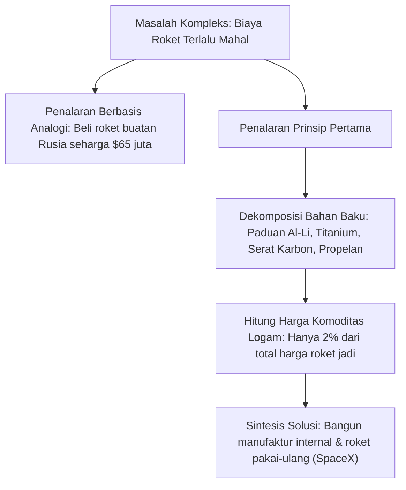

# Modul 002: First-Principles Thinking (Penalaran Prinsip Pertama & Dekonstruksi Masalah)

**Navigasi**: [⬅️ Master Index](../../INDEX.md) | [Tingkat 0: Tingkat 0: Fondasi Kognitif, Logika Murni & Berpikir Ilmiah](./README.md)
*Sebelumnya*: [001. meta-learning-kognisi](./001-meta-learning-kognisi.md) | *Berikutnya*: [003. systems-thinking](./003-systems-thinking.md)

---

## 1. Intuisi Dasar Tanpa Jargon ("Seperti Bayi Baru Lahir")
Bayangkan Anda ingin membuat mobil balap. Cara berpikir kebanyakan orang adalah melihat mobil yang sudah ada (Ferrari, Porsche) lalu meniru bentuknya dengan sedikit modifikasi warna atau bemper (penalaran analogi). 

Sebaliknya, **First-Principles Thinking (Penalaran Prinsip Pertama)** membongkar mobil itu hingga ke tingkat atom dan hukum fisika: Berapa berat material aluminium per kilogram? Berapa kapasitas pembakaran hidrokarbon atau densitas energi sel litium? Berapa koefisien gaya gesek ban terhadap aspal? Setelah Anda mendapatkan kebenaran paling dasar yang tidak dapat dibantah lagi, barulah Anda merakit ulang solusi baru yang jauh lebih efisien dari nol.

## 2. Fondasi Teoretis & Aksiomatik / Matematis
Prinsip pertama berakar dari epistemologi Aristoteles: *arche* (prinsip awal yang darinya suatu hal pertama kali diketahui dan tidak dapat dibuktikan dari prinsip lain yang lebih mendasar).

Secara metodologis, dekonstruksi masalah mengikuti langkah:
1. **Identifikasi Asumsi Terselubung**: Misalkan $A = \{a_1, a_2, \dots, a_n\}$ adalah himpunan klaim umum industri.
2. **Uji Reduksi**: Untuk setiap $a_i$, tanyakan: Apakah $a_i$ adalah hukum alam semesta (fisika/matematika) atau sekadar konvensi historis / tradisi sosial?
$$a_i \in \mathcal{L}_{fundamental} \quad \text{vs} \quad a_i \in \mathcal{C}_{konvensi}$$
3. **Formulasi Ulang**: Rekonstruksi solusi hanya menggunakan elemen dari $\mathcal{L}_{fundamental}$:
$$S_{baru} = f(\mathcal{L}_{fundamental})$$

## 3. Anatomi Teknis & Cara Kerja Internal


## 4. Implementasi Praktis & Kode / Simulasi Riil
```python
def first_principles_cost_audit(components: list[dict]) -> dict:
    """
    Dekonstruksi biaya produk menjadi bahan mentah fundamental vs markup proses industri.
    """
    raw_material_cost = sum(c['raw_cost'] * c['weight_kg'] for c in components)
    market_selling_price = sum(c['commercial_price'] for c in components)
    
    markup_factor = market_selling_price / max(1e-6, raw_material_cost)
    theoretical_savings = market_selling_price - raw_material_cost
    
    return {
        "total_raw_material_cost": raw_material_cost,
        "market_selling_price": market_selling_price,
        "markup_multiplier": round(markup_factor, 2),
        "theoretical_maximum_margin": round(theoretical_savings, 2)
    }

# Simulasi baterai pack industri
battery_bill_of_materials = [
    {"name": "Nickel", "weight_kg": 30, "raw_cost": 16.5, "commercial_price": 1200},
    {"name": "Cobalt", "weight_kg": 5, "raw_cost": 32.0, "commercial_price": 500},
    {"name": "Lithium Carbonate", "weight_kg": 12, "raw_cost": 14.0, "commercial_price": 900},
    {"name": "Aluminum Casings", "weight_kg": 40, "raw_cost": 2.4, "commercial_price": 450},
    {"name": "Electrolyte & Separator", "weight_kg": 15, "raw_cost": 8.0, "commercial_price": 600}
]

audit = first_principles_cost_audit(battery_bill_of_materials)
print("Analisis Prinsip Pertama Struktur Biaya Baterai:")
for k, v in audit.items():
    print(f" - {k}: {v}")
```

## 5. Miskonsepsi & Jebakan Industri
1. **Menghabiskan Energi untuk Hal Trivial**: Menerapkan penalaran prinsip pertama untuk memilih warna baju atau hal sepele hanya membuang waktu. Gunakan prinsip pertama hanya saat taruhannya tinggi (*high-stakes*) atau ada inefisiensi masif di industri.
2. **Mengabaikan Hukum Termodinamika & Fisika Nyata**: Mendekonstruksi sistem tanpa memperhitungkan batas efisiensi Carnot, disipasi panas, atau hambatan material.

## 6. Proyek Latihan & Rubrik Penilaian Mandiri
### Level 1 (Dasar)
Pilih satu teknologi yang Anda gunakan sehari-hari (misal: Cloud Storage). Dekonstruksi biaya dan komponen dasarnya: berapa harga disk mentah per TB vs berapa harga sewa bulanan penyedia cloud?

### Level 2 (Menengah)
Lakukan dekonstruksi arsitektur software web tradisional: Mengapa kita butuh relasional database, caching layer, dan frontend terpisah? Jika dimulai dari batas latency jaringan dan RAM vs NVMe, apa arsitektur paling sederhana yang bisa melayani 100.000 QPS?

### Level 3 (Mahir)
Tulis makalah teknis internal (RFC) dekonstruksi algoritma training neural network: Mengapa gradient descent butuh matriks perkalian besar di GPU? Mengapa tidak memakai bitwise operations atau photonic chips?

## 7. Rekomendasi Sumber Belajar Standar Emas
- Aristotle. *Posterior Analytics* (Buku I, Bagian 2).
- Musk, E. (2012). *Interview on First Principles and Physics Thinking*.
- Feynman, R. P. (1965). *The Character of Physical Law*. MIT Press.

---
*Navigasi Cepat*: [Ke Tingkat 0](./README.md) | [Ke Master Index](../../INDEX.md) | *Sebelumnya*: [001. meta-learning-kognisi](./001-meta-learning-kognisi.md) | *Berikutnya*: [003. systems-thinking](./003-systems-thinking.md)
