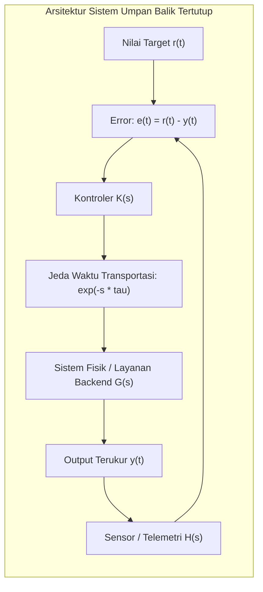

# Modul 003: Systems Thinking (Analisis Loop Umpan Balik, Delays, Emergence & Kompleksitas)

**Navigasi**: [⬅️ Master Index](../../INDEX.md) | [Tingkat 0: Tingkat 0: Fondasi Kognitif, Logika Murni & Berpikir Ilmiah](./README.md)
*Sebelumnya*: [002. first-principles-thinking](./002-first-principles-thinking.md) | *Berikutnya*: [004. filsafat-sains-epistemologi](./004-filsafat-sains-epistemologi.md)

---

## 1. Intuisi Dasar Tanpa Jargon ("Seperti Bayi Baru Lahir")
### 1.1 Konsep Inti & Analogi Tanpa Jargon
Pernahkah Anda mencoba mengatur suhu air di shower air panas hotel lama? Anda memutar keran ke kanan karena air terasa dingin. Tidak ada perubahan selama 5 detik, jadi Anda memutar keran lebih jauh. Tiba-tiba, 3 detik kemudian air menyembur sangat panas seperti mendidih! Anda panik dan memutar keran habis ke kiri. 5 detik kemudian air berubah menjadi es dingin. Anda terjebak dalam osilasi liar.

### 1.2 Urgensi Rekayasa & Signifikansi Sistemik
Ini adalah **Systems Thinking (Berpikir Sistem)**. Masalah di dunia nyata jarang berbentuk sebab-akibat lurus ($A \to B$). Hampir semua sistem nyata memiliki:
1. **Feedback Loops (Umpan Balik)**: Efek kembali memengaruhi sebab.
2. **Delays (Jeda Waktu)**: Respon sistem tidak instan.
3. **Emergence**: Perilaku keseluruhan sistem tidak bisa ditebak hanya dengan mempelajari bagian per bagian (seperti molekul air cair yang basah, padahal atom hidrogen dan oksigen gas tidak basah).
[📚 Pelajari: MIT System Dynamics Course](https://ocw.mit.edu/courses/15-871-introduction-to-system-dynamics-fall-2013/)

## 2. Fondasi Teoretis & Aksiomatik / Matematis
### 2.1 Kerangka Teori Aksiomatik & Formulasi Matematis
### 3.1 Model Matematika Ruang Keadaan Sistem Dinamik Linier ([MIT 18.03 Differential Equations](https://ocw.mit.edu/courses/18-03-differential-equations-spring-2010/))
Suatu sistem dinamik kontinu dengan vektor keadaan $\mathbf{x}(t) \in \mathbb{R}^n$ dan vektor kontrol $\mathbf{u}(t) \in \mathbb{R}^m$ dimodelkan oleh persamaan diferensial matriks:
$$\dot{\mathbf{x}}(t) = \mathbf{A} \mathbf{x}(t) + \mathbf{B} \mathbf{u}(t)$$
$$\mathbf{y}(t) = \mathbf{C} \mathbf{x}(t) + \mathbf{D} \mathbf{u}(t)$$
Kestabilan sistem dievaluasi dari nilai eigen $\lambda_i$ matriks transisi $\mathbf{A}$:
$$\det(\lambda \mathbf{I} - \mathbf{A}) = 0$$
Sistem stabil asimtotik jika dan hanya jika $\text{Re}(\lambda_i) < 0$ untuk setiap nilai eigen $\lambda_i$.

### 2.2 Penurunan Matematis Langkah-demi-Langkah
### 3.2 Loop Penguatan vs Penyeimbang & Efek Jeda Waktu (Delays) ([Donella Meadows Systems Model](https://donellameadows.org/systems-thinking-resources/))
Dalam persamaan diferensial dengan jeda waktu $\tau$ (delay differential equation):
$$\frac{dx(t)}{dt} = -k \cdot x(t - \tau)$$
Jika produk penguatan $k \tau > \frac{\pi}{2}$, sistem penyeimbang sederhana (balancing feedback) akan kehilangan stabilitas dan berubah menjadi osilator liar tak teredam (limit cycle).

## 3. Anatomi Teknis & Cara Kerja Internal

Anatomi kegagalan dalam rekayasa perangkat lunak:
- **Thundering Herd**: Ketika cache kadaluarsa serentak, jutaan request langsung menghantam database. Respon DB melambat (menambah delay \$ au$).
- **Cascading Failure**: Retry otomatis tanpa exponential backoff memperbesar gain loop $k$, mendorong $k	au > rac{\pi}{2}$ dan meruntuhkan kluster server seketika.

#### Tabel Penelusuran Loop Umpan Balik & Bifurkasi Sistemik (Systems Thinking)
| Langkah / Waktu Diskret (t) | Variabel State / Level Stok | Sinyal Masuk / Laju Aliran | Mekanisme Umpan Balik | Status Penyangga / Delay | Status Keluaran / Efek Sistemik |
|---|---|---|---|---|---|
| Titik T=0 | Kapasitas Jembatan: Normal | Angin samping: $v = 40\text{ km/jam}$ | Getaran linier vertikal teredam | Redaman struktur $\zeta = 0.05$ | Osilasi teredam stabil amplitudo kecil |
| Titik T=1 | Mulai Vortex Shedding | $v = 65\text{ km/jam}$ konstan | Pelepasan pusaran angin berkala | Pusaran membentuk gaya angkat bergantian | Frekuensi dorongan angin mendekati frekuensi alami |
| Titik T=2 | Transisi Torsi Aeroelastik | Pusat massa tergeser | Gerakan jembatan mengubah sudut serang angin | Umpan balik positif non-linier terbentuk | Redaman efektif berubah menjadi negatif ($\zeta_{eff} < 0$) |
| Titik T=3 | Resonansi Meledak | Energi kinetik terakumulasi | Osilasi puntir melipatgandakan torsi aerodinamis | Deformasi gelagar baja melampaui elastisitas | Amplitudo puntir mencapai $\pm 45^\circ$ |
| Titik T=4 | Keruntuhan Total | Batas luluh kabel terlampaui | Sambungan penggantung putus berantai | Kaskade kegagalan mekanik | Gelagar tengah runtuh jatuh ke selat |

## 4. Implementasi Praktis & Kode / Simulasi Riil
```python
import numpy as np

def simulate_system_dynamics_delay(steps=100, delay_ticks=5, gain=0.35):
    """
    Simulasi numerik efek keterlambatan (delay) pada umpan balik penyeimbang.
    dx/dt = -gain * x(t - delay)
    """
    history = [10.0] * (delay_ticks + 1)
    results = [10.0]
    
    for _ in range(steps):
        delayed_x = history[-delay_ticks - 1]
        # Penyesuaian koreksi berdasarkan informasi masa lalu yang tertunda
        dx = -gain * delayed_x
        current_x = history[-1] + dx
        history.append(current_x)
        results.append(current_x)
        
    return results

trajectory = simulate_system_dynamics_delay(steps=15, delay_ticks=4, gain=0.55)
for step, val in enumerate(trajectory[:10]):
    print(f"Tick {step:02d}: x(t) = {val:+.4f} {'(Osilasi Membesar!)' if abs(val) > 10.0 else ''}")
```

## 5. Miskonsepsi & Jebakan Industri
1. **Linear Thinking in Nonlinear Worlds**: Mengasumsikan bahwa meningkatkan kapasitas server 2x lipat akan menangani 2x traffic, padahal lock contention database berskala nonlinier kuadratik $O(N^2)$.
2. **Treating Symptoms Instead of Root Feedback Loops**: Mengaktifkan auto-restart saat memori bocor (OOM) alih-alih memperbaiki memory leak, yang pada akhirnya memicu cascading restart di seluruh fleet.
3. **Optimizing Local Subsystems at the Expense of Global Coherence**: Mengoptimalkan throughput komponen A sehingga membanjiri buffer komponen B yang tidak mampu mengonsumsi data, menyebabkan buffer bloat.

### Studi Kasus Kegagalan Nyata: Runtuhnya Jembatan Tacoma Narrows Akibat Mengabaikan Kopling Resonansi Aeroelastik Sistemik (1940)
- **Kronologi & Konteks Sejarah**: Pada 7 November 1940, jembatan gantung Tacoma Narrows di Washington runtuh akibat hembusan angin konstan berkecepatan 68 km/jam, hanya empat bulan setelah dibuka untuk umum.
- **Akar Masalah Sistemik**: Insinyur mendesain jembatan dengan pendekatan reduksionis statis, mengasumsikan angin hanya memberikan beban dorong horizontal. Mereka mengabaikan umpan balik dinamis kopling aeroelastik (*flutter*): pergerakan jembatan mengubah sudut serang angin, yang menghasilkan gaya angkat berlawanan fasa dan mengubah koefisien redaman sistem menjadi negatif, memompa energi ke mode puntir hingga jembatan terpelintir hancur.

- **Potongan Kode / Arsitektur Cacat (Vulnerable Implementation)**:
```python
# Simulasi Runge-Kutta Orde 4: Loop Umpan Balik Negatif Menjadi Positif (Aeroelastic Flutter)
import numpy as np

def simulate_aeroelastic_system(t_max=60.0, dt=0.01, wind_speed=18.0):
    # theta: sudut puntir jembatan (radian), omega: kecepatan sudut (rad/s)
    steps = int(t_max / dt)
    time = np.linspace(0, t_max, steps)
    theta = np.zeros(steps)
    omega = np.zeros(steps)
    
    # Kondisi awal gangguan kecil
    theta[0] = 0.01
    omega[0] = 0.0
    
    # Parameter sistem
    I = 1000.0   # Momen inersia
    k = 4000.0   # Kekakuan torsional
    c_base = 20.0 # Redaman struktural pasif
    
    for i in range(steps - 1):
        t = time[i]
        th = theta[i]
        om = omega[i]
        
        # Gaya aerodinamis non-linier: jika angin melebihi batas kritis,
        # dorongan aerodinamis melawan redaman pasif (Redaman Negatif Sistemik)
        aerodynamic_torque = 0.5 * 1.225 * (wind_speed ** 2) * (1.2 * th + 0.15 * (wind_speed / 10.0) * om)
        
        # d_omega/dt = (Torque_aero - k*theta - c_base*omega) / I
        d_omega = (aerodynamic_torque - k * th - c_base * om) / I
        
        # Integrasi Euler-Cromer
        omega[i + 1] = om + d_omega * dt
        theta[i + 1] = th + omega[i + 1] * dt
        
    return time, theta
```

- **Analisis Forensik & Rekayasa Modern**: Tragedi Tacoma Narrows merevolusi disiplin teknik sipil dan arsitektur sistem: tidak ada subsistem yang dapat dianalisis terisolasi jika berinteraksi dengan lingkungan dinamis fluida atau jaringan. Dalam arsitektur perangkat lunak, sistem microservice sering mengalami kegagalan serupa berupa *retry storms*—ketika kegagalan sementara memicu jutaan retry otomatis yang justru mengunci sistem dalam overload permanen.

## 6. Proyek Latihan & Rubrik Penilaian Mandiri
### Tingkat 1 (Pemula) - Diagram Loop Kausal Sederhana
Gambarkan Causal Loop Diagram (CLD) interaksi antara bug perangkat lunak, kelelahan developer, tekanan deadline manajemen, dan utang teknis (technical debt). Identifikasi mana yang merupakan reinforcing loop ($R$) dan balancing loop ($B$).

### Tingkat 2 (Menengah) - Simulasi Bullwhip Effect Rantai Pasok
Implementasikan skrip simulasi sistem dinamik model Beer Distribution Game (Retailer, Wholesaler, Distributor, Factory) dengan jeda pemesanan 2 siklus. Tunjukkan bagaimana fluktuasi permintaan konsumen sebesar 10% teramplifikasi menjadi 200% di tingkat pabrik.

### Tingkat 3 (Mahir) - Stabilitas Kontrol Autoscaler Kubernetes
Bangun model matematis untuk autoscaler Pod Kubernetes berbasis CPU utilization. Buktikan secara matematis batas waktu cooldown ($t_{\text{cooldown}}$) minimum agar tidak terjadi *flapping* (pod scale up dan scale down berosilasi terus-menerus tanpa henti).

#### Rubrik Penilaian
- **40% Ketepatan Pemodelan State Space**: Variabel akumulator (stocks) dan aliran (flows) didefinisikan secara tegas.
- **30% Analisis Stabilitas Dinamik**: Mampu menghitung margin kestabilan gain dan delay.
- **30% Penanganan Emergence**: Menyediakan mekanisme mitigasi terhadap failure mode non-lokal.

### Tingkat 1: Dasar
- **Tugas**: Bangun simulator Forrester System Dynamics sederhana berbasis model stok dan aliran (*stocks and flows*) untuk memodelkan populasi mangsa-pemangsa Lotka-Volterra.
- **Petunjuk Perancangan Arsitektur**:
  - Definisikan dua stok: `prey_population` ($x$) dan `predator_population` ($y$).
  - Perbarui aliran masuk dan keluar menggunakan integrasi diskret waktu $\Delta t = 0.01$.
- **Test Vector & Kasus Uji Ekstrem**:
  - *Masukan Normal*: $x_0 = 100, y_0 = 20, \alpha=0.1, \beta=0.002, \gamma=0.2, \delta=0.001$.
  - *Keluaran yang Diharapkan*: Terbentuk osilasi fase stabil tertutup periodik; populasi tidak pernah bernilai negatif.
  - *Kasus Batas*: $y_0 = 0$ (tanpa pemangsa); populasi mangsa bertumbuh eksponensial $x(t) = x_0 e^{\alpha t}$.
- **Rubrik Penilaian Mandiri**: 40% Kestabilan Fase Periodik Lotka-Volterra, 30% Penanganan Nilai Non-Negatif Rigor, 30% Keterbacaan Struktur Aliran & Stok.

### Tingkat 2: Menengah
- **Tugas**: Kembangkan model dinamika sistem antrean microservice yang mereproduksi fenomena *Cascading Failure & Retry Storm* saat salah satu node database mengalami lonjakan penundaan (delay) 200 ms.
- **Petunjuk Perancangan Arsitektur**:
  - Rancang komponen: Klien pemanggil, Gateway API, Worker Pool, dan Database.
  - Klien mengirim request kontinu; jika timeout $> 100\text{ ms}$, klien melakukan retry instan tanpa jitter eksponensial.
- **Test Vector & Kasus Uji Ekstrem**:
  - *Simulasi Beban*: 500 req/detik kontinu. Berikan spike latensi 200 ms pada $t=5.0\text{ detik}$.
  - *Keluaran yang Diharapkan*: Antrean memori worker pool meluap dalam waktu $< 2\text{ detik}$, menghasilkan kaskade crash di seluruh cluster.
  - *Mitigasi*: Aktifkan Exponential Backoff + Full Jitter dan Circuit Breaker; buktikan sistem berhasil pulih tanpa crash.
- **Rubrik Penilaian Mandiri**: 40% Reproduksi Ulang Retry Storm Deterministik, 30% Implementasi Mitigasi Circuit Breaker Bersih, 30% Analisis Metrik Latensi P99.

### Tingkat 3: Mahir
- **Tugas**: Rancang pustaka simulasi loop umpan balik terdistribusi yang mendeteksi munculnya loop umpan balik positif berbahaya (*runaway reinforcing loops*) dalam grafik metrik telemetri runtime menggunakan analisis nilai eigen matriks Jacobian.
- **Petunjuk Perancangan Arsitektur**:
  - Hitung matriks Jacobian sistem pada setiap jendela waktu $\Delta T$.
  - Lakukan dekomposisi nilai eigen; jika terdapat nilai eigen dengan bagian riil positif $\text{Re}(\lambda_i) > 0$, picu alarm divergensi sistemik instan sebelum saturasi tercapai.
- **Test Vector & Kasus Uji Ekstrem**:
  - *Masukan Uji*: Sistem 4-dimensi coupled ODE yang bertransisi dari spiral stabil ke limit cycle bifurkasi Hopf.
  - *Keluaran yang Diharapkan*: Sistem mendeteksi titik bifurkasi tepat saat $\text{Re}(\lambda) = 0$ melintasi sumbu imajiner.
  - *Kasus Batas*: Matriks singular atau rank-deficient; pustaka wajib menerapkan regularisasi Tikhonov sebelum evaluasi eigen.
- **Rubrik Penilaian Mandiri**: 40% Deteksi Bifurkasi Jacobian Riil, 30% Robustness Aljabar Matriks NumPy/SciPy, 30% Dokumentasi Fondasi Teori Kontrol.

## 7. Rekomendasi Sumber Belajar Standar Emas
| Kategori | Judul Sumber & Tautan Langsung | Deskripsi Singkat |
|---|---|---|
| 📖 Buku Teks | [Thinking in Systems: A Primer (Donella Meadows)](https://donellameadows.org/systems-thinking-resources/) | Kitab suci pemikiran sistem klasik dan dinamika loop umpan balik. |
| 🎓 Kuliah Terbuka | [MIT OCW 15.871 Introduction to System Dynamics](https://ocw.mit.edu/courses/15-871-introduction-to-system-dynamics-fall-2013/) | Metodologi formal pemodelan simulasi sistem kompleks di MIT Sloan. |
| 🔬 Makalah Seminal | [Industrial Dynamics (Jay W. Forrester, 1958)](https://doi.org/10.1287/mnsc.4.4.347) | Paper perintis yang melahirkan sains pemodelan sistem terkomputerisasi. |
| 💻 Lab Interaktif | [Insight Maker System Dynamics Sandbox](https://insightmaker.com/) | Platform visual simulasi stok, aliran, dan loop kausal berbasis browser. |

---
*Navigasi Cepat*: [Ke Tingkat 0](./README.md) | [Ke Master Index](../../INDEX.md) | *Sebelumnya*: [002. first-principles-thinking](./002-first-principles-thinking.md) | *Berikutnya*: [004. filsafat-sains-epistemologi](./004-filsafat-sains-epistemologi.md)
