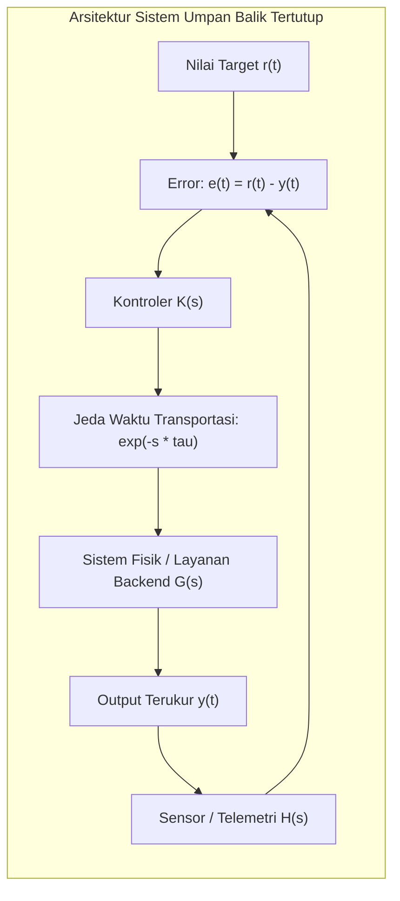

# Modul 003: Systems Thinking (Analisis Loop Umpan Balik, Delays, Emergence & Kompleksitas)

**Navigasi**: [⬅️ Master Index](../../INDEX.md) | [Tingkat 0: Tingkat 0: Fondasi Kognitif, Logika Murni & Berpikir Ilmiah](./README.md)
*Sebelumnya*: [002. first-principles-thinking](./002-first-principles-thinking.md) | *Berikutnya*: [004. filsafat-sains-epistemologi](./004-filsafat-sains-epistemologi.md)

---

## 1. Intuisi Dasar Tanpa Jargon ("Seperti Bayi Baru Lahir")
Pernahkah Anda mencoba mengatur suhu air di shower air panas hotel lama? Anda memutar keran ke kanan karena air terasa dingin. Tidak ada perubahan selama 5 detik, jadi Anda memutar keran lebih jauh. Tiba-tiba, 3 detik kemudian air menyembur sangat panas seperti mendidih! Anda panik dan memutar keran habis ke kiri. 5 detik kemudian air berubah menjadi es dingin. Anda terjebak dalam osilasi liar.

Ini adalah **Systems Thinking (Berpikir Sistem)**. Masalah di dunia nyata jarang berbentuk sebab-akibat lurus ($A \to B$). Hampir semua sistem nyata memiliki:
1. **Feedback Loops (Umpan Balik)**: Efek kembali memengaruhi sebab.
2. **Delays (Jeda Waktu)**: Respon sistem tidak instan.
3. **Emergence**: Perilaku keseluruhan sistem tidak bisa ditebak hanya dengan mempelajari bagian per bagian (seperti molekul air cair yang basah, padahal atom hidrogen dan oksigen gas tidak basah).
[📚 Pelajari: MIT System Dynamics Course](https://ocw.mit.edu/courses/15-871-introduction-to-system-dynamics-fall-2013/)

## 2. Fondasi Teoretis & Aksiomatik / Matematis
### 3.1 Model Matematika Ruang Keadaan Sistem Dinamik Linier ([MIT 18.03 Differential Equations](https://ocw.mit.edu/courses/18-03-differential-equations-spring-2010/))
Suatu sistem dinamik kontinu dengan vektor keadaan $\mathbf{x}(t) \in \mathbb{R}^n$ dan vektor kontrol $\mathbf{u}(t) \in \mathbb{R}^m$ dimodelkan oleh persamaan diferensial matriks:
$$\dot{\mathbf{x}}(t) = \mathbf{A} \mathbf{x}(t) + \mathbf{B} \mathbf{u}(t)$$
$$\mathbf{y}(t) = \mathbf{C} \mathbf{x}(t) + \mathbf{D} \mathbf{u}(t)$$
Kestabilan sistem dievaluasi dari nilai eigen $\lambda_i$ matriks transisi $\mathbf{A}$:
$$\det(\lambda \mathbf{I} - \mathbf{A}) = 0$$
Sistem stabil asimtotik jika dan hanya jika $\text{Re}(\lambda_i) < 0$ untuk setiap nilai eigen $\lambda_i$.

### 3.2 Loop Penguatan vs Penyeimbang & Efek Jeda Waktu (Delays) ([Donella Meadows Systems Model](https://donellameadows.org/systems-thinking-resources/))
Dalam persamaan diferensial dengan jeda waktu $\tau$ (delay differential equation):
$$\frac{dx(t)}{dt} = -k \cdot x(t - \tau)$$
Jika produk penguatan $k \tau > \frac{\pi}{2}$, sistem penyeimbang sederhana (balancing feedback) akan kehilangan stabilitas dan berubah menjadi osilator liar tak teredam (limit cycle).

## 3. Anatomi Teknis & Cara Kerja Internal

Anatomi kegagalan dalam rekayasa perangkat lunak:
- **Thundering Herd**: Ketika cache kadaluarsa serentak, jutaan request langsung menghantam database. Respon DB melambat (menambah delay $	au$).
- **Cascading Failure**: Retry otomatis tanpa exponential backoff memperbesar gain loop $k$, mendorong $k	au > rac{\pi}{2}$ dan meruntuhkan kluster server seketika.

## 4. Implementasi Praktis & Kode / Simulasi Riil
import numpy as np

def simulate_system_dynamics_delay(steps=100, delay_ticks=5, gain=0.35):
    """
    Simulasi numerik efek keterlambatan (delay) pada umpan balik penyeimbang.
    dx/dt = -gain * x(t - delay)
    """
    history = [10.0] * (delay_ticks + 1)
    results = [10.0]
    
    for _ in range(steps):
        delayed_x = history[-delay_ticks - 1]
        # Penyesuaian koreksi berdasarkan informasi masa lalu yang tertunda
        dx = -gain * delayed_x
        current_x = history[-1] + dx
        history.append(current_x)
        results.append(current_x)
        
    return results

trajectory = simulate_system_dynamics_delay(steps=15, delay_ticks=4, gain=0.55)
for step, val in enumerate(trajectory[:10]):
    print(f"Tick {step:02d}: x(t) = {val:+.4f} {'(Osilasi Membesar!)' if abs(val) > 10.0 else ''}")

## 5. Miskonsepsi & Jebakan Industri
1. **Linear Thinking in Nonlinear Worlds**: Mengasumsikan bahwa meningkatkan kapasitas server 2x lipat akan menangani 2x traffic, padahal lock contention database berskala nonlinier kuadratik $O(N^2)$.
2. **Treating Symptoms Instead of Root Feedback Loops**: Mengaktifkan auto-restart saat memori bocor (OOM) alih-alih memperbaiki memory leak, yang pada akhirnya memicu cascading restart di seluruh fleet.
3. **Optimizing Local Subsystems at the Expense of Global Coherence**: Mengoptimalkan throughput komponen A sehingga membanjiri buffer komponen B yang tidak mampu mengonsumsi data, menyebabkan buffer bloat.

## 6. Proyek Latihan & Rubrik Penilaian Mandiri
### Tingkat 1 (Pemula) - Diagram Loop Kausal Sederhana
Gambarkan Causal Loop Diagram (CLD) interaksi antara bug perangkat lunak, kelelahan developer, tekanan deadline manajemen, dan utang teknis (technical debt). Identifikasi mana yang merupakan reinforcing loop ($R$) dan balancing loop ($B$).

### Tingkat 2 (Menengah) - Simulasi Bullwhip Effect Rantai Pasok
Implementasikan skrip simulasi sistem dinamik model Beer Distribution Game (Retailer, Wholesaler, Distributor, Factory) dengan jeda pemesanan 2 siklus. Tunjukkan bagaimana fluktuasi permintaan konsumen sebesar 10% teramplifikasi menjadi 200% di tingkat pabrik.

### Tingkat 3 (Mahir) - Stabilitas Kontrol Autoscaler Kubernetes
Bangun model matematis untuk autoscaler Pod Kubernetes berbasis CPU utilization. Buktikan secara matematis batas waktu cooldown ($t_{\text{cooldown}}$) minimum agar tidak terjadi *flapping* (pod scale up dan scale down berosilasi terus-menerus tanpa henti).

#### Rubrik Penilaian
- **40% Ketepatan Pemodelan State Space**: Variabel akumulator (stocks) dan aliran (flows) didefinisikan secara tegas.
- **30% Analisis Stabilitas Dinamik**: Mampu menghitung margin kestabilan gain dan delay.
- **30% Penanganan Emergence**: Menyediakan mekanisme mitigasi terhadap failure mode non-lokal.

## 7. Rekomendasi Sumber Belajar Standar Emas
| Kategori | Judul Sumber & Tautan Langsung | Deskripsi Singkat |
|---|---|---|
| 📖 Buku Teks | [Thinking in Systems: A Primer (Donella Meadows)](https://donellameadows.org/systems-thinking-resources/) | Kitab suci pemikiran sistem klasik dan dinamika loop umpan balik. |
| 🎓 Kuliah Terbuka | [MIT OCW 15.871 Introduction to System Dynamics](https://ocw.mit.edu/courses/15-871-introduction-to-system-dynamics-fall-2013/) | Metodologi formal pemodelan simulasi sistem kompleks di MIT Sloan. |
| 🔬 Makalah Seminal | [Industrial Dynamics (Jay W. Forrester, 1958)](https://doi.org/10.1287/mnsc.4.4.347) | Paper perintis yang melahirkan sains pemodelan sistem terkomputerisasi. |
| 💻 Lab Interaktif | [Insight Maker System Dynamics Sandbox](https://insightmaker.com/) | Platform visual simulasi stok, aliran, dan loop kausal berbasis browser. |

---
*Navigasi Cepat*: [Ke Tingkat 0](./README.md) | [Ke Master Index](../../INDEX.md) | *Sebelumnya*: [002. first-principles-thinking](./002-first-principles-thinking.md) | *Berikutnya*: [004. filsafat-sains-epistemologi](./004-filsafat-sains-epistemologi.md)
