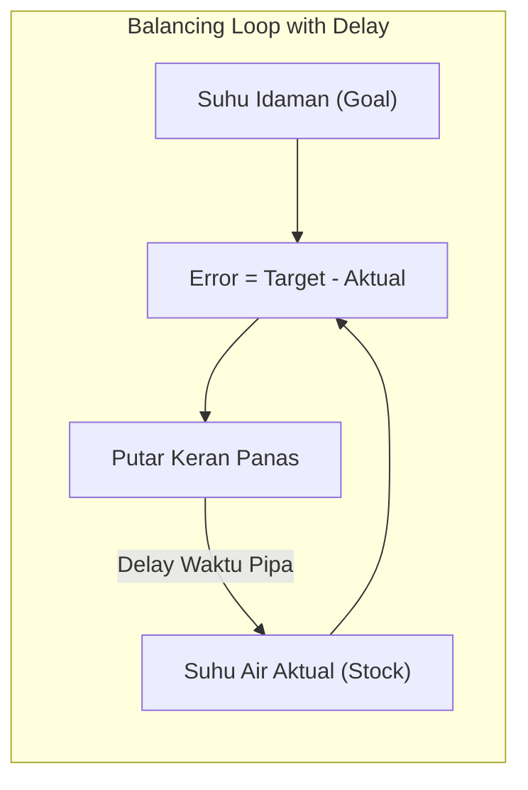

# Modul 003: Systems Thinking (Analisis Loop Umpan Balik, Delays, Emergence & Kompleksitas)

**Navigasi**: [⬅️ Master Index](../../INDEX.md) | [Tingkat 0: Tingkat 0: Fondasi Kognitif, Logika Murni & Berpikir Ilmiah](./README.md)
*Sebelumnya*: [002. first-principles-thinking](./002-first-principles-thinking.md) | *Berikutnya*: [004. filsafat-sains-epistemologi](./004-filsafat-sains-epistemologi.md)

---

## 1. Intuisi Dasar Tanpa Jargon ("Seperti Bayi Baru Lahir")
Ketika Anda menaikkan suhu pancuran air dingin, Anda memutar keran air panas. Karena pipa airnya panjang, air yang keluar masih dingin. Anda merasa kurang panas, jadi Anda memutar keran lebih jauh lagi. Lima detik kemudian, air mendidih keluar dan membakar kulit Anda! Anda panik dan memutar keran ke posisi paling dingin, hingga beberapa detik kemudian air menjadi es membeku.

Itulah **Systems Thinking**. Dunia nyata bukanlah garis lurus sebab-akibat sederhana ($A \to B$), melainkan jaringan melingkar yang memiliki *delay* (tundaan waktu), *feedback loops* (umpan balik penguat atau penyeimbang), dan *emergence* (sifat baru yang muncul dari interaksi komponen yang tidak dimiliki komponen individu).

## 2. Fondasi Teoretis & Aksiomatik / Matematis
Model sistem dinamik matematis dirumuskan sebagai sistem persamaan diferensial non-linier:
$$\frac{d\mathbf{x}}{dt} = \mathbf{f}(\mathbf{x}(t), \mathbf{u}(t), \boldsymbol{\theta})$$
Di mana:
- $\mathbf{x}(t) \in \mathbb{R}^n$ adalah vektor *stocks* (akumulasi status sistem, misalnya memori, populasi, modal).
- $\frac{d\mathbf{x}}{dt}$ adalah *flows* (laju perubahan: inflow dikurangi outflow).
- Feedback loop positif (reinforcing loop, $R$) ditandai dengan nilai eigen Jacobian $\lambda_i > 0$ yang memicu pertumbuhan eksponensial.
- Feedback loop negatif (balancing loop, $B$) ditandai dengan $\lambda_i < 0$ yang menghasilkan osilasi teredam atau kestabilan dinamis (*homeostasis*).

## 3. Anatomi Teknis & Cara Kerja Internal


## 4. Implementasi Praktis & Kode / Simulasi Riil
```python
import numpy as np

def simulate_shower_system(steps=60, delay_seconds=5, target_temp=40.0):
    """
    Simulasi sistem kontrol suhu pancuran air dengan feedback delay.
    """
    temp_history = [20.0] * (delay_seconds + 1)
    tap_setting = 20.0
    
    print(f"Target Suhu: {target_temp}°C | Delay Pipa: {delay_seconds} detik")
    print(f"{'Detik':<8}{'Setting Keran':<16}{'Suhu Keluar':<14}{'Status'}")
    
    for t in range(steps):
        # Suhu air yang keluar sekarang adalah akibat dari setting keran beberapa detik lalu
        current_temp = temp_history[-delay_seconds]
        error = target_temp - current_temp
        
        # Pengguna naif bereaksi secara proporsional terhadap error saat ini tanpa memperhitungkan delay
        tap_setting += 0.4 * error
        tap_setting = max(10.0, min(80.0, tap_setting))
        
        # Air baru mengalir ke pipa
        temp_history.append(tap_setting)
        
        if t % 5 == 0:
            status = "Stabil" if abs(error) < 1.0 else ("Terlalu Panas" if current_temp > target_temp else "Terlalu Dingin")
            print(f"{t:<8}{tap_setting:<16.1f}{current_temp:<14.1f}{status}")

simulate_shower_system()
```

## 5. Miskonsepsi & Jebakan Industri
1. **Linear Thinking in a Non-Linear World**: Memperbaiki kemacetan jalan raya dengan menambah jalur baru (Braess's Paradox: penambahan kapasitas justru menginduksi lebih banyak mobil sehingga kemacetan bertambah parah).
2. **Treating Symptoms Instead of Root Causes**: Memberikan obat penurun panas pada pasien infeksi bakteri tanpa memberikan antibiotik untuk membunuh sumber bakterinya.

## 6. Proyek Latihan & Rubrik Penilaian Mandiri
### Level 1 (Dasar)
Gambarkan diagram Causal Loop Diagram (CLD) untuk sistem "Cache Memory di Server Web": Tunjukkan hubungan antara *Cache Hit Ratio*, *Latency Database*, *Beban CPU*, dan *Kapasitas RAM*.

### Level 2 (Menengah)
Implementasikan simulasi predator-prey Lotka-Volterra menggunakan Python/NumPy untuk memodelkan interaksi dua populasi dengan osilasi siklus tertutup.

### Level 3 (Mahir)
Analisis fenomena *Cascading Failure* pada microservice architecture menggunakan model sistem dinamik: Tunjukkan bagaimana sebuah service lambat memicu thread exhaustion dan menumbangkan seluruh cluster.

## 7. Rekomendasi Sumber Belajar Standar Emas
- Meadows, D. H. (2008). *Thinking in Systems: A Primer*. Chelsea Green Publishing.
- Sterman, J. (2000). *Business Dynamics: Systems Thinking and Modeling for a Complex World*. McGraw-Hill.
- Senge, P. M. (1990). *The Fifth Discipline: The Art & Practice of The Learning Organization*. Doubleday.

---
*Navigasi Cepat*: [Ke Tingkat 0](./README.md) | [Ke Master Index](../../INDEX.md) | *Sebelumnya*: [002. first-principles-thinking](./002-first-principles-thinking.md) | *Berikutnya*: [004. filsafat-sains-epistemologi](./004-filsafat-sains-epistemologi.md)
