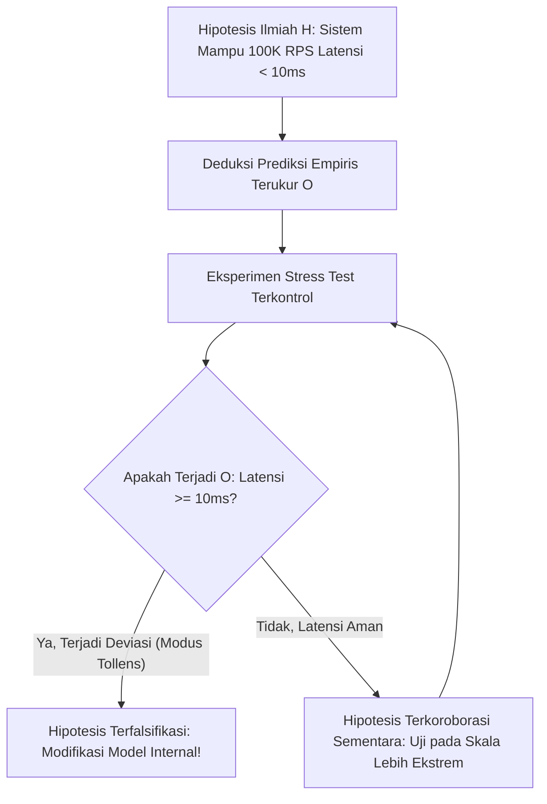

# Modul 004: Filsafat Sains & Epistemologi (Metode Ilmiah, Falsifikasi Popper & Batas Pengetahuan)

**Navigasi**: [⬅️ Master Index](../../INDEX.md) | [Tingkat 0: Tingkat 0: Fondasi Kognitif, Logika Murni & Berpikir Ilmiah](./README.md)
*Sebelumnya*: [003. systems-thinking](./003-systems-thinking.md) | *Berikutnya*: [005. logika-formal-teori-pembuktian](./005-logika-formal-teori-pembuktian.md)

---

## 1. Intuisi Dasar Tanpa Jargon ("Seperti Bayi Baru Lahir")
Bayangkan Anda tinggal di sebuah desa di mana semua angsa yang pernah dilihat warga berbulu putih. Warga desa membuat 'hukum alam': *Semua angsa di dunia berwarna putih*. Mereka telah mengamati 1.000 angsa putih berturut-turut. Setiap angsa putih baru yang ditemukan tampaknya 'membuktikan' teori mereka.

Namun pada tahun 1697, penjelajah berlayar ke Australia dan melihat seekor **Angsa Hitam (*Cygnus atratus*)**. Hanya dengan **satu pengamatan tunggal**, teori yang didukung 1.000 bukti hancur seketika!

Inilah inti **Filsafat Sains & Falsifikasi Karl Popper**:
1. Anda tidak akan pernah bisa membuktikan suatu teori ilmiah 100% benar secara absolut melalui induksi (karena Anda tidak bisa memeriksa seluruh alam semesta hingga akhir zaman).
2. Sebuah klaim hanya disebut **ilmiah** jika klaim tersebut memiliki syarat pembuktian salah (**falsifiable**).
3. Jika sebuah klaim tidak bisa diuji salah dalam skenario apa pun (misal: 'besok Anda mungkin beruntung atau tidak beruntung'), itu bukan sains, melainkan pseudosains atau dogma.
[📖 Pelajari: Karl Popper - The Logic of Scientific Discovery](https://plato.stanford.edu/entries/popper/)

## 2. Fondasi Teoretis & Aksiomatik / Matematis
### 4.1 Masalah Induksi David Hume ([Stanford: Problem of Induction](https://plato.stanford.edu/entries/induction-problem/))
Generalisasi induktif mengasumsikan keteraturan alam (Uniformity of Nature). Dari premis partikular:
$$\forall i \in \{1, \dots, N\}, \quad P(a_i) \text{ bernilai TRUE}$$
Induksi menarik kesimpulan universal:
$$\forall x, \quad P(x)$$
David Hume membuktikan bahwa penalaran ini sirkular: kita mempercayai induksi hanya karena di masa lalu induksi berhasil, yang merupakan penalaran induktif itu sendiri.

### 4.2 Kriteria Demarkasi & Asimetri Falsifikasi Popper ([Popper's Epistemology](https://plato.stanford.edu/entries/popper/))
Terdapat asimetri logis murni antara verifikasi dan falsifikasi dalam kalkulus predikat orde pertama:
- Sejuta pengamatan positif tidak dapat memvalidasi proposisi universal:
$$\neg \left[ \left( \bigwedge_{i=1}^N P(a_i) \right) \implies \forall x P(x) \right]$$
- Namun satu pengamatan kontra-contoh cukup untuk memfalsifikasi secara deduktif melalui *Modus Tollens*:
$$\frac{\forall x (T(x) \implies O(x)), \quad \exists k (T(k) \land \neg O(k))}{\therefore \neg \forall x (T(x) \implies O(x))}$$

### 4.3 Epistemologi Bayesian: Derajat Keyakinan Rasional ([MIT 18.650 Bayesian Inference](https://ocw.mit.edu/courses/18-650-statistics-for-applications-fall-2016/))
Alih-alih biner benar/salah, paradigma Bayesian memperbarui probabilitas hipotesis $H$ berdasarkan bukti baru $E$:
$$P(H \mid E) = \frac{P(E \mid H) P(H)}{P(E)}$$
Di mana $P(H)$ adalah keyakinan awal (*prior*), $P(E \mid H)$ adalah *likelihood*, dan $P(H \mid E)$ adalah keyakinan yang diperbarui (*posterior*).

## 3. Anatomi Teknis & Cara Kerja Internal

Siklus Metode Ilmiah Popperian:
1. Formulasi hipotesis yang berani (*bold hypothesis*) dengan ruang pengujian falsifikasi yang luas.
2. Desain eksperimen kejam (*severe test*) yang dirancang khusus untuk menjatuhkan hipotesis.
3. Teori yang lolos uji tidak disebut 'terbukti benar selamanya', melainkan **terkoroborasi** (*corroborated*) sampai eksperimen baru yang lebih presisi menggugurkannya.

## 4. Implementasi Praktis & Kode / Simulasi Riil
def bayesian_hypothesis_updater(prior: float, likelihood_if_true: float, likelihood_if_false: float) -> float:
    """
    Menghitung probabilitas posterior hipotesis berdasarkan bukti empiris baru.
    P(H|E) = (P(E|H) * P(H)) / [P(E|H)*P(H) + P(E|~H)*P(~H)]
    """
    marginal_evidence = (likelihood_if_true * prior) + (likelihood_if_false * (1.0 - prior))
    posterior = (likelihood_if_true * prior) / marginal_evidence
    return posterior

# Kasus: Hipotesis H = "Algoritma kompresi baru bebas bug memory corruption"
prior_belief = 0.50 # Skeptis awal 50-50

# Dijalankan pengujian fuzzing 10 juta input acak tanpa crash:
# P(NoCrash | BebasBug) = 1.0
# P(NoCrash | AdaBug) = 0.05 (sangat kecil kemungkinan bug lolos dari 10jt fuzzing)
updated_belief = bayesian_hypothesis_updater(prior=prior_belief, 
                                             likelihood_if_true=1.0, 
                                             likelihood_if_false=0.05)

print(f"Keyakinan Awal (Prior): {prior_belief * 100:.1f}%")
print(f"Keyakinan Pasca Fuzzing Berat (Posterior): {updated_belief * 100:.2f}%")

## 5. Miskonsepsi & Jebakan Industri
1. **Confirmation Bias**: Pengembang perangkat lunak hanya menulis unit test untuk *happy path* (masukan yang mereka tahu akan berhasil), alih-alih merancang test yang sengaja berusaha merusak sistem.
2. **Post-Hoc Rationalization**: Mengubah metrik keberhasilan atau menambah variabel ad-hoc setelah eksperimen gagal agar terlihat seolah-olah hipotesis semula berhasil.
3. **Pseudoscience of Non-reproducibility**: Mempublikasikan performa benchmark ML/Database tanpa merilis seed acak, konfigurasi hardware, dataset lengkap, dan skrip lingkungan.

## 6. Proyek Latihan & Rubrik Penilaian Mandiri
### Tingkat 1 (Pemula) - Audit Falsifiabilitas Pernyataan Teknis
Evaluasi 5 pernyataan arsitektur berikut: tentukan mana yang *falsifiable* dan mana yang tidak:
1. "Arsitektur microservices selalu lebih baik daripada monolit."
2. "Service X memiliki p99 latency di bawah 50ms untuk payload JSON berukuran < 10KB pada throughput 5.000 RPS."
3. "Kecerdasan Buatan Umum (AGI) akan muncul ketika sistem mencapai kesadaran kosmik."
4. "Database NoSQL ini memberikan konsistensi linearizable sesuai spesifikasi Jepsen testing."

### Tingkat 2 (Menengah) - Desain Severe Test untuk Cache Invalidation
Rancang skenario uji empiris berbasis *falsifikasi* untuk membuktikan kelemahan protokol cache invalidation terdistribusi berbasis TTL. Buat skrip stress testing jaringan yang mensimulasikan packet drop dan clock drift antar node.

### Tingkat 3 (Mahir) - Replikasi Krisis Sains dalam Benchmark AI
Ambil sebuah paper ML yang mengklaim metode barunya mengalahkan State-of-the-Art (SOTA). Lakukan pengujian saintifik independen dengan mengubah seed acak sebanyak 50 kali dan menguji pada data di luar domain (out-of-distribution). Analisis signifikansi statistik hasilnya menggunakan uji hipotesis Welch's t-test.

#### Rubrik Penilaian
- **40% Kriteria Falsifiabilitas**: Hipotesis dirumuskan dengan batasan kuantitatif yang jelas dan dapat digugurkan.
- **30% Kontrol Variabel Perancu (Confounding Variables)**: Mengisolasi variabel eksperimen dari noise lingkungan.
- **30% Integritas Replikasi**: Kode eksperimen bersifat deterministik, terbuka, dan dapat direproduksi oleh pihak ketiga.

## 7. Rekomendasi Sumber Belajar Standar Emas
| Kategori | Judul Sumber & Tautan Langsung | Deskripsi Singkat |
|---|---|---|
| 📖 Buku Teks | [The Logic of Scientific Discovery (Karl Popper)](https://plato.stanford.edu/entries/popper/) | Karya seminal filsafat sains abad ke-20 mengenai falsifikasi dan metode deduktif. |
| 🎓 Kuliah Terbuka | [MIT OCW 24.111 Philosophy of Science](https://ocw.mit.edu/courses/24-111-philosophy-of-science-spring-2016/) | Kuliah komprehensif epistemologi ilmiah, reduksi, dan struktur revolusi sains. |
| 🔬 Makalah Seminal | [Against Method (Paul Feyerabend, 1975)](https://www.marxists.org/reference/subject/philosophy/works/ge/feyerabe.htm) | Kritik radikal terhadap dogmatisme metode ilmiah monolitik. |
| 💻 Lab Interaktif | [Jepsen Distributed Systems Safety Analysis](https://jepsen.io/analyses) | Contoh nyata falsifikasi ilmiah praktis terhadap klaim konsistensi database modern. |

---
*Navigasi Cepat*: [Ke Tingkat 0](./README.md) | [Ke Master Index](../../INDEX.md) | *Sebelumnya*: [003. systems-thinking](./003-systems-thinking.md) | *Berikutnya*: [005. logika-formal-teori-pembuktian](./005-logika-formal-teori-pembuktian.md)
