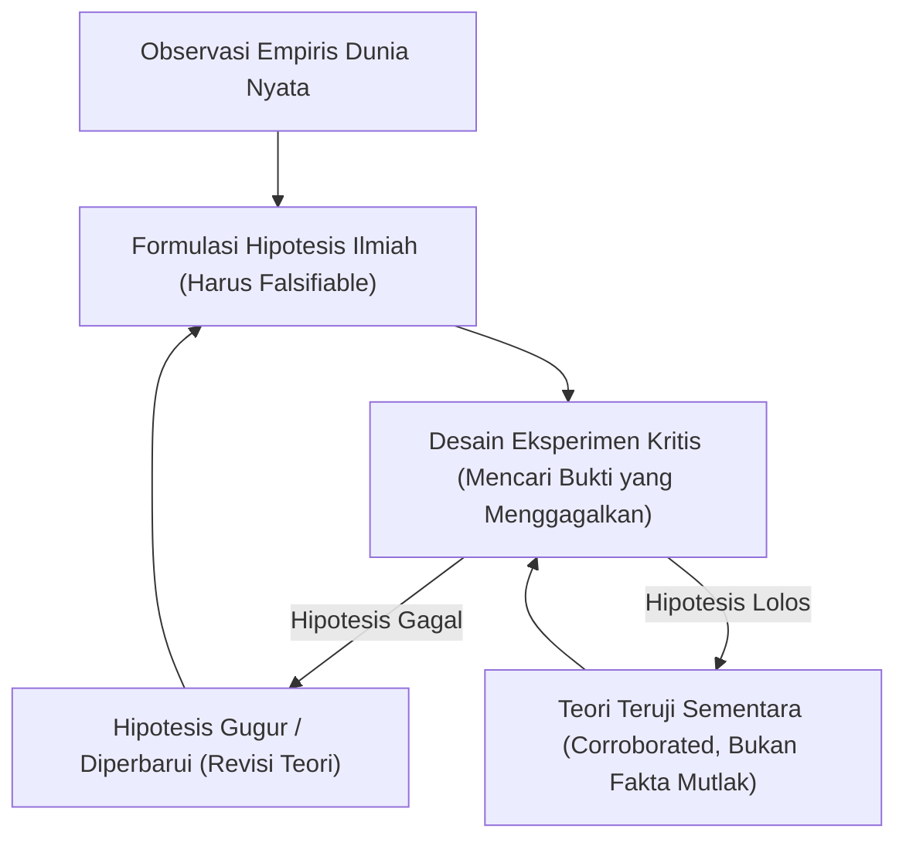

# Modul 004: Filsafat Sains & Epistemologi (Metode Ilmiah, Falsifikasi Popper & Batas Pengetahuan)

**Navigasi**: [⬅️ Master Index](../../INDEX.md) | [Tingkat 0: Tingkat 0: Fondasi Kognitif, Logika Murni & Berpikir Ilmiah](./README.md)
*Sebelumnya*: [003. systems-thinking](./003-systems-thinking.md) | *Berikutnya*: [005. logika-formal-teori-pembuktian](./005-logika-formal-teori-pembuktian.md)

---

## 1. Intuisi Dasar Tanpa Jargon ("Seperti Bayi Baru Lahir")
Bagaimana Anda tahu bahwa pernyataan "Semua angsa berwarna putih" adalah benar? Jika Anda melihat 10.000 angsa putih di Eropa, apakah itu membuktikan kebenaran absolut? Tidak! Cukup satu penemuan angsa hitam di Australia untuk menghancurkan seluruh teori tersebut.

Inilah inti dari **Filsafat Sains & Falsifikasi Karl Popper**: Sebuah teori ilmiah tidak pernah dapat "dibuktikan benar 100%" secara mutlak melalui verifikasi (induksi); ia hanya dapat dianggap sebagai penjelasan terbaik sementara yang *belum berhasil dibuktikan salah* (falsifikasi). Jika sebuah pernyataan tidak dapat diuji atau tidak memiliki skenario di mana ia bisa gagal, pernyataan tersebut bukanlah sains, melainkan dogma atau pseudosains.

## 2. Fondasi Teoretis & Aksiomatik / Matematis
### 1. Masalah Induksi (Hume's Problem)
Induksi menyimpulkan proposisi universal dari proposisi partikular:
$$\forall i \in \{1, \dots, N\}, P(x_i) \implies \forall x, P(x)$$
David Hume membuktikan bahwa inferensi ini secara logis tidak valid, tidak peduli seberapa besar nilai $N$.

### 2. Kriteria Demarkasi Karl Popper
Teori $T$ bersifat ilmiah jika dan hanya jika ruang kejadian pengamatan empiris $\Omega$ memuat himpunan bagian pengamatan potensial yang memalsukan $T$ ($F_T \neq \emptyset$):
$$\exists e \in \Omega \quad \text{sedemikian sehingga} \quad T \land e \vdash \bot$$

## 3. Anatomi Teknis & Cara Kerja Internal


## 4. Implementasi Praktis & Kode / Simulasi Riil
```python
import random

class HypothesisTester:
    """
    Simulasi prinsip falsifikasi Popper:
    Mencari counterexample untuk meruntuhkan klaim universal.
    """
    def __init__(self, rule_description, rule_fn):
        self.rule_description = rule_description
        self.rule_fn = rule_fn
        
    def test_falsifiability(self, test_generator, num_trials=10000):
        for trial in range(1, num_trials + 1):
            sample = test_generator()
            result = self.rule_fn(sample)
            if not result:
                return {
                    "falsified": True,
                    "counterexample": sample,
                    "trials_before_falsification": trial
                }
        return {
            "falsified": False,
            "counterexample": None,
            "trials_before_falsification": num_trials
        }

# Hipotesis Ilmiah: "Bilangan n^2 + n + 41 selalu menghasilkan bilangan prima untuk semua integer positif n"
# (Formula Euler klasik yang menghasilkan prima hingga n=39)
def is_prime(x):
    if x < 2: return False
    for i in range(2, int(x**0.5) + 1):
        if x % i == 0: return False
    return True

tester = HypothesisTester(
    "Euler Formula generates primes",
    lambda n: is_prime(n**2 + n + 41)
)

result = tester.test_falsifiability(lambda: random.randint(1, 100), num_trials=5000)
print(f"Hasil Pengujian Falsifikasi: {result}")
```

## 5. Miskonsepsi & Jebakan Industri
1. **Confirmation Bias**: Peneliti seringkali secara tidak sadar hanya mencari data atau metrik yang mendukung hipotesis mereka, dan mengabaikan data anomali yang membantahnya.
2. **Unfalsifiable Claims**: Membuat hipotesis yang memiliki "alasan cadangan" untuk setiap kemungkinan hasil (misalnya: "Sistem saya gagal karena energi kosmik yang tidak terdeteksi").

## 6. Proyek Latihan & Rubrik Penilaian Mandiri
### Level 1 (Dasar)
Ambil sebuah bug software yang baru-baru ini Anda temukan. Tuliskan hipotesis ilmiah mengapa bug tersebut terjadi, dan buat satu test case spesifik yang sengaja dirancang untuk memalsukan hipotesis Anda.

### Level 2 (Menengah)
Jelaskan perbedaan antara Epistemologi Bayesian (pembaruan probabilitas kepercayaan) vs Epistemologi Popperian (falsifikasi deduktif). Kapan Bayesian lebih unggul dalam machine learning?

### Level 3 (Mahir)
Analisis batas pengetahuan komputasi: Bagaimana Teorema Ketidaklengkapan Gödel dan Halting Problem Alan Turing menetapkan batas epistemologis fundamental pada apa yang dapat diketahui oleh matematika dan komputer.

## 7. Rekomendasi Sumber Belajar Standar Emas
- Popper, K. (1959). *The Logic of Scientific Discovery*. Routledge.
- Kuhn, T. S. (1962). *The Structure of Scientific Revolutions*. University of Chicago Press.
- Chalmers, A. F. (2013). *What Is This Thing Called Science?*. Hackett Publishing.

---
*Navigasi Cepat*: [Ke Tingkat 0](./README.md) | [Ke Master Index](../../INDEX.md) | *Sebelumnya*: [003. systems-thinking](./003-systems-thinking.md) | *Berikutnya*: [005. logika-formal-teori-pembuktian](./005-logika-formal-teori-pembuktian.md)
