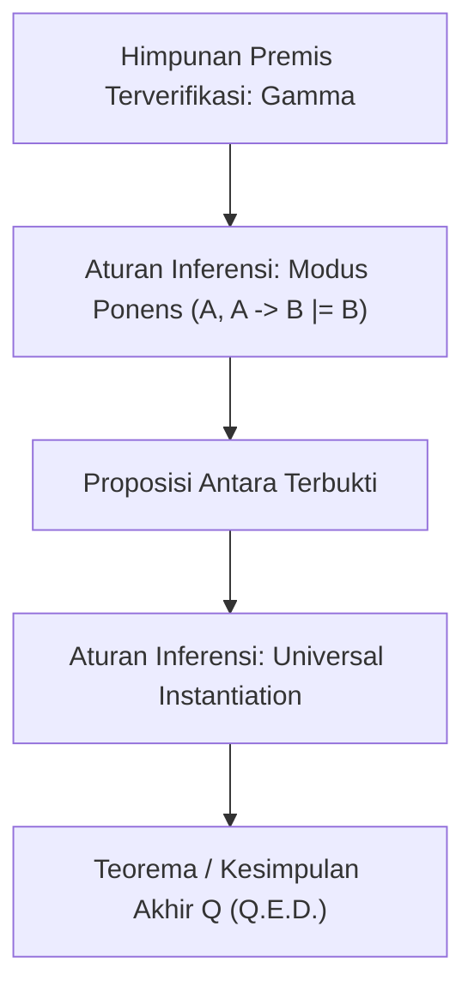

# Modul 005: Logika Formal & Teori Pembuktian (Logika Proposisional, Predikat, Deduksi, Induksi, Kontradiksi)

**Navigasi**: [⬅️ Master Index](../../INDEX.md) | [Tingkat 0: Tingkat 0: Fondasi Kognitif, Logika Murni & Berpikir Ilmiah](./README.md)
*Sebelumnya*: [004. filsafat-sains-epistemologi](./004-filsafat-sains-epistemologi.md) | *Berikutnya*: [006. teori-himpunan-dan-relasi](../01-fondasi-matematika/006-teori-himpunan-dan-relasi.md)

---

## 1. Intuisi Dasar Tanpa Jargon ("Seperti Bayi Baru Lahir")
### 1.1 Konsep Inti & Analogi Tanpa Jargon
Bayangkan seorang hakim di ruang sidang. Seorang jaksa berkata: "Terdakwa pasti pencuri, karena dia terlihat gugup dan kebanyakan pencuri itu gugup!" Hakim yang paham logika akan langsung menolak argumen tersebut karena itu adalah kesalahan berpikir *affirming the consequent*. Gugup bisa disebabkan oleh demam panggung, takut dituduh salah, atau kedinginan.

### 1.2 Urgensi Rekayasa & Signifikansi Sistemik
Dalam dunia komputer dan matematika, kita tidak boleh 'mengira-ngira'. Logika formal adalah **alat pemeriksa kebenaran mekanis**:
- Jika premisnya benar dan aturan penurunannya valid, maka kesimpulannya **dijamin 100% mutlak benar** di alam semesta mana pun!
- Semua compiler bahasa pemrograman, verifier keamanan kriptografi, hingga chip prosesor di dalam smartphone Anda dibangun di atas aturan logika formal ini.
[📚 Pelajari: MIT Logic Course](https://ocw.mit.edu/courses/24-241-logic-i-fall-2009/)

## 2. Fondasi Teoretis & Aksiomatik / Matematis
### 2.1 Kerangka Teori Aksiomatik & Formulasi Matematis
### 5.1 Logika Proposisional & Tabel Kebenaran ([Stanford CS103 Mathematical Foundations](https://web.stanford.edu/class/cs103/))
Bahasa formal proposisional didefinisikan secara rekursif atas himpunan variabel proposisional $P, Q, R$ dan perangkai logis:
- Negasi: $\neg P$
- Konjungsi: $P \land Q$
- Disjungsi: $P \lor Q$
- Implikasi Material: $P \implies Q \equiv \neg P \lor Q$
- Bi-implikasi: $P \iff Q \equiv (P \implies Q) \land (Q \implies P)$

### 2.2 Penurunan Matematis Langkah-demi-Langkah
### 5.2 Logika Predikat Orde Pertama (First-Order Logic / FOL) ([Open Logic Project](https://openlogicproject.net/))
Menambahkan domain diskursus, fungsi, relasi, dan kuantor:
- Kuantor Universal: $\forall x \, P(x)$ ("untuk setiap $x$, $P(x)$ berlaku")
- Kuantor Eksistensial: $\exists x \, P(x)$ ("terdapat setidaknya satu $x$ sehingga $P(x)$ berlaku")
Hukum De Morgan untuk kuantor:
$$\neg (\forall x \, P(x)) \iff \exists x \, (\neg P(x))$$
$$\neg (\exists x \, P(x)) \iff \forall x \, (\neg P(x))$$

### 5.3 Metode Pembuktian Matematis ([Book of Proof by Richard Hammack](https://www.people.vcu.edu/~rhammack/BookOfProof/))
1. **Bukti Langsung (Direct Proof)**: Asumsikan $P$, buktikan $Q$.
2. **Kontraposisi (Contrapositive)**: Membuktikan $P \implies Q$ melalui ekuivalensi logis $\neg Q \implies \neg P$.
3. **Kontradiksi (Reductio ad Absurdum)**: Asumsikan $P \land \neg Q$, turunkan kontradiksi mutlak $R \land \neg R \equiv \bot$.
4. **Induksi Matematika**:
   - Basis: Buktikan $P(0)$ benar.
   - Langkah Induktif: Buktikan $\forall k, (P(k) \implies P(k+1))$.
   - Kesimpulan: $\forall n \in \mathbb{N}, P(n)$ benar.

## 3. Anatomi Teknis & Cara Kerja Internal

Mekanisme pembuktian formal (Proof Assistant / SAT Solver):
- **SAT Solvers (DPLL / CDCL)**: Memeriksa apakah suatu formula proposisional dalam bentuk CNF (Conjunctive Normal Form) dapat dipuaskan (*satisfiable*).
- **Curry-Howard Isomorphism**: Korespodensi mendalam antara logika dan ilmu komputer: Proposisi $\equiv$ Tipe Data, Bukti Matematis $\equiv$ Program Komputer yang dapat dieksekusi.

#### Tabel Penelusuran Evaluasi Logika Orde Pertama & Resolusi Paradoks Russell
| Langkah / Tahap Deduksi | Struktur Kalimat / Proposisi | Premis / Aksioma Masukan | Operasi Unifikasi & Inferensi | Status Komprehensif Himpunan | Status Evaluasi / Kontradiksi |
|---|---|---|---|---|---|
| Langkah 0: Aksioma Naif | Skema Komprehensif Bebas | $\exists S, \forall x: x \in S \iff P(x)$ | Pembentukan himpunan dari predikat sembarang | Bebas tanpa pembatasan tipe semesta | Aksioma Frege diterima |
| Langkah 1: Konstruksi | Pembentukan Himpunan Russell | Predikat: $P(x) \equiv x \notin x$ | Definisikan himpunan $R = \{x \mid x \notin x\}$ | Objek $R$ diakui sebagai elemen himpunan legal | Himpunan anomali terbentuk |
| Langkah 2: Evaluasi $R \in R$ | Substitusi Kasus A | Asumsikan $R \in R$ bernilai Benar | Berdasarkan definisi: $R \in R \implies R \notin R$ | Kontradiksi langsung: Benar $\implies$ Salah | Kasus A runtuh |
| Langkah 3: Evaluasi $R \notin R$ | Substitusi Kasus B | Asumsikan $R \notin R$ bernilai Benar | Berdasarkan definisi: $R \notin R \implies R \in R$ | Kontradiksi langsung: Salah $\implies$ Benar | Kasus B runtuh |
| Langkah 4: Resolusi ZFC | Aksioma Pemisahan (*Aussonderung*) | Batasi komprehensif ke subset: $\{x \in A \mid P(x)\}$ | Russell Paradox mustahil terbentuk karena $R \notin R$ membuktikan $R$ bukan himpunan | Hirarki tipe ditegakkan | Ledakan logika (*Ex Falso Quodlibet*) dicegah |

## 4. Implementasi Praktis & Kode / Simulasi Riil
```python
def verify_modus_ponens(p: bool, p_implies_q: bool) -> bool:
    """
    Verifikasi mekanis aturan inferensi Modus Ponens:
    Premis 1: P
    Premis 2: P -> Q
    Konklusi: Q
    """
    # Mengingat (P -> Q) ekuivalen dengan (not P or Q)
    # Jika P True dan (P -> Q) True, maka Q harus True.
    assert p is True, "Premis P harus valid"
    assert p_implies_q is True, "Premis implikasi P -> Q harus valid"
    
    # Menemukan nilai kebenaran Q secara deduktif
    q = p and p_implies_q
    return q

# Verifikasi deduksi kebenaran
is_raining = True
rain_implies_wet_ground = True # Jika hujan, maka tanah basah

ground_is_wet = verify_modus_ponens(is_raining, rain_implies_wet_ground)
print(f"Status Kebenaran Deduktif Konklusi: Tanah Basah = {ground_is_wet}")
```

## 5. Miskonsepsi & Jebakan Industri
1. **Fallacy of Affirming the Consequent**: Menarik kesimpulan $P$ dari premis $(P \implies Q)$ dan $Q$. Contoh: "Jika hujan jalanan basah. Jalanan basah, jadi pasti hujan" (padahal bisa disiram mobil tangki).
2. **Fallacy of Denying the Antecedent**: Menarik kesimpulan $
eg Q$ dari premis $(P \implies Q)$ dan $
eg P$.
3. **Flawed Induction Base Case**: Melakukan pembuktian induktif dengan langkah implikasi $P(k) \implies P(k+1)$ yang benar tetapi dasar induksi $P(0)$ tidak valid, menghasilkan teorem palsu (misal paradoks "semua kuda memiliki warna sama").

### Studi Kasus Kegagalan Nyata: Krisis Fondasi Paradoks Russell pada Teori Himpunan Naif Frege (1901)
- **Kronologi & Konteks Sejarah**: Pada tahun 1902, matematikawan Jerman Gottlob Frege sedang menyelesaikan jilid kedua adikaryanya, *Grundgesetze der Arithmetik*, yang mendeduksi seluruh hukum matematika dari logika formal murni. Sebelum buku dicetak, Bertrand Russell mengirimkan surat singkat yang mendemonstrasikan paradoks fatal pada Aksioma V Frege.
- **Akar Masalah Logika**: Frege menggunakan skema komprehensif naif: untuk sembarang predikat $P(x)$, ada himpunan $\{x \mid P(x)\}$. Russell mengonstruksi $R = \{x \mid x 
otin x\}$. Jika $R \in R$, maka $R 
otin R$; jika $R 
otin R$, maka $R \in R$. Dalam logika klasik, adanya satu kontradiksi memicu prinsip ledakan (*Principle of Explosion / Ex Falso Quodlibet*), membuat sistem membuktikan klaim apa pun bernilai benar, meruntuhkan seluruh fondasi matematika Frege.

- **Potongan Kode / Arsitektur Cacat (Vulnerable Implementation)**:
```python
# Evaluator Logika Proposisional & Detektor Kontradiksi Russell
class PropositionalLogicEvaluator:
    def __init__(self):
        pass

    def evaluate_truth_table(self, formula_func, variables: list) -> dict:
        """
        Menghasilkan tabel kebenaran lengkap untuk memeriksa Tautologi atau Kontradiksi.
        """
        import itertools
        results = []
        is_tautology = True
        is_contradiction = True

        for values in itertools.product([False, True], repeat=len(variables)):
            env = dict(zip(variables, values))
            res = formula_func(env)
            results.append((env, res))
            if res:
                is_contradiction = False
            else:
                is_tautology = False

        return {
            "is_tautology": is_tautology,
            "is_contradiction": is_contradiction,
            "table": results
        }

# Demonstrasi Kontradiksi Russell: (R_in_R <==> not R_in_R) selalu False
def russell_paradox_statement(env):
    # env['R_in_R'] merepresentasikan proposisi R in R
    r = env['R_in_R']
    return (r and not r) or (not r and r)  # r <=> ~r ekuivalen kontradiksi mutlak

evaluator = PropositionalLogicEvaluator()
audit = evaluator.evaluate_truth_table(russell_paradox_statement, ['R_in_R'])
assert audit["is_contradiction"] is True, "Pernyataan Russell wajib terbukti kontradiksi mutlak!"
```

- **Analisis Logika & Dampak Komputasi**: Krisis Russell melahirkan Teori Tipe (*Type Theory*) oleh Russell-Whitehead dan Aksioma Zermelo-Fraenkel (ZFC). Dalam ilmu komputer, Teori Tipe adalah fondasi langsung dari sistem tipe pada kompilator bahasa modern (Rust, Haskell, TypeScript, Scala). Sistem tipe kompilator mencegah self-referential paradox serupa dengan melarang sebuah tipe memuat dirinya sendiri secara tak terikat tanpa pointer tak langsung (*infinite size struct indirection*).

## 6. Proyek Latihan & Rubrik Penilaian Mandiri
### Tingkat 1 (Pemula) - Konstruksi Tabel Kebenaran Formal
Buktikan menggunakan tabel kebenaran lengkap ($2^3 = 8$ baris) bahwa hukum distributif logika proposisional berlaku:
$$P \lor (Q \land R) \equiv (P \lor Q) \land (P \lor R)$$

### Tingkat 2 (Menengah) - Pembuktian Ketakhinggaan Bilangan Prima
Tuliskan pembuktian kontradiksi formal Euclid untuk membuktikan bahwa himpunan bilangan prima adalah tak hingga:
1. Asumsikan bilangan prima berhingga: $S = \{p_1, p_2, \dots, p_n\}$.
2. Konstruksi bilangan bulat $N = (p_1 	imes p_2 	imes \dots 	imes p_n) + 1$.
3. Buktikan secara deduktif bahwa $N$ memunculkan kontradiksi logis terhadap asumsi awal.

### Tingkat 3 (Mahir) - Pemecah Masalah Kepuasan Boolean (Mini-SAT Solver)
Implementasikan algoritma DPLL (Davis-Putnam-Logemann-Loveland) sederhana dalam Python yang menerima ekspresi logika dalam bentuk CNF dan mengembalikan penugasan variabel Boolean yang memuaskan atau menyatakan formula tidak dapat dipuaskan (UNSAT).

#### Rubrik Penilaian
- **40% Ketelitian Aksiomatik**: Tidak ada lompatan logika implisit atau pembuktian sirkular.
- **30% Ketepatan Penggunaan Kuantor**: Membedakan cakupan kuantor \$ orall x \exists y$ dengan $\exists y orall x$.
- **30% Validitas Algoritmik**: Implementasi DPLL mampu menangani unit propagation dan pure literal elimination secara benar.

### Tingkat 1: Dasar
- **Tugas**: Implementasikan parser ekspresi logika proposisional dan generator tabel kebenaran lengkap untuk variabel boolean $P, Q, R$.
- **Petunjuk Perancangan Arsitektur**:
  - Dukung operator logika standar: `AND` ($\land$), `OR` ($\lor$), `NOT` ($\neg$), `IMPLIES` ($\implies$), dan `IFF` ($\iff$).
  - Evaluasi ekspresi menggunakan pohon sintaks abstrak (AST) atau parsing Shunting-Yard.
- **Test Vector & Kasus Uji Ekstrem**:
  - *Hukum De Morgan*: `NOT (P AND Q)` dievaluasi terhadap `(NOT P) OR (NOT Q)`.
  - *Keluaran yang Diharapkan*: Seluruh $2^2 = 4$ baris tabel kebenaran menghasilkan nilai evaluasi identik (Tautologi Terverifikasi).
  - *Kasus Batas*: Ekspresi dengan tanda kurung bersarang dalam: `((P IMPLIES Q) AND (Q IMPLIES R)) IMPLIES (P IMPLIES R)` (Silogisme Hipotetis); wajib terbukti tautologi 100%.
- **Rubrik Penilaian Mandiri**: 40% Evaluasi Operator Boolean Eksak, 30% Parsing Tanda Kurung Bersarang Bebas Cacat, 30% Format Tampilan Tabel Bersih.

### Tingkat 2: Menengah
- **Tugas**: Bangun pemecah masalah kepuasan proposisional (SAT Solver) sederhana menggunakan algoritma Davis-Putnam-Logemann-Loveland (DPLL) pada formula dalam bentuk Conjunctive Normal Form (CNF).
- **Petunjuk Perancangan Arsitektur**:
  - Terapkan optimasi dasar DPLL: *Unit Propagation* dan *Pure Literal Elimination*.
  - Gunakan penelusuran rekursif dengan *backtracking* saat pencabangan tebakan nilai boolean.
- **Test Vector & Kasus Uji Ekstrem**:
  - *Masukan SAT*: Formula CNF 3-SAT sederhana yang dapat dipenuhi: `[[1, 2], [-1, 3], [-2, -3]]`.
  - *Keluaran yang Diharapkan*: Mengembalikan status `SATISFIABLE` beserta pemetaan variabel (misal `x1=True, x2=False, x3=True`).
  - *Masukan UNSAT*: Formula kontradiksi eksplisit: `[[1], [-1]]`. Solver harus mengembalikan `UNSATISFIABLE` seketika.
- **Rubrik Penilaian Mandiri**: 40% Implementasi Unit Propagation & DPLL Benar, 30% Backtracking Bersih Tanpa Memory Leak, 30% Ketepatan Deteksi SAT vs UNSAT.

### Tingkat 3: Mahir
- **Tugas**: Rancang mesin unifikasi resolusi logika orde pertama (*First-Order Logic Resolution Refutation Prover*) yang membuktikan keabsahan argumen silogisme formal.
- **Petunjuk Perancangan Arsitektur**:
  - Implementasikan algoritma unifikasi Robinson untuk menyelaraskan literal dengan variabel dan konstanta (`unify(P(x), P(Socrates))`).
  - Terapkan eliminasi implikasi, standarisasi variabel, skolemization, dan konversi ke Clause Form sebelum resolusi refutasi.
- **Test Vector & Kasus Uji Ekstrem**:
  - *Argumen Uji*: Premis 1: $\forall x (\text{Man}(x) \implies \text{Mortal}(x))$, Premis 2: $\text{Man}(\text{Socrates})$. Kesimpulan yang dinegasi: $\neg \text{Mortal}(\text{Socrates})$.
  - *Keluaran yang Diharapkan*: Prover menghasilkan klausa kosong (*empty clause* $\square$) melalui resolusi unifikasi, membuktikan argumen valid secara deduktif.
  - *Kasus Batas*: Siklus unifikasi tanpa batas (*Occurs Check failure*, misal mencoba menyelaraskan $x$ dengan $f(x)$); algoritma wajib menggagalkan unifikasi.
- **Rubrik Penilaian Mandiri**: 40% Algoritma Unifikasi Robinson Lengkap dengan Occurs Check, 30% Mesin Resolusi Refutasi Terbukti Memutus Klausa Kosong, 30% Kerapian Struktur Data Predikat & Term.

## 7. Rekomendasi Sumber Belajar Standar Emas
| Kategori | Judul Sumber & Tautan Langsung | Deskripsi Singkat |
|---|---|---|
| 📖 Buku Teks | [Book of Proof (Richard Hammack)](https://www.people.vcu.edu/~rhammack/BookOfProof/) | Panduan standar terbuka untuk metode pembuktian matematika formal. |
| 🎓 Kuliah Terbuka | [MIT OCW 24.241 Logic I](https://ocw.mit.edu/courses/24-241-logic-i-fall-2009/) | Kuliah logika formal proposisional, predikat, dan teori metateori logika. |
| 🔬 Makalah Seminal | [A Machine Program for Theorem-Proving (Davis, Logemann, Loveland, 1962)](https://doi.org/10.1145/368273.368557) | Makalah asli yang mendefinisikan algoritma CDCL/DPLL untuk SAT solving. |
| 💻 Lab Interaktif | [Logic Friday - Boolean Logic Analysis Tool](http://sontrak.com/) | Program visualisasi fungsi boolean, minimalisasi tabel kebenaran, dan gerbang. |

---
*Navigasi Cepat*: [Ke Tingkat 0](./README.md) | [Ke Master Index](../../INDEX.md) | *Sebelumnya*: [004. filsafat-sains-epistemologi](./004-filsafat-sains-epistemologi.md) | *Berikutnya*: [006. teori-himpunan-dan-relasi](../01-fondasi-matematika/006-teori-himpunan-dan-relasi.md)
