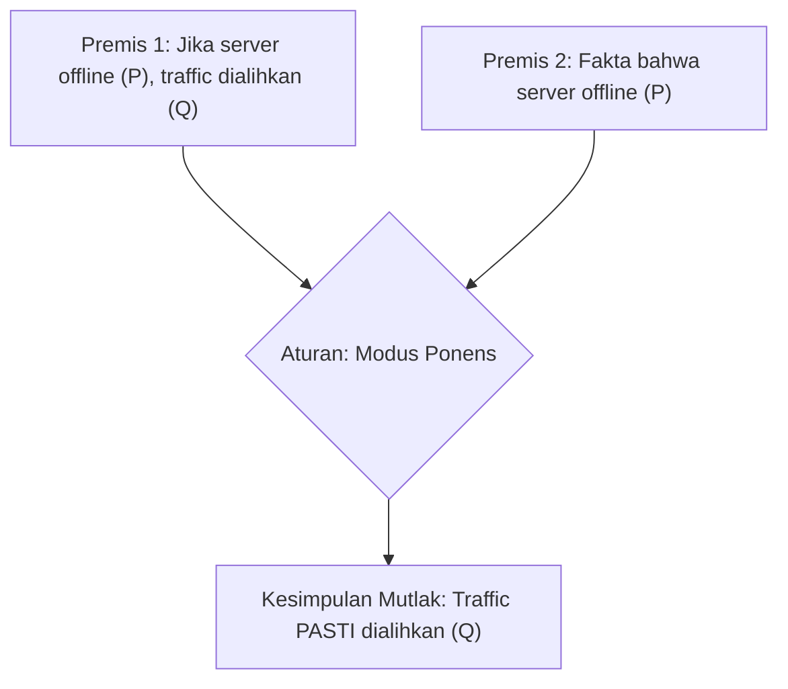

# Modul 005: Logika Formal & Teori Pembuktian (Logika Proposisional, Predikat, Deduksi, Induksi, Kontradiksi)

**Navigasi**: [⬅️ Master Index](../../INDEX.md) | [Tingkat 0: Tingkat 0: Fondasi Kognitif, Logika Murni & Berpikir Ilmiah](./README.md)
*Sebelumnya*: [004. filsafat-sains-epistemologi](./004-filsafat-sains-epistemologi.md) | *Berikutnya*: [006. teori-himpunan-dan-relasi](../01-fondasi-matematika/006-teori-himpunan-dan-relasi.md)

---

## 1. Intuisi Dasar Tanpa Jargon ("Seperti Bayi Baru Lahir")
Jika komputer Anda menerima perintah: "Hapus file jika nama file berawalan A dan berakhiran .tmp, ATAU jika pengguna adalah root", bagaimana komputer yakin tidak salah menghapus file penting? 

Komputer tidak menggunakan perasaan atau intuisi; ia menggunakan **Logika Formal**. Logika formal adalah bahasa matematika murni yang mengatur validitas penarikan kesimpulan. Dalam logika formal, kebenaran suatu kesimpulan tidak ditentukan oleh apakah topik pembicaraan terdengar bagus atau masuk akal, melainkan oleh *struktur aturan inferensi* yang tidak terbantahkan.

## 2. Fondasi Teoretis & Aksiomatik / Matematis
### 1. Logika Proposisional & Tabel Kebenaran
Proposisi adalah pernyataan deklaratif yang bernilai Benar ($T / 1$) atau Salah ($F / 0$).
Operasi dasar:
- Negasi: $\neg P$
- Konjungsi: $P \land Q$
- Disjungsi: $P \lor Q$
- Implikasi: $P \implies Q \equiv \neg P \lor Q$
- Bi-implikasi: $P \iff Q \equiv (P \implies Q) \land (Q \implies P)$

### 2. Aturan Inferensi Deduktif Klasik
- **Modus Ponens**:
  $$\frac{P, \quad P \implies Q}{\therefore Q}$$
- **Modus Tollens**:
  $$\frac{\neg Q, \quad P \implies Q}{\therefore \neg P}$$

### 3. Logika Predikat & Kuantor
- Kuantor Universal: $\forall x \in D, P(x)$
- Kuantor Eksistensial: $\exists x \in D, P(x)$
- Hukum De Morgan untuk Kuantor:
  $$\neg(\forall x, P(x)) \iff \exists x, \neg P(x)$$
  $$\neg(\exists x, P(x)) \iff \forall x, \neg P(x)$$

## 3. Anatomi Teknis & Cara Kerja Internal


## 4. Implementasi Praktis & Kode / Simulasi Riil
```python
def check_tautology(expr_fn, var_names):
    """
    Mengevaluasi apakah ekspresi logika proposisional adalah Tautologi (selalu bernilai True).
    """
    n = len(var_names)
    total_assignments = 1 << n
    
    for i in range(total_assignments):
        env = {}
        for j, name in enumerate(var_names):
            env[name] = bool((i >> j) & 1)
        
        result = expr_fn(env)
        if not result:
            return False, f"Batal pada assignment: {env}"
            
    return True, f"Tautologi Valid untuk seluruh {total_assignments} kombinasi!"

# Uji Hukum De Morgan: not (P and Q) == (not P or not Q)
is_valid, msg = check_tautology(
    lambda env: (not (env['P'] and env['Q'])) == (not env['P'] or not env['Q']),
    ['P', 'Q']
)
print("Verifikasi Hukum De Morgan:")
print(f"Status: {is_valid} | Pesan: {msg}")

# Uji Implikasi: (P implies Q) == (not P or Q)
is_valid_imp, msg_imp = check_tautology(
    lambda env: ((not env['P']) or env['Q']) == (not (env['P'] and not env['Q'])),
    ['P', 'Q']
)
print("
Verifikasi Kesetaraan Implikasi:")
print(f"Status: {is_valid_imp} | Pesan: {msg_imp}")
```

## 5. Miskonsepsi & Jebakan Industri
1. **Affirming the Consequent (Kekeliruan Menegaskan Akibat)**:
   - Premis: Jika hujan ($P$), jalanan basah ($Q$).
   - Fakta: Jalanan basah ($Q$).
   - Kesimpulan SALAH: Pasti hujan ($P$). (Bisa saja disiram air pemadam kebakaran!).
2. **Denying the Antecedent (Kekeliruan Menolak Sebab)**:
   - Premis: Jika hujan ($P$), jalanan basah ($Q$).
   - Fakta: Tidak hujan ($\neg P$).
   - Kesimpulan SALAH: Jalanan pasti tidak basah ($\neg Q$).

## 6. Proyek Latihan & Rubrik Penilaian Mandiri
### Level 1 (Dasar)
Buktikan menggunakan tabel kebenaran bahwa pernyataan kontrapositif $(P \implies Q) \iff (\neg Q \implies \neg P)$ bernilai benar untuk semua kemungkinan.

### Level 2 (Menengah)
Buktikan secara formal dengan metode Kontradiksi (*Reductio ad Absurdum*) bahwa $\sqrt{2}$ adalah bilangan irasional.

### Level 3 (Mahir)
Tulis Mini SAT Solver dalam Python (algoritma DPLL - Davis-Putnam-Logemann-Loveland) untuk menentukan satisfiability dari ekspresi Conjunctive Normal Form (CNF) 3 variabel.

## 7. Rekomendasi Sumber Belajar Standar Emas
- Enderton, H. B. (2001). *A Mathematical Introduction to Logic*. Academic Press.
- Rosen, K. H. (2019). *Discrete Mathematics and Its Applications*. McGraw-Hill.
- Russell, B., & Whitehead, A. N. (1910). *Principia Mathematica*. Cambridge University Press.

---
*Navigasi Cepat*: [Ke Tingkat 0](./README.md) | [Ke Master Index](../../INDEX.md) | *Sebelumnya*: [004. filsafat-sains-epistemologi](./004-filsafat-sains-epistemologi.md) | *Berikutnya*: [006. teori-himpunan-dan-relasi](../01-fondasi-matematika/006-teori-himpunan-dan-relasi.md)
