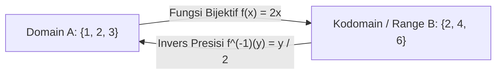

# Modul 006: Teori Himpunan & Hubungan (Set Theory, Relasi Ekuivalensi, Fungsi Bijektif)

**Navigasi**: [⬅️ Master Index](../../INDEX.md) | [Tingkat 1: Tingkat 1: Fondasi Matematika Komprehensif Dari Nol](./README.md)
*Sebelumnya*: [005. logika-formal-teori-pembuktian](../00-fondasi-kognitif-logika/005-logika-formal-teori-pembuktian.md) | *Berikutnya*: [007. pencacahan-sistem-bilangan-aritmatika](./007-pencacahan-sistem-bilangan-aritmatika.md)

---

## 1. Intuisi Dasar Tanpa Jargon ("Seperti Bayi Baru Lahir")
Bayangkan Anda memiliki kotak mainan. Anda ingin mengelompokkan mainan tersebut:
- Kelompok A: Mainan berwarna merah.
- Kelompok B: Mainan yang memiliki roda.

Apakah ada mainan yang masuk ke kedua kelompok? Ya, mobil balap merah! Itu disebut **Irisan (Intersection)**.
Apakah ada mainan yang masuk kelompok A atau B? Itu disebut **Gabungan (Union)**.

**Teori Himpunan (Set Theory)** adalah fondasi paling dasar dari seluruh matematika modern. Angka 0, 1, 2, garis lurus, matriks, fungsi komputer, dan database relasional SQL yang menyimpan saldo bank Anda, semuanya didefinisikan dari kumpulan objek tak berulang ini.
[📖 Pelajari: Stanford CS103 Mathematical Foundations](https://web.stanford.edu/class/cs103/)

## 2. Fondasi Teoretis & Aksiomatik / Matematis
### 6.1 Aksioma Zermelo-Fraenkel (ZFC) & Paradoks Russell ([Stanford: Set Theory](https://plato.stanford.edu/entries/set-theory/))
Paradoks Bertrand Russell menggugurkan teori himpunan naif: Jika $R = \{x \mid x \notin x\}$, apakah $R \in R$?
- Jika $R \in R$, maka menurut definisi $R \notin R$ (kontradiksi).
- Jika $R \notin R$, maka menurut definisi $R \in R$ (kontradiksi).
Solusi: Aksioma ZFC membatasi pembentukan himpunan melalui *Axiom of Specification* dan *Axiom of Foundation*.

### 6.2 Relasi & Sifat-Sifatnya ([Wolfram MathWorld: Equivalence Relation](https://mathworld.wolfram.com/EquivalenceRelation.html))
Relasi biner $R$ pada himpunan $A$ ($R \subseteq A \times A$) disebut **Relasi Ekuivalensi** ($\sim$) jika memenuhi tiga sifat:
1. **Refleksif**: $\forall x \in A, \, x \sim x$
2. **Simetris**: $\forall x, y \in A, \, x \sim y \implies y \sim x$
3. **Transitif**: $\forall x, y, z \in A, \, (x \sim y \land y \sim z) \implies x \sim z$
Relasi ekuivalensi mempartisi himpunan $A$ menjadi kelas-kelas ekuivalensi yang saling lepas (*disjoint partition*).

### 6.3 Karakteristik Fungsi: Injektif, Surjektif, Bijektif ([MIT 6.042J Mathematics for Computer Science](https://ocw.mit.edu/courses/6-042j-mathematics-for-computer-science-spring-2015/))
Untuk fungsi $f: A \to B$:
- **Injektif (Satu-ke-Satu)**: $\forall x_1, x_2 \in A, \, f(x_1) = f(x_2) \implies x_1 = x_2$
- **Surjektif (Pada / Onto)**: $\forall y \in B, \, \exists x \in A, \, f(x) = y$
- **Bijektif**: Memenuhi injektif dan surjektif sekaligus, menjamin adanya fungsi invers $f^{-1}: B \to A$.

## 3. Anatomi Teknis & Cara Kerja Internal

Struktur data himpunan di sistem komputer:
- **Hash Set**: Menggunakan hash table $O(1)$ amortized untuk lookup membership.
- **Bitset / Bit Array**: Operasi union ($\cup$) menggunakan bitwise OR (`|`), intersection ($\cap$) menggunakan bitwise AND (`&`), dieksekusi dalam 1 siklus clock CPU berkecepatan tinggi via instruksi SIMD.

## 4. Implementasi Praktis & Kode / Simulasi Riil
def set_theory_operations(set_a: set, set_b: set) -> dict:
    """
    Demonstrasi operasi teori himpunan fundamental.
    """
    return {
        "union (A | B)": set_a.union(set_b),
        "intersection (A & B)": set_a.intersection(set_b),
        "difference (A - B)": set_a.difference(set_b),
        "symmetric_diff (A ^ B)": set_a.symmetric_difference(set_b),
        "is_subset (A <= B)": set_a.issubset(set_b)
    }

a = {1, 2, 3, 4, 5}
b = {4, 5, 6, 7, 8}
ops = set_theory_operations(a, b)

print(f"Himpunan A: {a}")
print(f"Himpunan B: {b}")
print(f"Irisan (Intersection): {ops['intersection (A & B)']}")
print(f"Beda Simetris: {ops['symmetric_diff (A ^ B)']}")

## 5. Miskonsepsi & Jebakan Industri
1. **Confusing Subset with Element**: Mengira $A \subseteq B$ sama dengan $A \in B$. Himpunan $\{1\}$ adalah subset dari $\{1, 2\}$, tetapi $\{1\}$ bukan elemen dari $\{1, 2\}$.
2. **Assuming Hash Sets are Truly O(1)**: Mengabaikan hash collision attack di mana penyerang sengaja mengirim jutaan kunci dengan nilai hash sama, mereduksi kompleksitas himpunan dari $O(1)$ menjadi $O(N)$ dan melumpuhkan server web.
3. **Float Keys in Hash Sets**: Memasukkan bilangan pecahan floating point (`float`) ke dalam set/dict yang menghasilkan bug kritis karena pembulatan presisi IEEE 754 ($0.1 + 0.2 
eq 0.3$).

## 6. Proyek Latihan & Rubrik Penilaian Mandiri
### Tingkat 1 (Pemula) - Verifikasi Hukum De Morgan Himpunan
Tuliskan skrip Python yang memverifikasi bahwa untuk sembarang himpunan semesta $U$ dan dua subset $A, B \subseteq U$:
$$(A \cup B)^c = A^c \cap B^c \quad 	ext{dan} \quad (A \cap B)^c = A^c \cup B^c$$

### Tingkat 2 (Menengah) - Partisi Kelas Ekuivalensi Modular
Diberikan relasi ekuivalensi kongruensi modulo $m$ pada himpunan bilangan bulat $\mathbb{Z}$: $a \sim b \iff a \equiv b \pmod m$. Buktikan secara formal bahwa relasi ini refleksif, simetris, dan transitif, lalu bangun fungsi yang mengembalikan himpunan kelas partisi $\mathbb{Z}/m\mathbb{Z}$.

### Tingkat 3 (Mahir) - Implementasi Disjoint-Set Union (Union-Find)
Implementasikan struktur data Union-Find (*Disjoint-Set Forest*) dari nol dengan optimasi *Path Compression* dan *Union by Rank*. Buktikan bahwa kompleksitas waktu amortized operasi adalah $O(lpha(N))$ di mana $lpha$ adalah fungsi Inverse Ackermann.

#### Rubrik Penilaian
- **40% Kebenaran Aksiomatik**: Memahami batas formal ZFC dan pembuktian relasi ekuivalensi.
- **30% Efisiensi Algoritmik**: Struktur data himpunan diimplementasikan secara efisien tanpa kebocoran memori.
- **30% Penanganan Edge Cases**: Menangani himpunan kosong $\emptyset$ dan himpunan tak hingga secara tepat.

## 7. Rekomendasi Sumber Belajar Standar Emas
| Kategori | Judul Sumber & Tautan Langsung | Deskripsi Singkat |
|---|---|---|
| 📖 Buku Teks | [Elements of Set Theory (Herbert B. Enderton)](https://www.sciencedirect.com/book/9780122384400/elements-of-set-theory) | Buku teks standar universal pengantar teori himpunan aksiomatik ZFC. |
| 🎓 Kuliah Terbuka | [MIT OCW 6.042J Mathematics for Computer Science](https://ocw.mit.edu/courses/6-042j-mathematics-for-computer-science-spring-2015/) | Matematika diskrit, relasi, fungsi, dan teori himpunan untuk ilmu komputer. |
| 🔬 Makalah Seminal | [Über eine Eigenschaft des Inbegriffes aller reellen algebraischen Zahlen (Cantor, 1874)](https://doi.org/10.1515/crll.1874.77.258) | Paper pendiri Georg Cantor yang membuktikan ketaktercacahan bilangan riil. |
| 💻 Lab Interaktif | [Desmos Venn Diagram Sandbox](https://www.desmos.com/calculator) | Eksplorasi interaktif operasi himpunan, diagram Venn, dan aljabar Boolean. |

---
*Navigasi Cepat*: [Ke Tingkat 1](./README.md) | [Ke Master Index](../../INDEX.md) | *Sebelumnya*: [005. logika-formal-teori-pembuktian](../00-fondasi-kognitif-logika/005-logika-formal-teori-pembuktian.md) | *Berikutnya*: [007. pencacahan-sistem-bilangan-aritmatika](./007-pencacahan-sistem-bilangan-aritmatika.md)
