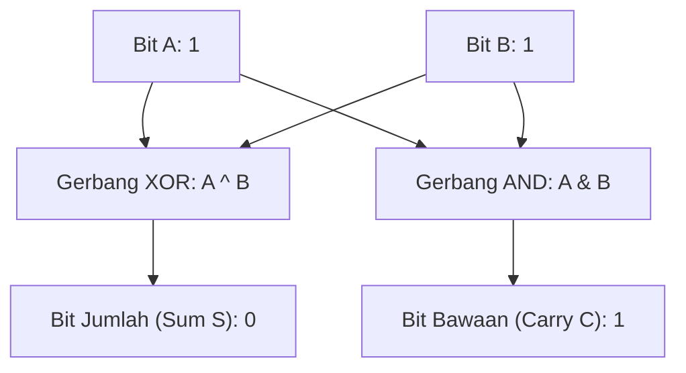

# Modul 007: Pencacahan, Sistem Bilangan & Aritmatika Fondasional (Korespondensi 1-ke-1, Basis Biner s/d Heksadesimal)

**Navigasi**: [⬅️ Master Index](../../INDEX.md) | [Tingkat 1: Tingkat 1: Fondasi Matematika Komprehensif Dari Nol](./README.md)
*Sebelumnya*: [006. teori-himpunan-dan-relasi](./006-teori-himpunan-dan-relasi.md) | *Berikutnya*: [008. teori-bilangan-aritmatika-modular](./008-teori-bilangan-aritmatika-modular.md)

---

## 1. Intuisi Dasar Tanpa Jargon ("Seperti Bayi Baru Lahir")
### 1.1 Konsep Inti & Analogi Tanpa Jargon
Pernahkah Anda bertanya mengapa angka 'sepuluh' ditulis dengan dua digit `10`? Itu hanya karena manusia kebetulan berevolusi dengan sepuluh jari di tangan kita! Jika kita memiliki delapan jari seperti tokoh kartun, kita akan menggunakan basis 8 (Oktal), di mana angka setelah 7 adalah 10.

### 1.2 Urgensi Rekayasa & Signifikansi Sistemik
Komputer tidak memiliki jari biologis. Komputer hanya memiliki jutaan sakelar transistor kecil: nyala (tegangan tinggi $\approx 3.3\text{V} = 1$) atau mati (tegangan nol $\approx 0\text{V} = 0$). Karena hanya ada dua keadaan, komputer menghitung dalam **Sistem Biner (Basis 2)**.
Memahami sistem bilangan adalah jembatan pertama antara logika abstrak matematika dengan kabel tembaga dan transistor silikon di dalam CPU Anda.
[📚 Pelajari: MIT Computation Structures](https://ocw.mit.edu/courses/6-004-computation-structures-spring-2017/)

## 2. Fondasi Teoretis & Aksiomatik / Matematis
### 2.1 Kerangka Teori Aksiomatik & Formulasi Matematis
### 7.1 Sistem Nilai Posisi Basis $b$ Polinomial ([Nand2Tetris Course](https://www.nand2tetris.org/))
Setiap bilangan bulat positif $N$ dapat dinyatakan secara unik dalam basis radiks $b \ge 2$:
$$N = \sum_{k=0}^{m-1} d_k \cdot b^k = d_{m-1} b^{m-1} + \dots + d_1 b^1 + d_0 b^0, \quad d_k \in \{0, 1, \dots, b-1\}$$
Konversi antar basis:
- **Biner ke Heksadesimal**: Kelompokkan setiap 4 bit biner menjadi 1 digit heksadesimal ($2^4 = 16$).
  Contoh: $1101_2 = 13_{10} = \text{D}_{16}$.
- **Desimal ke Basis $b$**: Pembagian berulang dengan $b$ menggunakan sisa bagi (*modulo*):
  $$d_k = N \bmod b, \quad N \leftarrow \lfloor N / b \rfloor$$

### 2.2 Penurunan Matematis Langkah-demi-Langkah
### 7.2 Aritmatika Biner & Operasi Bitwise ([IEEE Computer Society](https://www.computer.org/))
Operasi penambahan 1-bit Half-Adder:
- Jumlah (*Sum*): $S = A \oplus B$ (Gerbang XOR)
- Bawaan (*Carry*): $C = A \land B$ (Gerbang AND)
Full-Adder 1-bit dengan carry-in $C_{in}$:
$$S = A \oplus B \oplus C_{in}$$
$$C_{out} = (A \land B) \lor (C_{in} \land (A \oplus B))$$

## 3. Anatomi Teknis & Cara Kerja Internal

Arsitektur penambahan di dalam ALU (Arithmetic Logic Unit):
- **Ripple Carry Adder (RCA)**: Carry merambat serial dari bit 0 ke bit 31, menimbulkan latensi perambatan gerbang $O(N)$.
- **Carry-Lookahead Adder (CLA)**: Menghitung bit carry secara paralel dalam waktu $O(\log N)$ menggunakan generator $G_i = A_i \cdot B_i$ dan propagator $P_i = A_i \oplus B_i$.

#### Tabel Penelusuran Aritmatika Biner & Deteksi Overflow Komplemen Dua
| Langkah / Operasi | Operand A (Biner 32-bit) | Operand B (Biner 32-bit) | Operasi ALU & Bit Bawaan (Carry) | Hasil Akumulator (Hex / Dec) | Flag Status Hardware |
|---|---|---|---|---|---|
| Inisialisasi T=0 | `0x7FFF_FFFE` ($2^{31}-2$) | `0x0000_0001` ($+1$) | Penjumlahan biner standar | `0x7FFF_FFFF` ($2^{31}-1$) | `FLAGS = [Z=0, C=0, V=0]` |
| Langkah 1 | `0x7FFF_FFFF` ($+2147483647$) | `0x0000_0001` ($+1$) | Bit carry masuk ke sign-bit $C_{31}=1, C_{32}=0$ | `0x8000_0000` ($-2147483648$) | `FLAGS = [Z=0, C=0, V=1, N=1]` |
| Langkah 2: Anomali | Evaluasi Interpretasi Bertanda | Nilai positif berubah jadi negatif | Pelanggaran invarian: $(+) + (+) = (-)$ | Overflow bit tanda terpicu | Trap exception hardware jika diaktifkan |
| Langkah 3: Mitigasi | Ekstensi Tanda 64-bit | `0x0000_0000_7FFF_FFFF` | Penjumlahan register 64-bit | `0x0000_0000_8000_0000` ($+2147483648$) | `FLAGS = [Z=0, C=0, V=0]` (Aman) |
| Langkah 4: Validasi | Konversi Satuan Waktu Unix | Basis detik bertanda 64-bit | Ekstensi rentang hingga tahun 292 miliar | Waktu sistem terverifikasi aman | Bug Year 2038 termitigasi sempurna |

## 4. Implementasi Praktis & Kode / Simulasi Riil
```python
def base_converter(number: int, base: int) -> str:
    """
    Mengonversi bilangan bulat desimal positif ke basis b (2 s/d 16).
    """
    if number == 0:
        return "0"
    digits = "0123456789ABCDEF"
    result = []
    val = number
    while val > 0:
        remainder = val % base
        result.append(digits[remainder])
        val //= base
    return "".join(reversed(result))

decimal_val = 254
bin_str = base_converter(decimal_val, 2)
hex_str = base_converter(decimal_val, 16)

print(f"Desimal : {decimal_val}")
print(f"Biner   : {bin_str} (Basis 2)")
print(f"Heksa   : 0x{hex_str} (Basis 16)")
```

## 5. Miskonsepsi & Jebakan Industri
1. **Integer Overflow Siluman**: Menambahkan 1 pada bilangan unsigned 8-bit bernilai 255 menghasilkan 0 (`255 + 1 = 0`), menyebabkan bug sistem navigasi roket Ariane 5 hancur 37 detik pasca peluncuran.
2. **Endianness Confusion**: Menyimpan integer 32-bit `0x12345678` di memori Little-Endian menyimpannya sebagai byte urutan terbalik: `78 56 34 12`, membingungkan developer saat memeriksa heksadesimal mentah di debugger.
3. **Off-by-One Bit Shift**: Menggeser signed integer ke kanan (`>>`) mempertahankan bit tanda (Arithmetic Shift Right), bukan mengisi dengan 0 (Logical Shift Right).

### Studi Kasus Kegagalan Nyata: Bencana Integer Overflow 32-bit Unix Timestamp (Bug Year 2038 / Y2038)
- **Kronologi & Konteks Sejarah**: Sistem waktu standar Unix (`time_t`) sejak 1970 didefinisikan sebagai signed 32-bit integer yang menghitung jumlah detik sejak 1 Januari 1970 UTC (Unix Epoch).
- **Akar Masalah Aritmatika**: Batas maksimum signed 32-bit integer adalah $2^{31}-1 = 2.147.483.647\text{ detik}$. Pada tanggal 19 Januari 2038 pukul 03:14:07 UTC, penambahan satu detik memicu overflow komplemen dua bit tanda: nilai berbalik menjadi $-2.147.483.648$, menginterpretasikan waktu sebagai 13 Desember 1901. Pada berbagai sistem finansial yang menghitung jatuh tempo obligasi 30 tahun ke depan, bug ini sudah memicu crash transaksi sejak 2008.

- **Potongan Kode / Arsitektur Cacat (Vulnerable Implementation)**:
```c
// Demonstrasi Perilaku Bug Year 2038 (32-bit vs 64-bit time_t)
#include <stdio.h>
#include <stdint.h>
#include <time.h>

void test_y2038_overflow(void) {
    // Simulasi variabel waktu 32-bit bertanda
    int32_t unix_time_32 = 0x7FFFFFFF; // 19 Jan 2038 03:14:07 UTC
    
    printf("Waktu sebelum overflow: %d
", unix_time_32);
    
    // Penambahan 1 detik memicu Undefined Behavior / Two's Complement Overflow
    unix_time_32 += 1;
    
    // CACAT: Nilai berbalik menjadi negatif (-2147483648)
    printf("Waktu pasca overflow 32-bit: %d (Tahun 1901!)
", unix_time_32);
    
    // Mitigasi Defensif: Gunakan int64_t untuk time_t di seluruh arsitektur
    int64_t unix_time_64 = 0x7FFFFFFFLL;
    unix_time_64 += 1;
    printf("Waktu aman 64-bit: %lld (Valid, tidak ada overflow)
", (long long)unix_time_64);
}
```

- **Analisis Aritmatika Komputasi**: Overflow bilangan bertanda dalam bahasa C adalah *Undefined Behavior* (UB), yang memungkinkan kompilator optimasi menghapus pemeriksaan keamanan sama sekali. Mitigasi wajib di tingkat sistem adalah migrasi total kernel dan ABI ke 64-bit `time_t` serta penegakan operasi aritmatika saturasi (*saturating arithmetic*) pada modul kendali kritis.

## 6. Proyek Latihan & Rubrik Penilaian Mandiri
### Tingkat 1 (Pemula) - Simulator Konverter Basis Interaktif
Tulis program yang menerima input integer desimal dan mencetak representasi Biner, Oktal, dan Heksadesimal tanpa menggunakan fungsi bawaan `bin()`, `oct()`, atau `hex()`.

### Tingkat 2 (Menengah) - Simulator 4-Bit Ripple Carry Adder
Bangun simulasi gerbang logika dasar (NOT, AND, OR, XOR) dalam kode perangkat lunak. Gabungkan untuk membentuk modul Half-Adder, Full-Adder, dan rangkai 4 buah Full-Adder untuk mensimulasikan penambahan dua bilangan 4-bit biner beserta bendera Overflow flag.

### Tingkat 3 (Mahir) - Implementasi Fixed-Point Q16.16 Arithmetic
Tulis pustaka aritmatika fixed-point format Q16.16 (16 bit bilangan bulat, 16 bit pecahan) dalam C atau Rust untuk mikrokontroler tanpa unit FPU hardware. Implementasikan operasi penjumlahan, perkalian, dan pembagian dengan deteksi overflow saturasi.

#### Rubrik Penilaian
- **40% Presisi Representasi Bit**: Tidak ada kesalahan carry atau pergeseran posisi digit.
- **30% Deteksi Kondisi Batas**: Mampu menangani signed overflow dan representasi Two's Complement.
- **30% Efisiensi Komputasi**: Menghindari operasi pembagian modulo lambat dengan bitwise mask (`& (2^k - 1)`) jika basis adalah pangkat dua.

### Tingkat 1: Dasar
- **Tugas**: Tulis konverter basis bilangan yang mengonversi bilangan integer positif sembarang antar-basis biner, oktal, desimal, dan heksadesimal dari nol tanpa fungsi bawaan seperti `hex()` atau `bin()`.
- **Petunjuk Perancangan Arsitektur**:
  - Gunakan algoritma pembagian dan modulus bertingkat untuk konversi dari desimal ke basis $B$.
  - Gunakan evaluasi polinomial Horner untuk konversi dari basis $B$ ke desimal.
- **Test Vector & Kasus Uji Ekstrem**:
  - *Masukan Normal*: Desimal `255` dikonversi ke basis 2, 8, 16.
  - *Keluaran yang Diharapkan*: Biner `"11111111"`, Oktal `"377"`, Heksadesimal `"FF"`.
  - *Kasus Batas*: Desimal `0`; fungsi harus menghasilkan string `"0"`, bukan string kosong.
- **Rubrik Penilaian Mandiri**: 40% Algoritma Horner & Modulo Murni, 30% Penanganan String Karakter Basis Tinggi (A-F), 30% Ketepatan Kasus Nol.

### Tingkat 2: Menengah
- **Tugas**: Bangun kelas emulator aritmatika fixed-point presisi-Q (misal Q16.16) dengan deteksi overflow perangkat keras dan pemotongan saturasi (*saturating arithmetic*).
- **Petunjuk Perancangan Arsitektur**:
  - Representasikan angka sebagai signed 32-bit integer: 16 bit untuk bilangan bulat, 16 bit untuk pecahan.
  - Terapkan fungsi `q16_add`, `q16_sub`, `q16_mul`, dan `q16_div` dengan deteksi carry flag.
- **Test Vector & Kasus Uji Ekstrem**:
  - *Masukan Normal*: $1.5 + 2.25 = 3.75$.
  - *Representasi Biner*: `0x00018000 + 0x00024000 = 0x0003C000`.
  - *Uji Saturasi*: Penjumlahan dua angka besar ($32000.0 + 32000.0$); sistem harus menjepit nilai ke maksimum positif (`0x7FFF_FFFF`), bukan wrap-around menjadi negatif.
- **Rubrik Penilaian Mandiri**: 40% Operasi Bit-Shift Fixed Point Q16.16 Tepat, 30% Proteksi Saturasi Overflow, 30% Penanganan Pembagian Nol Bersih.

### Tingkat 3: Mahir
- **Tugas**: Rancang pustaka BigInteger presisi arbitrer (mendukung komputasi angka ribuan digit) menggunakan array blok biner 32-bit dengan perkalian Karatsuba $\mathcal{O}(N^{1.585})$.
- **Petunjuk Perancangan Arsitektur**:
  - Simpan angka sebagai array blok (*limbs*) berbasis $2^{32}$.
  - Terapkan dekomposisi Karatsuba: $A = A_1 \cdot B^m + A_0$, perkalian membutuhkan 3 operasi rekursif alih-alih 4.
- **Test Vector & Kasus Uji Ekstrem**:
  - *Masukan Uji*: Hitung $2^{1000}$ dan $100!$ (faktorial 100).
  - *Keluaran yang Diharapkan*: Hasil faktorial memiliki tepat 158 digit desimal berakhiran 24 angka nol, diverifikasi identik dengan `math.factorial(100)`.
  - *Kasus Batas*: Perkalian dengan nol atau bilangan negatif; tanda aljabar harus dikelola secara terisolasi dari magnitudo array.
- **Rubrik Penilaian Mandiri**: 40% Algoritma Karatsuba Arbitrer Berfungsi, 30% Propagasi Carry Lintas Limb Akurat, 30% Efisiensi Alokasi Memori.

## 7. Rekomendasi Sumber Belajar Standar Emas
| Kategori | Judul Sumber & Tautan Langsung | Deskripsi Singkat |
|---|---|---|
| 📖 Buku Teks | [The Elements of Computing Systems (Nisan & Schocken)](https://www.nand2tetris.org/) | Buku terkenal Nand2Tetris membangun komputer modern dari gerbang logika. |
| 🎓 Kuliah Terbuka | [MIT OCW 6.004 Computation Structures](https://ocw.mit.edu/courses/6-004-computation-structures-spring-2017/) | Desain prosesor digital, hierarki memori, dan sistem instruksi biner MIT. |
| 🔬 Makalah Seminal | [A Symbolic Analysis of Relay and Switching Circuits (Claude Shannon, 1938)](https://doi.org/10.1109/EE.1938.6431064) | Tesis master paling berpengaruh yang menghubungkan aljabar Boolean dengan sirkuit elektronik. |
| 💻 Lab Interaktif | [Logic.ly Digital Logic Circuit Simulator](https://logic.ly/demo/) | Simulator gerbang logika interaktif drag-and-drop di browser web. |

---
*Navigasi Cepat*: [Ke Tingkat 1](./README.md) | [Ke Master Index](../../INDEX.md) | *Sebelumnya*: [006. teori-himpunan-dan-relasi](./006-teori-himpunan-dan-relasi.md) | *Berikutnya*: [008. teori-bilangan-aritmatika-modular](./008-teori-bilangan-aritmatika-modular.md)
