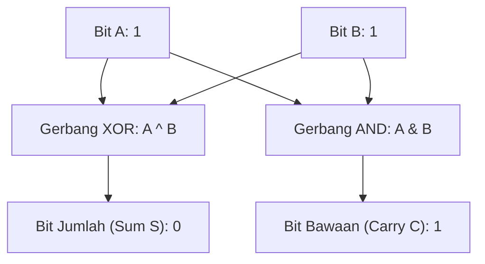

# Modul 007: Pencacahan, Sistem Bilangan & Aritmatika Fondasional (Korespondensi 1-ke-1, Basis Biner s/d Heksadesimal)

**Navigasi**: [⬅️ Master Index](../../INDEX.md) | [Tingkat 1: Tingkat 1: Fondasi Matematika Komprehensif Dari Nol](./README.md)
*Sebelumnya*: [006. teori-himpunan-dan-relasi](./006-teori-himpunan-dan-relasi.md) | *Berikutnya*: [008. teori-bilangan-aritmatika-modular](./008-teori-bilangan-aritmatika-modular.md)

---

## 1. Intuisi Dasar Tanpa Jargon ("Seperti Bayi Baru Lahir")
Pernahkah Anda bertanya mengapa angka 'sepuluh' ditulis dengan dua digit `10`? Itu hanya karena manusia kebetulan berevolusi dengan sepuluh jari di tangan kita! Jika kita memiliki delapan jari seperti tokoh kartun, kita akan menggunakan basis 8 (Oktal), di mana angka setelah 7 adalah 10.

Komputer tidak memiliki jari biologis. Komputer hanya memiliki jutaan sakelar transistor kecil: nyala (tegangan tinggi $\approx 3.3\text{V} = 1$) atau mati (tegangan nol $\approx 0\text{V} = 0$). Karena hanya ada dua keadaan, komputer menghitung dalam **Sistem Biner (Basis 2)**.
Memahami sistem bilangan adalah jembatan pertama antara logika abstrak matematika dengan kabel tembaga dan transistor silikon di dalam CPU Anda.
[📚 Pelajari: MIT Computation Structures](https://ocw.mit.edu/courses/6-004-computation-structures-spring-2017/)

## 2. Fondasi Teoretis & Aksiomatik / Matematis
### 7.1 Sistem Nilai Posisi Basis $b$ Polinomial ([Nand2Tetris Course](https://www.nand2tetris.org/))
Setiap bilangan bulat positif $N$ dapat dinyatakan secara unik dalam basis radiks $b \ge 2$:
$$N = \sum_{k=0}^{m-1} d_k \cdot b^k = d_{m-1} b^{m-1} + \dots + d_1 b^1 + d_0 b^0, \quad d_k \in \{0, 1, \dots, b-1\}$$
Konversi antar basis:
- **Biner ke Heksadesimal**: Kelompokkan setiap 4 bit biner menjadi 1 digit heksadesimal ($2^4 = 16$).
  Contoh: $1101_2 = 13_{10} = \text{D}_{16}$.
- **Desimal ke Basis $b$**: Pembagian berulang dengan $b$ menggunakan sisa bagi (*modulo*):
  $$d_k = N \bmod b, \quad N \leftarrow \lfloor N / b \rfloor$$

### 7.2 Aritmatika Biner & Operasi Bitwise ([IEEE Computer Society](https://www.computer.org/))
Operasi penambahan 1-bit Half-Adder:
- Jumlah (*Sum*): $S = A \oplus B$ (Gerbang XOR)
- Bawaan (*Carry*): $C = A \land B$ (Gerbang AND)
Full-Adder 1-bit dengan carry-in $C_{in}$:
$$S = A \oplus B \oplus C_{in}$$
$$C_{out} = (A \land B) \lor (C_{in} \land (A \oplus B))$$

## 3. Anatomi Teknis & Cara Kerja Internal

Arsitektur penambahan di dalam ALU (Arithmetic Logic Unit):
- **Ripple Carry Adder (RCA)**: Carry merambat serial dari bit 0 ke bit 31, menimbulkan latensi perambatan gerbang $O(N)$.
- **Carry-Lookahead Adder (CLA)**: Menghitung bit carry secara paralel dalam waktu $O(\log N)$ menggunakan generator $G_i = A_i \cdot B_i$ dan propagator $P_i = A_i \oplus B_i$.

## 4. Implementasi Praktis & Kode / Simulasi Riil
def base_converter(number: int, base: int) -> str:
    """
    Mengonversi bilangan bulat desimal positif ke basis b (2 s/d 16).
    """
    if number == 0:
        return "0"
    digits = "0123456789ABCDEF"
    result = []
    val = number
    while val > 0:
        remainder = val % base
        result.append(digits[remainder])
        val //= base
    return "".join(reversed(result))

decimal_val = 254
bin_str = base_converter(decimal_val, 2)
hex_str = base_converter(decimal_val, 16)

print(f"Desimal : {decimal_val}")
print(f"Biner   : {bin_str} (Basis 2)")
print(f"Heksa   : 0x{hex_str} (Basis 16)")

## 5. Miskonsepsi & Jebakan Industri
1. **Integer Overflow Siluman**: Menambahkan 1 pada bilangan unsigned 8-bit bernilai 255 menghasilkan 0 (`255 + 1 = 0`), menyebabkan bug sistem navigasi roket Ariane 5 hancur 37 detik pasca peluncuran.
2. **Endianness Confusion**: Menyimpan integer 32-bit `0x12345678` di memori Little-Endian menyimpannya sebagai byte urutan terbalik: `78 56 34 12`, membingungkan developer saat memeriksa heksadesimal mentah di debugger.
3. **Off-by-One Bit Shift**: Menggeser signed integer ke kanan (`>>`) mempertahankan bit tanda (Arithmetic Shift Right), bukan mengisi dengan 0 (Logical Shift Right).

## 6. Proyek Latihan & Rubrik Penilaian Mandiri
### Tingkat 1 (Pemula) - Simulator Konverter Basis Interaktif
Tulis program yang menerima input integer desimal dan mencetak representasi Biner, Oktal, dan Heksadesimal tanpa menggunakan fungsi bawaan `bin()`, `oct()`, atau `hex()`.

### Tingkat 2 (Menengah) - Simulator 4-Bit Ripple Carry Adder
Bangun simulasi gerbang logika dasar (NOT, AND, OR, XOR) dalam kode perangkat lunak. Gabungkan untuk membentuk modul Half-Adder, Full-Adder, dan rangkai 4 buah Full-Adder untuk mensimulasikan penambahan dua bilangan 4-bit biner beserta bendera Overflow flag.

### Tingkat 3 (Mahir) - Implementasi Fixed-Point Q16.16 Arithmetic
Tulis pustaka aritmatika fixed-point format Q16.16 (16 bit bilangan bulat, 16 bit pecahan) dalam C atau Rust untuk mikrokontroler tanpa unit FPU hardware. Implementasikan operasi penjumlahan, perkalian, dan pembagian dengan deteksi overflow saturasi.

#### Rubrik Penilaian
- **40% Presisi Representasi Bit**: Tidak ada kesalahan carry atau pergeseran posisi digit.
- **30% Deteksi Kondisi Batas**: Mampu menangani signed overflow dan representasi Two's Complement.
- **30% Efisiensi Komputasi**: Menghindari operasi pembagian modulo lambat dengan bitwise mask (`& (2^k - 1)`) jika basis adalah pangkat dua.

## 7. Rekomendasi Sumber Belajar Standar Emas
| Kategori | Judul Sumber & Tautan Langsung | Deskripsi Singkat |
|---|---|---|
| 📖 Buku Teks | [The Elements of Computing Systems (Nisan & Schocken)](https://www.nand2tetris.org/) | Buku terkenal Nand2Tetris membangun komputer modern dari gerbang logika. |
| 🎓 Kuliah Terbuka | [MIT OCW 6.004 Computation Structures](https://ocw.mit.edu/courses/6-004-computation-structures-spring-2017/) | Desain prosesor digital, hierarki memori, dan sistem instruksi biner MIT. |
| 🔬 Makalah Seminal | [A Symbolic Analysis of Relay and Switching Circuits (Claude Shannon, 1938)](https://doi.org/10.1109/EE.1938.6431064) | Tesis master paling berpengaruh yang menghubungkan aljabar Boolean dengan sirkuit elektronik. |
| 💻 Lab Interaktif | [Logic.ly Digital Logic Circuit Simulator](https://logic.ly/demo/) | Simulator gerbang logika interaktif drag-and-drop di browser web. |

---
*Navigasi Cepat*: [Ke Tingkat 1](./README.md) | [Ke Master Index](../../INDEX.md) | *Sebelumnya*: [006. teori-himpunan-dan-relasi](./006-teori-himpunan-dan-relasi.md) | *Berikutnya*: [008. teori-bilangan-aritmatika-modular](./008-teori-bilangan-aritmatika-modular.md)
