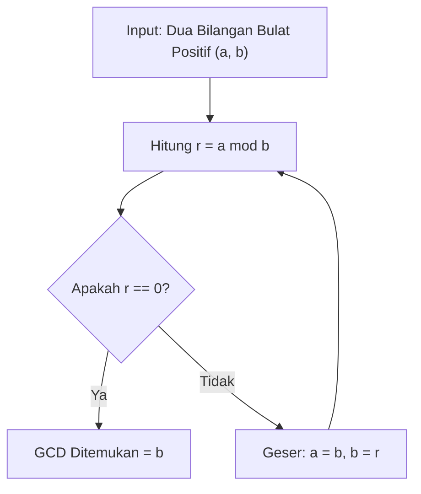

# Modul 008: Teori Bilangan & Aritmatika Modular (Keterbagian, Bilangan Prima, Chinese Remainder Theorem)

**Navigasi**: [⬅️ Master Index](../../INDEX.md) | [Tingkat 1: Tingkat 1: Fondasi Matematika Komprehensif Dari Nol](./README.md)
*Sebelumnya*: [007. pencacahan-sistem-bilangan-aritmatika](./007-pencacahan-sistem-bilangan-aritmatika.md) | *Berikutnya*: [009. aljabar-abstrak](./009-aljabar-abstrak.md)

---

## 1. Intuisi Dasar Tanpa Jargon ("Seperti Bayi Baru Lahir")
Bayangkan jam dinding dengan 12 angka. Jika sekarang jam 9 pagi dan Anda tidur selama 5 jam, jam berapa Anda bangun? $9 + 5 = 14$, tetapi jam dinding menunjukkan angka 2 siang! Mengapa? Karena jam dinding adalah sistem angka melingkar dengan modulus 12: $14 \equiv 2 \pmod{12}$.

**Teori Bilangan & Aritmatika Modular** adalah fondasi di balik seluruh sistem keamanan digital dunia. Kriptografi modern (seperti RSA, HTTPS, dan enkripsi Bitcoin) bekerja karena mengalikan dua bilangan prima raksasa sangat mudah bagi komputer, tetapi mencari faktor pembagi dari hasil perkalian tersebut butuh waktu miliaran tahun (*Faktorisasi Bilangan Prima*).

## 2. Fondasi Teoretis & Aksiomatik / Matematis
### 1. Keterbagian & Algoritma Pembagian Euclid
Untuk setiap bilangan bulat $a$ dan $b > 0$, terdapat pasangan unik $q, r \in \mathbb{Z}$ sedemikian sehingga:
$$a = q \cdot b + r, \quad 0 \le r < b$$
Algoritma Euclid untuk FPB/GCD:
$$\gcd(a, b) = \gcd(b, a \bmod b), \quad \gcd(a, 0) = a$$
Identitas Bézout: $\exists x, y \in \mathbb{Z}$ sedemikian sehingga $a \cdot x + b \cdot y = \gcd(a, b)$.
[📚 Pelajari: MIT OCW 6.042J Mathematics for Computer Science - Number Theory](https://ocw.mit.edu/courses/6-042j-mathematics-for-computer-science-fall-2010/pages/readings/)

### 2. Teorema Kecil Fermat & Teorema Euler
Jika $p$ prima dan $\gcd(a, p) = 1$:
$$a^{p-1} \equiv 1 \pmod{p}$$
Generalisasi fungsi totient Euler $\phi(n)$: Jika $\gcd(a, n) = 1$, maka $a^{\phi(n)} \equiv 1 \pmod{n}$.

### 3. Chinese Remainder Theorem (CRT)
Jika $m_1, m_2, \dots, m_k$ adalah bilangan bulat positif yang saling prima sepasang demi sepasang ($\gcd(m_i, m_j) = 1$ untuk $i \ne j$), maka sistem kongruensi:
$$x \equiv a_1 \pmod{m_1}, \quad x \equiv a_2 \pmod{m_2}, \quad \dots, \quad x \equiv a_k \pmod{m_k}$$
memiliki solusi unik modulo $M = m_1 \cdot m_2 \cdots m_k$:
$$x = \sum_{i=1}^k a_i \cdot M_i \cdot y_i \pmod{M}, \quad M_i = \frac{M}{m_i}, \quad M_i \cdot y_i \equiv 1 \pmod{m_i}$$

## 3. Anatomi Teknis & Cara Kerja Internal

Kompleksitas Algoritma Euclid adalah $O(\log(\min(a, b)))$ (Teorema Lamé: jumlah langkah pembagian tidak pernah melebihi 5 kali jumlah digit angka terkecil pada basis 10).

## 4. Implementasi Praktis & Kode / Simulasi Riil
```python
def extended_euclid(a: int, b: int) -> tuple[int, int, int]:
    """
    Extended Euclidean Algorithm:
    Mengembalikan (gcd, x, y) sedemikian sehingga a*x + b*y = gcd(a, b).
    """
    if b == 0:
        return a, 1, 0
    gcd, x1, y1 = extended_euclid(b, a % b)
    x = y1
    y = x1 - (a // b) * y1
    return gcd, x, y

def mod_inverse(a: int, m: int) -> int:
    """Menghitung invers perkalian modular a^(-1) mod m."""
    gcd, x, _ = extended_euclid(a, m)
    if gcd != 1:
        raise ValueError(f"Invers tidak ada karena gcd({a}, {m}) != 1")
    return (x % m + m) % m

def chinese_remainder_theorem(remainders: list[int], moduli: list[int]) -> int:
    """Menyelesaikan sistem kongruensi linier dengan Chinese Remainder Theorem."""
    M = 1
    for m in moduli:
        M *= m
    total = 0
    for a_i, m_i in zip(remainders, moduli):
        M_i = M // m_i
        y_i = mod_inverse(M_i, m_i)
        total += a_i * M_i * y_i
    return total % M

# Contoh Kasus Klasik Sun Tzu:
# x = 2 mod 3, x = 3 mod 5, x = 2 mod 7
solusi = chinese_remainder_theorem([2, 3, 2], [3, 5, 7])
print(f"Solusi Chinese Remainder Theorem: x = {solusi} (Modulo 105)")
assert solusi % 3 == 2 and solusi % 5 == 3 and solusi % 7 == 2
print("Verifikasi Kongruensi Lolos 100%!")
```

## 5. Miskonsepsi & Jebakan Industri
1. **Asumsi Pembagian Normal**: Mengira bahwa jika $a \cdot b \equiv a \cdot c \pmod{m}$, maka $b \equiv c \pmod{m}$. Ini SALAH kecuali $\gcd(a, m) = 1$.
2. **Integer Overflow pada Komputasi Pangkat**: Menghitung $a^b \bmod m$ dengan menghitung $a^b$ terlebih dahulu sebelum di-modulo akan menyebabkan ledakan ukuran memori (Gunakan algoritma *Modular Exponentiation* $O(\log b)$).

## 6. Proyek Latihan & Rubrik Penilaian Mandiri
### Level 1 (Dasar)
Gunakan algoritma Euclid manual untuk mencari $\gcd(252, 105)$ dan nyatakan dalam identitas Bézout $252x + 105y = \gcd$.

### Level 2 (Menengah)
Implementasikan uji keprimaan Miller-Rabin probabilistik dalam Python untuk menentukan apakah bilangan 1024-bit adalah bilangan prima.

### Level 3 (Mahir)
Bangun sistem kriptografi RSA mini dari nol: Buat fungsi generate keypair (p, q prima acak), enkripsi pesan string teks, dan dekripsi menggunakan Chinese Remainder Theorem untuk akselerasi dekripsi private key.

## 7. Rekomendasi Sumber Belajar Standar Emas
- [Buku Standar: An Introduction to the Theory of Numbers - G. H. Hardy & E. M. Wright (Oxford University Press)](https://global.oup.com/academic/product/an-introduction-to-the-theory-of-numbers-9780199219865)
- [Kuliah Terbuka: MIT OCW 18.781 Theory of Numbers](https://ocw.mit.edu/courses/18-781-theory-of-numbers-spring-2012/)
- [Kriptografi Interaktif: CrypTool Online - Modular Arithmetic & RSA Simulator](https://www.cryptool.org/en/cto/rsa-step-by-step)
- [Paper Seminal: A Method for Obtaining Digital Signatures and Public-Key Cryptosystems - Rivest, Shamir, Adleman (1978)](https://dl.acm.org/doi/10.1145/359340.359342)

---
*Navigasi Cepat*: [Ke Tingkat 1](./README.md) | [Ke Master Index](../../INDEX.md) | *Sebelumnya*: [007. pencacahan-sistem-bilangan-aritmatika](./007-pencacahan-sistem-bilangan-aritmatika.md) | *Berikutnya*: [009. aljabar-abstrak](./009-aljabar-abstrak.md)
