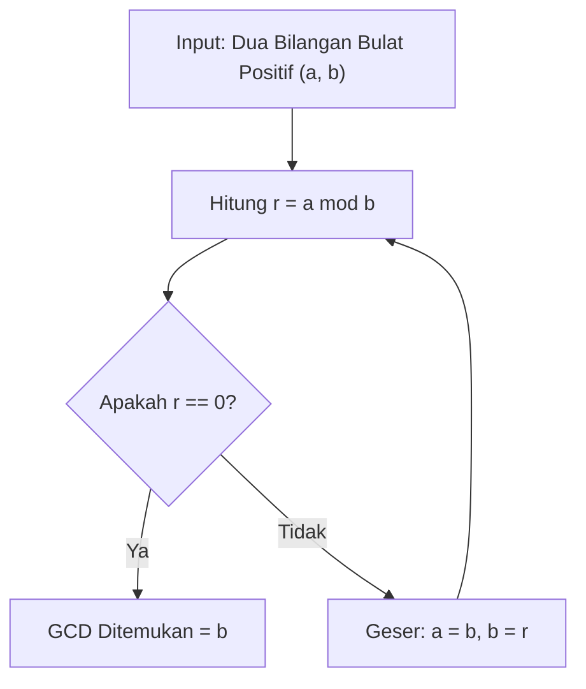

# Modul 008: Teori Bilangan & Aritmatika Modular (Keterbagian, Bilangan Prima, Chinese Remainder Theorem)

**Navigasi**: [⬅️ Master Index](../../INDEX.md) | [Tingkat 1: Tingkat 1: Fondasi Matematika Komprehensif Dari Nol](./README.md)
*Sebelumnya*: [007. pencacahan-sistem-bilangan-aritmatika](./007-pencacahan-sistem-bilangan-aritmatika.md) | *Berikutnya*: [009. aljabar-abstrak](./009-aljabar-abstrak.md)

---

## 1. Intuisi Dasar Tanpa Jargon ("Seperti Bayi Baru Lahir")
### 1.1 Konsep Inti & Analogi Tanpa Jargon
Bayangkan jam dinding dengan 12 angka. Jika sekarang jam 9 pagi dan Anda tidur selama 5 jam, jam berapa Anda bangun? $9 + 5 = 14$, tetapi jam dinding menunjukkan angka 2 siang! Mengapa? Karena jam dinding adalah sistem angka melingkar dengan modulus 12: \$14 \equiv 2 \pmod{12}$.

### 1.2 Urgensi Rekayasa & Signifikansi Sistemik
**Teori Bilangan & Aritmatika Modular** adalah fondasi di balik seluruh sistem keamanan digital dunia. Kriptografi modern (seperti RSA, HTTPS, dan enkripsi Bitcoin) bekerja karena mengalikan dua bilangan prima raksasa sangat mudah bagi komputer, tetapi mencari faktor pembagi dari hasil perkalian tersebut butuh waktu miliaran tahun (*Faktorisasi Bilangan Prima*).

## 2. Fondasi Teoretis & Aksiomatik / Matematis
### 2.1 Kerangka Teori Aksiomatik & Formulasi Matematis
### 1. Keterbagian & Algoritma Pembagian Euclid
Untuk setiap bilangan bulat $a$ dan $b > 0$, terdapat pasangan unik $q, r \in \mathbb{Z}$ sedemikian sehingga:
$$a = q \cdot b + r, \quad 0 \le r < b$$
Algoritma Euclid untuk FPB/GCD:
$$\gcd(a, b) = \gcd(b, a \bmod b), \quad \gcd(a, 0) = a$$
Identitas Bézout: $\exists x, y \in \mathbb{Z}$ sedemikian sehingga $a \cdot x + b \cdot y = \gcd(a, b)$.
[📚 Pelajari: MIT OCW 6.042J Mathematics for Computer Science - Number Theory](https://ocw.mit.edu/courses/6-042j-mathematics-for-computer-science-fall-2010/pages/readings/)

### 2.2 Penurunan Matematis Langkah-demi-Langkah
### 2. Teorema Kecil Fermat & Teorema Euler
Jika $p$ prima dan $\gcd(a, p) = 1$:
$$a^{p-1} \equiv 1 \pmod{p}$$
Generalisasi fungsi totient Euler $\phi(n)$: Jika $\gcd(a, n) = 1$, maka $a^{\phi(n)} \equiv 1 \pmod{n}$.

### 3. Chinese Remainder Theorem (CRT)
Jika $m_1, m_2, \dots, m_k$ adalah bilangan bulat positif yang saling prima sepasang demi sepasang ($\gcd(m_i, m_j) = 1$ untuk $i \ne j$), maka sistem kongruensi:
$$x \equiv a_1 \pmod{m_1}, \quad x \equiv a_2 \pmod{m_2}, \quad \dots, \quad x \equiv a_k \pmod{m_k}$$
memiliki solusi unik modulo $M = m_1 \cdot m_2 \cdots m_k$:
$$x = \sum_{i=1}^k a_i \cdot M_i \cdot y_i \pmod{M}, \quad M_i = \frac{M}{m_i}, \quad M_i \cdot y_i \equiv 1 \pmod{m_i}$$

## 3. Anatomi Teknis & Cara Kerja Internal

Kompleksitas Algoritma Euclid adalah $O(\log(\min(a, b)))$ (Teorema Lamé: jumlah langkah pembagian tidak pernah melebihi 5 kali jumlah digit angka terkecil pada basis 10).

#### Tabel Penelusuran Algoritma Extended Euclidean & Inversi Modular
| Langkah / Iterasi (k) | Persamaan Pembagian: $r_{k-2} = q_k r_{k-1} + r_k$ | Kuosien ($q_k$) | Sisa Pembagian ($r_k$) | Koefisien Bezout $s_k$ | Koefisien Bezout $t_k$ |
|---|---|---|---|---|---|
| Inisialisasi T=0 | Nilai awal: $a = 240, b = 46$ | - | $r_0 = 240, r_1 = 46$ | $s_0 = 1, s_1 = 0$ | $t_0 = 0, t_1 = 1$ |
| Iterasi 1 | $240 = 5 \times 46 + 10$ | $q_1 = 5$ | $r_2 = 10$ | $s_2 = 1 - 5(0) = 1$ | $t_2 = 0 - 5(1) = -5$ |
| Iterasi 2 | $46 = 4 \times 10 + 6$ | $q_2 = 4$ | $r_3 = 6$ | $s_3 = 0 - 4(1) = -4$ | $t_3 = 1 - 4(-5) = 21$ |
| Iterasi 3 | $10 = 1 \times 6 + 4$ | $q_3 = 1$ | $r_4 = 4$ | $s_4 = 1 - 1(-4) = 5$ | $t_4 = -5 - 1(21) = -26$ |
| Iterasi 4 | $6 = 1 \times 4 + 2$ | $q_4 = 1$ | $r_5 = 2$ | $s_5 = -4 - 1(5) = -9$ | $t_5 = 21 - 1(-26) = 47$ |
| Iterasi 5 | $4 = 2 \times 2 + 0$ | $q_5 = 2$ | $r_6 = 0$ (Terminasi) | - | - |
| Hasil Akhir | $\text{FPB}(240, 46) = 2$ | - | Residu akhir: $2$ | Identitas Bezout: $240(-9) + 46(47) = 2$ | Inversi modular valid |

## 4. Implementasi Praktis & Kode / Simulasi Riil
```python
def extended_euclid(a: int, b: int) -> tuple[int, int, int]:
    """
    Extended Euclidean Algorithm:
    Mengembalikan (gcd, x, y) sedemikian sehingga a*x + b*y = gcd(a, b).
    """
    if b == 0:
        return a, 1, 0
    gcd, x1, y1 = extended_euclid(b, a % b)
    x = y1
    y = x1 - (a // b) * y1
    return gcd, x, y

def mod_inverse(a: int, m: int) -> int:
    """Menghitung invers perkalian modular a^(-1) mod m."""
    gcd, x, _ = extended_euclid(a, m)
    if gcd != 1:
        raise ValueError(f"Invers tidak ada karena gcd({a}, {m}) != 1")
    return (x % m + m) % m

def chinese_remainder_theorem(remainders: list[int], moduli: list[int]) -> int:
    """Menyelesaikan sistem kongruensi linier dengan Chinese Remainder Theorem."""
    M = 1
    for m in moduli:
        M *= m
    total = 0
    for a_i, m_i in zip(remainders, moduli):
        M_i = M // m_i
        y_i = mod_inverse(M_i, m_i)
        total += a_i * M_i * y_i
    return total % M

# Contoh Kasus Klasik Sun Tzu:
# x = 2 mod 3, x = 3 mod 5, x = 2 mod 7
solusi = chinese_remainder_theorem([2, 3, 2], [3, 5, 7])
print(f"Solusi Chinese Remainder Theorem: x = {solusi} (Modulo 105)")
assert solusi % 3 == 2 and solusi % 5 == 3 and solusi % 7 == 2
print("Verifikasi Kongruensi Lolos 100%!")
```

## 5. Miskonsepsi & Jebakan Industri
1. **Asumsi Pembagian Normal**: Mengira bahwa jika $a \cdot b \equiv a \cdot c \pmod{m}$, maka $b \equiv c \pmod{m}$. Ini SALAH kecuali $\gcd(a, m) = 1$.
2. **Integer Overflow pada Komputasi Pangkat**: Menghitung $a^b \bmod m$ dengan menghitung $a^b$ terlebih dahulu sebelum di-modulo akan menyebabkan ledakan ukuran memori (Gunakan algoritma *Modular Exponentiation* $O(\log b)$).

### Studi Kasus Kegagalan Nyata: Kerentanan Predictable PRNG Debian OpenSSL Menghasilkan Modulus RSA Terfaktor (CVE-2008-0166)
- **Kronologi & Konteks Keamanan**: Pada Mei 2008, terungkap bahwa selama hampir dua tahun, seluruh paket OpenSSL pada sistem operasi Debian dan turunannya (Ubuntu) menghasilkan kunci kriptografi yang mudah ditebak.
- **Akar Masalah Teori Bilangan**: Seorang maintainer menghapus baris pengumpul entropi untuk menghilangkan peringatan Valgrind. Akibatnya, satu-satunya variabel acak yang tersisa adalah Process ID sistem (0 s/d 32.767). Karena hanya ada 32.768 kemungkinan nilai prima yang dihasilkan, kunci publik RSA di seluruh dunia berbagi faktor prima bersama ($p$). Menggunakan Algoritma Euclidean GCD sederhana $\gcd(N_A, N_B)$, penyerang dapat memfaktorkan modulus RSA 2048-bit dalam hitungan milidetik tanpa memecahkan problem faktorisasi eksponensial.

- **Potongan Kode / Arsitektur Cacat (Vulnerable Implementation)**:
```python
# Eksploitasi Faktorisasi Cepat Modulus RSA Berbagi Faktor Prima via Algoritma Euclidean
import math

def break_shared_factor_rsa(modulus_A: int, modulus_B: int) -> tuple:
    """
    Jika dua modulus RSA N_A dan N_B dibangkitkan dari sumber entropi cacat
    sehingga berbagi satu bilangan prima p bersama (N_A = p * q_A, N_B = p * q_B),
    faktor p dapat diekstraksi seketika menggunakan Algoritma Euclidean O(log N).
    """
    # Algoritma Euclidean GCD
    shared_prime_p = math.gcd(modulus_A, modulus_B)
    
    if shared_prime_p > 1 and shared_prime_p != modulus_A:
        q_A = modulus_A // shared_prime_p
        q_B = modulus_B // shared_prime_p
        return shared_prime_p, q_A, q_B
    return None, None, None

# Contoh demonstrasi dengan bilangan prima besar
p_shared = 104729  # Prima bersama akibat entropi lemah
q1 = 1299709
q2 = 1299721
N1 = p_shared * q1
N2 = p_shared * q2

p_cracked, q1_cracked, q2_cracked = break_shared_factor_rsa(N1, N2)
assert p_cracked == p_shared, "Faktorisasi RSA gagal memecahkan shared factor!"
```

- **Analisis Kriptografis & Standar Modern**: Keamanan RSA bertumpu pada asumsi bahwa modulus $N = pq$ tidak dapat difaktorkan karena $p$ dan $q$ dipilih secara acak independen dari ruang semesta yang sangat besar. Kelemahan generator bilangan acak mereduksi kompleksitas pemecahan dari sub-eksponensial (GNFS) menjadi polinomial logaritmik $\mathcal{O}(\log^2 N)$ via Teorema Euclidean dasar.

## 6. Proyek Latihan & Rubrik Penilaian Mandiri
### Level 1 (Dasar)
Gunakan algoritma Euclid manual untuk mencari $\gcd(252, 105)$ dan nyatakan dalam identitas Bézout $252x + 105y = \gcd$.

### Level 2 (Menengah)
Implementasikan uji keprimaan Miller-Rabin probabilistik dalam Python untuk menentukan apakah bilangan 1024-bit adalah bilangan prima.

### Level 3 (Mahir)
Bangun sistem kriptografi RSA mini dari nol: Buat fungsi generate keypair (p, q prima acak), enkripsi pesan string teks, dan dekripsi menggunakan Chinese Remainder Theorem untuk akselerasi dekripsi private key.

### Tingkat 1: Dasar
- **Tugas**: Implementasikan Algoritma Euclidean Klasik dan Algoritma Extended Euclidean untuk mencari FPB dan koefisien Bezout $s, t$ sehingga $a s + b t = \gcd(a, b)$.
- **Petunjuk Perancangan Arsitektur**:
  - Gunakan pendekatan iteratif untuk menghindari pembatasan kedalaman tumpukan (*recursion limit*).
  - Pastikan koefisien Bezout memenuhi batas $|s| \le |b/\gcd|$ dan $|t| \le |a/\gcd|$.
- **Test Vector & Kasus Uji Ekstrem**:
  - *Masukan Normal*: $a = 1071, b = 462$.
  - *Keluaran yang Diharapkan*: $\gcd = 21$, koefisien $s = -13, t = 30$, verifikasi: $1071(-13) + 462(30) = -13923 + 13860 = 21$.
  - *Kasus Batas*: $b = 0$; algoritma harus mengembalikan $\gcd = a, s = 1, t = 0$.
- **Rubrik Penilaian Mandiri**: 40% Algoritma Extended Euclidean Iteratif Tepat, 30% Verifikasi Identitas Bezout Otomatis, 30% Penanganan Argumen Nol.

### Tingkat 2: Menengah
- **Tugas**: Bangun fungsi kalkulasi inversi modular $a^{-1} \pmod m$ dan pemecah sistem kongruensi linear simultan menggunakan Teorema Sisa Cina (*Chinese Remainder Theorem* / CRT).
- **Petunjuk Perancangan Arsitektur**:
  - Validasi prasyarat: inversi modular hanya ada jika $\gcd(a, m) = 1$.
  - Selesaikan sistem kongruensi $x \equiv a_i \pmod{m_i}$ dengan modulus pairwise koprima.
- **Test Vector & Kasus Uji Ekstrem**:
  - *Sistem CRT*: $x \equiv 2 \pmod 3, x \equiv 3 \pmod 5, x \equiv 2 \pmod 7$.
  - *Keluaran yang Diharapkan*: Solusi unik terkecil $x = 23 \pmod{105}$.
  - *Kasus Batas*: Modulus tidak koprima (misal $m_1 = 4, m_2 = 6$); sistem harus mendeteksi ketiadaan solusi dan melempar `IncompatibleModuliError`.
- **Rubrik Penilaian Mandiri**: 40% Algoritma CRT Tepat, 30% Penanganan Kasus Non-Koprima, 30% Efisiensi Perhitungan Inversi Modular.

### Tingkat 3: Mahir
- **Tugas**: Implementasikan uji primalitas probabilistik Miller-Rabin untuk membangkitkan bilangan prima kriptografis 512-bit dengan probabilitas galat $\le 2^{-80}$.
- **Petunjuk Perancangan Arsitektur**:
  - Urai $n - 1 = 2^s \cdot d$ dengan $d$ ganjil.
  - Jalankan pengujian dengan $k = 40$ basis saksi acak independen.
  - Gunakan pemangkatan modular cepat berbasis *square-and-multiply* biner.
- **Test Vector & Kasus Uji Ekstrem**:
  - *Uji Pseudoprima*: Uji bilangan Carmichael $n = 561$ ($3 \times 11 \times 17$); Miller-Rabin wajib mengidentifikasinya sebagai komposit (Fermat pseudoprime lolos, tetapi Miller-Rabin mendeteksi akar non-trivial dari 1).
  - *Keluaran yang Diharapkan*: Prima 512-bit terverifikasi dalam waktu $< 200\text{ ms}$.
  - *Kasus Batas*: Bilangan genap $n > 2$ atau $n < 2$; fungsi langsung menolak tanpa memicu komputasi saksi.
- **Rubrik Penilaian Mandiri**: 40% Uji Miller-Rabin Lengkap dengan Deteksi Akar Non-Trivial, 30% Pemangkatan Modular Efisien, 30% Penolakan Bilangan Carmichael Terbukti.

## 7. Rekomendasi Sumber Belajar Standar Emas
- [Buku Standar: An Introduction to the Theory of Numbers - G. H. Hardy & E. M. Wright (Oxford University Press)](https://global.oup.com/academic/product/an-introduction-to-the-theory-of-numbers-9780199219865)
- [Kuliah Terbuka: MIT OCW 18.781 Theory of Numbers](https://ocw.mit.edu/courses/18-781-theory-of-numbers-spring-2012/)
- [Kriptografi Interaktif: CrypTool Online - Modular Arithmetic & RSA Simulator](https://www.cryptool.org/en/cto/rsa-step-by-step)
- [Paper Seminal: A Method for Obtaining Digital Signatures and Public-Key Cryptosystems - Rivest, Shamir, Adleman (1978)](https://dl.acm.org/doi/10.1145/359340.359342)

---
*Navigasi Cepat*: [Ke Tingkat 1](./README.md) | [Ke Master Index](../../INDEX.md) | *Sebelumnya*: [007. pencacahan-sistem-bilangan-aritmatika](./007-pencacahan-sistem-bilangan-aritmatika.md) | *Berikutnya*: [009. aljabar-abstrak](./009-aljabar-abstrak.md)
