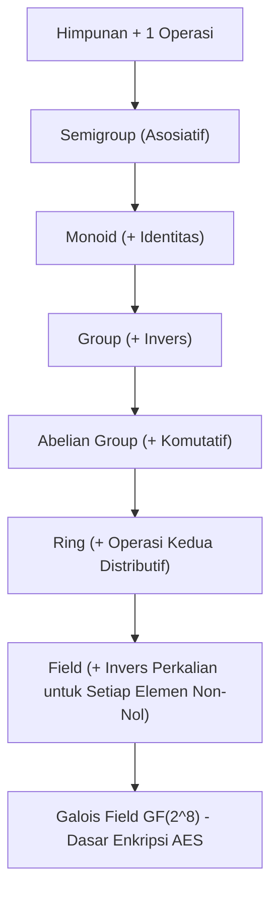

# Modul 009: Aljabar Abstrak (Grup, Ring, Medan, dan Galois Fields GF(2^n) untuk Kriptografi)

**Navigasi**: [⬅️ Master Index](../../INDEX.md) | [Tingkat 1: Tingkat 1: Fondasi Matematika Komprehensif Dari Nol](./README.md)
*Sebelumnya*: [008. teori-bilangan-aritmatika-modular](./008-teori-bilangan-aritmatika-modular.md) | *Berikutnya*: [010. geometri-analitik-trigonometri](./010-geometri-analitik-trigonometri.md)

---

## 1. Intuisi Dasar Tanpa Jargon ("Seperti Bayi Baru Lahir")
Pernahkah Anda memutar rubik's cube? Setiap putaran adalah sebuah aksi. Jika Anda memutar 90 derajat searah jarum jam, selalu ada aksi kebalikannya (putar 90 derajat berlawanan jarum jam) untuk mengembalikannya ke posisi semula. Tidak peduli urutan putaran apa yang Anda lakukan, kubus tetap utuh dan setiap kombinasi putaran menghasilkan status kubus yang sah.

**Aljabar Abstrak** adalah ilmu tentang "struktur simetri murni". Alih-alih hanya berurusan dengan angka, aljabar abstrak mengamati objek matematika apa pun (himpunan, simetri, matriks, rotasi) yang memiliki aturan operasi tertentu. Struktur Grup, Ring, Medan (*Field*), dan *Galois Field* $GF(2^n)$ adalah jantung penggerak dari enkripsi AES di smartphone Anda dan kode koreksi kesalahan di satelit luar angkasa!

## 2. Fondasi Teoretis & Aksiomatik / Matematis
### 1. Hierarki Struktur Aljabar
- **Grup $(G, \star)$**: Himpunan dengan satu operasi biner yang memenuhi 4 aksioma:
  1. Penutupan (*Closure*): $\forall a, b \in G, a \star b \in G$
  2. Asosiatif: $(a \star b) \star c = a \star (b \star c)$
  3. Elemen Identitas ($e$): $\exists e \in G, a \star e = e \star a = a$
  4. Elemen Invers: $\forall a \in G, \exists a^{-1} \in G, a \star a^{-1} = e$
  (Jika komutatif $a \star b = b \star a$, disebut Grup Abelian).
- **Ring $(R, +, \cdot)$**: Grup Abelian di bawah penjumlahan $(+)$, asosiatif di bawah perkalian $(\cdot)$, dan distributif.
- **Medan / Field $(\mathbb{F}, +, \cdot)$**: Ring komutatif di mana setiap elemen non-nol memiliki invers perkalian.

### 2. Galois Field $GF(p^n)$ (Medan Berhingga)
Medan berhingga dengan $q = p^n$ elemen ($p$ prima).
Untuk kriptografi perangkat keras (AES): $GF(2^8) = \mathbb{Z}_2[x] / \langle m(x) \rangle$ dengan polinomial tak tereduksi Rijndael:
$$m(x) = x^8 + x^4 + x^3 + x + 1 \quad (\text{0x11B})$$
Penjumlahan di $GF(2^n)$ adalah operasi bitwise XOR $(\oplus)$, sedangkan perkalian adalah perkalian polinomial modulo $m(x)$.
[📚 Pelajari: Harvard Math 122 Abstract Algebra Notes](https://abel.math.harvard.edu/~gross/m122/)

## 3. Anatomi Teknis & Cara Kerja Internal


## 4. Implementasi Praktis & Kode / Simulasi Riil
```python
def gf28_multiply(a: int, b: int, irreducible_poly: int = 0x11B) -> int:
    """
    Perkalian dua elemen pada Galois Field GF(2^8) modulo polinomial Rijndael (AES).
    Implementasi algoritma 'Russian Peasant Multiplication' berbasis bitwise.
    """
    p = 0
    for _ in range(8):
        if b & 1:
            p ^= a # Penjumlahan di GF(2) adalah XOR
        high_bit_set = a & 0x80
        a = (a << 1) & 0xFF
        if high_bit_set:
            a ^= (irreducible_poly & 0xFF) # Reduksi modulo polinomial
        b >>= 1
    return p

# Contoh Perkalian AES SubBytes: 0x57 * 0x83 = 0xC1 di GF(2^8)
val1 = 0x57
val2 = 0x83
result = gf28_multiply(val1, val2)
print(f"Perkalian Galois Field GF(2^8): 0x{val1:02X} * 0x{val2:02X} = 0x{result:02X}")
assert result == 0xC1
print("Hasil Sesuai Standar FIPS-197 AES NIST!")
```

## 5. Miskonsepsi & Jebakan Industri
1. **Mengira Operasi Perkalian di Medan Berhingga Sama dengan Aritmatika Biasa**: Mengalikan $0x57 \times 0x83$ di CPU menghasilkan $0x2C55$, tetapi di $GF(2^8)$ hasilnya adalah $0xC1$. Mengabaikan reduksi polinomial adalah penyebab utama kegagalan implementasi kriptografi manual.

## 6. Proyek Latihan & Rubrik Penilaian Mandiri
### Level 1 (Dasar)
Buktikan bahwa himpunan bilangan bulat $\mathbb{Z}$ di bawah operasi perkalian biasa BUKAN sebuah grup (identifikasi aksioma yang gagal).

### Level 2 (Menengah)
Bangun tabel perkalian lengkap (Cayley Table) untuk grup simetri segitiga sama sisi $S_3$ (orde 6) dan tentukan semua subgrup normalnya.

### Level 3 (Mahir)
Implementasikan tabel log dan antilog (tabel eksponensial) untuk $GF(2^8)$ guna melakukan perkalian medan berhingga dalam waktu $O(1)$ tanpa branch/percabangan (konstan waktu).

## 7. Rekomendasi Sumber Belajar Standar Emas
- [Buku Standar: Abstract Algebra - David S. Dummit & Richard M. Foote (Wiley)](https://www.wiley.com/en-us/Abstract+Algebra%2C+3rd+Edition-p-9780471433347)
- [Kuliah Terbuka: MIT OCW 18.701 Algebra I - Michael Artin](https://ocw.mit.edu/courses/18-701-algebra-i-fall-2010/)
- [Dokumentasi Standar NIST: FIPS PUB 197 Advanced Encryption Standard (AES)](https://csrc.nist.gov/publications/detail/fips/197/final)

---
*Navigasi Cepat*: [Ke Tingkat 1](./README.md) | [Ke Master Index](../../INDEX.md) | *Sebelumnya*: [008. teori-bilangan-aritmatika-modular](./008-teori-bilangan-aritmatika-modular.md) | *Berikutnya*: [010. geometri-analitik-trigonometri](./010-geometri-analitik-trigonometri.md)
