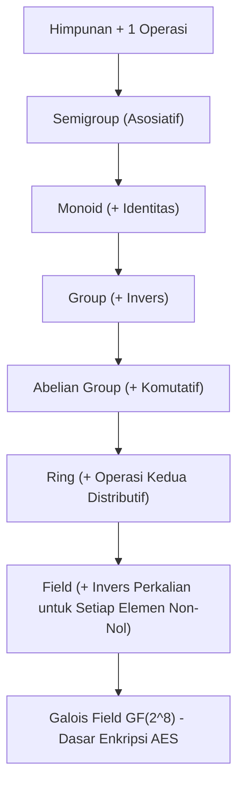

# Modul 009: Aljabar Abstrak (Grup, Ring, Medan, dan Galois Fields GF(2^n) untuk Kriptografi)

**Navigasi**: [⬅️ Master Index](../../INDEX.md) | [Tingkat 1: Tingkat 1: Fondasi Matematika Komprehensif Dari Nol](./README.md)
*Sebelumnya*: [008. teori-bilangan-aritmatika-modular](./008-teori-bilangan-aritmatika-modular.md) | *Berikutnya*: [010. geometri-analitik-trigonometri](./010-geometri-analitik-trigonometri.md)

---

## 1. Intuisi Dasar Tanpa Jargon ("Seperti Bayi Baru Lahir")
### 1.1 Konsep Inti & Analogi Tanpa Jargon
Pernahkah Anda memutar rubik's cube? Setiap putaran adalah sebuah aksi. Jika Anda memutar 90 derajat searah jarum jam, selalu ada aksi kebalikannya (putar 90 derajat berlawanan jarum jam) untuk mengembalikannya ke posisi semula. Tidak peduli urutan putaran apa yang Anda lakukan, kubus tetap utuh dan setiap kombinasi putaran menghasilkan status kubus yang sah.

### 1.2 Urgensi Rekayasa & Signifikansi Sistemik
**Aljabar Abstrak** adalah ilmu tentang "struktur simetri murni". Alih-alih hanya berurusan dengan angka, aljabar abstrak mengamati objek matematika apa pun (himpunan, simetri, matriks, rotasi) yang memiliki aturan operasi tertentu. Struktur Grup, Ring, Medan (*Field*), dan *Galois Field* $GF(2^n)$ adalah jantung penggerak dari enkripsi AES di smartphone Anda dan kode koreksi kesalahan di satelit luar angkasa!

## 2. Fondasi Teoretis & Aksiomatik / Matematis
### 2.1 Kerangka Teori Aksiomatik & Formulasi Matematis
### 1. Hierarki Struktur Aljabar
- **Grup $(G, \star)$**: Himpunan dengan satu operasi biner yang memenuhi 4 aksioma:
  1. Penutupan (*Closure*): $\forall a, b \in G, a \star b \in G$
  2. Asosiatif: $(a \star b) \star c = a \star (b \star c)$
  3. Elemen Identitas ($e$): $\exists e \in G, a \star e = e \star a = a$
  4. Elemen Invers: $\forall a \in G, \exists a^{-1} \in G, a \star a^{-1} = e$
  (Jika komutatif $a \star b = b \star a$, disebut Grup Abelian).
- **Ring $(R, +, \cdot)$**: Grup Abelian di bawah penjumlahan $(+)$, asosiatif di bawah perkalian $(\cdot)$, dan distributif.
- **Medan / Field $(\mathbb{F}, +, \cdot)$**: Ring komutatif di mana setiap elemen non-nol memiliki invers perkalian.

### 2.2 Penurunan Matematis Langkah-demi-Langkah
### 2. Galois Field $GF(p^n)$ (Medan Berhingga)
Medan berhingga dengan $q = p^n$ elemen ($p$ prima).
Untuk kriptografi perangkat keras (AES): $GF(2^8) = \mathbb{Z}_2[x] / \langle m(x) \rangle$ dengan polinomial tak tereduksi Rijndael:
$$m(x) = x^8 + x^4 + x^3 + x + 1 \quad (\text{0x11B})$$
Penjumlahan di $GF(2^n)$ adalah operasi bitwise XOR $(\oplus)$, sedangkan perkalian adalah perkalian polinomial modulo $m(x)$.
[📚 Pelajari: Harvard Math 122 Abstract Algebra Notes](https://abel.math.harvard.edu/~gross/m122/)

## 3. Anatomi Teknis & Cara Kerja Internal


#### Tabel Penelusuran Operasi Perkalian Polinomial Medan Galois $\text{GF}(2^8)$ (Rijndael AES Field)
| Langkah / Siklus | Operand A (Polinomial / Byte) | Operand B (Bit Aktif) | Aksi Bitwise & Reduksi Polinomial Irreduktibel $P(x) = x^8+x^4+x^3+x+1$ | Nilai Akumulator Sementara | Status Carry / Overflow |
|---|---|---|---|---|---|
| Inisialisasi T=0 | `0x57` ($x^6+x^4+x^2+x+1$) | `0x13` (Bit 0 aktif: $1$) | Akumulasikan: $res = res \oplus A$ | `0x57` | Bit 0 dari B diproses |
| Langkah 1 | Geser kiri `0x57` $\to$ `0xAE` | Bit 1 aktif: $1$ | MSB bit 7 sebelumnya $= 0$; tidak perlu reduksi $0x11B$ | $res = 0x57 \oplus 0xAE = 0xF9$ | Bit 1 dari B diproses |
| Langkah 2 | Geser kiri `0xAE` $\to$ `0x15C` | Bit 2 tidak aktif ($0$) | MSB bit 7 sebelumnya $= 1$; reduksi: `0x15C` $\oplus$ `0x11B` = `0x47` | `0xF9` (Tidak berubah) | Reduksi modulo $P(x)$ |
| Langkah 3 | Geser kiri `0x47` $\to$ `0x8E` | Bit 3 tidak aktif ($0$) | MSB bit 7 sebelumnya $= 0$; nilai $= 0x8E$ | `0xF9` | - |
| Langkah 4 | Geser kiri `0x8E` $\to$ `0x11C` | Bit 4 aktif: $1$ | MSB bit 7 sebelumnya $= 1$; reduksi: `0x11C` $\oplus$ `0x11B` = `0x07` | $res = 0xF9 \oplus 0x07 = 0xFE$ | Hasil akhir perkalian Rijndael |
| Selesai | Evaluasi Hasil | `0x57 * 0x13 mod P(x)` | Invarian Medan Terjaga: Hasil elemen $\in \text{GF}(2^8)$ | `0xFE` | Operasi medan terbukti tertutup |

## 4. Implementasi Praktis & Kode / Simulasi Riil
```python
def gf28_multiply(a: int, b: int, irreducible_poly: int = 0x11B) -> int:
    """
    Perkalian dua elemen pada Galois Field GF(2^8) modulo polinomial Rijndael (AES).
    Implementasi algoritma 'Russian Peasant Multiplication' berbasis bitwise.
    """
    p = 0
    for _ in range(8):
        if b & 1:
            p ^= a # Penjumlahan di GF(2) adalah XOR
        high_bit_set = a & 0x80
        a = (a << 1) & 0xFF
        if high_bit_set:
            a ^= (irreducible_poly & 0xFF) # Reduksi modulo polinomial
        b >>= 1
    return p

# Contoh Perkalian AES SubBytes: 0x57 * 0x83 = 0xC1 di GF(2^8)
val1 = 0x57
val2 = 0x83
result = gf28_multiply(val1, val2)
print(f"Perkalian Galois Field GF(2^8): 0x{val1:02X} * 0x{val2:02X} = 0x{result:02X}")
assert result == 0xC1
print("Hasil Sesuai Standar FIPS-197 AES NIST!")
```

## 5. Miskonsepsi & Jebakan Industri
1. **Mengira Operasi Perkalian di Medan Berhingga Sama dengan Aritmatika Biasa**: Mengalikan $0x57 \times 0x83$ di CPU menghasilkan $0x2C55$, tetapi di $GF(2^8)$ hasilnya adalah $0xC1$. Mengabaikan reduksi polinomial adalah penyebab utama kegagalan implementasi kriptografi manual.

### Studi Kasus Kegagalan Nyata: Pembobolan Kunci Privat ECDSA Sony PlayStation 3 Akibat Penggunaan Nonce Statis (2010)
- **Kronologi & Konteks Keamanan**: Pada Konferensi Chaos Communication Congress (27C3) Desember 2010, kelompok peretas fail0verflow mendemonstrasikan pembobolan total sistem keamanan konsol Sony PlayStation 3, mengekstraksi root private key penandatanganan firmware.
- **Akar Masalah Aljabar Abstrak**: Algoritma tanda tangan kurva eliptik (ECDSA) beroperasi pada grup siklik berorde prima $n$. Penandatanganan pesan menghasilkan pasangan $(r, s)$ menggunakan nilai acak (*nonce*) rahasia $k$: $r = (k G)_x \pmod n$ dan $s = k^{-1}(z + r d) \pmod n$. Sony mengabaikan aksioma keacakan dan menggunakan nilai $k$ yang sama persis untuk setiap penandatanganan. Dari dua tanda tangan berbeda, penyerang menyelesaikan sistem persamaan linear sederhana dalam medan hingga $\mathbb{F}_n$ dan menurunkan master private key $d$ dalam milidetik.

- **Potongan Kode / Arsitektur Cacat (Vulnerable Implementation)**:
```python
# Rekonstruksi Ekstraksi Kunci Privat ECDSA Akibat Penggunaan Kembali Nonce k
def recover_ecdsa_private_key(r: int, s1: int, s2: int, z1: int, z2: int, n: int) -> int:
    """
    Menurunkan kunci privat d dari dua tanda tangan (r, s1) dan (r, s2)
    yang dibuat dengan pesan z1 dan z2 menggunakan nonce k yang sama.
    Operasi dilakukan dalam medan hingga F_n (Aljabar Abstrak).
    """
    # s1 - s2 = k^(-1) * (z1 - z2) mod n
    # k = (z1 - z2) * (s1 - s2)^(-1) mod n
    delta_z = (z1 - z2) % n
    delta_s = (s1 - s2) % n
    
    assert delta_s != 0, "s1 dan s2 tidak boleh identik"
    
    # Inversi modular dalam grup hingga modulo n
    k = (delta_z * pow(delta_s, -1, n)) % n
    
    # s1 = k^(-1) * (z1 + r * d) mod n
    # d = r^(-1) * (s1 * k - z1) mod n
    r_inv = pow(r, -1, n)
    d = (r_inv * (s1 * k - z1)) % n
    
    return d

# Parameter uji coba grup kurva eliptik mainan
n_order = 115792089237316195423570985008687907852837564279074904382605163141518161494337
real_private_key = 0xDEADBEEFCAFE
static_k = 0x1337BEEF
r_val = 0x5555AAAA  # (k * G).x mod n
z1_hash = 0x11112222
z2_hash = 0x33334444

s1_val = (pow(static_k, -1, n_order) * (z1_hash + r_val * real_private_key)) % n_order
s2_val = (pow(static_k, -1, n_order) * (z2_hash + r_val * real_private_key)) % n_order

cracked_key = recover_ecdsa_private_key(r_val, s1_val, s2_val, z1_hash, z2_hash, n_order)
assert cracked_key == real_private_key, "Ekstraksi master private key gagal!"
```

- **Analisis Aljabar & Mitigasi Modern**: Kerentanan ini adalah pengingat bahwa keamanan protokol kriptografi kurva eliptik bergantung mutlak pada integritas aksioma aljabar medan hingga. Standar modern RFC 6979 mewajibkan *Deterministic ECDSA*, di mana nonce $k$ diturunkan secara deterministik melalui HMAC dari hash pesan dan kunci privat ($k = \text{HMAC}(d, z)$), menjamin $k$ selalu unik untuk setiap pesan berbeda tanpa bergantung pada generator entropi acak perangkat keras.

## 6. Proyek Latihan & Rubrik Penilaian Mandiri
### Level 1 (Dasar)
Buktikan bahwa himpunan bilangan bulat $\mathbb{Z}$ di bawah operasi perkalian biasa BUKAN sebuah grup (identifikasi aksioma yang gagal).

### Level 2 (Menengah)
Bangun tabel perkalian lengkap (Cayley Table) untuk grup simetri segitiga sama sisi $S_3$ (orde 6) dan tentukan semua subgrup normalnya.

### Level 3 (Mahir)
Implementasikan tabel log dan antilog (tabel eksponensial) untuk $GF(2^8)$ guna melakukan perkalian medan berhingga dalam waktu $O(1)$ tanpa branch/percabangan (konstan waktu).

### Tingkat 1: Dasar
- **Tugas**: Bangun kelas implementasi Aritmatika Medan Galois $\text{GF}(2^8)$ dengan polinomial irreduktibel AES $P(x) = x^8 + x^4 + x^3 + x + 1$ (`0x11B`).
- **Petunjuk Perancangan Arsitektur**:
  - Implementasikan operasi penjumlahan/pengurangan (XOR $\oplus$) dan perkalian modulo $P(x)$ menggunakan algoritma xtime / peasant multiplication.
- **Test Vector & Kasus Uji Ekstrem**:
  - *Perkalian Uji*: `0x57 * 0x83` dalam $\text{GF}(2^8)$.
  - *Keluaran yang Diharapkan*: Tepat bernilai `0xC1`.
  - *Kasus Batas*: Elemen identitas perkalian `0x01` dan elemen nol `0x00`; operasi $a \times 1 = a$ dan $a \times 0 = 0$.
- **Rubrik Penilaian Mandiri**: 40% Algoritma Perkalian Medan Galois Rijndael Tepat, 30% Reduksi Polinomial `0x11B` Akurat, 30% Tanpa Modulo Aritmatika Standar.

### Tingkat 2: Menengah
- **Tugas**: Bangun verifikator aksioma aljabar abstrak yang menguji apakah sebuah struktur himpunan dan tabel operasi biner $(S, \star)$ memenuhi syarat Grup Komutatif (Abelian Group): Tertutup, Asosiatif, Memiliki Elemen Identitas, Memiliki Invers Unik, dan Komutatif.
- **Petunjuk Perancangan Arsitektur**:
  - Masukan berupa tabel Cayley matriks $N \times N$.
  - Uji asosiatifitas Light's Associativity Test untuk seluruh kombinasi $(a \star b) \star c = a \star (b \star c)$.
- **Test Vector & Kasus Uji Ekstrem**:
  - *Grup Valid*: Grup Klein 4-group ($V_4$) pada tabel Cayley 4x4; validator harus mengonfirmasi bahwa seluruh 5 aksioma abelian terpenuhi.
  - *Bukan Grup*: Semigroup tanpa invers (misal tabel perkalian modulo 6 dengan elemen 2, 3, 4); validator wajib mendeteksi ketiadaan invers.
  - *Kasus Batas*: Grup trivial berukuran 1 elemen $\{e\}$; wajib tervalidasi sebagai grup abelian valid.
- **Rubrik Penilaian Mandiri**: 40% Verifikasi Lengkap 5 Aksioma Grup Abelian, 30% Deteksi Pelanggaran Elemen Spesifik, 30% Validasi Invariant Tabel Cayley.

### Tingkat 3: Mahir
- **Tugas**: Rancang pustaka Kurva Eliptik Weierstrass atas Medan Hingga $y^2 = x^3 + ax + b \pmod p$ yang mendukung penambahan titik (*point addition*), penggandaan (*point doubling*), dan perkalian skalar menggunakan algoritma Double-and-Add.
- **Petunjuk Perancangan Arsitektur**:
  - Tangani Titik di Tak Hingga (*Point at Infinity* $\mathcal{O}$) sebagai elemen identitas grup kurva eliptik.
  - Verifikasi diskriminan kurva non-singular $4a^3 + 27b^2 \not\equiv 0 \pmod p$.
- **Test Vector & Kasus Uji Ekstrem**:
  - *Parameter Uji*: Kurva secp256k1 ($y^2 = x^3 + 7 \pmod p$). Uji identitas: $n \times G = \mathcal{O}$, di mana $n$ adalah orde generator $G$.
  - *Keluaran yang Diharapkan*: Perkalian skalar $G$ sebanyak orde menghasilkan Titik di Tak Hingga.
  - *Kasus Batas*: Penambahan titik $P + (-P)$; sistem wajib mengembalikan Titik di Tak Hingga tanpa pembagian nol.
- **Rubrik Penilaian Mandiri**: 40% Aritmatika Kurva Eliptik Proyektif/Afin Tepat, 30% Penanganan Point at Infinity Sempurna, 30% Pencegahan Side-Channel Timing Dasar.

## 7. Rekomendasi Sumber Belajar Standar Emas
- [Buku Standar: Abstract Algebra - David S. Dummit & Richard M. Foote (Wiley)](https://www.wiley.com/en-us/Abstract+Algebra%2C+3rd+Edition-p-9780471433347)
- [Kuliah Terbuka: MIT OCW 18.701 Algebra I - Michael Artin](https://ocw.mit.edu/courses/18-701-algebra-i-fall-2010/)
- [Dokumentasi Standar NIST: FIPS PUB 197 Advanced Encryption Standard (AES)](https://csrc.nist.gov/publications/detail/fips/197/final)

---
*Navigasi Cepat*: [Ke Tingkat 1](./README.md) | [Ke Master Index](../../INDEX.md) | *Sebelumnya*: [008. teori-bilangan-aritmatika-modular](./008-teori-bilangan-aritmatika-modular.md) | *Berikutnya*: [010. geometri-analitik-trigonometri](./010-geometri-analitik-trigonometri.md)
