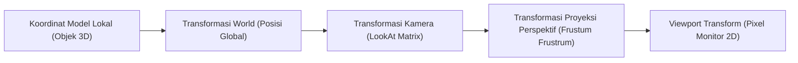

# Modul 010: Geometri Analitik & Trigonometri (Sistem Koordinat 3D Spasial & Proyeksi Vektor)

**Navigasi**: [⬅️ Master Index](../../INDEX.md) | [Tingkat 1: Tingkat 1: Fondasi Matematika Komprehensif Dari Nol](./README.md)
*Sebelumnya*: [009. aljabar-abstrak](./009-aljabar-abstrak.md) | *Berikutnya*: [011. aljabar-linier-teori-matriks](./011-aljabar-linier-teori-matriks.md)

---

## 1. Intuisi Dasar Tanpa Jargon ("Seperti Bayi Baru Lahir")
Bagaimana game 3D seperti Cyberpunk atau simulator pesawat menghitung sudut pandang pilot ketika pesawat menukik, berputar 45 derajat, dan menembakkan rudal ke arah target yang bergerak? Game engine tidak menebak-nebak: game engine menggunakan **Geometri Analitik & Trigonometri Spasial**. 

Setiap titik di dunia virtual adalah koordinat $(x, y, z)$. Vektor adalah panah yang menunjukkan arah dan kecepatan. Proyeksi vektor menghitung 'bayangan' rudal di atas tanah, dan perkalian silang (*cross product*) menemukan arah tegak lurus sempurna untuk memantulkan cahaya dari permukaan poligon!

## 2. Fondasi Teoretis & Aksiomatik / Matematis
### 1. Vektor Spasial & Operasi Dasar di $\mathbb{R}^3$
- Vektor posisi: $\mathbf{v} = [x, y, z]^T$, Panjang (Norma Euclidean): $\|\mathbf{v}\| = \sqrt{x^2 + y^2 + z^2}$.
- **Dot Product (Hasil Kali Titik)**:
  $$\mathbf{a} \cdot \mathbf{b} = \|\mathbf{a}\| \|\mathbf{b}\| \cos \theta = a_x b_x + a_y b_y + a_z b_z$$
  Proyeksi Ortogonal $\mathbf{a}$ pada $\mathbf{b}$:
  $$\text{proj}_{\mathbf{b}} \mathbf{a} = \frac{\mathbf{a} \cdot \mathbf{b}}{\|\mathbf{b}\|^2} \mathbf{b}$$
- **Cross Product (Hasil Kali Silang)**:
  $$\mathbf{a} \times \mathbf{b} = \det \begin{bmatrix} \mathbf{i} & \mathbf{j} & \mathbf{k} \\ a_x & a_y & a_z \\ b_x & b_y & b_z \end{bmatrix} = \|\mathbf{a}\| \|\mathbf{b}\| \sin \theta \; \mathbf{n}$$
  Menghasilkan vektor yang tegak lurus terhadap kedua vektor $\mathbf{a}$ dan $\mathbf{b}$ (aturan tangan kanan).
[📚 Pelajari: 3Blue1Brown - Essence of Linear Algebra (Dot & Cross Product)](https://www.3blue1brown.com/lessons/dot-products)

## 3. Anatomi Teknis & Cara Kerja Internal


## 4. Implementasi Praktis & Kode / Simulasi Riil
```python
import numpy as np

def compute_surface_normal_and_projection(v1, v2, light_vector):
    """
    Menghitung vektor normal permukaan poligon 3D dan intensitas pencahayaan Lambertian.
    """
    v1 = np.array(v1, dtype=float)
    v2 = np.array(v2, dtype=float)
    light = np.array(light_vector, dtype=float)
    light_norm = light / np.linalg.norm(light)
    
    # Cross product untuk mencari vektor normal bidang
    normal = np.cross(v1, v2)
    normal_unit = normal / np.linalg.norm(normal)
    
    # Dot product untuk menghitung pencahayaan (Hukum Kosinus Lambert)
    intensity = max(0.0, np.dot(normal_unit, -light_norm))
    
    # Proyeksi vektor cahaya pada normal
    proj_light = (np.dot(light, normal_unit)) * normal_unit
    
    return normal_unit, intensity, proj_light

# Segitiga 3D pada bidang XY
edge1 = [1.0, 0.0, 0.0]
edge2 = [0.0, 1.0, 0.0]
cahaya = [0.0, 0.0, -1.0] # Datang dari atas sumbu Z

norm_vec, light_intensity, proj = compute_surface_normal_and_projection(edge1, edge2, cahaya)
print("Vektor Normal Permukaan:", norm_vec)
print("Intensitas Cahaya Permukaan:", light_intensity)
```

## 5. Miskonsepsi & Jebakan Industri
1. **Gimbal Lock**: Memutar rotasi 3D menggunakan 3 sudut Euler $(pitch, yaw, roll)$ dapat memicu hilangnya 1 derajat kebebasan saat sumbu rotasi sejajar. Solusi standar industri game/robotika: selalu gunakan **Unit Quaternion** $\mathbf{q} = w + xi + yj + zk$.

## 6. Proyek Latihan & Rubrik Penilaian Mandiri
### Level 1 (Dasar)
Hitung sudut antara dua vektor 3D $\mathbf{a} = [1, 2, 3]$ dan $\mathbf{b} = [4, -1, 2]$ menggunakan rumus dot product.

### Level 2 (Menengah)
Bangun fungsi kamera `look_at(eye, target, up)` yang menghasilkan matriks rotasi dan translasi kamera $4 \times 4$ untuk grafika 3D.

### Level 3 (Mahir)
Implementasikan deteksi tabrakan ray-triangle intersection (algoritma Möller-Trumbore) berbasis proyeksi vektor dan koordinat barisentrik.

## 7. Rekomendasi Sumber Belajar Standar Emas
- [Buku Standar: Real-Time Rendering (4th ed.) - Tomas Akenine-Möller et al. (CRC Press)](https://www.realtimerendering.com/)
- [Kuliah Terbuka: UC Berkeley CS184 Computer Graphics and Imaging](https://cs184.org/lectures)
- [Simulator Interaktif: Desmos 3D Graphing Calculator](https://www.desmos.com/3d)

---
*Navigasi Cepat*: [Ke Tingkat 1](./README.md) | [Ke Master Index](../../INDEX.md) | *Sebelumnya*: [009. aljabar-abstrak](./009-aljabar-abstrak.md) | *Berikutnya*: [011. aljabar-linier-teori-matriks](./011-aljabar-linier-teori-matriks.md)
