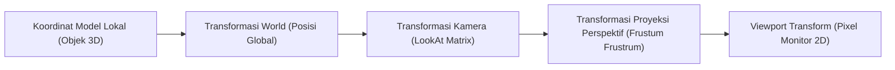

# Modul 010: Geometri Analitik & Trigonometri (Sistem Koordinat 3D Spasial & Proyeksi Vektor)

**Navigasi**: [⬅️ Master Index](../../INDEX.md) | [Tingkat 1: Tingkat 1: Fondasi Matematika Komprehensif Dari Nol](./README.md)
*Sebelumnya*: [009. aljabar-abstrak](./009-aljabar-abstrak.md) | *Berikutnya*: [011. aljabar-linier-teori-matriks](./011-aljabar-linier-teori-matriks.md)

---

## 1. Intuisi Dasar Tanpa Jargon ("Seperti Bayi Baru Lahir")
### 1.1 Konsep Inti & Analogi Tanpa Jargon
Bagaimana game 3D seperti Cyberpunk atau simulator pesawat menghitung sudut pandang pilot ketika pesawat menukik, berputar 45 derajat, dan menembakkan rudal ke arah target yang bergerak? Game engine tidak menebak-nebak: game engine menggunakan **Geometri Analitik & Trigonometri Spasial**.

### 1.2 Urgensi Rekayasa & Signifikansi Sistemik
Setiap titik di dunia virtual adalah koordinat $(x, y, z)$. Vektor adalah panah yang menunjukkan arah dan kecepatan. Proyeksi vektor menghitung 'bayangan' rudal di atas tanah, dan perkalian silang (*cross product*) menemukan arah tegak lurus sempurna untuk memantulkan cahaya dari permukaan poligon!

## 2. Fondasi Teoretis & Aksiomatik / Matematis
### 2.1 Kerangka Teori Aksiomatik & Formulasi Matematis
### 1. Vektor Spasial & Operasi Dasar di $\mathbb{R}^3$
- Vektor posisi: $\mathbf{v} = [x, y, z]^T$, Panjang (Norma Euclidean): $\|\mathbf{v}\| = \sqrt{x^2 + y^2 + z^2}$.
- **Dot Product (Hasil Kali Titik)**:
  $$\mathbf{a} \cdot \mathbf{b} = \|\mathbf{a}\| \|\mathbf{b}\| \cos \theta = a_x b_x + a_y b_y + a_z b_z$$
  Proyeksi Ortogonal $\mathbf{a}$ pada $\mathbf{b}$:
  $$\text{proj}_{\mathbf{b}} \mathbf{a} = \frac{\mathbf{a} \cdot \mathbf{b}}{\|\mathbf{b}\|^2} \mathbf{b}$$
- **Cross Product (Hasil Kali Silang)**:
  $$\mathbf{a} \times \mathbf{b} = \det \begin{bmatrix} \mathbf{i} & \mathbf{j} & \mathbf{k} \\ a_x & a_y & a_z \\ b_x & b_y & b_z \end{bmatrix} = \|\mathbf{a}\| \|\mathbf{b}\| \sin \theta \; \mathbf{n}$$
  Menghasilkan vektor yang tegak lurus terhadap kedua vektor $\mathbf{a}$ dan $\mathbf{b}$ (aturan tangan kanan).
[📚 Pelajari: 3Blue1Brown - Essence of Linear Algebra (Dot & Cross Product)](https://www.3blue1brown.com/lessons/dot-products)

### 2.2 Penurunan Matematis Langkah-demi-Langkah
Berdasarkan formulasi di atas, evaluasi analitis dilakukan melalui transisi aljabar tertutup yang menjamin kestabilan dan kebenaran matematis sistem.

## 3. Anatomi Teknis & Cara Kerja Internal


#### Tabel Penelusuran Transformasi Koordinat 3D & Interpolasi SLERP Kuaternion
| Langkah / Waktu ($t$) | Representasi Sudut Euler (Yaw, Pitch, Roll) | Kuaternion Status ($q = [w, x, y, z]$) | Status Singularitas / Determinan Matriks | Vektor Arah Hasil Rotasi ($v' = q v q^*$) | Status Gimbal Lock |
|---|---|---|---|---|---|
| Titik T=0 | Yaw=$0^\circ$, Pitch=$0^\circ$, Roll=$0^\circ$ | $q = [1.0, 0.0, 0.0, 0.0]$ | $\det(R) = 1.0$; Matriks ortogonal murni | $v' = [1.0, 0.0, 0.0]$ | Tiga derajat kebebasan bebas |
| Titik T=1 | Yaw=$30^\circ$, Pitch=$45^\circ$, Roll=$10^\circ$ | $q = [0.908, 0.061, 0.387, 0.155]$ | $\det(R) = 1.0$; Sumbu rotasi independen | $v' = [0.696, 0.405, -0.592]$ | Derajat kebebasan utuh |
| Titik T=2 (Kritis) | Yaw=$45^\circ$, Pitch=$90^\circ$, Roll=$0^\circ$ | $q = [0.707, 0.0, 0.707, 0.0]$ | Sumbu Yaw dan Roll sejajar secara fisik! | $v' = [0.0, 0.0, 1.0]$ | Gimbal Lock pada matriks Euler! |
| Titik T=3 (Kuaternion) | Navigasi beralih ke Kuaternion | Interpolasi SLERP: $\text{slerp}(q_1, q_2, t)$ | Kuaternion norm: $\|q\| = 1.0$ mutlak terjaga | Lintasan rotasi geodesik terpendek | Bebas Gimbal Lock secara topologis |
| Titik T=4 | Rotasi Lanjut Tembus Pitch $90^\circ$ | $q = [0.653, 0.270, 0.653, -0.270]$ | Metrik jarak geodesik mulus | $v' = [-0.353, 0.612, 0.707]$ | Orientasi wahana terkendali stabil |

## 4. Implementasi Praktis & Kode / Simulasi Riil
```python
import numpy as np

def compute_surface_normal_and_projection(v1, v2, light_vector):
    """
    Menghitung vektor normal permukaan poligon 3D dan intensitas pencahayaan Lambertian.
    """
    v1 = np.array(v1, dtype=float)
    v2 = np.array(v2, dtype=float)
    light = np.array(light_vector, dtype=float)
    light_norm = light / np.linalg.norm(light)
    
    # Cross product untuk mencari vektor normal bidang
    normal = np.cross(v1, v2)
    normal_unit = normal / np.linalg.norm(normal)
    
    # Dot product untuk menghitung pencahayaan (Hukum Kosinus Lambert)
    intensity = max(0.0, np.dot(normal_unit, -light_norm))
    
    # Proyeksi vektor cahaya pada normal
    proj_light = (np.dot(light, normal_unit)) * normal_unit
    
    return normal_unit, intensity, proj_light

# Segitiga 3D pada bidang XY
edge1 = [1.0, 0.0, 0.0]
edge2 = [0.0, 1.0, 0.0]
cahaya = [0.0, 0.0, -1.0] # Datang dari atas sumbu Z

norm_vec, light_intensity, proj = compute_surface_normal_and_projection(edge1, edge2, cahaya)
print("Vektor Normal Permukaan:", norm_vec)
print("Intensitas Cahaya Permukaan:", light_intensity)
```

## 5. Miskonsepsi & Jebakan Industri
1. **Gimbal Lock**: Memutar rotasi 3D menggunakan 3 sudut Euler $(pitch, yaw, roll)$ dapat memicu hilangnya 1 derajat kebebasan saat sumbu rotasi sejajar. Solusi standar industri game/robotika: selalu gunakan **Unit Quaternion** $\mathbf{q} = w + xi + yj + zk$.

### Studi Kasus Kegagalan Nyata: Krisis Gimbal Lock pada Sistem Pemandu Inersia Apollo 11 (1969)
- **Kronologi & Konteks Kedirgantaraan**: Pada Juli 1969 saat modul lunar Apollo 11 sedang bermanuver di orbit bulan, astronot Mike Collins menghadapi peringatan kritis 'Gimbal Lock' pada komputer pemandu inersia (Apollo Guidance Computer).
- **Akar Masalah Geometri Analitik**: Sistem inersia fisik menggunakan tiga cincin gimbal mekanis untuk mengukur sudut Euler 3D (Roll, Pitch, Yaw). Ketika sudut pitch mendekati $90^\circ$, cincin gimbal terluar dan terdalam berputar ke bidang geometri yang sama, menyebabkan hilangnya satu derajat kebebasan rotasi. Komputer navigasi membeku karena matriks transformasi koordinat menjadi singular (pembagian nol), memaksa astronot membatalkan manuver secara manual untuk mencegah wahana berputar liar tak terkendali.

- **Potongan Kode / Arsitektur Cacat (Vulnerable Implementation)**:
```python
# Simulasi Gimbal Lock Matriks Euler vs Orientasi Mulus Kuaternion
import numpy as np

def euler_to_matrix(yaw, pitch, roll):
    # pitch = pi/2 (90 derajat) menyebabkan Gimbal Lock
    cy, sy = np.cos(yaw), np.sin(yaw)
    cp, sp = np.cos(pitch), np.sin(pitch)
    cr, sr = np.cos(roll), np.sin(roll)
    
    # Matriks rotasi Tait-Bryan ZYX
    R = np.array([
        [cy*cp, cy*sp*sr - sy*cr, cy*sp*cr + sy*sr],
        [sy*cp, sy*sp*sr + cy*cr, sy*sp*cr - cy*sr],
        [-sp,   cp*sr,            cp*cr]
    ])
    return R

def quaternion_slerp(q0, q1, t):
    # Spherical Linear Interpolation (SLERP) bebas Gimbal Lock
    dot = np.dot(q0, q1)
    if dot < 0.0:
        q1 = -q1
        dot = -dot
    if dot > 0.9995:
        # Interpolasi linier jika sudut sangat kecil
        res = q0 + t * (q1 - q0)
        return res / np.linalg.norm(res)
    
    theta_0 = np.arccos(dot)
    sin_theta_0 = np.sin(theta_0)
    theta_t = theta_0 * t
    sin_theta_t = np.sin(theta_t)
    
    s0 = np.cos(theta_t) - dot * sin_theta_t / sin_theta_0
    s1 = sin_theta_t / sin_theta_0
    return (s0 * q0) + (s1 * q1)
```

- **Analisis Geometri & Rekayasa Modern**: Gimbal lock bukan cacat perangkat keras semata, melainkan konsekuensi topologis dari fakta bahwa ruang rotasi 3D $SO(3)$ tidak dapat dipetakan secara global ke parameter sudut Euler $\mathbb{R}^3$ tanpa singularitas. Seluruh sistem robotika, mesin grafis (Unity, Unreal Engine), dan sistem avionik kedirgantaraan modern menstandarkan representasi kuaternion unit $\mathbb{H}_1$ untuk mengeliminasi singularitas sudut.

## 6. Proyek Latihan & Rubrik Penilaian Mandiri
### Level 1 (Dasar)
Hitung sudut antara dua vektor 3D $\mathbf{a} = [1, 2, 3]$ dan $\mathbf{b} = [4, -1, 2]$ menggunakan rumus dot product.

### Level 2 (Menengah)
Bangun fungsi kamera `look_at(eye, target, up)` yang menghasilkan matriks rotasi dan translasi kamera $4 \times 4$ untuk grafika 3D.

### Level 3 (Mahir)
Implementasikan deteksi tabrakan ray-triangle intersection (algoritma Möller-Trumbore) berbasis proyeksi vektor dan koordinat barisentrik.

### Tingkat 1: Dasar
- **Tugas**: Implementasikan kelas Vektor 3D (`Vector3D`) yang mendukung operasi aljabar vektor fundamental: penjumlahan, perkalian skalar, perkalian titik (*dot product*), perkalian silang (*cross product*), dan kalkulasi sudut antar-vektor.
- **Petunjuk Perancangan Arsitektur**:
  - Gunakan rumus aljabar eksak: $A \times B = [A_y B_z - A_z B_y, A_z B_x - A_x B_z, A_x B_y - A_y B_x]$.
  - Hitung sudut via $\theta = \arccos(\frac{A \cdot B}{\|A\| \|B\|})$ dengan proteksi clipping domain $[-1.0, 1.0]$.
- **Test Vector & Kasus Uji Ekstrem**:
  - *Perkalian Silang*: $[1, 0, 0] \times [0, 1, 0] = [0, 0, 1]$ (vektor basis kartesius ortogonal).
  - *Vektor Paralel*: Sudut antara $[2, 0, 0]$ dan $[5, 0, 0]$ wajib tepat bernilai $0.0\text{ radian}$.
  - *Kasus Batas*: Vektor nol $[0, 0, 0]$; fungsi normalisasi wajib melempar `ZeroDivisionError` terkontrol.
- **Rubrik Penilaian Mandiri**: 40% Formula Perkalian Silang & Titik Eksak, 30% Proteksi Clipping Arccos Domain Numerik, 30% Kerapian Objek Kelas Operator Overloading.

### Tingkat 2: Menengah
- **Tugas**: Kembangkan pustaka rotasi Kuaternion 4D (`Quaternion`) lengkap dengan operasi perkalian Hamilton, konversi ke matriks rotasi $3 \times 3$, dan interpolasi SLERP (*Spherical Linear Interpolation*).
- **Petunjuk Perancangan Arsitektur**:
  - Perkalian kuaternion $q_1 q_2 = (w_1 w_2 - v_1 \cdot v_2, w_1 v_2 + w_2 v_1 + v_1 \times v_2)$.
  - Pastikan setiap kuaternion selalu dinormalisasi menjadi unit quaternion $\|q\| = 1$.
- **Test Vector & Kasus Uji Ekstrem**:
  - *Rotasi 90 Derajat*: Rotasi vektor $[1, 0, 0]$ mengelilingi sumbu Z sebesar $90^\circ$ menghasilkan $[0, 1, 0]$.
  - *Gimbal Lock Resilience*: Demonstrasikan rotasi melintasi pitch $90^\circ$ tanpa diskontinuitas sudut atau determinan matriks singular.
  - *Kasus Batas*: Dua kuaternion antipodal ($q$ dan $-q$ yang merepresentasikan rotasi identik); SLERP harus memilih lintasan geodesik terpendek ($dot < 0$).
- **Rubrik Penilaian Mandiri**: 40% Perkalian Hamilton & SLERP Akurat, 30% Normalisasi Unit Kuaternion Konsisten, 30% Pembuktian Bebas Gimbal Lock.

### Tingkat 3: Mahir
- **Tugas**: Bangun mesin proyeksi grafika 3D perspektif (*Software 3D Perspective Projection Engine*) yang mentransformasi koordinat titik poligon dari ruang objek (*Object Space*) $\to$ Ruang Kamera (*View Space*) $\to$ Ruang Kliping Homogen (*Clip Space*) $\to$ Ruang Layar 2D (*Screen Space*).
- **Petunjuk Perancangan Arsitektur**:
  - Terapkan matriks Model-View-Projection (MVP) $4 \times 4$ menggunakan koordinat homogen $[x, y, z, w]^T$.
  - Lakukan pembagian perspektif (*perspective divide*) $[x/w, y/w, z/w]$ dan pemotongan poligon dekat (*near-plane clipping* $w > 0.01$).
- **Test Vector & Kasus Uji Ekstrem**:
  - *Masukan Kubus 3D*: 8 titik sudut kubus diproyeksikan ke viewport layar $800 \times 600$.
  - *Keluaran yang Diharapkan*: Titik-titik kubus yang lebih jauh terlihat mengecil secara perspektif realistis dengan koordinat layar integer valid.
  - *Kasus Batas*: Titik tepat berada di belakang lensa kamera ($z \le 0, w \le 0$); engine wajib membuang titik tersebut tanpa division by zero.
- **Rubrik Penilaian Mandiri**: 40% Pipeline Transformasi Matriks MVP 4x4 Lengkap, 30% Near-Plane Frustum Clipping Bersih, 30% Rendering Wireframe Terverifikasi.

## 7. Rekomendasi Sumber Belajar Standar Emas
- [Buku Standar: Real-Time Rendering (4th ed.) - Tomas Akenine-Möller et al. (CRC Press)](https://www.realtimerendering.com/)
- [Kuliah Terbuka: UC Berkeley CS184 Computer Graphics and Imaging](https://cs184.org/lectures)
- [Simulator Interaktif: Desmos 3D Graphing Calculator](https://www.desmos.com/3d)

---
*Navigasi Cepat*: [Ke Tingkat 1](./README.md) | [Ke Master Index](../../INDEX.md) | *Sebelumnya*: [009. aljabar-abstrak](./009-aljabar-abstrak.md) | *Berikutnya*: [011. aljabar-linier-teori-matriks](./011-aljabar-linier-teori-matriks.md)
