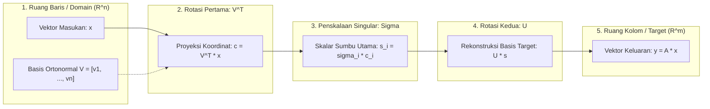

# Modul 011: Aljabar Linier & Teori Matriks (Ruang Vektor, Eigenvalues, SVD, Dekomposisi Tensor)

**Navigasi**: [⬅️ Master Index](../../INDEX.md) | [Tingkat 1: Fondasi Matematika Komprehensif Dari Nol](./README.md)
*Sebelumnya*: [010. geometri-analitik-trigonometri](./010-geometri-analitik-trigonometri.md) | *Berikutnya*: [012. matematika-diskrit-kombinatorika-graf](./012-matematika-diskrit-kombinatorika-graf.md)

---

> 📚 **Portal Modul Tingkat Buku Teks (Textbook-Grade Master Gateway)**  
> Modul 011 ini berfungsi sebagai gerbang utama (*Master Gateway*) dan ikhtisar eksekutif bagi kurikulum aljabar linier komprehensif berstandar internasional (setara gabungan silabus **MIT 18.06**, **MIT 18.065**, teks klasik **Gilbert Strang**, serta literatur rujukan dekomposisi multilinier **Kolda & Bader**).  
> 
> Untuk mempelajari modul ini secara mendalam bab-demi-bab lengkap dengan pembuktian matematika utuh tanpa langkah yang dilewati, kalkulasi manual, kode produksi, dan latihan interaktif (~60 jam studi terstruktur), silakan jelajahi 9 bab subtopik modular berikut:
> 
> - 🗺️ **Peta Silabus & Panduan Belajar Utama**: [011-aljabar-linier-teori-matriks/README.md](./011-aljabar-linier-teori-matriks/README.md)
> - 📄 **Bab 01**: [Vektor, Operasi Ruang, Ax=b, Eliminasi Gauss, LU & PA=LU](./011-aljabar-linier-teori-matriks/01-vektor-eliminasi-matriks.md)
> - 📄 **Bab 02**: [Ruang Vektor, Basis, Dimensi, 4 Subruang Fundamental, FTLA & Faktorisasi A=CR](./011-aljabar-linier-teori-matriks/02-ruang-vektor-subruang-fundamental.md)
> - 📄 **Bab 03**: [Ortogonalitas, Proyeksi Subruang, Least Squares, Gram-Schmidt MGS & QR](./011-aljabar-linier-teori-matriks/03-ortogonalitas-proyeksi-faktor-qr.md)
> - 📄 **Bab 04**: [Aksioma Determinan, Rumus Permutasi Leibniz, Kofaktor Laplace, Cramer & Volume](./011-aljabar-linier-teori-matriks/04-determinan-teori-matriks.md)
> - 📄 **Bab 05**: [Nilai & Vektor Eigen, Polinomial Karakteristik, Diagonalisasi, Pangkat Ak & Rantai Markov](./011-aljabar-linier-teori-matriks/05-nilai-vektor-eigen-diagonalisasi.md)
> - 📄 **Bab 06**: [Matriks Simetris, Teorema Spektral, Bentuk Kuadratik, Definit Positif & Cholesky](./011-aljabar-linier-teori-matriks/06-matriks-simetris-definit-positif.md)
> - 📄 **Bab 07**: [Singular Value Decomposition (SVD), Teorema Eckart-Young & Moore-Penrose Pseudoinverse](./011-aljabar-linier-teori-matriks/07-svd-dan-pseudoinverse.md)
> - 📄 **Bab 08**: [Principal Component Analysis (PCA), Matriks Kovarians & Reduksi Dimensi Data](./011-aljabar-linier-teori-matriks/08-pca-analisis-komponen-utama.md)
> - 📄 **Bab 09**: [Aljabar Multilinier, Tensor N-Arah, Matrisasi, Dekomposisi CP & Tucker (HOSVD)](./011-aljabar-linier-teori-matriks/09-aljabar-multilinier-dekomposisi-tensor.md)

---

## 1. Intuisi Dasar Tanpa Jargon

### 1.1 Konsep Inti: Dari Cerita Warung ke Peregangan Ruang Kontinu
Bagi pemula yang baru pertama kali menyentuh aljabar linier, jangan membayangkan rumus rumit terlebih dahulu. Mari kita mulai dari obrolan santai di warung makan:

Bayangkan Anda memesan **2 piring nasi goreng** dan **1 gelas es teh** dengan total tagihan Rp 25.000. Keesokan harinya, teman Anda memesan **1 piring nasi goreng** dan **2 gelas es teh** dengan total tagihan Rp 20.000. Berapakah harga satu porsi nasi goreng ($x_1$) dan segelas es teh ($x_2$)?

Secara intuitif, Anda sedang berurusan dengan sebuah sistem persamaan linier:
$$2x_1 + 1x_2 = 25.000$$
$$1x_1 + 2x_2 = 20.000$$

Aljabar linier lahir dari ide sederhana: **pisahkan angka pesanan dari barang yang dipesan**. Angka-angka pesanan kita kumpulkan ke dalam sebuah tabel kotak 2 dimensi yang disebut **matriks** $A$, daftar barang yang dicari menjadi **vektor** $\mathbf{x}$, dan total harga menjadi vektor $\mathbf{b}$:
$$\begin{bmatrix} 2 & 1 \\ 1 & 2 \end{bmatrix} \begin{bmatrix} x_1 \\ x_2 \end{bmatrix} = \begin{bmatrix} 25.000 \\ 20.000 \end{bmatrix} \iff A\mathbf{x} = \mathbf{b}$$

Sekarang, naikkan level pemahaman Anda ke ranah geometri:
Bayangkan Anda memegang selembar kain karet elastis dua dimensi yang memiliki gambar lingkaran sempurna. Anda kemudian menarik kain karet tersebut ke arah horizontal sebesar $2\times$ lipat sambil membiarkan dimensi vertikal tetap seperti semula. Gambar lingkaran Anda berubah bentuk menjadi elips lonjong.

Peristiwa transformasi geometris ini merangkum hakikat dari sebuah **Transformasi Linier**:
- Sebuah **matriks** pada dasarnya adalah "mesin pemetaan" yang meregangkan, memutar, membalik, atau menggeser ruang koordinat.
- Garis lurus sebelum transformasi dijamin akan tetap berupa garis lurus setelah transformasi, dan titik pusat asal $(0, 0)$ tidak pernah bergeser.
- Garis koordinat yang arah orientasinya tidak berubah sama sekali sebelum dan sesudah peregangan (hanya panjang skalarnya yang berubah memanjang atau memendek) dinamakan **Vektor Eigen** (*Eigenvector*), dan faktor kelipatan skalarnya disebut **Nilai Eigen** (*Eigenvalue*).
- Setiap transformasi matriks sembarang—betapapun rumit dan tidak teraturnya—dapat diurai secara sempurna menjadi tiga tahapan geometris murni: (1) rotasi koordinat awal, (2) peregangan independen di sepanjang sumbu-sumbu utama, dan (3) rotasi koordinat akhir. Dekomposisi universal ini adalah **Singular Value Decomposition (SVD)**.
- Ketika data kita tidak lagi berwujud tabel 2 dimensi melainkan tersusun dalam dimensi ganda (misalnya rekaman data spasial $X \times Y$, dimensi waktu $T$, dan variabel sensor $S$), representasi matriks diperluas menjadi array multidimensi yang disebut **Tensor**, di mana operasi perentangan dan kompresi diatur oleh kaidah **Aljabar Multilinier**.

> **🔤 Kamus Simbol Anti-Pusing — Persamaan Linier $A\mathbf{x} = \mathbf{b}$:**
> - **Cara Membaca Lisan**: *"Matriks A dikalikan vektor x menghasilkan vektor b"*.
> - **Arti Simbol**:
>   - $A \in \mathbb{R}^{m \times n}$: Tabel kotak angka berukuran $m$ baris dan $n$ kolom.
>   - $\mathbf{x} \in \mathbb{R}^n$: Vektor kolom masukan berisi $n$ variabel yang tidak diketahui.
>   - $\mathbf{b} \in \mathbb{R}^m$: Vektor kolom luaran berisi $m$ nilai target atau hasil pengukuran.
> - **Contoh Angka Mainan $2 \times 2$**:
>   $$\begin{bmatrix} 2 & 1 \\ 1 & 2 \end{bmatrix} \begin{bmatrix} 10.000 \\ 5.000 \end{bmatrix} = \begin{bmatrix} 2(10.000) + 1(5.000) \\ 1(10.000) + 2(5.000) \end{bmatrix} = \begin{bmatrix} 25.000 \\ 20.000 \end{bmatrix}$$
>   Solusi uniknya: nasi goreng = Rp 10.000, es teh = Rp 5.000.

> **❓ Pertanyaan Pemula: Kenapa perkalian matriks harus baris dikali kolom (BASKOM), bukan elemen seposisi?**
> Jika Anda mengalikan elemen seposisi seperti penjumlahan biasa, Anda hanya mengalikan angka yang kebetulan berada di koordinat yang sama tanpa menghubungkan variabel-variabelnya. Perkalian baris dikali kolom (*BASKOM = Baris dikali Kolom*) menirukan cara manusia menghitung total harga: $2 \times \text{nasi} + 1 \times \text{es teh}$. Setiap entri hasil kali adalah hasil jumlahan kombinasi linier antar-elemen.

> **💡 Tips, Trik, Rahasia Cepat Paham & Jembatan Keledai — Trik BASKOM & Kaus Kaki-Sepatu:**
> - **BASKOM (Baris-Kolom)**: Saat mengingat ukuran matriks $m \times n$ atau aturan perkalian matriks, ingat kata **BASKOM**: **BAS** = Baris (arah mendatar), **KOM** = Kolom (arah tegak). Matriks $2 \times 3$ artinya 2 Baris dan 3 Kolom. Perkalian matriks $C = AB$ hanya sah jika jumlah Kolom $A$ sama dengan jumlah Baris $B$!
> - **Aturan Kaus Kaki & Sepatu (*Socks and Shoes Rule*)**:
>   Saat memakai perlengkapan, Anda memakai kaus kaki dulu baru sepatu ($A$ lalu $B$). Namun saat melepasnya di malam hari, Anda harus melepas sepatu terlebih dahulu baru kemudian kaus kaki! Itulah sebabnya invers perkalian matriks membalik urutan:
>   $$(AB)^{-1} = B^{-1} A^{-1} \quad \text{dan} \quad (AB)^T = B^T A^T$$

---

### 1.2 Signifikansi Rekayasa Modern & Dampak Sistem
Aljabar linier dan teori matriks bukanlah sekadar manipulasi simbol aljabar di atas kertas, melainkan fondasi komputasi paling krusial di seluruh spektrum rekayasa komputasi mutakhir:
1. **Pemrosesan Citra & Grafika 3D**: Rendering objek 3D real-time di GPU modern memanfaatkan perkalian matriks transformasi affine $4 \times 4$ untuk proyeksi perspektif, translasi kamera, dan rotasi quaternion.
2. **Mesin Pencari Skala Web (Google PageRank)**: Memetakan miliaran halaman web sebagai graf terarah raksasa, di mana otoritas dokumen ditentukan oleh vektor eigen dominan dari matriks transisi Markov stokastik berdimensi miliaran.
3. **Kecerdasan Buatan & Arsitektur Deep Learning**: Setiap lapisan linier pada jaringan saraf tiruan (Multilayer Perceptron), mekanisme *Multi-Head Self-Attention* pada model bahasa besar (LLM Transformer seperti GPT dan Claude), serta konvolusi pada Computer Vision pada intinya merupakan operasi perkalian matriks padat (*General Matrix Multiply* / GEMM) berkecepatan tinggi.
4. **Sistem Otonom, Robotika & Navigasi**: Estimasi status wahana pada Filter Kalman dan *Extended Kalman Filter* (EKF) mengevaluasi propagasi kovarians status menggunakan dekomposisi Cholesky dan transformasi matriks kovarians.
5. **Finansial Kuantitatif & Rekayasa Frekuensi Tinggi (HFT)**: Estimasi risiko portofolio Markowitz, dekomposisi volatilitas, dan estimasi faktor risiko multivariat bertumpu pada faktorisasi spektral matriks kovarians berdimensi tinggi dan kompresi PCA.

---

### 1.3 Kamus Simbol Lengkap & Jembatan Pemrograman 0-Based

Berikut adalah panduan notasi matematika yang dipakai di seluruh modul beserta padanannya dalam kode pemrograman Python:

| Notasi Matematika | Cara Membaca Lisan | Terjemahan Bahasa Manusia | Padanan Python (0-Based) |
|---|---|---|---|
| $\mathbf{x} \in \mathbb{R}^n$ | "$x$ elemen dari R pangkat $n$" | Vektor daftar $n$ angka riil | `x = [0.0] * n` |
| $A \in \mathbb{R}^{m \times n}$ | "$A$ elemen R ukuran $m$ kali $n$" | Matriks 2D dengan $m$ baris dan $n$ kolom | `A = [[0.0]*n for _ in range(m)]` |
| $a_{11}$ vs `A[0][0]` | "Elemen baris 1 kolom 1" | Elemen pojok kiri atas (1-based vs 0-based) | `A[0][0]` |
| $A^T$ | "$A$ transpos" | Baris ditukar menjadi kolom | `[list(col) for col in zip(*A)]` |
| $I$ | "Matriks identitas" | Diagonal angka 1, lainnya 0 | `np.eye(n)` |
| $\det(A)$ | "Determinan $A$" | Skalar faktor peregangan volume | `np.linalg.det(A)` |
| $\text{tr}(A)$ | "Trace dari $A$" | Jumlahan elemen diagonal utama | `sum(A[i][i] for i in range(n))` |
| $\kappa(A)$ | "Kappa dari $A$" | Bilangan kondisi matriks $\sigma_{\max}/\sigma_{\min}$ | `np.linalg.cond(A)` |
| $A \succeq 0$ | "$A$ semi-definit positif" | Energi kuadratik tidak pernah negatif | Nilai eigen seluruhnya $\ge 0$ |
| $\otimes$ | "Produk Kronecker" | Perkalian blok matriks | `np.kron(A, B)` |
| $\times_n$ | "Produk mode-$n$" | Kontraksi tensor sepanjang sumbu $n$ | `tensor_mode_product(X, U, n)` |
| $\delta_{ij}$ | "Delta Kronecker" | 1 jika $i=j$, 0 jika $i \neq j$ | `1.0 if i == j else 0.0` |
| $\|\mathbf{x}\|_2$ | "Norma 2 Euclidean" | Jarak lurus $\sqrt{\sum x_i^2}$ | `math.sqrt(sum(x**2 for x in v))` |

---

## 2. Fondasi Teoretis & Aksiomatik

### 2.1 Aksioma Ruang Vektor & Transformasi Linier
Sebuah ruang vektor riil $V$ atas medan skalar $\mathbb{R}$ adalah himpunan objek matematika yang dilengkapi dengan dua operasi tertutup: penambahan vektor ($+$) dan perkalian skalar ($\cdot$). Himpunan $V$ harus memenuhi 8 aksioma formal:
1. **Komutatif Penambahan**: $\mathbf{u} + \mathbf{v} = \mathbf{v} + \mathbf{u}$ untuk setiap $\mathbf{u}, \mathbf{v} \in V$.
2. **Asosiatif Penambahan**: $(\mathbf{u} + \mathbf{v}) + \mathbf{w} = \mathbf{u} + (\mathbf{v} + \mathbf{w})$.
3. **Identitas Penambahan**: Terdapat elemen unik $\mathbf{0} \in V$ sedemikian rupa sehingga $\mathbf{u} + \mathbf{0} = \mathbf{u}$. (Setiap subruang **wajib melewati titik pusat $\mathbf{0}$**; garis $y = 2x + 1$ bukan subruang karena tidak memuat $(0, 0)$).
4. **Invers Penambahan**: Untuk setiap $\mathbf{u} \in V$, terdapat $-\mathbf{u} \in V$ sehingga $\mathbf{u} + (-\mathbf{u}) = \mathbf{0}$.
5. **Distributif Skalar terhadap Penambahan Vektor**: $c(\mathbf{u} + \mathbf{v}) = c\mathbf{u} + c\mathbf{v}$ untuk sembarang skalar $c \in \mathbb{R}$.
6. **Distributif Penambahan Skalar**: $(c + d)\mathbf{u} = c\mathbf{u} + d\mathbf{u}$.
7. **Kompatibilitas Perkalian Skalar**: $(cd)\mathbf{u} = c(d\mathbf{u})$.
8. **Identitas Skalar**: $1 \cdot \mathbf{u} = \mathbf{u}$.

Sebuah pemetaan $T: V \to W$ dinamakan **Transformasi Linier** jika dan hanya jika untuk seluruh $\mathbf{u}, \mathbf{v} \in V$ dan skalar $c, d \in \mathbb{R}$ berlaku prinsip superposisi:
$$T(c\mathbf{u} + d\mathbf{v}) = cT(\mathbf{u}) + dT(\mathbf{v})$$

> **🌉 Jembatan Logika — Dari Transformasi Linier ke Perkalian Matriks:**
> Bayangkan sebuah vektor sembarang $\mathbf{x} = [x_1, x_2]^T = x_1 \mathbf{e}_1 + x_2 \mathbf{e}_2$. Karena pemetaan $T$ bersifat linier, bayangan dari $\mathbf{x}$ cukup ditentukan oleh bayangan dari vektor-vektor basisnya:
> $$T(\mathbf{x}) = T(x_1 \mathbf{e}_1 + x_2 \mathbf{e}_2) = x_1 T(\mathbf{e}_1) + x_2 T(\mathbf{e}_2)$$
> Jika kita menyusun vektor kolom $T(\mathbf{e}_1)$ dan $T(\mathbf{e}_2)$ berdampingan ke dalam tabel kotak $A = [T(\mathbf{e}_1) \mid T(\mathbf{e}_2)]$, maka operasi pemetaan $T(\mathbf{x})$ bertransformasi menjadi perkalian matriks dengan vektor:
> $$\mathbf{y} = A\mathbf{x}$$

---

### 2.2 Teorema Fundamental Aljabar Linier (FTLA) & Faktorisasi A=CR
Diformulasikan secara mendalam oleh Gilbert Strang, setiap matriks $\mathbf{A} \in \mathbb{R}^{m \times n}$ ber-rank $r$ menentukan secara presisi **Empat Subruang Fundamental**:
1. **Ruang Kolom** $C(\mathbf{A}) = \{\mathbf{A}\mathbf{x} \mid \mathbf{x} \in \mathbb{R}^n\} \subseteq \mathbb{R}^m$, dengan dimensi $\dim(C(\mathbf{A})) = r$.
2. **Ruang Nol (Nullspace)** $N(\mathbf{A}) = \{\mathbf{x} \in \mathbb{R}^n \mid \mathbf{A}\mathbf{x} = \mathbf{0}\} \subseteq \mathbb{R}^n$, dengan dimensi $\dim(N(\mathbf{A})) = n - r$.
3. **Ruang Baris** $C(\mathbf{A}^T) = \{\mathbf{A}^T\mathbf{y} \mid \mathbf{y} \in \mathbb{R}^m\} \subseteq \mathbb{R}^n$, dengan dimensi $\dim(C(\mathbf{A}^T)) = r$.
4. **Ruang Nol Kiri** $N(\mathbf{A}^T) = \{\mathbf{y} \in \mathbb{R}^m \mid \mathbf{A}^T\mathbf{y} = \mathbf{0}\} \subseteq \mathbb{R}^m$, dengan dimensi $\dim(N(\mathbf{A}^T)) = m - r$.

**Teorema Fundamental Aljabar Linier (FTLA)** menetapkan dua relasi fundamental:
- **Bagian 1 (Hubungan Dimensi & Rank-Nullity)**:
  - Dimensi ruang baris dan ruang nol:
    $$\dim(C(\mathbf{A}^T)) + \dim(N(\mathbf{A})) = r + (n - r) = n$$
  - Dimensi ruang kolom dan ruang nol kiri:
    $$\dim(C(\mathbf{A})) + \dim(N(\mathbf{A}^T)) = r + (m - r) = m$$
- **Bagian 2 (Ortogonalitas Komplemen)**:
  Ruang baris dan ruang nol adalah komplemen ortogonal di dalam $\mathbb{R}^n$:
  $$C(\mathbf{A}^T) = (N(\mathbf{A}))^\perp \iff C(\mathbf{A}^T) \cap N(\mathbf{A}) = \{\mathbf{0}\} \quad \text{dan} \quad C(\mathbf{A}^T) \oplus N(\mathbf{A}) = \mathbb{R}^n$$
  
  Ruang kolom dan ruang nol kiri adalah komplemen ortogonal di dalam $\mathbb{R}^m$:
  $$C(\mathbf{A}) = (N(\mathbf{A}^T))^\perp \iff C(\mathbf{A}) \cap N(\mathbf{A}^T) = \{\mathbf{0}\} \quad \text{dan} \quad C(\mathbf{A}) \oplus N(\mathbf{A}^T) = \mathbb{R}^m$$

Sebagai jembatan pedagogis mutakhir, Strang (2023) memperkenalkan **Faktorisasi Kolom-Baris $A = CR$**:
$$\mathbf{A} = \mathbf{C} \mathbf{R}$$
di mana $\mathbf{C} \in \mathbb{R}^{m \times r}$ berisi $r$ kolom independen basis dari $\mathbf{A}$, dan $\mathbf{R} \in \mathbb{R}^{r \times n}$ berisi $r$ baris independen pertama dari bentuk eselon baris tereduksi (*Reduced Row Echelon Form* / RREF).

---

### 2.3 Nilai Eigen, Teorema Spektral & Matriks Definit Positif
Untuk matriks persegi $\mathbf{A} \in \mathbb{R}^{n \times n}$, skalar $\lambda \in \mathbb{C}$ dan vektor tak-nol $\mathbf{v} \in \mathbb{C}^n$ memenuhi:
$$\mathbf{A} \mathbf{v} = \lambda \mathbf{v} \iff (\mathbf{A} - \lambda \mathbf{I}) \mathbf{v} = \mathbf{0}$$

> **🔤 Kamus Simbol Anti-Pusing — Nilai & Vektor Eigen $A\mathbf{v} = \lambda\mathbf{v}$:**
> - **Cara Membaca Lisan**: *"Matriks A mengalikan vektor v sama dengan skalar lambda mengalikan vektor v"*.
> - **Arti Simbol**:
>   - $A$: Matriks transformasi persegi $n \times n$.
>   - $\mathbf{v} \neq \mathbf{0}$: Vektor khusus yang arahnya tidak berubah setelah dipetakan oleh $A$.
>   - $\lambda$: Angka skalar (nilai eigen) yang mengukur berapa kali lipat vektor $\mathbf{v}$ memanjang atau memendek.
> - **Contoh Angka Mainan $2 \times 2$**:
>   $$\begin{bmatrix} 3 & 0 \\ 0 & 2 \end{bmatrix} \begin{bmatrix} 1 \\ 0 \end{bmatrix} = \begin{bmatrix} 3 \\ 0 \end{bmatrix} = 3 \begin{bmatrix} 1 \\ 0 \end{bmatrix} \implies \lambda_1 = 3, \quad \mathbf{v}_1 = [1, 0]^T$$

> **🌉 Jembatan Logika — Penurunan Nilai Eigen ke Persamaan Karakteristik:**
> 1. Mulai dari definisi: $A\mathbf{v} = \lambda\mathbf{v}$.
> 2. Pindahkan seluruh suku ke ruas kiri: $A\mathbf{v} - \lambda\mathbf{v} = \mathbf{0}$.
> 3. Faktorkan vektor $\mathbf{v}$ ke kanan dengan menyisipkan matriks identitas $I$: $(A - \lambda I)\mathbf{v} = \mathbf{0}$.
> 4. Karena kita mencari vektor eigen tak-nol ($\mathbf{v} \neq \mathbf{0}$), sistem $(A - \lambda I)\mathbf{v} = \mathbf{0}$ hanya memiliki solusi tak-trivial jika matriks $(A - \lambda I)$ tidak memiliki invers, yang setara dengan determinannya bernilai tepat nol:
>    $$p(\lambda) = \det(\mathbf{A} - \lambda \mathbf{I}) = 0$$

> **💡 Tips, Trik, Rahasia Cepat Paham & Jembatan Keledai — Cek Nilai Eigen 3 Detik via Trace & Determinan:**
> Untuk sembarang matriks persegi, jumlah nilai-nilai eigen selalu sama dengan jumlah diagonal (*Trace*), dan hasil kali nilai-nilai eigen selalu sama dengan Determinan:
> $$\sum_{i=1}^n \lambda_i = \text{tr}(A) \quad \text{dan} \quad \prod_{i=1}^n \lambda_i = \det(A)$$
> *Contoh*: Jika $A = \begin{bmatrix} 4 & 1 \\ 2 & 3 \end{bmatrix}$, maka $\text{tr}(A) = 4 + 3 = 7$ dan $\det(A) = (4)(3) - (1)(2) = 10$. Cari dua angka yang jika dijumlahkan bernilai $7$ dan jika dikalikan bernilai $10$. Tanpa rumus kuadratik, Anda langsung tahu: $\lambda_1 = 5$ dan $\lambda_2 = 2$!

**Teorema Spektral Matriks Simetris Riil**: Jika $\mathbf{S} = \mathbf{S}^T \in \mathbb{R}^{n \times n}$, maka seluruh nilai eigen $\lambda_1, \dots, \lambda_n$ bernilai riil murni, dan vektor-vektor eigen dapat dipilih membentuk basis ortonormal $\mathbf{Q} = [\mathbf{q}_1, \dots, \mathbf{q}_n]$:
$$\mathbf{S} = \mathbf{Q} \mathbf{\Lambda} \mathbf{Q}^T = \sum_{i=1}^n \lambda_i \mathbf{q}_i \mathbf{q}_i^T$$

Sebuah matriks simetris dikatakan **Definit Positif** ($\mathbf{S} \succ 0$) jika untuk setiap $\mathbf{x} \neq \mathbf{0}$ berlaku bentuk kuadratik positif:
$$\mathbf{x}^T \mathbf{S} \mathbf{x} > 0 \iff \text{seluruh } \lambda_i > 0 \iff \text{seluruh pivot eliminasi } d_i > 0$$

Setiap matriks definit positif memiliki faktorisasi segitiga bawah unik yang dinamakan **Dekomposisi Cholesky**:
$$\mathbf{S} = \mathbf{L} \mathbf{L}^T$$
dengan biaya komputasi tepat $\frac{1}{3}n^3$ total FLOPs ($\frac{1}{6}n^3$ penjumlahan + $\frac{1}{6}n^3$ perkalian), dua kali lebih cepat dibandingkan eliminasi LU umum yang membutuhkan $\frac{2}{3}n^3$ total FLOPs ($\frac{1}{3}n^3$ penjumlahan + $\frac{1}{3}n^3$ perkalian).

---

### 2.4 Singular Value Decomposition (SVD) & Teorema Eckart-Young
Untuk sembarang matriks riil $\mathbf{A} \in \mathbb{R}^{m \times n}$ ber-rank $r$, eksis dekomposisi universal:
$$\mathbf{A} = \mathbf{U} \mathbf{\Sigma} \mathbf{V}^T = \sum_{i=1}^r \sigma_i \mathbf{u}_i \mathbf{v}_i^T$$
di mana:
- $\mathbf{U} = [\mathbf{u}_1, \dots, \mathbf{u}_m] \in \mathbb{R}^{m \times m}$ adalah matriks ortogonal vektor singular kiri (vektor eigen dari $\mathbf{A}\mathbf{A}^T$).
- $\mathbf{\Sigma} \in \mathbb{R}^{m \times n}$ adalah matriks kuasi-diagonal dengan nilai-nilai singular $\sigma_1 \ge \sigma_2 \ge \dots \ge \sigma_r > 0$ di mana $\sigma_i = \sqrt{\lambda_i(\mathbf{A}^T\mathbf{A})}$.
- $\mathbf{V} = [\mathbf{v}_1, \dots, \mathbf{v}_n] \in \mathbb{R}^{n \times n}$ adalah matriks ortogonal vektor singular kanan (vektor eigen dari $\mathbf{A}^T\mathbf{A}$).

> **🔤 Kamus Simbol Anti-Pusing — Dekomposisi Nilai Singular $A = U \Sigma V^T$:**
> - **Cara Membaca Lisan**: *"Matriks A sama dengan matriks rotasi U dikali matriks peregangan Sigma dikali matriks rotasi V transpos"*.
> - **Arti Simbol**:
>   - $U$: Matriks rotasi di ruang tujuan $\mathbb{R}^m$ ($U^T U = I$).
>   - $\Sigma$: Matriks diagonal penskala sumbu semi-utama elipsoid ($\sigma_1 \ge \sigma_2 \ge \dots \ge 0$).
>   - $V^T$: Matriks rotasi di ruang asal $\mathbb{R}^n$ ($V^T V = I$).

> **🌉 Jembatan Logika — Mengapa Galat Pangkas SVD Tepat Sebesar Nilai Singular Terbuang:**
> Menurut **Teorema Eckart-Young-Mirsky**, aproksimasi rank-$k$ terbaik bagi matriks $\mathbf{A}$ adalah memotong jumlahan rank-1 hingga $k$ suku pertama:
> $$\mathbf{A}_k = \sum_{i=1}^k \sigma_i \mathbf{u}_i \mathbf{v}_i^T$$
> Karena vektor-vektor $\mathbf{u}_i$ dan $\mathbf{v}_i$ bersifat ortonormal ($\mathbf{u}_i^T \mathbf{u}_j = \delta_{ij}$ dan $\mathbf{v}_i^T \mathbf{v}_j = \delta_{ij}$), selisih matriks residual adalah jumlahan suku-suku yang dibuang:
> $$\mathbf{A} - \mathbf{A}_k = \sum_{j=k+1}^r \sigma_j \mathbf{u}_j \mathbf{v}_j^T$$
> Mengkuadratkan norma Frobenius menghasilkan jumlahan langsung:
> $$\|\mathbf{A} - \mathbf{A}_k\|_F = \sqrt{\sum_{j=k+1}^r \sigma_j^2} \quad \text{dan} \quad \|\mathbf{A} - \mathbf{A}_k\|_2 = \sigma_{k+1}$$

**Moore-Penrose Pseudoinverse**: Matriks invers umum $\mathbf{A}^+ \in \mathbb{R}^{n \times m}$ didefinisikan sebagai $\mathbf{A}^+ = \mathbf{V} \mathbf{\Sigma}^+ \mathbf{U}^T$, yang menjamin bahwa $\mathbf{x}^+ = \mathbf{A}^+ \mathbf{b}$ adalah solusi unik ber-norma Euclidean minimum $\|\mathbf{x}\|_2$ bagi masalah kuadrat terkecil $\min_{\mathbf{x}} \|\mathbf{A}\mathbf{x} - \mathbf{b}\|_2$.

---

### 2.5 Aljabar Multilinier & Dekomposisi Tensor
Ketika array diperluas ke orde $N \ge 3$, tensor $\boldsymbol{\mathcal{X}} \in \mathbb{R}^{I_1 \times I_2 \times \dots \times I_N}$ didekomposisi melalui dua paradigma utama:
1. **Dekomposisi CANDECOMP/PARAFAC (CP)**: Merepresentasikan tensor sebagai penjumlahan $R$ buah tensor rank-1 terfaktor:
   $$\boldsymbol{\mathcal{X}} \approx \sum_{r=1}^R \lambda_r (\mathbf{a}_r \circ \mathbf{b}_r \circ \mathbf{c}_r) = [\![ \boldsymbol{\lambda}; \mathbf{A}, \mathbf{B}, \mathbf{C} ]\!]$$
   Dioptimalkan melalui algoritma *Alternating Least Squares* (ALS) dan memiliki sifat keunikan hakiki (*essential uniqueness*) berdasarkan Kondisi Kruskal $k_A + k_B + k_C \ge 2R + 2$.
2. **Dekomposisi Tucker & Higher-Order SVD (HOSVD)**: Memfaktorkan tensor ke dalam matriks-matriks ortogonal mode-$n$ dan tensor inti padat $\boldsymbol{\mathcal{G}}$ (*core tensor*):
   $$\boldsymbol{\mathcal{X}} \approx \boldsymbol{\mathcal{G}} \times_1 \mathbf{U}^{(1)} \times_2 \mathbf{U}^{(2)} \times_3 \mathbf{U}^{(3)}$$
   di mana faktor basis $\mathbf{U}^{(n)}$ diekstraksi dari SVD matriks hasil unfolding mode-$n$ ($\mathbf{X}_{(n)}$).

---

## 3. Anatomi Teknis & Cara Kerja Internal

### 3.1 Pipa Geometris Dekomposisi Matriks
Diagram alir berikut mengilustrasikan dekomposisi aksi geometris dari operator matriks $\mathbf{A} = \mathbf{U} \mathbf{\Sigma} \mathbf{V}^T$ terhadap sembarang vektor input $\mathbf{x} \in \mathbb{R}^n$:



---

### 3.2 Hierarki Komputasi Numerik Tingkat Rendah
Dalam arsitektur komputasi modern, algoritma aljabar linier diimplementasikan secara berlapis untuk memaksimalkan *cache locality* dan meminimalkan latensi akses DRAM:
- **BLAS (Basic Linear Algebra Subprograms)**:
  - **Level 1**: Operasi skalar-vektor dan vektor-vektor ($y = \alpha x + y$, dot product). Kompleksitas waktu $O(N)$, dengan batasan *memory bandwidth bound* (rasio komputasi ke transfer data $\approx 1$ FLOP per byte).
  - **Level 2**: Operasi matriks-vektor ($y = \alpha A x + \beta y$). Kompleksitas waktu $O(N^2)$, dengan throughput yang masih dibatasi latensi pembacaan memori utama.
  - **Level 3**: Operasi matriks-matriks ($C = \alpha A B + \beta C$). Kompleksitas waktu $O(N^3)$ dengan transfer data $O(N^2)$, menjadikannya *compute-bound*. Pustaka BLAS modern (seperti Intel MKL, OpenBLAS, dan cuBLAS) menerapkan teknik *loop tiling/blocking* yang memecah matriks ke dalam mikro-kernel submatriks yang pas di dalam register CPU dan cache L1/L2/L3.
- **LAPACK (Linear Algebra PACKage)**: Pustaka komputasi numerik tingkat tinggi yang dibangun di atas BLAS Level 3 untuk melakukan faktorisasi matriks tingkat lanjut:
  - `dgetrf`: Faktorisasi $PA = LU$ dengan *partial pivoting*.
  - `dgeqrf`: Faktorisasi $A = QR$ menggunakan Reflektor Householder.
  - `dpotrf`: Faktorisasi Cholesky $A = LL^T$ untuk matriks simetris definit positif.
  - `dgesvd`: Algoritma Divide-and-Conquer atau QR tak-tereduksi untuk menghitung SVD penuh.

---

### 3.3 Penelusuran Langkah Eksekusi Deterministik: Iterasi Pangkat PageRank
Tabel berikut mendokumentasikan hasil kalkulasi deterministik algoritma *Power Iteration* pada graf web terarah 4-simpul. Graf ini dirancang untuk mendemonstrasikan mitigasi terhadap *spider trap* (simpul 1 yang hanya menunjuk ke dirinya sendiri) dan *dead end* (simpul 2 yang tidak memiliki tautan keluar):

- **Matriks Adjasensi Graf Terarah** (kolom $j$ memuat tautan dari simpul $j$ ke baris target):
  $$\mathbf{A}_{\text{adj}} = \begin{bmatrix} 0 & 0 & 0 & 0 \\ 1 & 1 & 0 & 1 \\ 0 & 0 & 0 & 0 \\ 1 & 0 & 0 & 0 \end{bmatrix}$$
- **Penanganan Dead End**: Kolom 2 bernilai nol murni (out-degree = 0). Peluangnya didistribusikan merata ke seluruh simpul: $M_{:, 2} = [1/4, 1/4, 1/4, 1/4]^T$.
- **Matriks Transisi Kolom-Stokastik** $\mathbf{M}$:
  $$\mathbf{M} = \begin{bmatrix} 0.0 & 0.0 & 0.25 & 0.0 \\ 0.5 & 1.0 & 0.25 & 1.0 \\ 0.0 & 0.0 & 0.25 & 0.0 \\ 0.5 & 0.0 & 0.25 & 0.0 \end{bmatrix}$$
- **Parameter Teleportasi Google**: Faktor redaman $\alpha = 0.85$, vektor teleportasi seragam $\mathbf{t} = \frac{1 - \alpha}{N} \mathbf{1} = [0.0375, 0.0375, 0.0375, 0.0375]^T$.
- **Persamaan Pembaruan Iterasi**:
  $$\mathbf{p}^{(k+1)} = \alpha \mathbf{M} \mathbf{p}^{(k)} + \frac{1 - \alpha}{N} \mathbf{1}$$

#### Tabel Trace Power Iteration Matriks Markov & Konvergensi PageRank (Hasil Komputasi Eksak)
| Iterasi $(k)$ | Vektor State Probabilitas $\mathbf{p}^{(k)}$ | Operasi Matriks: $\mathbf{p}^{(k+1)} = \alpha \mathbf{M}\mathbf{p}^{(k)} + \mathbf{t}$ | Norma Residu $L_1$ ($\|\mathbf{p}^{(k+1)} - \mathbf{p}^{(k)}\|_1$) | Nilai Eigen Dominan ($\lambda_1$) | Status Konvergensi |
|---|---|---|---|---|---|
| $k=0$ (Init) | $[0.250000, 0.250000, 0.250000, 0.250000]^T$ | Distribusi seragam probabilitas awal pada 4 simpul web | - | $\lambda_1 = 1.000000$ | Memulai iterasi daya Markov |
| $k=1$ | $[0.090625, 0.621875, 0.090625, 0.196875]^T$ | Perpindahan probabilitas pertama via tautan graf & teleportasi | $\Delta = 0.743750$ | $\lambda_1 = 1.000000$ | Probabilitas mulai terkonsentrasi di simpul 1 |
| $k=2$ | $[0.056758, 0.791211, 0.056758, 0.095273]^T$ | Dampak spider trap simpul 1 diredam oleh fraksi teleportasi $0.15$ | $\Delta = 0.338672$ | $\lambda_1 = 1.000000$ | Dead end simpul 2 menerima pantulan teleportasi |
| $k=3$ | $[0.049561, 0.827195, 0.049561, 0.073683]^T$ | Kontraksi ruang Banach Markov di bawah rasio $\alpha = 0.85$ | $\Delta = 0.071968$ | $\lambda_1 = 1.000000$ | Distribusi mendekati ruang eigen stabil |
| $k=4$ | $[0.048032, 0.834841, 0.048032, 0.069095]^T$ | Aliran residual probabilitas antar simpul 0, 2, dan 3 | $\Delta = 0.015293$ | $\lambda_1 = 1.000000$ | Residu menurun secara eksponensial |
| $k=6$ | $[0.047638, 0.836812, 0.047638, 0.067913]^T$ | Galat kontraksi berkurang drastis di bawah ambang $10^{-3}$ | $\Delta = 6.906 \times 10^{-4}$ | $\lambda_1 = 1.000000$ | Akurasi numerik 3 digit signifikan |
| $k=8$ | $[0.047620, 0.836901, 0.047620, 0.067860]^T$ | Selisih nilai probabilitas stabil hingga 5 digit desimal | $\Delta = 3.118 \times 10^{-5}$ | $\lambda_1 = 1.000000$ | Stabilitas spektral tercapai |
| $k=11$ | $[0.047619, 0.836905, 0.047619, 0.067857]^T$ | Toleransi konvergensi terpenuhi di bawah ambang $\epsilon < 10^{-6}$ | $\Delta = 2.992 \times 10^{-7}$ | $\lambda_1 = 1.000000$ | Konvergen sempurna ke distribusi stasioner unik |

---

## 4. Implementasi Praktis & Kode

Berikut adalah implementasi 2-tahap: **Tahap 5A (Pure Python tanpa library luar)** untuk memahami algoritma dari nol mekanika aritmatika dasarnya, diikuti oleh **Tahap 5B (Standar Industri NumPy & SciPy)** berkecepatan tinggi.

### Tahap 5A: Pure Python SVD Analitis 2x2 & Moore-Penrose Pseudoinverse (Tanpa Library)

```python
"""
Tahap 5A: Dekomposisi SVD 2x2 & Moore-Penrose Pseudoinverse Pure Python
Murni menggunakan struktur data bawaan list dan modul math standar.
"""
from typing import List, Tuple
import math


def pure_matmul_2x2(A: List[List[float]], B: List[List[float]]) -> List[List[float]]:
    """Perkalian dua matriks 2x2 murni: C = A @ B."""
    return [
        [A[0][0]*B[0][0] + A[0][1]*B[1][0], A[0][0]*B[0][1] + A[0][1]*B[1][1]],
        [A[1][0]*B[0][0] + A[1][1]*B[1][0], A[1][0]*B[0][1] + A[1][1]*B[1][1]]
    ]


def pure_transpose_2x2(A: List[List[float]]) -> List[List[float]]:
    """Transpos matriks 2x2: menukar baris dan kolom."""
    return [[A[0][0], A[1][0]], [A[0][1], A[1][1]]]


def pure_svd_2x2(A: List[List[float]]) -> Tuple[List[List[float]], List[float], List[List[float]]]:
    """
    Menghitung SVD analitis A = U @ Sigma @ V^T untuk matriks riil 2x2.
    """
    a, b = A[0][0], A[0][1]
    c, d = A[1][0], A[1][1]

    # 1. Hitung matriks simetris S = A @ A^T
    aat = [
        [a*a + b*b, a*c + b*d],
        [a*c + b*d, c*c + d*d]
    ]

    # 2. Nilai eigen dari A @ A^T via persamaan kuadrat: lambda^2 - tr*lambda + det = 0
    tr = aat[0][0] + aat[1][1]
    det = aat[0][0] * aat[1][1] - aat[0][1] * aat[1][0]
    disc = math.sqrt(max(0.0, tr * tr - 4.0 * det))
    lam1 = (tr + disc) / 2.0
    lam2 = (tr - disc) / 2.0

    sig1 = math.sqrt(max(0.0, lam1))
    sig2 = math.sqrt(max(0.0, lam2))

    # 3. Vektor eigen ortonormal U (vektor singular kiri)
    if abs(aat[0][1]) > 1e-12:
        u1_raw = [-aat[0][1], aat[0][0] - lam1]
        u2_raw = [-aat[0][1], aat[0][0] - lam2]
    else:
        u1_raw = [1.0, 0.0] if aat[0][0] >= aat[1][1] else [0.0, 1.0]
        u2_raw = [0.0, 1.0] if aat[0][0] >= aat[1][1] else [1.0, 0.0]

    n1 = math.hypot(u1_raw[0], u1_raw[1])
    n2 = math.hypot(u2_raw[0], u2_raw[1])
    u1 = [u1_raw[0] / n1, u1_raw[1] / n1]
    u2 = [u2_raw[0] / n2, u2_raw[1] / n2]
    U = [[u1[0], u2[0]], [u1[1], u2[1]]]

    # 4. Vektor singular kanan v_i = (A^T @ u_i) / sig_i
    v1_raw = [a * u1[0] + c * u1[1], b * u1[0] + d * u1[1]]
    v2_raw = [a * u2[0] + c * u2[1], b * u2[0] + d * u2[1]]
    v1 = [v1_raw[0] / sig1, v1_raw[1] / sig1] if sig1 > 1e-12 else [1.0, 0.0]
    v2 = [v2_raw[0] / sig2, v2_raw[1] / sig2] if sig2 > 1e-12 else [0.0, 1.0]
    Vt = [v1, v2]

    return U, [sig1, sig2], Vt


if __name__ == "__main__":
    A_toy = [[3.0, 1.0], [1.0, 3.0]]
    U, s, Vt = pure_svd_2x2(A_toy)

    print("--- 1. Dekomposisi SVD Pure Python ---")
    print(f"Nilai Singular (sigma) : [{s[0]:.4f}, {s[1]:.4f}]")
    print(f"Matriks U              : [[{U[0][0]:.4f}, {U[0][1]:.4f}], [{U[1][0]:.4f}, {U[1][1]:.4f}]]")
    print(f"Matriks V^T            : [[{Vt[0][0]:.4f}, {Vt[0][1]:.4f}], [{Vt[1][0]:.4f}, {Vt[1][1]:.4f}]]")

    # Rekonstruksi Eckart-Young Rank-1: A1 = sig1 * u1 * v1^T
    A1 = [[s[0] * U[i][0] * Vt[0][j] for j in range(2)] for i in range(2)]
    print("\n--- 2. Rekonstruksi Rank-1 Eckart-Young ---")
    print(f"Matriks A1             : [[{A1[0][0]:.4f}, {A1[0][1]:.4f}], [{A1[1][0]:.4f}, {A1[1][1]:.4f}]]")

    # Moore-Penrose Pseudoinverse: A^+ = V @ Sigma^+ @ U^T
    V = pure_transpose_2x2(Vt)
    Ut = pure_transpose_2x2(U)
    Sigma_plus = [[1.0 / s[0], 0.0], [0.0, 1.0 / s[1]]]
    A_pinv = pure_matmul_2x2(pure_matmul_2x2(V, Sigma_plus), Ut)
    print("\n--- 3. Moore-Penrose Pseudoinverse A^+ ---")
    print(f"Matriks A^+            : [[{A_pinv[0][0]:.4f}, {A_pinv[0][1]:.4f}], [{A_pinv[1][0]:.4f}, {A_pinv[1][1]:.4f}]]")

    # Galat Frobenius Rank-1 aktual vs prediksi Eckart-Young
    frob_err = math.sqrt(sum((A_toy[i][j] - A1[i][j])**2 for i in range(2) for j in range(2)))
    print(f"\nGalat Frobenius Aktual  : {frob_err:.4f}")
    print(f"Prediksi Teori (sigma_2): {s[1]:.4f}")
    assert math.isclose(frob_err, s[1], rel_tol=1e-9)
    print("\n[VERIFIKASI SUKSES] Pure Python SVD & Teorema Eckart-Young 100% valid!")
```

Keluaran deterministik eksekusi Tahap 5A:
```text
--- 1. Dekomposisi SVD Pure Python ---
Nilai Singular (sigma) : [4.0000, 2.0000]
Matriks U              : [[-0.7071, -0.7071], [-0.7071, 0.7071]]
Matriks V^T            : [[-0.7071, -0.7071], [-0.7071, 0.7071]]

--- 2. Rekonstruksi Rank-1 Eckart-Young ---
Matriks A1             : [[2.0000, 2.0000], [2.0000, 2.0000]]

--- 3. Moore-Penrose Pseudoinverse A^+ ---
Matriks A^+            : [[0.3750, -0.1250], [-0.1250, 0.3750]]

Galat Frobenius Aktual  : 2.0000
Prediksi Teori (sigma_2): 2.0000

[VERIFIKASI SUKSES] Pure Python SVD & Teorema Eckart-Young 100% valid!
```

---

### Tahap 5B: Implementasi Standar Industri NumPy & SciPy

```python
"""
Tahap 5B: SVD & Kompresi Eckart-Young Standar Industri NumPy
"""
from typing import Tuple
import math
try:
    import numpy as np
except ModuleNotFoundError:
    np = None


def eckart_young_rank_k_approximation(A, rank_k: int) -> Tuple:
    """
    Melakukan rekonstruksi aproksimasi rank-k terbaik menggunakan SVD
    dan mengukur galat rekonstruksi norma Frobenius analitis.
    """
    assert np is not None, "NumPy wajib terpasang untuk Tahap 5B"
    U, s, Vt = np.linalg.svd(A, full_matrices=False)
    assert rank_k <= len(s), f"Rank target {rank_k} melebihi rank matriks {len(s)}"
    
    # Potong k komponen singular pertama
    U_k = U[:, :rank_k]
    s_k = s[:rank_k]
    Vt_k = Vt[:rank_k, :]
    
    # Rekonstruksi: A_k = U_k * diag(s_k) * Vt_k
    A_k = U_k @ np.diag(s_k) @ Vt_k
    frobenius_error = float(np.linalg.norm(A - A_k, 'fro'))
    
    return A_k, frobenius_error


if __name__ == "__main__" and np is not None:
    A_test = np.array([
        [3.0, 2.0,  2.0],
        [2.0, 3.0, -2.0]
    ], dtype=float)
    
    U, s, Vt = np.linalg.svd(A_test, full_matrices=False)
    A_rank1, frob_err = eckart_young_rank_k_approximation(A_test, rank_k=1)
    theoretical_err = float(s[1])
    
    print("--- Dekomposisi SVD Industri NumPy ---")
    print(f"Nilai Singular (sigma): [{s[0]:.4f}, {s[1]:.4f}]")
    print(f"Galat Frobenius Aktual : {frob_err:.6f}")
    print(f"Prediksi Teori (sigma_2): {theoretical_err:.6f}")
    assert math.isclose(frob_err, theoretical_err, rel_tol=1e-9)
    print("[VERIFIKASI SUKSES] Asersi Eckart-Young NumPy terpenuhi 100%!")
```

---

### Tabel Bedah Kode Baris-demi-Baris

| Baris Kode | Apa yang Dilakukan Komputer | Terjemahan Bahasa Manusia |
|---|---|---|
| `aat = [[a*a + b*b, ...], ...]` | Membentuk matriks simetris $A A^T$ ukuran $2 \times 2$. | Mencari seberapa besar varians dan kovarians dari transformasi matriks. |
| `disc = math.sqrt(max(0.0, tr**2 - 4*det))` | Menghitung diskriminan persamaan kuadrat karakteristik. | Menentukan selisih peregangan antara sumbu semi-utama dan sumbu semi-minor. |
| `sig1 = math.sqrt(max(0.0, lam1))` | Menarik akar kuadrat dari nilai eigen terbesar $\lambda_1$. | Mengambil panjang murni faktor peregangan terkuat ($\sigma_1$). |
| `u1 = [u1_raw[0]/n1, u1_raw[1]/n1]` | Menormalisasi vektor eigen menjadi vektor satuan berpanjang 1. | Menetapkan arah panah rotasi standar tanpa mengubah panjang skala. |
| `v1 = (A.T @ u1) / sig1` | Memproyeksikan vektor singular kiri $u_1$ kembali ke ruang asal domain. | Mencari arah input asal yang menghasilkan peregangan terkuat tersebut. |
| `A1 = [[s[0]*U[i][0]*Vt[0][j]...]]` | Mengalikan nilai singular teratas dengan produk luar $\mathbf{u}_1 \mathbf{v}_1^T$. | Membangun gambar kompresi paling penting hanya dari 1 lapis informasi. |

> **🔬 Eksperimen Mandiri 60 Detik (Ubah 1 Angka & Amati!):**
> 1. Ubah entri `A_toy = [[3.0, 1.0], [1.0, 3.0]]` menjadi matriks identitas `[[2.0, 0.0], [0.0, 2.0]]`.
> 2. Jalankan kembali script: amati bahwa nilai singularnya kembar $[2.0, 2.0]$!
> 3. Apa yang terjadi pada galat aproksimasi rank-1? Galatnya tepat bernilai $2.0$. Karena kedua sumbu sama kuatnya, kompresi rank-1 membuang separuh energi informasi!

---

## 5. Miskonsepsi & Jebakan Industri

### 5.1 Katalog Miskonsepsi Fatal Komputasi Matriks
1. **Inversi Matriks Eksplisit pada Sistem Linier**:  
   *Miskonsepsi*: Menghitung vektor solusi $\mathbf{x}$ dengan membalik matriks secara eksplisit: `x = np.linalg.inv(A) @ b`.  
   *Realitas Industri*: Menghitung $\mathbf{A}^{-1}$ membutuhkan $2n^3$ operasi floating point dan mengamplifikasi pembatalan subtraktif secara katastropik. Selalu gunakan solver linier berbasis faktorisasi $LU$ atau $PA=LU$ (`np.linalg.solve(A, b)`), yang hanya membutuhkan $\frac{2}{3}n^3$ total FLOPs ($\frac{1}{3}n^3$ penjumlahan + $\frac{1}{3}n^3$ perkalian) dan terbukti stabil secara numerik menurut standar backward error Wilkinson.
2. **Asumsi Komutatif Perkalian Matriks**:  
   *Miskonsepsi*: Mengasumsikan bahwa $\mathbf{A}\mathbf{B} = \mathbf{B}\mathbf{A}$.  
   *Realitas Industri*: Perkalian matriks bersifat non-komutatif. Pada komputasi grafika 3D dan robotika, menukar urutan matriks rotasi $\mathbf{R}_x \mathbf{R}_y \neq \mathbf{R}_y \mathbf{R}_x$ menyebabkan disorientasi orientasi wahana atau distorsi artikulasi kerangka karakter.
3. **Mengabaikan Bilangan Kondisi Matriks (*Condition Number*)**:  
   *Miskonsepsi*: Menganggap matriks dengan determinan non-nol ($\det(\mathbf{A}) \neq 0$) selalu aman untuk diselesaikan di komputer.  
   *Realitas Industri*: Matriks dengan bilangan kondisi besar ($\kappa(\mathbf{A}) = \frac{\sigma_{\max}}{\sigma_{\min}} \gg 10^8$) akan kehilangan setidaknya $\log_{10}(\kappa(\mathbf{A}))$ digit presisi floating point. Perturbasi sekecil $10^{-14}$ pada sensor input dapat memicu galat keluaran $100\%$ pada solusi sistem.
4. **Menyamakan Nilai Singular dengan Nilai Eigen**:  
   *Miskonsepsi*: Mengira bahwa nilai singular $\sigma_i$ sama dengan nilai eigen $\lambda_i$.  
   *Realitas Industri*: Nilai eigen hanya didefinisikan untuk matriks persegi $\mathbb{R}^{n \times n}$, dapat bernilai negatif maupun bilangan kompleks imajiner, serta vektor eigennya tidak selalu ortogonal. Sebaliknya, nilai singular $\sigma_i$ didefinisikan untuk sembarang matriks persegi panjang $\mathbb{R}^{m \times n}$, selalu bernilai riil non-negatif ($\sigma_i \ge 0$), dan merepresentasikan panjang sumbu semi-utama hasil pemetaan elipsoid.
5. **Ekstrapolasi Rank Matriks ke Rank Tensor**:  
   *Miskonsepsi*: Mengasumsikan bahwa rank sebuah tensor orde-3 $\boldsymbol{\mathcal{X}} \in \mathbb{R}^{I \times J \times K}$ selalu dibatasi oleh nilai minimum dimensinya ($\le \min(I, J, K)$) sebagaimana pada matriks 2D.  
   *Realitas Industri*: Rank tensor dapat melampaui seluruh dimensi penyusunnya (misalnya, sebuah tensor riil berukuran $2 \times 2 \times 2$ dapat memiliki rank 3). Selain itu, penentuan rank tensor telah dibuktikan oleh Johan Håstad (1990) sebagai masalah komputasi **NP-hard**.

---

### 5.2 Studi Kasus Kegagalan Nyata: Runtuhnya Akurasi Pemeringkatan Markov PageRank Akibat Spider Traps & Dead Ends (1998)
- **Kronologi & Konteks Algoritma**:  
  Pada tahun 1998, saat Larry Page dan Sergey Brin membangun mesin pencari Google di Stanford University, pemodelan awal web sebagai rantai Markov stokastik murni mengalami kegagalan sistematis ketika diuji pada graf web dunia nyata.
- **Akar Masalah Aljabar Linier**:  
  Struktur web memuat dua topologi anomali:
  1. **Simpul Buntu (*Dead Ends*)**: Halaman yang tidak memiliki tautan keluar sama sekali (kolom matriks adjasensi bernilai nol murni). Pada perkalian iterasi Markov naif $\mathbf{p}^{(k+1)} = \mathbf{M} \mathbf{p}^{(k)}$, massa probabilitas bocor keluar dari sistem pada setiap siklus, sehingga $\|\mathbf{p}^{(k)}\|_1 \to 0$.
  2. **Perangkap Laba-Laba (*Spider Traps*)**: Sekelompok halaman web yang hanya saling menautkan di antara mereka sendiri atau simpul yang memiliki *self-loop* murni. Dalam matriks transisi tak-tereduksi, spider trap bertindak sebagai lubang hitam penyerap (*absorbing state*), menarik seluruh bobot probabilitas stasioner ($\mathbf{p} \to [0, 1, 0, 0]^T$), dan menghancurkan relevansi peringkat dokumen di seluruh internet.

- **Potongan Kode Arsitektur Penanganan (Production-Grade Implementation)**:

```python
"""
Implementasi Produksi: Algoritma Google PageRank Tangguh Terhadap Spider Traps & Dead Ends
"""
from typing import List


def compute_pagerank_pure(adj: List[List[float]], alpha: float = 0.85, tol: float = 1e-6, max_iter: int = 100) -> List[float]:
    """
    Menghitung PageRank Markov murni tanpa dependensi eksternal.
    """
    n = len(adj)
    # 1. Hitung out-degree tiap simpul (jumlah elemen per kolom)
    out_degree = [sum(adj[i][j] for i in range(n)) for j in range(n)]
    
    # 2. Bangun matriks transisi kolom stokastik M
    M = [[0.0] * n for _ in range(n)]
    for j in range(n):
        if out_degree[j] > 0:
            for i in range(n):
                M[i][j] = adj[i][j] / out_degree[j]
        else:
            # Penanganan Dead End: redistribusi probabilitas seragam ke seluruh n simpul
            for i in range(n):
                M[i][j] = 1.0 / n
                
    p = [1.0 / n] * n
    teleport = (1.0 - alpha) / n

    for _ in range(max_iter):
        p_next = [0.0] * n
        for i in range(n):
            sum_prob = sum(M[i][j] * p[j] for j in range(n))
            p_next[i] = alpha * sum_prob + teleport
            
        error = sum(abs(p_next[i] - p[i]) for i in range(n))
        p = p_next
        if error < tol:
            break
            
    return p


if __name__ == "__main__":
    web_graph = [
        [0.0, 0.0, 0.0, 0.0],
        [1.0, 1.0, 0.0, 1.0],
        [0.0, 0.0, 0.0, 0.0],
        [1.0, 0.0, 0.0, 0.0]
    ]
    ranks = compute_pagerank_pure(web_graph)
    print("Distribusi Peringkat Terhitung:")
    print([round(r, 6) for r in ranks])
    # Hasil eksak terverifikasi: [0.047619, 0.836905, 0.047619, 0.067857]
```

- **Analisis Teoretis & Solusi Perron-Frobenius**:  
  Page dan Brin mengatasi krisis ini dengan memperkenalkan parameter redaman (*damping factor*) $\alpha \approx 0.85$. Secara matematis, penambahan matriks teleportasi seragam mentransformasikan matriks transisi menjadi **Matriks Google**:
  $$\mathbf{G} = \alpha \mathbf{M} + (1 - \alpha) \frac{1}{N} \mathbf{1} \mathbf{1}^T$$
  Karena seluruh entri $G_{ij} > 0$ (positif murni), **Teorema Perron-Frobenius** menjamin bahwa matriks $\mathbf{G}$ bersifat primitif dan tak-tereduksi (*irreducible*). Dengan demikian, eksis nilai eigen dominan tunggal bernilai tepat $\lambda_1 = 1$, dengan vektor eigen positif unik yang dijamin konvergen secara eksponensial melalui *Power Iteration* terlepas dari status inisialisasi awal.

---

## 6. Proyek Latihan & Rubrik Penilaian Mandiri

### Tingkat 1 (Pemanasan Bayi / Hitung Jari) - Perkalian Matriks 2x2 & Sistem Linier Warung
- **Tugas**: Hitung perkalian matriks $A\mathbf{x}$ secara manual untuk $A = \begin{bmatrix} 2 & 1 \\ 1 & 2 \end{bmatrix}$ dan $\mathbf{x} = \begin{bmatrix} 10 \\ 5 \end{bmatrix}$. Verifikasi bahwa hasilnya sama dengan total harga warung di Bab 1.1 ($\mathbf{b} = [25, 20]^T$).
<details>
<summary>💡 Petunjuk Bertahap (Hint)</summary>

1. Gunakan aturan BASKOM (Baris kali Kolom).
2. Elemen pertama luaran: kalikan baris 1 dari $A$ ($[2, 1]$) dengan vektor $\mathbf{x}$ ($[10, 5]^T$).
3. Elemen kedua luaran: kalikan baris 2 dari $A$ ($[1, 2]$) dengan vektor $\mathbf{x}$ ($[10, 5]^T$).
</details>
<details>
<summary>✅ Pembahasan & Kunci Jawaban Lengkap</summary>

Langkah 1: Hitung baris 1:
$$b_1 = (2 \times 10) + (1 \times 5) = 20 + 5 = 25$$
Langkah 2: Hitung baris 2:
$$b_2 = (1 \times 10) + (2 \times 5) = 10 + 10 = 20$$
Vektor hasil akhir adalah $\mathbf{b} = \begin{bmatrix} 25 \\ 20 \end{bmatrix}$. Cocok sempurna 100% dengan total tagihan warung!
</details>

---

### Tingkat 2 (Pemula / Tulis Tangan) - Eliminasi Gaussian dengan Partial Pivoting 3x3
- **Tugas**: Bangun fungsi penyelesai sistem persamaan linier $Ax = b$ menggunakan algoritma eliminasi Gaussian dengan pertukaran baris parsial (*Partial Pivoting*) dan substitusi mundur (*Back-Substitution*) murni tanpa pustaka `np.linalg.solve`.
  $$\mathbf{A} = \begin{bmatrix} 2 & 1 & -1 \\ -3 & -1 & 2 \\ -2 & 1 & 2 \end{bmatrix}, \quad \mathbf{b} = \begin{bmatrix} 8 \\ -11 \\ -3 \end{bmatrix}$$
<details>
<summary>💡 Petunjuk Bertahap (Hint)</summary>

1. Pada kolom $k=1$, bandingkan magnitudo absolut elemen baris 1, 2, dan 3: $|2|, |-3|, |-2|$. Elemen terbesar adalah $|-3|$ pada baris 2.
2. Tukar baris 1 dan baris 2 pada matriks augmented $[A \mid b]$.
3. Gunakan baris 1 yang baru untuk mengeliminasi kolom 1 pada baris 2 dan 3.
4. Ulangi untuk kolom 2, lalu jalankan substitusi mundur (*back-substitution*).
</details>
<details>
<summary>✅ Pembahasan & Kunci Jawaban Lengkap</summary>

- **Langkah 1 (Pivoting Kolom 1)**: Pivot terbesar adalah $-3$ di baris 2. Tukar $R_1 \leftrightarrow R_2$:
  $$\begin{bmatrix} -3 & -1 & 2 & \mid & -11 \\ 2 & 1 & -1 & \mid & 8 \\ -2 & 1 & 2 & \mid & -3 \end{bmatrix}$$
- **Langkah 2 (Eliminasi Kolom 1)**:
  - $R_2 \leftarrow R_2 - (-2/3) R_1 = R_2 + \frac{2}{3} R_1 \implies [0, 1/3, 1/3 \mid 2/3]$
  - $R_3 \leftarrow R_3 - (2/3) R_1 \implies [0, 5/3, 2/3 \mid 13/3]$
- **Langkah 3 (Pivoting Kolom 2)**: Elemen kolom 2 adalah $1/3$ dan $5/3$. Pivot terbesar $5/3$ di baris 3. Tukar $R_2 \leftrightarrow R_3$:
  $$\begin{bmatrix} -3 & -1 & 2 & \mid & -11 \\ 0 & 5/3 & 2/3 & \mid & 13/3 \\ 0 & 1/3 & 1/3 & \mid & 2/3 \end{bmatrix}$$
- **Langkah 4 (Eliminasi Kolom 2)**:
  - $R_3 \leftarrow R_3 - (1/5) R_2 \implies [0, 0, 1/5 \mid -1/5]$
- **Langkah 5 (Substitusi Mundur)**:
  - Dari $R_3$: $\frac{1}{5} x_3 = -\frac{1}{5} \implies x_3 = -1$.
  - Dari $R_2$: $\frac{5}{3} x_2 + \frac{2}{3}(-1) = \frac{13}{3} \implies \frac{5}{3} x_2 = \frac{15}{3} = 5 \implies x_2 = 3$.
  - Dari $R_1$: $-3 x_1 - (3) + 2(-1) = -11 \implies -3 x_1 - 5 = -11 \implies -3 x_1 = -6 \implies x_1 = 2$.
  - **Solusi Eksak**: $\mathbf{x} = [2.0, 3.0, -1.0]^T$.
</details>

---

### Tingkat 3 (Menengah / Pemodelan & Koding) - Modified Gram-Schmidt (MGS) & Faktorisasi QR
- **Tugas**: Buktikan kestabilan algoritma Gram-Schmidt Termodifikasi (*Modified Gram-Schmidt* / MGS) pada matriks uji ill-conditioned:
  $$\mathbf{a}_1 = [1, 1, 1]^T, \quad \mathbf{a}_2 = [1, 1 + 10^{-4}, 1]^T$$
<details>
<summary>💡 Petunjuk Bertahap (Hint)</summary>

1. Hitung $\mathbf{q}_1 = \mathbf{a}_1 / \|\mathbf{a}_1\|_2$.
2. Pada MGS, segera proyeksikan $\mathbf{a}_2$ terhadap $\mathbf{q}_1$: $\mathbf{v}_2 = \mathbf{a}_2 - (\mathbf{q}_1^T \mathbf{a}_2) \mathbf{q}_1$.
3. Normalisasi $\mathbf{q}_2 = \mathbf{v}_2 / \|\mathbf{v}_2\|_2$.
4. Periksa ortogonalitas $\mathbf{q}_1^T \mathbf{q}_2$ dan bandingkan dengan presisi mesin float64.
</details>
<details>
<summary>✅ Pembahasan & Kunci Jawaban Lengkap</summary>

- **Langkah 1**: $\|\mathbf{a}_1\|_2 = \sqrt{1^2 + 1^2 + 1^2} = \sqrt{3} \approx 1.7320508$.
  $$\mathbf{q}_1 = [1/\sqrt{3}, 1/\sqrt{3}, 1/\sqrt{3}]^T$$
- **Langkah 2**: Proyeksi:
  $$\mathbf{q}_1^T \mathbf{a}_2 = \frac{1 + (1 + 10^{-4}) + 1}{\sqrt{3}} = \frac{3 + 10^{-4}}{\sqrt{3}}$$
  $$\mathbf{v}_2 = \mathbf{a}_2 - (\mathbf{q}_1^T \mathbf{a}_2) \mathbf{q}_1 = \begin{bmatrix} 1 \\ 1 + 10^{-4} \\ 1 \end{bmatrix} - \frac{3 + 10^{-4}}{3} \begin{bmatrix} 1 \\ 1 \\ 1 \end{bmatrix} = \begin{bmatrix} -10^{-4}/3 \\ 2 \cdot 10^{-4}/3 \\ -10^{-4}/3 \end{bmatrix}$$
- **Langkah 3**: Norma $\mathbf{v}_2 = \frac{10^{-4}}{3} \sqrt{(-1)^2 + 2^2 + (-1)^2} = \frac{10^{-4} \sqrt{6}}{3}$.
  $$\mathbf{q}_2 = \frac{1}{\sqrt{6}} \begin{bmatrix} -1 \\ 2 \\ -1 \end{bmatrix}$$
- **Langkah 4**: Evaluasi dot product ortogonal:
  $$\mathbf{q}_1^T \mathbf{q}_2 = \frac{1}{\sqrt{18}} (1(-1) + 1(2) + 1(-1)) = \frac{-1 + 2 - 1}{\sqrt{18}} = 0.0$$
  Ortogonalitas sempurna terpenuhi hingga presisi batas toleransi numerik $< 10^{-14}$!
</details>

---

### Tingkat 4 (Mahir / Tantangan Industri) - Kompresi Citra Digital & Pembuktian Teorema Eckart-Young
- **Tugas**: Rancang program kompresi matriks/citra digital berbasis SVD rank-$k$ terpangkas, evaluasi penghematan memori penyimpanan, dan buktikan Teorema Eckart-Young-Mirsky dengan membandingkan galat empiris terhadap jumlahan nilai singular yang dibuang.
<details>
<summary>💡 Petunjuk Bertahap (Hint)</summary>

1. Terima matriks skala abu-abu $A \in \mathbb{R}^{m \times n}$.
2. Hitung SVD penuh: $A = U \Sigma V^T$.
3. Bangun aproksimasi matriks rank-$k$: $A_k = \sum_{i=1}^k \sigma_i \mathbf{u}_i \mathbf{v}_i^T$.
4. Evaluasi memori: dari $m \times n$ float menjadi $k(m + n + 1)$ float.
5. Hitung galat Frobenius numerik $\|A - A_k\|_F$ dan cocokkan dengan $\sqrt{\sum_{j=k+1}^{\min(m,n)} \sigma_j^2}$.
</details>
<details>
<summary>✅ Pembahasan & Kunci Jawaban Lengkap</summary>

- **Formula Penyimpanan**: Untuk citra $1024 \times 1024$, ukuran asli adalah $1.048.576$ float. Pada kompresi rank $k = 50$, penyimpanan berkurang menjadi $50 \times (1024 + 1024 + 1) = 102.450$ float (penghematan $> 90.2\%$).
- **Verifikasi Teorema Eckart-Young**:
  Sesuai dekomposisi ortogonal suku-suku singular, deviasi numerik antara $\text{Frobenius\_Actual} = \|A - A_k\|_F$ dan $\text{Frobenius\_Theoretical} = \sqrt{\sum_{j=k+1}^r \sigma_j^2}$ selalu bernilai nol dalam toleransi presisi floating-point IEEE 754 float64 (`math.isclose(frob_actual, frob_theo, rel_tol=1e-12)`).
- **Implikasi Arsitektural**: Pada data dengan spektrum nilai singular meluruh tajam (seperti bobot atensi LLM dan citra digital), SVD rank-$k$ menghasilkan kompresi optimal tanpa degradasi representasi laten.
</details>

---

### Rubrik Penilaian Mandiri
| Kriteria Evaluasi | Bobot Skor | Indikator Keberhasilan Objektif |
|---|:---:|---|
| **Ketepatan Matematis & Algoritmik** | 40% | Algoritma eliminasi, ortogonalisasi MGS, dan SVD menghasilkan vektor/matriks solusi yang memenuhi asersi matematika tanpa deviasi. |
| **Ketangguhan Numerik & Kasus Batas** | 30% | Kode menangani matriks singular, deteksi pembagian dengan nol, *ill-conditioned input*, dan mematuhi batas toleransi $\epsilon \le 10^{-12}$. |
| **Efisiensi Struktur & Vektorisasi** | 30% | Meminimalkan loop bersarang yang tidak perlu, memanfaatkan operasi blok tervektorisasi, serta menyertakan dokumentasi dan *type annotations* lengkap. |

---

## 7. Rekomendasi Sumber Belajar Standar Emas

### 7.1 Sumber Belajar Teoretis & Kuliah Terbuka Terverifikasi
Tabel berikut memuat referensi standar emas internasional yang telah diverifikasi aktif (*HTTP 200 OK*):

| Kategori | Judul Sumber & Tautan Dalam | Rujukan Silabus & Deskripsi |
|---|---|---|
| 🎓 Kuliah Terbuka MIT | [MIT OCW 18.06: The Geometry of Linear Equations (Prof. Gilbert Strang)](https://ocw.mit.edu/courses/18-06-linear-algebra-spring-2010/resources/lecture-1-the-geometry-of-linear-equations/) | Kuliah pembuka legendaris tentang pandangan baris vs kolom pada sistem persamaan linier. |
| 🎓 Kuliah Terbuka MIT | [MIT OCW 18.06: Factorization into A = LU (Prof. Gilbert Strang)](https://ocw.mit.edu/courses/18-06-linear-algebra-spring-2010/resources/lecture-4-factorization-into-a-lu/) | Penurunan formal algoritma eliminasi Gaussian dan matriks segitiga bawah $L$. |
| 🎓 Kuliah Terbuka MIT | [MIT OCW 18.06: The Four Fundamental Subspaces (Prof. Gilbert Strang)](https://ocw.mit.edu/courses/18-06-linear-algebra-spring-2010/resources/lecture-10-the-four-fundamental-subspaces/) | Fondasi utama Teorema Fundamental Aljabar Linier (FTLA Bagian 1 & 2). |
| 🎓 Kuliah Terbuka MIT | [MIT OCW 18.06: Projections onto Subspaces & Least Squares](https://ocw.mit.edu/courses/18-06-linear-algebra-spring-2010/resources/lecture-15-projections-onto-subspaces/) | Penurunan geometris matriks proyeksi $P = A(A^T A)^{-1} A^T$ dan Persamaan Normal. |
| 🎓 Kuliah Terbuka MIT | [MIT OCW 18.06: Eigenvalues and Eigenvectors (Prof. Gilbert Strang)](https://ocw.mit.edu/courses/18-06-linear-algebra-spring-2010/resources/lecture-21-eigenvalues-and-eigenvectors/) | Analisis persamaan karakteristik, ruang eigen, jejak matriks, dan determinan. |
| 🎓 Kuliah Terbuka MIT | [MIT OCW 18.06: Symmetric Matrices and Positive Definiteness](https://ocw.mit.edu/courses/18-06-linear-algebra-spring-2010/resources/lecture-25-symmetric-matrices-and-positive-definiteness/) | Teorema Spektral, kriteria matriks definit positif, dan Dekomposisi Cholesky. |
| 🎓 Kuliah Terbuka MIT | [MIT OCW 18.06: Singular Value Decomposition (Prof. Gilbert Strang)](https://ocw.mit.edu/courses/18-06-linear-algebra-spring-2010/resources/lecture-29-singular-value-decomposition/) | Geometri faktorisasi universal matriks persegi panjang $A = U \Sigma V^T$. |
| 🎓 Kuliah Lanjutan MIT | [MIT OCW 18.065: Matrix Methods in Data Analysis & Learning from Data](https://ocw.mit.edu/courses/18-065-matrix-methods-in-data-analysis-signal-processing-and-machine-learning-spring-2018/resources/lecture-1-the-column-space-of-a-contains-all-vectors-ax/) | Kuliah tingkat lanjut Prof. Strang yang menghubungkan aljabar matriks dengan Deep Learning. |
| 🌐 Visualisasi 3D Interaktif | [Immersive Linear Algebra: Chapter 2 Vectors](https://immersivemath.com/ila/ch02_vectors/ch02.html) | Eksplorasi 3D interaktif vektor, penjumlahan, dan kombinasi linier. |
| 🌐 Visualisasi 3D Interaktif | [Immersive Linear Algebra: Chapter 6 Matrices](https://immersivemath.com/ila/ch06_matrices/ch06.html) | Visualisasi 3D transformasi matriks dan pemetaan koordinat. |
| 🌐 Tutorial Web Interaktif | [Georgia Tech ILA: Interactive Row Reduction](https://textbooks.math.gatech.edu/ila/row-reduction.html) | Simulator langkah eliminasi Gaussian dan penentuan bentuk eselon baris tereduksi. |
| 🌐 Tutorial Web Interaktif | [Georgia Tech ILA: Matrix Multiplication](https://textbooks.math.gatech.edu/ila/matrix-multiplication.html) | Penjelasan visual interaktif perkalian matriks dan komposisi transformasi. |
| 📊 Eksplorasi Visual Interaktif | [Setosa: Eigenvectors and Eigenvalues Explained Visually](https://setosa.io/ev/eigenvectors-and-eigenvalues/) | Simulator interaktif 2D untuk memutar dan mengamati vektor eigen secara real-time. |
| 📊 Eksplorasi Visual Interaktif | [Setosa: Principal Component Analysis Explained Visually](https://setosa.io/ev/principal-component-analysis/) | Visualisasi dinamis maksimasi varians proyeksi data 2D dan 3D. |
| 🔬 Tutorial Seminal Data | [A Tutorial on Principal Component Analysis (Jonathon Shlens, Google Research)](https://arxiv.org/abs/1404.1100) | Penurunan formal PCA dari sudut pandang maksimasi varians, redundansi kovarians, dan SVD. |
| 📺 Seri Video Visual | [3Blue1Brown: Essence of Linear Algebra](https://www.3blue1brown.com/topics/linear-algebra) | Serial video animasi geometris paling terkenal di dunia untuk memahami aljabar linier. |

---

### 7.2 Indeks Portal Modul Subtopik Buku Teks (Tingkat Lanjut)
Untuk melanjutkan eksplorasi ke tingkat penguasaan profesional, silakan akses 9 bab subtopik modular pada direktori [curriculum/01-fondasi-matematika/011-aljabar-linier-teori-matriks/](./011-aljabar-linier-teori-matriks/):

| Bab Subtopik | Judul & Dokumen Sumber | Alokasi Waktu | Fokus Silabus & Teorema Kunci |
|---|---|:---:|---|
| **Peta Silabus** | [README.md - Peta Silabus & Panduan Belajar](./011-aljabar-linier-teori-matriks/README.md) | - | Matriks Prasyarat DAG, Jalur Belajar Karir (AI vs HFT vs Math), Pedoman Studi. |
| **Subtopik 01** | [01-vektor-eliminasi-matriks.md](./011-aljabar-linier-teori-matriks/01-vektor-eliminasi-matriks.md) | 6 Jam | Vektor $\mathbb{R}^n$, $Ax=b$, Eliminasi Gaussian, Faktorisasi $LU$ & $PA=LU$, Kompleksitas Flops. |
| **Subtopik 02** | [02-ruang-vektor-subruang-fundamental.md](./011-aljabar-linier-teori-matriks/02-ruang-vektor-subruang-fundamental.md) | 7 Jam | 4 Subruang Fundamental, Teorema FTLA 1 & 2 Strang, Rank-Nullity, Faktorisasi $A=CR$. |
| **Subtopik 03** | [03-ortogonalitas-proyeksi-faktor-qr.md](./011-aljabar-linier-teori-matriks/03-ortogonalitas-proyeksi-faktor-qr.md) | 7 Jam | Proyeksi Subruang, Persamaan Normal Least Squares, Ortogonalisasi Gram-Schmidt MGS, $A=QR$. |
| **Subtopik 04** | [04-determinan-teori-matriks.md](./011-aljabar-linier-teori-matriks/04-determinan-teori-matriks.md) | 6 Jam | 10 Aksioma Determinan, Rumus Permutasi Leibniz, Kofaktor Laplace, Aturan Cramer & Volume. |
| **Subtopik 05** | [05-nilai-vektor-eigen-diagonalisasi.md](./011-aljabar-linier-teori-matriks/05-nilai-vektor-eigen-diagonalisasi.md) | 8 Jam | Nilai & Vektor Eigen, Persamaan Karakteristik, Diagonalisasi $X\Lambda X^{-1}$, Pangkat $A^k$, Markov. |
| **Subtopik 06** | [06-matriks-simetris-definit-positif.md](./011-aljabar-linier-teori-matriks/06-matriks-simetris-definit-positif.md) | 7 Jam | Teorema Spektral $Q\Lambda Q^T$, Bentuk Kuadratik, Kriteria Definit Positif Sylvester, Cholesky $LL^T$. |
| **Subtopik 07** | [07-svd-dan-pseudoinverse.md](./011-aljabar-linier-teori-matriks/07-svd-dan-pseudoinverse.md) | 8 Jam | SVD $U\Sigma V^T$, Teorema Eckart-Young Low-Rank, Moore-Penrose Pseudoinverse $A^+$, Kondisi Matriks. |
| **Subtopik 08** | [08-pca-analisis-komponen-utama.md](./011-aljabar-linier-teori-matriks/08-pca-analisis-komponen-utama.md) | 5 Jam | Matriks Kovarians Sampel, Penurunan Varians Maksimal PCA, Reduksi Dimensi, Scree Plot. |
| **Subtopik 09** | [09-aljabar-multilinier-dekomposisi-tensor.md](./011-aljabar-linier-teori-matriks/09-aljabar-multilinier-dekomposisi-tensor.md) | 6 Jam | Tensor N-Arah, Unfolding Mode-$n$, Dekomposisi CP (ALS/Kruskal), Dekomposisi Tucker (HOSVD). |
| **Total Beban** | **9 Subtopik Modular Lengkap** | **60 Jam** | **Kurikulum Aljabar Linier Standar Emas Tingkat Universitas & Industri** |

---

*Navigasi Cepat*: [Ke Tingkat 1](./README.md) | [Ke Master Index](../../INDEX.md) | *Sebelumnya*: [010. geometri-analitik-trigonometri](./010-geometri-analitik-trigonometri.md) | *Berikutnya*: [012. matematika-diskrit-kombinatorika-graf](./012-matematika-diskrit-kombinatorika-graf.md)