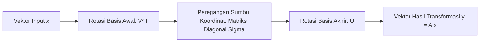

# Modul 011: Aljabar Linier & Teori Matriks (Ruang Vektor, Eigenvalues, SVD, Dekomposisi Tensor)

**Navigasi**: [⬅️ Master Index](../../INDEX.md) | [Tingkat 1: Tingkat 1: Fondasi Matematika Komprehensif Dari Nol](./README.md)
*Sebelumnya*: [010. geometri-analitik-trigonometri](./010-geometri-analitik-trigonometri.md) | *Berikutnya*: [012. matematika-diskrit-kombinatorika-graf](./012-matematika-diskrit-kombinatorika-graf.md)

---

## 1. Intuisi Dasar Tanpa Jargon ("Seperti Bayi Baru Lahir")
Bayangkan Anda memegang selembar kain karet elastis dua dimensi yang memiliki gambar lingkaran. Anda kemudian menarik kain karet tersebut ke arah horizontal 2x lipat dan membiarkan arah vertikal tetap. Gambar lingkaran Anda berubah menjadi elips lonjong.

Peristiwa ini disebut **Transformasi Linier**:
- Matriks adalah 'mesin' yang meregangkan, memutar, atau membalik ruang.
- Garis yang awalnya lurus akan tetap lurus setelah transformasi, dan titik pusat asal $(0, 0)$ tidak pernah berpindah.
- Garis yang arahnya sama persis sebelum dan sesudah peregangan (hanya panjangnya yang berubah) disebut **Eigenvector**, dan faktor perpanjangannya disebut **Eigenvalue**!

Seluruh grafik 3D di game modern, algoritma PageRank Google yang mencari miliaran halaman web, hingga model Transformer ChatGPT pada dasarnya adalah perkalian matriks aljabar linier masif.
[📚 Pelajari: 3Blue1Brown Essence of Linear Algebra](https://www.3blue1brown.com/topics/linear-algebra)

## 2. Fondasi Teoretis & Aksiomatik / Matematis
### 11.1 Ruang Vektor & Transformasi Linier ([MIT 18.06 Gilbert Strang](https://ocw.mit.edu/courses/18-06-linear-algebra-spring-2010/))
Ruang vektor $V$ atas medan $\mathbb{F}$ memenuhi 8 aksioma penambahan vektor dan perkalian skalar. Transformasi $T: V \to W$ bersifat linier jika dan hanya jika:
$$T(\mathbf{u} + \mathbf{v}) = T(\mathbf{u}) + T(\mathbf{v}) \quad \text{dan} \quad T(c\mathbf{u}) = cT(\mathbf{u})$$
Representasi matriks transformasi $\mathbf{A} \in \mathbb{R}^{m \times n}$ memetakan koordinat basis input ke basis output:
$$\mathbf{y} = \mathbf{A} \mathbf{x}$$

### 11.2 Nilai Eigen, Vektor Eigen & Dekomposisi Spektral ([Stanford EE263 Linear Dynamical Systems](https://web.stanford.edu/class/ee263/))
Vektor tak-nol $\mathbf{v}$ adalah vektor eigen dari $\mathbf{A}$ dengan nilai eigen $\lambda$ jika:
$$\mathbf{A} \mathbf{v} = \lambda \mathbf{v} \iff (\mathbf{A} - \lambda \mathbf{I}) \mathbf{v} = \mathbf{0}$$
Nilai $\lambda$ diperoleh dari penyelesaian persamaan karakteristik:
$$\det(\mathbf{A} - \lambda \mathbf{I}) = 0$$

### 11.3 Singular Value Decomposition (SVD) ([Gilbert Strang SVD Paper](https://doi.org/10.1137/1035028))
Setiap matriks riil $\mathbf{A} \in \mathbb{R}^{m \times n}$ dapat difaktorkan menjadi tiga matriks:
$$\mathbf{A} = \mathbf{U} \mathbf{\Sigma} \mathbf{V}^T$$
Di mana:
- $\mathbf{U} \in \mathbb{R}^{m \times m}$ adalah matriks ortogonal vektor singular kiri ($AA^T$).
- $\mathbf{\Sigma} \in \mathbb{R}^{m \times n}$ adalah matriks diagonal nilai singular $\sigma_1 \ge \sigma_2 \ge \dots \ge 0$.
- $\mathbf{V} \in \mathbb{R}^{n \times n}$ adalah matriks ortogonal vektor singular kanan ($A^T A$).
Teorema Eckart-Young-Mirsky: Aproksimasi rank-$k$ terbaik untuk matriks $\mathbf{A}$ diperoleh dengan mempertahankan $k$ nilai singular pertama:
$$\mathbf{A}_k = \sum_{i=1}^k \sigma_i \mathbf{u}_i \mathbf{v}_i^T$$

## 3. Anatomi Teknis & Cara Kerja Internal

Pustaka komputasi numerik tingkat rendah:
- **BLAS (Basic Linear Algebra Subprograms)**:
  - Level 1: Operasi vektor-vektor ($y = lpha x + y$) - $O(N)$
  - Level 2: Operasi matriks-vektor ($y = lpha A x + eta y$) - $O(N^2)$
  - Level 3: Operasi matriks-matriks ($C = lpha A B + eta C$) - $O(N^3)$ dioptimalkan via cache-blocking mikrokernel CPU register.
- **LAPACK**: Pustaka Fortran/C performa tinggi untuk faktorisasi LU, QR, Cholesky, dan dekomposisi eigen.

## 4. Implementasi Praktis & Kode / Simulasi Riil
import numpy as np

def low_rank_svd_approximation(matrix: np.ndarray, rank_k: int) -> np.ndarray:
    """
    Melakukan kompresi matriks dengan aproksimasi SVD rank-k optimal (Teorema Eckart-Young).
    """
    U, s, Vt = np.linalg.svd(matrix, full_matrices=False)
    # Potong hanya k komponen singular teratas
    U_k = U[:, :rank_k]
    s_k = s[:rank_k]
    Vt_k = Vt[:rank_k, :]
    
    # Rekonstruksi matriks terkompresi
    approx = np.dot(U_k * s_k, Vt_k)
    return approx

# Matriks data sintetis 5x5
np.random.seed(42)
original_mat = np.random.randn(5, 5)
compressed_rank2 = low_rank_svd_approximation(original_mat, rank_k=2)

frobenius_error = np.linalg.norm(original_mat - compressed_rank2, 'fro')
print(f"Matriks Asli:
{original_mat[:2, :2]}")
print(f"Aproksimasi Rank-2:
{compressed_rank2[:2, :2]}")
print(f"Galat Rekonstruksi Frobenius: {frobenius_error:.4f}")

## 5. Miskonsepsi & Jebakan Industri
1. **Inverting Matrices Explicitly**: Menghitung invers langsung $\mathbf{x} = \mathbf{A}^{-1}\mathbf{b}$ dalam kode produksi alih-alih menggunakan penyelesai sistem linier `np.linalg.solve(A, b)` (faktorisasi LU/Cholesky), yang menyebabkan instabilitas numerik parah dan pembengkakan memori.
2. **Matrix Multiplication Non-commutativity**: Mengasumsikan $\mathbf{A}\mathbf{B} = \mathbf{B}\mathbf{A}$, padahal perkalian matriks tidak komutatif, mengakibatkan bug rotasi orientasi 3D terbalik.
3. **Ill-Conditioned Matrices**: Matriks dengan *condition number* sangat besar ($\kappa(\mathbf{A}) = \sigma_{\max} / \sigma_{\min} \gg 10^8$) menyebabkan error floating point kecil pada input teramplifikasi menjadi salah 100% pada solusi.

## 6. Proyek Latihan & Rubrik Penilaian Mandiri
### Tingkat 1 (Pemula) - Visualisasi Transformasi Geometri 2D
Tulis skrip Python dengan Matplotlib yang menggambar sebuah persegi di koordinat $(0,0)$ s/d $(1,1)$. Kalikan titik-titik sudut persegi dengan matriks rotasi $\mathbf{R}(	heta)$ dan matriks geser (*shear*). Tunjukkan perubahan bentuk geometrisnya secara visual.

### Tingkat 2 (Menengah) - Implementasi Power Iteration untuk Eigenvalue Terbesar
Implementasikan algoritma iterasi daya (*Power Iteration*) untuk mencari eigenvalue dominan dan eigenvector terkait dari sebuah matriks simetris tanpa menggunakan `np.linalg.eig`. Buktikan konvergensi rasio Rayleigh.

### Tingkat 3 (Mahir) - Kompresi Citra Grayscale Menggunakan SVD
Muat sebuah gambar grayscale $512 	imes 512$ piksel sebagai matriks riil. Lakukan faktorisasi SVD dan rekam ukuran penyimpanan citra dengan $k \in \{5, 20, 50, 100\}$. Plot grafik trade-off antara rasio kompresi data vs Mean Squared Error (MSE) citra rekonstruksi.

#### Rubrik Penilaian
- **40% Ketepatan Matematis**: Implementasi ortogonalisasi Gram-Schmidt atau faktorisasi SVD akurat.
- **30% Optimasi Performa**: Menggunakan operasi tervektorisasi NumPy/BLAS tanpa loop Python lambat.
- **30% Analisis Galat Numerik**: Mampu menghitung Frobenius norm dan residual error solusi linier.

## 7. Rekomendasi Sumber Belajar Standar Emas
| Kategori | Judul Sumber & Tautan Langsung | Deskripsi Singkat |
|---|---|---|
| 📖 Buku Teks | [Linear Algebra and Its Applications (Gilbert Strang)](https://math.mit.edu/~gs/) | Buku rujukan standar emas dunia pengantar aljabar linier intuitif dan aplikasi. |
| 🎓 Kuliah Terbuka | [MIT OCW 18.06 Linear Algebra (Gilbert Strang)](https://ocw.mit.edu/courses/18-06-linear-algebra-spring-2010/) | Seri kuliah paling terkenal dalam sejarah matematika terapan MIT. |
| 🔬 Makalah Seminal | [The Anatomy of a Large-Scale Hypertextual Web Search Engine (Page & Brin, 1998)](http://infolab.stanford.edu/pub/papers/google.pdf) | Paper asli Google PageRank berbasis eigenvector Markov chain ruang dokumen. |
| 💻 Lab Interaktif | [3Blue1Brown Linear Transformations Interactive](https://www.3blue1brown.com/topics/linear-algebra) | Seri visualisasi interaktif transformasi ruang vektor dan determinan. |

---
*Navigasi Cepat*: [Ke Tingkat 1](./README.md) | [Ke Master Index](../../INDEX.md) | *Sebelumnya*: [010. geometri-analitik-trigonometri](./010-geometri-analitik-trigonometri.md) | *Berikutnya*: [012. matematika-diskrit-kombinatorika-graf](./012-matematika-diskrit-kombinatorika-graf.md)
