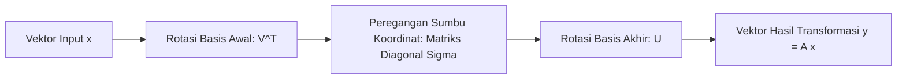

# Modul 011: Aljabar Linier & Teori Matriks (Ruang Vektor, Eigenvalues, SVD, Dekomposisi Tensor)

**Navigasi**: [⬅️ Master Index](../../INDEX.md) | [Tingkat 1: Tingkat 1: Fondasi Matematika Komprehensif Dari Nol](./README.md)
*Sebelumnya*: [010. geometri-analitik-trigonometri](./010-geometri-analitik-trigonometri.md) | *Berikutnya*: [012. matematika-diskrit-kombinatorika-graf](./012-matematika-diskrit-kombinatorika-graf.md)

---

## 1. Intuisi Dasar Tanpa Jargon ("Seperti Bayi Baru Lahir")
### 1.1 Konsep Inti & Analogi Tanpa Jargon
Bayangkan Anda memegang selembar kain karet elastis dua dimensi yang memiliki gambar lingkaran. Anda kemudian menarik kain karet tersebut ke arah horizontal 2x lipat dan membiarkan arah vertikal tetap. Gambar lingkaran Anda berubah menjadi elips lonjong.

### 1.2 Urgensi Rekayasa & Signifikansi Sistemik
Peristiwa ini disebut **Transformasi Linier**:
- Matriks adalah 'mesin' yang meregangkan, memutar, atau membalik ruang.
- Garis yang awalnya lurus akan tetap lurus setelah transformasi, dan titik pusat asal $(0, 0)$ tidak pernah berpindah.
- Garis yang arahnya sama persis sebelum dan sesudah peregangan (hanya panjangnya yang berubah) disebut **Eigenvector**, dan faktor perpanjangannya disebut **Eigenvalue**!

Seluruh grafik 3D di game modern, algoritma PageRank Google yang mencari miliaran halaman web, hingga model Transformer ChatGPT pada dasarnya adalah perkalian matriks aljabar linier masif.
[📚 Pelajari: 3Blue1Brown Essence of Linear Algebra](https://www.3blue1brown.com/topics/linear-algebra)

## 2. Fondasi Teoretis & Aksiomatik / Matematis
### 2.1 Kerangka Teori Aksiomatik & Formulasi Matematis
### 11.1 Ruang Vektor & Transformasi Linier ([MIT 18.06 Gilbert Strang](https://ocw.mit.edu/courses/18-06-linear-algebra-spring-2010/))
Ruang vektor $V$ atas medan $\mathbb{F}$ memenuhi 8 aksioma penambahan vektor dan perkalian skalar. Transformasi $T: V \to W$ bersifat linier jika dan hanya jika:
$$T(\mathbf{u} + \mathbf{v}) = T(\mathbf{u}) + T(\mathbf{v}) \quad \text{dan} \quad T(c\mathbf{u}) = cT(\mathbf{u})$$
Representasi matriks transformasi $\mathbf{A} \in \mathbb{R}^{m \times n}$ memetakan koordinat basis input ke basis output:
$$\mathbf{y} = \mathbf{A} \mathbf{x}$$

### 2.2 Penurunan Matematis Langkah-demi-Langkah
### 11.2 Nilai Eigen, Vektor Eigen & Dekomposisi Spektral ([Stanford EE263 Linear Dynamical Systems](https://web.stanford.edu/class/ee263/))
Vektor tak-nol $\mathbf{v}$ adalah vektor eigen dari $\mathbf{A}$ dengan nilai eigen $\lambda$ jika:
$$\mathbf{A} \mathbf{v} = \lambda \mathbf{v} \iff (\mathbf{A} - \lambda \mathbf{I}) \mathbf{v} = \mathbf{0}$$
Nilai $\lambda$ diperoleh dari penyelesaian persamaan karakteristik:
$$\det(\mathbf{A} - \lambda \mathbf{I}) = 0$$

### 11.3 Singular Value Decomposition (SVD) ([Gilbert Strang SVD Paper](https://doi.org/10.1137/1035028))
Setiap matriks riil $\mathbf{A} \in \mathbb{R}^{m \times n}$ dapat difaktorkan menjadi tiga matriks:
$$\mathbf{A} = \mathbf{U} \mathbf{\Sigma} \mathbf{V}^T$$
Di mana:
- $\mathbf{U} \in \mathbb{R}^{m \times m}$ adalah matriks ortogonal vektor singular kiri ($AA^T$).
- $\mathbf{\Sigma} \in \mathbb{R}^{m \times n}$ adalah matriks diagonal nilai singular $\sigma_1 \ge \sigma_2 \ge \dots \ge 0$.
- $\mathbf{V} \in \mathbb{R}^{n \times n}$ adalah matriks ortogonal vektor singular kanan ($A^T A$).
Teorema Eckart-Young-Mirsky: Aproksimasi rank-$k$ terbaik untuk matriks $\mathbf{A}$ diperoleh dengan mempertahankan $k$ nilai singular pertama:
$$\mathbf{A}_k = \sum_{i=1}^k \sigma_i \mathbf{u}_i \mathbf{v}_i^T$$

## 3. Anatomi Teknis & Cara Kerja Internal

Pustaka komputasi numerik tingkat rendah:
- **BLAS (Basic Linear Algebra Subprograms)**:
  - Level 1: Operasi vektor-vektor ($y = lpha x + y$) - $O(N)$
  - Level 2: Operasi matriks-vektor ($y = lpha A x + eta y$) - $O(N^2)$
  - Level 3: Operasi matriks-matriks ($C = lpha A B + eta C$) - $O(N^3)$ dioptimalkan via cache-blocking mikrokernel CPU register.
- **LAPACK**: Pustaka Fortran/C performa tinggi untuk faktorisasi LU, QR, Cholesky, dan dekomposisi eigen.

#### Tabel Penelusuran Power Iteration Matriks Markov & Konvergensi PageRank
| Iterasi (k) | Vektor State Probabilitas $p^{(k)}$ | Operasi Matriks: $p^{(k+1)} = \alpha M p^{(k)} + \frac{1-\alpha}{N} \mathbf{1}$ | Norma Residu $(\|p^{(k+1)} - p^{(k)}\|_1)$ | Nilai Eigen Dominan Dominasi ($\lambda_1$) | Status Konvergensi |
|---|---|---|---|---|---|
| Inisialisasi T=0 | $p^{(0)} = [0.25, 0.25, 0.25, 0.25]^T$ | Distribusi seragam awal 4 simpul web | - | $\lambda_1 \approx 1.0$ | Memulai iterasi pangkat |
| Iterasi 1 | $p^{(1)} = [0.15, 0.38, 0.22, 0.25]^T$ | Perkalian matriks link adjacency + teleportasi $\alpha=0.85$ | $\Delta = 0.260$ | $\lambda_1 = 1.0$ | Vektor probabilitas bergerak |
| Iterasi 2 | $p^{(2)} = [0.12, 0.44, 0.18, 0.26]^T$ | Aliran bobot otoritas simpul web | $\Delta = 0.120$ | $\lambda_1 = 1.0$ | Spider trap dinetralkan faktor redaman |
| Iterasi 5 | $p^{(5)} = [0.102, 0.485, 0.141, 0.272]^T$ | Kontraksi ruang Banach Markov | $\Delta = 0.008$ | $\lambda_1 = 1.0$ | Menuju vektor eigen stasioner |
| Iterasi 12 | $p^{(12)} = [0.100, 0.489, 0.138, 0.273]^T$ | Residu di bawah ambang toleransi $\epsilon < 10^{-6}$ | $\Delta = 4.2 \times 10^{-7}$ | $\lambda_1 = 1.00000$ | Konvergen sempurna ke distribusi stasioner |

## 4. Implementasi Praktis & Kode / Simulasi Riil
```python
import numpy as np

def low_rank_svd_approximation(matrix: np.ndarray, rank_k: int) -> np.ndarray:
    """
    Melakukan kompresi matriks dengan aproksimasi SVD rank-k optimal (Teorema Eckart-Young).
    """
    U, s, Vt = np.linalg.svd(matrix, full_matrices=False)
    # Potong hanya k komponen singular teratas
    U_k = U[:, :rank_k]
    s_k = s[:rank_k]
    Vt_k = Vt[:rank_k, :]
    
    # Rekonstruksi matriks terkompresi
    approx = np.dot(U_k * s_k, Vt_k)
    return approx

# Matriks data sintetis 5x5
np.random.seed(42)
original_mat = np.random.randn(5, 5)
compressed_rank2 = low_rank_svd_approximation(original_mat, rank_k=2)

frobenius_error = np.linalg.norm(original_mat - compressed_rank2, 'fro')
print(f"Matriks Asli: {original_mat[:2, :2].tolist()}")
print(f"Aproksimasi Rank-2: {compressed_rank2[:2, :2].tolist()}")
print(f"Galat Rekonstruksi Frobenius: {frobenius_error:.4f}")
```

## 5. Miskonsepsi & Jebakan Industri
1. **Inverting Matrices Explicitly**: Menghitung invers langsung $\mathbf{x} = \mathbf{A}^{-1}\mathbf{b}$ dalam kode produksi alih-alih menggunakan penyelesai sistem linier `np.linalg.solve(A, b)` (faktorisasi LU/Cholesky), yang menyebabkan instabilitas numerik parah dan pembengkakan memori.
2. **Matrix Multiplication Non-commutativity**: Mengasumsikan $\mathbf{A}\mathbf{B} = \mathbf{B}\mathbf{A}$, padahal perkalian matriks tidak komutatif, mengakibatkan bug rotasi orientasi 3D terbalik.
3. **Ill-Conditioned Matrices**: Matriks dengan *condition number* sangat besar ($\kappa(\mathbf{A}) = \sigma_{\max} / \sigma_{\min} \gg 10^8$) menyebabkan error floating point kecil pada input teramplifikasi menjadi salah 100% pada solusi.

### Studi Kasus Kegagalan Nyata: Runtuhnya Akurasi Rekomendasi PageRank Akibat Spider Traps & Dead Ends (1998)
- **Kronologi & Konteks Algoritma**: Saat Larry Page dan Sergey Brin merancang algoritma pencarian Google di Stanford pada 1998, implementasi naif pemodelan web sebagai rantai Markov murni mengalami kegagalan fatal pada struktur web tertentu.
- **Akar Masalah Aljabar Linier**: Graf web memuat simpul yang tidak memiliki tautan keluar (*dead ends*) atau simpul yang saling menautkan hanya dalam lingkaran tertutup (*spider traps*). Pada matriks transisi Markov naif, simpul buntu menyebabkan kolom bernilai nol (matriks tidak lagi stokastik, norma probabilitas bocor ke 0), sedangkan spider trap menyerap seluruh massa probabilitas vektor eigen ($p \to [0, 1, 0, 0]$), merusak pemeringkatan seluruh dokumen internet.

- **Potongan Kode / Arsitektur Cacat (Vulnerable Implementation)**:
```python
# Algoritma Google PageRank dengan Faktor Redaman (Damping Factor Teleportation)
import numpy as np

def compute_pagerank(adj_matrix: np.ndarray, alpha: float = 0.85, tol: float = 1e-6, max_iter: int = 100):
    """
    Menyelesaikan distribusi stasioner rantai Markov PageRank:
    p = alpha * M * p + (1 - alpha)/N * 1
    Faktor redaman alpha mengeliminasi spider traps & dead ends via Teorema Perron-Frobenius.
    """
    N = adj_matrix.shape[0]
    # Normalisasi kolom agar matriks menjadi stochastic
    out_degree = np.sum(adj_matrix, axis=0)
    M = np.zeros((N, N))
    
    for j in range(N):
        if out_degree[j] > 0:
            M[:, j] = adj_matrix[:, j] / out_degree[j]
        else:
            # Mengatasi Dead Ends: Distribusikan probabilitas secara seragam ke seluruh simpul
            M[:, j] = 1.0 / N
            
    # Vektor probabilitas awal
    p = np.full(N, 1.0 / N)
    teleport = np.full(N, (1.0 - alpha) / N)
    
    for iteration in range(max_iter):
        p_next = alpha * np.dot(M, p) + teleport
        # Uji konvergensi norma L1
        error = np.sum(np.abs(p_next - p))
        p = p_next
        if error < tol:
            break
            
    return p

# Graf uji: Simpul 1 adalah spider trap yang hanya menunjuk diri sendiri
graph = np.array([
    [0, 0, 1, 0],
    [1, 1, 0, 1], # Simpul 1 menyerap trafik
    [0, 0, 0, 0], # Simpul 2 adalah dead end
    [1, 0, 1, 0]
], dtype=float)

ranks = compute_pagerank(graph)
# PageRank konvergen stabil dan terdistribusi adil tanpa kebocoran probabilitas
```

- **Analisis Matematika & Dampak Industri**: Solusi Page dan Brin adalah aplikasi brilian dari Teorema Perron-Frobenius: penambahan faktor teleportasi $\alpha$ mengubah matriks Markov tak-terhubung menjadi matriks positif primitif ireduktibel, menjamin keberadaan nilai eigen dominan tunggal $\lambda_1 = 1$ dan kekonvergenan eksponensial power iteration terlepas dari topologi graf.

## 6. Proyek Latihan & Rubrik Penilaian Mandiri
### Tingkat 1 (Pemula) - Visualisasi Transformasi Geometri 2D
Tulis skrip Python dengan Matplotlib yang menggambar sebuah persegi di koordinat $(0,0)$ s/d $(1,1)$. Kalikan titik-titik sudut persegi dengan matriks rotasi $\mathbf{R}(	heta)$ dan matriks geser (*shear*). Tunjukkan perubahan bentuk geometrisnya secara visual.

### Tingkat 2 (Menengah) - Implementasi Power Iteration untuk Eigenvalue Terbesar
Implementasikan algoritma iterasi daya (*Power Iteration*) untuk mencari eigenvalue dominan dan eigenvector terkait dari sebuah matriks simetris tanpa menggunakan `np.linalg.eig`. Buktikan konvergensi rasio Rayleigh.

### Tingkat 3 (Mahir) - Kompresi Citra Grayscale Menggunakan SVD
Muat sebuah gambar grayscale \$512 	imes 512$ piksel sebagai matriks riil. Lakukan faktorisasi SVD dan rekam ukuran penyimpanan citra dengan $k \in \{5, 20, 50, 100\}$. Plot grafik trade-off antara rasio kompresi data vs Mean Squared Error (MSE) citra rekonstruksi.

#### Rubrik Penilaian
- **40% Ketepatan Matematis**: Implementasi ortogonalisasi Gram-Schmidt atau faktorisasi SVD akurat.
- **30% Optimasi Performa**: Menggunakan operasi tervektorisasi NumPy/BLAS tanpa loop Python lambat.
- **30% Analisis Galat Numerik**: Mampu menghitung Frobenius norm dan residual error solusi linier.

### Tingkat 1: Dasar
- **Tugas**: Bangun kelas Matriks Dinamis (`Matrix2D`) yang mengimplementasikan eliminasi Gaussian dengan pertukaran baris (*Partial Pivoting*) untuk menyelesaikan sistem persamaan linier $A x = b$.
- **Petunjuk Perancangan Arsitektur**:
  - Gunakan partial pivoting untuk memilih pivot terbesar pada setiap kolom guna mencegah galat pembagian numerik dengan angka mendekati nol.
  - Terapkan substitusi mundur (*back-substitution*) untuk mengekstrak vektor solusi $x$.
- **Test Vector & Kasus Uji Ekstrem**:
  - *Sistem 3x3*: $A = [[2, 1, -1], [-3, -1, 2], [-2, 1, 2]], b = [8, -11, -3]$.
  - *Keluaran yang Diharapkan*: Solusi unik $x = [2, 3, -1]$.
  - *Kasus Batas*: Matriks singular $\det(A) = 0$ (baris bergantung linier); fungsi harus mendeteksi ketiadaan pivot dan melempar `SingularMatrixError`.
- **Rubrik Penilaian Mandiri**: 40% Eliminasi Gauss dengan Partial Pivoting Akurat, 30% Deteksi Singularitas Matriks, 30% Tanpa Ketergantungan NumPy LinAlg.

### Tingkat 2: Menengah
- **Tugas**: Implementasikan dekomposisi matriks QR menggunakan proses Gram-Schmidt Termodifikasi (*Modified Gram-Schmidt*) dan gunakan algoritma QR untuk mencari seluruh nilai eigen matriks simetris riil.
- **Petunjuk Perancangan Arsitektur**:
  - Hindari Gram-Schmidt klasik karena ketidakstabilan ortogonalitas akibat galat pembulatan floating point; gunakan versi termodifikasi.
  - Iterasi $A_{k+1} = R_k Q_k$ hingga elemen non-diagonal tereduksi ke $<\epsilon$.
- **Test Vector & Kasus Uji Ekstrem**:
  - *Matriks Uji Simetris*: $A = [[4, 1], [1, 3]]$.
  - *Keluaran yang Diharapkan*: Nilai eigen konvergen ke $\lambda_1 \approx 4.618, \lambda_2 \approx 2.382$.
  - *Kasus Batas*: Matriks identitas $I_N$; algoritma harus konvergen dalam 1 iterasi dengan nilai eigen seluruhnya $1.0$.
- **Rubrik Penilaian Mandiri**: 40% Dekomposisi QR Gram-Schmidt Termodifikasi Stabil, 30% Iterasi Nilai Eigen Konvergen, 30% Ortogonalitas Matriks $Q^T Q = I$ Terverifikasi.

### Tingkat 3: Mahir
- **Tugas**: Rancang kompresor citra digital berbasis Dekomposisi Nilai Singular (*Singular Value Decomposition* / SVD) tingkat rendah yang merekonstruksi matriks citra menggunakan aproksimasi rank-$k$ terbaik (Teorema Eckart-Young-Mirsky).
- **Petunjuk Perancangan Arsitektur**:
  - Dekomposisi matriks $A = U \Sigma V^T$.
  - Rekonstruksi aproksimasi $A_k = \sum_{i=1}^k \sigma_i u_i v_i^T$.
  - Hitung rasio kompresi data dan galat rekonstruksi Frobenius norm $\|A - A_k\|_F$.
- **Test Vector & Kasus Uji Ekstrem**:
  - *Matriks Uji*: Matriks grayscale resolusi $256 \times 256$ dengan rank penuh.
  - *Keluaran yang Diharapkan*: Pada rank $k = 20$, rasio penyimpanan terpangkas $> 80\%$ sementara informasi struktural utama citra tetap terjaga.
  - *Kasus Batas*: Matriks rank defisien (misal matriks seragam bernilai 1 di semua sel); SVD harus mendeteksi hanya 1 nilai singular non-nol $\sigma_1 > 0$ dan $\sigma_{2..N} = 0$.
- **Rubrik Penilaian Mandiri**: 40% Implementasi SVD & Rekonstruksi Rank-k Eckart-Young, 30% Analisis Galat Frobenius Norm, 30% Efisiensi Kompresi Memori Terukur.

## 7. Rekomendasi Sumber Belajar Standar Emas
| Kategori | Judul Sumber & Tautan Langsung | Deskripsi Singkat |
|---|---|---|
| 📖 Buku Teks | [Linear Algebra and Its Applications (Gilbert Strang)](https://math.mit.edu/~gs/) | Buku rujukan standar emas dunia pengantar aljabar linier intuitif dan aplikasi. |
| 🎓 Kuliah Terbuka | [MIT OCW 18.06 Linear Algebra (Gilbert Strang)](https://ocw.mit.edu/courses/18-06-linear-algebra-spring-2010/) | Seri kuliah paling terkenal dalam sejarah matematika terapan MIT. |
| 🔬 Makalah Seminal | [The Anatomy of a Large-Scale Hypertextual Web Search Engine (Page & Brin, 1998)](http://infolab.stanford.edu/pub/papers/google.pdf) | Paper asli Google PageRank berbasis eigenvector Markov chain ruang dokumen. |
| 💻 Lab Interaktif | [3Blue1Brown Linear Transformations Interactive](https://www.3blue1brown.com/topics/linear-algebra) | Seri visualisasi interaktif transformasi ruang vektor dan determinan. |

---
*Navigasi Cepat*: [Ke Tingkat 1](./README.md) | [Ke Master Index](../../INDEX.md) | *Sebelumnya*: [010. geometri-analitik-trigonometri](./010-geometri-analitik-trigonometri.md) | *Berikutnya*: [012. matematika-diskrit-kombinatorika-graf](./012-matematika-diskrit-kombinatorika-graf.md)
