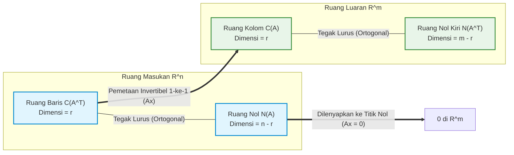

# Bab 02: Ruang Vektor, 4 Subruang Fundamental & Faktorisasi A = CR

[← Kembali ke Modul Utama](../011-aljabar-linier-teori-matriks.md) | [Daftar Isi Modul](./README.md)

---

## 1. Intuisi Dasar & Motivasi dari Titik Nol
Tautan Rujukan Kuliah: [MIT OCW 18.06 Kuliah 6: Column Space and Nullspace](https://ocw.mit.edu/courses/18-06-linear-algebra-spring-2010/resources/lecture-6-column-space-and-nullspace/) | [MIT OCW 18.06 Kuliah 10: The Four Fundamental Subspaces](https://ocw.mit.edu/courses/18-06-linear-algebra-spring-2010/resources/lecture-10-the-four-fundamental-subspaces/)

Bayangkan Anda sedang merancang kerangka jembatan suspensi baja atau jaring-jaring transmisi daya listrik nasional. Pada setiap tiang penyangga, gaya-gaya mekanik bekerja dalam berbagai arah spasial. Ketika angin kencang bertiup atau muatan kendaraan melintas di atas dek, struktur tersebut mengalami deformasi elastis.

Pertanyaan mendasar fisika dan rekayasa yang muncul:
1. *Ruang vektor macam apa yang dibentuk oleh semua kemungkinan kombinasi gaya yang dapat ditahan secara stabil oleh kerangka tersebut tanpa mengalami keruntuhan geser?*
2. *Apakah ada konfigurasi beban eksternal tertentu yang menghasilkan defleksi nol mutlak pada fondasi tumpuan (berada di dalam "ruang nol" atau nullspace struktur)?*
3. *Bagaimana kita memisahkan informasi esensial murni dari data redundan yang berulang?*

Dalam aljabar linier tradisional berpusat pada baris (*row-centric*), matriks sering kali hanya dianggap sebagai tabel angka pasif untuk menyelesaikan persamaan simultan. Namun, dalam aljabar linier modern (*column-first perspective*) yang dipopulerkan oleh Profesor Gilbert Strang dari MIT, sebuah matriks $A$ berukuran $m \times n$ dipandang sebagai **pemetaan linier dinamis (*linear transformation*)** yang mentransfer vektor-vektor dari ruang masukan berdimensi $n$ ($\mathbb{R}^n$) menuju ruang luaran berdimensi $m$ ($\mathbb{R}^m$):
$$T_A: \mathbb{R}^n \to \mathbb{R}^m, \quad T_A(\mathbf{x}) = A\mathbf{x}$$

Dua ruang yang terlibat di sini bukanlah ruang kosong tak beraturan, melainkan struktur aljabar teratur yang disebut **ruang vektor (*vector spaces*)**. Di dalam kedua ruang inilah terdapat **Empat Subruang Fundamental (*The Four Fundamental Subspaces*)** yang menguraikan geometri transformasi linier secara sempurna:
- Dua subruang bersemayam di dalam ruang masukan $\mathbb{R}^n$: Ruang Baris $C(A^T)$ dan Ruang Nol (*Nullspace*) $N(A)$.
- Dua subruang bersemayam di dalam ruang luaran $\mathbb{R}^m$: Ruang Kolom $C(A)$ dan Ruang Nol Kiri (*Left Nullspace*) $N(A^T)$.

Kunci dari keindahan geometri ini adalah ortogonalitas: ruang masukan $\mathbb{R}^n$ terbelah menjadi dua belahan yang saling tegak lurus sempurna ($C(A^T) \perp N(A)$), dan ruang luaran $\mathbb{R}^m$ juga terbelah menjadi dua belahan yang saling tegak lurus sempurna ($C(A) \perp N(A^T)$). Pemahaman atas keempat subruang ini melahirkan faktorisasi paling fundamental dalam sains data modern: **Faktorisasi Kolom-Baris $A = CR$**.

---

## 2. Definisi Formal, Teorema & Penurunan Matematis Lengkap
Tautan Rujukan Kuliah: [MIT OCW 18.06 Kuliah 7: Solving Ax = 0](https://ocw.mit.edu/courses/18-06-linear-algebra-spring-2010/resources/lecture-7-solving-ax-0-pivot-variables-special-solutions/) | [MIT OCW 18.06 Kuliah 9: Independence, Basis, and Dimension](https://ocw.mit.edu/courses/18-06-linear-algebra-spring-2010/resources/lecture-9-independence-basis-and-dimension/)

### 2.1 Aksioma Ruang Vektor & Subruang Aljabar
Sebuah **ruang vektor** $(V, +, \cdot)$ atas medan skalar riil $\mathbb{R}$ adalah himpunan elemen $V$ yang dilengkapi dengan dua operasi tertutup:
1. **Penjumlahan Vektor**: $+ : V \times V \to V$ yang memetakan $(\mathbf{u}, \mathbf{v}) \mapsto \mathbf{u} + \mathbf{v}$.
2. **Perkalian Skalar**: $\cdot : \mathbb{R} \times V \to V$ yang memetakan $(c, \mathbf{v}) \mapsto c\mathbf{v}$.

Kedua operasi ini wajib memenuhi **8 Aksioma Ruang Vektor** untuk setiap $\mathbf{u}, \mathbf{v}, \mathbf{w} \in V$ dan setiap skalar $c, d \in \mathbb{R}$:
1. **Komutatif Penjumlahan**: $\mathbf{u} + \mathbf{v} = \mathbf{v} + \mathbf{u}$.
2. **Asosiatif Penjumlahan**: $(\mathbf{u} + \mathbf{v}) + \mathbf{w} = \mathbf{u} + (\mathbf{v} + \mathbf{w})$.
3. **Identitas Penjumlahan**: Terdapat elemen unik $\mathbf{0} \in V$ sedemikian sehingga $\mathbf{v} + \mathbf{0} = \mathbf{v}$.
4. **Invers Penjumlahan**: Untuk setiap $\mathbf{v} \in V$, terdapat elemen $-\mathbf{v} \in V$ sedemikian sehingga $\mathbf{v} + (-\mathbf{v}) = \mathbf{0}$.
5. **Distributif Skalar terhadap Penjumlahan Vektor**: $c(\mathbf{u} + \mathbf{v}) = c\mathbf{u} + c\mathbf{v}$.
6. **Distributif Skalar terhadap Penjumlahan Skalar**: $(c + d)\mathbf{v} = c\mathbf{v} + d\mathbf{v}$.
7. **Asosiatif Perkalian Skalar**: $c(d\mathbf{v}) = (cd)\mathbf{v}$.
8. **Identitas Perkalian Skalar**: $1 \cdot \mathbf{v} = \mathbf{v}$.

#### Definisi Subruang Aljabar (*Subspace*)
Sebuah himpunan bagian tak-kosong $S \subseteq V$ disebut **subruang linier** dari $V$ (ditulis $S \le V$) jika dan hanya jika $S$ mewarisi sifat ruang vektor di bawah operasi yang sama. Secara operasional, ini setara dengan memenuhi **Tiga Syarat Ketertutupan**:
1. Vektor nol milik himpunan: $\mathbf{0} \in S$.
2. Tertutup terhadap penjumlahan: Jika $\mathbf{u}, \mathbf{v} \in S$, maka $\mathbf{u} + \mathbf{v} \in S$.
3. Tertutup terhadap perkalian skalar: Jika $\mathbf{u} \in S$ dan $c \in \mathbb{R}$, maka $c\mathbf{u} \in S$.

> [!IMPORTANT]
> Garis lurus atau bidang datar pada $\mathbb{R}^3$ yang **tidak melewati titik asal $(0, 0, 0)$** bukanlah subruang vektor, karena melanggar syarat $\mathbf{0} \in S$ dan tidak tertutup di bawah perkalian skalar dengan $c = 0$.

---

### 2.2 Rentang, Kebebasan Linier, Basis & Dimensi
Misalkan $S = \{\mathbf{v}_1, \mathbf{v}_2, \dots, \mathbf{v}_k\}$ adalah himpunan vektor di $V$.

1. **Kombinasi Linier & Rentang (*Span*)**:
   Rentang dari $S$, dinotasikan $\text{span}(S)$, adalah himpunan seluruh kombinasi linier yang mungkin dari vektor-vektor di $S$:
   $$\text{span}(S) = \left\{ \sum_{i=1}^k c_i \mathbf{v}_i \;\middle|\; c_1, \dots, c_k \in \mathbb{R} \right\}$$
   $\text{span}(S)$ selalu membentuk subruang terkecil dari $V$ yang memuat seluruh elemen $S$.

2. **Kebebasan Linier (*Linear Independence*)**:
   Vektor-vektor $\{\mathbf{v}_1, \dots, \mathbf{v}_k\}$ dikatakan **bebas linier** jika persamaan:
   $$c_1 \mathbf{v}_1 + c_2 \mathbf{v}_2 + \dots + c_k \mathbf{v}_k = \mathbf{0}$$
   hanya memiliki satu-satunya solusi trivial, yaitu $c_1 = c_2 = \dots = c_k = 0$. Jika terdapat kombinasi tak-trivial di mana setidaknya ada satu $c_j \ne 0$ yang menghasilkan $\mathbf{0}$, maka himpunan tersebut **bergantung linier (*linearly dependent*)**.

3. **Basis Ruang Vektor**:
   Himpunan vektor $\mathcal{B} = \{\mathbf{b}_1, \mathbf{b}_2, \dots, \mathbf{b}_d\}$ disebut **basis** bagi ruang vektor $V$ jika memenuhi dua syarat simultan:
   - $\mathcal{B}$ bebas linier.
   - $\mathcal{B}$ merentang seluruh ruang: $\text{span}(\mathcal{B}) = V$.

4. **Dimensi Ruang Vektor**:
   **Dimensi** dari $V$, ditulis $\dim(V)$, adalah kardinalitas (jumlah vektor) dari basis $\mathcal{B}$. Seluruh basis bagi ruang vektor yang sama dijamin memiliki jumlah vektor yang identik.

---

### 2.3 Bentuk Eselon Baris Tereduksi (RREF)
Bentuk Eselon Baris Tereduksi (*Reduced Row Echelon Form*, RREF) adalah representasi kanonikal unik yang diperoleh dengan menerapkan eliminasi Gauss-Jordan pada matriks $A \in \mathbb{R}^{m \times n}$. Matriks $R = \text{rref}(A)$ memenuhi empat kondisi:
1. Semua baris yang seluruh elemennya bernilai nol diletakkan pada bagian paling bawah matriks.
2. Pada setiap baris tak-nol, elemen tak-nol pertama dari kiri disebut **pivot (leading 1)** dan bernilai tepat $1$.
3. Pivot pada baris yang lebih rendah selalu berada di kolom sebelah kanan pivot baris di atasnya.
4. Setiap kolom yang memuat pivot bernilai nol pada seluruh baris lainnya (baik di atas maupun di bawah pivot).

Jumlah total pivot pada $R$ mendefinisikan **rank matriks** $r = \text{rank}(A)$.
- Kolom-kolom yang memuat pivot disebut **kolom pivot** (*pivot columns*).
- Kolom-kolom yang tidak memuat pivot disebut **kolom bebas** (*free columns*).

---

### 2.4 Empat Subruang Fundamental Gilbert Strang
Untuk setiap matriks riil $A \in \mathbb{R}^{m \times n}$ dengan rank $r$:

| Subruang | Notasi | Ruang Lingkup | Dimensi | Basis Kanonikal |
|---|:---:|:---:|:---:|---|
| **Ruang Kolom** (*Column Space*) | $C(A)$ | $\mathbb{R}^m$ | $r$ | Kolom-kolom asli pada $A$ yang bersesuaian dengan kolom pivot pada $\text{rref}(A)$. |
| **Ruang Baris** (*Row Space*) | $C(A^T)$ | $\mathbb{R}^n$ | $r$ | Baris-baris tak-nol pada matriks eselon tereduksi $R = \text{rref}(A)$. |
| **Ruang Nol** (*Nullspace*) | $N(A)$ | $\mathbb{R}^n$ | $n - r$ | Solusi khusus (*special solutions*) dari sistem homogen $A\mathbf{x} = \mathbf{0}$. |
| **Ruang Nol Kiri** (*Left Nullspace*) | $N(A^T)$ | $\mathbb{R}^m$ | $m - r$ | Solusi khusus dari sistem $A^T \mathbf{y} = \mathbf{0}$ (atau $\mathbf{y}^T A = \mathbf{0}^T$). |



---

### 2.5 Teorema Fundamental Aljabar Linier (FTLA)
Teorema Fundamental Aljabar Linier (*The Fundamental Theorem of Linear Algebra*) dirumuskan dalam dua bagian besar:

#### Bagian 1: Dimensi Subruang
1. $\dim(C(A)) = \dim(C(A^T)) = r$. Dimensi ruang kolom persis sama dengan dimensi ruang baris (rank kolom sama dengan rank baris).
2. $\dim(N(A)) = n - r$.
3. $\dim(N(A^T)) = m - r$.

#### Bagian 2: Ortogonalitas Komplementer
Subruang-subruang tersebut saling melengkapi secara ortogonal di dalam ruangnya masing-masing:
1. Di dalam $\mathbb{R}^n$: Ruang baris tegak lurus terhadap ruang nol:
   $$C(A^T) \perp N(A) \quad \text{dan} \quad C(A^T) \oplus N(A) = \mathbb{R}^n$$
2. Di dalam $\mathbb{R}^m$: Ruang kolom tegak lurus terhadap ruang nol kiri:
   $$C(A) \perp N(A^T) \quad \text{dan} \quad C(A) \oplus N(A^T) = \mathbb{R}^m$$

#### Pembuktian Teorema Ortogonalitas $C(A^T) \perp N(A)$:
Ambil sembarang vektor $\mathbf{x} \in N(A)$. Berdasarkan definisi ruang nol, $A\mathbf{x} = \mathbf{0}$.
Tuliskan matriks $A$ dalam bentuk vektor baris $\mathbf{r}_1^T, \mathbf{r}_2^T, \dots, \mathbf{r}_m^T$:
$$A\mathbf{x} = \begin{bmatrix} \mathbf{r}_1^T \\ \mathbf{r}_2^T \\ \vdots \\ \mathbf{r}_m^T \end{bmatrix} \mathbf{x} = \begin{bmatrix} \mathbf{r}_1^T \mathbf{x} \\ \mathbf{r}_2^T \mathbf{x} \\ \vdots \\ \mathbf{r}_m^T \mathbf{x} \end{bmatrix} = \begin{bmatrix} 0 \\ 0 \\ \vdots \\ 0 \end{bmatrix}$$
Artinya, hasil kali titik (*dot product*) vektor $\mathbf{x}$ dengan setiap baris matriks $A$ bernilai nol:
$$\mathbf{r}_i^T \mathbf{x} = 0, \quad \forall i \in \{1, 2, \dots, m\}$$
Sekarang ambil sembarang vektor $\mathbf{v} \in C(A^T)$. Karena $\mathbf{v}$ berada di ruang baris, $\mathbf{v}$ merupakan kombinasi linier dari baris-baris $A$:
$$\mathbf{v} = \sum_{i=1}^m c_i \mathbf{r}_i$$
Hitung perkalian titik antara $\mathbf{v}$ dan $\mathbf{x}$:
$$\mathbf{v}^T \mathbf{x} = \left( \sum_{i=1}^m c_i \mathbf{r}_i \right)^T \mathbf{x} = \sum_{i=1}^m c_i (\mathbf{r}_i^T \mathbf{x}) = \sum_{i=1}^m c_i (0) = 0$$
Karena $\mathbf{v}^T \mathbf{x} = 0$ untuk sembarang $\mathbf{v} \in C(A^T)$ dan $\mathbf{x} \in N(A)$, maka terbukti secara analitis bahwa **seluruh ruang baris ortogonal terhadap seluruh ruang nol**. $\blacksquare$

---

### 2.6 Penurunan & Pembuktian Teorema Rank-Nullity
**Teorema Rank-Nullity (Sylvester)**:
Untuk setiap pemetaan linier $A \in \mathbb{R}^{m \times n}$:
$$\text{rank}(A) + \text{nullity}(A) = n$$
Di mana $\text{rank}(A) = r$ dan $\text{nullity}(A) = \dim(N(A))$.

#### Bukti Analitis Lengkap:
Misalkan matriks eselon baris tereduksi $R = \text{rref}(A)$ memiliki $r$ buah pivot.
1. Jumlah seluruh kolom pada matriks $A$ adalah $n$.
2. Setiap kolom pada matriks $R$ secara tegas tergolong ke dalam salah satu dari dua kategori yang saling eksklusif:
   - Kolom yang memiliki elemen pivot (berjumlah $r$).
   - Kolom yang tidak memiliki elemen pivot, yaitu kolom variabel bebas (berjumlah $n - r$).
3. Untuk setiap variabel bebas $x_j$ (di mana $j$ adalah indeks kolom bebas), kita dapat mengonstruksi sebuah solusi khusus homogen $\mathbf{s}_j$ dengan menetapkan variabel bebas $x_j = 1$ dan menetapkan seluruh variabel bebas lainnya bernilai $0$. Nilai dari $r$ variabel pivot kemudian ditentukan secara unik oleh persamaan baris pada $R\mathbf{x} = \mathbf{0}$.
4. Himpunan solusi khusus $\{\mathbf{s}_1, \mathbf{s}_2, \dots, \mathbf{s}_{n-r}\}$:
   - **Bebas Linier**: Vektor-vektor ini bebas linier karena pada baris komponen variabel bebasnya, vektor-vektor tersebut memuat matriks identitas berukuran $(n-r) \times (n-r)$. Tidak ada kombinasi linier skalar yang dapat saling meniadakan.
   - **Merentang $N(A)$**: Setiap solusi homogen dari $A\mathbf{x} = \mathbf{0}$ memiliki nilai variabel bebas tertentu $(c_1, c_2, \dots, c_{n-r})$. Vektor $\mathbf{x} - \sum_{k=1}^{n-r} c_k \mathbf{s}_k$ akan memiliki nilai nol pada seluruh variabel bebas dan seluruh variabel pivot, sehingga $\mathbf{x} = \sum_{k=1}^{n-r} c_k \mathbf{s}_k$.
5. Karena $\{\mathbf{s}_1, \dots, \mathbf{s}_{n-r}\}$ bebas linier dan merentang $N(A)$, himpunan tersebut membentuk basis bagi $N(A)$.
6. Maka kardinalitas basis tersebut adalah $\dim(N(A)) = n - r$.
7. Mengatur ulang persamaan: $r + (n - r) = n$.
Terbukti: $\text{rank}(A) + \text{nullity}(A) = n$. $\blacksquare$

---

### 2.7 Faktorisasi Modern Kolom-Baris: $A = CR$
Faktorisasi $A = CR$ adalah dekomposisi paling intuitif dan bermakna fisik dalam aljabar linier modern.
Jika $A \in \mathbb{R}^{m \times n}$ memiliki rank $r$:
1. Matriks $C \in \mathbb{R}^{m \times r}$ dikonstruksi dengan mengambil **$r$ kolom pivot pertama yang bebas linier langsung dari matriks asli $A$**.
2. Matriks $R \in \mathbb{R}^{r \times n}$ adalah **$r$ baris pertama tak-nol dari bentuk eselon baris tereduksi $\text{rref}(A)$**.

Matriks perkalian $CR$ merekonstruksi matriks asli $A$ secara eksak:
$$A = C R$$

#### Interpretasi Fondasional:
- Matriks $C$ memuat **basis sejati bagi ruang kolom $C(A)$** yang diambil langsung dari data asli, mempertahankan makna fisis satuan data.
- Matriks $R$ memuat **koefisien kombinasi linier** yang menyatakan bagaimana setiap kolom pada $A$ dibentuk dari $r$ kolom basis pada $C$.
- Setiap kolom ke-$j$ pada $A$ adalah kombinasi linier: $\mathbf{a}_j = C \mathbf{r}_j$, di mana $\mathbf{r}_j$ adalah kolom ke-$j$ dari matriks $R$.

---

## 3. Contoh Hitungan Manual Langkah-demi-Langkah
Tautan Rujukan Kuliah: [MIT OCW 18.06 Kuliah 8: Solving Ax = b](https://ocw.mit.edu/courses/18-06-linear-algebra-spring-2010/resources/lecture-8-solving-ax-b-row-reduced-form-r/) | [Wikipedia: Reduced Row Echelon Form](https://en.wikipedia.org/wiki/Row_echelon_form)

Diberikan matriks berukuran $3 \times 4$:
$$A = \begin{bmatrix} 1 & 2 & 2 & 2 \\ 2 & 4 & 6 & 8 \\ 3 & 6 & 8 & 10 \end{bmatrix}$$

Tujuan kita:
1. Lakukan eliminasi Gauss-Jordan menuju bentuk eselon baris tereduksi $R = \text{rref}(A)$.
2. Tentukan rank $r$ dan identifikasi kolom pivot serta kolom bebas.
3. Tentukan basis dan dimensi untuk keempat subruang fundamental: $C(A), C(A^T), N(A), N(A^T)$.
4. Bentuk faktorisasi kolom-baris $A = CR$ dan buktikan kebenarannya secara aritmatika.
5. Verifikasi ortogonalitas $C(A^T) \perp N(A)$.

---

### Langkah 1: Eliminasi Gauss-Jordan Menuju RREF
Matriks awal:
$$A = \begin{bmatrix} 1 & 2 & 2 & 2 \\ 2 & 4 & 6 & 8 \\ 3 & 6 & 8 & 10 \end{bmatrix}$$

Pivot pertama adalah elemen baris 1 kolom 1: $p_1 = 1$.
Eliminasi entri di bawah pivot pertama:
- Operasi $R_2 \leftarrow R_2 - 2 R_1$:
  $$\begin{bmatrix} 2 & 4 & 6 & 8 \end{bmatrix} - 2 \begin{bmatrix} 1 & 2 & 2 & 2 \end{bmatrix} = \begin{bmatrix} 0 & 0 & 2 & 4 \end{bmatrix}$$
- Operasi $R_3 \leftarrow R_3 - 3 R_1$:
  $$\begin{bmatrix} 3 & 6 & 8 & 10 \end{bmatrix} - 3 \begin{bmatrix} 1 & 2 & 2 & 2 \end{bmatrix} = \begin{bmatrix} 0 & 0 & 2 & 4 \end{bmatrix}$$

Matriks menjadi:
$$\begin{bmatrix} 1 & 2 & 2 & 2 \\ 0 & 0 & 2 & 4 \\ 0 & 0 & 2 & 4 \end{bmatrix}$$

Perhatikan kolom 2 bernilai nol pada posisi pivot potensial. Kolom 2 adalah kolom bebas pertama!
Kita bergerak ke kolom 3. Elemen pada baris 2 kolom 3 bernilai $2$.
Eliminasi entri di bawah pivot kedua:
- Operasi $R_3 \leftarrow R_3 - R_2$:
  $$\begin{bmatrix} 0 & 0 & 2 & 4 \end{bmatrix} - \begin{bmatrix} 0 & 0 & 2 & 4 \end{bmatrix} = \begin{bmatrix} 0 & 0 & 0 & 0 \end{bmatrix}$$

Matriks eselon baris (U):
$$U = \begin{bmatrix} 1 & 2 & 2 & 2 \\ 0 & 0 & 2 & 4 \\ 0 & 0 & 0 & 0 \end{bmatrix}$$

Sekarang lakukan eliminasi mundur (*back-substitution*) menuju bentuk tereduksi:
- Skalakan baris 2 agar pivot bernilai $1$ ($R_2 \leftarrow \frac{1}{2} R_2$):
  $$R_2 = \begin{bmatrix} 0 & 0 & 1 & 2 \end{bmatrix}$$
- Bersihkan entri di atas pivot baris 2 ($R_1 \leftarrow R_1 - 2 R_2$):
  $$\begin{bmatrix} 1 & 2 & 2 & 2 \end{bmatrix} - 2 \begin{bmatrix} 0 & 0 & 1 & 2 \end{bmatrix} = \begin{bmatrix} 1 & 2 & 0 & -2 \end{bmatrix}$$

Bentuk eselon baris tereduksi akhir ($R = \text{rref}(A)$):
$$R = \begin{bmatrix} 1 & 2 & 0 & -2 \\ 0 & 0 & 1 & 2 \\ 0 & 0 & 0 & 0 \end{bmatrix}$$

---

### Langkah 2: Analisis Kolom & Dimensi
- **Elemen Pivot**: Berada pada baris 1 kolom 1 dan baris 2 kolom 3.
- **Kolom Pivot**: Kolom 1 dan Kolom 3.
- **Kolom Bebas**: Kolom 2 dan Kolom 4.
- **Rank Matriks**: $r = 2$.
- **Jumlah Kolom**: $n = 4$.
- **Nullity**: $n - r = 4 - 2 = 2$.
- **Dimensi Ruang Nol Kiri**: $m - r = 3 - 2 = 1$.

---

### Langkah 3: Menentukan Basis Keempat Subruang

#### 1. Ruang Kolom $C(A) \subseteq \mathbb{R}^3$:
Basis diambil dari **kolom 1 dan kolom 3 pada matriks asli $A$**:
$$\text{Basis } C(A) = \left\{ \begin{bmatrix} 1 \\ 2 \\ 3 \end{bmatrix}, \; \begin{bmatrix} 2 \\ 6 \\ 8 \end{bmatrix} \right\}, \quad \dim(C(A)) = 2$$

#### 2. Ruang Baris $C(A^T) \subseteq \mathbb{R}^4$:
Basis diambil dari **baris-baris tak-nol pada matriks eselon tereduksi $R$**:
$$\text{Basis } C(A^T) = \left\{ \begin{bmatrix} 1 \\ 2 \\ 0 \\ -2 \end{bmatrix}, \; \begin{bmatrix} 0 \\ 0 \\ 1 \\ 2 \end{bmatrix} \right\}, \quad \dim(C(A^T)) = 2$$

#### 3. Ruang Nol $N(A) \subseteq \mathbb{R}^4$:
Sistem persamaan $R\mathbf{x} = \mathbf{0}$ memberikan:
$$\begin{cases} x_1 + 2x_2 - 2x_4 = 0 \implies x_1 = -2x_2 + 2x_4 \\ x_3 + 2x_4 = 0 \implies x_3 = -2x_4 \end{cases}$$

- **Solusi Khusus 1** (pilih variabel bebas $x_2 = 1, x_4 = 0$):
  $$x_1 = -2(1) + 2(0) = -2, \quad x_3 = -2(0) = 0 \implies \mathbf{s}_1 = \begin{bmatrix} -2 \\ 1 \\ 0 \\ 0 \end{bmatrix}$$

- **Solusi Khusus 2** (pilih variabel bebas $x_2 = 0, x_4 = 1$):
  $$x_1 = -2(0) + 2(1) = 2, \quad x_3 = -2(1) = -2 \implies \mathbf{s}_2 = \begin{bmatrix} 2 \\ 0 \\ -2 \\ 1 \end{bmatrix}$$

$$\text{Basis } N(A) = \left\{ \begin{bmatrix} -2 \\ 1 \\ 0 \\ 0 \end{bmatrix}, \; \begin{bmatrix} 2 \\ 0 \\ -2 \\ 1 \end{bmatrix} \right\}, \quad \dim(N(A)) = 2$$

#### 4. Ruang Nol Kiri $N(A^T) \subseteq \mathbb{R}^3$:
Ruang nol kiri adalah himpunan vektor $\mathbf{y} \in \mathbb{R}^3$ yang memenuhi $\mathbf{y}^T A = \mathbf{0}^T$.
Perhatikan baris ketiga yang menjadi nol saat eliminasi:
Baris 3 dari $A$ dikurangi $R_2 - R_1$, yaitu:
$$R_3 - (R_2 - 2R_1) - 3R_1 = R_3 - R_2 - R_1 = 0$$
Artinya:
$$(-1)\text{baris}_1(A) + (-1)\text{baris}_2(A) + (1)\text{baris}_3(A) = \begin{bmatrix} 0 & 0 & 0 & 0 \end{bmatrix}$$
Mari kita uji perkalian titik dengan setiap kolom $A$:
$$\begin{bmatrix} -1 & -1 & 1 \end{bmatrix} \begin{bmatrix} 1 & 2 & 2 & 2 \\ 2 & 4 & 6 & 8 \\ 3 & 6 & 8 & 10 \end{bmatrix} = \begin{bmatrix} -1-2+3 & -2-4+6 & -2-6+8 & -2-8+10 \end{bmatrix} = \begin{bmatrix} 0 & 0 & 0 & 0 \end{bmatrix}$$
Maka basis untuk ruang nol kiri adalah:
$$\text{Basis } N(A^T) = \left\{ \begin{bmatrix} -1 \\ -1 \\ 1 \end{bmatrix} \right\}, \quad \dim(N(A^T)) = 1$$

---

### Langkah 4: Konstruksi & Verifikasi Faktorisasi $A = CR$
- Matriks $C \in \mathbb{R}^{3 \times 2}$ memuat kolom 1 dan kolom 3 dari $A$:
  $$C = \begin{bmatrix} 1 & 2 \\ 2 & 6 \\ 3 & 8 \end{bmatrix}$$
- Matriks $R_0 \in \mathbb{R}^{2 \times 4}$ memuat 2 baris tak-nol pertama dari $\text{rref}(A)$:
  $$R_0 = \begin{bmatrix} 1 & 2 & 0 & -2 \\ 0 & 0 & 1 & 2 \end{bmatrix}$$

Mari kita kalikan $C \times R_0$:
$$C R_0 = \begin{bmatrix} 1 & 2 \\ 2 & 6 \\ 3 & 8 \end{bmatrix} \begin{bmatrix} 1 & 2 & 0 & -2 \\ 0 & 0 & 1 & 2 \end{bmatrix}$$
Hitung per baris:
- Baris 1:
  $$1 \begin{bmatrix} 1 & 2 & 0 & -2 \end{bmatrix} + 2 \begin{bmatrix} 0 & 0 & 1 & 2 \end{bmatrix} = \begin{bmatrix} 1 & 2 & 2 & 2 \end{bmatrix}$$
- Baris 2:
  $$2 \begin{bmatrix} 1 & 2 & 0 & -2 \end{bmatrix} + 6 \begin{bmatrix} 0 & 0 & 1 & 2 \end{bmatrix} = \begin{bmatrix} 2 & 4 & 6 & 8 \end{bmatrix}$$
- Baris 3:
  $$3 \begin{bmatrix} 1 & 2 & 0 & -2 \end{bmatrix} + 8 \begin{bmatrix} 0 & 0 & 1 & 2 \end{bmatrix} = \begin{bmatrix} 3 & 6 & 8 & 10 \end{bmatrix}$$

Hasil penggabungan:
$$C R_0 = \begin{bmatrix} 1 & 2 & 2 & 2 \\ 2 & 4 & 6 & 8 \\ 3 & 6 & 8 & 10 \end{bmatrix} = A$$
Faktorisasi $A = CR$ terbukti identik dan tepat 100%!

---

### Langkah 5: Verifikasi Hubungan Ortogonalitas $C(A^T) \perp N(A)$
Ambil basis ruang baris $\mathbf{r}_1, \mathbf{r}_2$ dan basis ruang nol $\mathbf{s}_1, \mathbf{s}_2$:
1. $\mathbf{r}_1 \cdot \mathbf{s}_1 = (1)(-2) + (2)(1) + (0)(0) + (-2)(0) = -2 + 2 + 0 + 0 = 0$.
2. $\mathbf{r}_1 \cdot \mathbf{s}_2 = (1)(2) + (2)(0) + (0)(-2) + (-2)(1) = 2 + 0 + 0 - 2 = 0$.
3. $\mathbf{r}_2 \cdot \mathbf{s}_1 = (0)(-2) + (0)(1) + (1)(0) + (2)(0) = 0 + 0 + 0 + 0 = 0$.
4. $\mathbf{r}_2 \cdot \mathbf{s}_2 = (0)(2) + (0)(0) + (1)(-2) + (2)(1) = 0 + 0 - 2 + 2 = 0$.

Seluruh kombinasi perkalian titik bernilai $0$. Kedua subruang terbukti saling tegak lurus sempurna!

---

## 4. Implementasi Komputasi & Kode Python Industri
Tautan Dokumentasi Resmi: [SciPy Linear Algebra Library](https://docs.scipy.org/doc/scipy/reference/linalg.html) | [SymPy Matrices Documentation](https://docs.sympy.org/latest/modules/matrices/matrices.html)

Berikut adalah implementasi Python berstandar produksi yang menghitung bentuk eselon baris tereduksi (RREF), mengekstraksi basis keempat subruang fundamental, dan melakukan faktorisasi $A = CR$ dengan penanganan presisi numerik:

```python
"""
Modul Fondasi: Komputasi 4 Subruang Fundamental & Faktorisasi A = CR.
Menggunakan NumPy untuk aljabar linier numerik dan verifikasi analitis.
"""

from typing import Tuple, List, Dict
import numpy as np


def compute_four_subspaces(
    matrix: np.ndarray, tol: float = 1e-10
) -> Dict[str, np.ndarray]:
    """
    Menghitung basis ortonormal bagi keempat subruang fundamental menggunakan SVD.

    Args:
        matrix: Matriks riil 2D berukuran (m, n).
        tol: Ambang batas toleransi singular value untuk penentuan rank numerik.

    Returns:
        Dictionary berisi basis ortonormal untuk C(A), C(A^T), N(A), dan N(A^T).
    """
    if matrix.ndim != 2:
        raise ValueError(f"Input harus matriks 2D, didapat shape {matrix.shape}")

    m, n = matrix.shape
    u, s, vh = np.linalg.svd(matrix, full_matrices=True)

    # Tentukan rank efektif
    rank = int(np.sum(s > tol))

    # 1. Ruang Kolom C(A): r kolom pertama dari U (vektor di R^m)
    col_space_basis = u[:, :rank]

    # 2. Ruang Baris C(A^T): r baris pertama dari V^T (vektor di R^n)
    row_space_basis = vh[:rank, :].T

    # 3. Ruang Nol N(A): sisa n - r baris dari V^T (vektor di R^n)
    null_space_basis = vh[rank:, :].T

    # 4. Ruang Nol Kiri N(A^T): sisa m - r kolom dari U (vektor di R^m)
    left_null_space_basis = u[:, rank:]

    return {
        "rank": rank,
        "col_space": col_space_basis,
        "row_space": row_space_basis,
        "null_space": null_space_basis,
        "left_null_space": left_null_space_basis,
    }


def factorize_a_cr(
    matrix: np.ndarray, tol: float = 1e-10
) -> Tuple[np.ndarray, np.ndarray, List[int]]:
    """
    Menghitung Faktorisasi Kolom-Baris Gilbert Strang: A = C @ R.
    C memuat kolom-kolom pivot asli dari A.
    R memuat baris-baris tak-nol dari rref(A).

    Args:
        matrix: Matriks riil input berukuran (m, n).
        tol: Ambang batas deteksi floating-point.

    Returns:
        Tuple (C, R, pivot_columns).
    """
    A = matrix.astype(np.float64)
    m, n = A.shape
    rref_mat = A.copy()

    pivot_cols: List[int] = []
    pivot_row = 0

    for col in range(n):
        if pivot_row >= m:
            break

        # Cari pivot terbesar pada kolom ini (partial pivoting)
        max_idx = pivot_row + np.argmax(np.abs(rref_mat[pivot_row:, col]))
        if np.abs(rref_mat[max_idx, col]) < tol:
            continue

        # Tukar baris
        if max_idx != pivot_row:
            rref_mat[[pivot_row, max_idx]] = rref_mat[[max_idx, pivot_row]]

        # Normalisasi pivot menjadi 1
        pivot_val = rref_mat[pivot_row, col]
        rref_mat[pivot_row] = rref_mat[pivot_row] / pivot_val

        # Eliminasi entri lain di kolom ini
        for r in range(m):
            if r != pivot_row and np.abs(rref_mat[r, col]) > tol:
                factor = rref_mat[r, col]
                rref_mat[r] -= factor * rref_mat[pivot_row]

        pivot_cols.append(col)
        pivot_row += 1

    rank = len(pivot_cols)
    C = A[:, pivot_cols]
    R = rref_mat[:rank, :]

    # Asersi kualitas rekonstruksi
    assert np.allclose(C @ R, A, atol=1e-8), "Rekonstruksi A = C @ R gagal!"

    return C, R, pivot_cols


if __name__ == "__main__":
    # Matriks uji dari Contoh Manual Bab 02
    A_test = np.array(
        [[1.0, 2.0, 2.0, 2.0],
         [2.0, 4.0, 6.0, 8.0],
         [3.0, 6.0, 8.0, 10.0]],
        dtype=np.float64
    )

    print("=== PENGUJIAN FAKTORISASI A = C @ R ===")
    C_mat, R_mat, pivots = factorize_a_cr(A_test)
    print("Indeks Kolom Pivot:", pivots)
    print("Matriks Kolom C (Basis C(A) dari A):\n", C_mat)
    print("Matriks Baris R (Baris Tak-Nol RREF):\n", R_mat)
    print("Hasil Perkalian C @ R:\n", C_mat @ R_mat)

    print("\n=== PENGUJIAN EMPAT SUBLUANG FUNDAMENTAL (SVD) ===")
    subspaces = compute_four_subspaces(A_test)
    print("Rank Matriks:", subspaces["rank"])
    print("Dimensi C(A):", subspaces["col_space"].shape[1])
    print("Dimensi N(A):", subspaces["null_space"].shape[1])
    print("Dimensi C(A^T):", subspaces["row_space"].shape[1])
    print("Dimensi N(A^T):", subspaces["left_null_space"].shape[1])

    # Uji Ortogonalitas C(A^T) perp N(A)
    ortho_check = subspaces["row_space"].T @ subspaces["null_space"]
    print("Maksimum |Row_Space^T @ Null_Space|:", np.max(np.abs(ortho_check)))
    assert np.allclose(ortho_check, 0.0, atol=1e-12)
    print("[STATUS] Seluruh asersi matematis lulus validasi komputasi!")
```

---

## 5. Miskonsepsi Umum & Post-Mortem Kegagalan Industri
Tautan Rujukan Kuliah: [MIT OCW 18.06 Kuliah 10](https://ocw.mit.edu/courses/18-06-linear-algebra-spring-2010/resources/lecture-10-the-four-fundamental-subspaces/) | [Stanford University: Linear Dynamical Systems](https://see.stanford.edu/Course/EE263)

### 5.1 Miskonsepsi Kritis: Mengabaikan Keberadaan Nullspace dalam Pemodelan
Tiga kesalahan pemula yang kerap menyebabkan kegagalan sistem komersial:
1. **Mengira $\dim(C(A))$ Berbeda dengan $\dim(C(A^T))$**:
   Pemula sering berasumsi bahwa matriks tinggi dan ramping ($1000 \times 3$) memiliki rank baris yang lebih tinggi dari rank kolom. Padahal, **rank baris selalu identik dengan rank kolom** ($r \le \min(m, n)$).
2. **Mengambil Vektor Kolom dari $R$ (Bukan dari $A$) sebagai Basis $C(A)$**:
   Eliminasi baris melestarikan ruang baris ($C(R^T) = C(A^T)$) dan ruang nol ($N(R) = N(A)$), namun **mengubah ruang kolom secara drastis** ($C(R) \ne C(A)$). Basis ruang kolom wajib diambil dari kolom-kolom asli pada matriks $A$.
3. **Mengabaikan Keruntuhan Dimensi (*Rank Deficiency*)**:
   Jika matriks fitur data $X \in \mathbb{R}^{m \times n}$ memiliki rank $r < n$, maka $N(X) \ne \{\mathbf{0}\}$. Akibatnya, matriks gramian $X^T X$ tidak dapat dibalik (*singular*), dan estimator regresi linier kuadrat terkecil runtuh (*inversion failure*).

---

### 5.2 Post-Mortem Bencana Nyata: Runtuhnya Estimasi Faktor Kuantitatif Akibat Multikolinieritas
Pada krisis likuiditas pasar modal kuantitatif kuartal ketiga tahun 2007 (*The 2007 Quant Meltdown*), sejumlah *hedge fund* kuantitatif terkemuka di Wall Street mengalami penurunan modal hingga lebih dari 30% hanya dalam tempo 72 jam. 

#### Anatomi Kegagalan Matematis:
1. **Model Penilaian Aset**: Tim peneliti kuantitatif melatih model regresi faktor linier multi-variat untuk memprediksi imbal hasil $10.000$ saham:
   $$\mathbf{y} = X \boldsymbol{\beta} + \boldsymbol{\epsilon}$$
   Di mana $X \in \mathbb{R}^{N \times P}$ adalah matriks fitur faktor (seperti rasio laba, momentum harga, likuiditas, volatilitas tersirat).
2. **Korupsi Ruang Fitur**: Model menambahkan puluhan variasi faktor momentum teknikal yang saling berkorelasi sangat tinggi ($r_{ij} > 0{,}99$).
   Secara aljabar linier, beberapa kolom pada matriks faktor $X$ hampir bergantung linier. Hal ini menyebabkan nilai singular terkecil $\sigma_{\min}(X) \approx 10^{-7}$.
3. **Ledakan Varians Estimator Koefisien**:
   Estimator kuadrat terkecil biasa (*Ordinary Least Squares*, OLS) dirumuskan sebagai:
   $$\hat{\boldsymbol{\beta}} = (X^T X)^{-1} X^T \mathbf{y}$$
   Kovarians dari koefisien parameter estimator adalah:
   $$\text{Cov}(\hat{\boldsymbol{\beta}}) = \sigma^2 (X^T X)^{-1}$$
   Karena salah satu arah fitur hampir masuk ke dalam ruang nol $N(X)$, nilai eigen terkecil dari $X^T X$ mendekati nol: $\lambda_{\min}(X^T X) = \sigma_{\min}^2 \approx 10^{-14}$.
   Matriks $(X^T X)^{-1}$ meledak dengan magnitude $10^{14}$!
4. **Dampak Finansial**:
   Perubahan harga saham sekecil apapun di pasar menghasilkan perubahan drastis pada vektor bobot portofolio $\hat{\boldsymbol{\beta}}$. Sistem perdagangan otomatis mengeksekusi *fire-sale* (jual paksa) atas ratusan miliar dolar posisi saham secara bersamaan, memperparah likuiditas pasar dan memicu kerugian berantai.
5. **Pelajaran Rekayasa**:
   Sebelum membalikkan matriks $X^T X$, sistem wajib melakukan audit dekomposisi rank atau proyeksi ruang kolom $C(X)$ via faktorisasi $A = CR$, atau menggunakan regularisasi Tikhonov (Ridge Regression) $(X^T X + \lambda I)^{-1}$ yang secara sengaja menggeser spektrum keluar dari ruang nol.

---

## 6. Latihan Mandiri Berjenjang

### Tingkat 1: Pemula (Penetapan Konseptual)
Diberikan matriks $B$:
$$B = \begin{bmatrix} 1 & 3 & 5 \\ 2 & 6 & 10 \end{bmatrix}$$
1. Tentukan rank matriks $B$.
2. Tentukan basis dan dimensi untuk ruang kolom $C(B)$ dan ruang nol $N(B)$.

<details>
<summary>Kunci Jawaban Tingkat 1</summary>

1. **Rank Matriks**:
   Baris 2 adalah kelipatan tepat dari baris 1: $R_2 = 2 R_1$.
   Dengan eliminasi $R_2 \leftarrow R_2 - 2 R_1$, matriks menjadi:
   $$R = \begin{bmatrix} 1 & 3 & 5 \\ 0 & 0 & 0 \end{bmatrix}$$
   Terdapat hanya 1 pivot (pada baris 1 kolom 1). Maka $\text{rank}(B) = 1$.

2. **Basis & Dimensi**:
   - $\dim(C(B)) = r = 1$. Basis diambil dari kolom pivot pertama matriks asli $B$:
     $$\text{Basis } C(B) = \left\{ \begin{bmatrix} 1 \\ 2 \end{bmatrix} \right\}$$
   - $\dim(N(B)) = n - r = 3 - 1 = 2$.
     Persamaan homogen: $x_1 + 3x_2 + 5x_3 = 0 \implies x_1 = -3x_2 - 5x_3$.
     - Variabel bebas $x_2 = 1, x_3 = 0 \implies x_1 = -3 \implies \mathbf{s}_1 = [-3, 1, 0]^T$.
     - Variabel bebas $x_2 = 0, x_3 = 1 \implies x_1 = -5 \implies \mathbf{s}_2 = [-5, 0, 1]^T$.
     $$\text{Basis } N(B) = \left\{ \begin{bmatrix} -3 \\ 1 \\ 0 \end{bmatrix}, \; \begin{bmatrix} -5 \\ 0 \\ 1 \end{bmatrix} \right\}$$
</details>

---

### Tingkat 2: Menengah (Aplikasi & Pembuktian)
Misalkan $A$ adalah matriks berukuran $5 \times 3$ dengan rank $r = 3$.
1. Apakah sistem $A\mathbf{x} = \mathbf{b}$ selalu memiliki solusi untuk setiap $\mathbf{b} \in \mathbb{R}^5$? Jelaskan dengan menggunakan konsep ruang kolom.
2. Berapakah dimensi dari ruang nol $N(A)$ dan ruang nol kiri $N(A^T)$?
3. Jika solusi ada, apakah solusi tersebut dijamin unik? Buktikan.

<details>
<summary>Kunci Jawaban Tingkat 2</summary>

1. **Keberadaan Solusi**:
   Sistem $A\mathbf{x} = \mathbf{b}$ hanya memiliki solusi jika $\mathbf{b} \in C(A)$.
   Dimensi ruang target adalah $\mathbb{R}^5$ ($\dim = 5$), sedangkan $\dim(C(A)) = r = 3$.
   Ruang kolom $C(A)$ hanyalah subruang berdimensi 3 di dalam ruang 5 dimensi. Oleh karena itu, untuk sembarang vektor $\mathbf{b} \in \mathbb{R}^5$ yang berada di luar rentang kolom $A$, sistem **tidak memiliki solusi**.

2. **Dimensi Ruang Nol**:
   - $\dim(N(A)) = n - r = 3 - 3 = 0$. Ruang nol hanya memuat vektor nol trivial: $N(A) = \{\mathbf{0}\}$.
   - $\dim(N(A^T)) = m - r = 5 - 3 = 2$.

3. **Keunikan Solusi**:
   Ya, jika solusi ada, solusi tersebut **dijamin unik**.
   *Bukti*: Misalkan terdapat dua solusi $\mathbf{x}_1$ dan $\mathbf{x}_2$ sedemikian sehingga $A\mathbf{x}_1 = \mathbf{b}$ dan $A\mathbf{x}_2 = \mathbf{b}$.
   Kurangkan kedua persamaan:
   $$A\mathbf{x}_1 - A\mathbf{x}_2 = \mathbf{b} - \mathbf{b} \implies A(\mathbf{x}_1 - \mathbf{x}_2) = \mathbf{0}$$
   Artinya vektor $(\mathbf{x}_1 - \mathbf{x}_2) \in N(A)$.
   Namun, kita telah membuktikan bahwa $N(A) = \{\mathbf{0}\}$.
   Maka $\mathbf{x}_1 - \mathbf{x}_2 = \mathbf{0} \implies \mathbf{x}_1 = \mathbf{x}_2$. Solusi terbukti unik!
</details>

---

### Tingkat 3: Mahir (Analisis Spektral & Dekomposisi Rank-1)
Buktikan bahwa sembarang matriks $A \in \mathbb{R}^{m \times n}$ dengan rank $r$ dapat dituliskan secara tepat sebagai penjumlahan dari $r$ matriks ber-rank 1:
$$A = \sum_{k=1}^r \mathbf{c}_k \mathbf{r}_k^T$$
Di mana $\mathbf{c}_k$ adalah kolom-kolom dari $C$ dan $\mathbf{r}_k^T$ adalah baris-baris dari $R$ pada faktorisasi $A = CR$.

<details>
<summary>Kunci Jawaban Tingkat 3</summary>

**Bukti Analitis**:
Berdasarkan faktorisasi kolom-baris Gilbert Strang, $A = CR$, di mana $C \in \mathbb{R}^{m \times r}$ dan $R \in \mathbb{R}^{r \times n}$.
Tuliskan matriks $C$ dalam bentuk kolom-kolomnya:
$$C = \begin{bmatrix} \mathbf{c}_1 & \mathbf{c}_2 & \dots & \mathbf{c}_r \end{bmatrix}$$
Dan tuliskan matriks $R$ dalam bentuk baris-barisnya:
$$R = \begin{bmatrix} \mathbf{r}_1^T \\ \mathbf{r}_2^T \\ \vdots \\ \mathbf{r}_r^T \end{bmatrix}$$
Berdasarkan aturan perkalian matriks blok (perkalian kolom kali baris / *outer product expansion*):
$$A = C R = \begin{bmatrix} \mathbf{c}_1 & \dots & \mathbf{c}_r \end{bmatrix} \begin{bmatrix} \mathbf{r}_1^T \\ \vdots \\ \mathbf{r}_r^T \end{bmatrix} = \mathbf{c}_1 \mathbf{r}_1^T + \mathbf{c}_2 \mathbf{r}_2^T + \dots + \mathbf{c}_r \mathbf{r}_r^T = \sum_{k=1}^r \mathbf{c}_k \mathbf{r}_k^T$$
Setiap suku $\mathbf{c}_k \mathbf{r}_k^T$ adalah hasil kali luar (*outer product*) dari vektor kolom $\mathbf{c}_k \in \mathbb{R}^m$ dan vektor baris $\mathbf{r}_k^T \in \mathbb{R}^{1 \times n}$.
Setiap matriks hasil kali luar ini memiliki tepat satu kolom bebas (seluruh kolom lainnya adalah kelipatan skalar dari $\mathbf{c}_k$), sehingga $\text{rank}(\mathbf{c}_k \mathbf{r}_k^T) = 1$.
Maka terbukti bahwa setiap matriks ber-rank $r$ merupakan jumlahan dari tepat $r$ buah matriks ber-rank 1. $\blacksquare$
</details>

---

## 7. Rujukan Silabus & Tautan Belajar Standar Emas
- [MIT OCW 18.06 Kuliah 6: Column Space and Nullspace](https://ocw.mit.edu/courses/18-06-linear-algebra-spring-2010/resources/lecture-6-column-space-and-nullspace/) — Rekaman kuliah definitif Prof. Gilbert Strang mengenai konsep ruang kolom dan ruang nol.
- [MIT OCW 18.06 Kuliah 7: Solving Ax = 0](https://ocw.mit.edu/courses/18-06-linear-algebra-spring-2010/resources/lecture-7-solving-ax-0-pivot-variables-special-solutions/) — Algoritma formal penentuan variabel pivot, variabel bebas, dan konstruksi basis ruang nol.
- [MIT OCW 18.06 Kuliah 10: The Four Fundamental Subspaces](https://ocw.mit.edu/courses/18-06-linear-algebra-spring-2010/resources/lecture-10-the-four-fundamental-subspaces/) — Geometri lengkap Teorema Fundamental Aljabar Linier dan relasi ortogonalitas antar-subruang.
- [Gilbert Strang: Linear Algebra and Learning from Data (MIT 18.065)](https://ocw.mit.edu/courses/18-065-matrix-methods-in-data-analysis-signal-processing-and-machine-learning-spring-2018/) — Pembahasan faktorisasi modern $A = CR$ dan aplikasinya pada sains data skala masif.
