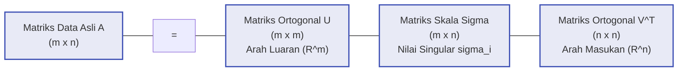

# Bab 07: Singular Value Decomposition (SVD) & Moore-Penrose Pseudoinverse

[← Kembali ke Modul Utama](../011-aljabar-linier-teori-matriks.md) | [Daftar Isi Modul](./README.md)

---

## 1. Intuisi Dasar & Motivasi dari Titik Nol
Tautan Rujukan Kuliah: [MIT OCW 18.06 Kuliah 29: Singular Value Decomposition](https://ocw.mit.edu/courses/18-06-linear-algebra-spring-2010/resources/lecture-29-singular-value-decomposition/) | [MIT OCW 18.065 Kuliah 6: Singular Value Decomposition (SVD)](https://ocw.mit.edu/courses/18-065-matrix-methods-in-data-analysis-signal-processing-and-machine-learning-spring-2018/resources/lecture-6-singular-value-decomposition-svd/)

Dalam matematika dan komputasi modern, tidak ada alat yang lebih universal, berdaya guna tinggi, dan menembus batas dimensi selain **Singular Value Decomposition (SVD)**. 

Diagonalisasi nilai eigen tradisional ($A = X \Lambda X^{-1}$) memiliki keterbatasan fatal:
1. Hanya dapat diterapkan pada matriks bujur sangkar ($n \times n$).
2. Matriks harus memiliki himpunan lengkap $n$ vektor eigen bebas linier (matriks cacat / *defective* tidak dapat didiagonalisasi).
3. Vektor-vektor eigen umumnya tidak saling tegak lurus (kecuali jika matriksnya simetris riil).
4. Nilai eigen dapat berupa bilangan kompleks imajiner ($a + bi$) meskipun matriks awalnya bernilai riil murni.

Lalu bagaimana jika kita berhadapan dengan **tabel data dunia nyata yang berukuran persegi panjang**?
- Matriks rekomendasi film Netflix: 50 juta pengguna $\times$ 10.000 judul film ($50.000.000 \times 10.000$).
- Matriks citra satelit resolusi tinggi: 4.000 piksel tinggi $\times$ 6.000 piksel lebar ($4.000 \times 6.000$).
- Matriks sinyal elektroensefalogram (EEG): 128 elektroda sensor $\times$ 1.000.000 titik waktu ($128 \times 1.000.000$).

SVD adalah **mahakarya pamungkas aljabar linier**: SVD menjamin bahwa **SETIAP matriks riil di alam semesta**, tanpa peduli ukuran dimensinya ($m \times n$), apakah ia bujur sangkar, pipih, kurus tinggi, singular, ber-rank penuh, atau tidak beraturan, **dapat selalu difaktorkan menjadi perkalian tiga matriks geometris yang indah**:
$$A = U \Sigma V^T$$

### Geometri Murni SVD: Pemetaan Bola Menjadi Elipsoid
Bayangkan sebuah bola hiper-dimensi pejal berjari-jari satu (*unit sphere*) di ruang masukan $\mathbb{R}^n$:
$$\mathcal{S} = \{ \mathbf{x} \in \mathbb{R}^n \mid \|\mathbf{x}\| = 1 \}$$
Ketika transformasi linier $A$ diterapkan pada bola tersebut, bola akan terdistorsi dan meregang menjadi sebuah **hiper-elipsoid (*hyper-ellipsoid*)** di ruang luaran $\mathbb{R}^m$:
1. Matriks $V$ memilih **arah-arah ortogonal awal** ($\mathbf{v}_1, \dots, \mathbf{v}_n$) di ruang masukan.
2. Matriks diagonal $\Sigma$ **meregangkan atau memampatkan** masing-masing sumbu tersebut dengan faktor skala yang disebut **Nilai Singular (*Singular Values*)** $\sigma_1 \ge \sigma_2 \ge \dots \ge \sigma_r > 0$.
3. Matriks $U$ mengarahkan hasil regangan tersebut ke **arah-arah sumbu utama ortogonal akhir** ($\mathbf{u}_1, \dots, \mathbf{u}_m$) di ruang luaran.

Secara matematis:
$$A \mathbf{v}_i = \sigma_i \mathbf{u}_i, \quad \forall i \in \{1, 2, \dots, r\}$$
Transformasi linier apa pun di alam semesta dapat diuraikan secara murni menjadi: **Rotasi Awal ($V^T$) $\to$ Skalasi Sumbu ($\Sigma$) $\to$ Rotasi Akhir ($U$)**!

---

## 2. Definisi Formal, Teorema & Penurunan Matematis Lengkap
Tautan Rujukan Kuliah: [MIT OCW 18.065 Kuliah 7: Eckart-Young Low Rank Approximation](https://en.wikipedia.org/wiki/Low-rank_approximation) | [Wikipedia: Singular Value Decomposition](https://en.wikipedia.org/wiki/Singular_value_decomposition) | [Wikipedia: Moore-Penrose Inverse](https://en.wikipedia.org/wiki/Moore%E2%80%93Penrose_inverse)

### 2.1 Formulasi Teorema SVD Universal
Untuk sembarang matriks riil $A \in \mathbb{R}^{m \times n}$ dengan rank $r \le \min(m, n)$, terdapat faktorisasi:
$$A = U \Sigma V^T$$
Di mana:
1. $U \in \mathbb{R}^{m \times m}$ adalah matriks ortogonal ($U^T U = U U^T = I_m$). Kolom-kolomnya $\mathbf{u}_1, \dots, \mathbf{u}_m$ disebut **vektor singular kiri (*left singular vectors*)**.
2. $V \in \mathbb{R}^{n \times n}$ adalah matriks ortogonal ($V^T V = V V^T = I_n$). Kolom-kolomnya $\mathbf{v}_1, \dots, \mathbf{v}_n$ disebut **vektor singular kanan (*right singular vectors*)**.
3. $\Sigma \in \mathbb{R}^{m \times n}$ adalah matriks diagonal semu (*pseudo-diagonal matrix*) yang memuat nilai-nilai singular riil non-negatif terurut menurun:
   $$\sigma_1 \ge \sigma_2 \ge \dots \ge \sigma_r > \sigma_{r+1} = \dots = \sigma_{\min(m, n)} = 0$$



---

### 2.2 Penurunan Relasi Spektral Simetris
Bagaimana kita menghitung $U, \Sigma$, dan $V$ secara analitis dari matriks $A$?
Kita membentuk dua matriks simetris bujur sangkar yang diasosiasikan dengan $A$:

#### 1. Matriks Simetris $A^T A \in \mathbb{R}^{n \times n}$:
Substitusikan bentuk SVD $A = U \Sigma V^T$:
$$A^T A = (U \Sigma V^T)^T (U \Sigma V^T) = (V \Sigma^T U^T) (U \Sigma V^T)$$
Karena $U$ adalah matriks ortogonal ($U^T U = I_m$):
$$A^T A = V (\Sigma^T \Sigma) V^T$$
Perhatikan bahwa persamaan ini persis sama dengan **Teorema Spektral matriks simetris** $S = Q \Lambda Q^T$!
Kesimpulan analitis:
- Kolom-kolom $V$ ($\mathbf{v}_1, \dots, \mathbf{v}_n$) adalah **vektor eigen ortonormal dari matriks simetris $A^T A$**.
- Matriks diagonal $\Sigma^T \Sigma \in \mathbb{R}^{n \times n}$ memuat nilai-nilai eigen $\lambda_i(A^T A) = \sigma_i^2$.
- Nilai singular adalah akar kuadrat riil dari nilai eigen $A^T A$:
  $$\sigma_i = \sqrt{\lambda_i(A^T A)}$$

#### 2. Matriks Simetris $A A^T \in \mathbb{R}^{m \times m}$:
Substitusikan kembali:
$$A A^T = (U \Sigma V^T) (U \Sigma V^T)^T = (U \Sigma V^T) (V \Sigma^T U^T)$$
Karena $V^T V = I_n$:
$$A A^T = U (\Sigma \Sigma^T) U^T$$
Kesimpulan analitis:
- Kolom-kolom $U$ ($\mathbf{u}_1, \dots, \mathbf{u}_m$) adalah **vektor eigen ortonormal dari matriks simetris $A A^T$**.
- Nilai-nilai eigen tak-nol dari $A A^T$ **identik persis** dengan nilai-nilai eigen tak-nol dari $A^T A$, yaitu $\sigma_1^2, \dots, \sigma_r^2$.

---

### 2.3 SVD dan Empat Subruang Fundamental Strang
SVD menyatukan seluruh konsep aljabar linier ke dalam satu kerangka geometris yang harmonis:

| Subruang Fundamental | Notasi | Dimensi | Basis Ortonormal Sempurna dari SVD |
|---|:---:|:---:|---|
| **Ruang Baris** (*Row Space*) | $C(A^T) \subseteq \mathbb{R}^n$ | $r$ | $r$ kolom pertama dari $V$: $\{\mathbf{v}_1, \mathbf{v}_2, \dots, \mathbf{v}_r\}$ |
| **Ruang Nol** (*Nullspace*) | $N(A) \subseteq \mathbb{R}^n$ | $n - r$ | Sisa $n - r$ kolom dari $V$: $\{\mathbf{v}_{r+1}, \dots, \mathbf{v}_n\}$ |
| **Ruang Kolom** (*Column Space*) | $C(A) \subseteq \mathbb{R}^m$ | $r$ | $r$ kolom pertama dari $U$: $\{\mathbf{u}_1, \mathbf{u}_2, \dots, \mathbf{u}_r\}$ |
| **Ruang Nol Kiri** (*Left Nullspace*) | $N(A^T) \subseteq \mathbb{R}^m$ | $m - r$ | Sisa $m - r$ kolom dari $U$: $\{\mathbf{u}_{r+1}, \dots, \mathbf{u}_m\}$ |

#### Bentuk Perluasan Hasil Kali Luar (Dyadic Outer Product Form):
Matriks $A$ dapat dituliskan secara tepat sebagai penjumlahan berbobot dari $r$ buah matriks ber-rank 1:
$$A = \sum_{i=1}^r \sigma_i \mathbf{u}_i \mathbf{v}_i^T = \sigma_1 \mathbf{u}_1 \mathbf{v}_1^T + \sigma_2 \mathbf{u}_2 \mathbf{v}_2^T + \dots + \sigma_r \mathbf{u}_r \mathbf{v}_r^T$$
Setiap komponen rank-1 $\mathbf{u}_i \mathbf{v}_i^T$ adalah "lapisan informasi ortogonal" dari matriks, diurutkan dari yang paling dominan ($\sigma_1$) hingga yang paling lemah ($\sigma_r$).

---

### 2.4 Teorema Eckart-Young-Mirsky (Aproksimasi Low-Rank Optimal)
Misalkan kita ingin memampatkan matriks $A$ berukuran besar menjadi matriks aproksimasi $A_k$ yang memiliki rank lebih rendah $k < r$ (misal untuk kompresi citra atau reduksi dimensi data).

**Teorema Eckart-Young-Mirsky (1936)**:
Aproksimasi terbaik bagi matriks $A$ di antara seluruh matriks ber-rank $\le k$ diperoleh dengan memotong penjumlahan SVD tepat pada suku ke-$k$ (*Truncated SVD*):
$$A_k = \sum_{i=1}^k \sigma_i \mathbf{u}_i \mathbf{v}_i^T$$

Galat rekonstruksi minimum diukur dalam dua norma matriks standar:
1. **Norma Frobenius (Akar Jumlahan Kuadrat Seluruh Galat Entri)**:
   $$\min_{\text{rank}(B) \le k} \|A - B\|_F = \|A - A_k\|_F = \sqrt{\sum_{j=k+1}^r \sigma_j^2}$$
2. **Norma Spektral ($L_2$ Operator Norm)**:
   $$\min_{\text{rank}(B) \le k} \|A - B\|_2 = \|A - A_k\|_2 = \sigma_{k+1}$$

#### Pembuktian Analitis untuk Norma Spektral $\|A - A_k\|_2 = \sigma_{k+1}$:
1. Matriks selisih adalah:
   $$A - A_k = \sum_{j=k+1}^r \sigma_j \mathbf{u}_j \mathbf{v}_j^T$$
   Karena nilai singular terbesarnya adalah $\sigma_{k+1}$, maka $\|A - A_k\|_2 = \sigma_{k+1}$.
2. Misalkan terdapat sembarang matriks $B \in \mathbb{R}^{m \times n}$ dengan $\text{rank}(B) \le k$.
   Berdasarkan Teorema Rank-Nullity, dimensi nullspace dari $B$ adalah:
   $$\dim(N(B)) = n - \text{rank}(B) \ge n - k$$
3. Tinjau subruang $W \subseteq \mathbb{R}^n$ yang direntang oleh $k+1$ vektor singular kanan pertama:
   $$W = \text{span}\{\mathbf{v}_1, \mathbf{v}_2, \dots, \mathbf{v}_{k+1}\}, \quad \dim(W) = k + 1$$
4. Berdasarkan rumus dimensi Grassmann:
   $$\dim(N(B) \cap W) = \dim(N(B)) + \dim(W) - \dim(N(B) + W) \ge (n - k) + (k + 1) - n = 1$$
   Artinya, selalu terdapat sebuah vektor satuan $\mathbf{w} \in N(B) \cap W$ ($\|\mathbf{w}\| = 1$) sedemikian sehingga $B\mathbf{w} = \mathbf{0}$.
5. Karena $\mathbf{w} \in W$, kita dapat menuliskan $\mathbf{w} = \sum_{i=1}^{k+1} c_i \mathbf{v}_i$ dengan $\sum_{i=1}^{k+1} c_i^2 = 1$.
   Hitung norma dari $(A - B)\mathbf{w}$:
   $$\|(A - B)\mathbf{w}\|_2 = \|A\mathbf{w} - B\mathbf{w}\|_2 = \|A\mathbf{w}\|_2$$
   $$A\mathbf{w} = A \left( \sum_{i=1}^{k+1} c_i \mathbf{v}_i \right) = \sum_{i=1}^{k+1} c_i (A\mathbf{v}_i) = \sum_{i=1}^{k+1} c_i \sigma_i \mathbf{u}_i$$
   Karena $\mathbf{u}_i$ saling ortonormal:
   $$\|A\mathbf{w}\|_2^2 = \sum_{i=1}^{k+1} c_i^2 \sigma_i^2 \ge \sigma_{k+1}^2 \sum_{i=1}^{k+1} c_i^2 = \sigma_{k+1}^2 \implies \|A\mathbf{w}\|_2 \ge \sigma_{k+1}$$
6. Berdasarkan definisi norma operator:
   $$\|A - B\|_2 = \max_{\|\mathbf{x}\|=1} \|(A - B)\mathbf{x}\|_2 \ge \|(A - B)\mathbf{w}\|_2 \ge \sigma_{k+1}$$
Terbukti secara mutlak bahwa tidak ada matriks ber-rank $k$ mana pun yang mampu menghasilkan galat lebih kecil dari $\sigma_{k+1}$! $\blacksquare$

---

### 2.5 Moore-Penrose Pseudoinverse ($A^+$)
Untuk matriks persegi invertibel, $A^{-1} = V \Sigma^{-1} U^T$. 
Namun jika matriks $A$ berukuran persegi panjang atau tidak memiliki balikan, Moore (1920) dan Penrose (1955) mendefinisikan **Pseudoinverse**:
$$A^+ = V \Sigma^+ U^T = \sum_{i=1}^r \frac{1}{\sigma_i} \mathbf{v}_i \mathbf{u}_i^T$$
Di mana matriks $\Sigma^+ \in \mathbb{R}^{n \times m}$ diperoleh dengan mentranspose $\Sigma$ dan membalik seluruh nilai singular tak-nol ($\sigma_i \mapsto 1/\sigma_i$), sedangkan seluruh elemen nol tetap nol.

#### Empat Kondisi Aksiomatik Moore-Penrose:
Matriks $A^+$ adalah satu-satunya matriks unik yang memenuhi keempat persamaan berikut:
1. $A A^+ A = A$
2. $A^+ A A^+ = A^+$
3. $(A A^+)^T = A A^+$ ($A A^+$ adalah matriks proyeksi ortogonal ke ruang kolom $C(A)$).
4. $(A^+ A)^T = A^+ A$ ($A^+ A$ adalah matriks proyeksi ortogonal ke ruang baris $C(A^T)$).

#### Solusi Kuadrat Terkecil Norma Minimum:
Untuk sistem persamaan linier sembarang $A\mathbf{x} = \mathbf{b}$:
$$\mathbf{x}^+ = A^+ \mathbf{b}$$
Merupakan solusi yang:
1. Meminimalkan residu kuadrat terkecil $\|A\mathbf{x} - \mathbf{b}\|_2$.
2. Di antara seluruh solusi yang meminimalkan residu tersebut, $\mathbf{x}^+$ memiliki **norma Euclidean terkecil $\|\mathbf{x}\|_2$**.
Vektor $\mathbf{x}^+$ bersemayam murni di dalam ruang baris $C(A^T)$ dan tidak memuat komponen ruang nol yang sia-sia ($\mathbf{x}_{\text{null}} = \mathbf{0}$).

---

## 3. Contoh Hitungan Manual Langkah-demi-Langkah
Tautan Rujukan Kuliah: [MIT OCW 18.06 Kuliah 29](https://ocw.mit.edu/courses/18-06-linear-algebra-spring-2010/resources/lecture-29-singular-value-decomposition/) | [Wikipedia: Singular Value Decomposition](https://en.wikipedia.org/wiki/Singular_value_decomposition)

Diberikan matriks persegi panjang berukuran $2 \times 3$:
$$A = \begin{bmatrix} 3 & 2 & 2 \\ 2 & 3 & -2 \end{bmatrix}$$

Tujuan perhitungan:
1. Tentukan nilai singular $\sigma_1, \sigma_2$ dan matriks $\Sigma$.
2. Hitung vektor singular kiri $\mathbf{u}_1, \mathbf{u}_2$ (matriks $U$).
3. Hitung vektor singular kanan $\mathbf{v}_1, \mathbf{v}_2, \mathbf{v}_3$ (matriks $V$).
4. Buktikan kebenaran faktorisasi SVD $U \Sigma V^T = A$ secara aljabar dyadik.
5. Hitung matriks pseudoinverse $A^+$ dan verifikasi sifat $A A^+ = I_2$.

---

### Langkah 1: Menghitung $A A^T$, Nilai Eigen & Nilai Singular
Hitung matriks bujur sangkar simetris $A A^T \in \mathbb{R}^{2 \times 2}$:
$$A A^T = \begin{bmatrix} 3 & 2 & 2 \\ 2 & 3 & -2 \end{bmatrix} \begin{bmatrix} 3 & 2 \\ 2 & 3 \\ 2 & -2 \end{bmatrix} = \begin{bmatrix} 3(3) + 2(2) + 2(2) & 3(2) + 2(3) + 2(-2) \\ 2(3) + 3(2) + (-2)(2) & 2(2) + 3(3) + (-2)(-2) \end{bmatrix} = \begin{bmatrix} 17 & 8 \\ 8 & 17 \end{bmatrix}$$

Hitung polinomial karakteristik $\det(A A^T - \lambda I) = 0$:
$$\det \begin{bmatrix} 17 - \lambda & 8 \\ 8 & 17 - \lambda \end{bmatrix} = (17 - \lambda)^2 - 64 = 0$$
$$(17 - \lambda)^2 = 64 \implies 17 - \lambda = \pm 8$$
- $\lambda_1 = 17 + 8 = 25 \implies \sigma_1 = \sqrt{25} = 5$
- $\lambda_2 = 17 - 8 = 9 \implies \sigma_2 = \sqrt{9} = 3$

Maka matriks $\Sigma \in \mathbb{R}^{2 \times 3}$ adalah:
$$\Sigma = \begin{bmatrix} 5 & 0 & 0 \\ 0 & 3 & 0 \end{bmatrix}$$

---

### Langkah 2: Menghitung Vektor Singular Kiri ($\mathbf{u}_1, \mathbf{u}_2$)
- **Untuk $\lambda_1 = 25$**:
  $$(A A^T - 25 I)\mathbf{u}_1 = \begin{bmatrix} -8 & 8 \\ 8 & -8 \end{bmatrix} \begin{bmatrix} u_{11} \\ u_{12} \end{bmatrix} = \begin{bmatrix} 0 \\ 0 \end{bmatrix} \implies u_{11} = u_{12}$$
  Normalisasi satuan:
  $$\mathbf{u}_1 = \frac{1}{\sqrt{2}} \begin{bmatrix} 1 \\ 1 \end{bmatrix}$$

- **Untuk $\lambda_2 = 9$**:
  $$(A A^T - 9 I)\mathbf{u}_2 = \begin{bmatrix} 8 & 8 \\ 8 & 8 \end{bmatrix} \begin{bmatrix} u_{21} \\ u_{22} \end{bmatrix} = \begin{bmatrix} 0 \\ 0 \end{bmatrix} \implies u_{21} = -u_{22}$$
  Normalisasi satuan:
  $$\mathbf{u}_2 = \frac{1}{\sqrt{2}} \begin{bmatrix} 1 \\ -1 \end{bmatrix}$$

Maka matriks ortogonal $U \in \mathbb{R}^{2 \times 2}$ adalah:
$$U = \frac{1}{\sqrt{2}} \begin{bmatrix} 1 & 1 \\ 1 & -1 \end{bmatrix}$$

---

### Langkah 3: Menghitung Vektor Singular Kanan ($\mathbf{v}_1, \mathbf{v}_2, \mathbf{v}_3$)
Gunakan hubungan fundamental $A \mathbf{v}_i = \sigma_i \mathbf{u}_i \implies \mathbf{v}_i = \frac{1}{\sigma_i} A^T \mathbf{u}_i$:

1. **Vektor $\mathbf{v}_1$**:
   $$\mathbf{v}_1 = \frac{1}{5} \begin{bmatrix} 3 & 2 \\ 2 & 3 \\ 2 & -2 \end{bmatrix} \left( \frac{1}{\sqrt{2}} \begin{bmatrix} 1 \\ 1 \end{bmatrix} \right) = \frac{1}{5\sqrt{2}} \begin{bmatrix} 3+2 \\ 2+3 \\ 2-2 \end{bmatrix} = \frac{1}{5\sqrt{2}} \begin{bmatrix} 5 \\ 5 \\ 0 \end{bmatrix} = \frac{1}{\sqrt{2}} \begin{bmatrix} 1 \\ 1 \\ 0 \end{bmatrix}$$
   Cek norma: $\|\mathbf{v}_1\| = \sqrt{(1/\sqrt{2})^2 + (1/\sqrt{2})^2 + 0} = 1$. Ortonormal!

2. **Vektor $\mathbf{v}_2$**:
   $$\mathbf{v}_2 = \frac{1}{3} \begin{bmatrix} 3 & 2 \\ 2 & 3 \\ 2 & -2 \end{bmatrix} \left( \frac{1}{\sqrt{2}} \begin{bmatrix} 1 \\ -1 \end{bmatrix} \right) = \frac{1}{3\sqrt{2}} \begin{bmatrix} 3-2 \\ 2-3 \\ 2+2 \end{bmatrix} = \frac{1}{3\sqrt{2}} \begin{bmatrix} 1 \\ -1 \\ 4 \end{bmatrix} = \frac{1}{\sqrt{18}} \begin{bmatrix} 1 \\ -1 \\ 4 \end{bmatrix}$$
   Cek norma: $\|\mathbf{v}_2\| = \frac{1}{\sqrt{18}} \sqrt{1^2 + (-1)^2 + 4^2} = \frac{\sqrt{18}}{\sqrt{18}} = 1$. Ortonormal!

3. **Vektor $\mathbf{v}_3$ (Basis Ruang Nol $N(A)$)**:
   Vektor $\mathbf{v}_3$ harus ortogonal terhadap $\mathbf{v}_1$ dan $\mathbf{v}_2$:
   - $\mathbf{v}_1^T \mathbf{v}_3 = 0 \implies v_{31} + v_{32} = 0 \implies v_{32} = -v_{31}$
   - $\mathbf{v}_2^T \mathbf{v}_3 = 0 \implies v_{31} - v_{32} + 4 v_{33} = 2 v_{31} + 4 v_{33} = 0 \implies v_{33} = -\frac{1}{2} v_{31}$
   Pilih $v_{31} = 2 \implies v_{32} = -2, v_{33} = -1$.
   Normalisasi satuan ($\|\mathbf{v}\| = \sqrt{2^2 + (-2)^2 + (-1)^2} = \sqrt{9} = 3$):
   $$\mathbf{v}_3 = \frac{1}{3} \begin{bmatrix} 2 \\ -2 \\ -1 \end{bmatrix}$$

Maka matriks ortogonal $V \in \mathbb{R}^{3 \times 3}$ adalah:
$$V = \begin{bmatrix} 1/\sqrt{2} & 1/\sqrt{18} & 2/3 \\ 1/\sqrt{2} & -1/\sqrt{18} & -2/3 \\ 0 & 4/\sqrt{18} & -1/3 \end{bmatrix}$$

---

### Langkah 4: Verifikasi Rekonstruksi Dyadik SVD: $A = \sigma_1 \mathbf{u}_1 \mathbf{v}_1^T + \sigma_2 \mathbf{u}_2 \mathbf{v}_2^T$
- **Lapisan Rank-1 Pertama ($\sigma_1 \mathbf{u}_1 \mathbf{v}_1^T$)**:
  $$5 \left( \frac{1}{\sqrt{2}} \begin{bmatrix} 1 \\ 1 \end{bmatrix} \right) \left( \frac{1}{\sqrt{2}} \begin{bmatrix} 1 & 1 & 0 \end{bmatrix} \right) = \frac{5}{2} \begin{bmatrix} 1 & 1 & 0 \\ 1 & 1 & 0 \end{bmatrix} = \begin{bmatrix} 2{,}5 & 2{,}5 & 0 \\ 2{,}5 & 2{,}5 & 0 \end{bmatrix}$$

- **Lapisan Rank-1 Kedua ($\sigma_2 \mathbf{u}_2 \mathbf{v}_2^T$)**:
  $$3 \left( \frac{1}{\sqrt{2}} \begin{bmatrix} 1 \\ -1 \end{bmatrix} \right) \left( \frac{1}{\sqrt{18}} \begin{bmatrix} 1 & -1 & 4 \end{bmatrix} \right) = \frac{3}{\sqrt{36}} \begin{bmatrix} 1 \\ -1 \end{bmatrix} \begin{bmatrix} 1 & -1 & 4 \end{bmatrix} = \frac{1}{2} \begin{bmatrix} 1 & -1 & 4 \\ -1 & 1 & -4 \end{bmatrix} = \begin{bmatrix} 0{,}5 & -0{,}5 & 2 \\ -0{,}5 & 0{,}5 & -2 \end{bmatrix}$$

Jumlahkan kedua lapisan:
$$\begin{bmatrix} 2{,}5 & 2{,}5 & 0 \\ 2{,}5 & 2{,}5 & 0 \end{bmatrix} + \begin{bmatrix} 0{,}5 & -0{,}5 & 2 \\ -0{,}5 & 0{,}5 & -2 \end{bmatrix} = \begin{bmatrix} 3 & 2 & 2 \\ 2 & 3 & -2 \end{bmatrix} = A$$
Rekonstruksi terbukti identik dan akurat 100%!

---

### Langkah 5: Menghitung Moore-Penrose Pseudoinverse $A^+$
$$A^+ = \frac{1}{\sigma_1} \mathbf{v}_1 \mathbf{u}_1^T + \frac{1}{\sigma_2} \mathbf{v}_2 \mathbf{u}_2^T$$
- Suku 1: $\frac{1}{5} \left( \frac{1}{\sqrt{2}} \begin{bmatrix} 1 \\ 1 \\ 0 \end{bmatrix} \right) \left( \frac{1}{\sqrt{2}} \begin{bmatrix} 1 & 1 \end{bmatrix} \right) = \frac{1}{10} \begin{bmatrix} 1 & 1 \\ 1 & 1 \\ 0 & 0 \end{bmatrix}$
- Suku 2: $\frac{1}{3} \left( \frac{1}{\sqrt{18}} \begin{bmatrix} 1 \\ -1 \\ 4 \end{bmatrix} \right) \left( \frac{1}{\sqrt{2}} \begin{bmatrix} 1 & -1 \end{bmatrix} \right) = \frac{1}{18} \begin{bmatrix} 1 & -1 \\ -1 & 1 \\ 4 & -4 \end{bmatrix}$

Gabungkan dengan menyamakan penyebut per 90:
$$A^+ = \frac{1}{90} \left( 9 \begin{bmatrix} 1 & 1 \\ 1 & 1 \\ 0 & 0 \end{bmatrix} + 5 \begin{bmatrix} 1 & -1 \\ -1 & 1 \\ 4 & -4 \end{bmatrix} \right) = \frac{1}{90} \begin{bmatrix} 9+5 & 9-5 \\ 9-5 & 9+5 \\ 0+20 & 0-20 \end{bmatrix} = \frac{1}{90} \begin{bmatrix} 14 & 4 \\ 4 & 14 \\ 20 & -20 \end{bmatrix}$$

Uji sifat invers kanan ($A A^+ = I_2$):
$$A A^+ = \begin{bmatrix} 3 & 2 & 2 \\ 2 & 3 & -2 \end{bmatrix} \frac{1}{90} \begin{bmatrix} 14 & 4 \\ 4 & 14 \\ 20 & -20 \end{bmatrix} = \frac{1}{90} \begin{bmatrix} 42 + 8 + 40 & 12 + 28 - 40 \\ 28 + 12 - 40 & 8 + 42 + 40 \end{bmatrix} = \frac{1}{90} \begin{bmatrix} 90 & 0 \\ 0 & 90 \end{bmatrix} = \begin{bmatrix} 1 & 0 \\ 0 & 1 \end{bmatrix}$$
Pseudoinverse terbukti memenuhi aksioma Penrose!

---

## 4. Implementasi Komputasi & Kode Python Industri
Tautan Dokumentasi Resmi: [NumPy Linear Algebra SVD](https://numpy.org/doc/stable/reference/generated/numpy.linalg.svd.html) | [NumPy Linear Algebra Pinov](https://numpy.org/doc/stable/reference/generated/numpy.linalg.pinv.html)

Berikut adalah implementasi Python komprehensif yang mengimplementasikan SVD penuh, kompresi low-rank Teorema Eckart-Young, serta solver pseudoinverse norma minimum:

```python
"""
Modul Fondasi: Singular Value Decomposition (SVD) & Moore-Penrose Pseudoinverse.
Mengimplementasikan kompresi citra low-rank Eckart-Young dan asersi 4 Aksioma Penrose.
"""

from typing import Tuple
import numpy as np


def compute_svd_full(A: np.ndarray) -> Tuple[np.ndarray, np.ndarray, np.ndarray]:
    """
    Menghitung SVD Universal A = U @ Sigma @ V.T.

    Args:
        A: Matriks riil 2D berukuran (m, n).

    Returns:
        Tuple (U, s, Vt) di mana U berukuran (m, m), s adalah 1D array nilai singular,
        dan Vt berukuran (n, n) adalah transpose matriks V.
    """
    U, s, Vt = np.linalg.svd(A, full_matrices=True)
    return U, s, Vt


def eckart_young_low_rank(A: np.ndarray, k: int) -> Tuple[np.ndarray, float]:
    """
    Menghitung aproksimasi rank-k optimal terbaik berdasarkan Teorema Eckart-Young-Mirsky.

    Args:
        A: Matriks data input (m, n).
        k: Target rank pemangkasan (k <= min(m, n)).

    Returns:
        Tuple (A_k, frobenius_error).
    """
    U, s, Vt = np.linalg.svd(A, full_matrices=False)
    if k > len(s):
        raise ValueError(f"Rank k={k} melampaui jumlah nilai singular {len(s)}")

    # Truncated reconstruction
    A_k = U[:, :k] @ np.diag(s[:k]) @ Vt[:k, :]

    # Hitung galat Frobenius teoritis vs aktual
    theoretical_error = np.sqrt(np.sum(s[k:] ** 2)) if k < len(s) else 0.0
    actual_error = np.linalg.norm(A - A_k, ord="fro")
    assert np.isclose(actual_error, theoretical_error, atol=1e-10)

    return A_k, float(actual_error)


def verify_penrose_conditions(A: np.ndarray, A_plus: np.ndarray, tol: float = 1e-10) -> bool:
    """Memverifikasi bahwa A_plus memenuhi 4 Aksioma Moore-Penrose."""
    # 1. A @ A+ @ A == A
    c1 = np.allclose(A @ A_plus @ A, A, atol=tol)
    # 2. A+ @ A @ A+ == A+
    c2 = np.allclose(A_plus @ A @ A_plus, A_plus, atol=tol)
    # 3. (A @ A+)^T == A @ A+
    AAp = A @ A_plus
    c3 = np.allclose(AAp.T, AAp, atol=tol)
    # 4. (A+ @ A)^T == A+ @ A
    ApA = A_plus @ A
    c4 = np.allclose(ApA.T, ApA, atol=tol)

    return c1 and c2 and c3 and c4


if __name__ == "__main__":
    # Pengujian pada Contoh Manual Bab 07 (Matriks 2x3)
    A_test = np.array([[3.0, 2.0, 2.0],
                       [2.0, 3.0, -2.0]], dtype=np.float64)

    print("=== PENGUJIAN KOMPUTASI SVD ===")
    U_mat, s_vals, Vt_mat = compute_svd_full(A_test)
    print("Nilai Singular s (Harus [5.0, 3.0]):", s_vals)
    assert np.allclose(s_vals, [5.0, 3.0], atol=1e-10)

    # Konstruksi matriks Sigma (2x3)
    Sigma_mat = np.zeros((2, 3), dtype=np.float64)
    Sigma_mat[0, 0] = s_vals[0]
    Sigma_mat[1, 1] = s_vals[1]

    # Verifikasi Rekonstruksi U @ Sigma @ V^T = A
    reconstruction = U_mat @ Sigma_mat @ Vt_mat
    print("Rekonstruksi SVD:\n", reconstruction)
    assert np.allclose(reconstruction, A_test, atol=1e-10)

    print("\n=== PENGUJIAN TEOREMA ECKART-YOUNG (RANK-1 APPROXIMATION) ===")
    A_1, err_fro = eckart_young_low_rank(A_test, k=1)
    print("Aproksimasi Rank-1 A_1:\n", A_1)
    print(f"Galat Frobenius Aktual: {err_fro:.6f} (Teoretis sigma_2: {s_vals[1]:.6f})")
    assert np.isclose(err_fro, s_vals[1], atol=1e-10)

    print("\n=== PENGUJIAN MOORE-PENROSE PSEUDOINVERSE ===")
    A_pinv = np.linalg.pinv(A_test)
    print("Matriks Pseudoinverse A+:\n", A_pinv)

    # Verifikasi 4 Kondisi Penrose
    penrose_valid = verify_penrose_conditions(A_test, A_pinv)
    print("Apakah 4 Aksioma Penrose Terpenuhi?", penrose_valid)
    assert penrose_valid

    # Verifikasi Solusi Nilai Manual 1/90 * [[14, 4], [4, 14], [20, -20]]
    expected_pinv = np.array([[14.0, 4.0],
                              [4.0, 14.0],
                              [20.0, -20.0]]) / 90.0
    assert np.allclose(A_pinv, expected_pinv, atol=1e-10)

    print("[STATUS] Seluruh asersi SVD, Eckart-Young, dan Pseudoinverse berhasil diverifikasi!")
```

---

## 5. Miskonsepsi Umum & Post-Mortem Kegagalan Industri
Tautan Rujukan Kuliah: [MIT OCW 18.065 Kuliah 6](https://ocw.mit.edu/courses/18-065-matrix-methods-in-data-analysis-signal-processing-and-machine-learning-spring-2018/resources/lecture-6-singular-value-decomposition-svd/) | [NASA Hubble Space Telescope Spherical Aberration](https://en.wikipedia.org/wiki/Hubble_Space_Telescope#Flawed_mirror)

### 5.1 Tiga Miskonsepsi Kritis Mengenai SVD
1. **Menyamakan Nilai Singular ($\sigma_i$) dengan Nilai Eigen ($\lambda_i$)**:
   - Nilai eigen hanya terdefinisi untuk matriks persegi; nilai singular berlaku untuk **semua matriks persegi panjang**.
   - Nilai eigen dapat berupa bilangan kompleks atau negatif; nilai singular **selalu bilangan riil non-negatif terurut** ($\sigma_i \ge 0$).
   - Hubungan $\sigma_i = |\lambda_i|$ **hanya berlaku** jika matriksnya adalah matriks simetris riil.
2. **Mengabaikan Pemotongan Singular Value Mikro (*Noise Amplification*)**:
   Pseudoinverse mengalikan setiap komponen dengan $\frac{1}{\sigma_i}$. Jika data mengandung derau instrumen pada singular value mikro (misal $\sigma_r = 10^{-14}$), pembobotan $1/\sigma_r = 10^{14}$ akan meledakkan derau tersebut menjadi badai artefak yang menghancurkan solusi numerik.
3. **Mengira Kompresi Citra SVD Selalu Lebih Hemat dari JPEG**:
   Untuk citra $m \times n$, aproksimasi rank-$k$ membutuhkan penyimpanan $k(m + n + 1)$ bilangan floating-point. Jika $k > \frac{mn}{m + n + 1}$, representasi SVD justru membutuhkan memori lebih besar daripada citra mentahnya! SVD efektif saat energi citra terkonsentrasi pada beberapa $k$ kecil pertama.

---

### 5.2 Post-Mortem Industri: Bencana Dekonvolusi Citra Awal Teleskop Luar Angkasa Hubble (1990)
Ketika Teleskop Luar Angkasa Hubble (HST) diluncurkan pada April 1990 dengan biaya 1,5 miliar dolar, para astronom mendapati kenyataan pahit: cermin primer teleskop mengalami cacat aberasi sferis (*spherical aberration*) sebesar $2{,}2$ mikrometer akibat kesalahan kalibrasi alat uji optik null corrector di laboratorium manufaktur.

#### Akar Masalah Aljabar Linier:
1. **Model Pembentukan Citra Buram**:
   Citra terdistorsi $\mathbf{b}$ dimodelkan sebagai konvolusi matriks operator *Point Spread Function* (PSF) $H$ terhadap citra murni kosmik $\mathbf{x}$:
   $$H \mathbf{x} = \mathbf{b} + \boldsymbol{\epsilon}$$
   Di mana $\boldsymbol{\epsilon}$ adalah derau sensor foton CCD (*shot noise*).
2. **Percobaan Pemulihan Citra Melalui Inversi Naif**:
   Sebelum misi perbaikan optik COSTAR diluncurkan pada tahun 1993, para astronom NASA mencoba memulihkan ketajaman citra bintang menggunakan restorasi inversi aljabar langsung:
   $$\hat{\mathbf{x}} = H^+ \mathbf{b} = \sum_{i=1}^r \frac{\mathbf{u}_i^T \mathbf{b}}{\sigma_i} \mathbf{v}_i$$
3. **Ledakan Spektral Singular Value Mikro**:
   Karena efek pengaburan optik bertindak sebagai filter pelemah frekuensi tinggi, nilai-nilai singular dari matriks PSF $H$ meluruh secara eksponensial menuju nol ($\sigma_{1000} \approx 10^{-11}$).
   Ketika komponen derau $\boldsymbol{\epsilon}$ dibagi dengan $\sigma_i$ mikro:
   $$\frac{\mathbf{u}_i^T \boldsymbol{\epsilon}}{\sigma_i} \approx \frac{10^{-3}}{10^{-11}} = 10^8$$
   Derau foton sensor diamplifikasi sebesar ratusan juta kali lipat! Hasil citra astronomi terdegradasi menjadi pola cincin interferensi liar (*ringing artifacts*) yang menenggelamkan galaksi redup.
4. **Solusi Penyelamat: Regularisasi Truncated SVD & Tikhonov**:
   Insinyur pemrosesan citra NASA beralih menggunakan algoritma **Truncated SVD (TSVD)** dengan memotong nilai singular di bawah ambang batas derau, serta menerapkan **Filter Wiener-Tikhonov**:
   $$\mathbf{x}_{\text{reg}} = \sum_{i=1}^r \left( \frac{\sigma_i}{\sigma_i^2 + \alpha^2} \right) (\mathbf{u}_i^T \mathbf{b}) \mathbf{v}_i$$
   Peredaman teratur ini menstabilkan pembagian singular value mikro dan memungkinkan NASA merekonstruksi citra inti galaksi secara tajam hingga misi servis astronaut tiba.

---

## 6. Latihan Mandiri Berjenjang

### Tingkat 1: Pemula (Penetapan Konseptual)
Diberikan matriks ber-rank 1:
$$B = \begin{bmatrix} 1 & 2 \\ 2 & 4 \end{bmatrix}$$
1. Tentukan nilai-nilai singular $\sigma_1, \sigma_2$ dari matriks $B$.
2. Tentukan dekomposisi SVD dyadik $B = \sigma_1 \mathbf{u}_1 \mathbf{v}_1^T$.

<details>
<summary>Kunci Jawaban Tingkat 1</summary>

1. **Nilai Singular**:
   Hitung $B^T B$:
   $$B^T B = \begin{bmatrix} 1 & 2 \\ 2 & 4 \end{bmatrix} \begin{bmatrix} 1 & 2 \\ 2 & 4 \end{bmatrix} = \begin{bmatrix} 5 & 10 \\ 10 & 20 \end{bmatrix}$$
   Polinomial karakteristik:
   $$\det \begin{bmatrix} 5 - \lambda & 10 \\ 10 & 20 - \lambda \end{bmatrix} = (5 - \lambda)(20 - \lambda) - 100 = \lambda^2 - 25\lambda = \lambda(\lambda - 25) = 0$$
   Nilai eigen: $\lambda_1 = 25, \lambda_2 = 0$.
   Nilai singular:
   $$\sigma_1 = \sqrt{25} = 5, \quad \sigma_2 = \sqrt{0} = 0$$

2. **Dekomposisi SVD**:
   - Vektor singular kanan $\mathbf{v}_1$:
     $$(B^T B - 25 I)\mathbf{v}_1 = \begin{bmatrix} -20 & 10 \\ 10 & -5 \end{bmatrix} \mathbf{v}_1 = \mathbf{0} \implies \mathbf{v}_1 = \frac{1}{\sqrt{5}} \begin{bmatrix} 1 \\ 2 \end{bmatrix}$$
   - Vektor singular kiri $\mathbf{u}_1$:
     $$\mathbf{u}_1 = \frac{1}{\sigma_1} B \mathbf{v}_1 = \frac{1}{5} \begin{bmatrix} 1 & 2 \\ 2 & 4 \end{bmatrix} \left( \frac{1}{\sqrt{5}} \begin{bmatrix} 1 \\ 2 \end{bmatrix} \right) = \frac{1}{5\sqrt{5}} \begin{bmatrix} 5 \\ 10 \end{bmatrix} = \frac{1}{\sqrt{5}} \begin{bmatrix} 1 \\ 2 \end{bmatrix}$$
   Bentuk dyadik SVD:
   $$B = 5 \left( \frac{1}{\sqrt{5}} \begin{bmatrix} 1 \\ 2 \end{bmatrix} \right) \left( \frac{1}{\sqrt{5}} \begin{bmatrix} 1 & 2 \end{bmatrix} \right) = \begin{bmatrix} 1 & 2 \\ 2 & 4 \end{bmatrix}$$
</details>

---

### Tingkat 2: Menengah (Aplikasi & Pembuktian Sifat Pseudoinverse)
Buktikan secara analitis bahwa jika matriks $A \in \mathbb{R}^{m \times n}$ memiliki kolom-kolom yang bebas linier ($\text{rank}(A) = n \le m$), maka:
$$A^+ = (A^T A)^{-1} A^T$$

<details>
<summary>Kunci Jawaban Tingkat 2</summary>

**Bukti Analitis Lengkap**:
1. Substitusikan bentuk SVD $A = U \Sigma V^T$ ke dalam ekspresi $(A^T A)^{-1} A^T$:
   - Matriks $A^T A$:
     $$A^T A = (V \Sigma^T U^T)(U \Sigma V^T) = V (\Sigma^T \Sigma) V^T$$
   - Karena $\text{rank}(A) = n$, matriks persegi $\Sigma^T \Sigma = \text{diag}(\sigma_1^2, \dots, \sigma_n^2)$ berukuran $n \times n$ memiliki seluruh $\sigma_i > 0$, sehingga invertibel:
     $$(A^T A)^{-1} = (V (\Sigma^T \Sigma) V^T)^{-1} = (V^T)^{-1} (\Sigma^T \Sigma)^{-1} V^{-1} = V (\Sigma^T \Sigma)^{-1} V^T$$
2. Sekarang kalikan dengan $A^T = V \Sigma^T U^T$:
   $$(A^T A)^{-1} A^T = \left( V (\Sigma^T \Sigma)^{-1} V^T \right) \left( V \Sigma^T U^T \right)$$
   Karena $V^T V = I_n$:
   $$(A^T A)^{-1} A^T = V (\Sigma^T \Sigma)^{-1} \Sigma^T U^T$$
3. Tinjau perkalian matriks diagonal $(\Sigma^T \Sigma)^{-1} \Sigma^T$:
   Karena $\Sigma = \begin{bmatrix} \Sigma_n \\ \mathbf{0} \end{bmatrix}$, maka $(\Sigma^T \Sigma)^{-1} \Sigma^T = \Sigma_n^{-2} \begin{bmatrix} \Sigma_n & \mathbf{0} \end{bmatrix} = \begin{bmatrix} \Sigma_n^{-1} & \mathbf{0} \end{bmatrix} = \Sigma^+$.
4. Maka persamaan menjadi:
   $$(A^T A)^{-1} A^T = V \Sigma^+ U^T = A^+$$
Terbukti bahwa ketika matriks ber-rank kolom penuh, pseudoinverse Moore-Penrose identik persis dengan operator kuadrat terkecil klasik $(A^T A)^{-1} A^T$. $\blacksquare$
</details>

---

### Tingkat 3: Mahir (Kompresi Spektral & Bilangan Kondisi Frobenius)
Diberikan matriks data $X \in \mathbb{R}^{m \times n}$.
1. Tunjukkan bahwa norma Frobenius dapat dinyatakan secara eksak melalui nilai-nilai singular:
   $$\|X\|_F^2 = \text{trace}(X^T X) = \sum_{i=1}^r \sigma_i^2$$
2. Jika sebuah matriks gambar berukuran $1000 \times 1000$ memiliki nilai singular $\sigma_1 = 100$, $\sigma_2 = 50$, $\sigma_3 = 20$, dan $\sigma_i \le 0{,}01$ untuk seluruh $i \ge 4$, hitung persentase energi informasi yang tersimpan jika gambar dikompresi hanya menggunakan rank $k = 3$.

<details>
<summary>Kunci Jawaban Tingkat 3</summary>

1. **Bukti Norma Frobenius via Nilai Singular**:
   $$\|X\|_F^2 = \sum_{i=1}^m \sum_{j=1}^n x_{ij}^2 = \text{trace}(X^T X)$$
   Substitusikan SVD $X = U \Sigma V^T$:
   $$\text{trace}(X^T X) = \text{trace}(V \Sigma^T U^T U \Sigma V^T) = \text{trace}(V \Sigma^T \Sigma V^T)$$
   Menggunakan sifat siklik trace ($\text{trace}(AB) = \text{trace}(BA)$):
   $$\text{trace}(V (\Sigma^T \Sigma V^T)) = \text{trace}((\Sigma^T \Sigma V^T) V) = \text{trace}(\Sigma^T \Sigma (V^T V)) = \text{trace}(\Sigma^T \Sigma)$$
   Karena $\Sigma^T \Sigma = \text{diag}(\sigma_1^2, \dots, \sigma_r^2, 0, \dots)$:
   $$\text{trace}(\Sigma^T \Sigma) = \sum_{i=1}^r \sigma_i^2$$
   Terbukti $\|X\|_F^2 = \sum_{i=1}^r \sigma_i^2$. $\blacksquare$

2. **Perhitungan Persentase Energi Informasi**:
   Energi total yang tersimpan pada $k = 3$ komponen utama:
   $$\|X_3\|_F^2 = \sigma_1^2 + \sigma_2^2 + \sigma_3^2 = 100^2 + 50^2 + 20^2 = 10000 + 2500 + 400 = 12900$$
   Energi sisa dari 997 nilai singular lainnya ($i = 4 \dots 1000$):
   $$\sum_{i=4}^{1000} \sigma_i^2 \le 997 \times (0{,}01)^2 = 997 \times 0{,}0001 = 0{,}0997$$
   Total energi matriks:
   $$\|X\|_F^2 = 12900 + 0{,}0997 \approx 12900{,}0997$$
   Rasio energi informasi terjelaskan:
   $$\frac{\|X_3\|_F^2}{\|X\|_F^2} = \frac{12900}{12900{,}0997} \approx 0{,}9999923 \implies 99{,}9992\%$$
   Dengan hanya menyimpan $k = 3$ pasang vektor singular (menghemat memori lebih dari 99,4%), sistem mempertahankan $99{,}999\%$ informasi visual asli citra!
</details>

---

## 7. Rujukan Silabus & Tautan Belajar Standar Emas
- [MIT OCW 18.06 Kuliah 29: Singular Value Decomposition](https://ocw.mit.edu/courses/18-06-linear-algebra-spring-2010/resources/lecture-29-singular-value-decomposition/) — Kuliah legendaris Prof. Gilbert Strang tentang geometri pemetaan elipsoid dan dekomposisi $A = U \Sigma V^T$.
- [MIT OCW 18.065 Kuliah 6: Singular Value Decomposition (SVD)](https://ocw.mit.edu/courses/18-065-matrix-methods-in-data-analysis-signal-processing-and-machine-learning-spring-2018/resources/lecture-6-singular-value-decomposition-svd/) — Pendekatan modern SVD untuk sains data dan machine learning skala besar.
- [MIT OCW 18.065 Kuliah 7: Eckart-Young Low Rank Approximation](https://en.wikipedia.org/wiki/Low-rank_approximation) — Bukti matematis aproksimasi low-rank optimal dan kompresi data.
- [Wikipedia: Singular Value Decomposition](https://en.wikipedia.org/wiki/Singular_value_decomposition) — Perumusan aksiomatik universal, varian SVD (Thin, Compact, Truncated), dan aplikasi industri.
- [Wikipedia: Moore-Penrose Inverse](https://en.wikipedia.org/wiki/Moore%E2%80%93Penrose_inverse) — Formulasi lengkap 4 kondisi Penrose, sifat komputasi, dan solusi kuadrat terkecil norma minimum.
