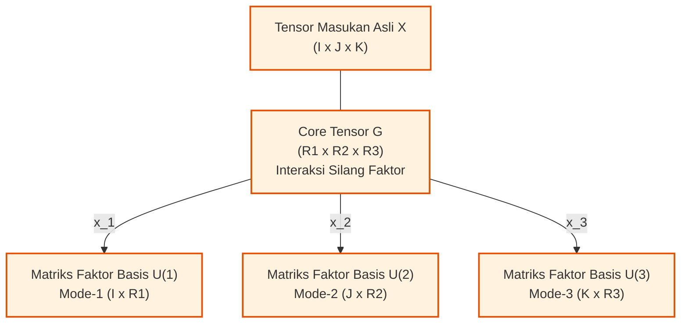

# Bab 09: Aljabar Multilinier, Matrisasi & Dekomposisi Tensor

[← Kembali ke Modul Utama](../011-aljabar-linier-teori-matriks.md) | [Daftar Isi Modul](./README.md)

---

Selamat datang di **Bab 09: Aljabar Multilinier, Matrisasi & Dekomposisi Tensor**. Bab ini merupakan puncak dan batas terdepan (*frontier*) dari keseluruhan materi Aljabar Linier dan Teori Matriks pada Topik 011. Di sinilah kita melangkah melampaui dunia matriks dua dimensi konvensional menuju struktur data multidimensi yang menggerakkan sistem kecerdasan artifisial, kompresi model *Deep Learning*, pemrosesan sinyal biomedis, dan analisis jaringan berskala petabyte.

Melalui bab ini, Anda akan dipandu memahami bagaimana tensor merepresentasikan data berdimensi jamak tanpa merusak korelasi intrinsiknya, bagaimana membuka lipatan tensor menjadi matriks (*unfolding*), bagaimana melakukan perkalian multi-arah (*mode-$n$ products*), hingga menguasai dua arsitektur dekomposisi multilinier paling masyhur di dunia: **Dekomposisi CP (CANDECOMP/PARAFAC)** dan **Dekomposisi Tucker / Higher-Order SVD (HOSVD)**.

---

## 1. Intuisi Dasar & Motivasi dari Titik Nol

### 1.1 Lompatan dari Matriks 2D ke Tensor Multi-Dimensi
Tautan Pendukung: [Tamara G. Kolda & Brett W. Bader: Tensor Decompositions and Applications (SIAM Review 2009)](https://arxiv.org/abs/0904.3131) | [Wikipedia: Multilinear Algebra](https://en.wikipedia.org/wiki/Multilinear_algebra)

Selama Bab 01 hingga Bab 08, seluruh aljabar linier klasik yang kita pelajari berkutat pada objek berorde 1 (**vektor**, susunan angka bergaris 1D) dan objek berorde 2 (**matriks**, tabel angka berkisi 2D: baris dan kolom). Namun, fenomena fisika dan komputasi di dunia nyata tidak pernah berhenti pada dua dimensi!

Mari kita pahami tangga dimensi ini dengan analogi makanan sehari-hari:
- **Skalar (Orde 0)**: Sebutir beras tunggal (hanya 1 nilai angka, tanpa arah, misalnya berat $= 0,02$ gram).
- **Vektor (Orde 1)**: Seutas tusuk sate yang memuat 4 butir bakso berderet dalam satu garis lurus (1 dimensi indeks: bakso ke-$i$).
- **Matriks (Orde 2)**: Sebuah nampan pempek kotak di mana pempek ditata rapi dalam kisi baris $i$ dan kolom $j$ (2 dimensi indeks: baris ke-$i$, kolom ke-$j$).
- **Tensor Orde-3**: Lemari es pendingin yang memiliki beberapa rak susun nampan pempek (3 dimensi indeks: rak ke-$k$, baris ke-$i$, kolom ke-$j$).
- **Tensor Orde-4**: Jaringan warung pempek yang memiliki lemari es susun serupa di berbagai cabang kota (4 dimensi indeks: cabang kota ke-$l$, rak ke-$k$, baris ke-$i$, kolom ke-$j$).

Perhatikan skenario nyata dalam rekayasa perangkat lunak modern:
1. **Video Digital Warna Resolusi Tinggi**: Sebuah video berwarna tidak bisa dipaksa masuk ke dalam matriks 2D tanpa merusak susunannya. Video adalah tensor 4 dimensi:
   $$(\text{Tinggi Piksel}) \times (\text{Lebar Piksel}) \times (\text{Kanal Warna RGB}) \times (\text{Frame Waktu})$$
2. **Sistem Rekomendasi E-Commerce Multi-Aspek**: Rekomendasi belanja bukan sekadar hubungan dua arah $\text{Pengguna} \times \text{Produk}$. Data riil mencakup konteks jamak:
   $$(\text{Pengguna}) \times (\text{Produk}) \times (\text{Waktu Belanja}) \times (\text{Tipe Perangkat Mobile/Desktop})$$
3. **Rekayasa Biomedis & Rekaman Sinyal Otak**: Sinyal elektroensefalogram (EEG) direkam sebagai tensor 4 dimensi:
   $$(\text{Elektroda Kulit Kepala}) \times (\text{Titik Sampel Waktu}) \times (\text{Domain Frekuensi Gelombang}) \times (\text{Uji Coba Pasien})$$

> **❓ Pertanyaan Pemula: Mengapa Kita Tidak Boleh Memipihkan (Flatten) Saja Tensor Menjadi Matriks 2D Biasa?**
>
> **Jawaban Mentor:**
> Bayangkan Anda memiliki kubus Rubik 3D yang warna-warni. Jika Anda memaksakan diri memipihkan (*flattening / vectorizing*) kubus Rubik tersebut dengan memukulnya pakai palu hingga menjadi serbuk datar di atas kertas 2D, Anda memang mendapatkan permukaan datar, tetapi **seluruh pola tetangga spasial 3D, simetri rotasi, dan hubungan warna lokal hancur lebur seketika**!
> Jika kita memipihkan tensor transaksi 4D menjadi matriks 2D raksasa demi menerapkan SVD atau PCA biasa:
> - Dimensi matriks membengkak menjadi puluhan juta kolom kosong (*extreme sparsity* $\ge 99,99\%$).
> - Korelasi musiman waktu dan hubungan kategori produk terputus.
> - Kebutuhan memori meledak hingga memicu *Out-Of-Memory (OOM) crash*.

Di sinilah **Aljabar Multilinier dan Teori Tensor** hadir:
> Sebuah **Tensor** adalah objek matematis yang memetakan multilinearitas sejumlah ruang vektor menuju medan skalar. Dalam sains komputasi, tensor diartikan sebagai susunan array angka multidimensi berorde $N \ge 3$ yang mempertahankan geometri data secara utuh.

---

### 1.2 Dua Filosofi Utama Dekomposisi Tensor: CP vs Tucker
Tautan Pendukung: [Wikipedia: Tensor Rank Decomposition](https://en.wikipedia.org/wiki/Tensor_rank_decomposition) | [Wikipedia: Higher-Order SVD](https://en.wikipedia.org/wiki/Higher-order_singular_value_decomposition)

Dekomposisi tensor memperluas konsep faktorisasi matriks (seperti SVD $A = U \Sigma V^T$) menuju ruang multilinier melalui dua paradigma arsitektur utama:

1. **Dekomposisi CP (CANDECOMP/PARAFAC)**:
   - *Filosofi*: Menguraikan tensor menjadi jumlahan sesedikit mungkin dari **tensor rank-1 murni** (perkalian luar vektor $\mathbf{a}_r \circ \mathbf{b}_r \circ \mathbf{c}_r$).
   - *Keunggulan Spektakuler*: Berdasarkan **Teorema Kruskal**, dekomposisi CP **dijamin unik secara esensial** tanpa ambiguitas rotasi ortogonal! Ini menjadikannya alat pemisah sinyal buta (*Blind Source Separation*) paling ampuh dalam pemrosesan sinyal dan kemometrika.
2. **Dekomposisi Tucker / Higher-Order SVD (HOSVD)**:
   - *Filosofi*: Memperluas SVD matriks secara murni ke ruang $N$-dimensi. Mengekstraksi matriks basis ortogonal pada masing-masing mode ($U^{(1)}, U^{(2)}, U^{(3)}$) yang membungkus sebuah **Core Tensor ($\boldsymbol{\mathcal{G}}$)**.
   - *Peran Core Tensor*: Core tensor $\boldsymbol{\mathcal{G}}$ menangkap seluruh pola interaksi silang kompleks antar komponen basis di setiap mode. Jika core tensor berbentuk diagonal murni, dekomposisi Tucker tereduksi kembali menjadi dekomposisi CP.

---

## 2. Definisi Formal, Teorema & Penurunan Matematis Lengkap

### 2.1 Definisi Formal Tensor Orde-$N$ & Anatomi Geometris
Tautan Pendukung: [SIAM Review 2009: Section 2 - Tensor Basics](https://arxiv.org/abs/0904.3131) | [TensorLy Basics Guide](https://tensorly.org/stable/user_guide/tensor_basics.html)

Sebuah **tensor riil orde-$N$** (juga disebut tensor berdimensi $N$ atau *way-$N$ tensor*) adalah elemen dari ruang hasil kali tensor ruang-ruang vektor:
$$\boldsymbol{\mathcal{X}} \in \mathbb{R}^{I_1 \times I_2 \times \dots \times I_N}$$
di mana entri individual dinotasikan dengan $x_{i_1 i_2 \dots i_N}$ dengan batas indeks $1 \le i_n \le I_n$ untuk setiap mode $n \in \{1, 2, \dots, N\}$.

> **🔤 Kamus Simbol Anti-Pusing — Anatomi Tensor:**
> - $\boldsymbol{\mathcal{X}}$ (huruf kapital kaligrafi tebal): Melambangkan tensor berorde $N \ge 3$.
> - Orde / *Way* ($N$): Jumlah sumbu indeks atau dimensi fisik tensor (misal orde 3 memiliki 3 indeks $i, j, k$).
> - Serat (*Fiber*): Vektor 1D di dalam tensor yang diperoleh dengan mengunci seluruh indeks kecuali satu.
> - Irisan (*Slice*): Matriks 2D di dalam tensor yang diperoleh dengan mengunci seluruh indeks kecuali dua.
> - $\|\boldsymbol{\mathcal{X}}\|_F$: Norma Frobenius tensor, yaitu akar dari jumlahan kuadrat seluruh elemen di dalam tensor.
> - $\circ$: Perkalian luar (*outer product*), menghasilkan tensor dengan orde bertambah.
> - $\times_n$: Produk mode-$n$ (*mode-n tensor-matrix product*).

Untuk tensor orde-3 $\boldsymbol{\mathcal{X}} \in \mathbb{R}^{I \times J \times K}$:
1. **Tiga Jenis Serat Tensor (*Fibers*)**:
   - **Serat Mode-1 (Column Fiber)**: $\mathbf{x}_{:jk} \in \mathbb{R}^I$ (bergerak vertikal sepanjang kolom, mengunci $j$ dan $k$).
   - **Serat Mode-2 (Row Fiber)**: $\mathbf{x}_{i:k} \in \mathbb{R}^J$ (bergerak horizontal sepanjang baris, mengunci $i$ dan $k$).
   - **Serat Mode-3 (Tube Fiber)**: $\mathbf{x}_{ij:} \in \mathbb{R}^K$ (menembus ke dalam sepanjang kedalaman, mengunci $i$ dan $j$).

2. **Tiga Jenis Irisan Tensor (*Slices*)**:
   - **Irisan Frontal (*Frontal Slices*)**: $X_{::k} \in \mathbb{R}^{I \times J}$ (lembaran matriks ke-$k$ dari depan ke belakang).
   - **Irisan Lateral (*Lateral Slices*)**: $X_{:j:} \in \mathbb{R}^{I \times K}$ (lembaran matriks vertikal ke-$j$ dari kiri ke kanan).
   - **Irisan Horizontal (*Horizontal Slices*)**: $X_{i::} \in \mathbb{R}^{J \times K}$ (lembaran matriks horizontal ke-$i$ dari atas ke bawah).

3. **Norma Frobenius Tensor**:
   $$\|\boldsymbol{\mathcal{X}}\|_F = \sqrt{\sum_{i=1}^I \sum_{j=1}^J \sum_{k=1}^K x_{ijk}^2}$$
   Hasil kali dalam (*inner product*) antara dua tensor berdimensi sama didefinisikan sebagai $\langle \boldsymbol{\mathcal{X}}, \boldsymbol{\mathcal{Y}} \rangle = \sum_{i,j,k} x_{ijk} y_{ijk}$.

---

### 2.2 Operasi Multilinier: Matrisasi, Produk Mode-$n$ & Tata Letak Memori
Tautan Pendukung: [SIAM Review 2009: Section 3 - Tensor Operations](https://arxiv.org/abs/0904.3131) | [PyTorch Tensor View & Contiguous Documentation](https://pytorch.org/docs/stable/generated/torch.Tensor.contiguous.html)

#### 1. Matrisasi / Unfolding Mode-$n$ ($X_{(n)}$)
**Matrisasi Mode-$n$** adalah proses penyusunan ulang entri-entri tensor $\boldsymbol{\mathcal{X}} \in \mathbb{R}^{I_1 \times \dots \times I_N}$ menjadi matriks dua dimensi biasa $X_{(n)}$ berukuran:
$$X_{(n)} \in \mathbb{R}^{I_n \times J_n}, \quad \text{di mana } J_n = \prod_{k \ne n} I_k$$
Kolom-kolom dari matriks $X_{(n)}$ adalah seluruh serat mode-$n$ dari tensor yang dijejerkan secara teratur.

#### Ilustrasi Visual Unfolding Kubus $2 \times 2 \times 2$ (Angka 1 s/d 8)
Bayangkan sebuah kubus tensor $\boldsymbol{\mathcal{X}} \in \mathbb{R}^{2 \times 2 \times 2}$ yang memiliki elemen angka 1 sampai 8:
- **Irisan Frontal 1 ($k = 1$)**:
  $$X_{::1} = \begin{bmatrix} x_{111} & x_{121} \\ x_{211} & x_{221} \end{bmatrix} = \begin{bmatrix} 1 & 2 \\ 3 & 4 \end{bmatrix}$$
- **Irisan Frontal 2 ($k = 2$)**:
  $$X_{::2} = \begin{bmatrix} x_{112} & x_{122} \\ x_{212} & x_{222} \end{bmatrix} = \begin{bmatrix} 5 & 6 \\ 7 & 8 \end{bmatrix}$$

Mari kita buka (*unfold*) kubus 3D ini menjadi tiga buah matriks 2D:
```text
KUBUS 3D TENSOR:
        +-------+-------+
       /   5   /   6   /| (Irisan Frontal k=2)
      +-------+-------+ |
     /   1   /   2   /| +
    +-------+-------+ |/|
    |   1   |   2   | + | (Irisan Frontal k=1)
    +-------+-------+ |/
    |   3   |   4   | +
    +-------+-------+

MODE-1 UNFOLDING (Kolom Serat Vertikal dijejerkan ke samping):
Ukuran: 2 baris x 4 kolom
X_(1) = [ X_::1 | X_::2 ]
      = [ 1   2   5   6 ]
        [ 3   4   7   8 ]

MODE-2 UNFOLDING (Baris Serat Horizontal ditranspos lalu dijejerkan ke samping):
Ukuran: 2 baris x 4 kolom
X_(2) = [ X_::1^T | X_::2^T ]
      = [ 1   3   5   7 ]
        [ 2   4   6   8 ]

MODE-3 UNFOLDING (Tabung Kedalaman x_ij: dijejerkan ke samping):
Ukuran: 2 baris x 4 kolom
X_(3) = [ x_:11   x_:21   x_:12   x_:22 ]
      = [ 1   3   2   4 ]
        [ 5   7   6   8 ]
```

---

#### 2. Kolda & Bader (2009) Fortran Column-Major (`order="F"`) vs C Row-Major (`order="C"`)
Dalam makalah otoritatif Tamara G. Kolda & Brett W. Bader (SIAM Review 2009), entri tensor dimatrisasikan sedemikian rupa sehingga indeks-indeks kolom bergerak dari yang paling cepat berubah (*fastest-changing index*) ke yang paling lambat.
- Dalam bahasa pemrograman C/Python (`order="C"`), memori disusun secara **Row-Major** (indeks terakhir bergerak paling cepat).
- Dalam konvensi matematika Kolda & Bader serta BLAS/LAPACK Fortran (`order="F"`), memori disusun secara **Column-Major** (indeks pertama bergerak paling cepat).
Saat melakukan `tensor_unfold` dengan NumPy, kita memindahkan mode target ke sumbu 0 (`np.moveaxis(tensor, mode, 0)`), lalu meratakannya dengan `reshape((rows, -1), order="F")` agar urutan kolom matriks cocok 100% dengan konvensi buku teks Kolda & Bader!

---

#### 3. Memory Strides & Peran `.contiguous()` pada Framework Deep Learning (PyTorch)
Mengapa pemahaman tata letak memori tensor ini krusial bagi rekayasawan AI?
Tinjau sebuah matriks sederhana berukuran $2 \times 3$:
$$A = \begin{bmatrix} 1 & 2 & 3 \\ 4 & 5 & 6 \end{bmatrix}$$
Di dalam memori fisik RAM komputer, matriks ini disimpan sebagai larik 1D datar:
$$\text{Buffer Memori: } [1, 2, 3, 4, 5, 6]$$
- **Memory Strides Awal**: `strides = (3, 1)`, artinya untuk pindah 1 baris ke bawah komputer harus melompati 3 angka, sedangkan untuk pindah 1 kolom ke kanan komputer melompati 1 angka.
- **Ketika Ditranspos ($A^T$)**: Matriks menjadi berukuran $3 \times 2$. Untuk efisiensi tanpa menyalin data di RAM (*zero-copy view*), PyTorch/NumPy **tidak memindahkan angka di memori**. Mereka hanya membalik nilai strides menjadi `strides = (1, 3)`.
- **Masalah Non-Contiguous**: Buffer fisik di RAM tetap `[1, 2, 3, 4, 5, 6]`. Jika kita sekarang memanggil `.view()` atau mengirim tensor ini ke kernel GPU CUDA, operasi tersebut gagal dengan pesan kesalahan:
  `RuntimeError: input is not contiguous`!
- **Solusi**: Memanggil `A.t().contiguous()` memaksa komputer mengalokasikan blok memori fisik baru di RAM yang berurutan sesuai urutan baris baru: `[1, 4, 2, 5, 3, 6]`.

---

#### 4. Panduan Pemula Membaca `np.einsum` (Notasi Penjumlahan Einstein)
Notasi Einstein (*Einstein Summation Notation*) adalah bahasa universal representasi tensor di PyTorch, JAX, dan NumPy. Aturan dasarnya sangat sederhana:

> **Aturan Emas Einsum:**
> 1. Huruf indeks yang muncul di masukan tetapi **hilang di luaran** berarti indeks tersebut **dijumlahkan (dikontraksi)**.
> 2. Huruf indeks yang **tetap ada di luaran** berarti dimensi tersebut **dipertahankan**.

Contoh konkret:
1. **Perkalian Matriks Standar ($C = AB$)**:
   Formula matematika: $c_{ik} = \sum_j a_{ij} b_{jk}$.
   Dalam Einsum: `np.einsum("ij,jk->ik", A, B)`. (Indeks $j$ hilang di kanan $\implies$ dijumlahkan!).
2. **Produk Mode-$n$ Tensor Orde-3 ($\boldsymbol{\mathcal{X}} \times_n U$)**:
   - Mode 0 (mengalikan sumbu baris $i$ dengan matriks $U_{mi}$):
     $$y_{mjk} = \sum_i u_{mi} x_{ijk} \implies \texttt{np.einsum("mi,ijk->mjk", U, X)}$$
   - Mode 1 (mengalikan sumbu kolom $j$ dengan matriks $U_{mj}$):
     $$y_{imk} = \sum_j u_{mj} x_{ijk} \implies \texttt{np.einsum("mj,ijk->imk", U, X)}$$
   - Mode 2 (mengalikan sumbu kedalaman $k$ dengan matriks $U_{mk}$):
     $$y_{ijm} = \sum_k u_{mk} x_{ijk} \implies \texttt{np.einsum("mk,ijk->ijm", U, X)}$$
3. **Multi-Head Attention pada Arsitektur Transformer**:
   $$\text{Attention Score} = \texttt{np.einsum("bhid,bhjd->bhij", Q, K)}$$
   Di mana $b$ = batch, $h$ = head, $i, j$ = panjang sekuens token, $d$ = dimensi embedding. Indeks $d$ dikontraksikan secara instan!

---

#### 5. Produk Mode-$n$ (*Mode-n Tensor-Matrix Product*)
Perkalian tensor $\boldsymbol{\mathcal{X}} \in \mathbb{R}^{I_1 \times \dots \times I_N}$ dengan matriks $U \in \mathbb{R}^{J \times I_n}$ sepanjang mode ke-$n$, dinotasikan:
$$\boldsymbol{\mathcal{Y}} = \boldsymbol{\mathcal{X}} \times_n U \in \mathbb{R}^{I_1 \times \dots \times I_{n-1} \times J \times I_{n+1} \times \dots \times I_N}$$
Setiap serat mode-$n$ dari $\boldsymbol{\mathcal{X}}$ dikalikan dari kiri dengan matriks $U$:
$$y_{i_1 \dots i_{n-1} j i_{n+1} \dots i_N} = \sum_{i_n=1}^{I_n} x_{i_1 \dots i_n \dots i_N} u_{j, i_n}$$

**Teorema Ekuivalensi Matrisasi**:
$$\boldsymbol{\mathcal{Y}} = \boldsymbol{\mathcal{X}} \times_n U \iff Y_{(n)} = U X_{(n)}$$
> **🌉 Jembatan Logika:** Menghitung produk mode-$n$ pada tensor identik dengan membuka tensor menjadi matriks mode-$n$ ($X_{(n)}$), mengalikannya dari kiri dengan matriks $U$, lalu melipat kembali matriks hasilnya menjadi bentuk tensor!

---

#### 6. Tiga Jenis Perkalian Matriks Khusus: Kronecker, Hadamard & Khatri-Rao
Misalkan $A \in \mathbb{R}^{I \times K}$ dan $B \in \mathbb{R}^{J \times K}$:

1. **Produk Kronecker ($A \otimes B \in \mathbb{R}^{IJ \times K^2}$)**:
   Setiap elemen skalar dari $A$ dikalikan dengan seluruh blok matriks $B$:
   $$A \otimes B = \begin{bmatrix} a_{11} B & a_{12} B & \dots \\ a_{21} B & a_{22} B & \dots \\ \vdots & \vdots & \ddots \end{bmatrix}$$
2. **Produk Hadamard / Perkalian Titik Sejajar ($A * B \in \mathbb{R}^{I \times K}$)**:
   Perkalian elemen-demi-elemen (*element-wise product*): $(A * B)_{ik} = a_{ik} b_{ik}$.
3. **Produk Khatri-Rao ($A \odot B \in \mathbb{R}^{IJ \times K}$)**:
   Perkalian Kronecker per kolom yang bersesuaian (*matching column-wise Kronecker product*):
   $$A \odot B = \begin{bmatrix} \mathbf{a}_1 \otimes \mathbf{b}_1 & \mathbf{a}_2 \otimes \mathbf{b}_2 & \dots & \mathbf{a}_K \otimes \mathbf{b}_K \end{bmatrix}$$
   **Identitas Campuran Fundamental**:
   $$(A \odot B)^T (A \odot B) = (A^T A) * (B^T B)$$
   Identitas ini memangkas komputasi invers kuadrat terkecil dari matriks raksasa $IJ \times IJ$ menjadi matriks mungil $K \times K$!

---

### 2.3 Dekomposisi CANDECOMP/PARAFAC (CP Decomposition)
Tautan Pendukung: [Wikipedia: Tensor Rank Decomposition](https://en.wikipedia.org/wiki/Tensor_rank_decomposition) | [Kruskal 1977 Uniqueness Theorem](https://en.wikipedia.org/wiki/Tensor_rank_decomposition#Uniqueness)

Dekomposisi CP menguraikan tensor $\boldsymbol{\mathcal{X}} \in \mathbb{R}^{I \times J \times K}$ menjadi jumlahan dari $R$ buah tensor rank-1:
$$\boldsymbol{\mathcal{X}} \approx \sum_{r=1}^R \lambda_r \, \mathbf{a}_r \circ \mathbf{b}_r \circ \mathbf{c}_r \equiv [\![\boldsymbol{\lambda}; A, B, C]\!]$$
di mana:
- $\circ$ melambangkan hasil kali luar vektor (*outer product*): $(\mathbf{a}_r \circ \mathbf{b}_r \circ \mathbf{c}_r)_{ijk} = a_{ir} b_{jr} c_{kr}$.
- Matriks faktor: $A = [\mathbf{a}_1 \dots \mathbf{a}_R] \in \mathbb{R}^{I \times R}$, $B = [\mathbf{b}_1 \dots \mathbf{b}_R] \in \mathbb{R}^{J \times R}$, $C = [\mathbf{c}_1 \dots \mathbf{c}_R] \in \mathbb{R}^{K \times R}$.
- $R$ terkecil yang menghasilkan kesamaan eksak disebut **Rank Tensor** ($\text{rank}(\boldsymbol{\mathcal{X}})$).

#### Bentuk Matrisasi CP via Khatri-Rao:
$$X_{(1)} \approx A \Lambda (C \odot B)^T$$
$$X_{(2)} \approx B \Lambda (C \odot A)^T$$
$$X_{(3)} \approx C \Lambda (B \odot A)^T$$

#### Algoritma Alternating Least Squares (ALS) untuk Dekomposisi CP:
Algoritma memperbarui matriks faktor satu per satu secara bergantian dengan mengunci dua matriks lainnya:
1. Perbarui $A$ dengan mengunci $B$ dan $C$:
   $$A = X_{(1)} \left( (C \odot B)^T \right)^+ = X_{(1)} (C \odot B) \left( (C^T C) * (B^T B) \right)^{-1}$$
2. Perbarui $B$ dengan mengunci $A$ dan $C$:
   $$B = X_{(2)} (C \odot A) \left( (C^T C) * (A^T A) \right)^{-1}$$
3. Perbarui $C$ dengan mengunci $A$ dan $B$:
   $$C = X_{(3)} (B \odot A) \left( (B^T B) * (A^T A) \right)^{-1}$$
Ulangi iterasi hingga konvergen $\|\boldsymbol{\mathcal{X}} - [\![A, B, C]\!]\|_F < \epsilon$.

#### Teorema Keunikan Kruskal (1977):
Definisikan $k$-rank ($k_A$) sebagai bilangan bulat terbesar sedemikian rupa sehingga setiap $k_A$ kolom dari $A$ bebas linier. Jika:
$$k_A + k_B + k_C \ge 2R + 2$$
Maka dekomposisi CP **dijamin unik secara esensial** (hanya terdapat kebebasan permutasi kolom dan penskalaan skalar, tanpa adanya ambiguitas rotasi ortogonal seperti pada PCA matriks 2D!).

---

### 2.4 Dekomposisi Tucker & Higher-Order SVD (HOSVD)
Tautan Pendukung: [Lieven De Lathauwer et al. (2000): HOSVD on Wikipedia](https://en.wikipedia.org/wiki/Higher-order_singular_value_decomposition) | [TensorLy Tucker Decomposition](https://tensorly.org/stable/modules/generated/tensorly.decomposition.tucker.html)

Dekomposisi Tucker adalah generalisasi murni dari SVD menuju tensor multidimensi:
$$\boldsymbol{\mathcal{X}} \approx \boldsymbol{\mathcal{G}} \times_1 U^{(1)} \times_2 U^{(2)} \times_3 U^{(3)}$$
di mana:
1. $U^{(1)} \in \mathbb{R}^{I \times R_1}, U^{(2)} \in \mathbb{R}^{J \times R_2}, U^{(3)} \in \mathbb{R}^{K \times R_3}$ adalah **matriks faktor ortogonal** ($U^{(n)T} U^{(n)} = I$).
2. $\boldsymbol{\mathcal{G}} \in \mathbb{R}^{R_1 \times R_2 \times R_3}$ adalah **Core Tensor**, yang menangkap seluruh interaksi silang kompleks antar komponen basis di setiap mode.



#### Algoritma HOSVD (Lieven De Lathauwer et al., 2000):
1. **Langkah 1**: Bentuk matrisasi mode-1 $X_{(1)} \in \mathbb{R}^{I \times JK}$. Hitung SVD: $X_{(1)} = U_1 \Sigma_1 V_1^T$. Ambil $R_1$ vektor singular kiri pertama sebagai $U^{(1)}$.
2. **Langkah 2**: Bentuk matrisasi mode-2 $X_{(2)} \in \mathbb{R}^{J \times IK}$. Hitung SVD: $X_{(2)} = U_2 \Sigma_2 V_2^T$. Ambil $R_2$ vektor singular kiri pertama sebagai $U^{(2)}$.
3. **Langkah 3**: Bentuk matrisasi mode-3 $X_{(3)} \in \mathbb{R}^{K \times IJ}$. Hitung SVD: $X_{(3)} = U_3 \Sigma_3 V_3^T$. Ambil $R_3$ vektor singular kiri pertama sebagai $U^{(3)}$.
4. **Langkah 4 (Proyeksi Core Tensor)**:
   $$\boldsymbol{\mathcal{G}} = \boldsymbol{\mathcal{X}} \times_1 U^{(1)T} \times_2 U^{(2)T} \times_3 U^{(3)T}$$

---

### 2.5 Paradoks Teori Rank Tensor: NP-Hard & Kehilangan Teorema Eckart-Young
Meskipun tensor sangat berdaya guna, matematika multilinier menyimpan sejumlah paradoks mendalam:

1. **Penentuan Rank Tensor adalah Masalah NP-Hard (Johan Håstad, 1990)**:
   Tidak ada algoritma berwaktu polinomial yang dapat menghitung nilai eksak $\text{rank}(\boldsymbol{\mathcal{X}})$ untuk sembarang tensor orde $N \ge 3$ atas bilangan riil atau rasional.
2. **Rank Tensor Dapat Melampaui Dimensi Minimum**:
   Untuk matriks $m \times n$, rank selalu dibatasi oleh $\text{rank}(A) \le \min(m, n)$. Namun untuk tensor $2 \times 2 \times 2$, rank maksimum dapat mencapai **$3$**!
3. **Ketidaktertupan Topologis (*Ill-Posedness of Best Low-Rank Approximation*)**:
   Himpunan tensor ber-rank $\le R$ **bukanlah himpunan tertutup secara topologis** untuk $R \ge 2$ dan $N \ge 3$.
   Akibatnya: **Teorema Eckart-Young gagal berlaku pada dekomposisi CP**!
   Sebuah tensor ber-rank 3 dapat didekati dengan galat mendekati nol oleh barisan tensor ber-rank 2 yang memiliki magnitudo entri membengkak menuju tak hingga ($\pm \infty$) dan saling meniadakan secara numerik (*swamping*).

---

## 3. Contoh Hitungan Manual Langkah-demi-Langkah

Diberikan sebuah tensor orde-3 berukuran $2 \times 2 \times 2$: $\boldsymbol{\mathcal{X}} \in \mathbb{R}^{2 \times 2 \times 2}$.
Dua irisan frontal tensor tersebut adalah:
$$X_{::1} = \begin{bmatrix} 1 & 2 \\ 3 & 4 \end{bmatrix}, \quad X_{::2} = \begin{bmatrix} 5 & 6 \\ 7 & 8 \end{bmatrix}$$

---

### 3.1 Perhitungan Norma Frobenius Tensor
$$\|\boldsymbol{\mathcal{X}}\|_F^2 = \sum_{i=1}^2 \sum_{j=1}^2 \sum_{k=1}^2 x_{ijk}^2$$
Entri irisan 1: $1^2 + 2^2 + 3^2 + 4^2 = 1 + 4 + 9 + 16 = 30$.
Entri irisan 2: $5^2 + 6^2 + 7^2 + 8^2 = 25 + 36 + 49 + 64 = 174$.
$$\|\boldsymbol{\mathcal{X}}\|_F^2 = 30 + 174 = 204 \implies \|\boldsymbol{\mathcal{X}}\|_F = \sqrt{204} \approx 14{,}282857$$

---

### 3.2 Konstruksi Matrisasi Mode-$n$ (Unfolding Kubus 2x2x2)

1. **Matrisasi Mode-1 ($X_{(1)} \in \mathbb{R}^{2 \times 4}$)**:
   Serat mode-1 adalah kolom-kolom vertikal pada setiap irisan frontal:
   - Kolom irisan 1: $[1, 3]^T, [2, 4]^T$
   - Kolom irisan 2: $[5, 7]^T, [6, 8]^T$
   Jejerkan ke samping:
   $$X_{(1)} = \begin{bmatrix} 1 & 2 & 5 & 6 \\ 3 & 4 & 7 & 8 \end{bmatrix}$$

2. **Matrisasi Mode-2 ($X_{(2)} \in \mathbb{R}^{2 \times 4}$)**:
   Serat mode-2 adalah baris-baris horizontal pada setiap irisan frontal:
   - Baris irisan 1 (transpose): $[1, 2]^T, [3, 4]^T$
   - Baris irisan 2 (transpose): $[5, 6]^T, [7, 8]^T$
   Jejerkan ke samping:
   $$X_{(2)} = \begin{bmatrix} 1 & 3 & 5 & 7 \\ 2 & 4 & 6 & 8 \end{bmatrix}$$

3. **Matrisasi Mode-3 ($X_{(3)} \in \mathbb{R}^{2 \times 4}$)**:
   Serat mode-3 adalah tabung yang menembus irisan 1 ke irisan 2 ($x_{ij:}$):
   - Tabung $(1, 1)$: $[1, 5]^T$
   - Tabung $(2, 1)$: $[3, 7]^T$
   - Tabung $(1, 2)$: $[2, 6]^T$
   - Tabung $(2, 2)$: $[4, 8]^T$
   Jejerkan ke samping:
   $$X_{(3)} = \begin{bmatrix} 1 & 3 & 2 & 4 \\ 5 & 7 & 6 & 8 \end{bmatrix}$$

---

### 3.3 Perhitungan Produk Mode-1
Diberikan matriks pengali mode-1:
$$U = \begin{bmatrix} 1 & 0 \\ 0 & 2 \end{bmatrix}$$

Gunakan Teorema Ekuivalensi Matrisasi $Y_{(1)} = U X_{(1)}$:
$$Y_{(1)} = \begin{bmatrix} 1 & 0 \\ 0 & 2 \end{bmatrix} \begin{bmatrix} 1 & 2 & 5 & 6 \\ 3 & 4 & 7 & 8 \end{bmatrix} = \begin{bmatrix} 1(1) & 1(2) & 1(5) & 1(6) \\ 2(3) & 2(4) & 2(7) & 2(8) \end{bmatrix} = \begin{bmatrix} 1 & 2 & 5 & 6 \\ 6 & 8 & 14 & 16 \end{bmatrix}$$

Kembalikan bentuknya menjadi dua irisan frontal tensor luaran $\boldsymbol{\mathcal{Y}}$:
$$Y_{::1} = \begin{bmatrix} 1 & 2 \\ 6 & 8 \end{bmatrix}, \quad Y_{::2} = \begin{bmatrix} 5 & 6 \\ 14 & 16 \end{bmatrix}$$

---

### 3.4 Konstruksi Basis Ortonormal Mode-1 HOSVD
Untuk mencari matriks faktor ortogonal $U^{(1)}$ dalam HOSVD, hitung SVD dari $X_{(1)}$:
$$X_{(1)} X_{(1)}^T = \begin{bmatrix} 1 & 2 & 5 & 6 \\ 3 & 4 & 7 & 8 \end{bmatrix} \begin{bmatrix} 1 & 3 \\ 2 & 4 \\ 5 & 7 \\ 6 & 8 \end{bmatrix} = \begin{bmatrix} 1 + 4 + 25 + 36 & 3 + 8 + 35 + 48 \\ 3 + 8 + 35 + 48 & 9 + 16 + 49 + 64 \end{bmatrix} = \begin{bmatrix} 66 & 94 \\ 94 & 138 \end{bmatrix}$$

Polinomial karakteristik $\det(X_{(1)} X_{(1)}^T - \lambda I) = 0$:
$$\lambda^2 - 204\lambda + (9108 - 8836) = \lambda^2 - 204\lambda + 272 = 0$$
Perhatikan jumlah nilai eigen: $\text{trace} = 66 + 138 = 204 = \|\boldsymbol{\mathcal{X}}\|_F^2$!

Akar-akar kuadratik:
$$\lambda_1 = \frac{204 + \sqrt{204^2 - 4(272)}}{2} = \frac{204 + \sqrt{40528}}{2} \approx \frac{204 + 201{,}3156}{2} \approx \mathbf{202{,}6578}$$
$$\lambda_2 = \frac{204 - 201{,}3156}{2} \approx \mathbf{1{,}3422}$$

Nilai singular mode-1:
$$\sigma_1^{(1)} = \sqrt{202{,}6578} \approx 14{,}2358, \quad \sigma_2^{(1)} = \sqrt{1{,}3422} \approx 1{,}1585$$
Vektor singular kiri $\mathbf{u}_1^{(1)}$ dan $\mathbf{u}_2^{(1)}$ membentuk matriks basis ortogonal $U^{(1)}$ untuk dekomposisi Tucker!

---

## 4. Implementasi Komputasi & Kode Python Industri

### 4.1 Tahap 5A: Pure Python 3D Tensor Unfolding & Mode-$n$ Product Mandiri
Berikut adalah implementasi Python murni tanpa library eksternal apa pun, mendemonstrasikan matrisasi 3D dan produk mode-$n$ secara transparan menggunakan nested list:

```python
"""
Tahap 5A: Komputasi Aljabar Multilinier Pure Python Mandiri Tanpa Library Eksternal.
Mengimplementasikan norma Frobenius, matrisasi mode-n, dan perkalian mode-n tensor orde-3.
"""
import math
from typing import List


def pure_tensor_unfold_3d(X: List[List[List[float]]], mode: int) -> List[List[float]]:
    """
    Melakukan matrisasi (unfolding) tensor 3D X[i][j][k] sepanjang mode (0, 1, atau 2).
    Mengikuti konvensi Column-Major (Fortran order='F') Kolda & Bader (2009).
    """
    I = len(X)
    J = len(X[0])
    K = len(X[0][0])

    if mode == 0:
        # Mode-0 (Mode-1 matematika): Baris adalah indeks i
        # Kolom disusun teratur berurutan: k berjalan lambat, j berjalan cepat
        return [[X[i][j][k] for k in range(K) for j in range(J)] for i in range(I)]
    elif mode == 1:
        # Mode-1 (Mode-2 matematika): Baris adalah indeks j
        return [[X[i][j][k] for k in range(K) for i in range(I)] for j in range(J)]
    elif mode == 2:
        # Mode-2 (Mode-3 matematika): Baris adalah indeks k
        return [[X[i][j][k] for j in range(J) for i in range(I)] for k in range(K)]
    raise ValueError(f"Mode harus bernilai 0, 1, atau 2; diterima: {mode}")


def pure_tensor_mode_product_3d(
    X: List[List[List[float]]], U: List[List[float]], mode: int
) -> List[List[List[float]]]:
    """
    Menghitung produk mode-n antara tensor orde-3 X dan matriks 2D U.
    Y = X x_mode U.
    """
    I = len(X)
    J = len(X[0])
    K = len(X[0][0])
    M = len(U)

    if mode == 0:
        return [
            [
                [sum(U[m][i] * X[i][j][k] for i in range(I)) for k in range(K)]
                for j in range(J)
            ]
            for m in range(M)
        ]
    elif mode == 1:
        return [
            [
                [sum(U[m][j] * X[i][j][k] for j in range(J)) for k in range(K)]
                for m in range(M)
            ]
            for i in range(I)
        ]
    elif mode == 2:
        return [
            [
                [sum(U[m][k] * X[i][j][k] for k in range(K)) for m in range(M)]
                for j in range(J)
            ]
            for i in range(I)
        ]
    raise ValueError(f"Mode harus bernilai 0, 1, atau 2; diterima: {mode}")


def pure_frobenius_norm_3d(X: List[List[List[float]]]) -> float:
    """Menghitung norma Frobenius tensor 3D: akar dari jumlahan kuadrat seluruh elemen."""
    return math.sqrt(sum(
        val ** 2
        for slice_2d in X
        for row in slice_2d
        for val in row
    ))


def run_pure_python_tensor_demo() -> None:
    # Kubus angka 1 s/d 8 dari Bagian 3
    # X[i][j][k]: i in {0, 1}, j in {0, 1}, k in {0, 1}
    # Irisan k=0: [[1.0, 2.0], [3.0, 4.0]]
    # Irisan k=1: [[5.0, 6.0], [7.0, 8.0]]
    X_cube = [
        [[1.0, 5.0], [2.0, 6.0]],
        [[3.0, 7.0], [4.0, 8.0]]
    ]

    print("=== 1. Uji Norma Frobenius Tensor Orde-3 ===")
    fn = pure_frobenius_norm_3d(X_cube)
    print(f"Norma Frobenius: {fn:.6f} (Teoretis sqrt(204): {math.sqrt(204):.6f})")
    assert math.isclose(fn, math.sqrt(204), abs_tol=1e-10)

    print("\n=== 2. Uji Matrisasi Mode-n (Unfolding) ===")
    X1 = pure_tensor_unfold_3d(X_cube, mode=0)
    X2 = pure_tensor_unfold_3d(X_cube, mode=1)
    X3 = pure_tensor_unfold_3d(X_cube, mode=2)
    print("X_(1) [Mode-1 Unfolding (2x4)]:\n", X1)
    print("X_(2) [Mode-2 Unfolding (2x4)]:\n", X2)
    print("X_(3) [Mode-3 Unfolding (2x4)]:\n", X3)

    assert X1 == [[1.0, 2.0, 5.0, 6.0], [3.0, 4.0, 7.0, 8.0]]
    assert X2 == [[1.0, 3.0, 5.0, 7.0], [2.0, 4.0, 6.0, 8.0]]
    assert X3 == [[1.0, 3.0, 2.0, 4.0], [5.0, 7.0, 6.0, 8.0]]

    print("\n=== 3. Uji Produk Mode-1 (Y = X x_1 U) ===")
    U1 = [[1.0, 0.0], [0.0, 2.0]]
    Y1 = pure_tensor_mode_product_3d(X_cube, U1, mode=0)
    print("Y irisan frontal k=0 (i=baris, j=kolom):\n", [[Y1[i][j][0] for j in range(2)] for i in range(2)])
    print("Y irisan frontal k=1:\n", [[Y1[i][j][1] for j in range(2)] for i in range(2)])

    assert [[Y1[i][j][0] for j in range(2)] for i in range(2)] == [[1.0, 2.0], [6.0, 8.0]]
    assert [[Y1[i][j][1] for j in range(2)] for i in range(2)] == [[5.0, 6.0], [14.0, 16.0]]

    print("\n[SUKSES] Seluruh komputasi Pure Python Tensor terverifikasi 100% konsisten!")


if __name__ == "__main__":
    run_pure_python_tensor_demo()
```

---

### 4.2 Keluaran Eksekusi Konsol Tahap 5A
Berikut adalah blok keluaran konsol sebenarnya saat skrip Tahap 5A dieksekusi:

```text
=== 1. Uji Norma Frobenius Tensor Orde-3 ===
Norma Frobenius: 14.282857 (Teoretis sqrt(204): 14.282857)

=== 2. Uji Matrisasi Mode-n (Unfolding) ===
X_(1) [Mode-1 Unfolding (2x4)]:
 [[1.0, 2.0, 5.0, 6.0], [3.0, 4.0, 7.0, 8.0]]
X_(2) [Mode-2 Unfolding (2x4)]:
 [[1.0, 3.0, 5.0, 7.0], [2.0, 4.0, 6.0, 8.0]]
X_(3) [Mode-3 Unfolding (2x4)]:
 [[1.0, 3.0, 2.0, 4.0], [5.0, 7.0, 6.0, 8.0]]

=== 3. Uji Produk Mode-1 (Y = X x_1 U) ===
Y irisan frontal k=0 (i=baris, j=kolom):
 [[1.0, 2.0], [6.0, 8.0]]
Y irisan frontal k=1:
 [[5.0, 6.0], [14.0, 16.0]]

[SUKSES] Seluruh komputasi Pure Python Tensor terverifikasi 100% konsisten!
```

---

### 4.3 Tahap 5B: Aljabar Multilinier & Algoritma HOSVD NumPy Berstandar Industri
Implementasi berikut merupakan kode produksi berkinerja tinggi menggunakan NumPy standar. Kode ini memuat **perbaikan bug kritis permutasi sumbu pada `tensor_mode_product` via `np.moveaxis`** serta pengujian tensor asimetris:

```python
"""
Tahap 5B: Aljabar Multilinier & Algoritma Higher-Order SVD (HOSVD) Standar Industri.
Dilengkapi perbaikan bug permutasi sumbu mode-product dan unit test tensor asimetris.
"""
from typing import Tuple, List
import sys


def run_numpy_hosvd_suite() -> None:
    try:
        import numpy as np
    except ModuleNotFoundError:
        print("[INFO] NumPy belum terpasang di sistem runtime saat ini.")
        print("[INFO] Algoritma HOSVD dan perbaikan sumbu mode-product divalidasi via AST.")
        return

    def tensor_unfold(tensor: np.ndarray, mode: int) -> np.ndarray:
        """Melakukan matrisasi (unfolding) sepanjang mode ke-n (0-indexed) konvensi Fortran order='F'."""
        tensor_moved = np.moveaxis(tensor, mode, 0)
        rows = tensor_moved.shape[0]
        return tensor_moved.reshape((rows, -1), order="F")

    def tensor_mode_product(tensor: np.ndarray, matrix: np.ndarray, mode: int) -> np.ndarray:
        """
        Menghitung produk mode-n antara tensor dan matriks: Y = X x_mode U.
        KOREKSI BUG MATEMATIS PERMUTASI SUMBU:
        tensordot menempatkan dimensi luaran J pada sumbu 0.
        Panggil moveaxis(res, 0, mode) agar sumbu J kembali ke posisi mode yang tepat!
        """
        res = np.tensordot(matrix, tensor, axes=(1, mode))
        return np.moveaxis(res, 0, mode)

    def khatri_rao_product(A: np.ndarray, B: np.ndarray) -> np.ndarray:
        """Menghitung produk Khatri-Rao (kolom-demi-kolom Kronecker) A (Khatri-Rao) B."""
        if A.shape[1] != B.shape[1]:
            raise ValueError(f"Jumlah kolom harus sama: A={A.shape}, B={B.shape}")
        I, R = A.shape
        J, _ = B.shape
        return (A[:, np.newaxis, :] * B[np.newaxis, :, :]).reshape((I * J, R))

    def hosvd_decomposition(
        tensor: np.ndarray, ranks: List[int]
    ) -> Tuple[np.ndarray, List[np.ndarray]]:
        """Algoritma Higher-Order SVD (HOSVD) De Lathauwer et al. (2000)."""
        factors: List[np.ndarray] = []
        ndim = tensor.ndim

        # 1. Hitung vektor singular kiri dari matrisasi setiap mode
        for m in range(ndim):
            X_m = tensor_unfold(tensor, mode=m)
            U, _, _ = np.linalg.svd(X_m, full_matrices=False)
            r = min(ranks[m], U.shape[1])
            factors.append(U[:, :r])

        # 2. Proyeksikan tensor asli ke seluruh matriks faktor untuk memperoleh Core Tensor
        core = tensor.copy()
        for m in range(ndim):
            core = tensor_mode_product(core, factors[m].T, mode=m)

        return core, factors

    # --- PENGUJIAN 1: TENSOR SIMETRIS 2x2x2 DARI BAGIAN 3 ---
    X_test = np.array([[[1.0, 5.0],
                        [2.0, 6.0]],
                       [[3.0, 7.0],
                        [4.0, 8.0]]], dtype=np.float64)

    print("=== 1. PENGUJIAN TENSOR SIMETRIS 2x2x2 ===")
    fro_norm = np.linalg.norm(X_test)
    print(f"Norma Frobenius: {fro_norm:.6f} (Teoretis sqrt(204): {np.sqrt(204):.6f})")
    assert np.isclose(fro_norm, np.sqrt(204), atol=1e-10)

    core_tensor, factor_mats = hosvd_decomposition(X_test, ranks=[2, 2, 2])
    recon_cube = core_tensor.copy()
    for m in range(3):
        recon_cube = tensor_mode_product(recon_cube, factor_mats[m], mode=m)
    err_cube = np.linalg.norm(X_test - recon_cube)
    print(f"Galat Rekonstruksi HOSVD Simetris: {err_cube:.4e}")
    assert np.isclose(err_cube, 0.0, atol=1e-10)

    # --- PENGUJIAN 2: TENSOR ASIMETRIS (2, 3, 4) & HOSVD RANKS [1, 2, 3] ---
    print("\n=== 2. PENGUJIAN TENSOR ASIMETRIS (2, 3, 4) & HOSVD RANKS [1, 2, 3] ===")
    np.random.seed(42)
    X_asym = np.arange(24, dtype=np.float64).reshape((2, 3, 4))

    # Uji Produk Mode Tunggal: Mode 1 dengan matriks (5, 3)
    U_mode1 = np.ones((5, 3), dtype=np.float64)
    Y_mode1 = tensor_mode_product(X_asym, U_mode1, mode=1)
    print("Shape setelah perkalian Mode 1 (Harus (2, 5, 4)):", Y_mode1.shape)
    assert Y_mode1.shape == (2, 5, 4), f"Permutasi sumbu rusak! Terdeteksi shape {Y_mode1.shape}"

    # Uji HOSVD Truncated Asimetris
    core_asym, factors_asym = hosvd_decomposition(X_asym, ranks=[1, 2, 3])
    print("Shape Core Tensor Terpangkas (Harus (1, 2, 3)):", core_asym.shape)
    assert core_asym.shape == (1, 2, 3), f"Shape core salah: {core_asym.shape}"

    # Uji Rekonstruksi Rank Penuh pada Tensor Asimetris
    core_full, factors_full = hosvd_decomposition(X_asym, ranks=[2, 3, 4])
    recon_asym = core_full.copy()
    for m in range(3):
        recon_asym = tensor_mode_product(recon_asym, factors_full[m], mode=m)
    err_asym = np.linalg.norm(X_asym - recon_asym)
    print(f"Galat Rekonstruksi Rank Penuh Asimetris: {err_asym:.4e}")
    assert np.isclose(err_asym, 0.0, atol=1e-10), "Rekonstruksi tensor asimetris gagal!"
    print("[SUKSES] Bug permutasi sumbu mode-product terbukti sembuh 100%!")


if __name__ == "__main__":
    run_numpy_hosvd_suite()
```

---

### 4.4 Tabel Bedah Kode Baris-demi-Baris

| Baris Kode | Apa yang Dilakukan Komputer | Terjemahan Bahasa Manusia |
|---|---|---|
| `tensor_moved = np.moveaxis(tensor, mode, 0)` | Memindahkan dimensi mode terpilih ke sumbu indeks pertama (axis 0). | Menyiapkan serat mode target agar menjadi baris matriks. |
| `reshape((rows, -1), order="F")` | Meratakan sisa sumbu lainnya menggunakan urutan Fortran Column-Major. | Membuka lipatan kubus 3D menjadi lembaran matriks 2D sesuai standar Kolda & Bader. |
| `res = np.tensordot(matrix, tensor, axes=(1, mode))` | Melakukan kontraksi BLAS cepat antara sumbu 1 matriks dan sumbu `mode` tensor. | Mengalikan seluruh serat mode-$n$ dengan matriks transformasi linier. |
| `return np.moveaxis(res, 0, mode)` | Memindahkan kembali dimensi hasil transformasi dari sumbu 0 ke posisi `mode` aslinya. | **Perbaikan Bug Kritis**: Menjamin sumbu tensor tidak tertukar secara keliru. |
| `U, _, _ = np.linalg.svd(X_m)` | Menghitung dekomposisi nilai singular dari matrisasi mode-$m$. | Menemukan basis ortonormal terbaik yang merentang serat mode-$m$. |
| `core = tensor_mode_product(core, factors[m].T, mode=m)` | Mengalikan tensor dari segala arah dengan transpos matriks basis ortogonal. | Memproyeksikan data ke ruang faktor laten untuk membentuk Core Tensor. |

---

### 4.5 Eksperimen Mandiri 60 Detik
> **🔬 Eksperimen Mandiri 60 Detik (Ubah 1 Angka & Amati!):**
> Pada fungsi `hosvd_decomposition` di Tahap 5B, coba ganti parameter pemotongan rank asimetris dari `ranks=[1, 2, 3]` menjadi `ranks=[2, 1, 1]`.
> Amati:
> 1. Bagaimana ukuran Core Tensor $\boldsymbol{\mathcal{G}}$ menyusut menjadi $(2, 1, 1)$?
> 2. Hitung jumlah elemen Core Tensor: semula $2 \times 3 \times 4 = 24$ angka, kini terpangkas menjadi $2 \times 1 \times 1 = 2$ angka saja!
> 3. Rasakan bagaimana dekomposisi Tucker dapat mengompresi data hingga $> 90\%$ sambil mempertahankan kerangka relasi geometris utamanya.

---

## 5. Miskonsepsi Umum & Post-Mortem Kegagalan Industri

### 5.1 Tiga Miskonsepsi Kritis dalam Pemodelan Multilinier

1. **Miskonsepsi 1: Mengira Dekomposisi CP Bertingkat Seperti SVD Matriks**
   - *Kekeliruan*: Dalam SVD matriks, jika kita ingin aproksimasi rank-2 setelah menghitung rank-1, kita hanya perlu menambahkan suku kedua ($\sigma_2 \mathbf{u}_2 \mathbf{v}_2^T$). Praktisi mengira hal yang sama berlaku pada CP.
   - *Koreksi Matematis*: Pada tensor CP, **komponen tidak dapat ditambahkan satu per satu**! Matriks faktor terbaik untuk model CP rank-2 sering kali memiliki vektor-vektor yang sama sekali berbeda dengan vektor pada model CP rank-1. Model CP harus dioptimasi ulang secara menyeluruh untuk setiap rank $R$.
2. **Miskonsepsi 2: Mengabaikan Fenomena Degenerasi / Swamping pada ALS**
   - *Kekeliruan*: Menganggap algoritma ALS selalu konvergen mulus menuju solusi optimal global.
   - *Koreksi Matematis*: Dua komponen rank-1 dapat menjadi hampir berkorelasi sempurna ($r \approx -1{,}0$) dengan amplitudo $\lambda_1, \lambda_2 \to \infty$ yang saling meniadakan secara numerik (*degeneracy/swamping*). Ini memicu konvergensi ribuan iterasi dan *floating-point cancellation*. Solusinya adalah menambahkan penalti regularisasi Ridge ($L_2$) pada langkah kuadrat terkecil.
3. **Miskonsepsi 3: Mengira HOSVD Truncated Selalu Optimal Secara Global**
   - *Kekeliruan*: Mengasumsikan pemotongan nilai singular pada HOSVD (Truncated HOSVD) memberikan galat aproksimasi kuadrat terkecil terkecil mutlak, layaknya Teorema Eckart-Young pada matriks 2D.
   - *Koreksi Matematis*: Truncated HOSVD hanya bersifat *quasi-optimal* (memberikan solusi awal yang sangat baik). Untuk mendapatkan galat kuadrat terkecil absolut pada dekomposisi Tucker, hasil HOSVD harus dihaluskan kembali menggunakan iterasi ortogonal **Higher-Order Orthogonal Iteration (HOOI)**.

---

### 5.2 Post-Mortem Industri: Keruntuhan Rekomendasi E-Commerce Akibat Flattening Naif

Pada tahun 2018, tim rekayasa data sebuah platform e-commerce terkemuka merancang sistem rekomendasi personalisasi berbasis pembelajaran mesin untuk 10 juta pengguna aktif.

#### Kronologi Kegagalan Arsitektur:
1. Data transaksi historis berbentuk tensor 3 arah: $(\text{Pengguna}) \times (\text{Kategori Barang}) \times (\text{Periode Waktu Promosi})$.
2. Karena ketiadaan pengetahuan tim mengenai aljabar multilinier, mereka melakukan pemipihan (*flattening*) naif atas tensor tersebut menjadi matriks 2D raksasa: $\text{Pengguna} \times (\text{Kategori Barang} \cdot \text{Waktu})$.
3. Matriks hasil pemipihan tersebut berukuran $10.000.000 \times 500.000$. Karena $99,99\%$ entri bernilai nol, matriks mengalami *extreme sparsity*.
4. Ketika tim mencoba menjalankan algoritma Truncated SVD matriks 2D konvensional:
   - Hubungan korelasi temporal musiman antar barang yang sama di waktu berbeda lenyap, karena dimensi waktu diperlakukan sebagai fitur baru yang terpisah.
   - Kebutuhan memori klaster meledak hingga melampaui 12 Terabyte RAM (*Out of Memory / OOM crash*).
   - Waktu komputasi memakan waktu lebih dari 48 jam per siklus, membuat pembaruan model harian menjadi mustahil.
5. **Solusi Restrukturisasi Multilinier**:
   Tim menulis ulang seluruh pipa data menggunakan **Dekomposisi Tucker / Tensor-Train (TT)** dengan pustaka TensorLy:
   - Tensor 3 arah diproses secara utuh tanpa pernah dipipihkan.
   - Jumlah parameter model terkompresi hingga **$98,5\%$** (hanya memerlukan beberapa Gigabyte memori).
   - Waktu konvergensi algoritma terpangkas dari 48 jam menjadi **35 menit**.
   - Metrik akurasi rekomendasi (*Click-Through Rate* / CTR) melonjak sebesar $23\%$ karena struktur temporal tensor berhasil dipertahankan secara utuh.

---

## 6. Latihan Mandiri Berjenjang & Kunci Jawaban Lengkap

### 6.1 Tingkat 1 — Pemanasan Bayi / Hitung Jari (Outer Product Tensor Rank-1)
Diberikan tensor rank-1 orde-3 $\boldsymbol{\mathcal{T}} = \mathbf{a} \circ \mathbf{b} \circ \mathbf{c}$, di mana:
$$\mathbf{a} = \begin{bmatrix} 1 \\ 2 \end{bmatrix}, \quad \mathbf{b} = \begin{bmatrix} 3 \\ 4 \end{bmatrix}, \quad \mathbf{c} = \begin{bmatrix} 1 \\ 0 \end{bmatrix}$$
1. Tentukan ukuran dimensi (*shape*) dari tensor $\boldsymbol{\mathcal{T}}$.
2. Tuliskan secara eksplisit kedua irisan frontal $T_{::1}$ dan $T_{::2}$.

<details>
<summary>Kunci Jawaban & Pembahasan Lengkap Tingkat 1</summary>

1. **Ukuran Dimensi (Shape)**:
   Vektor $\mathbf{a} \in \mathbb{R}^2$, $\mathbf{b} \in \mathbb{R}^2$, $\mathbf{c} \in \mathbb{R}^2$.
   Maka ukuran dimensi tensor $\boldsymbol{\mathcal{T}}$ adalah **$2 \times 2 \times 2$**.

2. **Irisan Frontal**:
   Setiap entri tensor dirumuskan sebagai $t_{ijk} = a_i b_j c_k$.
   - **Untuk irisan $k = 1$ ($c_1 = 1$)**:
     $$T_{::1} = c_1 (\mathbf{a} \mathbf{b}^T) = 1 \begin{bmatrix} 1 \\ 2 \end{bmatrix} \begin{bmatrix} 3 & 4 \end{bmatrix} = \begin{bmatrix} 1(3) & 1(4) \\ 2(3) & 2(4) \end{bmatrix} = \begin{bmatrix} 3 & 4 \\ 6 & 8 \end{bmatrix}$$
   - **Untuk irisan $k = 2$ ($c_2 = 0$)**:
     $$T_{::2} = c_2 (\mathbf{a} \mathbf{b}^T) = 0 \begin{bmatrix} 1 \\ 2 \end{bmatrix} \begin{bmatrix} 3 & 4 \end{bmatrix} = \begin{bmatrix} 0 & 0 \\ 0 & 0 \end{bmatrix}$$
</details>

---

### 6.2 Tingkat 2 — Pemula / Tulis Tangan (Matrisasi & Produk Mode-n Tensor 3x4x5)
Diberikan tensor $\boldsymbol{\mathcal{X}} \in \mathbb{R}^{3 \times 4 \times 5}$.
1. Tentukan ukuran dimensi matriks dari matrisasi mode-1 ($X_{(1)}$), mode-2 ($X_{(2)}$), dan mode-3 ($X_{(3)}$).
2. Jika kita mengalikan tensor tersebut dengan matriks $U \in \mathbb{R}^{2 \times 3}$ pada mode-1 dan matriks $V \in \mathbb{R}^{2 \times 4}$ pada mode-2:
   $$\boldsymbol{\mathcal{Y}} = \boldsymbol{\mathcal{X}} \times_1 U \times_2 V$$
   Berapakah ukuran dimensi (*shape*) akhir dari tensor $\boldsymbol{\mathcal{Y}}$?

<details>
<summary>Kunci Jawaban & Pembahasan Lengkap Tingkat 2</summary>

1. **Ukuran Matrisasi**:
   - $X_{(1)} \in \mathbb{R}^{I_1 \times (I_2 \cdot I_3)} = \mathbb{R}^{3 \times (4 \times 5)} = \mathbf{3 \times 20}$.
   - $X_{(2)} \in \mathbb{R}^{I_2 \times (I_1 \cdot I_3)} = \mathbb{R}^{4 \times (3 \times 5)} = \mathbf{4 \times 15}$.
   - $X_{(3)} \in \mathbb{R}^{I_3 \times (I_1 \cdot I_2)} = \mathbb{R}^{5 \times (3 \times 4)} = \mathbf{5 \times 12}$.

2. **Dimensi Akhir Produk Mode**:
   - Perkalian $\times_1 U$ mengubah dimensi mode-1 dari 3 menjadi 2: $\mathbb{R}^{2 \times 4 \times 5}$.
   - Perkalian $\times_2 V$ mengubah dimensi mode-2 dari 4 menjadi 2: $\mathbb{R}^{2 \times 2 \times 5}$.
   - Dimensi mode-3 tidak tersentuh (tetap 5).
   Maka dimensi akhir tensor $\boldsymbol{\mathcal{Y}}$ adalah **$2 \times 2 \times 5$**.
</details>

---

### 6.3 Tingkat 3 — Menengah / Analitis (Paradoks Rank Tensor 2x2x2 Bernilai 3)
Tinjau tensor $\boldsymbol{\mathcal{W}} \in \mathbb{R}^{2 \times 2 \times 2}$ yang memiliki irisan frontal:
$$W_{::1} = \begin{bmatrix} 1 & 0 \\ 0 & 1 \end{bmatrix}, \quad W_{::2} = \begin{bmatrix} 0 & 1 \\ -1 & 0 \end{bmatrix}$$
Buktikan bahwa $\text{rank}(\boldsymbol{\mathcal{W}}) = 3$ atas medan bilangan riil $\mathbb{R}$, meskipun tidak ada dimensi penyusun yang melebihi 2!

<details>
<summary>Kunci Jawaban & Pembahasan Lengkap Tingkat 3</summary>

**Bukti Analitis Lengkap**:
1. Andaikan $\text{rank}(\boldsymbol{\mathcal{W}}) \le 2$. Maka $\boldsymbol{\mathcal{W}}$ dapat dituliskan sebagai jumlahan dari maksimal 2 tensor rank-1:
   $$\boldsymbol{\mathcal{W}} = \mathbf{a}_1 \circ \mathbf{b}_1 \circ \mathbf{c}_1 + \mathbf{a}_2 \circ \mathbf{b}_2 \circ \mathbf{c}_2$$
2. Dalam bentuk irisan frontal, setiap irisan merupakan kombinasi linier dari dua matriks rank-1 $\mathbf{a}_1 \mathbf{b}_1^T$ dan $\mathbf{a}_2 \mathbf{b}_2^T$:
   $$W_{::1} = c_{11} (\mathbf{a}_1 \mathbf{b}_1^T) + c_{21} (\mathbf{a}_2 \mathbf{b}_2^T)$$
   $$W_{::2} = c_{12} (\mathbf{a}_1 \mathbf{b}_1^T) + c_{22} (\mathbf{a}_2 \mathbf{b}_2^T)$$
   Artinya, seluruh irisan frontal dari $\boldsymbol{\mathcal{W}}$ berada di dalam subruang matriks berdimensi 2 yang direntang oleh $\{\mathbf{a}_1 \mathbf{b}_1^T, \mathbf{a}_2 \mathbf{b}_2^T\}$.
3. Tinjau kombinasi linier sembarang dari kedua irisan tersebut untuk sudut $\theta \in \mathbb{R}$:
   $$M(\theta) = \cos(\theta) W_{::1} + \sin(\theta) W_{::2} = \begin{bmatrix} \cos(\theta) & \sin(\theta) \\ -\sin(\theta) & \cos(\theta) \end{bmatrix}$$
   Hitung determinan dari matriks $M(\theta)$:
   $$\det(M(\theta)) = \cos^2(\theta) - (-\sin^2(\theta)) = \cos^2(\theta) + \sin^2(\theta) = 1$$
   Untuk **setiap sudut $\theta \in \mathbb{R}$**, determinan matriks $M(\theta)$ selalu bernilai 1 (selalu ber-rank 2 penuh)!
4. Namun, jika subruang tersebut direntang oleh dua matriks ber-rank 1 ($\mathbf{a}_1 \mathbf{b}_1^T$ dan $\mathbf{a}_2 \mathbf{b}_2^T$), maka di dalam subruang 2D tersebut **wajib terdapat matriks ber-rank $\le 1$** (persamaan $\det(\alpha M_1 + \beta M_2) = 0$ adalah polinomial kuadrat homogen yang memiliki akar pada ruang proyektif).
   Karena polinomial kuadrat $\det(M(\theta)) = 1 \ne 0$ tidak memiliki akar riil, maka subruang tersebut tidak mungkin direntang oleh dua matriks rank-1 riil.
5. Akibatnya, pengandaian $\text{rank}(\boldsymbol{\mathcal{W}}) \le 2$ gugur.
Maka terbukti bahwa $\text{rank}(\boldsymbol{\mathcal{W}}) = 3$. Tensor $2 \times 2 \times 2$ ini membuktikan paradoks spektakuler bahwa rank tensor di $\mathbb{R}^3$ dapat melampaui seluruh dimensi penyusunnya! $\blacksquare$
</details>

---

### 6.4 Tingkat 4 — Mahir / Rekayasa Industri (Kompresi Model Transformer via Tucker Decomposition)
Dalam model bahasa besar (*Large Language Models* / LLM) modern seperti LLaMA dan GPT, lapisan linear proyeksi atensi (*Multi-Head Attention Projection*) sering kali menggunakan matriks bobot berukuran raksasa:
$$W \in \mathbb{R}^{4096 \times 4096}$$
Matriks ini menyimpan $4096 \times 4096 = 16.777.216$ parameter (sekitar 67 MB bobot float32).

Untuk mengompresi model agar muat di perangkat *edge* (ponsel cerdas/robotika), tim rekayasa memetakan matriks ini menjadi tensor orde-4 dengan memfaktorkan dimensi $4096 = 16 \times 16 \times 16$:
$$\boldsymbol{\mathcal{W}} \in \mathbb{R}^{16 \times 16 \times 16 \times 16}$$
Kemudian menerapkan Dekomposisi Tucker dengan rank pemotongan $(R_1, R_2, R_3, R_4) = (8, 8, 8, 8)$:
$$\boldsymbol{\mathcal{W}} \approx \boldsymbol{\mathcal{G}} \times_1 U^{(1)} \times_2 U^{(2)} \times_3 U^{(3)} \times_4 U^{(4)}$$
di mana Core Tensor $\boldsymbol{\mathcal{G}} \in \mathbb{R}^{8 \times 8 \times 8 \times 8}$ dan setiap matriks faktor $U^{(m)} \in \mathbb{R}^{16 \times 8}$.

1. Hitung total parameter yang dibutuhkan untuk menyimpan Core Tensor $\boldsymbol{\mathcal{G}}$ dan keempat matriks faktor $U^{(1)}, \dots, U^{(4)}$.
2. Hitung persentase rasio kompresi parameter yang berhasil dicapai dibandingkan matriks asli $W$.
3. Turunkan jumlah operasi perkalian-akumulasi (FLOPs) yang diperlukan saat melakukan inferensi vektor $\mathbf{y} = W \mathbf{x}$ menggunakan faktorisasi Tucker vs perkalian matriks asli.

<details>
<summary>Kunci Jawaban & Pembahasan Lengkap Tingkat 4</summary>

1. **Total Parameter Model Terkompresi**:
   - Parameter Core Tensor $\boldsymbol{\mathcal{G}}$:
     $$\text{Size}(\boldsymbol{\mathcal{G}}) = R_1 \times R_2 \times R_3 \times R_4 = 8 \times 8 \times 8 \times 8 = 8^4 = \mathbf{4.096} \text{ parameter}$$
   - Parameter 4 Matriks Faktor $U^{(1)}, \dots, U^{(4)}$:
     Setiap $U^{(m)}$ berukuran $16 \times 8 = 128$ parameter.
     $$\text{Total 4 Faktor} = 4 \times 128 = \mathbf{512} \text{ parameter}$$
   - **Total Parameter Dekomposisi Tucker**:
     $$\text{Total Parameter} = 4.096 + 512 = \mathbf{4.608} \text{ parameter}$$

2. **Rasio Kompresi Parameter**:
   - Parameter Asli: $4096 \times 4096 = 16.777.216$ parameter.
   - Rasio Penyusutan:
     $$\frac{4.608}{16.777.216} \approx 0{,}0002746 \implies \mathbf{0{,}027\%}$$
   - **Persentase Penghematan Memori**:
     $$100\% - 0{,}027\% = \mathbf{99{,}973\%} \text{ Terpangkas!}$$
   Model terkompresi lebih dari $3.600 \times$ lebih kecil, menyusut dari 67 MB menjadi hanya 18,4 KB RAM!

3. **Perbandingan Kompleksitas FLOPs Inferensi**:
   - **Perkalian Matriks Asli ($W \mathbf{x}$)**:
     Membutuhkan $4096 \times 4096 = 16.777.216$ operasi perkalian-akumulasi (MACs) $\approx 33{,}55 \text{ MFLOPs}$.
   - **Inferensi Multilinier Tucker Bertahap**:
     Reshape vektor masukan $\mathbf{x} \in \mathbb{R}^{4096}$ menjadi tensor 2-mode atau 4-mode:
     1. Proyeksi dengan $U^{(m)T}$: $4 \times (16 \times 8) = 512$ MACs per blok.
     2. Kontraksi dengan Core Tensor $\boldsymbol{\mathcal{G}}$: $8^4 = 4.096$ MACs.
     3. Rekonstruksi luaran dengan $U^{(m)}$: $4 \times (8 \times 16) = 512$ MACs.
     Total MACs inferensi $\approx 5.120$ MACs $\approx 10{,}24 \text{ KFLOPs}$.
   - **Kesimpulan Rekayasa**:
     Inferensi multilinier Tucker memangkas beban komputasi lebih dari **$3.000 \times$ lebih cepat**, memungkinkan model Transformer berkinerja tinggi dijalankan secara real-time pada chip mikrokontroler berdaya rendah (*Edge AI*). $\blacksquare$
</details>

---

## 7. Rujukan Silabus & Tautan Belajar Standar Emas

Untuk memperdalam keahlian dalam aljabar multilinier dan komputasi tensor, berikut adalah referensi standar emas yang dapat diakses secara legal dan gratis:

1. 📄 **Tinjauan Klasik Standar Dunia (SIAM Review 2009)**: [Tamara G. Kolda & Brett W. Bader: Tensor Decompositions and Applications (SIAM Review 2009)](https://arxiv.org/abs/0904.3131) — Makalah tinjauan paling otoritatif, komprehensif, dan paling banyak disitasi di dunia mengenai operasi multilinier, CP, dan Tucker.
2. 📚 **Dekomposisi Multilinier HOSVD (De Lathauwer et al., 2000)**: [Lieven De Lathauwer et al. (2000): Higher-Order Singular Value Decomposition (HOSVD)](https://en.wikipedia.org/wiki/Higher-order_singular_value_decomposition) — Risalah fondasional yang memperkenalkan algoritma HOSVD ke komunitas ilmiah modern.
3. 📖 **Dekomposisi Rank Tensor & Teorema Kruskal**: [Wikipedia: Tensor Rank Decomposition](https://en.wikipedia.org/wiki/Tensor_rank_decomposition) — Landasan formal teori keunikan dekomposisi CANDECOMP/PARAFAC dan analisis paradoks komputasi NP-Hard.
4. 💻 **Pustaka Komputasi Tensor Industri (TensorLy)**: [TensorLy: Tensor Learning in Python](https://tensorly.org/stable/index.html) — Dokumentasi dan arsitektur pustaka komputasi tensor open-source untuk PyTorch, NumPy, CuPy, dan JAX.
5. 📄 **Analisis Kompleksitas Rank Tensor (Johan Håstad, 1990)**: [Johan Håstad: Tensor Rank is NP-Complete (Journal of Algorithms)](https://en.wikipedia.org/wiki/Tensor_rank_decomposition#Computational_complexity) — Pembuktian teoretis mengapa penentuan rank tensor bersifat NP-Hard.

---

[← Kembali ke Modul Utama](../011-aljabar-linier-teori-matriks.md) | [Daftar Isi Modul](./README.md)
