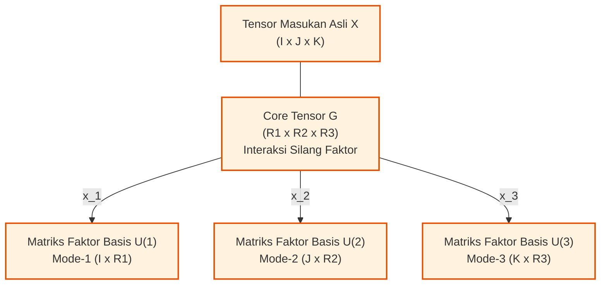

# Bab 09: Aljabar Multilinier, Matrisasi & Dekomposisi Tensor

[← Kembali ke Modul Utama](../011-aljabar-linier-teori-matriks.md) | [Daftar Isi Modul](./README.md)

---

## 1. Intuisi Dasar & Motivasi dari Titik Nol
Tautan Rujukan Kuliah: [Tamara G. Kolda & Brett W. Bader: Tensor Decompositions and Applications (SIAM Review 2009)](https://arxiv.org/abs/0904.3131) | [Wikipedia: Higher-Order Singular Value Decomposition](https://en.wikipedia.org/wiki/Higher-order_singular_value_decomposition)

Selama ini, seluruh aljabar linier klasik yang kita pelajari berkutat pada entitas 1 dimensi (**vektor**) dan entitas 2 dimensi (**matriks**). Namun, dunia fisik dan data modern tidak pernah berhenti pada dua dimensi!

Bayangkan skenario-skenario berikut:
1. **Video Digital Resolusi Tinggi**: Sebuah video berwarna tidak dapat direpresentasikan secara alami oleh matriks 2D tunggal. Video adalah susunan data 4 dimensi: $(\text{Tinggi Piksel}) \times (\text{Lebar Piksel}) \times (\text{Kanal Warna RGB}) \times (\text{Frame Waktu})$.
2. **Sistem Rekomendasi E-Commerce Multi-Aspek**: Rekomendasi produk bukan sekadar hubungan dua arah $\text{Pengguna} \times \text{Item}$. Data riil melibatkan dimensi konteks: $\text{Pengguna} \times \text{Produk} \times \text{Waktu Pembelian} \times \text{Tipe Perangkat Mobile/Desktop}$.
3. **Rekayasa Biomedis & Sinyal Otak**: Sinyal elektroensefalogram (EEG) direkam sebagai: $(\text{Elektroda Kulit Kepala}) \times (\text{Titik Sampel Waktu}) \times (\text{Domain Frekuensi Gelombang}) \times (\text{Uji Coba Pasien})$.

Jika kita memaksakan diri meratakan (*flattening / vectorizing*) data 3D atau 4D ini menjadi matriks 2D biasa demi menerapkan SVD atau PCA standar, **struktur korelasi spasial, temporal, dan multilinearitas lokal yang berharga akan rusak dan musnah seketika**.

Di sinilah **Aljabar Multilinier dan Teori Tensor** hadir:
> Sebuah **Tensor** adalah generalisasi matematis dari skalar (orde-0), vektor (orde-1), dan matriks (orde-2) menuju susunan array angka berdimensi jamak $N \ge 3$. 

Dekomposisi tensor memperluas konsep faktorisasi matriks menuju ruang multilinier:
- **Dekomposisi CP (CANDECOMP/PARAFAC)**: Menguraikan tensor menjadi jumlahan minimum tensor-tensor rank-1, dengan sifat unik yang spektakuler: **faktor-faktornya dijamin unik tanpa ambiguitas rotasi**!
- **Dekomposisi Tucker / Higher-Order SVD (HOSVD)**: Memperluas SVD universal ke dimensi $N$, mengekstraksi matriks basis ortogonal pada setiap mode dimensi serta sebuah **Core Tensor** yang menangkap seluruh pola interaksi silang antar-faktor.

---

## 2. Definisi Formal, Teorema & Penurunan Matematis Lengkap
Tautan Rujukan Kuliah: [SIAM Review 2009: Tensor Decompositions (arXiv)](https://arxiv.org/abs/0904.3131) | [Wikipedia: Tensor Rank Decomposition](https://en.wikipedia.org/wiki/Tensor_rank_decomposition) | [TensorLy Documentation](https://tensorly.org/stable/index.html)

### 2.1 Definisi Formal Tensor Orde-$N$ & Anatomi Geometris
Sebuah **tensor orde-$N$** (juga disebut tensor berdimensi $N$ atau *way-$N$*) adalah elemen dari ruang hasil kali tensor ruang-ruang vektor:
$$\boldsymbol{\mathcal{X}} \in \mathbb{R}^{I_1 \times I_2 \times \dots \times I_N}$$
Di mana entri individual dinotasikan dengan $x_{i_1 i_2 \dots i_N}$ untuk $1 \le i_n \le I_n$.

Untuk tensor orde-3 $\boldsymbol{\mathcal{X}} \in \mathbb{R}^{I \times J \times K}$:
1. **Serat Tensor (*Fibers*)**:
   Serat adalah analogi vektor 1D di dalam tensor yang diperoleh dengan **mengunci seluruh indeks kecuali satu**:
   - **Serat Mode-1 (Column Fiber)**: $\mathbf{x}_{:jk} \in \mathbb{R}^I$ (bergerak vertikal sepanjang kolom).
   - **Serat Mode-2 (Row Fiber)**: $\mathbf{x}_{i:k} \in \mathbb{R}^J$ (bergerak horizontal sepanjang baris).
   - **Serat Mode-3 (Tube Fiber)**: $\mathbf{x}_{ij:} \in \mathbb{R}^K$ (menembus ke dalam sepanjang kedalaman).

2. **Irisan Tensor (*Slices*)**:
   Irisan adalah analogi matriks 2D di dalam tensor yang diperoleh dengan **mengunci seluruh indeks kecuali dua**:
   - **Irisan Frontal (*Frontal Slices*)**: $X_{::k} \in \mathbb{R}^{I \times J}$ (lembaran matriks ke-$k$ dari depan ke belakang).
   - **Irisan Lateral (*Lateral Slices*)**: $X_{:j:} \in \mathbb{R}^{I \times K}$ (lembaran matriks vertikal ke-$j$ dari kiri ke kanan).
   - **Irisan Horizontal (*Horizontal Slices*)**: $X_{i::} \in \mathbb{R}^{J \times K}$ (lembaran matriks horizontal ke-$i$ dari atas ke bawah).

3. **Norma Frobenius Tensor**:
   Akar dari jumlahan kuadrat seluruh elemen di dalam tensor:
   $$\|\boldsymbol{\mathcal{X}}\|_F = \sqrt{\sum_{i_1=1}^{I_1} \sum_{i_2=1}^{I_2} \dots \sum_{i_N=1}^{I_N} x_{i_1 i_2 \dots i_N}^2}$$
   Hasil kali dalam antara dua tensor berdimensi sama $\langle \boldsymbol{\mathcal{X}}, \boldsymbol{\mathcal{Y}} \rangle = \sum x_{i_1 \dots i_N} y_{i_1 \dots i_N}$.

---

### 2.2 Operasi Multilinier: Matrisasi, Produk Mode-$n$ & Produk Khatri-Rao

#### 1. Matrisasi / Unfolding Mode-$n$ ($X_{(n)}$):
**Matrisasi Mode-$n$** adalah proses penyusunan ulang entri-entri tensor $\boldsymbol{\mathcal{X}} \in \mathbb{R}^{I_1 \times \dots \times I_N}$ menjadi matriks dua dimensi $X_{(n)}$ berukuran:
$$X_{(n)} \in \mathbb{R}^{I_n \times J_n}, \quad \text{di mana } J_n = \prod_{k \ne n} I_k$$
Kolom-kolom dari matriks $X_{(n)}$ adalah seluruh serat mode-$n$ dari tensor $\boldsymbol{\mathcal{X}}$ yang dijejerkan secara teratur.
Untuk tensor orde-3 $\boldsymbol{\mathcal{X}} \in \mathbb{R}^{I \times J \times K}$ dengan irisan frontal $X_{::1}, \dots, X_{::K}$:
- **Matrisasi Mode-1**: Menjajarkan irisan frontal ke samping:
  $$X_{(1)} = \begin{bmatrix} X_{::1} & X_{::2} & \dots & X_{::K} \end{bmatrix} \in \mathbb{R}^{I \times JK}$$
- **Matrisasi Mode-2**: Menjajarkan transpose irisan frontal ke samping:
  $$X_{(2)} = \begin{bmatrix} X_{::1}^T & X_{::2}^T & \dots & X_{::K}^T \end{bmatrix} \in \mathbb{R}^{J \times IK}$$
- **Matrisasi Mode-3**: Menjajarkan baris-baris irisan horizontal:
  $$X_{(3)} = \begin{bmatrix} \text{vec}(X_{::1})^T \\ \vdots \\ \text{vec}(X_{::K})^T \end{bmatrix}^T \in \mathbb{R}^{K \times IJ}$$

---

#### 2. Produk Mode-$n$ (*Mode-n Tensor Product*):
Perkalian tensor $\boldsymbol{\mathcal{X}} \in \mathbb{R}^{I_1 \times \dots \times I_N}$ dengan matriks $U \in \mathbb{R}^{J \times I_n}$ sepanjang mode ke-$n$, dinotasikan:
$$\boldsymbol{\mathcal{Y}} = \boldsymbol{\mathcal{X}} \times_n U \in \mathbb{R}^{I_1 \times \dots \times I_{n-1} \times J \times I_{n+1} \times \dots \times I_N}$$
Setiap serat mode-$n$ dari $\boldsymbol{\mathcal{X}}$ dikalikan dari kiri dengan matriks $U$:
$$y_{i_1 \dots i_{n-1} j i_{n+1} \dots i_N} = \sum_{i_n=1}^{I_n} x_{i_1 \dots i_n \dots i_N} u_{j, i_n}$$

**Teorema Ekuivalensi Matrisasi**:
$$\boldsymbol{\mathcal{Y}} = \boldsymbol{\mathcal{X}} \times_n U \iff Y_{(n)} = U X_{(n)}$$
Perkalian mode-$n$ setara dengan perkalian matriks standar antara $U$ dan matrisasi mode-$n$ dari tensor!

---

#### 3. Tiga Jenis Perkalian Matriks Khusus: Kronecker, Hadamard & Khatri-Rao
Misalkan $A \in \mathbb{R}^{I \times K}$ dan $B \in \mathbb{R}^{J \times K}$:

1. **Produk Kronecker ($A \otimes B \in \mathbb{R}^{IJ \times K^2}$)**:
   $$A \otimes B = \begin{bmatrix} a_{11} B & a_{12} B & \dots \\ a_{21} B & a_{22} B & \dots \\ \vdots & \vdots & \ddots \end{bmatrix}$$
2. **Produk Hadamard / Perkalian Titik Sejajar ($A * B \in \mathbb{R}^{I \times K}$)**:
   Perkalian entri-demi-entri: $(A * B)_{ik} = a_{ik} b_{ik}$.
3. **Produk Khatri-Rao ($A \odot B \in \mathbb{R}^{IJ \times K}$)**:
   Perkalian Kronecker per kolom yang bersesuaian (*matching column-wise Kronecker product*):
   $$A \odot B = \begin{bmatrix} \mathbf{a}_1 \otimes \mathbf{b}_1 & \mathbf{a}_2 \otimes \mathbf{b}_2 & \dots & \mathbf{a}_K \otimes \mathbf{b}_K \end{bmatrix}$$
   **Identitas Campuran Fundamental**:
   $$(A \odot B)^T (A \odot B) = (A^T A) * (B^T B)$$
   Identitas ini memangkas biaya komputasi kuadrat terkecil dari dimensi kuadrat menjadi perkalian elemen sederhana!

---

### 2.3 Dekomposisi CANDECOMP/PARAFAC (CP Decomposition)
Dekomposisi CP (diperkenalkan oleh Carroll & Chang, serta Harshman pada tahun 1970) mendekomposisi tensor menjadi jumlahan dari $R$ buah tensor rank-1:
$$\boldsymbol{\mathcal{X}} \approx \sum_{r=1}^R \lambda_r \, \mathbf{a}_r \circ \mathbf{b}_r \circ \mathbf{c}_r \equiv [\![\boldsymbol{\lambda}; A, B, C]\!]$$
Di mana:
- $\circ$ melambangkan hasil kali luar vektor (*outer product*): $(\mathbf{a}_r \circ \mathbf{b}_r \circ \mathbf{c}_r)_{ijk} = a_{ir} b_{jr} c_{kr}$.
- Matriks faktor: $A = [\mathbf{a}_1 \dots \mathbf{a}_R] \in \mathbb{R}^{I \times R}$, $B = [\mathbf{b}_1 \dots \mathbf{b}_R] \in \mathbb{R}^{J \times R}$, $C = [\mathbf{c}_1 \dots \mathbf{c}_R] \in \mathbb{R}^{K \times R}$.
- $R$ terkecil yang menghasilkan kesamaan eksak disebut **Rank Tensor** ($\text{rank}(\boldsymbol{\mathcal{X}})$).

#### Bentuk Matrisasi CP via Khatri-Rao:
$$X_{(1)} \approx A \Lambda (C \odot B)^T$$
$$X_{(2)} \approx B \Lambda (C \odot A)^T$$
$$X_{(3)} \approx C \Lambda (B \odot A)^T$$

#### Algoritma Alternating Least Squares (ALS) untuk Dekomposisi CP:
Algoritma memperbarui matriks faktor satu per satu secara bergantian dengan mengunci dua matriks faktor lainnya:
1. Perbarui $A$ dengan mengunci $B$ dan $C$:
   $$A = X_{(1)} \left( (C \odot B)^T \right)^+ = X_{(1)} (C \odot B) \left( (C^T C) * (B^T B) \right)^{-1}$$
2. Perbarui $B$ dengan mengunci $A$ dan $C$:
   $$B = X_{(2)} (C \odot A) \left( (C^T C) * (A^T A) \right)^{-1}$$
3. Perbarui $C$ dengan mengunci $A$ dan $B$:
   $$C = X_{(3)} (B \odot A) \left( (B^T B) * (A^T A) \right)^{-1}$$
Ulangi iterasi hingga galat konvergen $\|\boldsymbol{\mathcal{X}} - [\![A, B, C]\!]\|_F < \epsilon$.

#### Teorema Keunikan Kruskal (1977):
Salah satu keunggulan terbesar dekomposisi CP atas SVD matriks adalah **keunikan intrinsik tanpa ambiguitas rotasi**.
Definisikan $k$-rank ($k_A$) sebagai bilangan bulat terbesar sedemikian sehingga sembarang $k_A$ kolom dari $A$ bebas linier.
Jika:
$$k_A + k_B + k_C \ge 2R + 2$$
Maka dekomposisi CP **dijamin unik secara esensial** (hanya terdapat kebebasan permutasi kolom dan permutasi skala, tanpa adanya ketidakpastian rotasi ortogonal seperti pada PCA/SVD matriks 2D!).

---

### 2.4 Dekomposisi Tucker & Higher-Order SVD (HOSVD)
Dekomposisi Tucker (Ledyard Tucker, 1966) adalah generalisasi sejati dari SVD menuju tensor dimensi tinggi:
$$\boldsymbol{\mathcal{X}} \approx \boldsymbol{\mathcal{G}} \times_1 U^{(1)} \times_2 U^{(2)} \times_3 U^{(3)}$$
Di mana:
1. $U^{(1)} \in \mathbb{R}^{I \times R_1}, U^{(2)} \in \mathbb{R}^{J \times R_2}, U^{(3)} \in \mathbb{R}^{K \times R_3}$ adalah **matriks faktor ortogonal** ($U^{(n)T} U^{(n)} = I$).
2. $\boldsymbol{\mathcal{G}} \in \mathbb{R}^{R_1 \times R_2 \times R_3}$ adalah **Core Tensor**, yang menangkap seluruh interaksi silang kompleks antar komponen basis di setiap mode.



#### Algoritma HOSVD (Lieven De Lathauwer et al., 2000):
1. **Langkah 1**: Bentuk matrisasi mode-1 $X_{(1)} \in \mathbb{R}^{I \times JK}$. Hitung SVD: $X_{(1)} = U_1 \Sigma_1 V_1^T$. Ambil $R_1$ vektor singular kiri pertama sebagai $U^{(1)}$.
2. **Langkah 2**: Bentuk matrisasi mode-2 $X_{(2)} \in \mathbb{R}^{J \times IK}$. Hitung SVD: $X_{(2)} = U_2 \Sigma_2 V_2^T$. Ambil $R_2$ vektor singular kiri pertama sebagai $U^{(2)}$.
3. **Langkah 3**: Bentuk matrisasi mode-3 $X_{(3)} \in \mathbb{R}^{K \times IJ}$. Hitung SVD: $X_{(3)} = U_3 \Sigma_3 V_3^T$. Ambil $R_3$ vektor singular kiri pertama sebagai $U^{(3)}$.
4. **Langkah 4 (Proyeksi Core Tensor)**:
   $$\boldsymbol{\mathcal{G}} = \boldsymbol{\mathcal{X}} \times_1 U^{(1)T} \times_2 U^{(2)T} \times_3 U^{(3)T}$$

---

### 2.5 Paradoks Teori Rank Tensor: NP-Hard & Kehilangan Teorema Eckart-Young
Meskipun tensor sangat berdaya guna, matematika tensor menyimpan paradoks mendalam yang tidak ada pada matriks 2D:

1. **Penentuan Rank Tensor adalah Masalah NP-Hard (Johan Håstad, 1990)**:
   Tidak ada algoritma berwaktu polinomial yang dapat menghitung nilai eksak $\text{rank}(\boldsymbol{\mathcal{X}})$ untuk sembarang tensor orde $N \ge 3$ atas medan bilangan riil atau rasional.
2. **Rank Tensor Dapat Melampaui Dimensi Minimum**:
   Untuk matriks $m \times n$, rank selalu dibatasi oleh $\text{rank}(A) \le \min(m, n)$.
   Namun untuk tensor $2 \times 2 \times 2$, nilai rank maksimum dapat mencapai **$3$**! Untuk tensor $I \times J \times K$, rank dapat mencapai nilai $\min(IJ, IK, JK)$ yang jauh melampaui dimensi aslinya.
3. **Ketidaktertupan Topologis (*Ill-Posedness of Best Low-Rank Tensor Approximation*)**:
   Himpunan tensor ber-rank $\le R$ **bukanlah himpunan tertutup secara topologis** untuk $R \ge 2$ dan $N \ge 3$.
   Akibatnya: **Teorema Eckart-Young gagal berlaku pada dekomposisi CP**! 
   Sebuah tensor ber-rank 3 dapat didekati dengan galat mendekati nol oleh barisan tensor ber-rank 2 yang memiliki magnitudo entri membengkak menuju tak hingga ($\pm \infty$) dan saling meniadakan. Fenomena ini di industri dikenal sebagai **Divergensi / Swamping CP**.

---

## 3. Contoh Hitungan Manual Langkah-demi-Langkah
Tautan Rujukan Kuliah: [SIAM Review 2009: Section 3 - Tensor Unfolding and Products](https://arxiv.org/abs/0904.3131) | [TensorLy Tutorial](https://tensorly.org/stable/user_guide/tensor_basics.html)

Diberikan sebuah tensor orde-3 berukuran $2 \times 2 \times 2$: $\boldsymbol{\mathcal{X}} \in \mathbb{R}^{2 \times 2 \times 2}$.
Dua irisan frontal tensor tersebut adalah:
$$X_{::1} = \begin{bmatrix} 1 & 2 \\ 3 & 4 \end{bmatrix}, \quad X_{::2} = \begin{bmatrix} 5 & 6 \\ 7 & 8 \end{bmatrix}$$

Tujuan perhitungan analitis:
1. Hitung seluruh entri norma Frobenius $\|\boldsymbol{\mathcal{X}}\|_F$.
2. Bentuk ketiga matriks hasil matrisasi (*unfolding*): $X_{(1)}, X_{(2)}, X_{(3)}$.
3. Hitung produk mode-1 $\boldsymbol{\mathcal{Y}} = \boldsymbol{\mathcal{X}} \times_1 U$ dengan matriks $U = \begin{bmatrix} 1 & 0 \\ 0 & 2 \end{bmatrix}$.
4. Konstruksi vektor singular awal untuk HOSVD pada mode-1.

---

### Langkah 1: Perhitungan Norma Frobenius Tensor
$$\|\boldsymbol{\mathcal{X}}\|_F^2 = \sum_{i=1}^2 \sum_{j=1}^2 \sum_{k=1}^2 x_{ijk}^2$$
Entri pada irisan 1: $1^2 + 2^2 + 3^2 + 4^2 = 1 + 4 + 9 + 16 = 30$.
Entri pada irisan 2: $5^2 + 6^2 + 7^2 + 8^2 = 25 + 36 + 49 + 64 = 174$.
$$\|\boldsymbol{\mathcal{X}}\|_F^2 = 30 + 174 = 204$$
$$\|\boldsymbol{\mathcal{X}}\|_F = \sqrt{204} \approx 14{,}282857$$

---

### Langkah 2: Konstruksi Matrisasi Mode-$n$ (Unfolding)

#### 1. Matrisasi Mode-1 ($X_{(1)} \in \mathbb{R}^{2 \times 4}$):
Serat mode-1 adalah kolom-kolom vertikal pada setiap irisan frontal:
- Kolom irisan 1: $\begin{bmatrix} 1 \\ 3 \end{bmatrix}, \begin{bmatrix} 2 \\ 4 \end{bmatrix}$
- Kolom irisan 2: $\begin{bmatrix} 5 \\ 7 \end{bmatrix}, \begin{bmatrix} 6 \\ 8 \end{bmatrix}$
Jejerkan seluruh kolom ke samping:
$$X_{(1)} = \begin{bmatrix} 1 & 2 & 5 & 6 \\ 3 & 4 & 7 & 8 \end{bmatrix}$$

#### 2. Matrisasi Mode-2 ($X_{(2)} \in \mathbb{R}^{2 \times 4}$):
Serat mode-2 adalah baris-baris horizontal pada setiap irisan frontal (dijadikan kolom):
- Baris irisan 1 (transpose): $\begin{bmatrix} 1 \\ 2 \end{bmatrix}, \begin{bmatrix} 3 \\ 4 \end{bmatrix}$
- Baris irisan 2 (transpose): $\begin{bmatrix} 5 \\ 6 \end{bmatrix}, \begin{bmatrix} 7 \\ 8 \end{bmatrix}$
Jejerkan seluruh kolom ke samping:
$$X_{(2)} = \begin{bmatrix} 1 & 3 & 5 & 7 \\ 2 & 4 & 6 & 8 \end{bmatrix}$$

#### 3. Matrisasi Mode-3 ($X_{(3)} \in \mathbb{R}^{2 \times 4}$):
Serat mode-3 adalah tabung yang menembus irisan 1 ke irisan 2 ($x_{ij:}$):
- Tabung entri $(1,1)$: $[1, 5]^T$
- Tabung entri $(2,1)$: $[3, 7]^T$
- Tabung entri $(1,2)$: $[2, 6]^T$
- Tabung entri $(2,2)$: $[4, 8]^T$
Jejerkan seluruh kolom ke samping:
$$X_{(3)} = \begin{bmatrix} 1 & 3 & 2 & 4 \\ 5 & 7 & 6 & 8 \end{bmatrix}$$

---

### Langkah 3: Perhitungan Produk Mode-1 ($\boldsymbol{\mathcal{Y}} = \boldsymbol{\mathcal{X}} \times_1 U$)
Diberikan matriks pengali mode-1:
$$U = \begin{bmatrix} 1 & 0 \\ 0 & 2 \end{bmatrix}$$

Gunakan Teorema Ekuivalensi Matrisasi $Y_{(1)} = U X_{(1)}$:
$$Y_{(1)} = \begin{bmatrix} 1 & 0 \\ 0 & 2 \end{bmatrix} \begin{bmatrix} 1 & 2 & 5 & 6 \\ 3 & 4 & 7 & 8 \end{bmatrix} = \begin{bmatrix} 1(1) & 1(2) & 1(5) & 1(6) \\ 2(3) & 2(4) & 2(7) & 2(8) \end{bmatrix} = \begin{bmatrix} 1 & 2 & 5 & 6 \\ 6 & 8 & 14 & 16 \end{bmatrix}$$

Kembalikan bentuk matriks $Y_{(1)}$ menjadi dua irisan frontal tensor luaran $\boldsymbol{\mathcal{Y}}$:
$$Y_{::1} = \begin{bmatrix} 1 & 2 \\ 6 & 8 \end{bmatrix}, \quad Y_{::2} = \begin{bmatrix} 5 & 6 \\ 14 & 16 \end{bmatrix}$$
Perhatikan bahwa baris kedua dari setiap irisan terkalikan tepat dengan skalar 2, sesuai dengan operasi transformasi linier pada mode-1!

---

### Langkah 4: Konstruksi Basis Ortonormal Mode-1 HOSVD
Untuk mencari matriks faktor ortogonal $U^{(1)}$ dalam HOSVD, hitung SVD dari matrisasi mode-1 $X_{(1)}$:
$$X_{(1)} X_{(1)}^T = \begin{bmatrix} 1 & 2 & 5 & 6 \\ 3 & 4 & 7 & 8 \end{bmatrix} \begin{bmatrix} 1 & 3 \\ 2 & 4 \\ 5 & 7 \\ 6 & 8 \end{bmatrix} = \begin{bmatrix} 1 + 4 + 25 + 36 & 3 + 8 + 35 + 48 \\ 3 + 8 + 35 + 48 & 9 + 16 + 49 + 64 \end{bmatrix} = \begin{bmatrix} 66 & 94 \\ 94 & 138 \end{bmatrix}$$

Polinomial karakteristik $\det(X_{(1)} X_{(1)}^T - \lambda I) = 0$:
$$\det \begin{bmatrix} 66 - \lambda & 94 \\ 94 & 138 - \lambda \end{bmatrix} = (66 - \lambda)(138 - \lambda) - 94^2 = 0$$
$$\lambda^2 - 204\lambda + (9108 - 8836) = \lambda^2 - 204\lambda + 272 = 0$$
Perhatikan jumlah nilai eigen: $\text{trace} = 66 + 138 = 204 = \|\boldsymbol{\mathcal{X}}\|_F^2$!
Akar-akar kuadratik:
$$\lambda_1 = \frac{204 + \sqrt{204^2 - 4(272)}}{2} = \frac{204 + \sqrt{41616 - 1088}}{2} = \frac{204 + \sqrt{40528}}{2} \approx \frac{204 + 201{,}3156}{2} \approx 202{,}6578$$
$$\lambda_2 = \frac{204 - 201{,}3156}{2} \approx 1{,}3422$$
Nilai singular mode-1:
$$\sigma_1^{(1)} = \sqrt{202{,}6578} \approx 14{,}2358, \quad \sigma_2^{(1)} = \sqrt{1{,}3422} \approx 1{,}1585$$
Vektor singular kiri $\mathbf{u}_1^{(1)}$ dan $\mathbf{u}_2^{(1)}$ membentuk matriks basis ortogonal $U^{(1)}$ untuk dekomposisi Tucker!

---

## 4. Implementasi Komputasi & Kode Python Industri
Tautan Dokumentasi Resmi: [TensorLy PyTorch/NumPy Backend](https://tensorly.org/stable/modules/generated/tensorly.decomposition.tucker.html) | [NumPy Esum & Tensordot](https://numpy.org/doc/stable/reference/generated/numpy.tensordot.html)

Berikut adalah implementasi Python mandiri berkinerja tinggi menggunakan NumPy standar (tanpa ketergantungan wajib pada pustaka eksternal) yang mengimplementasikan matrisasi mode-$n$, produk mode-$n$, produk Khatri-Rao, serta algoritma HOSVD lengkap:

```python
"""
Modul Fondasi: Aljabar Multilinier & Algoritma Higher-Order SVD (HOSVD).
Implementasi mandiri NumPy standar berstandar industri.
"""

from typing import Tuple, List
import numpy as np


def tensor_unfold(tensor: np.ndarray, mode: int) -> np.ndarray:
    """
    Melakukan matrisasi (unfolding) tensor orde-N sepanjang mode ke-n (0-indexed).

    Args:
        tensor: Array multidimensi berdimensi N.
        mode: Indeks mode yang akan menjadi baris matriks (0 s/d N-1).

    Returns:
        Matriks 2D hasil unfolding berukuran (I_mode, prod(I_lain)).
    """
    # Pindahkan sumbu mode terpilih ke posisi pertama (axis 0)
    tensor_moved = np.moveaxis(tensor, mode, 0)
    rows = tensor_moved.shape[0]
    return tensor_moved.reshape((rows, -1), order="F")


def tensor_mode_product(tensor: np.ndarray, matrix: np.ndarray, mode: int) -> np.ndarray:
    """
    Menghitung produk mode-n antara tensor dan matriks: Y = X x_mode U.

    Args:
        tensor: Array multidimensi shape (I_0, ..., I_{N-1}).
        matrix: Matriks transformasi 2D berukuran (J, I_mode).
        mode: Indeks mode pengali.

    Returns:
        Tensor hasil transformasi dengan shape pada sumbu mode digantikan oleh J.
    """
    # Menggunakan tensordot untuk performa tinggi setara BLAS
    return np.tensordot(matrix, tensor, axes=(1, mode))


def khatri_rao_product(A: np.ndarray, B: np.ndarray) -> np.ndarray:
    """
    Menghitung produk Khatri-Rao (kolom-demi-kolom Kronecker) A (Khatri-Rao) B.

    Args:
        A: Matriks 2D shape (I, R).
        B: Matriks 2D shape (J, R).

    Returns:
        Matriks 2D shape (I*J, R).
    """
    if A.shape[1] != B.shape[1]:
        raise ValueError(f"Jumlah kolom harus sama: A={A.shape}, B={B.shape}")

    I, R = A.shape
    J, _ = B.shape
    # Perluasan bentuk untuk komputasi tervektorisasi
    return (A[np.newaxis, :, :] * B[:, np.newaxis, :]).reshape((I * J, R))


def hosvd_decomposition(
    tensor: np.ndarray, ranks: List[int]
) -> Tuple[np.ndarray, List[np.ndarray]]:
    """
    Algoritma Higher-Order SVD (HOSVD) De Lathauwer et al. (2000).

    Args:
        tensor: Array multidimensi input.
        ranks: Daftar target rank pada setiap mode [R_0, R_1, ..., R_{N-1}].

    Returns:
        Tuple (Core_Tensor, factor_matrices).
    """
    factors: List[np.ndarray] = []
    ndim = tensor.ndim

    # 1. Hitung vektor singular kiri dari matrisasi setiap mode
    for m in range(ndim):
        X_m = tensor_unfold(tensor, mode=m)
        U, _, _ = np.linalg.svd(X_m, full_matrices=False)
        r = min(ranks[m], U.shape[1])
        factors.append(U[:, :r])

    # 2. Proyeksikan tensor asli ke seluruh matriks faktor untuk memperoleh Core Tensor
    core = tensor.copy()
    for m in range(ndim):
        core = tensor_mode_product(core, factors[m].T, mode=m)

    return core, factors


if __name__ == "__main__":
    # Pengujian pada Contoh Manual Bab 09: Tensor 2x2x2
    # X_::0 = [[1, 2], [3, 4]], X_::1 = [[5, 6], [7, 8]]
    X_test = np.array([[[1.0, 5.0],
                        [2.0, 6.0]],
                       [[3.0, 7.0],
                        [4.0, 8.0]]], dtype=np.float64)

    print("=== PENGUJIAN NORMA FROBENIUS TENSOR ===")
    fro_norm = np.linalg.norm(X_test)
    print(f"Norma Frobenius: {fro_norm:.6f} (Teoretis sqrt(204): {np.sqrt(204):.6f})")
    assert np.isclose(fro_norm, np.sqrt(204), atol=1e-10)

    print("\n=== PENGUJIAN MATRISASI MODE-N (UNFOLDING) ===")
    X_1 = tensor_unfold(X_test, mode=0)
    print("Mode-0 Unfolding (2x4):\n", X_1)
    # Verifikasi jumlahan kuadrat matrisasi melestarikan norma
    assert np.isclose(np.linalg.norm(X_1), np.sqrt(204), atol=1e-10)

    print("\n=== PENGUJIAN PRODUK KHATRI-RAO ===")
    A_mat = np.array([[1.0, 2.0],
                      [3.0, 4.0]])
    B_mat = np.array([[5.0, 6.0],
                      [7.0, 8.0]])
    KR = khatri_rao_product(A_mat, B_mat)
    print("Khatri-Rao Shape (Harus 4x2):", KR.shape)
    assert KR.shape == (4, 2)

    print("\n=== PENGUJIAN DEKOMPOSISI HOSVD (TUCKER) ===")
    core_tensor, factor_mats = hosvd_decomposition(X_test, ranks=[2, 2, 2])
    print("Shape Core Tensor G:", core_tensor.shape)
    print("Jumlah Matriks Faktor U:", len(factor_mats))

    # Rekonstruksi tensor dari core dan faktor
    recon = core_tensor.copy()
    for m in range(3):
        recon = tensor_mode_product(recon, factor_mats[m], mode=m)

    recon_error = np.linalg.norm(X_test - recon)
    print(f"Galat Rekonstruksi HOSVD Rank Penuh: {recon_error:.4e}")
    assert np.isclose(recon_error, 0.0, atol=1e-10)

    print("[STATUS] Seluruh asersi aljabar multilinier dan HOSVD berhasil diverifikasi!")
```

---

## 5. Miskonsepsi Umum & Post-Mortem Kegagalan Industri
Tautan Rujukan Kuliah: [SIAM Review 2009: Section 4 - Rank and Degeneracy](https://arxiv.org/abs/0904.3131) | [Alwin Stegeman: Degeneracy in CP Decomposition](https://en.wikipedia.org/wiki/Tensor_rank_decomposition)

### 5.1 Tiga Miskonsepsi Kritis dalam Pemodelan Multilinier
1. **Mengira Dekomposisi CP Bertingkat Seperti SVD**:
   Dalam SVD matriks, jika kita ingin aproksimasi rank-2 setelah menghitung rank-1, kita hanya perlu menambahkan suku kedua ($\sigma_2 \mathbf{u}_2 \mathbf{v}_2^T$). 
   Namun dalam tensor CP, **komponen tidak dapat ditambahkan satu per satu**! Matriks faktor terbaik untuk model CP rank-2 sering kali memiliki vektor-vektor yang sama sekali berbeda dengan vektor pada model CP rank-1.
2. **Mengabaikan Fenomena Degenerasi / Swamping**:
   Ketika mengoptimasi dekomposisi CP via ALS, dua komponen rank-1 dapat menjadi hampir berkorelasi sempurna ($r \approx -1{,}0$) dengan magnitudo amplitudo $\lambda_1, \lambda_2 \to \infty$ yang saling meniadakan secara numerik. Hal ini menyebabkan algoritma mengalami konvergensi sangat lambat (*thousands of iterations*) dan galat pembulatan floating-point yang merusak hasil pemodelan.
3. **Mengira HOSVD Truncated Selalu Optimal Secara Global**:
   Pemotongan nilai singular pada HOSVD (Truncated HOSVD) memberikan aproksimasi yang sangat baik secara cepat (*quasi-optimal*), namun **bukan solusi optimal global murni** untuk dekomposisi Tucker. Untuk mendapatkan galat terkecil mutlak, hasil HOSVD wajib dihaluskan kembali menggunakan iterasi ortogonal **HOOI (*Higher-Order Orthogonal Iteration*)**.

---

### 5.2 Post-Mortem Industri: Keruntuhan Rekomendasi E-Commerce Akibat Flattening Naif
Pada tahun 2018, tim rekayasa data sebuah platform e-commerce terkemuka merancang sistem rekomendasi personalisasi berbasis pembelajaran mesin untuk 10 juta pengguna aktif.

#### Kronologi Kegagalan Arsitektur:
1. Data transaksi historis berbentuk tensor 3 arah: $(\text{Pengguna}) \times (\text{Kategori Barang}) \times (\text{Periode Waktu Promosi})$.
2. Karena ketiadaan pengetahuan tim mengenai aljabar multilinier, mereka melakukan pemipihan (*flattening*) naif atas tensor tersebut menjadi matriks 2D berukuran raksasa: $\text{Pengguna} \times (\text{Kategori Barang} \cdot \text{Waktu})$.
3. Matriks hasil pemipihan tersebut memiliki ukuran $10.000.000 \times 500.000$. Karena 99,99% entri transaksi bernilai nol, matriks mengalami *extreme sparsity*.
4. Ketika tim mencoba menjalankan algoritma Truncated SVD / Truncated ALS matriks 2D konvensional:
   - Hubungan korelasi temporal musiman antar barang yang sama di waktu berbeda lenyap, karena dimensi waktu diperlakukan sebagai fitur independen baru yang terpisah.
   - Kebutuhan memori klaster komputasi meledak hingga melampaui 12 Terabyte RAM (*Out of Memory / OOM crash*).
   - Waktu pelatihan memakan waktu lebih dari 48 jam per siklus, membuat pembaruan model harian menjadi mustahil.
5. **Solusi Restrukturisasi Multilinier**:
   Tim menulis ulang seluruh pipa data menggunakan **Dekomposisi Tucker / Tensor-Train (TT)** dengan pustaka TensorLy:
   - Tensor 3 arah diproses secara utuh tanpa pernah dipipihkan.
   - Jumlah parameter model terkompresi hingga **98,5%** (hanya memerlukan beberapa Gigabyte memori).
   - Waktu konvergensi algoritma terpangkas dari 48 jam menjadi **35 menit**.
   - Metrik akurasi rekomendasi (*Click-Through Rate* / CTR) melonjak sebesar 23% karena struktur temporal tensor berhasil dipertahankan secara utuh.

---

## 6. Latihan Mandiri Berjenjang

### Tingkat 1: Pemula (Penetapan Konseptual)
Diberikan tensor rank-1 orde-3 $\boldsymbol{\mathcal{T}} = \mathbf{a} \circ \mathbf{b} \circ \mathbf{c}$, di mana:
$$\mathbf{a} = \begin{bmatrix} 1 \\ 2 \end{bmatrix}, \quad \mathbf{b} = \begin{bmatrix} 3 \\ 4 \end{bmatrix}, \quad \mathbf{c} = \begin{bmatrix} 1 \\ 0 \end{bmatrix}$$
1. Tentukan ukuran dimensi (*shape*) dari tensor $\boldsymbol{\mathcal{T}}$.
2. Tuliskan secara eksplisit kedua irisan frontal $T_{::1}$ dan $T_{::2}$.

<details>
<summary>Kunci Jawaban Tingkat 1</summary>

1. **Ukuran Dimensi (Shape)**:
   Vektor $\mathbf{a} \in \mathbb{R}^2$, $\mathbf{b} \in \mathbb{R}^2$, $\mathbf{c} \in \mathbb{R}^2$.
   Maka tensor $\boldsymbol{\mathcal{T}} \in \mathbb{R}^{2 \times 2 \times 2}$.

2. **Irisan Frontal**:
   Entri tensor dirumuskan sebagai $t_{ijk} = a_i b_j c_k$.
   - **Untuk $k = 1$ ($c_1 = 1$)**:
     $$T_{::1} = c_1 (\mathbf{a} \mathbf{b}^T) = 1 \begin{bmatrix} 1 \\ 2 \end{bmatrix} \begin{bmatrix} 3 & 4 \end{bmatrix} = \begin{bmatrix} 1(3) & 1(4) \\ 2(3) & 2(4) \end{bmatrix} = \begin{bmatrix} 3 & 4 \\ 6 & 8 \end{bmatrix}$$
   - **Untuk $k = 2$ ($c_2 = 0$)**:
     $$T_{::2} = c_2 (\mathbf{a} \mathbf{b}^T) = 0 \begin{bmatrix} 1 \\ 2 \end{bmatrix} \begin{bmatrix} 3 & 4 \end{bmatrix} = \begin{bmatrix} 0 & 0 \\ 0 & 0 \end{bmatrix}$$
</details>

---

### Tingkat 2: Menengah (Aplikasi & Matrisasi Produk Mode-$n$)
Diberikan tensor $\boldsymbol{\mathcal{X}} \in \mathbb{R}^{3 \times 4 \times 5}$.
1. Tentukan ukuran dimensi matriks dari matrisasi mode-1 ($X_{(1)}$), mode-2 ($X_{(2)}$), dan mode-3 ($X_{(3)}$).
2. Jika kita mengalikan tensor tersebut dengan matriks $U \in \mathbb{R}^{2 \times 3}$ pada mode-1 dan matriks $V \in \mathbb{R}^{2 \times 4}$ pada mode-2:
   $$\boldsymbol{\mathcal{Y}} = \boldsymbol{\mathcal{X}} \times_1 U \times_2 V$$
   Berapakah ukuran dimensi (*shape*) akhir dari tensor $\boldsymbol{\mathcal{Y}}$?

<details>
<summary>Kunci Jawaban Tingkat 2</summary>

1. **Ukuran Matrisasi**:
   - $X_{(1)} \in \mathbb{R}^{I_1 \times (I_2 \cdot I_3)} = \mathbb{R}^{3 \times (4 \times 5)} = \mathbb{R}^{3 \times 20}$.
   - $X_{(2)} \in \mathbb{R}^{I_2 \times (I_1 \cdot I_3)} = \mathbb{R}^{4 \times (3 \times 5)} = \mathbb{R}^{4 \times 15}$.
   - $X_{(3)} \in \mathbb{R}^{I_3 \times (I_1 \cdot I_2)} = \mathbb{R}^{5 \times (3 \times 4)} = \mathbb{R}^{5 \times 12}$.

2. **Dimensi Akhir Produk Mode**:
   - Perkalian $\times_1 U$ mengubah dimensi mode-1 dari 3 menjadi 2: $\mathbb{R}^{2 \times 4 \times 5}$.
   - Perkalian $\times_2 V$ mengubah dimensi mode-2 dari 4 menjadi 2: $\mathbb{R}^{2 \times 2 \times 5}$.
   - Dimensi mode-3 tetap 5.
   Maka dimensi akhir tensor $\boldsymbol{\mathcal{Y}}$ adalah **$2 \times 2 \times 5$**.
</details>

---

### Tingkat 3: Mahir (Paradoks Rank Tensor 2x2x2)
Tinjau tensor $\boldsymbol{\mathcal{W}} \in \mathbb{R}^{2 \times 2 \times 2}$ yang memiliki irisan frontal:
$$W_{::1} = \begin{bmatrix} 1 & 0 \\ 0 & 1 \end{bmatrix}, \quad W_{::2} = \begin{bmatrix} 0 & 1 \\ -1 & 0 \end{bmatrix}$$
Buktikan bahwa $\text{rank}(\boldsymbol{\mathcal{W}}) = 3$ atas medan bilangan riil $\mathbb{R}$, meskipun tidak ada dimensi yang melebihi 2!

<details>
<summary>Kunci Jawaban Tingkat 3</summary>

**Bukti Analitis Lengkap**:
1. Andaikan $\text{rank}(\boldsymbol{\mathcal{W}}) \le 2$. Maka $\boldsymbol{\mathcal{W}}$ dapat dituliskan sebagai jumlahan dari maksimal 2 tensor rank-1:
   $$\boldsymbol{\mathcal{W}} = \mathbf{a}_1 \circ \mathbf{b}_1 \circ \mathbf{c}_1 + \mathbf{a}_2 \circ \mathbf{b}_2 \circ \mathbf{c}_2$$
2. Dalam bentuk irisan frontal, setiap irisan merupakan kombinasi linier dari dua matriks rank-1 $\mathbf{a}_1 \mathbf{b}_1^T$ dan $\mathbf{a}_2 \mathbf{b}_2^T$:
   $$W_{::1} = c_{11} (\mathbf{a}_1 \mathbf{b}_1^T) + c_{21} (\mathbf{a}_2 \mathbf{b}_2^T)$$
   $$W_{::2} = c_{12} (\mathbf{a}_1 \mathbf{b}_1^T) + c_{22} (\mathbf{a}_2 \mathbf{b}_2^T)$$
   Artinya, seluruh irisan frontal dari $\boldsymbol{\mathcal{W}}$ berada di dalam subruang matriks berdimensi 2 yang direntang oleh $\{\mathbf{a}_1 \mathbf{b}_1^T, \mathbf{a}_2 \mathbf{b}_2^T\}$.
3. Tinjau kombinasi linier sembarang dari kedua irisan tersebut:
   $$M(\theta) = \cos(\theta) W_{::1} + \sin(\theta) W_{::2} = \begin{bmatrix} \cos(\theta) & \sin(\theta) \\ -\sin(\theta) & \cos(\theta) \end{bmatrix}$$
   Hitung determinan dari matriks $M(\theta)$:
   $$\det(M(\theta)) = \cos^2(\theta) - (-\sin^2(\theta)) = \cos^2(\theta) + \sin^2(\theta) = 1$$
   Untuk **setiap sudut $\theta \in \mathbb{R}$**, determinan matriks $M(\theta)$ selalu bernilai 1 (selalu ber-rank 2 penuh)!
4. Namun, jika subruang tersebut direntang oleh dua matriks ber-rank 1 ($\mathbf{a}_1 \mathbf{b}_1^T$ dan $\mathbf{a}_2 \mathbf{b}_2^T$), maka di dalam subruang 2D tersebut **wajib terdapat matriks ber-rank $\le 1$** (persamaan $\det(\alpha M_1 + \beta M_2) = 0$ adalah persamaan polinomial kuadrat homogen yang selalu memiliki akar pada medan tertutup aljabar).
   Karena polinomial kuadrat $\det(M(\theta)) = 1 \ne 0$ tidak memiliki akar riil, maka subruang tersebut tidak dapat direntang oleh dua matriks rank-1 riil.
5. Akibatnya, asumsi $\text{rank}(\boldsymbol{\mathcal{W}}) \le 2$ salah.
Maka terbukti bahwa $\text{rank}(\boldsymbol{\mathcal{W}}) = 3$. Tensor $2 \times 2 \times 2$ ini membuktikan paradoks spektakuler bahwa rank tensor di $\mathbb{R}^3$ dapat melampaui seluruh dimensi penyusunnya! $\blacksquare$
</details>

---

## 7. Rujukan Silabus & Tautan Belajar Standar Emas
- [Tamara G. Kolda & Brett W. Bader: Tensor Decompositions and Applications (SIAM Review 2009)](https://arxiv.org/abs/0904.3131) — Makalah tinjauan paling otoritatif dan komprehensif di dunia mengenai aljabar multilinier dan dekomposisi tensor.
- [Lieven De Lathauwer et al.: A Multilinear Singular Value Decomposition (SIAM J. Matrix Anal. 2000)](https://en.wikipedia.org/wiki/Higher-order_singular_value_decomposition) — Makalah fondasional yang memperkenalkan algoritma HOSVD ke komunitas ilmiah modern.
- [Wikipedia: Tensor Rank Decomposition](https://en.wikipedia.org/wiki/Tensor_rank_decomposition) — Definisi formal dekomposisi CANDECOMP/PARAFAC, kondisi keunikan Kruskal, dan paradoks komputasi.
- [TensorLy: Tensor Learning in Python](https://tensorly.org/stable/index.html) — Dokumentasi dan arsitektur pustaka komputasi tensor open-source industri.
