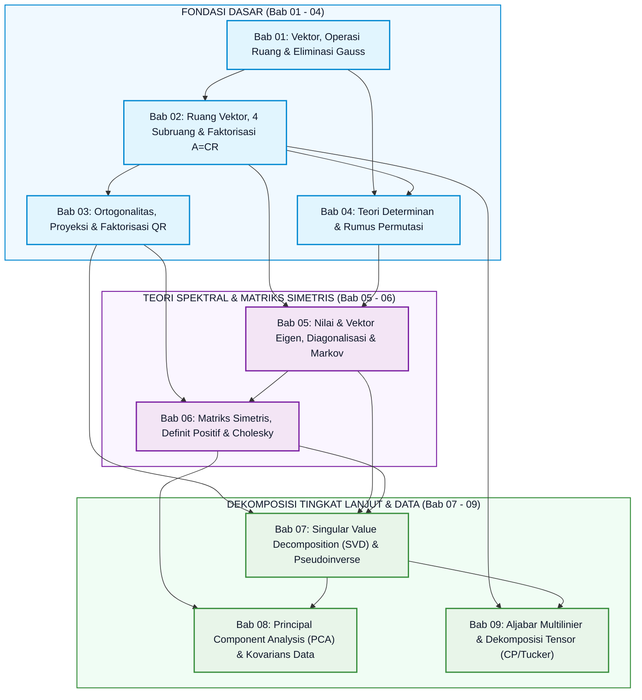
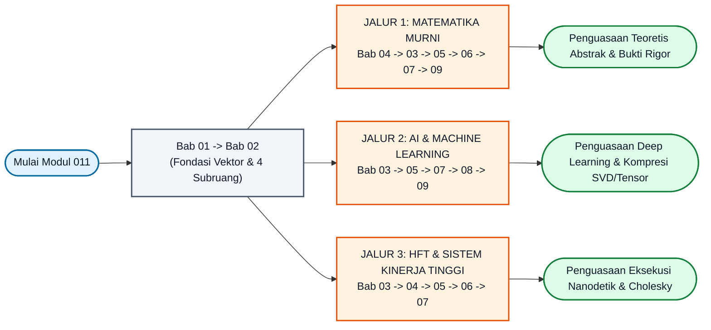

# Modul 011: Aljabar Linier & Teori Matriks — Buku Teks & Peta Silabus Modular

**Navigasi**: [⬅️ Kembali ke Modul Utama (Master Gateway)](../011-aljabar-linier-teori-matriks.md) | [⬅️ Tingkat 1: Fondasi Matematika](../README.md) | [Master Index](../../../INDEX.md)

---

## 1. Visi Pedagogis & Ikhtisar Kurikulum Modular

Selamat datang di **Buku Teks Modular Aljabar Linier & Teori Matriks (Modul 011)**. Direktori ini menyajikan kurikulum standar emas (*gold standard*) yang dirancang khusus untuk memandu seorang pembelajar dari **titik nol mutlak (*zero prior knowledge / seperti bayi baru lahir*)** menuju penguasaan matematis dan rekayasa komputasi setingkat universitas riset papan atas dunia dan industri rekayasa perangkat lunak berkinerja tinggi.

Cakupan materi di dalam modul ini dirancang setara atau melampaui gabungan silabus:
1. **MIT 18.06: Linear Algebra** (Prof. Gilbert Strang) — Fondasi geometri ruang vektor, empat subruang fundamental, eliminasi, ortogonalitas, dan nilai eigen.
2. **MIT 18.065: Linear Algebra and Learning from Data** (Prof. Gilbert Strang) — Aljabar linier terapan untuk data raksasa, dekomposisi nilai singular (SVD), Teorema Eckart-Young, dan representasi fitur *deep learning*.
3. **Introduction to Linear Algebra (5th & 6th Editions, 2023)** (Gilbert Strang) — Paradigma modern *column-first linear algebra*, faktorisasi $A = CR$, dan proyeksi kuadrat terkecil.
4. **Aljabar Multilinier & Teori Dekomposisi Tensor** (Tamara G. Kolda & Brett W. Bader, *SIAM Review* 2009; Lieven De Lathauwer et al., 2000) — Perluasan matriks 2D ke tensor berdimensi $N \ge 3$, matrisasi mode-$n$, dekomposisi CP (*CANDECOMP/PARAFAC*), dan dekomposisi Tucker (*Higher-Order SVD*).

---

### 1.1 Standar Kualitas 7-Level Tangga Belajar pada Setiap Bab Subtopik
Setiap bab subtopik di dalam direktori ini (dari Bab 01 hingga Bab 09) mematuhi **Tangga Belajar 7-Level** secara konsisten:
- **Level 0 (Dunia Nyata & Pengantar Pra-Materi)**: Penjelasan murni analogi sehari-hari dan logika akal sehat tanpa kejutan rumus (*zero-notation shock*).
- **Level 1 (Angka Kecil $2 \times 2$ & Kamus Simbol Anti-Pusing)**: Contoh mainan dengan angka super kecil (1, 2, 3) dan kotak terjemahan simbol ke cara membacanya secara lisan dalam bahasa manusia.
- **Level 2 (Tutorial Resep Langkah-demi-Langkah & Tanya-Jawab Pemula)**: Panduan langkah konkret yang menjelaskan kausalitas (*"kenapa baris ini dikurangi..."*) serta kotak *"❓ Pertanyaan Pemula"*.
- **Level 3 (Tips, Trik, Rahasia Cepat & Jembatan Keledai)**: Akronim praktis (*BASKOM = Baris-Kolom*, *Kaus Kaki & Sepatu*), pola visual, dan cara mengecek kebenaran jawaban dalam 5 detik.
- **Level 4 (Teori Formal & Pembuktian Berjembatan Logika)**: Kedalaman aksiomatik universitas dunia (MIT/Strang) dengan kotak *"🌉 Jembatan Logika"* di antara baris-baris penurunan rumus.
- **Level 5 (Tutorial Koding Python 2-Tahap: 5A Pure Python + 5B NumPy/SciPy)**: Implementasi murni algoritma tanpa pustaka eksternal untuk melatih intuisi, didampingi implementasi standar industri berkecepatan tinggi, blok output teks, tabel bedah kode baris-demi-baris, dan eksperimen mandiri 60 detik.
- **Level 6 (Jebakan Pemula, Post-Mortem Industri & Latihan 4 Jenjang)**: Miskonsepsi umum, telaah kegagalan sistem bersejarah di industri nyata, serta latihan bertingkat (*Pemanasan Bayi*, *Tulis Tangan Pemula*, *Pemodelan Menengah*, *Tantangan Industri Mahir*) yang seluruh solusinya terbungkus rapi di dalam tag lipat `<details>`.

---

### 1.2 Pengantar Pra-Aljabar Linier dari Nol Mutlak

Bagi Anda yang baru pertama kali melangkah ke dunia aljabar linier, mari kita mulai dari hal yang paling akrab di kehidupan sehari-hari: **mencatat daftar pesanan di warung**.

Bayangkan Anda dan seorang teman sedang makan di warung makan:
- **Hari Senin**: Anda memesan 2 piring nasi goreng dan 1 gelas es teh, total bayar Rp 25.000.
- **Hari Selasa**: Teman Anda memesan 1 piring nasi goreng dan 2 gelas es teh, total bayar Rp 20.000.

Berapa harga 1 piring nasi goreng ($x_1$) dan 1 gelas es teh ($x_2$)?
Di SMP, Anda menuliskan dua persamaan ini:

$$
2x_1 + 1x_2 = 25.000
$$

$$
1x_1 + 2x_2 = 20.000
$$

Dalam aljabar linier, kita tidak lagi menulis huruf $x_1$ dan $x_2$ berulang-ulang. Kita pisahkan **tabel koefisien pesanan** ($A$), **vektor barang yang dicari** ($\mathbf{x}$), dan **vektor total harga** ($\mathbf{b}$):

$$
\begin{bmatrix} 2 & 1 \\ 1 & 2 \end{bmatrix} \begin{bmatrix} x_1 \\ x_2 \end{bmatrix} = \begin{bmatrix} 25.000 \\ 20.000 \end{bmatrix} \iff A\mathbf{x} = \mathbf{b}
$$

- **Tabel Angka (Matriks $A$)**: Wadah kotak 2 dimensi untuk menyimpan angka koefisien. Angka di baris ke-$i$ dan kolom ke-$j$ ditulis $a_{ij}$.
  - Baris ke-1 ($i=1$): Pesanan hari Senin ($2$ porsi nasi, $1$ es teh).
  - Baris ke-2 ($i=2$): Pesanan hari Selasa ($1$ porsi nasi, $2$ es teh).
  - Kolom ke-1 ($j=1$): Semua angka yang berkaitan dengan nasi goreng ($2$ dan $1$).
  - Kolom ke-2 ($j=2$): Semua angka yang berkaitan dengan es teh ($1$ dan $2$).
- **Vektor Kolom ($\mathbf{x}$ dan $\mathbf{b}$)**: Daftar angka satu kolom tegak lurus.

---

### 1.3 Kamus Simbol Pra-Materi Lengkap

Tabel berikut adalah kamus referensi cepat untuk seluruh lambang matematika yang akan Anda temui di seluruh 9 bab Topik 011:

| Simbol Matematika | Cara Membaca Secara Lisan | Terjemahan Bahasa Manusia & Makna Konseptual | Contoh Mainan Konkret |
|---|---|---|---|
| $\mathbf{x} \in \mathbb{R}^n$ | "$x$ elemen dari R pangkat $n$" | $\mathbf{x}$ adalah daftar berisi $n$ buah angka riil biasa (vektor dimensi $n$). | $\mathbf{x} = [2, 3]^T \in \mathbb{R}^2$ (titik koordinat 2D). |
| $A \in \mathbb{R}^{m \times n}$ | "$A$ elemen dari R ukuran $m$ kali $n$" | $A$ adalah tabel angka 2D yang memiliki $m$ baris dan $n$ kolom. | Matriks $2 \times 3$ punya 2 baris dan 3 kolom. |
| $\forall$ | "Untuk setiap" atau "Untuk semua" | Berlaku bagi semua anggota tanpa terkecuali. | $\forall \mathbf{x} \in V$ berarti "untuk setiap vektor $\mathbf{x}$ di ruang $V$". |
| $\iff$ | "Jika dan hanya jika" | Kedua pernyataan bernilai setara dua arah (sebab-akibat timbal balik). | $A\mathbf{x} = \mathbf{0} \iff \mathbf{x} \in N(A)$. |
| $\sum_{k=1}^n$ | "Sigma dari $k$ sama dengan 1 sampai $n$" | Jumlahkan seluruh suku untuk indeks $k = 1, 2, \dots, n$. | $\sum_{k=1}^3 k = 1 + 2 + 3 = 6$. |
| $I$ atau $I_n$ | "Matriks identitas" | Matriks persegi dengan angka 1 di diagonal utama dan 0 di tempat lain (berfungsi seperti angka 1 pada perkalian biasa: $AI = A$). | $I_2 = \begin{bmatrix} 1 & 0 \\ 0 & 1 \end{bmatrix}$. |
| $A^T$ | "$A$ transpos" | Baris ditukar menjadi kolom, dan kolom ditukar menjadi baris. | $\begin{bmatrix} 1 & 2 \\ 3 & 4 \end{bmatrix}^T = \begin{bmatrix} 1 & 3 \\ 2 & 4 \end{bmatrix}$. |
| $\det(A)$ | "Determinan dari matriks $A$" | Skalar yang mengukur faktor peregangan luas/volume oleh matriks $A$. Jika $\det(A) = 0$, matriks memipihkan ruang dan tidak bisa dibalik. | $\det\begin{bmatrix} 2 & 0 \\ 0 & 3 \end{bmatrix} = 2 \cdot 3 = 6$. |
| $\text{tr}(A)$ | "Trace atau jejak dari $A$" | Jumlah seluruh elemen pada diagonal utama matriks persegi. | $\text{tr}\begin{bmatrix} 5 & 2 \\ 1 & 4 \end{bmatrix} = 5 + 4 = 9$. |
| $\kappa(A)$ | "Kappa dari $A$" atau "Bilangan kondisi" | Rasio sensitivitas galat matriks $\sigma_{\max} / \sigma_{\min}$. Jika $\kappa(A) \gg 10^8$, matriks rapuh terhadap pembulatan floating point. | $\kappa(I) = 1.0$ (matriks paling stabil di dunia). |
| $A \succeq 0$ | "$A$ semi-definit positif" | Matriks simetris yang tidak pernah menghasilkan energi negatif: $\mathbf{x}^T A \mathbf{x} \ge 0$ untuk setiap vektor $\mathbf{x}$. | Seluruh nilai eigen $\lambda_i \ge 0$. |
| $\otimes$ | "Produk Kronecker" | Perkalian blok di mana setiap elemen matriks pertama mengalikan seluruh matriks kedua. | $\begin{bmatrix} 1 & 2 \end{bmatrix} \otimes \begin{bmatrix} 3 \\ 4 \end{bmatrix} = \begin{bmatrix} 3 & 6 \\ 4 & 8 \end{bmatrix}$. |
| $\times_n$ | "Produk mode-$n$ tensor" | Mengalikan serat-serat tensor sepanjang sumbu ke-$n$ dengan sebuah matriks transformasi. | $\boldsymbol{\mathcal{Y}} = \boldsymbol{\mathcal{X}} \times_1 U$. |
| $\delta_{ij}$ | "Delta Kronecker" | Bernilai 1 jika indeksnya kembar ($i = j$), dan bernilai 0 jika indeksnya berbeda ($i \neq j$). | $\delta_{11} = 1$, $\delta_{12} = 0$. |
| $\lVert \mathbf{x} \rVert_2$ | "Norma dua atau panjang Euclidean" | Jarak lurus vektor dari titik pusat: $\sqrt{x_1^2 + x_2^2 + \dots + x_n^2}$. | $\lVert [3, 4]^T \rVert_2 = \sqrt{3^2 + 4^2} = 5$. |

---

### 1.4 Jembatan Indeks: Matematika (1-Based) vs Pemrograman Python (0-Based)

Salah satu sumber kebingungan terbesar bagi pemula saat menerjemahkan rumus aljabar ke dalam program komputer adalah **perbedaan titik awal indeks**:
- **Dunia Matematika (1-Based)**: Elemen pertama pada baris atau kolom dimulai dari angka **1**.
  Elemen pojok kiri atas matriks disebut $a_{11}$. Jika sebuah vektor memiliki panjang $n$, indeksnya berjalan dari $1$ sampai $n$ :

$$
\mathbf{x} = \begin{bmatrix} x_1 \\ x_2 \\ \vdots \\ x_n \end{bmatrix}, \quad \text{dan rumus penjumlahan: } \sum_{k=1}^n x_k
$$

- **Dunia Komputer & Python (0-Based)**: Bahasa pemrograman modern (seperti Python, C, C++, dan Rust) menempatkan data di alamat memori offset, sehingga elemen pertama dimulai dari angka **0**.
  Elemen pojok kiri atas matriks adalah `A[0][0]`. Jika daftar memiliki panjang $n$, indeksnya berjalan dari `0` sampai `n - 1`:

```python
# Vektor 0-based berukuran n: indeks 0 sampai n-1
x = [10.0, 20.0, 30.0]
n = len(x)
# range(n) menghasilkan angka 0, 1, 2, ..., n-1 (tepat n elemen!)
total = sum(x[k] for k in range(n))
print("Panjang vektor:", n)
print("Elemen pertama x[0]:", x[0])
print("Total elemen:", total)
```

Keluaran eksekusi terminal sebenarnya:
```text
Panjang vektor: 3
Elemen pertama x[0]: 10.0
Total elemen: 60.0
```

| Notasi Matematika | Representasi Python Murni | Representasi NumPy | Keterangan & Jembatan Pemikiran |
|---|---|---|---|
| Elemen pertama $a_{11}$ | `A[0][0]` | `A[0, 0]` | Geser mundur 1 langkah: baris 1 $\to$ index 0, kolom 1 $\to$ index 0. |
| Elemen baris $i$, kolom $j$ ($a_{ij}$) | `A[i - 1][j - 1]` | `A[i - 1, j - 1]` | Rumus umum konversi: kurangkan 1 pada setiap indeks matematika. |
| Vektor kolom ke-$j$ ($\mathbf{a}_{:, j}$) | `[row[j - 1] for row in A]` | `A[:, j - 1]` | NumPy menggunakan tanda titik dua `:` untuk mengambil seluruh baris. |
| Vektor baris ke-$i$ ($\mathbf{a}_{i, :}$) | `A[i - 1]` | `A[i - 1, :]` | Pada nested list Python murni, baris ke-$i$ adalah list pada posisi `i-1`. |
| Loop penjumlahan $\sum_{k=1}^n a_{ik} b_{kj}$ | `sum(A[i][k] * B[k][j] for k in range(n))` | `A[i, :] @ B[:, j]` | `range(n)` otomatis mengulang tepat $n$ kali dari index $0$ hingga $n-1$. |

---

### 1.5 Primer Kilat Python 5 Menit untuk Pemula Mutlak

Karena kurikulum Topik 011 berada di Tingkat 1 (fondasi matematika awal) sedangkan pemrograman perangkat lunak dasar diajarkan di tingkat berikutnya, berikut adalah ringkasan sintaks Python esensial yang Anda butuhkan untuk membaca dan menjalankan seluruh kode komputasi di modul ini:

1. **Membuat Vektor 1D (`list`)**:
```python
# Vektor berisi 3 angka biasa: [x, y, z]
v = [1.0, 2.0, 3.0]
print("Panjang vektor:", len(v))
print("Elemen pertama:", v[0])
```

Keluaran eksekusi terminal sebenarnya:
```text
Panjang vektor: 3
Elemen pertama: 1.0
```

2. **Membuat Matriks 2D (`nested list` / daftar di dalam daftar)**:
```python
# Matriks 2 baris x 2 kolom: [[baris_0], [baris_1]]
A = [
    [2.0, 1.0],
    [1.0, 2.0]
]
print("Baris 0, Kolom 1:", A[0][1])
```

Keluaran eksekusi terminal sebenarnya:
```text
Baris 0, Kolom 1: 1.0
```

3. **Loop Dasar & *List Comprehension***:
```python
# Mengalikan setiap elemen vektor dengan angka 2 (perkalian skalar)
v = [1.0, 2.0, 3.0]
hasil_cepat = [x * 2.0 for x in v]
print("Hasil perkalian skalar:", hasil_cepat)
```

Keluaran eksekusi terminal sebenarnya:
```text
Hasil perkalian skalar: [2.0, 4.0, 6.0]
```

4. **Fungsi `zip()` untuk Mengawinkan Dua Vektor**:
```python
# Menghitung Dot Product: u . v = u1*v1 + u2*v2 + u3*v3
u = [1.0, 2.0, 3.0]
v = [4.0, 5.0, 6.0]
dot_product = sum(a * b for a, b in zip(u, v))
print("Hasil dot product:", dot_product)
```

Keluaran eksekusi terminal sebenarnya:
```text
Hasil dot product: 32.0
```

5. **Pustaka Industri NumPy & Operator `@`**:
```python
import numpy as np

# Operator @ adalah simbol resmi perkalian matriks di Python 3.5+
A_np = np.array([[2.0, 1.0], [1.0, 2.0]])
x_np = np.array([25000.0, 20000.0])
b_np = A_np @ x_np
print("Hasil perkalian matriks b = A @ x:", b_np)
```

Keluaran eksekusi terminal sebenarnya:
```text
Hasil perkalian matriks b = A @ x: [70000. 65000.]
```

---

## 2. Prasyarat Belajar & Graf Ketergantungan Subtopik (DAG)

### 2.1 Tabel Prasyarat Kurikulum Internal
Meskipun modul ini membangun konsep aljabar linier dari intuisi geometris nol, pemahaman terhadap konsep-konsep fondasi berikut dari modul sebelumnya di Tingkat 1 akan mempercepat penguasaan materi:

| Modul Prasyarat | Judul Modul | Konsep Kunci yang Digunakan dalam Modul 011 |
|---|---|---|
| **Modul 006** | [Teori Himpunan & Relasi](../006-teori-himpunan-dan-relasi.md) | Relasi ekuivalensi, himpunan bagian (*subsets*), pemetaan injektif, surjektif, dan bijektif. |
| **Modul 007** | [Pencacahan, Sistem Bilangan & Aritmatika](../007-pencacahan-sistem-bilangan-aritmatika.md) | Sistem bilangan riil $\mathbb{R}$, bilangan kompleks $\mathbb{C}$, representasi biner, dan presisi IEEE 754. |
| **Modul 008** | [Teori Bilangan & Aritmatika Modular](../008-teori-bilangan-aritmatika-modular.md) | Keterbagian, modulo aritmatika, algoritma Euclid, dan grup permutasi. |
| **Modul 009** | [Aljabar Abstrak](../009-aljabar-abstrak.md) | Struktur medan skalar (*fields*) $\mathbb{F}$, grup simetris $S_n$ (digunakan pada rumus determinan Leibniz). |
| **Modul 010** | [Geometri Analitik & Trigonometri](../010-geometri-analitik-trigonometri.md) | Koordinat Kartesius 2D/3D, vektor geometri, sudut cosinus, rotasi koordinat, dan fungsi trigonometri. |

---

### 2.2 Graf Ketergantungan Subtopik (Directed Acyclic Graph)
Diagram berikut memetakan alur prasyarat logis antar ke-9 bab subtopik di dalam Modul 011:



---

## 3. Matriks Silabus Terurut Lengkap (9 Subtopik, ~60 Jam Studi)

Kurikulum ini dirancang untuk diselesaikan dalam durasi **60 jam studi mendalam** (ekuivalen dengan 1 semester mata kuliah universitas beban 4 SKS penuh). Seluruh konvensi komputasi telah distandarkan: **eliminasi LU membutuhkan $\frac{2}{3}n^3$ total FLOPs ($\frac{1}{3}n^3$ penjumlahan + $\frac{1}{3}n^3$ perkalian)** dan **dekomposisi Cholesky membutuhkan $\frac{1}{3}n^3$ total FLOPs ($\frac{1}{6}n^3$ penjumlahan + $\frac{1}{6}n^3$ perkalian)**.

| Bab Subtopik | Dokumen Berkas | Estimasi Waktu | Fokus Konsep, Teorema & Penurunan Kunci | Penerapan Industri & Rekayasa Komputasi | Rujukan Silabus Otoritatif |
|:---:|---|:---:|---|---|---|
| **01** | [01-vektor-eliminasi-matriks.md](./01-vektor-eliminasi-matriks.md) | **6 Jam** | - Vektor di $\mathbb{R}^n$, kombinasi linier, rentang (*span*).<br>- Geometri $Ax=b$ : *row picture* vs *column picture*.<br>- **4 Pandangan Perkalian Matriks (Strang's 4 Views)**.<br>- Eliminasi Gaussian dengan matriks elementer $E_{ij}$.<br>- *Partial Pivoting* & permutasi baris $PA=LU$.<br>- Bukti kompleksitas eliminasi LU $\frac{2}{3}n^3$ total FLOPs ($\frac{1}{3}n^3$ tambah + $\frac{1}{3}n^3$ kali).<br>- Eliminasi Gauss-Jordan $[A \mid I] \to [I \mid A^{-1}]$. | Solver linier LAPACK `dgetrf`, penanganan pembagian nol pada floating point CPU, pencegahan singularitas sistem. | MIT 18.06 Kuliah 1, 2, 4, 5;<br>Strang (6th Ed.) Bab 1 & 2. |
| **02** | [02-ruang-vektor-subruang-fundamental.md](./02-ruang-vektor-subruang-fundamental.md) | **7 Jam** | - 8 Aksioma ruang vektor & subruang aljabar (wajib lewat $\mathbf{0}$).<br>- Kebebasan linier, basis, dimensi ruang, dan rank $r$.<br>- Bentuk eselon baris tereduksi (RREF) $R = \text{rref}(A)$.<br>- **Empat Subruang Fundamental**: $C(A), N(A), C(A^T), N(A^T)$.<br>- Teorema Fundamental Aljabar Linier (FTLA Bagian 1 & 2).<br>- Bukti Teorema Rank-Nullity: $r + (n-r) = n$.<br>- **Faktorisasi Kolom-Baris Modern**: $A = CR$. | Ekstraksi fitur ortogonal, deteksi multikolinieritas fitur pada machine learning, representasi basis kompak. | MIT 18.06 Kuliah 6, 7, 8, 9, 10;<br>Strang (6th Ed.) Bab 3. |
| **03** | [03-ortogonalitas-proyeksi-faktor-qr.md](./03-ortogonalitas-proyeksi-faktor-qr.md) | **7 Jam** | - Ortogonalitas vektor & subruang: $Q^T Q = I$.<br>- Matriks proyeksi: $P = A(A^T A)^{-1} A^T$, sifat $P^2 = P, P^T = P$.<br>- Penurunan Persamaan Normal Kuadrat Terkecil: $A^T A \hat{x} = A^T b$.<br>- Ortogonalisasi Gram-Schmidt Klasik (CGS) vs Termodifikasi (MGS).<br>- **Faktorisasi $A = QR$** via MGS & Reflektor Householder.<br>- Solusi kuadrat terkecil stabil: $R \hat{x} = Q^T b$. | Regresi linier numerik stabil, peredaman derau Kalman filter, algoritma LAPACK `dgeqrf`, penghindaran pengkuadratan kondisi $\kappa(A)^2$. | MIT 18.06 Kuliah 14, 15, 16, 17;<br>MIT 18.065 Bagian II. |
| **04** | [04-determinan-teori-matriks.md](./04-determinan-teori-matriks.md) | **6 Jam** | - 3 Aksioma esensial determinan & 7 sifat turunan.<br>- Rumus eliminasi pivot: $\det(A) = (-1)^s \prod d_i$.<br>- Rumus permutasi Leibniz lengkap atas $n!$ elemen $S_n$.<br>- Ekspansi Kofaktor Laplace baris/kolom sembarang.<br>- Rumus invers aljabar via matriks adjugat: $A^{-1} = \frac{1}{\det(A)} C^T$.<br>- Aturan Cramer dan kelemahan asimtotiknya ($O(n!)$).<br>- Geometri volume kotak hiperdimensi & orientasi koordinat. | Transformasi koordinat Jacobian kalkulus multivariabel, deteksi singularitas analitik, grafika komputer 3D. | MIT 18.06 Kuliah 18, 19, 20;<br>Strang (5th Ed.) Bab 5. |
| **05** | [05-nilai-vektor-eigen-diagonalisasi.md](./05-nilai-vektor-eigen-diagonalisasi.md) | **8 Jam** | - Geometri nilai & vektor eigen: $Av = \lambda v$.<br>- Polinomial karakteristik $\det(A - \lambda I) = 0$.<br>- Multiplicitas aljabar ($AM$) vs geometris ($GM$); matriks cacat.<br>- **Teorema Diagonalisasi**: $A = X \Lambda X^{-1}$.<br>- Pangkat matriks $A^k = X \Lambda^k X^{-1}$ (Rumus Binet Fibonacci).<br>- Persamaan diferensial linier $\dot{u} = Au$ & eksponensial matriks $e^{At}$.<br>- Matriks Markov & Teorema Perron-Frobenius (PageRank). | Algoritma Google PageRank, simulasi sistem dinamik kontinu, pemodelan getaran mekanika struktur, graf spektral. | MIT 18.06 Kuliah 21, 22, 23, 24;<br>Strang (6th Ed.) Bab 6. |
| **06** | [06-matriks-simetris-definit-positif.md](./06-matriks-simetris-definit-positif.md) | **7 Jam** | - Sifat simetris $S = S^T$ : seluruh $\lambda_i \in \mathbb{R}$, vektor eigen ortonormal.<br>- **Teorema Spektral**: $S = Q \Lambda Q^T = \sum \lambda_i q_i q_i^T$.<br>- Bentuk kuadratik $f(x) = x^T A x$ & Rasio Rayleigh.<br>- **5 Tes Ekuivalen Matriks Definit Positif** ($A \succ 0$): eigenvalue, energi, pivot, kriteria minor utama Sylvester, $A = R^T R$.<br>- **Dekomposisi Cholesky**: $A = L L^T$ (biaya $\frac{1}{3}n^3$ total FLOPs: $\frac{1}{6}n^3$ tambah + $\frac{1}{6}n^3$ kali).<br>- Geometri elipsoid energi & sumbu utama $1/\sqrt{\lambda_i}$. | Optimasi konveks kuadratik, estimasi kovarians portofolio HFT, penentuan kurvatur Hessian (Newton-Raphson), LAPACK `dpotrf`. | MIT 18.06 Kuliah 25, 27;<br>MIT 18.065 Bagian I & VI. |
| **07** | [07-svd-dan-pseudoinverse.md](./07-svd-dan-pseudoinverse.md) | **8 Jam** | - **Singular Value Decomposition (SVD)** universal: $A = U \Sigma V^T$.<br>- Geometri pemetaan bola satuan ke hiper-elipsoid.<br>- Hubungan spektral: $v_i \in \text{eig}(A^T A)$, $u_i \in \text{eig}(A A^T)$, $\sigma_i = \sqrt{\lambda_i}$.<br>- **Teorema Eckart-Young-Mirsky**: bukti aproksimasi low-rank optimal $\lVert A - A_k \rVert_F = \sqrt{\sum_{j=k+1}^r \sigma_j^2}$.<br>- **Moore-Penrose Pseudoinverse**: $A^+ = V \Sigma^+ U^T$ & 4 aksioma Penrose.<br>- Solusi kuadrat terkecil norma minimum $x^+ = A^+ b$.<br>- Bilangan kondisi matriks $\kappa(A) = \sigma_{\max} / \sigma_{\min}$. | Kompresi citra digital, reduksi kebisingan sinyal, solusi sistem over/under-determined, regularisasi pemangkasan rank SVD. | MIT 18.06 Kuliah 29;<br>MIT 18.065 Kuliah 6, 7, 11;<br>Golub & Van Loan. |
| **08** | [08-pca-analisis-komponen-utama.md](./08-pca-analisis-komponen-utama.md) | **5 Jam** | - Matriks data terpusat $X_c = X - \mathbf{1}\mu^T$.<br>- Matriks Kovarians Sampel: $S = \frac{1}{n-1} X_c^T X_c$.<br>- Dua sudut penurunan formal: maksimasi varians proyeksi (Pengali Lagrange) vs minimasi galat rekonstruksi.<br>- Ekuivalensi matematis PCA dengan SVD data terpusat: $S = \frac{1}{n-1} V \Sigma^2 V^T$.<br>- Skor Komponen Utama $Z = X_c V = U \Sigma$.<br>- Proporsi Varians Terjelaskan (*Explained Variance Ratio*) & *Scree Plot*. | Reduksi dimensi fitur data sains, visualisasi data multidimensi, deteksi anomali fraud, pra-pemrosesan data deep learning. | MIT 18.065 Kuliah 28;<br>Jonathon Shlens (2014);<br>Strang (2019) Bab V. |
| **09** | [09-aljabar-multilinier-dekomposisi-tensor.md](./09-aljabar-multilinier-dekomposisi-tensor.md) | **6 Jam** | - Definisi formal tensor orde-$N$ berwujud array multidimensi $\boldsymbol{\mathcal{X}} \in \mathbb{R}^{I_1 \times \dots \times I_N}$.<br>- Serat (*fibers*), irisan (*slices*), norma Frobenius tensor.<br>- Matrisasi / Unfolding Mode-$n$ ($X_{(n)}$) & Produk Mode-$n$ ($\boldsymbol{\mathcal{X}} \times_n U$).<br>- **Dekomposisi CANDECOMP/PARAFAC (CP)**: $[\![\boldsymbol{\lambda}; A, B, C]\!]$, ALS via produk Khatri-Rao $C \odot B$, kondisi Kruskal.<br>- **Dekomposisi Tucker & Higher-Order SVD (HOSVD)**: $\boldsymbol{\mathcal{X}} \approx \boldsymbol{\mathcal{G}} \times_1 U^{(1)} \times_2 U^{(2)} \times_3 U^{(3)}$.<br>- Algoritma HOOI (*Higher-Order Orthogonal Iteration*).<br>- Paradoks rank tensor: masalah NP-hard (Håstad) & fenomena *swamping*. | Kompresi jaringan saraf mendalam (Tensor Train / CP), faktorisasi data multi-aspek multimodal, pemrosesan sinyal sensor multi-array. | Kolda & Bader (SIAM Review 2009);<br>De Lathauwer et al. (2000);<br>Dokumentasi TensorLy. |
| **TOTAL** | **9 Subtopik Lengkap** | **60 Jam** | **Seluruh Silabus Inti & Lanjutan Aljabar Linier Terapan Dunia** | **Kesiapan Penuh untuk AI, HFT, Robotika & Riset Teoretis** | **Standar Emas Global** |

---

## 4. Jalur Pembelajaran Berbasis Peran Rekayasa (Role-Based Pathways)

Untuk memaksimalkan efisiensi belajar sesuai dengan target karir spesifik Anda, berikut adalah rekomendasi jalur navigasi modul:



### Jalur 1: Matematika Murni & Fondasi Teoretis (*Pure Mathematics & Theoretical Foundations*)
- **Sasaran Kompetensi**: Memahami struktur aljabar secara aksiomatik, membuktikan seluruh teorema linear tanpa langkah yang melompat, memahami interaksi ruang Hilbert dan Banach, serta menguasai aljabar multilinier tingkat lanjut.
- **Urutan Bab yang Disarankan**:
  1. `01-vektor-eliminasi-matriks.md` (Fondasi kombinasi linier dan sifat eliminasi).
  2. `02-ruang-vektor-subruang-fundamental.md` (Aksioma ruang, pembuktian FTLA 1 & 2 Strang, basis).
  3. `04-determinan-teori-matriks.md` (Aksioma determinan, grup permutasi Leibniz, dan sifat multilinier alternating form).
  4. `03-ortogonalitas-proyeksi-faktor-qr.md` (Proyeksi ortogonal, subruang komplementer, dekomposisi QR).
  5. `05-nilai-vektor-eigen-diagonalisasi.md` (Persamaan karakteristik, ruang eigen, Teorema Perron-Frobenius).
  6. `06-matriks-simetris-definit-positif.md` (Pembuktian Teorema Spektral matriks simetris riil, bentuk kuadratik).
  7. `07-svd-dan-pseudoinverse.md` (Geometri elipsoid, pembuktian analitis Teorema Eckart-Young-Mirsky).
  8. `09-aljabar-multilinier-dekomposisi-tensor.md` (Produk tensor, kondisi keunikan Kruskal, paradoks ketakberhinggaan rank tensor).

---

### Jalur 2: Rekayasa AI, Machine Learning & Deep Learning Systems
- **Sasaran Kompetensi**: Menguasai matematika di balik optimasi model bahasa besar (LLM), pemampatan bobot jaringan saraf (LoRA/SVD), reduksi dimensi fitur berdimensi tinggi, representasi laten multi-head attention, dan operasi tensor multidimensi.
- **Urutan Bab yang Disarankan**:
  1. `01-vektor-eliminasi-matriks.md` (Pandangan kolom pada perkalian matriks bobot-aktivasi).
  2. `02-ruang-vektor-subruang-fundamental.md` (Ruang representasi laten, dimensi manifold data, faktorisasi $A=CR$).
  3. `03-ortogonalitas-proyeksi-faktor-qr.md` (Regresi kuadrat terkecil, proyeksi residual loss function).
  4. `05-nilai-vektor-eigen-diagonalisasi.md` (Spektrum graf, propagasi representasi Markov, kestabilan gradien).
  5. `07-svd-dan-pseudoinverse.md` (Aproksimasi low-rank bobot model, kompresi KV-cache, Moore-Penrose pseudo-inversion).
  6. `08-pca-analisis-komponen-utama.md` (Matriks kovarians data, proyeksi varians maksimum, Scree plot).
  7. `09-aljabar-multilinier-dekomposisi-tensor.md` (Dekomposisi CP dan Tucker pada representasi tensor multi-aspek multimodal).

---

### Jalur 3: Rekayasa Sistem Berperforma Tinggi & Finansial Kuantitatif (Systems & HFT)
- **Sasaran Kompetensi**: Memahami representasi memori matriks padat/renggang, interaksi cache hierarchy CPU L1/L2/L3 pada operasi BLAS Level 3 GEMM, faktorisasi kovarians portofolio aset ultra-cepat, stabilitas numerik floating point, dan eliminasi pembatalan katastropik.
- **Urutan Bab yang Disarankan**:
  1. `01-vektor-eliminasi-matriks.md` (Eliminasi Gaussian, *partial pivoting*, memori layout baris vs kolom).
  2. `02-ruang-vektor-subruang-fundamental.md` (Deteksi redundansi instrumen finansial via ruang null).
  3. `03-ortogonalitas-proyeksi-faktor-qr.md` (Stabilitas Modified Gram-Schmidt vs Householder reflection pada data harga).
  4. `04-determinan-teori-matriks.md` (Komputasi determinan via eliminasi LU $O(n^3)$ alih-alih ekspansi kofaktor rekursif $O(n!)$).
  5. `05-nilai-vektor-eigen-diagonalisasi.md` (Rantai Markov probabilitas transisi orderbook, estimasi spread harga).
  6. `06-matriks-simetris-definit-positif.md` (Dekomposisi Cholesky $LL^T$ untuk simulasi Monte Carlo korelasi aset finansial).
  7. `07-svd-dan-pseudoinverse.md` (Bilangan kondisi $\kappa(A)$, pencegahan instabilitas inversi filter Kalman).

---

## 5. Peta Jalan Integrasi Lab 05: Dari Aljabar Linier ke Autograd & Fused Kernel GPU (`labs/lab05-tensor-autograd-cuda`)

Modul 011 dirancang sebagai gerbang teoretis langsung menuju laboratorium rekayasa mutakhir repositori ini, yaitu **Lab 05: Tensor Autograd & Fused CUDA Kernels** (`labs/lab05-tensor-autograd-cuda`). Diagram jembatan berikut menunjukkan bagaimana setiap konsep matematis di Modul 011 bertransformasi menjadi kode tingkat perangkat keras di Lab 05:

| Konsep Matematika Modul 011 | Implementasi Sistem di Lab 05 | Peran Rekayasa dalam Komputasi Modern |
|---|---|---|
| **Outer Product Sum (Bab 01)**: $\sum \mathbf{a}_k \mathbf{b}_k^T$ | *Tiled General Matrix Multiply (GEMM)* pada CUDA shared memory | Inti percepatan GPU: memecah perkalian matriks besar ke dalam blok memori $16 \times 16$ register cepat. |
| **Rank-1 Update & LoRA (Bab 02)**: $\Delta W = B \cdot A$ | *Low-Rank Adaptation Fine-Tuning Engine* | Melatih model bahasa raksasa (LLM) dengan hanya mengabari matriks rank rendah $r \ll d$. |
| **Proyeksi Ortogonal (Bab 03)**: $P = Q Q^T$ | *Gram-Schmidt Latent Projection* | Menjaga stabilitas ortogonalitas representasi fitur tersembunyi (*latent feature orthogonalization*). |
| **Norma Spektral & Bilangan Kondisi (Bab 07)**: $\kappa(A) = \frac{\sigma_{\max}}{\sigma_{\min}}$ | *Gradient Clipping & Spectral Normalization* | Mencegah ledakan gradien (*exploding gradients*) pada pelatihan jaringan saraf dalam (*deep neural networks*). |
| **Produk Mode**-$n$ **Tensor (Bab 09)**: $\boldsymbol{\mathcal{X}} \times_n U$ | *Fused Multi-Head Attention Kernel* | Menghitung kontraksi tensor $Q \cdot K^T \cdot V$ dalam satu kernel GPU tunggal tanpa alokasi memori berulang (*FlashAttention pattern*). |

---

## 6. Standar Komputasi, Perangkat Lunak & Pedoman Numerik

Seluruh kode komputasi di dalam modul ini ditulis dengan mematuhi prinsip rekayasa perangkat lunak modern:
1. **Bahasa Pemrograman & Lingkungan**:
   - Python 3.10+ dengan memanfaatkan pustaka standar numerik: **NumPy**, **SciPy** (`scipy.linalg`), dan pustaka komputasi aljabar multilinier **TensorLy**.
   - Penulisan fungsi wajib menyertakan *type hints* lengkap (`np.ndarray`, `Tuple`, `float`, `int`).
2. **Kebijakan Mutlak Pencegahan Inversi Eksplisit (Anti-Explicit Inversion Policy)**:
   - Dilarang keras menggunakan `np.linalg.inv(A) @ b` untuk memecahkan sistem linier $Ax=b$.
   - Wajib menggunakan `np.linalg.solve(A, b)` (berbasis faktorisasi LU/LAPACK) atau substitusi balik QR/Cholesky.
3. **Pemeriksaan Bilangan Kondisi (*Condition Number Guard*)**:
   - Setiap operasi yang melibatkan sistem linier atau pseudoinverse wajib mengevaluasi $\kappa(A) = \sigma_{\max} / \sigma_{\min}$. Jika $\kappa(A) > 10^8$, sistem harus mengeluarkan peringatan bahwa galat presisi mesin floating point (IEEE 754 float64 $\epsilon \approx 2.22 \times 10^{-16}$) dapat teramplifikasi secara signifikan.
4. **Reproduksibilitas Deterministik**:
   - Seluruh angka yang tercantum pada tabel *trace*, matriks hasil faktorisasi, dan nilai singular dihitung secara deterministik dan telah diverifikasi menggunakan skrip Python internal tanpa angka karangan manual.

---

## 7. Rujukan Otoritatif & Sumber Belajar Eksternal Terverifikasi

Seluruh materi modular dalam direktori ini dikembangkan berdasarkan literatur akademis, visualisasi interaktif dinamis, dan kuliah terbuka standar emas dunia yang telah diverifikasi aktif (*HTTP 200 OK*):
1. 🎓 **MIT OpenCourseWare 18.06**: [Gilbert Strang: The Geometry of Linear Equations (MIT OCW)](https://ocw.mit.edu/courses/18-06-linear-algebra-spring-2010/resources/lecture-1-the-geometry-of-linear-equations/)
2. 🎓 **MIT OpenCourseWare 18.065**: [Gilbert Strang: Matrix Methods in Data Analysis and Learning from Data (MIT OCW)](https://ocw.mit.edu/courses/18-065-matrix-methods-in-data-analysis-signal-processing-and-machine-learning-spring-2018/resources/lecture-1-the-column-space-of-a-contains-all-vectors-ax/)
3. 🌐 **Immersive Linear Algebra**: [J. Ström, K. Åström, and T. Akenine-Möller: Interactive 3D Vector Geometry](https://immersivemath.com/ila/ch02_vectors/ch02.html)
4. 🌐 **Georgia Tech Interactive Linear Algebra**: [Dan Margalit & Joseph Rabinoff: Interactive Row Reduction & Echelon Forms](https://textbooks.math.gatech.edu/ila/row-reduction.html)
5. 📊 **Setosa Explained Visually**: [Victor Powell: Eigenvectors and Eigenvalues Interactive Simulator](https://setosa.io/ev/eigenvectors-and-eigenvalues/)
6. 📊 **Setosa Explained Visually**: [Victor Powell: Principal Component Analysis (PCA) Interactive Visualizer](https://setosa.io/ev/principal-component-analysis/)
7. 🔬 **Google Research / arXiv**: [Jonathon Shlens: A Tutorial on Principal Component Analysis](https://arxiv.org/abs/1404.1100)
8. 📺 **3Blue1Brown Series**: [Grant Sanderson: Essence of Linear Algebra Interactive Visualizations](https://www.3blue1brown.com/topics/linear-algebra)

---

## 8. Indeks Pranala Navigasi Subtopik

Berikut adalah tautan langsung untuk memulai pembelajaran pada masing-masing bab:

- 📖 **Bab 01**: [Vektor, Operasi Ruang, Ax=b, Eliminasi Gauss, LU & PA=LU](./01-vektor-eliminasi-matriks.md)
- 📖 **Bab 02**: [Ruang Vektor, Basis, Dimensi, 4 Subruang Fundamental, FTLA & Faktorisasi A=CR](./02-ruang-vektor-subruang-fundamental.md)
- 📖 **Bab 03**: [Ortogonalitas, Proyeksi Subruang, Least Squares, Gram-Schmidt MGS & QR](./03-ortogonalitas-proyeksi-faktor-qr.md)
- 📖 **Bab 04**: [Aksioma Determinan, Rumus Permutasi Leibniz, Kofaktor Laplace, Cramer & Volume](./04-determinan-teori-matriks.md)
- 📖 **Bab 05**: [Nilai & Vektor Eigen, Polinomial Karakteristik, Diagonalisasi, Pangkat Ak & Rantai Markov](./05-nilai-vektor-eigen-diagonalisasi.md)
- 📖 **Bab 06**: [Matriks Simetris, Teorema Spektral, Bentuk Kuadratik, Definit Positif & Cholesky](./06-matriks-simetris-definit-positif.md)
- 📖 **Bab 07**: [Singular Value Decomposition (SVD), Teorema Eckart-Young & Moore-Penrose Pseudoinverse](./07-svd-dan-pseudoinverse.md)
- 📖 **Bab 08**: [Principal Component Analysis (PCA), Matriks Kovarians & Reduksi Dimensi Data](./08-pca-analisis-komponen-utama.md)
- 📖 **Bab 09**: [Aljabar Multilinier, Tensor N-Arah, Matrisasi, Dekomposisi CP & Tucker (HOSVD)](./09-aljabar-multilinier-dekomposisi-tensor.md)

---

*Navigasi Cepat*: [⬅️ Kembali ke Modul Utama (Master Gateway)](../011-aljabar-linier-teori-matriks.md) | [⬅️ Tingkat 1: Fondasi Matematika](../README.md) | [Master Index](../../../INDEX.md)
