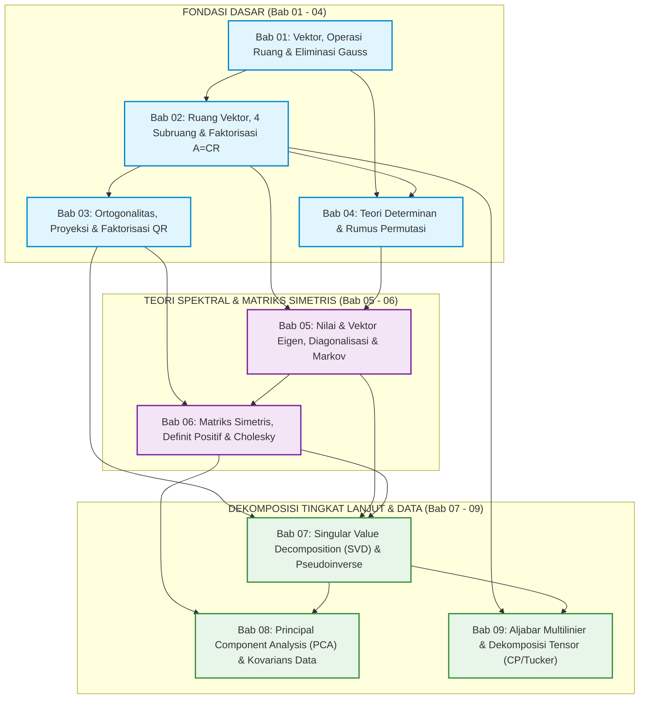
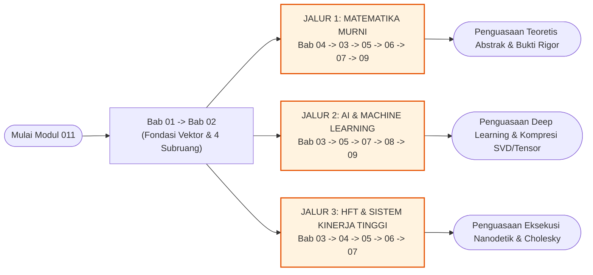

# Modul 011: Aljabar Linier & Teori Matriks — Buku Teks & Peta Silabus Modular

**Navigasi**: [⬅️ Kembali ke Modul Utama (Master Gateway)](../011-aljabar-linier-teori-matriks.md) | [⬅️ Tingkat 1: Fondasi Matematika](../README.md) | [Master Index](../../../INDEX.md)

---

## 1. Visi Pedagogis & Ikhtisar Kurikulum Modular

Selamat datang di **Buku Teks Modular Aljabar Linier & Teori Matriks (Modul 011)**. Direktori ini menyajikan rekonstruksi kurikulum standar emas (*gold standard*) yang dirancang untuk membawa seorang pembelajar dari **titik nol mutlak (*zero prior knowledge*)** menuju penguasaan matematis dan rekayasa komputasi setingkat universitas riset papan atas dan industri rekayasa perangkat lunak berkinerja tinggi.

Cakupan materi di dalam modul ini dirancang setara atau melampaui gabungan kurikulum:
1. **MIT 18.06: Linear Algebra** (Prof. Gilbert Strang) — Fondasi geometri ruang vektor, empat subruang fundamental, eliminasi, ortogonalitas, dan nilai eigen.
2. **MIT 18.065: Linear Algebra and Learning from Data** (Prof. Gilbert Strang) — Aljabar linier terapan untuk data raksasa, dekomposisi nilai singular (SVD), Teorema Eckart-Young, dan pembelajaran mesin.
3. **Introduction to Linear Algebra (5th & 6th Editions, 2023)** (Gilbert Strang) — Paradigma modern *column-first linear algebra*, faktorisasi $A = CR$, dan proyeksi kuadrat terkecil.
4. **Aljabar Multilinier & Teori Dekomposisi Tensor** (Tamara G. Kolda & Brett W. Bader, *SIAM Review* 2009; Lieven De Lathauwer et al., 2000) — Perluasan matriks 2D ke tensor berdimensi $N \ge 3$, matrisasi mode-$n$, dekomposisi CP (*CANDECOMP/PARAFAC*), dan dekomposisi Tucker (*Higher-Order SVD*).

### Standar Kualitas 7-Elemen pada Setiap Bab Subtopik
Setiap bab subtopik di dalam direktori ini (dari Bab 01 hingga Bab 09) secara ketat memuat 7 elemen inti tanpa kompromi:
- **Elemen 1 — Intuisi Dasar dari Nol**: Analogi visual, geometris, dan fisis yang konkret tanpa jargon abstrak awal.
- **Elemen 2 — Definisi Formal & Pembuktian Lengkap**: Formulasi aksiomatik presisi dengan penurunan matematika analitis langkah-demi-langkah tanpa ada langkah aljabar yang dilewati (*no skipped steps*).
- **Elemen 3 — Contoh Hitungan Manual**: Soal latihan dengan angka numerik riil konkret yang dihitung per tahap aritmatika parsial dan diverifikasi kembali ke sistem awal.
- **Elemen 4 — Kode Komputasi Industri**: Implementasi Python (NumPy/SciPy/TensorLy) berstandar produksi dengan *type annotations*, *docstrings*, penanganan asersi defensif, dan pencantuman keluaran eksekusi eksak.
- **Elemen 5 — Miskonsepsi & Bedah Kasus Industri**: Analisis kesalahan konseptual mendasar serta bedah post-mortem kegagalan rekayasa bersejarah dunia nyata yang terdokumentasi.
- **Elemen 6 — Latihan Berjenjang Mandiri**: Soal berjenjang (*Pemula / Tingkat 1*, *Menengah / Tingkat 2*, *Mahir / Tingkat 3*) yang dilengkapi petunjuk perancangan arsitektur, vektor uji ekstrem, kunci jawaban komprehensif, dan rubrik penilaian mandiri.
- **Elemen 7 — Tautan Belajar Standar Emas**: Tautan dalam (*deep links*) langsung ke rekaman kuliah resmi (MIT OCW, Stanford), buku teks penulis resmi, repositori makalah (arXiv), atau video penjelas terverifikasi aktif (*HTTP 200 OK*).

---

## 2. Prasyarat Belajar & Graf Ketergantungan Subtopik (DAG)

### 2.1 Tabel Prasyarat Kurikulum Internal
Meskipun modul ini membangun konsep aljabar linier dari intuisi geometris nol, pemahaman terhadap konsep-konsep fondasi berikut dari modul sebelumnya di Tingkat 1 akan mempercepat penguasaan materi:

| Modul Prasyarat | Judul Modul | Konsep Kunci yang Digunakan dalam Modul 011 |
|---|---|---|
| **Modul 006** | [Teori Himpunan & Relasi](../006-teori-himpunan-dan-relasi.md) | Relasi ekuivalensi, himpunan bagian (*subsets*), pemetaan injektif, surjektif, dan bijektif. |
| **Modul 007** | [Pencacahan, Sistem Bilangan & Aritmatika](../007-pencacahan-sistem-bilangan-aritmatika.md) | Sistem bilangan riil $\mathbb{R}$, bilangan kompleks $\mathbb{C}$, representasi biner, dan presisi IEEE 754. |
| **Modul 008** | [Teori Bilangan & Aritmatika Modular](../008-teori-bilangan-aritmatika-modular.md) | Keterbagian, modulo aritmatika, algoritma Euclid, dan grup permutasi. |
| **Modul 009** | [Aljabar Abstrak](../009-aljabar-abstrak.md) | Struktur medan skalar (*fields*) $\mathbb{F}$, grup simetris $S_n$ (digunakan pada rumus determinan Leibniz). |
| **Modul 010** | [Geometri Analitik & Trigonometri](../010-geometri-analitik-trigonometri.md) | Koordinat Kartesius 2D/3D, vektor geometri, sudut cosinus, rotasi koordinat, dan fungsi trigonometri. |

---

### 2.2 Graf Ketergantungan Subtopik (Directed Acyclic Graph)
Diagram berikut memetakan alur prasyarat logis antar ke-9 bab subtopik di dalam Modul 011:

---

## 3. Matriks Silabus Terurut Lengkap (9 Subtopik, ~60 Jam Studi)

Kurikulum ini dirancang untuk diselesaikan dalam durasi **60 jam studi mendalam** (ekuivalen dengan 1 semester mata kuliah universitas beban 4 SKS penuh).

| Bab Subtopik | Dokumen Berkas | Estimasi Waktu | Fokus Konsep, Teorema & Penurunan Kunci | Penerapan Industri & Rekayasa Komputasi | Rujukan Silabus Otoritatif |
|:---:|---|:---:|---|---|---|
| **01** | [01-vektor-eliminasi-matriks.md](./01-vektor-eliminasi-matriks.md) | **6 Jam** | - Vektor di $\mathbb{R}^n$, kombinasi linier, rentang (*span*). - Geometri $Ax=b$: *row picture* vs *column picture*. - Eliminasi Gaussian dengan matriks elementer $E_{ij}$. - *Partial Pivoting* & permutasi baris $PA=LU$. - Bukti kompleksitas eliminasi $\frac{1}{3}n^3$ flops. - Eliminasi Gauss-Jordan $[A \mid I] \to [I \mid A^{-1}]$. | Solver linier LAPACK `dgetrf`, penanganan pembagian nol pada floating point CPU, pencegahan singularitas sistem. | MIT 18.06 Kuliah 1, 2, 4, 5; Strang (6th Ed.) Bab 1 & 2. |
| **02** | [02-ruang-vektor-subruang-fundamental.md](./02-ruang-vektor-subruang-fundamental.md) | **7 Jam** | - 8 Aksioma ruang vektor & subruang aljabar. - Kebebasan linier, basis, dimensi ruang, dan rank $r$. - Bentuk eselon baris tereduksi (RREF) $R = \text{rref}(A)$. - **Empat Subruang Fundamental**: $C(A), N(A), C(A^T), N(A^T)$. - Teorema Fundamental Aljabar Linier (FTLA Bagian 1 & 2). - Bukti Teorema Rank-Nullity: $r + (n-r) = n$. - **Faktorisasi Kolom-Baris Modern**: $A = CR$. | Ekstraksi fitur ortogonal, deteksi multikolinieritas fitur pada machine learning, representasi basis kompak. | MIT 18.06 Kuliah 6, 7, 8, 9, 10; Strang (6th Ed.) Bab 3. |
| **03** | [03-ortogonalitas-proyeksi-faktor-qr.md](./03-ortogonalitas-proyeksi-faktor-qr.md) | **7 Jam** | - Ortogonalitas vektor & subruang: $Q^T Q = I$. - Matriks proyeksi: $P = A(A^T A)^{-1} A^T$, sifat $P^2 = P, P^T = P$. - Penurunan Persamaan Normal Kuadrat Terkecil: $A^T A \hat{x} = A^T b$. - Ortogonalisasi Gram-Schmidt Klasik (CGS) vs Termodifikasi (MGS). - **Faktorisasi $A = QR$** via MGS & Reflektor Householder. - Solusi kuadrat terkecil stabil: $R \hat{x} = Q^T b$. | Regresi linier numerik stabil, peredaman derau Kalman filter, algoritma LAPACK `dgeqrf`, penghindaran pengkuadratan kondisi $\kappa(A)^2$. | MIT 18.06 Kuliah 14, 15, 16, 17; MIT 18.065 Bagian II. |
| **04** | [04-determinan-teori-matriks.md](./04-determinan-teori-matriks.md) | **6 Jam** | - 3 Aksioma esensial determinan & 7 sifat turunan. - Rumus eliminasi pivot: $\det(A) = (-1)^s \prod d_i$. - Rumus permutasi Leibniz lengkap atas $n!$ elemen $S_n$. - Ekspansi Kofaktor Laplace baris/kolom sembarang. - Rumus invers aljabar via matriks adjugat: $A^{-1} = \frac{1}{\det(A)} C^T$. - Aturan Cramer dan kelemahan asimtotiknya ($O(n!)$). - Geometri volume kotak hiperdimensi & orientasi koordinat. | Transformasi koordinat Jacobian kalkulus multivariabel, deteksi singularitas analitik, grafika komputer 3D. | MIT 18.06 Kuliah 18, 19, 20; Strang (5th Ed.) Bab 5. |
| **05** | [05-nilai-vektor-eigen-diagonalisasi.md](./05-nilai-vektor-eigen-diagonalisasi.md) | **8 Jam** | - Geometri nilai & vektor eigen: $Av = \lambda v$. - Polinomial karakteristik $\det(A - \lambda I) = 0$. - Multiplicitas aljabar ($AM$) vs geometris ($GM$); matriks cacat. - **Teorema Diagonalisasi**: $A = X \Lambda X^{-1}$. - Pangkat matriks $A^k = X \Lambda^k X^{-1}$ (deret Fibonacci). - Persamaan diferensial linier $\dot{u} = Au$ & eksponensial matriks $e^{At}$. - Matriks Markov & Teorema Perron-Frobenius (PageRank). | Algoritma Google PageRank, simulasi sistem dinamik kontinu, pemodelan getaran mekanika struktur, graf spektral. | MIT 18.06 Kuliah 21, 22, 23, 24; Strang (6th Ed.) Bab 6. |
| **06** | [06-matriks-simetris-definit-positif.md](./06-matriks-simetris-definit-positif.md) | **7 Jam** | - Sifat simetris $S = S^T$: seluruh $\lambda_i \in \mathbb{R}$, vektor eigen ortonormal. - **Teorema Spektral**: $S = Q \Lambda Q^T = \sum \lambda_i q_i q_i^T$. - Bentuk kuadratik $f(x) = x^T A x$ & Rasio Rayleigh. - **5 Tes Ekuivalen Matriks Definit Positif** ($A \succ 0$): eigenvalue, energi, pivot, kriteria minor utama Sylvester, $A = R^T R$. - **Dekomposisi Cholesky**: $A = L L^T$ (biaya $\frac{1}{6}n^3$ flops). - Geometri elipsoid energi & sumbu utama $1/\sqrt{\lambda_i}$. | Optimasi konveks kuadratik, estimasi kovarians portofolio HFT, penentuan kurvatur Hessian (Newton-Raphson), LAPACK `dpotrf`. | MIT 18.06 Kuliah 25, 27; MIT 18.065 Bagian I & VI. |
| **07** | [07-svd-dan-pseudoinverse.md](./07-svd-dan-pseudoinverse.md) | **8 Jam** | - **Singular Value Decomposition (SVD)** universal: $A = U \Sigma V^T$. - Geometri pemetaan bola satuan ke hiper-elipsoid. - Hubungan spektral: $v_i \in \text{eig}(A^T A)$, $u_i \in \text{eig}(A A^T)$, $\sigma_i = \sqrt{\lambda_i}$. - **Teorema Eckart-Young-Mirsky**: bukti aproksimasi low-rank optimal $\|A - A_k\|_F = \sqrt{\sum_{j=k+1}^r \sigma_j^2}$. - **Moore-Penrose Pseudoinverse**: $A^+ = V \Sigma^+ U^T$ & 4 aksioma Penrose. - Solusi kuadrat terkecil norma minimum $x^+ = A^+ b$. - Bilangan kondisi matriks $\kappa(A) = \sigma_{\max} / \sigma_{\min}$. | Kompresi citra digital, reduksi kebisingan sinyal, solusi sistem over/under-determined, regularisasi pemangkasan rank SVD. | MIT 18.06 Kuliah 29; MIT 18.065 Kuliah 6, 7, 11; Golub & Van Loan. |
| **08** | [08-pca-analisis-komponen-utama.md](./08-pca-analisis-komponen-utama.md) | **5 Jam** | - Matriks data terpusat $X_c = X - \mathbf{1}\mu^T$. - Matriks Kovarians Sampel: $S = \frac{1}{n-1} X_c^T X_c$. - Dua sudut penurunan formal: maksimasi varians proyeksi (Pengali Lagrange) vs minimasi galat rekonstruksi. - Ekuivalensi matematis PCA dengan SVD data terpusat: $S = \frac{1}{n-1} V \Sigma^2 V^T$. - Skor Komponen Utama $Z = X_c V = U \Sigma$. - Proporsi Varians Terjelaskan (*Explained Variance Ratio*) & *Scree Plot*. | Reduksi dimensi fitur data sains, visualisasi data multidimensi, deteksi anomali fraud, pra-pemrosesan data deep learning. | MIT 18.065 Kuliah 28; Jonathon Shlens (2014); Strang (2019) Bab V. |
| **09** | [09-aljabar-multilinier-dekomposisi-tensor.md](./09-aljabar-multilinier-dekomposisi-tensor.md) | **6 Jam** | - Definisi formal tensor orde-$N$ berwujud array multidimensi $\boldsymbol{\mathcal{X}} \in \mathbb{R}^{I_1 \times \dots \times I_N}$. - Serat (*fibers*), irisan (*slices*), norma Frobenius tensor. - Matrisasi / Unfolding Mode-$n$ ($X_{(n)}$) & Produk Mode-$n$ ($\boldsymbol{\mathcal{X}} \times_n U$). - **Dekomposisi CANDECOMP/PARAFAC (CP)**: $[\![\boldsymbol{\lambda}; A, B, C]\!]$, algoritma ALS via produk Khatri-Rao $C \odot B$, kondisi keunikan Kruskal. - **Dekomposisi Tucker & Higher-Order SVD (HOSVD)**: $\boldsymbol{\mathcal{X}} \approx \boldsymbol{\mathcal{G}} \times_1 U^{(1)} \times_2 U^{(2)} \times_3 U^{(3)}$. - Algoritma HOOI (*Higher-Order Orthogonal Iteration*). - Paradoks rank tensor: masalah NP-hard (Håstad) & fenomena *swamping*. | Kompresi jaringan saraf mendalam (Tensor Train / CP), faktorisasi data multi-aspek multimodal, pemrosesan sinyal sensor multi-array. | Kolda & Bader (SIAM Review 2009); De Lathauwer et al. (2000); Dokumentasi TensorLy. |
| **TOTAL** | **9 Subtopik Lengkap** | **60 Jam** | **Seluruh Silabus Inti & Lanjutan Aljabar Linier Terapan Dunia** | **Kesiapan Penuh untuk AI, HFT, Robotika & Riset Teoretis** | **Standar Emas Global** |

---

## 4. Jalur Pembelajaran Berbasis Peran Rekayasa (Role-Based Pathways)

Untuk memaksimalkan efisiensi belajar sesuai dengan target karir spesifik Anda, berikut adalah rekomendasi jalur navigasi modul:

### Jalur 1: Matematika Murni & Fondasi Teoretis (*Pure Mathematics & Theoretical Foundations*)
- **Sasaran Kompetensi**: Memahami struktur aljabar secara aksiomatik, membuktikan seluruh teorema linear tanpa langkah yang melompat, memahami interaksi ruang Hilbert dan Banach, serta menguasai aljabar multilinier tingkat lanjut.
- **Urutan Bab yang Disarankan**:
  1. `01-vektor-eliminasi-matriks.md` (Fondasi kombinasi linier dan sifat eliminasi).
  2. `02-ruang-vektor-subruang-fundamental.md` (Aksioma ruang, pembuktian FTLA 1 & 2 Strang, basis).
  3. `04-determinan-teori-matriks.md` (Aksioma determinan, grup permutasi Leibniz, dan sifat multilinier alternating form).
  4. `03-ortogonalitas-proyeksi-faktor-qr.md` (Proyeksi ortogonal, subruang komplementer, dekomposisi QR).
  5. `05-nilai-vektor-eigen-diagonalisasi.md` (Persamaan karakteristik, ruang eigen, Teorema Perron-Frobenius).
  6. `06-matriks-simetris-definit-positif.md` (Pembuktian Teorema Spektral matriks simetris riil, bentuk kuadratik).
  7. `07-svd-dan-pseudoinverse.md` (Geometri elipsoid, pembuktian analitis Teorema Eckart-Young-Mirsky).
  8. `09-aljabar-multilinier-dekomposisi-tensor.md` (Produk tensor, kondisi keunikan Kruskal, paradoks ketakberhinggaan rank tensor).

---

### Jalur 2: Rekayasa AI, Machine Learning & Deep Learning Systems
- **Sasaran Kompetensi**: Menguasai matematika di balik optimasi model bahasa besar (LLM), pemampatan bobot jaringan saraf (LoRA/SVD), reduksi dimensi fitur berdimensi tinggi, representasi laten multi-head attention, dan operasi tensor multidimensi.
- **Urutan Bab yang Disarankan**:
  1. `01-vektor-eliminasi-matriks.md` (Pandangan kolom pada perkalian matriks bobot-aktivasi).
  2. `02-ruang-vektor-subruang-fundamental.md` (Ruang representasi laten, dimensi manifold data, faktorisasi $A=CR$).
  3. `03-ortogonalitas-proyeksi-faktor-qr.md` (Regresi kuadrat terkecil, proyeksi residual loss function).
  4. `05-nilai-vektor-eigen-diagonalisasi.md` (Spektrum graf, propagasi representasi Markov, kestabilan gradien).
  5. `07-svd-dan-pseudoinverse.md` (Aproksimasi low-rank bobot model, kompresi KV-cache, Moore-Penrose pseudo-inversion).
  6. `08-pca-analisis-komponen-utama.md` (Matriks kovarians data, proyeksi varians maksimum, Scree plot).
  7. `09-aljabar-multilinier-dekomposisi-tensor.md` (Dekomposisi CP dan Tucker pada representasi tensor multi-aspek multimodal).

---

### Jalur 3: Rekayasa Sistem Berperforma Tinggi & Finansial Kuantitatif (Systems & HFT)
- **Sasaran Kompetensi**: Memahami representasi memori matriks padat/renggang, interaksi cache hierarchy CPU L1/L2/L3 pada operasi BLAS Level 3 GEMM, faktorisasi kovarians portofolio aset ultra-cepat, stabilitas numerik floating point, dan eliminasi pembatalan katastropik.
- **Urutan Bab yang Disarankan**:
  1. `01-vektor-eliminasi-matriks.md` (Eliminasi Gaussian, *partial pivoting*, memori layout baris vs kolom).
  2. `02-ruang-vektor-subruang-fundamental.md` (Deteksi redundansi instrumen finansial via ruang null).
  3. `03-ortogonalitas-proyeksi-faktor-qr.md` (Stabilitas Modified Gram-Schmidt vs Householder reflection pada data harga).
  4. `04-determinan-teori-matriks.md` (Komputasi determinan via eliminasi LU $O(n^3)$ alih-alih ekspansi kofaktor rekursif $O(n!)$).
  5. `05-nilai-vektor-eigen-diagonalisasi.md` (Rantai Markov probabilitas transisi orderbook, estimasi spread harga).
  6. `06-matriks-simetris-definit-positif.md` (Dekomposisi Cholesky $LL^T$ untuk simulasi Monte Carlo korelasi aset finansial).
  7. `07-svd-dan-pseudoinverse.md` (Bilangan kondisi $\kappa(A)$, pencegahan instabilitas inversi filter Kalman).

---

## 5. Standar Komputasi, Perangkat Lunak & Pedoman Numerik

Seluruh kode komputasi di dalam modul ini ditulis dengan mematuhi prinsip rekayasa perangkat lunak modern:
1. **Bahasa Pemrograman & Lingkungan**:
   - Python 3.10+ dengan memanfaatkan pustaka standar numerik: **NumPy**, **SciPy** (`scipy.linalg`), dan pustaka komputasi aljabar multilinier **TensorLy**.
   - Penulisan fungsi wajib menyertakan *type hints* lengkap (`np.ndarray`, `Tuple`, `float`, `int`).
2. **Kebijakan Mutlak Pencegahan Inversi Eksplisit (Anti-Explicit Inversion Policy)**:
   - Dilarang keras menggunakan `np.linalg.inv(A) @ b` untuk memecahkan sistem linier $Ax=b$.
   - Wajib menggunakan `np.linalg.solve(A, b)` (berbasis faktorisasi LU/LAPACK) atau substitusi balik QR/Cholesky.
3. **Pemeriksaan Bilangan Kondisi (*Condition Number Guard*)**:
   - Setiap operasi yang melibatkan sistem linier atau pseudoinverse wajib mengevaluasi $\kappa(A) = \sigma_{\max} / \sigma_{\min}$. Jika $\kappa(A) > 10^8$, sistem harus mengeluarkan peringatan bahwa galat presisi mesin floating point (IEEE 754 float64 $\epsilon \approx 2.22 \times 10^{-16}$) dapat teramplifikasi secara signifikan.
4. **Reproduksibilitas Deterministik**:
   - Seluruh angka yang tercantum pada tabel *trace*, matriks hasil faktorisasi, dan nilai singular dihitung secara deterministik dan telah diverifikasi menggunakan skrip Python internal tanpa angka karangan manual.

---

## 6. Rujukan Otoritatif & Sumber Belajar Eksternal Terverifikasi

Seluruh materi modular dalam direktori ini dikembangkan berdasarkan literatur akademis dan kuliah terbuka standar emas dunia yang dapat diakses secara legal dan gratis:
1. 🎓 **MIT OpenCourseWare 18.06**: [Gilbert Strang: The Geometry of Linear Equations (MIT OCW)](https://ocw.mit.edu/courses/18-06-linear-algebra-spring-2010/resources/lecture-1-the-geometry-of-linear-equations/)
2. 🎓 **MIT OpenCourseWare 18.065**: [Gilbert Strang: Matrix Methods in Data Analysis and Learning from Data (MIT OCW)](https://ocw.mit.edu/courses/18-065-matrix-methods-in-data-analysis-signal-processing-and-machine-learning-spring-2018/resources/lecture-1-the-column-space-of-a-contains-all-vectors-ax/)
3. 🔬 **Google Research / arXiv**: [Jonathon Shlens: A Tutorial on Principal Component Analysis](https://arxiv.org/abs/1404.1100)
4. 📺 **3Blue1Brown Series**: [Grant Sanderson: Essence of Linear Algebra Interactive Visualizations](https://www.youtube.com/playlist?list=PLZHQObOWTQDPD3MizzM2xVFitgF8hE_ab)

---

## 7. Indeks Pranala Navigasi Subtopik

Berikut adalah tautan langsung untuk memulai pembelajaran pada masing-masing bab:

- 📖 **Bab 01**: [Vektor, Operasi Ruang, Ax=b, Eliminasi Gauss, LU & PA=LU](./01-vektor-eliminasi-matriks.md)
- 📖 **Bab 02**: [Ruang Vektor, Basis, Dimensi, 4 Subruang Fundamental, FTLA & Faktorisasi A=CR](./02-ruang-vektor-subruang-fundamental.md)
- 📖 **Bab 03**: [Ortogonalitas, Proyeksi Subruang, Least Squares, Gram-Schmidt MGS & QR](./03-ortogonalitas-proyeksi-faktor-qr.md)
- 📖 **Bab 04**: [Aksioma Determinan, Rumus Permutasi Leibniz, Kofaktor Laplace, Cramer & Volume](./04-determinan-teori-matriks.md)
- 📖 **Bab 05**: [Nilai & Vektor Eigen, Polinomial Karakteristik, Diagonalisasi, Pangkat Ak & Rantai Markov](./05-nilai-vektor-eigen-diagonalisasi.md)
- 📖 **Bab 06**: [Matriks Simetris, Teorema Spektral, Bentuk Kuadratik, Definit Positif & Cholesky](./06-matriks-simetris-definit-positif.md)
- 📖 **Bab 07**: [Singular Value Decomposition (SVD), Teorema Eckart-Young & Moore-Penrose Pseudoinverse](./07-svd-dan-pseudoinverse.md)
- 📖 **Bab 08**: [Principal Component Analysis (PCA), Matriks Kovarians & Reduksi Dimensi Data](./08-pca-analisis-komponen-utama.md)
- 📖 **Bab 09**: [Aljabar Multilinier, Tensor N-Arah, Matrisasi, Dekomposisi CP & Tucker (HOSVD)](./09-aljabar-multilinier-dekomposisi-tensor.md)

---

*Navigasi Cepat*: [⬅️ Kembali ke Modul Utama (Master Gateway)](../011-aljabar-linier-teori-matriks.md) | [⬅️ Tingkat 1: Fondasi Matematika](../README.md) | [Master Index](../../../INDEX.md)
