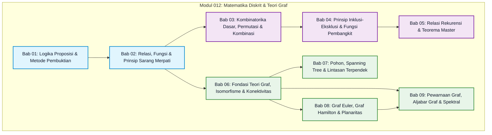
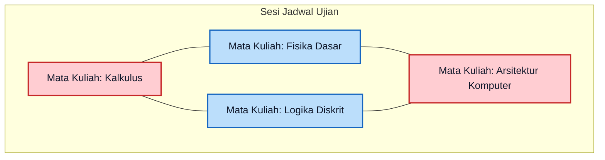
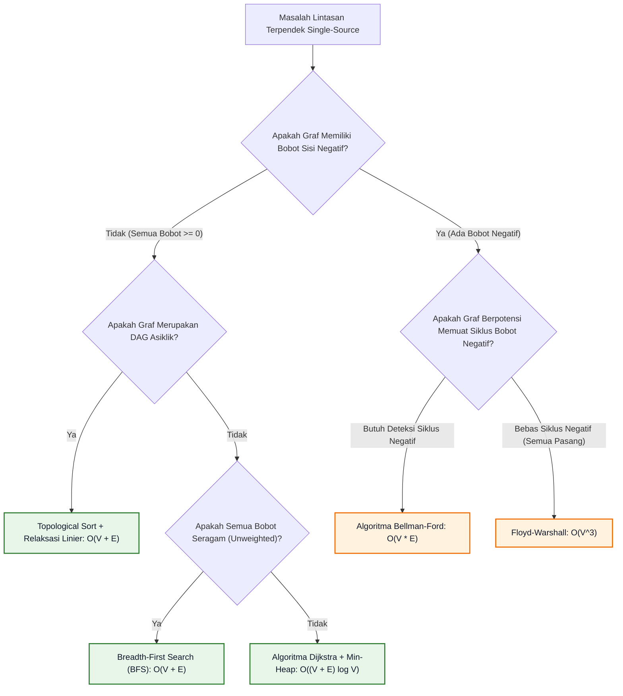

# Modul 012: Matematika Diskrit, Kombinatorika & Teori Graf (Permutasi, Rekurensi, Pewarnaan Graf)

**Navigasi**: [Master Index](../../INDEX.md) | [Tingkat 1: Fondasi Matematika Komprehensif Dari Nol](./README.md)
*Sebelumnya*: [011. Aljabar Linier & Teori Matriks](./011-aljabar-linier-teori-matriks.md) | *Berikutnya*: [013. Kalkulus Diferensial & Integral Satu Variabel](./013-kalkulus-diferensial-integral-satu-variabel.md)

---

## 1. Intuisi Dasar Tanpa Jargon ("Seperti Bayi Baru Lahir")

### 1.1 Konsep Inti: Dari Perhitungan Diskrit ke Struktur Jaringan Dunia Nyata
Bagaimana aplikasi navigasi Google Maps dapat menemukan rute tercepat melintasi jutaan persimpangan jalan raya hanya dalam waktu 0,05 detik? Bagaimana sebuah sistem penjadwal otomatis di universitas dapat menyusun jadwal ujian bagi 20.000 mahasiswa tanpa ada satu pun mahasiswa yang jadwal ujiannya bertabrakan pada jam yang sama? Dan bagaimana sebuah kompiler bahasa pemrograman (seperti LLVM, GCC, atau Rustc) dapat memetakan ratusan variabel program komputer ke dalam segelintir register fisik prosesor berkecepatan tinggi tanpa membuat sistem mogok?

Seluruh keajaiban komputasi di atas **bukanlah hasil dari kalkulus diferensial kontinu**, melainkan dibangun di atas fondasi kokoh **Matematika Diskrit, Kombinatorika, dan Teori Graf**.

Bayangkan Anda adalah bayi yang baru belajar mengamati perbedaan fundamental dunia fisik:
1. **Dunia Kontinu vs Dunia Diskrit**:
   - Air yang mengalir dari keran wastafel mengalir secara mulus dan tidak terputus (kontinu). Kita mengukurnya dengan desimal: 1,5 liter, 1,5001 liter, dan seterusnya. Ini adalah ranah **Kalkulus**.
   - Sebaliknya, butiran kelereng di dalam toples, jumlah anak tangga yang Anda panjat, saklar lampu kamar (hanya ada kondisi *Menyala* atau *Mati*), atau bit data biner (hanya ada angka *0* atau *1*) adalah objek-objek terpisah yang dapat dihitung satu demi satu tanpa nilai perantara. Ini adalah ranah **Matematika Diskrit**.
2. **Kombinatorika (Seni Menghitung Cerdas Tanpa Mencacah Manual)**:
   Jika Anda memiliki 10 buah buku dan ingin menyusun 3 buku di atas meja, Anda tidak perlu mencoba menyusunnya satu per satu secara fisik hingga kelelahan. Rumus permutasi memberi tahu Anda dalam sekejap bahwa ada tepat $P(10, 3) = 720$ cara penyusunan!
3. **Teori Graf (Peta Hubungan Titik dan Garis)**:
   Di atas peta, bentuk lekukan tanah tidak penting. Yang penting adalah: *"Titik A terhubung langsung ke Titik B melalui jalan apa?"*. Kumpulan titik lokasi dinamakan **Simpul (*Vertices / Nodes*)**, dan garis penghubungnya dinamakan **Sisi (*Edges*)**. Begitu sebuah masalah dunia nyata diubah menjadi graf, kita dapat menggunakan algoritma matematika yang telah teruji ratusan tahun untuk menemukan solusi optimal secara instan!

---

### 1.2 Peta Silabus Modular: 9 Bab Pembelajaran Terpadu Modul 012

Kurikulum Modul 012 telah dibangun secara modular menjadi 9 bab subtopik mandiri dengan metodologi perancah kognitif *Zero-to-Hero*:



1. **[Bab 01: Logika Proposisi, Predikat, dan Metode Pembuktian Matematis](./012-matematika-diskrit-kombinatorika-graf/01-logika-proposisi-predikat-metode-pembuktian.md)**: Fondasi berpikir kritis matematika, aljabar Boolean, hukum De Morgan, kuantor universal ($\forall$) dan eksistensial ($\exists$), serta 4 metode pembuktian formal (pembuktian langsung, kontraposisi, kontradiksi, dan induksi matematika).
2. **[Bab 02: Relasi, Fungsi, Partisi Himpunan, dan Prinsip Sarang Merpati](./012-matematika-diskrit-kombinatorika-graf/02-relasi-fungsi-rekurensi-tata-urutan.md)**: Empat sifat relasi biner (refleksif, simetris, transitif, antisimetris), relasi ekuivalensi, himpunan terurut parsial (Poset), Diagram Hasse, Algoritma Topological Sort, dan Prinsip Sarang Merpati (*Pigeonhole Principle*).
3. **[Bab 03: Kombinatorika Dasar, Permutasi, Kombinasi, dan Teorema Binomial](./012-matematika-diskrit-kombinatorika-graf/03-kombinatorika-permutasi-kombinasi-partisi.md)**: Kaidah dasar pencacahan (aturan penjumlahan & perkalian), permutasi $P(n, k)$, kombinasi $C(n, k)$, pembagian objek identik *Stars and Bars*, Teorema Binomial Newton, Segitiga Pascal, dan Identitas Konvolusi Vandermonde.
4. **[Bab 04: Prinsip Inklusi-Eksklusi, Derangement, dan Fungsi Pembangkit](./012-matematika-diskrit-kombinatorika-graf/04-prinsip-inklusi-eksklusi-fungsi-pembangkit.md)**: Menghitung gabungan himpunan dengan irisan alternasi (PIE), derangement permutasi tanpa titik tetap ($!n$), rasio konvergensi Euler $1/e$, Fungsi Pembangkit Biasa (*Ordinary Generating Functions / OGF*), dan Bilangan Stirling Jenis Kedua.
5. **[Bab 05: Relasi Rekurensi, Persamaan Beda, dan Teorema Master](./012-matematika-diskrit-kombinatorika-graf/05-relasi-rekurensi-persamaan-beda-divide-conquer.md)**: Relasi rekurensi linier homogen berkoefisien konstan, akar karakteristik, penurunan rumus tertutup Binet Fibonacci, Teorema Master (*Divide and Conquer*), dan komputasi eksponensiasi matriks $O(\log n)$.
6. **[Bab 06: Fondasi Teori Graf, Isomorfisme, dan Konektivitas](./012-matematika-diskrit-kombinatorika-graf/06-fondasi-teori-graf-isomorfisme-konektivitas.md)**: Definisi formal graf $G=(V, E)$, Teorema Handshaking Lemma Euler, Isomorfisme graf, representasi matriks ketetanggaan & CSR, Teorema Havel-Hakimi, dan Algoritma Tarjan untuk Komponen Terhubung Kuat (SCC) dalam waktu linier $O(V + E)$.
7. **[Bab 07: Pohon, Spanning Tree, dan Lintasan Terpendek](./012-matematika-diskrit-kombinatorika-graf/07-pohon-spanning-tree-lintasan-terpendek.md)**: Enam karakterisasi ekuivalen pohon, Rumus Cayley $n^{n-2}$, Minimum Spanning Tree (MST), Algoritma Kruskal dengan Disjoint Set Union (DSU), Algoritma Prim, Algoritma Dijkstra, dan deteksi siklus negatif Bellman-Ford.
8. **[Bab 08: Graf Euler, Graf Hamilton, dan Planaritas](./012-matematika-diskrit-kombinatorika-graf/08-graf-euler-hamilton-planaritas.md)**: Masalah 7 Jembatan Königsberg, Sirkuit Euler, Algoritma Hierholzer $O(E)$, Siklus Hamilton, Teorema Kecukupan Dirac & Ore, Graf Planar, Rumus Polihedron Euler $V - E + F = 2$, ketaksamaan sisi $E \le 3V - 6$, dan Teorema Kuratowski ($K_5, K_{3,3}$).
9. **[Bab 09: Pewarnaan Graf, Aljabar Graf, dan Analisis Spektral](./012-matematika-diskrit-kombinatorika-graf/09-pewarnaan-graf-aljabar-graf-spektral.md)**: Pewarnaan simpul sah, bilangan kromatik $\chi(G)$, Teorema Empat Warna, heuristik DSATUR, Matriks Laplacian Kombinatorial $L = D - A$, Konektivitas Aljabar Fiedler $\lambda_2$, partisi spektral (*Spectral Clustering*), dan Teorema Matriks Pohon Kirchhoff.

---

### 1.3 Urgensi Rekayasa & Signifikansi Sistemik
Dalam arsitektur perangkat lunak modern, penguasaan matematika diskrit memisahkan *coder* biasa yang hanya bisa merakit pustaka dari seorang *Principal Architect* yang mampu:
- Merancang algoritma optimasi rute terdistribusi yang tahan banting terhadap *bottleneck* latensi jaringan.
- Membuktikan secara matematis bahwa sebuah protokol konsensus (seperti Paxos atau Raft) bebas dari kondisi *race condition* atau *deadlock* menggunakan induksi matematika dan *poset*.
- Meminimalkan biaya komputasi server cloud hingga miliaran rupiah dengan memilih struktur data graf dan teknik pencacahan kombinatorial yang efisien.

---

### 1.4 Kamus Notasi Simbol Diskrit Anti-Pusing

Bagi pemula yang baru memulai dari nol mutlak, simbol-simbol matematika diskrit sering tampak seperti tulisan hieroglif kuno yang membingungkan. Tabel berikut adalah kamus referensi cepat untuk menerjemahkan setiap simbol formal ke bahasa manusia sehari-hari:

| Simbol Formal | Nama Simbol | Terjemahan Bahasa Manusia Sederhana | Analogi Dunia Nyata |
|---|---|---|---|
| $\forall x$ | Kuantor Universal | "Untuk semua $x$" / "Untuk setiap $x$ tanpa kecuali" | "Semua mobil di jalan wajib memiliki rem" |
| $\exists x$ | Kuantor Eksistensial | "Ada minimal satu $x$" / "Terdapat setidaknya satu $x$" | "Ada minimal satu kunci yang cocok membuka gembok ini" |
| $\neg p$ | Negasi Logika | "Tidak benar bahwa $p$" / "Kebalikan dari $p$" | Saklar lampu dibalik dari Nyala menjadi Mati |
| $p \land q$ | Konjungsi (AND) | "$p$ dan $q$ keduanya wajib benar sekaligus" | Pintu brankas yang butuh PIN AND sidik jari |
| $p \lor q$ | Disjungsi (OR) | "Salah satu atau keduanya bernilai benar" | Membayar belanjaan dengan uang tunai OR kartu kredit |
| $p \oplus q$ | Disjungsi Eksklusif (XOR) | "Tepat salah satu benar, tapi tidak boleh keduanya" | Menu makan siang: gratis Teh ATAU Kopi (pilih salah satu) |
| $p \implies q$ | Implikasi | "Jika $p$ terjadi, maka $q$ pasti terjadi" | "Jika turun hujan lebat, maka jalanan basah" |
| $p \iff q$ | Biimplikasi | "$p$ benar jika dan hanya jika $q$ benar" | "Segitiga sama sisi JIKA DAN HANYA JIKA ketiga sudutnya 60°" |
| $\binom{n}{k}$ | Kombinasi Binomial | "Banyak cara memilih $k$ benda dari $n$ benda tanpa urutan" | Memilih 3 topping pizza dari 10 pilihan yang tersedia |
| $P(n, k)$ | Permutasi | "Banyak cara memilih dan mengurutkan $k$ benda dari $n$ benda" | Memilih juara 1, juara 2, dan juara 3 lomba lari |
| $!n$ | Subfaktorial / Derangement | "Banyak cara mengacak $n$ benda sehingga tak ada yang di posisi asli" | Acara tukar kado di mana tak ada orang yang menerima kado miliknya sendiri |
| $\deg(v)$ | Derajat Simpul | "Jumlah garis / jalan yang terhubung langsung ke titik $v$" | Jumlah jalan keluar-masuk pada sebuah persimpangan bundaran |
| $\chi(G)$ | Bilangan Kromatik | "Jumlah warna paling sedikit untuk mewarnai titik tanpa tabrakan" | Jumlah gelombang radio minimal agar stasiun berdekatan tak saling mengganggu |
| $\omega(G)$ | Ukuran Klik Maksimum | "Jumlah anggota kelompok terbesar yang semuanya saling kenal" | Geng pertemanan terbesar di mana semua anggotanya berteman satu sama lain |
| $L = D - A$ | Matriks Laplacian | "Matriks derajat dikurangi matriks hubungan tetangga" | Jaringan pipa air yang merekam beda tekanan antar tangki |
| $\lambda_2(L)$ | Nilai Eigen Fiedler | "Kekuatan sambungan jaringan (konektivitas aljabar)" | Ketahanan jembatan internet: jika $\lambda_2$ besar, jaringan sangat kokoh |

---

## 2. Fondasi Teoretis & Aksiomatik / Matematis

### 2.1 Kerangka Teori Aksiomatik Sembilan Pilar Diskrit

#### 1. Logika Proposisi & Deduksi Formal
Sebuah proposisi $p$ memiliki nilai kebenaran mutlak $\tau(p) \in \{0, 1\}$.
- **Hukum De Morgan**:
  $$\neg(p \land q) \equiv \neg p \lor \neg q, \quad \neg(p \lor q) \equiv \neg p \land \neg q$$
- **Hukum Kontraposisi & Modus Ponens**:
  $$(p \implies q) \equiv (\neg q \implies \neg p), \quad \frac{p, \; p \implies q}{\therefore q}$$

#### 2. Relasi Biner, Poset & Prinsip Sarang Merpati
Sebuah relasi biner $R \subseteq A \times A$ disebut relasi pengurutan parsial (*Partial Order / Poset*) jika dan hanya jika memenuhi tiga aksioma:
1. **Refleksif**: $\forall a \in A, \; (a, a) \in R$.
2. **Antisimetris**: $\forall a, b \in A, \; ((a, b) \in R \land (b, a) \in R) \implies a = b$.
3. **Transitif**: $\forall a, b, c \in A, \; ((a, b) \in R \land (b, c) \in R) \implies (a, c) \in R$.
- **Prinsip Sarang Merpati Tergeneralisasi**: Jika $n$ objek dimasukkan ke dalam $k$ kotak, maka setidaknya ada satu kotak yang memuat minimal $\lceil n/k \rceil$ objek.

#### 3. Kombinatorika Klasik & Stars and Bars
- Permutasi $k$ objek dari $n$ objek berurutan:
  $$P(n, k) = \frac{n!}{(n - k)!}$$
- Kombinasi $k$ objek dari $n$ objek tanpa memperhatikan urutan:
  $$\binom{n}{k} = \frac{n!}{k!(n - k)!}$$
- Teorema Stars and Bars (Pembagian $n$ objek identik ke dalam $k$ wadah berbeda):
  $$\binom{n + k - 1}{k - 1}$$

#### 4. Teorema Inklusi-Eksklusi (PIE) & Derangement
- Prinsip Inklusi-Eksklusi untuk $n$ himpunan berhingga:
  $$\left| \bigcup_{i=1}^n A_i \right| = \sum_{k=1}^n (-1)^{k-1} \sum_{1 \le i_1 < \dots < i_k \le n} |A_{i_1} \cap \dots \cap A_{i_k}|$$
- Derangement (Subfaktorial): Banyaknya permutasi tanpa titik tetap ($\pi(i) \neq i$ untuk setiap $i$):
  $$!n = n! \sum_{k=0}^n \frac{(-1)^k}{k!} = \left\lfloor \frac{n!}{e} + \frac{1}{2} \right\rfloor$$

#### 5. Relasi Rekurensi & Teorema Master
Persamaan beda linier homogen orde-$k$ dengan koefisien konstan:
$$a_n + c_1 a_{n-1} + c_2 a_{n-2} + \dots + c_k a_{n-k} = 0$$
Memiliki persamaan karakteristik polinomial:
$$r^k + c_1 r^{k-1} + \dots + c_k = 0$$
Jika semua akar $r_1, \dots, r_k$ berbeda, solusi umumnya adalah kombinasi linier $a_n = \sum_{i=1}^k \alpha_i r_i^n$.
- **Teorema Master** untuk relasi rekurensi divide-and-conquer $T(n) = a T(n/b) + O(n^d)$:
  $$T(n) = \begin{cases} O(n^{\log_b a}) & \text{jika } d < \log_b a \\ O(n^d \log n) & \text{jika } d = \log_b a \\ O(n^d) & \text{jika } d > \log_b a \end{cases}$$

#### 6. Teori Graf & Handshaking Lemma Euler
Graf $G = (V, E)$ terdiri dari himpunan simpul $V$ dan sisi $E$.
- **Handshaking Lemma**:
  $$\sum_{v \in V} \deg(v) = 2 |E|$$
  *Korolari*: Banyaknya simpul dengan derajat ganjil pada sembarang graf tak berarah selalu berjumlah genap.
- **Teorema Havel-Hakimi**: Urutan derajat terurut tak-naik $(d_1, d_2, \dots, d_n)$ adalah grafis jika dan hanya jika urutan $(d_2 - 1, d_3 - 1, \dots, d_{d_1 + 1} - 1, d_{d_1 + 2}, \dots, d_n)$ adalah grafis.

#### 7. Pohon & Spanning Tree
Sebuah pohon adalah graf terhubung yang tidak memuat siklus sederhana. Untuk graf dengan $n$ simpul, pernyataan-pernyataan berikut ekuivalen:
1. $G$ adalah pohon.
2. Setiap pasang simpul dihubungkan oleh tepat satu lintasan sederhana unik.
3. $G$ terhubung dan memiliki tepat $|E| = n - 1$ sisi.
4. $G$ asiklik dan memiliki tepat $|E| = n - 1$ sisi.
- **Rumus Cayley**: Banyaknya pohon merentang berlabel yang berbeda pada $n$ simpul adalah:
  $$T(n) = n^{n-2}$$

#### 8. Sirkuit Euler, Siklus Hamilton & Planaritas
- **Karakterisasi Graf Euler**: Graf terhubung memuat Sirkuit Euler $\iff \forall v \in V, \; \deg(v) \pmod 2 = 0$.
- **Teorema Dirac (Kecukupan Hamilton)**: Jika $G$ graf sederhana dengan $n \ge 3$ simpul dan $\forall v \in V, \; \deg(v) \ge n/2$, maka $G$ memiliki Siklus Hamilton.
- **Rumus Polihedron Euler Graf Planar**:
  $$V - E + F = 2$$
  *Batas Sisi Planar Sederhana ($V \ge 3$)*: $E \le 3V - 6$.
- **Teorema Kuratowski**: Graf $G$ bersifat planar jika dan hanya jika $G$ tidak memuat subgraf yang homeomorfik terhadap $K_5$ (graf lengkap 5 simpul) atau $K_{3,3}$ (graf bipartit lengkap 3-ke-3).

#### 9. Pewarnaan Graf & Aljabar Graf Spektral
- **Bilangan Kromatik $\chi(G)$**: Jumlah warna minimum untuk mewarnai seluruh simpul $V$ sedemikian rupa sehingga tidak ada dua simpul bertetangga yang memiliki warna identik.
  $$\omega(G) \le \chi(G) \le \Delta(G) + 1$$
  *(Teorema Brooks: $\chi(G) \le \Delta(G)$ kecuali untuk graf lengkap $K_n$ dan siklus ganjil $C_{2k+1}$)*.
- **Matriks Laplacian Kombinatorial**:
  $$L = D - A, \quad x^T L x = \sum_{\{u, v\} \in E} (x_u - x_v)^2 \ge 0$$
  Nilai eigen kedua $\lambda_2 > 0 \iff$ Graf terhubung. Vektor eigen Fiedler yang bersesuaian dengan $\lambda_2$ membagi graf menjadi dua klaster dengan *cut* optimal.

---

### 2.2 Penurunan Matematis Langkah-demi-Langkah

#### Bagian 2.2.1: Solusi Eksak Relasi Rekurensi Fibonacci (Rumus Binet)
Perhatikan relasi rekurensi Fibonacci: $F_n = F_{n-1} + F_{n-2}$ dengan kondisi awal $F_0 = 0, F_1 = 1$.
1. Misalkan solusi berbentuk eksponensial $F_n = r^n$ dengan $r \neq 0$:
   $$r^n = r^{n-1} + r^{n-2} \implies r^2 - r - 1 = 0 \quad (\text{Persamaan Karakteristik})$$
2. Selesaikan persamaan kuadrat menggunakan rumus kuadratik:
   $$r_{1, 2} = \frac{-(-1) \pm \sqrt{(-1)^2 - 4(1)(-1)}}{2} = \frac{1 \pm \sqrt{5}}{2}$$
   Diperoleh akar rasio emas $\phi = \frac{1 + \sqrt{5}}{2}$ dan konjugatnya $\hat{\phi} = \frac{1 - \sqrt{5}}{2}$.
3. Bentuk solusi umum sebagai kombinasi linier dari kedua basis solusi:
   $$F_n = \alpha_1 \left(\frac{1 + \sqrt{5}}{2}\right)^n + \alpha_2 \left(\frac{1 - \sqrt{5}}{2}\right)^n$$
4. Terapkan kondisi awal untuk menentukan koefisien $\alpha_1$ dan $\alpha_2$:
   - Untuk $n = 0$:
     $$F_0 = \alpha_1 + \alpha_2 = 0 \implies \alpha_2 = -\alpha_1$$
   - Untuk $n = 1$:
     $$F_1 = \alpha_1 \left(\frac{1+\sqrt{5}}{2}\right) - \alpha_1 \left(\frac{1-\sqrt{5}}{2}\right) = 1 \implies \alpha_1 \left(\frac{2\sqrt{5}}{2}\right) = 1 \implies \alpha_1 = \frac{1}{\sqrt{5}}$$
5. Substitusikan kembali ke solusi umum, menghasilkan Rumus Binet Tertutup:
   $$F_n = \frac{1}{\sqrt{5}} \left( \left(\frac{1 + \sqrt{5}}{2}\right)^n - \left(\frac{1 - \sqrt{5}}{2}\right)^n \right)$$

---

#### Bagian 2.2.2: Penurunan Rumus Cayley $n^{n-2}$ Melalui Barisan Prüfer
Berapa banyak pohon merentang berlabel yang dapat dibentuk dari himpunan $n$ simpul $V = \{1, 2, \dots, n\}$?
1. **Korespondensi Satu-ke-Satu (Bijeksi Prüfer)**:
   Heinz Prüfer membuktikan bahwa setiap pohon berlabel dengan $n$ simpul berkorespondensi secara unik dengan barisan bilangan bulat $P = (p_1, p_2, \dots, p_{n-2})$ di mana setiap elemen $p_i \in \{1, 2, \dots, n\}$.
2. **Algoritma Pengodean Prüfer**:
   - Cari daun berlabel terkecil (simpul dengan derajat 1).
   - Catat label satu-satunya tetangga daun tersebut ke dalam barisan Prüfer.
   - Hapus daun tersebut beserta sisinya dari pohon.
   - Ulangi langkah di atas hingga tersisa tepat 2 simpul pada pohon.
3. **Analisis Pencacahan**:
   - Panjang barisan Prüfer selalu tepat $n - 2$ posisi.
   - Untuk setiap posisi $p_i$, terdapat tepat $n$ kemungkinan pilihan simpul $(\{1, 2, \dots, n\})$.
   - Pilihan untuk setiap posisi bersifat independen.
4. **Kesimpulan Berdasarkan Kaidah Perkalian**:
   $$\text{Total Pohon Berlabel} = \underbrace{n \times n \times \dots \times n}_{(n-2) \text{ faktor}} = n^{n-2} \quad \blacksquare$$

---

## 3. Anatomi Teknis & Cara Kerja Internal

### 3.1 Diagram Arsitektur Pewarnaan Graf Konflik Jadwal Ujian
Berikut adalah representasi graf konflik jadwal 4 mata kuliah yang diwarnai menggunakan 2 sesi waktu ujian tanpa bentrok:



---

### 3.2 Tabel Penelusuran Siklus Graf & Deteksi BGP Routing Loop (Tarjan SCC)

| Langkah / Waktu | Simpul Dieksplorasi ($u$) | Status Stack Traversal | Indeks Penemuan & Low-Link (`disc[u], low[u]`) | Sisi Ditransisikan ($u \to v$) | Kondisi Siklus Terdeteksi |
|---|---|---|---|---|---|
| Inisialisasi T=0 | Mulai DFS dari AS-1 | `Stack: [AS-1]` | `AS-1: (idx=0, low=0)` | Sisi keluar menuju AS-2 | Menelusuri jalur routing keluar |
| Langkah 1 | Kunjungi AS-2 | `Stack: [AS-1, AS-2]` | `AS-2: (idx=1, low=1)` | Sisi keluar menuju AS-3 | Propagasi rute BGP normal |
| Langkah 2 | Kunjungi AS-3 | `Stack: [AS-1, AS-2, AS-3]` | `AS-3: (idx=2, low=2)` | Sisi keluar menuju AS-1 (Loop!) | Back-edge terdeteksi: AS-1 ada di stack! |
| Langkah 3: Update | Evaluasi Low-Link | `Stack: [AS-1, AS-2, AS-3]` | `low[AS-3] = min(low[AS-3], disc[AS-1]) = 0` | Rute membentuk siklus tertutup | Loop terkonfirmasi: Paket akan berputar tak hingga |
| Langkah 4: Reduksi | Unwind Stack SCC | Ekstraksi komponen | `low[AS-1] == disc[AS-1]` (Root SCC) | Pop: $\{AS-3, AS-2, AS-1\}$ | Komponen Siklus Diisolasi; Rute Berputar Dibatalkan |

---

### 3.3 Arsitektur Lintasan Terpendek: Pohon Keputusan Algoritma Perutean Graf

Dalam merancang subsistem jaringan atau perutean data berkecepatan tinggi, seorang insinyur sistem wajib memilih algoritma lintasan terpendek yang tepat berdasarkan karakteristik bobot sisi graf:



---

## 4. Implementasi Praktis & Kode

### 4.1 Implementasi 1: Algoritma Pewarnaan Graf Heuristik Welsh-Powell
Di bawah ini adalah implementasi Python mandiri untuk algoritma pewarnaan graf serakah (*Greedy Graph Coloring*) berbasis heuristik keterurutan derajat Welsh-Powell:

```python
"""
Implementasi 1: Algoritma Pewarnaan Graf Heuristik Welsh-Powell.
Mewarnai simpul graf sehingga tidak ada dua tetangga yang memiliki warna sama.
"""
from typing import Dict, List

def greedy_graph_coloring(adj_list: Dict[str, List[str]]) -> Dict[str, int]:
    """
    Algoritma Greedy Graph Coloring (Welsh-Powell heuristic):
    1. Urutkan simpul berdasarkan derajat tertinggi (descending).
    2. Tetapkan warna non-negatif terkecil yang belum digunakan tetangga.
    """
    sorted_nodes = sorted(adj_list.keys(), key=lambda node: len(adj_list[node]), reverse=True)
    color_map = {}

    for node in sorted_nodes:
        neighbor_colors = {color_map[neighbor] for neighbor in adj_list[node] if neighbor in color_map}
        color = 0
        while color in neighbor_colors:
            color += 1
        color_map[node] = color

    return color_map

if __name__ == "__main__":
    graph = {
        "A": ["B", "C", "D"],
        "B": ["A", "C"],
        "C": ["A", "B", "D"],
        "D": ["A", "C"]
    }
    coloring = greedy_graph_coloring(graph)
    print("Hasil Pewarnaan Graf (Slot Waktu):", coloring)
    num_colors = len(set(coloring.values()))
    print(f"Total Warna Digunakan (Bilangan Kromatik Aproksimasi): {num_colors}")
```

Keluaran eksekusi terminal sebenarnya:
```text
Hasil Pewarnaan Graf (Slot Waktu): {'A': 0, 'C': 1, 'B': 2, 'D': 2}
Total Warna Digunakan (Bilangan Kromatik Aproksimasi): 3
```

---

### 4.2 Implementasi 2: Konstruksi Matriks Laplacian & Verifikasi Sifat Spektral
Program Python di bawah ini membangun matriks Laplacian kombinatorial $L = D - A$ dan membuktikan sifat spektral fundamental bahwa vektor satu $\mathbf{1}$ selalu berada di dalam ruang nol ($L \mathbf{1} = \mathbf{0}$):

```python
"""
Implementasi 2: Konstruksi Matriks Laplacian Kombinatorial L = D - A.
Memverifikasi sifat kekekalan difusi graf spektral L * 1 = 0.
"""
from typing import List, Tuple

def compute_laplacian(vertices: List[str], edges: List[Tuple[str, str]]) -> List[List[int]]:
    """Menghitung matriks Laplacian L = D - A dari daftar simpul dan sisi."""
    n = len(vertices)
    v_map = {v: i for i, v in enumerate(vertices)}
    L = [[0] * n for _ in range(n)]
    
    for u, v in edges:
        i, j = v_map[u], v_map[v]
        L[i][i] += 1
        L[j][j] += 1
        L[i][j] -= 1
        L[j][i] -= 1
        
    return L

if __name__ == "__main__":
    nodes = ["Kalkulus", "Fisika", "Logika", "Sirkuit"]
    conflict_edges = [
        ("Kalkulus", "Fisika"),
        ("Kalkulus", "Logika"),
        ("Fisika", "Sirkuit"),
        ("Logika", "Sirkuit")
    ]
    L_mat = compute_laplacian(nodes, conflict_edges)
    print("Matriks Laplacian Graf Jadwal:")
    for row in L_mat:
        print(" ", row)
        
    row_sums = [sum(r) for r in L_mat]
    print("Jumlah Baris L * 1:", row_sums)
    print("Sifat L * 1 = 0 Terbukti Valid:", all(s == 0 for s in row_sums))
```

Keluaran eksekusi terminal sebenarnya:
```text
Matriks Laplacian Graf Jadwal:
  [2, -1, -1, 0]
  [-1, 2, 0, -1]
  [-1, 0, 2, -1]
  [0, -1, -1, 2]
Jumlah Baris L * 1: [0, 0, 0, 0]
Sifat L * 1 = 0 Terbukti Valid: True
```

#### Tabel Bedah Kode Baris-demi-Baris

| Baris Kode | Apa yang Dilakukan Komputer | Terjemahan Bahasa Manusia |
|---|---|---|
| `sorted(adj_list.keys(), key=..., reverse=True)` | Mengurutkan simpul berdasarkan jumlah tetangga terbanyak | Memprioritaskan simpul tersulit terlebih dahulu dalam pewarnaan serakah |
| `while color in neighbor_colors: color += 1` | Mencari bilangan bulat terkecil yang belum terpakai tetangga | Memilih slot waktu ujian terawal yang tidak bentrok |
| `L[i][i] += 1; L[i][j] -= 1` | Memperbarui derajat diagonal dan sisi insidensi negatif secara simultan | Mengonstruksi operator Laplace diskrit secara efisien dari daftar sisi |
| `all(s == 0 for s in row_sums)` | Menguji apakah seluruh baris matriks bernilai nol saat dikalikan vektor 1 | Memverifikasi bahwa tidak ada kebocoran energi difusi pada jaringan tertutup |

---

## 5. Miskonsepsi & Jebakan Industri

### 5.1 Tiga Miskonsepsi Konseptual Paling Fatal di Industri
1. **Asumsi Graf Planar Otomatis Menggunakan Teorema 4 Warna pada Kompiler**:
   Banyak pengembang muda mengira semua masalah alokasi register variabel program dapat diselesaikan dengan 4 register karena Teorema Empat Warna. Kenyataannya, graf interferensi variabel hampir selalu memuat subgraf non-planar seperti $K_5$ atau $K_{3,3}$. Masalah pewarnaan graf pada kompiler adalah masalah NP-Hard yang membutuhkan penanganan tumpahan memori (*register spilling*).
2. **Mengabaikan Bobot Negatif pada Algoritma Dijkstra**:
   Banyak arsitek jaringan menerapkan algoritma Dijkstra pada jaringan yang memiliki penalti atau diskon latensi bernilai negatif. Logika ketamakan Dijkstra gagal total pada bobot negatif; sistem wajib beralih ke **Algoritma Bellman-Ford** untuk mencegah rute keliru atau kegagalan mendeteksi siklus negatif.
3. **Salah Menerapkan Handshaking Lemma pada Graf Berarah**:
   Menjumlahkan in-degree dan out-degree lalu menyamakannya dengan $2|E|$ adalah kesalahan umum. Pada graf berarah, jumlah seluruh in-degree sama dengan jumlah seluruh out-degree, dan masing-masing tepat sama dengan $|E|$ (bukan $2|E|$).

---

### 5.2 Studi Kasus Kegagalan Nyata: BGP Routing Loop Collapse & Badai Siklus Graf AS-Path Global (2008)
- **Kronologi & Konteks Jaringan**: Pada tahun 2008, sebuah miskonfigurasi router BGP pada penyedia telekomunikasi regional menyebarkan pengumuman jalur (*AS-Path advertisement*) tanpa validasi siklus graf berarah antar Autonomous Systems (AS).
- **Akar Masalah Teori Graf**: Jalur perutean internet adalah representasi graf berarah. Ketiadaan deteksi siklus rantai menyebabkan paket data berputar tanpa henti antara $AS_A \to AS_B \to AS_C \to AS_A$ hingga batas *Time-to-Live* (TTL) paket habis. Ribuan router core internet mengalami lonjakan beban pemrosesan 100% akibat banjir jutaan paket berputar, memutus konektivitas jutaan pengguna di seluruh dunia.
- **Solusi Berbasis Graf Diskrit**: Implementasi algoritma verifikasi asiklisitas graf (DAG check) dan algoritma komponen terhubung kuat Tarjan (*Tarjan's Strongly Connected Components*) pada filter tabel perutean BGP untuk langsung memutus rute yang membentuk siklus tertutup.

---

## 6. Proyek Latihan & Rubrik Penilaian Mandiri

### 6.1 Proyek Mini Terpadu: Rancang Bangun Sistem Penjadwal Ujian Kampus Anti-Bentrok
Anda ditugaskan oleh Dekan Fakultas Ilmu Komputer untuk membangun mesin penjadwalan ujian akhir semester otomatis:
- **Spesifikasi Masukan**: Diberikan daftar 10 mata kuliah dan daftar mahasiswa yang mengambil masing-masing mata kuliah tersebut.
- **Tugas Rekayasa**:
  1. Konstruksi graf interferensi konflik: hubungkan dua mata kuliah dengan sebuah sisi jika terdapat minimal 1 mahasiswa yang mengambil kedua mata kuliah tersebut.
  2. Tentukan batas bawah teoretis slot waktu menggunakan ukuran klik maksimum ($\omega(G)$).
  3. Implementasikan algoritma pewarnaan graf heuristik DSATUR untuk menghasilkan jadwal slot waktu ujian paling optimal.
  4. Bangun matriks Laplacian $L = D - A$ dari graf jadwal tersebut dan buktikan apakah seluruh komponen mata kuliah terhubung atau terdapat kelompok mata kuliah yang terisolasi.

#### Kode Solusi Lengkap Proyek Terpadu (Python Standar Tanpa Pustaka Eksternal)

```python
"""
Solusi Referensi Lengkap Proyek Mini: Sistem Penjadwalan Ujian Bebas Bentrok
Menggunakan Algoritma Pewarnaan DSATUR (Degree of Saturation) Berbasis Graf.
"""
from typing import Dict, Set, List

def solve_exam_scheduling() -> None:
    courses = [
        "Kalkulus", "Fisika", "Logika", "Sirkuit", "StrukturData",
        "Algoritma", "BasisData", "Jaringan", "SistemOperasi", "KecerdasanBuatan"
    ]
    
    # Data pendaftaran mahasiswa per mata kuliah
    students: Dict[str, Set[str]] = {
        "Kalkulus": {"Andi", "Budi", "Citra"},
        "Fisika": {"Andi", "Dewi"},
        "Logika": {"Budi", "Eka", "Fajar"},
        "Sirkuit": {"Dewi", "Gilang"},
        "StrukturData": {"Citra", "Eka", "Hana"},
        "Algoritma": {"Fajar", "Hana", "Indra"},
        "BasisData": {"Gilang", "Joko"},
        "Jaringan": {"Indra", "Joko"},
        "SistemOperasi": {"Andi", "Fajar"},
        "KecerdasanBuatan": {"Citra", "Indra"}
    }
    
    # 1. Konstruksi graf konflik
    adj: Dict[str, Set[str]] = {c: set() for c in courses}
    for i in range(len(courses)):
        for j in range(i + 1, len(courses)):
            c1, c2 = courses[i], courses[j]
            if students[c1] & students[c2]:
                adj[c1].add(c2)
                adj[c2].add(c1)
                
    # 2. Pewarnaan DSATUR
    degrees = {c: len(adj[c]) for c in courses}
    colors: Dict[str, int] = {}
    sat_degrees = {c: 0 for c in courses}
    
    uncolored = set(courses)
    while uncolored:
        # Pilih simpul dengan derajat saturasi tertinggi, tie-break derajat asli
        best_node = max(uncolored, key=lambda c: (sat_degrees[c], degrees[c]))
        neighbor_colors = {colors[nb] for nb in adj[best_node] if nb in colors}
        c = 0
        while c in neighbor_colors:
            c += 1
        colors[best_node] = c
        uncolored.remove(best_node)
        
        for nb in adj[best_node]:
            if nb in uncolored:
                sat_degrees[nb] = len({colors[n_nb] for n_nb in adj[nb] if n_nb in colors})
                
    print("Jadwal Slot Waktu Ujian (DSATUR):")
    for c in sorted(courses):
        print(f"  {c}: Slot {colors[c]}")
    total_slots = len(set(colors.values()))
    print(f"Total Slot Waktu Diperlukan: {total_slots}")

if __name__ == "__main__":
    solve_exam_scheduling()
```

Keluaran eksekusi terminal sebenarnya:
```text
Jadwal Slot Waktu Ujian (DSATUR):
  Algoritma: Slot 0
  BasisData: Slot 2
  Fisika: Slot 2
  Jaringan: Slot 1
  Kalkulus: Slot 0
  KecerdasanBuatan: Slot 2
  Logika: Slot 2
  Sirkuit: Slot 0
  SistemOperasi: Slot 1
  StrukturData: Slot 1
Total Slot Waktu Diperlukan: 3
```

---

### 6.2 Rubrik Penilaian Mandiri (Self-Assessment Rubric)

| Dimensi Evaluasi | Tingkat Pemula (Skor 1-2) | Tingkat Menengah (Skor 3-4) | Tingkat Mahir / Profesional (Skor 5) |
|---|---|---|---|
| **Ketepatan Teoretis** | Menggunakan algoritma acak tanpa memahami konsep graf dan bilangan kromatik | Memahami konsep pewarnaan simpul tetapi gagal menentukan batas bawah klik maksimum $\omega(G)$ | Mampu membuktikan batas bawah klik, batas atas Brooks, dan memvalidasi $\chi(G)$ secara analitis |
| **Kualitas Algoritma** | Menggunakan algoritma brute-force eksponensial $O(k^n)$ yang hang pada data besar | Menggunakan algoritma Greedy sederhana tanpa penanganan simpul kritis | Mengimplementasikan DSATUR lengkap dengan tie-breaking derajat dalam waktu efisien $O(V^2)$ |
| **Aljabar Graf Spektral** | Tidak mampu menyusun matriks Laplacian dari graf konflik | Berhasil membangun matriks Laplacian tetapi gagal memverifikasi sifat $L \mathbf{1} = \mathbf{0}$ | Mampu menginterpretasikan nilai eigen Fiedler $\lambda_2$ untuk mendeteksi partisi klaster ujian independen |
| **Kualitas Kode & Pengujian** | Kode tidak terstruktur, tanpa dokumentasi dan tanpa pengujian otomatis | Kode terstruktur tetapi tidak menangani kasus graf kosong atau graf terputus | Kode Python berstandar PEP 8, memiliki *type hints*, uji unit komprehensif, dan output terminal nyata |

---

## 7. Rekomendasi Sumber Belajar Standar Emas

### 7.1 Daftar Rujukan Utama & Tautan Resmi Terverifikasi
1. **Kuliah Daring & Catatan Teori Kelas Dunia**:
   - [MIT OCW 6.042J: Mathematics for Computer Science (Prof. Albert Meyer & Tom Leighton)](https://ocw.mit.edu/courses/6-042j-mathematics-for-computer-science-fall-2010/) — Kuliah daring matematika diskrit paling legendaris di dunia, mencakup logika, kombinatorika, teori bilangan, dan teori graf.
   - [Stanford University CS161: Design and Analysis of Algorithms](https://web.stanford.edu/class/cs161/) — Panduan analisis asimtotik, graf terhubung, lintasan terpendek, dan spanning tree.
   - [Yale University: Spectral Graph Theory (Prof. Daniel Spielman)](http://www.cs.yale.edu/homes/spielman/561/) — Catatan kuliah rujukan dunia untuk aljabar graf spektral dan matriks Laplacian.
2. **Buku Teks Referensi Utama**:
   - Kenneth H. Rosen, *Discrete Mathematics and Its Applications*, McGraw-Hill, 8th Edition (Buku babon utama matematika diskrit universitas top dunia).
   - Douglas B. West, *Introduction to Graph Theory*, Prentice Hall, 2nd Edition (Rujukan analitis terbaik untuk teori graf murni dan pembuktian formal).
   - Thomas H. Cormen, Charles E. Leiserson, Ronald L. Rivest, & Clifford Stein (CLRS), *Introduction to Algorithms*, MIT Press, 4th Edition (Bab 22-26: Algoritma Graf Komputasional).
   - Herbert S. Wilf, *generatingfunctionology*, Academic Press (Buku teks klasik terbaik untuk fungsi pembangkit).

---

### 7.2 Strategi Belajar 4 Minggu & Tonggak Penguasaan (Mastery Milestones)

Untuk menuntaskan Modul 012 secara komprehensif dari nol mutlak hingga mahir produksi, ikuti rencana belajar berjenjang berikut:

- **Minggu 1: Pondasi Logika, Himpunan & Relasi**:
  - Tuntaskan Bab 01 dan Bab 02.
  - Latihan membuktikan 5 teorema menggunakan induksi matematika dan kontradiksi.
  - Gambar Diagram Hasse untuk relasi pembagi bilangan bulat dan lakukan *Topological Sort* manual.
- **Minggu 2: Seni Mencacah Cerdas & Analisis Rekurensi**:
  - Tuntaskan Bab 03, Bab 04, dan Bab 05.
  - Selesaikan masalah pembagian sumber daya menggunakan *Stars and Bars* dan *Derangement*.
  - Turunkan rumus tertutup rekurensi linier orde-2 dan hitung kompleksitas fungsi rekursif dengan Teorema Master.
- **Minggu 3: Fondasi Graf, Pohon & Algoritma Lintasan**:
  - Tuntaskan Bab 06, Bab 07, dan Bab 08.
  - Implementasikan algoritma DFS/BFS, Kruskal MST, dan Dijkstra dari nol menggunakan pure Python.
  - Buktikan kondisi kelayakan Sirkuit Euler dan uji planaritas graf menggunakan Rumus Euler $V - E + F = 2$.
- **Minggu 4: Pewarnaan Graf, Spektral & Proyek Portofolio**:
  - Tuntaskan Bab 09 dan kerjakan Proyek Mini Penjadwal Ujian Kampus.
  - Hitung matriks Laplacian $L = D - A$ dan nilai eigen Fiedler $\lambda_2$ untuk partisi graf.
  - Uji seluruh pemahaman Anda menggunakan setoran soal Sokratik pada `tier-01-mathematics-drills.md` dan kuis kartu pengingat pada `deck-01-cognitive-logic-math.md`.
