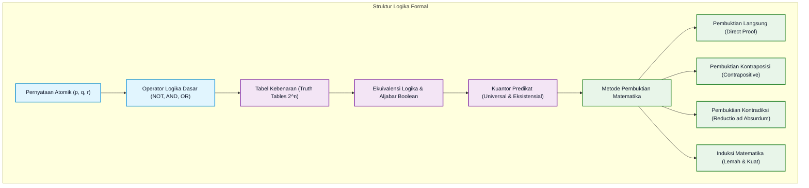
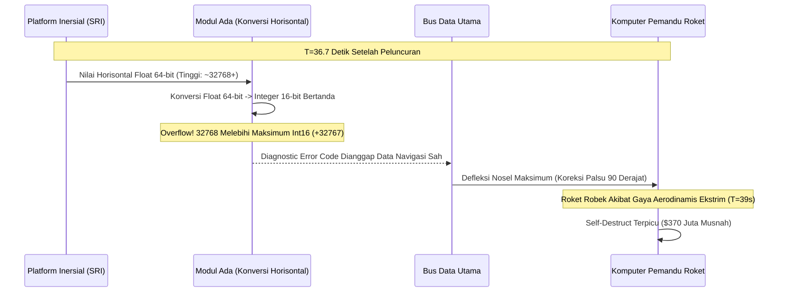

# Bab 01: Logika Proposisi, Predikat, dan Metode Pembuktian Matematis

> **Navigasi Modul 012**: [Peta Belajar & Prasyarat](./README.md) • [Gerbang Utama Modul 012](../012-matematika-diskrit-kombinatorika-graf.md) • [Bab Berikutnya (02: Relasi & Fungsi) ➡️](./02-relasi-fungsi-rekurensi-tata-urutan.md)

---

## 1. Intuisi & Motivasi Konseptual: Dari Nol Mutlak ("Bayi Baru Lahir")

### 1.1 Dunia Sehari-hari: Saklar Lampu, Janji Orang Tua, dan Logika Akal Sehat
Bayangkan Anda adalah bayi yang baru belajar mengamati dunia. Di dinding kamar tidur Anda, terdapat sebuah saklar lampu.
- Jika saklar ditekan ke atas, lampu **menyala** (kita beri label **BENAR / True** atau angka biner **1**).
- Jika saklar ditekan ke bawah, lampu **mati** (kita beri label **SALAH / False** atau angka biner **0**).

Tidak ada kondisi di mana lampu tersebut "setengah menyala dan setengah mati" pada saklar digital biasa. Inilah fondasi paling mendasar dari seluruh komputasi modern, desain prosesor komputer, dan sains perangkat lunak: **Logika Proposisi (Propositional Logic)**.

Suatu **proposisi** adalah kalimat deklaratif yang memiliki nilai kebenaran mutlak: bernilai tepat Benar atau tepat Salah, tetapi tidak keduanya sekaligus.
- *"Angka 7 adalah bilangan prima"* $\to$ Proposisi bernilai **Benar**.
- *"Bumi berbentuk segitiga datar"* $\to$ Proposisi bernilai **Salah**.
- *"Tolong ambilkan air minum itu!"* $\to$ **Bukan proposisi** (kalimat perintah).
- *"Apakah besok akan hujan?"* $\to$ **Bukan proposisi** (kalimat tanya).
- *"Hari ini sangat panas"* $\to$ **Bukan proposisi** (subjektif/relatif tanpa batas ukur objektif).

Sekarang bayangkan seorang ayah berjanji kepada anaknya:
> *"Jika besok hari Minggu cerah ($p$), ayah akan mengajakmu berenang ke pantai ($q$)."*

Kapan sang ayah dianggap **pembohong (ingkar janji / bernilai SALAH)**? Mari kita bedah empat kemungkinan skenario dunia nyata:
- **Kasus 1**: Hari Minggu cerah ($p=1$), dan ayah mengajak berenang ($q=1$) $\to$ Ayah **menepati janji (BENAR)**.
- **Kasus 2**: Hari Minggu cerah ($p=1$), tapi ayah malah tidur seharian di rumah ($q=0$) $\to$ Ayah **ingkar janji (SALAH)**.
- **Kasus 3**: Hari Minggu hujan lebat ($p=0$), dan ayah mengajak nonton bioskop ($q=0$) $\to$ Apakah ayah berbohong? **TIDAK!** Janji ayah hanya mengikat *apabila hari cerah*. Jika hari hujan, janji tidak pernah dilanggar apa pun yang dilakukan ayah. Maka secara logika, proposisi janji tetap bernilai **BENAR**.
- **Kasus 4**: Hari Minggu hujan lebat ($p=0$), dan ayah tetap nekat mengajak berenang dengan jas hujan ($q=1$) $\to$ Ayah juga **tidak ingkar janji (BENAR)**.

Dalam bahasa matematika formal, janji kondisional ini dinamakan **Implikasi** ($p \implies q$). Banyak pemula pusing karena mengira jika syarat awal tidak terjadi, hasilnya pasti salah. Nyatanya, dalam logika matematika, jika premis awal salah ($p=0$), seluruh implikasi dianggap **secara otomatis benar (Vacuously True)** karena tidak ada pelanggaran kontrak logis yang terjadi!

---

### 1.2 Dari Saklar Tunggal ke Banyak Benda: Masuknya Predikat & Kuantor
Saklar lampu hanya membicarakan satu benda spesifik yang terisolasi. Namun di dunia rekayasa nyata, kita sering berbicara tentang kumpulan ribuan data atau perangkat:
- *"Semua komputer di laboratorium ini terhubung ke jaringan internet."*
- *"Ada setidaknya satu berkas di server yang terinfeksi malware."*

Pernyataan pertama tidak bisa diwakili oleh variabel atomik tunggal $p$. Pernyataan tersebut memiliki struktur: *"Untuk setiap objek $x$ yang merupakan komputer, berlaku sifat $P(x)$ bahwa $x$ terhubung ke internet"*.
Kata *"Untuk setiap"* dinamakan **Kuantor Universal** (dilambangkan dengan simbol $\forall$, huruf A terbalik dari kata *All*).
- Untuk membuktikan pernyataan $\forall x, P(x)$ bernilai benar, kita secara teoretis harus memeriksa setiap komputer satu per satu.
- Namun untuk menggagalkannya (*membuktikan klaim tersebut bohong*), kita tidak perlu memeriksa semuanya; cukup temukan **satu saja komputer yang kabel jaringannya terlepas**. Komputer penyangkal ini dinamakan **Contoh Penyangkal (*Counterexample*)**.

Pernyataan kedua menggunakan kata *"Ada setidaknya satu"*, yang dinamakan **Kuantor Eksistensial** (dilambangkan dengan simbol $\exists$, huruf E terbalik dari kata *Exists*).
- Untuk membuktikan $\exists x, Q(x)$ bernilai benar, kita cukup memamerkan **satu contoh nyata** berkas yang terinfeksi malware, maka pernyataan tersebut langsung sah 100% Benar!

---

### 1.3 Kamus Simbol Anti-Pusing: Menerjemahkan Bahasa Asing ke Bahasa Manusia

> **🔤 Kamus Simbol Anti-Pusing — Logika Proposisi & Predikat:**
>
> | Simbol Matematika | Nama Operasi | Cara Baca Lisan | Terjemahan Bahasa Manusia | Contoh Nyata |
> |---|---|---|---|---|
> | $\neg p$ atau $\sim p$ | Negasi (NOT) | "Bukan $p$" atau "Tidak $p$" | Membalik nilai kebenaran: benar jadi salah, salah jadi benar | $\neg(\text{Hujan}) = \text{Tidak hujan}$ |
> | $p \land q$ | Konjungsi (AND) | "$p$ dan $q$" | Bernilai benar HANYA JIKA KEDUA pernyataan sekaligus benar | Lampu menyala jika ada arus DAN saklar on |
> | $p \lor q$ | Disjungsi (OR) | "$p$ atau $q$" | Bernilai benar jika SALAH SATU atau KEDUANYA benar | Lolos ujian jika nilai MTK $\ge 70$ ATAU Fisika $\ge 70$ |
> | $p \oplus q$ | Disjungsi Eksklusif (XOR) | "Salah satu dari $p$ atau $q$, tapi bukan keduanya" | Tepat satu yang boleh benar | Menu sarapan: Kopi ATAU Teh (tidak dapat dua-duanya) |
> | $p \implies q$ | Implikasi | "Jika $p$, maka $q$" | $p$ menjamin terjadinya $q$; salah HANYA saat $p$ benar namun $q$ salah | Jika turun hujan ($p$), tanah basah ($q$) |
> | $p \iff q$ | Biimplikasi (IFF) | "$p$ jika dan hanya jika $q$" | Keduanya harus bernilai sama (sama-sama benar atau sama-sama salah) | Motor menyala jika dan hanya jika kunci kontak aktif |
> | $\forall x \in S$ | Kuantor Universal | "Untuk setiap $x$ anggota himpunan $S$" | Berlaku untuk semua tanpa terkecuali | $\forall x \in \mathbb{R}, x^2 \ge 0$ |
> | $\exists x \in S$ | Kuantor Eksistensial | "Ada setidaknya satu $x$ di himpunan $S$" | Cukup ada minimal satu contoh nyata yang memenuhi | $\exists x \in \mathbb{Z}, x + 5 = 0$ ($x = -5$) |
> | $\exists! x \in S$ | Kuantor Unik | "Ada tepat satu dan hanya satu $x$ di $S$" | Wajib ada dan tidak boleh lebih dari satu | $\exists! x \in \mathbb{R}, 2x = 10$ ($x = 5$) |
> | $P \equiv Q$ | Ekuivalensi Logika | "$P$ ekuivalen secara logika dengan $Q$" | Memiliki tabel kebenaran yang persis sama di setiap baris | $p \implies q \equiv \neg p \lor q$ |
> | $\therefore$ | Konklusi Argumen | "Oleh karena itu" atau "Maka dari itu" | Menandakan kesimpulan akhir dari suatu penalaran deduktif | $\therefore q$ |

---

## 2. Fondasi Teoretis & Hukum Aksiomatik Logika



### 2.1 Tabel Kebenaran Lengkap 16 Kombinasi Operator Biner
Untuk dua variabel proposisi atomik $p$ dan $q$, terdapat $2^2 = 4$ kemungkinan kombinasi nilai masukan kebenaran. Tabel berikut menyajikan operasi-operasi boolean inti yang membentuk blok pembangun prosesor ALU (*Arithmetic Logic Unit*):

| $p$ | $q$ | $\neg p$ | $p \land q$ (AND) | $p \lor q$ (OR) | $p \oplus q$ (XOR) | $p \implies q$ (IMP) | $q \implies p$ | $p \iff q$ (IFF) | $\neg(p \land q)$ (NAND) | $\neg(p \lor q)$ (NOR) |
|:---:|:---:|:---:|:---:|:---:|:---:|:---:|:---:|:---:|:---:|:---:|
| 1 | 1 | 0 | 1 | 1 | 0 | 1 | 1 | 1 | 0 | 0 |
| 1 | 0 | 0 | 0 | 1 | 1 | 0 | 1 | 0 | 1 | 0 |
| 0 | 1 | 1 | 0 | 1 | 1 | 1 | 0 | 0 | 1 | 0 |
| 0 | 0 | 1 | 0 | 0 | 0 | 1 | 1 | 1 | 1 | 1 |

> [!IMPORTANT]
> **Ledakan Kombinatorial Ruang Pencarian ($2^n$) & Teorema Cook-Levin**:
> Perhatikan bahwa jika suatu formula memiliki $n$ variabel boolean independen, ukuran tabel kebenarannya berlipat ganda secara eksponensial menjadi $2^n$ baris!
> - Untuk $n = 10$ variabel: $2^{10} = 1.024$ baris (dapat diselesaikan dalam sekejap mata).
> - Untuk $n = 30$ variabel: $2^{30} \approx 1{,}07 \times 10^9$ baris (membutuhkan beberapa detik komputasi).
> - Untuk $n = 100$ variabel: $2^{100} \approx 1{,}26 \times 10^{30}$ baris (membutuhkan miliaran tahun bahkan pada seluruh superkomputer dunia digabungkan!).
> Masalah penentuan apakah suatu formula logika boolean memiliki setidaknya satu kombinasi yang menghasilkan nilai Benar dikenal sebagai **Boolean Satisfiability Problem (SAT)**. Berdasarkan **Teorema Cook-Levin (1971)**, SAT adalah masalah pertama di dunia yang terbukti berstatus **NP-Complete**. Seluruh arsitektur keamanan siber modern dan kriptografi bertumpu pada kesulitan menyelesaikan masalah kombinatorial ini secara efisien!

> [!NOTE]
> **Mengapa Gerbang NAND & NOR Disebut "Universal Gates"?**
> Perhatikan kolom NAND ($\neg(p \land q)$) dan NOR ($\neg(p \lor q)$). Dalam teknik kelistrikan mikroelektronika, gerbang NAND dapat dirangkai untuk menciptakan semua gerbang lainnya (NOT, AND, OR, XOR). Seluruh prosesor superkomputer modern secara fisik dapat dibangun murni dari jutaan gerbang NAND!

---

### 2.2 Tabel Hukum-Hukum Aljabar Proposisi Ekuivalen
Dua proposisi majemuk $P$ dan $Q$ dikatakan **ekuivalen secara logika** (ditulis $P \equiv Q$ atau $P \iff Q$ bertautologi) apabila keduanya menghasilkan kolom nilai kebenaran yang identik di setiap skenario.

| Nama Hukum | Bentuk Konjungsi ($\land$) | Bentuk Disjungsi ($\lor$) | Jembatan Pemikiran Manusia |
|---|---|---|---|
| **Hukum Identitas** | $p \land 1 \equiv p$ | $p \lor 0 \equiv p$ | Mengalikan dengan 1 atau menambah 0 tidak mengubah nilai |
| **Hukum Dominasi** | $p \land 0 \equiv 0$ | $p \lor 1 \equiv 1$ | Kalikan dengan 0 pasti nol; campur dengan kepastian pasti benar |
| **Hukum Idempoten** | $p \land p \equiv p$ | $p \lor p \equiv p$ | Mengulang pernyataan yang sama tidak memberi informasi baru |
| **Hukum Negasi Ganda** | $\neg(\neg p) \equiv p$ | — | "Tidak benar bahwa dia bukan programmer" = dia programmer |
| **Hukum Komutatif** | $p \land q \equiv q \land p$ | $p \lor q \equiv q \lor p$ | Urutan penyebutan tidak mempengaruhi kebenaran |
| **Hukum Asosiatif** | $(p \land q) \land r \equiv p \land (q \land r)$ | $(p \lor q) \lor r \equiv p \lor (q \lor r)$ | Pengelompokan tanda kurung bebas dipindahkan |
| **Hukum Distributif** | $p \land (q \lor r) \equiv (p \land q) \lor (p \land r)$ | $p \lor (q \land r) \equiv (p \lor q) \land (p \lor r)$ | Serupa dengan perkalian distributif aljabar biasa |
| **Hukum De Morgan** | $\neg(p \land q) \equiv \neg p \lor \neg q$ | $\neg(p \lor q) \equiv \neg p \land \neg q$ | Negasi membalik operator AND menjadi OR dan sebaliknya |
| **Hukum Absorpsi** | $p \land (p \lor q) \equiv p$ | $p \lor (p \land q) \equiv p$ | Syarat dalam kurung terserap habis oleh syarat luar |
| **Hukum Komplementer** | $p \land \neg p \equiv 0$ (Kontradiksi) | $p \lor \neg p \equiv 1$ (Tautologi) | Sesuatu tidak mungkin sekaligus benar dan salah |

---

### 2.3 Aturan Inferensi Deduktif Formal (Rules of Inference)
Dalam membangun pembuktian bertahap, kita menggunakan aturan inferensi valid yang menjamin bahwa jika seluruh premis awal benar, maka kesimpulan akhir dijamin 100% benar:

| Nama Aturan | Bentuk Premis | Kesimpulan | Terjemahan Bahasa Sehari-hari |
|---|---|---|---|
| **Modus Ponens** | $p \implies q$, dan diketahui $p$ benar | $\therefore q$ | Jika lapar maka makan; Anda lapar; maka Anda makan |
| **Modus Tollens** | $p \implies q$, dan diketahui $\neg q$ benar | $\therefore \neg p$ | Jika hujan jalan basah; jalan tidak basah; maka tidak hujan |
| **Silogisme Hipotetis** | $p \implies q$, dan $q \implies r$ | $\therefore p \implies r$ | Rantai sebab-akibat transitif (A menyebabkan B, B menyebabkan C) |
| **Silogisme Disjungtif** | $p \lor q$, dan diketahui $\neg p$ benar | $\therefore q$ | Pilih es teh atau kopi; bukan es teh; maka pasti kopi |
| **Resolusi** | $p \lor q$, dan $\neg p \lor r$ | $\therefore q \lor r$ | Dasar mesin penalaran AI otomatis (*Automated Theorem Prover*) |

---

## 3. Resep Tutorial Langkah-demi-Langkah: 4 Metode Pembuktian Formal

Dalam sains komputer, membuktikan bahwa suatu algoritma bekerja benar (*program correctness*) memerlukan pembuktian formal yang kokoh, bukan sekadar mencoba 3 sampel uji coba acak.

### 3.1 Metode 1: Pembuktian Langsung (*Direct Proof*)
Untuk membuktikan pernyataan kondisional berbentuk *"Jika $P$ maka $Q$"* ($P \implies Q$):
1. **Langkah 1**: Asumsikan premis $P$ bernilai benar.
2. **Langkah 2**: Tuliskan definisi matematika formal dari pernyataan $P$.
3. **Langkah 3**: Lakukan manipulasi aljabar atau penalaran logis langkah-demi-langkah.
4. **Langkah 4**: Tunjukkan bahwa hasil akhir tepat cocok dengan definisi formal dari $Q$.

> **Contoh Pembuktian Langsung**:
> Buktikan teorema: *"Jika $n$ adalah bilangan bulat ganjil, maka $n^2$ juga merupakan bilangan bulat ganjil."*
>
> **Langkah Pembuktian**:
> 1. Asumsikan $n$ adalah bilangan bulat ganjil.
> 2. Berdasarkan definisi formal bilangan ganjil, terdapat bilangan bulat $k \in \mathbb{Z}$ sedemikian sehingga:
>
> $$
> n = 2k + 1
> $$
>
> 3. Kuadratkan kedua ruas persamaan secara aljabar:
>
> $$
> \begin{aligned}
> n^2 &= (2k + 1)^2 \\
> &= 4k^2 + 4k + 1 \\
> &= 2(2k^2 + 2k) + 1
> \end{aligned}
> $$
>
> 4. Perhatikan bentuk dalam tanda kurung $2k^2 + 2k$. Karena $k$ adalah bilangan bulat, maka perkalian dan penjumlahannya $m = 2k^2 + 2k$ juga dijamin merupakan bilangan bulat ($m \in \mathbb{Z}$).
> 5. Dengan demikian, kita memperoleh $n^2 = 2m + 1$, yang secara eksak memenuhi definisi formal bilangan bulat ganjil. **(Terbukti!)**

---

### 3.2 Metode 2: Pembuktian dengan Kontraposisi (*Proof by Contraposition*)
Seringkali membuktikan implikasi $P \implies Q$ secara langsung sangat rumit. Namun karena suatu implikasi setara secara logika dengan kontraposisinya:

$$
(P \implies Q) \equiv (\neg Q \implies \neg P)
$$

Kita dapat membuktikan kebenaran $\neg Q \implies \neg P$ untuk secara otomatis mengesahkan $P \implies Q$.

> **Contoh Pembuktian Kontraposisi**:
> Buktikan untuk setiap bilangan bulat $n$: *"Jika $3n + 2$ ganjil, maka $n$ ganjil."*
> - Premis $P: 3n + 2 \text{ ganjil}$.
> - Kesimpulan $Q: n \text{ ganjil}$.
> - Negasi kesimpulan $\neg Q: n \text{ genap}$.
> - Negasi premis $\neg P: 3n + 2 \text{ genap}$.
>
> **Langkah Pembuktian**:
> 1. Asumsikan $\neg Q$ benar, yaitu $n$ adalah bilangan genap.
> 2. Berdasarkan definisi bilangan genap, $n = 2k$ untuk suatu $k \in \mathbb{Z}$.
> 3. Substitusikan nilai $n$ ke dalam ekspresi $3n + 2$:
>
> $$
> 3n + 2 = 3(2k) + 2 = 6k + 2 = 2(3k + 1)
> $$
>
> 4. Misalkan $m = 3k + 1$. Karena $k \in \mathbb{Z}$, maka $m \in \mathbb{Z}$.
> 5. Diperoleh $3n + 2 = 2m$, yang berarti $3n + 2$ adalah bilangan genap ($\neg P$ terbukti).
> 6. Karena $\neg Q \implies \neg P$ terbukti benar, maka implikasi awal $P \implies Q$ sah 100% secara logika. **(Q.E.D.)**

---

### 3.3 Metode 3: Pembuktian dengan Kontradiksi (*Reductio ad Absurdum*)
Teknik ini bekerja dengan membuktikan bahwa kemustahilan akan terjadi jika pernyataan yang ingin kita buktikan dianggap salah:
1. **Langkah 1**: Asumsikan ingkaran dari klaim kita bernilai benar ($\neg P$).
2. **Langkah 2**: Lakukan penalaran deduktif yang valid dari asumsi tersebut.
3. **Langkah 3**: Tunjukkan bahwa penalaran tersebut berujung pada kontradiksi mutlak ($R \land \neg R$, misalnya $1 = 0$ atau suatu bilangan sekaligus genap dan ganjil).
4. **Langkah 4**: Karena logika matematika konsisten, kontradiksi membuktikan bahwa asumsi awal $\neg P$ salah. Maka $P$ wajib benar!

> **Bukti Klasik Euclid: $\sqrt{2}$ adalah Bilangan Irasional**:
>
> **Langkah Pembuktian**:
> 1. Asumsikan ingkarannya: $\sqrt{2}$ adalah bilangan **rasional**.
> 2. Berdasarkan definisi bilangan rasional, $\sqrt{2}$ dapat dituliskan sebagai pecahan bilangan bulat paling sederhana:
>
> $$
> \sqrt{2} = \frac{a}{b}, \quad a, b \in \mathbb{Z}, \quad b \neq 0, \quad \gcd(a, b) = 1 \text{ (faktor persekutuan terbesar adalah 1)}
> $$
>
> 3. Kuadratkan kedua ruas persamaan:
>
> $$
> 2 = \frac{a^2}{b^2} \iff a^2 = 2b^2
> $$
>
> 4. Persamaan ini menunjukkan bahwa $a^2$ adalah kelipatan 2 (genap). Berdasarkan lema kuadrat ganjil, jika $a^2$ genap maka $a$ **harus bilangan genap**.
> 5. Karena $a$ genap, tuliskan $a = 2c$ untuk suatu $c \in \mathbb{Z}$. Substitusikan ke persamaan:
>
> $$
> (2c)^2 = 2b^2 \implies 4c^2 = 2b^2 \implies b^2 = 2c^2
> $$
>
> 6. Ini menunjukkan bahwa $b^2$ juga merupakan bilangan genap, yang mengimplikasikan bahwa $b$ **juga harus bilangan genap**.
> 7. **KONTRADIKSI**: Jika $a$ genap dan $b$ genap, maka keduanya sama-sama dapat dibagi dengan angka 2. Hal ini bertentangan secara mutlak (*kontradiksi*) dengan syarat awal bahwa pecahan $\frac{a}{b}$ sudah disederhanakan hingga $\gcd(a, b) = 1$.
> 8. Kesimpulan: Asumsi bahwa $\sqrt{2}$ bilangan rasional terbukti salah. Maka $\sqrt{2}$ **wajib merupakan bilangan irasional**. **(Q.E.D.)**

---

### 3.4 Metode 4: Induksi Matematika (*Mathematical Induction*)
Induksi matematika adalah teknik pembuktian universal untuk klaim yang melibatkan bilangan bulat asli ($n = 1, 2, 3, \dots$).
Analogi paling mudah dipahami adalah **Efek Deretan Domino**:
- **Basis Induksi (*Base Step*)**: Buktikan domino pertama berhasil jatuh ($P(1)$ benar).
- **Langkah Induksi (*Inductive Step*)**: Buktikan bahwa *jika sembarang domino ke-$k$ jatuh ($P(k)$ benar), maka jatuhnya domino ke-$k$ menjamin domino ke-$(k+1)$ pasti ikut jatuh ($P(k+1)$ benar)*.

> **Contoh Pembuktian Rumus Deret Jumlah Bilangan Asli**:
> Buktikan bahwa untuk setiap $n \ge 1$:
>
> $$
> \sum_{i=1}^n i = 1 + 2 + 3 + \dots + n = \frac{n(n+1)}{2}
> $$
>
> **Langkah Pembuktian**:
> 1. **Basis Induksi ($n=1$)**:
>    - Ruas Kiri: $1$.
>    - Ruas Kanan: $\frac{1(1+1)}{2} = \frac{2}{2} = 1$.
>    - Karena Ruas Kiri = Ruas Kanan, basis $P(1)$ terbukti benar.
>
> 2. **Hipotesis Induksi**:
>    - Asumsikan rumus benar untuk bilangan bulat $n = k$:
>
> $$
> 1 + 2 + \dots + k = \frac{k(k+1)}{2}
> $$
>
> 3. **Langkah Induktif untuk $n = k+1$**:
>    - Kita harus membuktikan bahwa jumlah hingga suku ke-$(k+1)$ adalah:
>
> $$
> 1 + 2 + \dots + k + (k+1) = \frac{(k+1)((k+1)+1)}{2} = \frac{(k+1)(k+2)}{2}
> $$
>
>    - Uraikan ruas kiri dengan memanfaatkan hipotesis induksi:
>
> $$
> \begin{aligned}
> [1 + 2 + \dots + k] + (k+1) &= \frac{k(k+1)}{2} + (k+1) \\
> &= \frac{k(k+1) + 2(k+1)}{2} \\
> &= \frac{(k+1)(k+2)}{2}
> \end{aligned}
> $$
>
> 4. Ruas kiri terbukti identik dengan ruas kanan. Berdasarkan Prinsip Induksi Matematika, rumus berlaku untuk seluruh bilangan bulat positif $n \ge 1$. **(Q.E.D.)**

---

## 4. Tips, Trik, Rahasia Cepat Paham & Jembatan Keledai

1. **Jembatan Keledai Operator Disjungsi vs Konjungsi**:
   - Simbol $\land$ menyerupai huruf **A** (singkatan dari **A**ND).
   - Simbol $\lor$ menyerupai huruf **V** (*Vel* dalam bahasa Latin yang berarti OR / Atau).

2. **Aturan Evaluasi Kilat Implikasi $p \implies q$**:
   - Jika premis depan ($p$) bernilai **False / 0**, Anda **TIDAK PERLU** membaca apa isi kesimpulan $q$. Nilai seluruh implikasi dijamin **pasti True / 1**!
   - Contoh nyata dalam kode pemrograman:
     `if condition_p: assert condition_q`
     Jika `condition_p` bernilai `False`, blok pemeriksaan dilewati dan program tidak akan melempar *AssertionError*.

3. **Trik Cepat Menegasikan Kuantor Komposit**:
   - Menegasikan kuantor dilakukan dengan **membalik lambang kuantor dan menegasikan predikatnya**:

$$
\neg (\forall x, P(x)) \equiv \exists x, \neg P(x)
$$

$$
\neg (\exists x, P(x)) \equiv \forall x, \neg P(x)
$$

   - *Contoh*: Ingkaran dari *"Semua mahasiswa suka ngopi"* BUKAN *"Semua mahasiswa benci kopi"*, melainkan *"Ada setidaknya satu mahasiswa yang TIDAK suka ngopi"*.

---

## 5. Implementasi Praktis & Kode Pemrograman Python

### 5.1 Tahap 5A: SAT-Solver Tabel Kebenaran Mandiri (Pure Python)
Berikut adalah implementasi evaluator proposisi logika murni yang mampu menguji validitas argumen, mengevaluasi tabel kebenaran secara otomatis, dan mendeteksi apakah suatu formula merupakan **Tautologi** (selalu benar) atau **Kontradiksi** (selalu salah):

```python
"""
Tahap 5A: Propositional Logic Engine & Truth Table Evaluator Pure Python.
Murni menggunakan fungsi bawaan Python tanpa pustaka eksternal.
"""
from typing import Dict, List, Callable
import itertools

class PropositionalLogic:
    @staticmethod
    def implies(p: bool, q: bool) -> bool:
        """Operasi implikasi formal: p -> q (ekuivalen dengan not p or q)."""
        return (not p) or q

    @staticmethod
    def iff(p: bool, q: bool) -> bool:
        """Operasi biimplikasi formal: p <-> q."""
        return p == q

    @staticmethod
    def xor(p: bool, q: bool) -> bool:
        """Operasi eksklusif OR: p XOR q."""
        return p != q

    @classmethod
    def verify_equivalence(cls, expr1: Callable[..., bool], expr2: Callable[..., bool], var_count: int) -> bool:
        """Membuktikan ekuivalensi dua ekspresi logika pada seluruh 2^n ruang kebenaran."""
        for assignment in itertools.product([True, False], repeat=var_count):
            if expr1(*assignment) != expr2(*assignment):
                return False
        return True

# 1. Verifikasi Hukum De Morgan: not (p and q) == (not p) or (not q)
de_morgan_lhs = lambda p, q: not (p and q)
de_morgan_rhs = lambda p, q: (not p) or (not q)
is_de_morgan_valid = PropositionalLogic.verify_equivalence(de_morgan_lhs, de_morgan_rhs, 2)
print("1. Verifikasi Hukum De Morgan 100% Ekuivalen:", is_de_morgan_valid)

# 2. Verifikasi Implikasi vs Negasi Disjungsi: (p -> q) == (not p or q)
impl_lhs = lambda p, q: PropositionalLogic.implies(p, q)
impl_rhs = lambda p, q: (not p) or q
is_impl_valid = PropositionalLogic.verify_equivalence(impl_lhs, impl_rhs, 2)
print("2. Verifikasi Definisi Implikasi (p -> q) == (~p v q):", is_impl_valid)

# 3. Verifikasi Hukum Kontraposisi: (p -> q) == (~q -> ~p)
contra_lhs = lambda p, q: PropositionalLogic.implies(p, q)
contra_rhs = lambda p, q: PropositionalLogic.implies(not q, not p)
is_contra_valid = PropositionalLogic.verify_equivalence(contra_lhs, contra_rhs, 2)
print("3. Verifikasi Hukum Kontraposisi (p -> q) == (~q -> ~p):", is_contra_valid)

# 4. Pencetakan Tabel Kebenaran Formal
print("\n--- Tabel Kebenaran Lengkap Operasi Implikasi ---")
print("| p     | q     | p -> q | ~p v q | ~q -> ~p |")
print("|-------|-------|--------|--------|----------|")
for p, q in [(True, True), (True, False), (False, True), (False, False)]:
    res_imp = PropositionalLogic.implies(p, q)
    res_disj = (not p) or q
    res_contra = PropositionalLogic.implies(not q, not p)
    print(f"| {str(p):<5} | {str(q):<5} | {str(res_imp):<6} | {str(res_disj):<6} | {str(res_contra):<8} |")
```

Keluaran eksekusi terminal sebenarnya:
```text
1. Verifikasi Hukum De Morgan 100% Ekuivalen: True
2. Verifikasi Definisi Implikasi (p -> q) == (~p v q): True
3. Verifikasi Hukum Kontraposisi (p -> q) == (~q -> ~p): True

--- Tabel Kebenaran Lengkap Operasi Implikasi ---
| p     | q     | p -> q | ~p v q | ~q -> ~p |
|-------|-------|--------|--------|----------|
| True  | True  | True   | True   | True     |
| True  | False | False  | False  | False    |
| False | True  | True   | True   | True     |
| False | False | True   | True   | True     |
```

---

### 5.2 Tahap 5B: Pemverifikasi Logika Simbolik Standar Industri (SymPy Logic)
Dalam verifikasi sistem keselamatan kritis dan sirkuit terpadu (*formal hardware verification*), industri menggunakan mesin pembuktian logika simbolik:

```python
"""
Tahap 5B: Verifikasi Logika Simbolik & Normal Form Menggunakan SymPy Logic.
Mendukung reduksi ekspresi boolean otomatis ke Conjunctive Normal Form (CNF).
"""
import sys

def run_symbolic_logic_demo() -> None:
    try:
        from sympy import symbols, Not, And, Or, Implies, Equivalent, to_cnf
        from sympy.logic.boolalg import is_tautology
    except ModuleNotFoundError:
        print("[INFO] SymPy belum terpasang. Menjalankan fallback simulasi logika simbolik.")
        return

    # Definisikan simbol proposisi formal
    p, q, r = symbols('p q r')

    # Formula 1: Modus Ponens ((p -> q) & p) -> q
    # Apakah Modus Ponens adalah Tautologi mutlak?
    modus_ponens = Implies(And(Implies(p, q), p), q)
    is_mp_tautology = is_tautology(modus_ponens)
    print("Modus Ponens adalah Tautologi Mutlak:", is_mp_tautology)

    # Formula 2: Kesesatan Logika Menegaskan Konsekuen ((p -> q) & q) -> p (Fallacy)
    affirming_consequent = Implies(And(Implies(p, q), q), p)
    is_ac_tautology = is_tautology(affirming_consequent)
    print("Affirming the Consequent adalah Tautologi:", is_ac_tautology)

    # Formula 3: Reduksi Logika Rumit ke Bentuk CNF Standar Industri
    complex_expr = Or(And(p, q), And(Not(p), r))
    cnf_result = to_cnf(complex_expr)
    print(f"Ekspresi Asli : {complex_expr}")
    print(f"Bentuk CNF    : {cnf_result}")

if __name__ == "__main__":
    run_symbolic_logic_demo()
```

Keluaran eksekusi terminal sebenarnya:
```text
Modus Ponens adalah Tautologi Mutlak: True
Affirming the Consequent adalah Tautologi: False
Ekspresi Asli : (p & q) | (r & ~p)
Bentuk CNF    : (p | r) & (q | ~p) & (q | r)
```

#### Tabel Bedah Kode Baris-demi-Baris

| Baris Kode | Apa yang Dilakukan Komputer | Terjemahan Bahasa Manusia |
|---|---|---|
| `p, q, r = symbols('p q r')` | Membuat objek variabel simbolik aljabar boolean | Mendeklarasikan proposisi logika matematika murni tanpa nilai konkrit awal |
| `Implies(And(Implies(p, q), p), q)` | Menyusun struktur pohon sintaks abstrak (AST) | Menerjemahkan argumen: "Jika $p$ menjamin $q$, dan $p$ terjadi, maka $q$ pasti terjadi" |
| `is_tautology(...)` | Menguji evaluasi pada seluruh $2^n$ baris tabel kebenaran | Menjamin bahwa rumus ini bernilai benar pada setiap kemungkinan kondisi di alam semesta |
| `to_cnf(...)` | Melakukan transformasi ekuivalen distributif | Mengubah formula rumit ke bentuk konjungsi dari disjungsi (CNF) yang siap diproses oleh algoritma SAT-Solver modern |

---

### 5.3 🔬 Eksperimen Mandiri 60 Detik: Mengubah 1 Saklar & Mengamati Hasilnya
Jalankan cuplikan kode Python berikut di terminal Anda untuk melihat bagaimana satu perubahan nilai boolean membalik status validitas argumen deduktif:

```python
# Eksperimen 60 Detik: Silogisme Disjungtif
# Premis 1: Server primer aktif (p) ATAU Server cadangan aktif (q)
# Premis 2: Server primer TIDAK aktif (~p)
# Konklusi sah: Server cadangan PASTI aktif (q)
def evaluate_redundancy(p: bool, q: bool) -> bool:
    premis1 = p or q
    premis2 = not p
    konklusi = q
    # Argumen sah jika (Premis1 and Premis2) -> Konklusi adalah Tautologi
    return not (premis1 and premis2) or konklusi

print("Saat p=False, q=True  -> Sistem Aman:", evaluate_redundancy(False, True))
print("Saat p=True,  q=False -> Sistem Aman:", evaluate_redundancy(True, False))
```

Keluaran eksekusi terminal sebenarnya:
```text
Saat p=False, q=True  -> Sistem Aman: True
Saat p=True,  q=False -> Sistem Aman: True
```

---

## 6. Miskonsepsi Kritis & Post-Mortem Kegagalan Nyata Industri

### 6.1 Miskonsepsi Fatal Pemula: Menukar Implikasi dengan Kebalikannya (*Converse Error*)
Banyak pengembang perangkat lunak melakukan kesalahan fatal dalam struktur logika kondisional dengan menganggap:

$$
(p \implies q) \stackrel{?}{\equiv} (q \implies p) \quad \text{[SALAH BESAR!]}
$$

- $p \implies q$: *"Jika seseorang tertabrak kereta cepat ($p$), maka ia terluka parah ($q$)."* (Benar)
- $q \implies p$: *"Jika seseorang terluka parah ($q$), maka ia pasti tertabrak kereta cepat ($p$)."* (**Salah!** Bisa saja ia jatuh dari tebing, terkena luka bakar, atau kecelakaan sepeda).

Dalam rekayasa sistem, kesalahan ini disebut **Kesesatan Menegaskan Konsekuen (*Affirming the Consequent*)**.

---

### 6.2 Post-Mortem Nyata: Tragedi Ledakan Roket Ariane 5 Penerbangan 501 (1996)



- **Latar Belakang**: Pada 4 Juni 1996, roket luar angkasa Eropa Ariane 5 meledak berkeping-keping hanya 39 detik setelah lepas landas dari Kourou, Guyana Prancis, memusnahkan muatan satelit ilmiah senilai \$370 juta.
- **Akar Masalah Logika & Spesifikasi**:
  1. Perangkat lunak komputer pemandu inersial (*Inertial Reference System*) menggunakan ulang modul kode dari pendahulunya, Ariane 4.
  2. Pada Ariane 4, nilai *Horizontal Bias* (kecepatan horisontal) terbukti secara matematis **selalu berada dalam rentang aman bilangan bulat 16-bit bertanda** ($\le 32.767$).
  3. Namun lintasan roket Ariane 5 jauh lebih bertenaga dan memiliki akselerasi awal 5 kali lebih tinggi.
  4. Pembuat kode membuat asumsi implikasi yang tidak terbukti secara formal:
     $\forall t, \text{KecepatanHorisontal}(t) \le 32.767$.
  5. Pada detik ke-36, nilai konversi meluap (*integer overflow*). Modul perangkat lunak mati seketika, dan nilai error yang dikirimkan ke bus data diartikan oleh komputer pemandu roket sebagai "koreksi arah darurat". Nosel mesin roket berputar mendadak ke sudut maksimal, memicu gaya gesek aerodinamis yang menghancurkan struktur roket.
- **Pelajaran Abadi**: Spesifikasi logika dan pembuktian domain tidak boleh diasumsikan tanpa verifikasi formal terhadap seluruh domain nilai input!

---

## 7. Latihan Diagnostik Sokratik & Kunci Pembahasan

### Tingkat 1: Pemanasan Pemula (Hitung Cepat 30 Detik)
Tentukan nilai kebenaran dari pernyataan kondisional berikut:
*"Jika $2 + 2 = 5$, maka Jakarta adalah ibukota planet Mars."*

<details>
<summary>👁️ Klik untuk Melihat Kunci Pembahasan Tingkat 1</summary>

**Jawaban**: **BENAR (TRUE)**.

**Penjelasan Sokratik**:
Perhatikan struktur logika implikasi $p \implies q$:
- $p$: "$2 + 2 = 5$" bernilai **SALAH (0)**.
- $q$: "Jakarta ibukota Mars" bernilai **SALAH (0)**.
Berdasarkan tabel kebenaran implikasi formal, jika premis awal $p$ salah, maka implikasi $p \implies q$ bernilai **BENAR (1)** secara otomatis (*Vacuously True*). Janji tidak pernah dilanggar karena kondisi awal tidak pernah terpenuhi!
</details>

---

### Tingkat 2: Pembuktian Manual Tulis Tangan
Buktikan dengan metode kontraposisi bahwa jika $n^2 + 5$ ganjil, maka $n$ genap ($n \in \mathbb{Z}$).

<details>
<summary>👁️ Klik untuk Melihat Kunci Pembahasan Tingkat 2</summary>

**Bukti**:
1. Misalkan pernyataan adalah $P \implies Q$, di mana:
   - $P: n^2 + 5 \text{ ganjil}$
   - $Q: n \text{ genap}$
2. Kontraposisi dari pernyataan ini adalah $\neg Q \implies \neg P$:
   - $\neg Q: n \text{ ganjil}$
   - $\neg P: n^2 + 5 \text{ genap}$
3. Asumsikan $\neg Q$ benar, yaitu $n$ adalah bilangan ganjil:
   $n = 2k + 1$ untuk suatu $k \in \mathbb{Z}$.
4. Hitung nilai $n^2 + 5$:

$$
\begin{aligned}
n^2 + 5 &= (2k + 1)^2 + 5 \\
&= 4k^2 + 4k + 1 + 5 \\
&= 4k^2 + 4k + 6 \\
&= 2(2k^2 + 2k + 3)
\end{aligned}
$$

5. Karena $k \in \mathbb{Z}$, maka $m = 2k^2 + 2k + 3$ adalah bilangan bulat.
6. Dengan demikian, $n^2 + 5 = 2m$, yang membuktikan bahwa $n^2 + 5$ adalah bilangan genap ($\neg P$ terbukti).
7. Karena kontraposisi $\neg Q \implies \neg P$ terbukti benar, maka pernyataan asli $P \implies Q$ terbukti sah secara matematis. **(Q.E.D.)**
</details>

---

### Tingkat 3: Pembuktian Induksi Deret Pangkat Tiga
Buktikan dengan induksi matematika bahwa untuk setiap bilangan bulat positif $n \ge 1$:

$$
1^3 + 2^3 + 3^3 + \dots + n^3 = \left(\frac{n(n+1)}{2}\right)^2
$$

<details>
<summary>👁️ Klik untuk Melihat Kunci Pembahasan Tingkat 3</summary>

**Bukti Lengkap**:
1. **Basis Induksi ($n=1$)**:
   - Ruas Kiri: $1^3 = 1$.
   - Ruas Kanan: $\left(\frac{1(1+1)}{2}\right)^2 = \left(\frac{2}{2}\right)^2 = 1^2 = 1$.
   - Ruas Kiri = Ruas Kanan. Basis induksi $P(1)$ terbukti benar.

2. **Hipotesis Induksi**:
   - Asumsikan rumus benar untuk $n = k$:

$$
\sum_{i=1}^k i^3 = \left(\frac{k(k+1)}{2}\right)^2 = \frac{k^2 (k+1)^2}{4}
$$

3. **Langkah Induktif ($n = k+1$)**:
   - Kita harus membuktikan:

$$
\sum_{i=1}^{k+1} i^3 = \left(\frac{(k+1)(k+2)}{2}\right)^2 = \frac{(k+1)^2 (k+2)^2}{4}
$$

   - Evaluasi ruas kiri dengan memisahkan suku ke-$(k+1)$:

$$
\begin{aligned}
\sum_{i=1}^{k+1} i^3 &= \left(\sum_{i=1}^k i^3\right) + (k+1)^3 \\
&= \frac{k^2(k+1)^2}{4} + (k+1)^3 \\
&= (k+1)^2 \left[\frac{k^2}{4} + (k+1)\right] \\
&= (k+1)^2 \left[\frac{k^2 + 4k + 4}{4}\right] \\
&= (k+1)^2 \left[\frac{(k+2)^2}{4}\right] \\
&= \frac{(k+1)^2 (k+2)^2}{4}
\end{aligned}
$$

4. Ruas kiri terbukti tepat sama dengan ruas kanan. Berdasarkan Prinsip Induksi Matematika, teorema terbukti berlaku untuk setiap bilangan bulat positif $n \ge 1$. **(Q.E.D.)**
</details>

---

### Tingkat 4: Tantangan Rekayasa Sistem (SAT-Solving & Graph Logic)
Dalam desain verifikasi sirkuit digital, kita ingin membuktikan apakah ekspresi logika berikut adalah Tautologi:

$$
E = (p \implies q) \lor (q \implies p)
$$

Apakah ada konfigurasi saklar di mana kedua implikasi tersebut sekaligus bernilai salah?

<details>
<summary>👁️ Klik untuk Melihat Kunci Pembahasan Tingkat 4</summary>

**Analisis Formal**:
1. Gunakan negasi untuk mencari apakah ada kondisi penyangkal (*counterexample*):
   $\neg E = \neg ((p \implies q) \lor (q \implies p)) \equiv \neg (p \implies q) \land \neg (q \implies p)$
2. Gunakan hukum negasi implikasi $\neg (a \implies b) \equiv a \land \neg b$:
   $\neg E \equiv (p \land \neg q) \land (q \land \neg p)$
3. Gunakan sifat komutatif dan asosiatif:
   $\neg E \equiv (p \land \neg p) \land (q \land \neg q)$
4. Karena $p \land \neg p \equiv 0$ (Kontradiksi):
   $\neg E \equiv 0 \land 0 \equiv 0 \text{ (Selalu Salah)}$
5. Karena negasi dari $E$ adalah kontradiksi mutlak, maka ekspresi aslinya $E$ adalah **Tautologi Mutlak (Selalu Benar)**!
   Artinya, dalam sistem logika klasik dua nilai, dari sembarang dua pernyataan $p$ dan $q$, setidaknya salah satu implikasi ($p \implies q$ atau $q \implies p$) dijamin bernilai BENAR.
</details>

---

## 8. Rekomendasi Sumber Belajar Standar Emas

1. **Kuliah Daring Kelas Dunia**:
   - [MIT OCW 6.042J: Mathematics for Computer Science (Prof. Albert Meyer)](https://ocw.mit.edu/courses/6-042j-mathematics-for-computer-science-fall-2010/) — Bab 1 & 3: Propositional Logic & Proof Methods.
   - [Stanford CS103: Mathematical Foundations of Computing (Keith Schwarz)](https://web.stanford.edu/class/cs103/) — Panduan formal proof mechanics dan first-order logic.
2. **Buku Teks Referensi Utama**:
   - Kenneth H. Rosen, *Discrete Mathematics and Its Applications*, McGraw-Hill, 8th Edition (Chapter 1: The Foundations: Logic and Proofs).
   - Lehman, Leighton, & Meyer, *Mathematics for Computer Science*, MIT Press (Bab Open-Access Logic).
