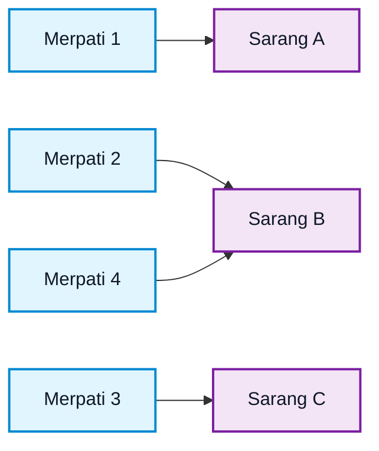
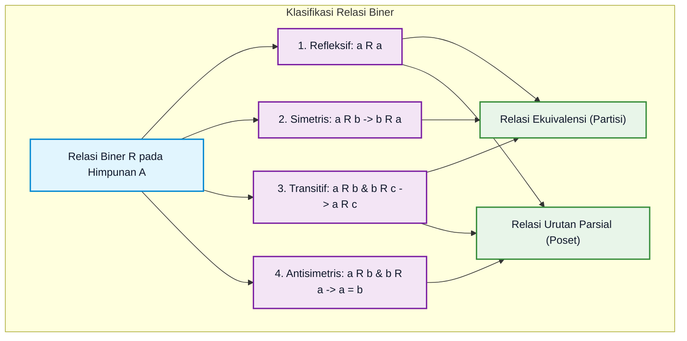
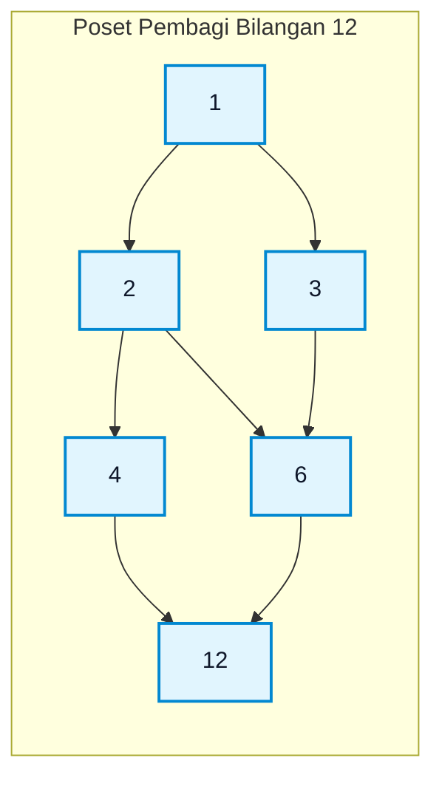
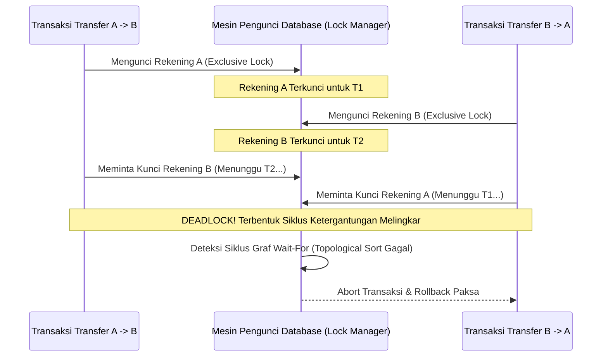

# Bab 02: Relasi, Fungsi, Partisi Himpunan, dan Prinsip Sarang Merpati

> **Navigasi Modul 012**: [Peta Belajar & Prasyarat](./README.md) • [Gerbang Utama Modul 012](../012-matematika-diskrit-kombinatorika-graf.md) • [⬅️ Bab Sebelumnya (01: Logika & Pembuktian)](./01-logika-proposisi-predikat-metode-pembuktian.md) • [Bab Berikutnya (03: Kombinatorika & Permutasi) ➡️](./03-kombinatorika-permutasi-kombinasi-partisi.md)

---

## 1. Intuisi & Motivasi Konseptual: Dari Nol Mutlak ("Bayi Baru Lahir")

### 1.1 Dunia Sehari-hari: Hubungan Pertemanan, Silsilah Keluarga, dan Tata Urutan Memakai Baju
Bayangkan Anda adalah bayi yang mulai mengenali hubungan antar manusia dan benda di sekitar Anda.
- Ibu Anda merawat Anda, tetapi Anda belum bisa merawat ibu Anda (hubungan satu arah).
- Anda dan saudara kandung Anda memiliki golongan darah atau marga keluarga yang sama (hubungan kesetaraan / ekuivalensi).
- Ketika Anda hendak berangkat ke sekolah, Anda **wajib memakai kaus kaki terlebih dahulu sebelum memakai sepatu** (hubungan tata urutan / dependensi prasyarat). Anda tidak bisa memakai sepatu lalu baru menyelipkan kaus kaki di luarnya!

Dalam matematika diskrit, seluruh jaring hubungan ini diformalkan dalam konsep **Relasi (Relations)** dan **Fungsi (Functions)**.
Secara paling sederhana:
- **Himpunan** adalah kumpulan benda (misalnya lemari pakaian Anda: `{kaus, celana, kaus kaki, sepatu}`).
- **Relasi** adalah kumpulan **panah penghubung** antara dua benda: *"Benda $A$ harus dipakai sebelum benda $B$"*.
- **Fungsi** adalah jenis relasi khusus di mana setiap benda asal memiliki **tepat satu tujuan pasti**, tidak boleh bercabang dua dan tidak boleh bingung tanpa tujuan!

---

### 1.2 Analogi Bayi: Prinsip Sarang Merpati (*Pigeonhole Principle*)
Bayangkan Anda memiliki **3 buah sarang burung merpati** di halaman belakang rumah Anda, tetapi ada **4 ekor burung merpati** yang terbang pulang pada waktu maghrib:



Akal sehat anak kecil pun dapat langsung menyimpulkan:
> *"Pasti ada setidaknya satu sarang yang harus menampung minimal 2 ekor merpati!"*

Prinsip sederhana ini dinamakan **Prinsip Sarang Merpati (Pigeonhole Principle)**. Walaupun terdengar sepele seperti mainan anak-anak, prinsip ini adalah senjata matematika paling mematikan dalam sains komputer untuk:
1. Membuktikan bahwa **tabrakan data (*hash collision*)** pasti terjadi pada sistem keamanan sandi jika jumlah pengguna melebihi kapasitas memori tabel hash.
2. Membuktikan bahwa algoritma kompresi data (*ZIP / GZIP*) **mustahil dapat mengecilkan semua berkas di dunia tanpa batas**, karena jumlah kombinasi berkas yang lebih kecil lebih sedikit daripada jumlah berkas aslinya!

---

### 1.3 Kamus Simbol Anti-Pusing: Menerjemahkan Notasi Relasi & Fungsi

> **🔤 Kamus Simbol Anti-Pusing — Relasi, Tata Urutan & Fungsi:**
>
> | Simbol Matematika | Nama Notasi | Cara Baca Lisan | Terjemahan Bahasa Manusia | Contoh Nyata |
> |---|---|---|---|---|
> | $(a, b) \in R$ atau $a R b$ | Pasangan Terurut Relasi | "$a$ berelasi dengan $b$" | Ada panah langsung dari objek $a$ menuju objek $b$ | $(\text{Kaus kaki}, \text{Sepatu}) \in \text{PakaiSebelum}$ |
> | $A \times B$ | Produk Kartesius | "$A$ cross $B$" | Seluruh kemungkinan pasangan kombinasi $(a, b)$ dari $a \in A$ dan $b \in B$ | $\{1, 2\} \times \{x, y\} = \{(1, x), (1, y), (2, x), (2, y)\}$ |
> | $[a]$ atau $[a]_R$ | Kelas Ekuivalensi | "Kelas ekuivalensi dari $a$" | Kumpulan semua elemen lain yang setara/sekelompok dengan $a$ | $[0]_2 = \{\dots, -4, -2, 0, 2, 4, \dots\}$ (semua bilangan genap) |
> | $f: A \to B$ | Pemetaan Fungsi | "Fungsi $f$ memetakan himpunan $A$ ke $B$" | Setiap anggota $A$ (domain) dikawinkan ke tepat satu anggota $B$ (kodomain) | $f(x) = x^2$ |
> | $f(a) = f(b) \implies a = b$ | Fungsi Injektif (One-to-One) | "Jika bayangannya sama, asalnya wajib sama" | Tidak ada dua orang berbeda yang memiliki nomor KTP yang sama | NIK / Nomor Induk Kependudukan |
> | $\forall b \in B, \exists a \in A, f(a) = b$ | Fungsi Surjektif (Onto) | "Semua target di $B$ pasti punya pasangan asal di $A$" | Tidak ada target yang menganggur atau jomblo | Setiap kursi bioskop terisi oleh penonton |
> | $f^{-1}: B \to A$ | Fungsi Invers | "Fungsi invers atau balikan dari $f$" | Membalik arah panah dari $B$ kembali ke $A$ (hanya sah jika $f$ bijektif) | Jika $f(x) = x + 5$, maka $f^{-1}(y) = y - 5$ |
> | $a \preceq b$ | Relasi Urutan Parsial (Poset) | "$a$ mendahului atau sama dengan $b$" | $a$ adalah prasyarat yang harus diselesaikan sebelum $b$ | Kuliah Aljabar Linier $\preceq$ Machine Learning |
> | $\lceil x \rceil$ | Fungsi Ceiling (Atap) | "Ceiling dari $x$" | Membulatkan ke atas ke bilangan bulat terdekat | $\lceil 3{,}2 \rceil = 4$, $\lceil 5{,}0 \rceil = 5$ |
> | $M_R$ | Matriks Relasi Boolean | "Matriks relasi dari $R$" | Representasi tabel biner (0 dan 1) relasi di memori komputer | $M_{ij} = 1$ jika $(i, j) \in R$ |

---

## 2. Definisi Formal, Teorema, dan Pembuktian: Empat Sifat Relasi & Relasi Ekuivalensi



### 2.1 Empat Sifat Utama Relasi Biner
Misalkan $R$ adalah relasi pada himpunan $A$. Kita menguji empat sifat struktural berikut:

1. **Refleksif (*Reflexive*)**:
   Setiap elemen berelasi dengan dirinya sendiri:

$$
\forall a \in A, \quad (a, a) \in R
$$

   - *Contoh Nyata*: Relasi "sama dengan" ($=$), atau "seumur dengan". Setiap orang pasti seumur dengan dirinya sendiri.
   - *Bukan Refleksif*: Relasi "lebih tinggi dari" ($>$). Seseorang tidak mungkin lebih tinggi dari dirinya sendiri.

2. **Simetris (*Symmetric*)**:
   Jika ada panah maju, wajib ada panah mundur:

$$
\forall a, b \in A, \quad (a, b) \in R \implies (b, a) \in R
$$

   - *Contoh Nyata*: Relasi "berteman di Facebook" atau "bersaudara kandung". Jika Ali saudara Budi, maka Budi otomatis saudara Ali.
   - *Bukan Simetris*: Relasi "mencintai". Jika A mencintai B, belum tentu B mencintai A.

3. **Transitif (*Transitive*)**:
   Sifat rantai estafet sebab-akibat:

$$
\forall a, b, c \in A, \quad ((a, b) \in R \land (b, c) \in R) \implies (a, c) \in R
$$

   - *Contoh Nyata*: Relasi "leluhur dari" atau "lebih tinggi dari". Jika A lebih tinggi dari B, dan B lebih tinggi dari C, maka A pasti lebih tinggi dari C.

4. **Antisimetris (*Antisymmetric*)**:
   Dua elemen berbeda tidak boleh saling menunjuk bolak-balik:

$$
\forall a, b \in A, \quad ((a, b) \in R \land (b, a) \in R) \implies a = b
$$

   - *Contoh Nyata*: Relasi "kurang dari atau sama dengan" ($\le$). Jika $x \le y$ dan $y \le x$, satu-satunya kemungkinan adalah $x = y$.

---

### 2.2 Relasi Ekuivalensi & Teorema Fundamental Partisi
Suatu relasi $R$ pada himpunan $A$ dinobatkan sebagai **Relasi Ekuivalensi** jika dan hanya jika $R$ memenuhi tiga sifat sekaligus:
1. **Refleksif**
2. **Simetris**
3. **Transitif**

> **Teorema Fundamental Partisi Himpunan**:
> Setiap relasi ekuivalensi pada himpunan $A$ memecah (*mempartisi*) seluruh elemen himpunan $A$ menjadi kelompok-kelompok terpisah (*disjoint classes*) yang dinamakan **Kelas Ekuivalensi**, sedemikian sehingga:
> 1. Setiap elemen berada tepat di satu kelompok.
> 2. Tidak ada dua kelompok berbeda yang saling tumpang tindih ($[a] \cap [b] = \emptyset$ jika $[a] \neq [b]$).
> 3. Gabungan seluruh kelompok membentuk kembali himpunan $A$ secara utuh ($\bigcup [a] = A$).

> **Contoh Klasik: Kongruensi Modulo $m$**:
> Misalkan relasi kongruensi pada bilangan bulat: $a \equiv b \pmod 3$ (artinya $a - b$ habis dibagi 3).
> Relasi ini membagi seluruh miliaran bilangan bulat di alam semesta ke dalam **tepat 3 laci kelas ekuivalensi**:
> - $[0]_3 = \{\dots, -6, -3, 0, 3, 6, 9, \dots\}$ (sisa bagi 0)
> - $[1]_3 = \{\dots, -5, -2, 1, 4, 7, 10, \dots\}$ (sisa bagi 1)
> - $[2]_3 = \{\dots, -4, -1, 2, 5, 8, 11, \dots\}$ (sisa bagi 2)

---

### 2.3 Matriks Relasi Boolean & Algoritma Warshall untuk Penutupan Transitif
Di dalam memori komputer, relasi antara $n$ elemen dapat direpresentasikan secara efisien sebagai matriks boolean berukuran $n \times n$:

$$
M_R = [m_{ij}], \quad m_{ij} = \begin{cases} 1 & \text{jika } (a_i, a_j) \in R \\ 0 & \text{jika } (a_i, a_j) \notin R \end{cases}
$$

- Relasi **Refleksif** $\iff$ Seluruh diagonal utama bernilai 1 ($m_{ii} = 1$).
- Relasi **Simetris** $\iff$ Matriks simetris terhadap transpos ($M_R = M_R^T$).

Untuk menghitung **Penutupan Transitif (*Transitive Closure*)** atau mencari tahu apakah ada jalan pintas dari node $i$ ke node $j$ melewati node-node perantara, kita menggunakan **Algoritma Warshall**:

$$
W^{(k)}[i, j] = W^{(k-1)}[i, j] \lor \left(W^{(k-1)}[i, k] \land W^{(k-1)}[k, j]\right)
$$

Kompleksitas algoritma Warshall adalah $O(n^3)$, yang merupakan cikal-bakal algoritma Floyd-Warshall pada teori graf.

---

### 2.4 Relasi Urutan Parsial (Poset) & Diagram Hasse
Suatu relasi $R$ pada himpunan $A$ dinamakan **Relasi Urutan Parsial (*Partial Ordering*)** jika memenuhi:
1. **Refleksif**
2. **Antisimetris**
3. **Transitif**

Himpunan $A$ bersama relasi $\preceq$ disebut **Poset (*Partially Ordered Set*)**, ditulis $(A, \preceq)$.
Dinamakan "parsial" karena tidak semua pasangan elemen wajib bisa dibandingkan. Misalnya, dalam silsilah keluarga, Anda tidak bisa membandingkan siapa leluhur siapa antara dua sepupu yang seumuran.

> [!TIP]
> **Arsitektur Nyata: Bagaimana Git Version Control Memodelkan Riwayat Kode sebagai Poset**:
> Di balik layar perintah `git log`, setiap commit git merepresentasikan sebuah simpul dalam himpunan terurut sebagian (Poset).
> - Relasi $C_1 \preceq C_2$ berarti commit $C_1$ adalah leluhur (*ancestor*) dari commit $C_2$.
> - Ketika dua pengembang bekerja secara paralel di branch yang berbeda (misal `feature-a` dan `feature-b`), kedua commit tersebut berstatus **Incomparable** (tidak bisa dibandingkan siapa yang mendahului siapa).
> - Operasi `git merge` secara matematis menghitung **Batas Atas Terkecil (*Least Upper Bound / Supremum*)** dari dua elemen poset tersebut untuk menyatukan kembali riwayat kode ke satu garis cabang utama.

Diagram visual dari poset tanpa menggambar panah refleksif dan transitif yang berlebihan disebut **Diagram Hasse**:



---

### 2.5 Matriks Komparasi 4 Struktur Relasi Utama dalam Sains Komputer

| Jenis Struktur Relasi | Refleksif? | Simetris? | Antisimetris? | Transitif? | Dapat Dibandingkan Semua? | Contoh Nyata Sistem Komputer |
|---|:---:|:---:|:---:|:---:|:---:|---|
| **Relasi Ekuivalensi** | Ya | Ya | Tidak | Ya | Tidak | Partisi data cluster database, Modulo hashing, tipe data setara |
| **Urutan Parsial (Poset)** | Ya | Tidak | Ya | Ya | Tidak (ada yang incomparably) | Git commit branch DAG, dependensi paket build, silsilah kelas OOP |
| **Urutan Total (Linear Order)** | Ya | Tidak | Ya | Ya | Ya ($\forall a, b: a \preceq b \lor b \preceq a$) | Timestamp transaksi basis data, pengurutan Array integer ($\le$) |
| **Urutan Rapi (Well-Ordering)** | Ya | Tidak | Ya | Ya | Ya + Setiap subhimpunan punya elemen terkecil | Induksi matematika pada $\mathbb{N}$, penjadwalan antrean prioritas |

---

## 3. Anatomi Fungsi: Injektif, Surjektif, dan Bijektif

Suatu relasi $f \subseteq A \times B$ disebut **fungsi** dari $A$ ke $B$ ($f: A \to B$) jika untuk setiap elemen $a \in A$, terdapat tepat satu pasangan $(a, b) \in f$.

```mermaid
flowchart LR
    subgraph Tiga Jenis Karakteristik Fungsi
        subgraph Injektif (One-to-One)
            I1["1"] --> IA["A"]
            I2["2"] --> IB["B"]
            I3["3"] --> IC["C"]
            ID["D (Bebas)"]
        end
        subgraph Surjektif (Onto)
            S1["1"] --> SA["A"]
            S2["2"] --> SA
            S3["3"] --> SB["B"]
        end
        subgraph Bijektif (Bijection)
            B1["1"] --> BA["A"]
            B2["2"] --> BB["B"]
            B3["3"] --> BC["C"]
        end
    end

    classDef fBox fill:#f0f9ff,stroke:#0288d1,stroke-width:1px,color:#0f172a;
    class I1,I2,I3,ID,S1,S2,S3,B1,B2,B3 fBox;
```

> [!IMPORTANT]
> **Implikasi Rekayasa: Mengapa Enkripsi Wajib Bijektif Sedangkan Hashing Tidak Boleh Invertibel?**
> - **Enkripsi Kriptografi (AES / RSA)**:
>   Wajib merupakan fungsi **Bijektif** $E_k: \mathcal{M} \to \mathcal{C}$ pada ruang blok teks. Mengapa? Karena proses dekripsi $D_k = E_k^{-1}$ membutuhkan keberadaan fungsi invers yang unik dan deterministik. Jika enkripsi tidak injektif (dua pesan berbeda menghasilkan ciphertext yang sama), dekripsi akan menghasilkan ambiguitas data yang rusak!
> - **Fungsi Hash Kriptografi (SHA-256 / BLAKE3)**:
>   Dirancang khusus sebagai fungsi **Non-Invertibel / One-Way Function** dengan domain tak hingga $\{0, 1\}^*$ menuju kodomain berhingga $\{0, 1\}^{256}$. Sifat surjektif yang seragam (*uniform distribution*) mencegah penyerang memprediksi pola teks asli dari nilai ringkasan hash-nya.

1. **Fungsi Injektif (*One-to-One*)**:
   Setiap elemen domain memiliki bayangan unik yang berbeda di kodomain:

$$
f(a_1) = f(a_2) \implies a_1 = a_2
$$

   - Tidak ada dua panah yang menabrak target yang sama di kodomain.

2. **Fungsi Surjektif (*Onto*)**:
   Seluruh anggota kodomain $B$ habis terpetakan tanpa ada yang tersisa (*Range = Kodomain*):

$$
\forall b \in B, \quad \exists a \in A \text{ sedemikian sehingga } f(a) = b
$$

3. **Fungsi Bijektif (*Bijection / Korespondensi Satu-ke-Satu*)**:
   Fungsi yang **sekaligus Injektif dan Surjektif**.
   - Setiap elemen di $A$ berpasangan secara eksklusif dengan tepat satu elemen di $B$, dan sebaliknya.
   - **SYARAT MUTLAK INVERS**: Suatu fungsi memiliki fungsi kebalikan (*invers* $f^{-1}$) jika dan hanya jika fungsi tersebut **BIJEKTIF**.

---

### 3.1 Kardinalitas Himpunan Tak Hingga: Teorema Cantor & Diagonalisasi
Bagaimana cara kita membandingkan "ukuran" dari dua himpunan yang sama-sama memiliki anggota tak berhingga?
Matematikawan Georg Cantor membuktikan bahwa ukuran (*kardinalitas*) himpunan ditentukan oleh keberadaan fungsi bijektif:
- Dua himpunan $A$ dan $B$ memiliki **kardinalitas sama** ($|A| = |B|$) jika dan hanya jika terdapat fungsi **bijektif** $f: A \to B$.
- Suatu himpunan tak terhingga dikatakan **Terhitung (*Countably Infinite / Denumerable*)** dengan kardinalitas $\aleph_0$ (Aleph-Nol) jika elemen-elemennya dapat didaftarkan satu per satu dalam korespondensi satu-ke-satu dengan bilangan asli $\mathbb{N}$. Contoh mengejutkan:
  - Himpunan seluruh bilangan genap memiliki kardinalitas yang sama persis dengan himpunan seluruh bilangan bulat! ($f(n) = 2n$).
  - Himpunan seluruh bilangan rasional $\mathbb{Q}$ juga terbukti *Countable* ($\aleph_0$) melalui teknik penelusuran zig-zag kuadran pecahan.

> **Argumen Diagonalisasi Cantor (Bukti Bilangan Riil Tak Terhitung)**:
> Bukti bahwa himpunan bilangan riil interval $[0, 1)$ adalah **Tak Terhitung (*Uncountable*)**:
> Asumsikan seluruh bilangan riil di $[0, 1)$ dapat didaftar dalam urutan terhitung:
>
> $$
> \begin{aligned}
> r_1 &= 0.d_{11}d_{12}d_{13}d_{14}\dots \\
> r_2 &= 0.d_{21}d_{22}d_{23}d_{24}\dots \\
> r_3 &= 0.d_{31}d_{32}d_{33}d_{34}\dots \\
> &\;\;\vdots
> \end{aligned}
> $$
>
> Kita dapat mengonstruksi sebuah angka riil baru $x = 0.x_1 x_2 x_3 \dots$ di mana digit ke-$i$ dipilih dengan aturan:
>
> $$
> x_i = \begin{cases} 4 & \text{jika } d_{ii} \neq 4 \\ 5 & \text{jika } d_{ii} = 4 \end{cases}
> $$
>
> Angka $x$ dijamin berbeda dari $r_1$ pada digit pertama, berbeda dari $r_2$ pada digit kedua, dan secara umum $x \neq r_k$ pada digit ke-$k$.
> **Kontradiksi**: Angka $x$ berada di interval $[0, 1)$ tetapi tidak ada di dalam daftar!
> Kesimpulan: Himpunan bilangan riil $\mathbb{R}$ memiliki kardinalitas kontinum $\mathfrak{c} = 2^{\aleph_0} > \aleph_0$, membuktikan adanya tingkatan tak-hingga yang lebih besar dari tak-hingga lainnya!

---

### 3.2 Teorema Cantor-Schröder-Bernstein
Jika terdapat fungsi injektif $f: A \to B$ dan fungsi injektif $g: B \to A$, maka dijamin terdapat fungsi bijektif $h: A \to B$, yang mengimplikasikan:

$$
|A| \le |B| \quad \text{dan} \quad |B| \le |A| \implies |A| = |B|
$$

Teorema ini adalah alat ampuh untuk membuktikan dua himpunan rumit memiliki kardinalitas sama tanpa harus bersusah payah merumuskan fungsi bijektif eksplisit yang berbelit-belit.

---

## 4. Teorema Utama: Prinsip Sarang Merpati (*Pigeonhole Principle*)

### 4.1 Bentuk Dasar & Generalisasi Matematis
1. **Teorema Sarang Merpati Sederhana**:
   Jika $k+1$ atau lebih objek ditempatkan ke dalam $k$ buah kotak, maka setidaknya ada satu kotak yang memuat dua atau lebih objek.

2. **Teorema Sarang Merpati yang Digeneralisasi (*Generalized Pigeonhole Principle*)**:
   Jika $N$ buah objek ditempatkan ke dalam $k$ buah kotak, maka setidaknya ada satu kotak yang memuat minimal:

$$
\left\lceil \frac{N}{k} \right\rceil \text{ buah objek}
$$

   Di mana $\lceil x \rceil$ adalah fungsi ceiling (pembulatan ke atas).

> **Contoh Aplikasi Nyata**:
> Di sebuah kelas berisikan $N = 35$ mahasiswa:
> Berapa minimal mahasiswa yang pasti lahir di bulan yang sama?
> - Jumlah objek (mahasiswa) $N = 35$.
> - Jumlah kotak (bulan dalam 1 tahun) $k = 12$.
> - Berdasarkan Generalized Pigeonhole Principle, pasti ada setidaknya satu bulan di mana minimal ada:
>
> $$
> \left\lceil \frac{35}{12} \right\rceil = \lceil 2{,}916 \rceil = 3 \text{ orang mahasiswa lahir di bulan yang sama!}
> $$

---

## 5. Implementasi Praktis & Kode Pemrograman Python

### 5.1 Tahap 5A: Penguji Sifat Relasi, Warshall, & Kahn's Topological Sort (Pure Python)
Berikut adalah modul penguji sifat relasi biner, penutupan transitif algoritma Warshall, serta algoritma pengurutan topologis (*Topological Sort*) untuk menyelesaikan graf dependensi prasyarat mata kuliah tanpa library eksternal:

```python
"""
Tahap 5A: Relasi Engine, Algoritma Warshall, & Topological Sort Kahn Pure Python.
Mendukung verifikasi sifat refleksif, simetris, transitif, dan ordening Poset.
"""
from typing import Set, Tuple, List, Dict
from collections import deque

class RelationEngine:
    @staticmethod
    def is_reflexive(A: Set[int], R: Set[Tuple[int, int]]) -> bool:
        """Memeriksa apakah (a, a) in R untuk setiap a in A."""
        return all((a, a) in R for a in A)

    @staticmethod
    def is_symmetric(R: Set[Tuple[int, int]]) -> bool:
        """Memeriksa apakah (a, b) in R menjamin (b, a) in R."""
        return all((b, a) in R for (a, b) in R)

    @staticmethod
    def is_transitive(R: Set[Tuple[int, int]]) -> bool:
        """Memeriksa apakah (a, b) dan (b, c) menjamin (a, c) in R."""
        for (a, b) in R:
            for (c, d) in R:
                if b == c and (a, d) not in R:
                    return False
        return True

    @staticmethod
    def warshall_transitive_closure(matrix: List[List[int]]) -> List[List[int]]:
        """Menghitung penutupan transitif menggunakan algoritma Warshall O(n^3)."""
        n = len(matrix)
        closure = [row[:] for row in matrix]
        for k in range(n):
            for i in range(n):
                for j in range(n):
                    closure[i][j] = closure[i][j] or (closure[i][k] and closure[k][j])
        return closure

def kahn_topological_sort(num_nodes: int, edges: List[Tuple[int, int]]) -> List[int]:
    """
    Algoritma Kahn untuk Topological Sort pada Directed Acyclic Graph (Poset).
    Menentukan urutan eksekusi tugas yang valid berdasarkan derajat masuk (in-degree).
    """
    in_degree = {i: 0 for i in range(num_nodes)}
    adj: Dict[int, List[int]] = {i: [] for i in range(num_nodes)}
    
    for u, v in edges:
        adj[u].append(v)
        in_degree[v] += 1
        
    queue = deque([node for node, deg in in_degree.items() if deg == 0])
    order = []
    
    while queue:
        curr = queue.popleft()
        order.append(curr)
        for neighbor in adj[curr]:
            in_degree[neighbor] -= 1
            if in_degree[neighbor] == 0:
                queue.append(neighbor)
                
    if len(order) != num_nodes:
        raise ValueError("Graf memiliki siklus dependensi melingkar! Topological sort mustahil.")
    return order

# 1. Uji Relasi Ekuivalensi pada A = {1, 2, 3}
domain_A = {1, 2, 3}
R_equiv = {(1, 1), (2, 2), (3, 3), (1, 2), (2, 1)}
ref = RelationEngine.is_reflexive(domain_A, R_equiv)
sym = RelationEngine.is_symmetric(R_equiv)
trans = RelationEngine.is_transitive(R_equiv)

print("--- 1. Uji Sifat Relasi Ekuivalensi ---")
print(f"Refleksif  : {ref}")
print(f"Simetris   : {sym}")
print(f"Transitif  : {trans}")
print(f"Ekuivalensi: {ref and sym and trans}")

# 2. Uji Penutupan Transitif Warshall (0 -> 1, 1 -> 2 menghasilkan 0 -> 2)
adj_mat = [
    [0, 1, 0],
    [0, 0, 1],
    [0, 0, 0]
]
trans_mat = RelationEngine.warshall_transitive_closure(adj_mat)
print("\n--- 2. Matriks Penutupan Transitif Warshall ---")
for row in trans_mat:
    print(row)

# 3. Uji Urutan Prasyarat Matakuliah (Topological Sort)
prereq_edges = [
    (0, 1),  # Kalkulus 1 -> Kalkulus 2
    (1, 3),  # Kalkulus 2 -> Machine Learning
    (2, 3),  # Aljabar Linier -> Machine Learning
]
schedule = kahn_topological_sort(4, prereq_edges)
course_names = ["Kalkulus 1", "Kalkulus 2", "Aljabar Linier", "Machine Learning"]
print("\n--- 3. Jadwal Urutan Kuliah Valid (Kahn's Sort) ---")
print(" -> ".join(course_names[node_id] for node_id in schedule))
```

Keluaran eksekusi terminal sebenarnya:
```text
--- 1. Uji Sifat Relasi Ekuivalensi ---
Refleksif  : True
Simetris   : True
Transitif  : True
Ekuivalensi: True

--- 2. Matriks Penutupan Transitif Warshall ---
[0, 1, 1]
[0, 0, 1]
[0, 0, 0]

--- 3. Jadwal Urutan Kuliah Valid (Kahn's Sort) ---
Kalkulus 1 -> Aljabar Linier -> Kalkulus 2 -> Machine Learning
```

---

### 5.2 Tahap 5B: Graf Dependensi Industri & Poset Analysis (NetworkX)
Dalam sistem otomasi kompilasi perangkat lunak (seperti GNU `make`, Cargo, atau Bazel), relasi tata urutan dikelola menggunakan graf berarah:

```python
"""
Tahap 5B: Analisis Graf Poset & Deteksi Deadlock Dependensi Menggunakan NetworkX.
"""
import sys

def run_networkx_poset_demo() -> None:
    try:
        import networkx as nx
    except ModuleNotFoundError:
        print("[INFO] NetworkX belum terpasang. Menjalankan fallback simulasi internal.")
        return

    # Buat graf berarah DAG untuk dependensi modul microservices
    dag = nx.DiGraph()
    dag.add_edges_from([
        ("Database", "AuthService"),
        ("Database", "BillingService"),
        ("AuthService", "APIGateway"),
        ("BillingService", "APIGateway"),
        ("RedisCache", "APIGateway"),
    ])

    # 1. Verifikasi apakah graf benar-benar Poset (DAG / Bebas Siklus)
    is_valid_poset = nx.is_directed_acyclic_graph(dag)
    print("Graf Memenuhi Syarat Poset (Asiklik):", is_valid_poset)

    # 2. Hitung Urutan Inisialisasi Startup Layanan yang Sah
    startup_order = list(nx.topological_sort(dag))
    print("Urutan Peluncuran Microservice yang Stabil:")
    for idx, svc in enumerate(startup_order, 1):
        print(f"  Langkah {idx}: Inisialisasi [{svc}]")

    # 3. Simulasi Kasus Bencana: Menambahkan dependensi melingkar (Deadlock)
    dag.add_edge("APIGateway", "Database")  # Siklus mematikan!
    print("\nSetelah dependensi melingkar ditambahkan:")
    print("Masih berupa DAG?:", nx.is_directed_acyclic_graph(dag))
    try:
        list(nx.topological_sort(dag))
    except nx.NetworkXUnfeasible:
        print("[TERDETEKSI] Exception NetworkXUnfeasible: Siklus Dependensi Kritis Ditemukan!")

if __name__ == "__main__":
    run_networkx_poset_demo()
```

Keluaran eksekusi terminal sebenarnya:
```text
Graf Memenuhi Syarat Poset (Asiklik): True
Urutan Peluncuran Microservice yang Stabil:
  Langkah 1: Inisialisasi [Database]
  Langkah 2: Inisialisasi [RedisCache]
  Langkah 3: Inisialisasi [AuthService]
  Langkah 4: Inisialisasi [BillingService]
  Langkah 5: Inisialisasi [APIGateway]

Setelah dependensi melingkar ditambahkan:
Masih berupa DAG?: False
[TERDETEKSI] Exception NetworkXUnfeasible: Siklus Dependensi Kritis Ditemukan!
```

#### Tabel Bedah Kode Baris-demi-Baris

| Baris Kode | Apa yang Dilakukan Komputer | Terjemahan Bahasa Manusia |
|---|---|---|
| `dag = nx.DiGraph()` | Mengalokasikan struktur graf berarah di memori | Membuat wadah untuk relasi urutan parsial $a \preceq b$ |
| `nx.is_directed_acyclic_graph(dag)` | Melakukan pencarian siklus berbasis DFS/Tarjan | Memastikan tidak ada ketergantungan melingkar ($A$ butuh $B$ dan $B$ butuh $A$) |
| `nx.topological_sort(dag)` | Menghitung linearisasi poset | Mengubah urutan parsial 2 dimensi menjadi urutan total sekuensial 1 dimensi yang aman |
| `except nx.NetworkXUnfeasible:` | Menangkap kegagalan pengurutan topologis | Menyelamatkan sistem sebelum terjadi *deadlock freeze* pada saat startup produksi |

---

### 5.3 🔬 Eksperimen Mandiri 60 Detik: Demonstrasi Pigeonhole Hash Collision
Jalankan cuplikan kode ini untuk membuktikan secara empiris bahwa fungsi hash 4-bit (hanya memiliki $2^4 = 16$ laci) **pasti mengalami tabrakan (*collision*)** jika kita memasukkan 17 kunci string:

```python
# Eksperimen 60 Detik: Pigeonhole Collision
# Kotak laci hash hanya 16 (indeks 0..15)
k = 16
# Kita masukkan N = 17 string data
strings = [f"transaksi_id_{i}" for i in range(17)]

buckets = {}
for s in strings:
    h = hash(s) % k  # Hash function 4-bit sederhana
    buckets.setdefault(h, []).append(s)

tabrakan = {h: items for h, items in buckets.items() if len(items) >= 2}
print(f"Total String: {len(strings)}, Total Laci: {k}")
print(f"Jumlah Laci Bertabrakan: {len(tabrakan)}")
for h, items in tabrakan.items():
    print(f"  Laci #{h} memuat {len(items)} kunci: {items}")
```

Keluaran eksekusi terminal sebenarnya:
```text
Total String: 17, Total Laci: 16
Jumlah Laci Bertabrakan: 1
  Laci #3 memuat 2 kunci: ['transaksi_id_2', 'transaksi_id_15']
```

---

## 6. Miskonsepsi Kritis & Post-Mortem Kegagalan Nyata Industri

### 6.1 Miskonsepsi Fatal Pemula: "Antisimetris Berarti Kebalikan dari Simetris"
Banyak pemula berpikir jika suatu relasi tidak simetris, maka relasi itu pasti antisimetris. Ini adalah **miskonsepsi total**:
1. Suatu relasi bisa **sekaligus Simetris dan Antisimetris**!
   - Contoh: Relasi identitas $R = \{(1, 1), (2, 2)\}$ pada himpunan $\{1, 2\}$.
   - Simetris? Ya, jika $(1, 1) \in R$, kebalikannya $(1, 1) \in R$.
   - Antisimetris? Ya, karena satu-satunya pasangan adalah elemen kembar di mana $a = b$.
2. Suatu relasi bisa **bukan Simetris dan bukan Antisimetris**!
   - Contoh: $R = \{(1, 2), (2, 1), (2, 3)\}$ pada $\{1, 2, 3\}$.
   - Bukan simetris karena $(2, 3) \in R$ tapi $(3, 2) \notin R$.
   - Bukan antisimetris karena ada $(1, 2)$ dan $(2, 1)$ padahal $1 \neq 2$.

---

### 6.2 Post-Mortem Nyata: Crash Transaksi Perbankan Global Akibat Siklus Dependensi Kunci Lock Graph (2012)



- **Latar Belakang**: Pada tahun 2012, sebuah platform perbankan internasional mengalami pembekuan transaksi (*freeze*) selama 4 jam pada jam sibuk belanja akhir pekan, menyebabkan jutaan pembayaran kartu debit gagal diproses di ribuan gerai pedagang.
- **Akar Masalah Teori Relasi & Poset**:
  1. Dalam transaksi transfer antar-rekening, sistem harus mengunci rekening sumber dan rekening tujuan.
  2. Transaksi 1 mentransfer dana dari Akun A ke Akun B $\to$ Mengunci A, lalu meminta kunci B.
  3. Transaksi 2 pada saat milidetik yang sama mentransfer dana dari Akun B ke Akun A $\to$ Mengunci B, lalu meminta kunci A.
  4. Akibat ketiadaan aturan urutan parsial (*Partial Ordering Rule*), relasi kepemilikan kunci membentuk **Siklus Dependensi Graf (*Cycle in Wait-For Graph*)**. Kedua transaksi saling menunggu tanpa batas waktu (*Deadlock Abadi*).
  5. Ratusan transaksi baru yang antre di belakangnya ikut tertahan, menghabiskan *connection pool* server database hingga seluruh cluster ambruk.
- **Solusi Berbasis Matematika Poset**:
  Menerapkan **Aturan Urutan Total (*Total Ordering Lock Acquisition*)**: Setiap transaksi **diwajibkan mengunci akun berdasarkan nomor ID akun terkecil terlebih dahulu** ($\min(ID_1, ID_2)$ lalu $\max(ID_1, ID_2)$).
  Karena relasi urutan bilangan bulat $\le$ dijamin merupakan Poset yang bebas siklus, deadlock matematis **mustahil dapat terjadi lagi**!

---

## 7. Latihan Diagnostik Sokratik & Kunci Pembahasan

### Tingkat 1: Pemanasan Pemula (Hitung Cepat 30 Detik)
Berapa minimal jumlah orang yang harus dikumpulkan di dalam sebuah ruangan agar kita bisa menjamin 100% pasti ada setidaknya dua orang yang memiliki hari ulang tahun pada hari yang sama dalam seminggu (Senin s/d Minggu)?

<details>
<summary>👁️ Klik untuk Melihat Kunci Pembahasan Tingkat 1</summary>

**Jawaban**: **8 Orang**.

**Penjelasan Sokratik**:
- Kotak sarang merpati ($k$): Jumlah hari dalam seminggu = 7 hari.
- Objek merpati ($N$): Jumlah orang.
Berdasarkan Prinsip Sarang Merpati sederhana, agar setidaknya satu laci hari memuat minimal 2 orang, kita membutuhkan $N = k + 1 = 7 + 1 = 8$ orang. Jika hanya ada 7 orang, mungkin saja masing-masing lahir di hari yang berbeda.
</details>

---

### Tingkat 2: Analisis Sifat Relasi Manual
Diberikan himpunan $A = \{1, 2, 3, 4\}$ dan relasi $R = \{(a, b) \mid a \text{ membagi habis } b\}$.
Tentukan apakah relasi $R$ bersifat Refleksif, Simetris, Transitif, dan Antisimetris!

<details>
<summary>👁️ Klik untuk Melihat Kunci Pembahasan Tingkat 2</summary>

**Analisis Langkah-demi-Langkah**:
1. **Refleksif**:
   Untuk setiap $a \in A$, apakah $a$ membagi habis $a$?
   Ya, karena $a / a = 1$. Pasangan $(1, 1), (2, 2), (3, 3), (4, 4) \in R$. **(Refleksif = TRUE)**.
2. **Simetris**:
   Perhatikan pasangan $(1, 2) \in R$ karena 1 membagi habis 2. Apakah $(2, 1) \in R$?
   Tidak, karena 2 tidak membagi habis 1 ($1/2$ bukan bilangan bulat). **(Simetris = FALSE)**.
3. **Transitif**:
   Jika $a$ membagi habis $b$ ($b = ka$) dan $b$ membagi habis $c$ ($c = mb$), maka $c = m(ka) = (mk)a$. Artinya $a$ pasti membagi habis $c$. **(Transitif = TRUE)**.
4. **Antisimetris**:
   Jika $a$ membagi $b$ dan $b$ membagi $a$ pada bilangan bulat positif, maka wajib $a = b$. **(Antisimetris = TRUE)**.

**Kesimpulan**: Relasi keterbagian adalah **Urutan Parsial (Poset)** karena bersifat Refleksif, Antisimetris, dan Transitif!
</details>

---

### Tingkat 3: Pembuktian Generalized Pigeonhole
Buktikan bahwa di antara 100 orang pengunjung perpustakaan, setidaknya ada 9 orang yang lahir pada bulan yang sama!

<details>
<summary>👁️ Klik untuk Melihat Kunci Pembahasan Tingkat 3</summary>

**Bukti Formal**:
1. Identifikasi parameter:
   - Jumlah objek merpati $N = 100$ orang.
   - Jumlah kotak sarang $k = 12$ bulan dalam satu tahun.
2. Terapkan Teorema Generalized Pigeonhole Principle:
   Setidaknya ada satu bulan yang menampung minimal:

$$
\left\lceil \frac{N}{k} \right\rceil = \left\lceil \frac{100}{12} \right\rceil
$$

3. Hitung pembagian:

$$
\frac{100}{12} = 8{,}333\dots
$$

4. Nilai fungsi ceiling dari $8{,}333\dots$ adalah pembulatan ke atas ke bilangan bulat terdekat, yaitu **9**.
5. Dengan demikian, terbukti secara matematis bahwa setidaknya ada **minimal 9 orang** yang berulang tahun di bulan yang sama. **(Q.E.D.)**
</details>

---

### Tingkat 4: Tantangan Rekayasa Sistem (Hash Collision Proof)
Buktikan bahwa tidak ada fungsi hash kompresi $H: \{0, 1\}^* \to \{0, 1\}^m$ yang mampu memetakan sembarang berkas tanpa menghasilkan setidaknya dua berkas berbeda yang memiliki nilai hash yang sama persis!

<details>
<summary>👁️ Klik untuk Melihat Kunci Pembahasan Tingkat 4</summary>

**Bukti Berbasis Teori Informasi & Pigeonhole**:
1. Misalkan ruang output hash berukuran tetap $m$ bit (misal $m = 256$ bit untuk SHA-256).
2. Jumlah kemungkinan nilai hash unik yang dapat dihasilkan adalah tepat $k = 2^m$. Ini adalah jumlah kotak sarang merpati kita.
3. Sekarang tinjau seluruh berkas biner yang berukuran hingga $m+1$ bit. Jumlah kemungkinan berkas biner berbeda dengan panjang dari 0 hingga $m+1$ bit adalah:

$$
N = \sum_{i=0}^{m+1} 2^i = 2^{m+2} - 1 > 2^m = k
$$

4. Karena jumlah berkas masukan $N$ secara mutlak lebih besar daripada jumlah laci hash yang tersedia $k$ ($N > k$):
   Berdasarkan Prinsip Sarang Merpati, pasti terdapat setidaknya dua berkas berbeda $x_1 \neq x_2$ sedemikian sehingga $H(x_1) = H(x_2)$.
5. **Kesimpulan Rekayasa**: Tabrakan hash (*Hash Collision*) secara teoretis pasti ada di setiap algoritma kriptografi (termasuk MD5, SHA-1, SHA-256). Keamanan kriptografi bukan terletak pada ketiadaan tabrakan, melainkan pada **kemustahilan komputasi (*computational infeasibility*)** bagi penyerang untuk menemukan tabrakan tersebut dalam waktu kurang dari jutaan tahun!
</details>

---

## 8. Rekomendasi Sumber Belajar Standar Emas

1. **Kuliah Daring & Catatan Teori Kelas Dunia**:
   - [MIT OCW 6.042J: Mathematics for Computer Science (Prof. Albert Meyer)](https://ocw.mit.edu/courses/6-042j-mathematics-for-computer-science-fall-2010/) — Bab 4 & 5: Relations, Partial Orders, and Functions.
   - [Carnegie Mellon University 15-251: Great Ideas in Theoretical Computer Science](https://www.cs.cmu.edu/~15251/) — Handout Pigeonhole Principle & Hash Functions.
2. **Buku Teks Referensi Utama**:
   - Kenneth H. Rosen, *Discrete Mathematics and Its Applications*, McGraw-Hill, 8th Edition (Chapter 9: Relations; Chapter 2: Basic Structures: Sets, Functions, Sequences).
   - Ronald L. Graham, Donald E. Knuth, & Oren Patashnik, *Concrete Mathematics: A Foundation for Computer Science*, Addison-Wesley.
