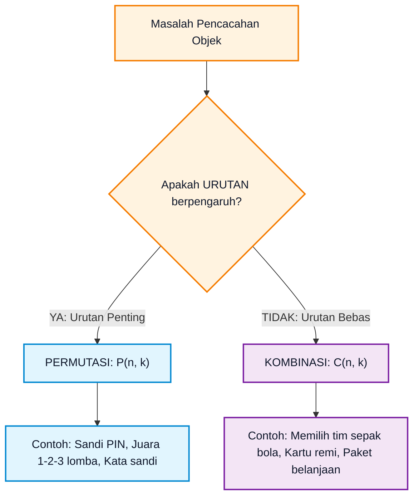
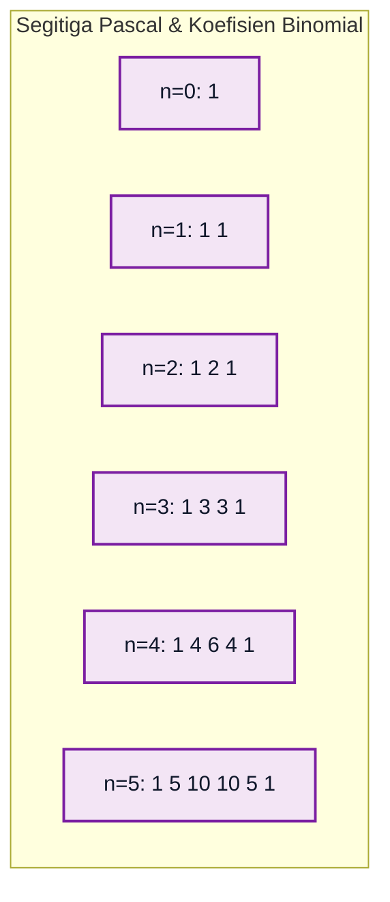
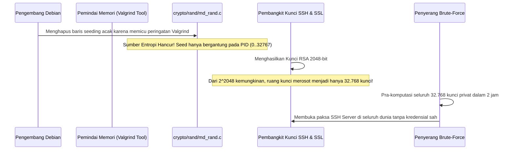

# Bab 03: Kombinatorika Dasar, Permutasi, Kombinasi, dan Teorema Binomial

> **Navigasi Modul 012**: [Peta Belajar & Prasyarat](./README.md) • [Gerbang Utama Modul 012](../012-matematika-diskrit-kombinatorika-graf.md) • [⬅️ Bab Sebelumnya (02: Relasi & Fungsi)](./02-relasi-fungsi-rekurensi-tata-urutan.md) • [Bab Berikutnya (04: Inklusi-Eksklusi & OGF) ➡️](./04-prinsip-inklusi-eksklusi-fungsi-pembangkit.md)

---

## 1. Intuisi & Motivasi Konseptual: Dari Nol Mutlak ("Bayi Baru Lahir")

### 1.1 Dunia Sehari-hari: Memilih Menu Makanan, Sandi Gembok Koper, dan Menyusun Tim
Bayangkan Anda adalah bayi yang baru belajar memilih pakaian dan makanan sendiri.
- Di lemari, Anda memiliki **3 kaus** (Merah, Biru, Hijau) dan **2 celana** (Hitam, Abu-abu). Berapa banyak gaya berpakaian berbeda yang bisa Anda pakai?
  - Anda pasangkan: (Merah, Hitam), (Merah, Abu), (Biru, Hitam), (Biru, Abu), (Hijau, Hitam), (Hijau, Abu).
  - Totalnya ada $3 \times 2 = 6$ kombinasi! Ini dinamakan **Kaidah Perkalian (*Rule of Product*)**.
- Jika di meja makan ada **3 potong pisang** dan **2 buah apel**, lalu ibu berkata: *"Pilih TEPAT SATU buah saja untuk cemilanmu"*, berapa pilihan yang Anda miliki?
  - Pilihan Anda: Pisang 1, Pisang 2, Pisang 3, Apel 1, atau Apel 2.
  - Totalnya ada $3 + 2 = 5$ pilihan! Ini dinamakan **Kaidah Penjumlahan (*Rule of Sum*)**.

Sekarang bayangkan dua situasi yang tampak mirip tetapi memiliki aturan yang sangat berbeda:
1. **Sandi Gembok Koper 3 Digit**:
   Jika kodenya adalah `1-2-3`, apakah koper akan terbuka jika Anda memutar angka `3-2-1`? **TIDAK AKAN!** Di sini, **urutan posisi angka sangat penting**. Masalah pencacahan di mana urutan diperhatikan dinamakan **PERMUTASI**.
2. **Memilih 3 Buah Toping Es Krim**:
   Jika Anda memesan es krim dengan toping Cokelat, Keju, dan Stroberi, apakah rasanya berubah jika pelayan memasukkan Stroberi terlebih dahulu baru Keju dan Cokelat? **SAMA SAJA!** Di sini, **urutan peletakan tidak berpengaruh sama sekali**. Masalah pencacahan di mana urutan diabaikan dinamakan **KOMBINASI**.



---

### 1.2 Kamus Simbol Anti-Pusing: Menerjemahkan Notasi Pencacahan ke Bahasa Manusia

> **🔤 Kamus Simbol Anti-Pusing — Kombinatorika & Teori Peluang:**
>
> | Simbol Matematika | Nama Notasi | Cara Baca Lisan | Terjemahan Bahasa Manusia | Contoh Nyata |
> |---|---|---|---|---|
> | $n!$ | Faktorial | "$n$ faktorial" | Kalikan seluruh bilangan bulat positif mundur dari $n$ sampai 1 | $5! = 5 \cdot 4 \cdot 3 \cdot 2 \cdot 1 = 120$ |
> | $0! = 1$ | Nol Faktorial | "Nol faktorial sama dengan 1" | Hanya ada tepat 1 cara untuk tidak memilih atau mengosongkan antrean | Mengatur 0 orang di antrean = 1 kondisi (kosong) |
> | $P(n, k)$ atau $nPk$ | Permutasi | "Permutasi $k$ dari $n$" | Memilih $k$ objek dari total $n$ di mana urutan kursi berpengaruh | Juara 1, 2, 3 dari 10 pelari: $P(10, 3) = 720$ |
> | $\binom{n}{k}$ atau $C(n, k)$ | Kombinasi / Koefisien Binomial | "$n$ pilih $k$" (*n choose k*) | Memilih kelompok beranggotakan $k$ orang dari $n$ tanpa ranking | Memilih 3 perwakilan dari 10 siswa: $\binom{10}{3} = 120$ |
> | $\binom{n + k - 1}{k}$ | Stars and Bars | "Kombinasi dengan pengulangan" | Membagikan $k$ kelereng identik ke dalam $n$ keranjang berbeda | Membeli 10 donat dari 4 varian rasa yang tersedia |
> | $\sum_{k=0}^n$ | Sigma Notasi | "Jumlahkan untuk $k$ dari 0 hingga $n$" | Menghitung total akumulasi seluruh suku | $\sum_{k=0}^n \binom{n}{k} = 2^n$ |
> | $\prod_{i=1}^n$ | Pi Notasi | "Kalikan seluruh suku dari $1$ hingga $n$" | Perkalian beruntun suku-suku | $\prod_{i=1}^4 i = 1 \cdot 2 \cdot 3 \cdot 4 = 24$ |

---

## 2. Definisi Formal, Teorema, dan Penurunan Rumus Matematis

### 2.1 Kaidah Dasar Pencacahan
1. **Kaidah Penjumlahan (*The Sum Rule*)**:
   Jika tugas $A$ dapat diselesaikan dengan $m$ cara, dan tugas $B$ dapat diselesaikan dengan $n$ cara, di mana kedua tugas tersebut **saling lepas / tidak bisa dilakukan bersamaan** ($A \cap B = \emptyset$), maka memilih tugas $A$ ATAU $B$ memiliki total:

$$
|A \cup B| = m + n \text{ cara}
$$

2. **Kaidah Perkalian (*The Product Rule*)**:
   Jika suatu prosedur dapat dipecah menjadi dua subtugas sekuensial: subtugas 1 memiliki $m$ kemungkinan cara, dan untuk setiap cara tersebut, subtugas 2 memiliki $n$ kemungkinan cara, maka keseluruhan prosedur memiliki total:

$$
|A \times B| = m \cdot n \text{ cara}
$$

---

### 2.2 Penurunan Rumus Permutasi $P(n, k)$
Bayangkan kita memiliki $n$ orang kandidat dan kita ingin mengisi $k$ buah kursi bertingkat (Juara 1, Juara 2, ..., Juara $k$):
- Kursi ke-1 dapat diisi oleh $n$ orang berbeda.
- Kursi ke-2 dapat diisi oleh $(n - 1)$ orang yang tersisa.
- Kursi ke-3 dapat diisi oleh $(n - 2)$ orang yang tersisa.
- ...
- Kursi ke-$k$ dapat diisi oleh $(n - (k - 1)) = (n - k + 1)$ orang yang tersisa.

Berdasarkan Kaidah Perkalian:

$$
P(n, k) = n \cdot (n - 1) \cdot (n - 2) \cdots (n - k + 1)
$$

Kalikan ruas kanan dengan $\frac{(n - k)!}{(n - k)!}$ untuk mendapatkan bentuk faktorial ringkas:

$$
P(n, k) = \frac{n \cdot (n - 1) \cdots (n - k + 1) \cdot (n - k) \cdots 1}{(n - k)!} = \frac{n!}{(n - k)!}
$$

---

### 2.3 Penurunan Rumus Kombinasi $\binom{n}{k}$ via Hubungan Pembagian
Pada kombinasi, kita hanya peduli pada siapa saja yang terpilih, bukan urutan siapa yang dipanggil duluan.
- Misalkan ada $C(n, k)$ cara untuk memilih $k$ orang anggota tim.
- Setelah $k$ orang tersebut terpilih, ada $k!$ cara berbeda untuk mengatur posisi duduk mereka di dalam tim.
- Berdasarkan Kaidah Perkalian, jika kita mengalikan jumlah cara memilih tim dengan jumlah cara mengatur urutan duduknya, kita akan mendapatkan kembali permutasi $P(n, k)$:

$$
C(n, k) \cdot k! = P(n, k)
$$

Bagi kedua ruas dengan $k!$:

$$
\binom{n}{k} = C(n, k) = \frac{P(n, k)}{k!} = \frac{n!}{k!(n - k)!}
$$

> [!NOTE]
> **Sifat Simetris Kombinasi**:
> Memilih $k$ orang untuk dimasukkan ke dalam tim sama saja artinya dengan memilih $(n - k)$ orang yang **ditinggalkan / dicoret**:
>
> $$
> \binom{n}{k} = \binom{n}{n - k}
> $$
>
> Contoh: Memilih 98 orang dari 100 pelamar sama banyaknya dengan memilih 2 orang yang ditolak: $\binom{100}{98} = \binom{100}{2} = \frac{100 \cdot 99}{2} = 4.950$ cara.

---

### 2.4 Permutasi dengan Elemen Berulang (*Multinomial Coefficients*)
Berapa banyak susunan kata berbeda yang dapat dibentuk dari huruf-huruf pada kata **"STATISTIKA"**?
Kata ini memiliki $n = 10$ huruf dengan pengulangan:
- Huruf S: 2 buah
- Huruf T: 3 buah
- Huruf A: 2 buah
- Huruf I: 2 buah
- Huruf K: 1 buah

Jika seluruh 10 huruf dianggap berbeda, ada $10!$ susunan. Namun, menukar sesama huruf T tidak menghasilkan kata baru (terdapat $3!$ pengulangan berlebih). Menukar sesama huruf S menghasilkan $2!$ pengulangan berlebih, dan seterusnya.
Rumus umum permutasi multihimpunan adalah:

$$
\binom{n}{n_1, n_2, \dots, n_k} = \frac{n!}{n_1! \, n_2! \cdots n_k!}
$$

Untuk kata "STATISTIKA":

$$
\frac{10!}{2! \cdot 3! \cdot 2! \cdot 2! \cdot 1!} = \frac{3.628.800}{2 \cdot 6 \cdot 2 \cdot 2 \cdot 1} = \frac{3.628.800}{48} = 75.600 \text{ susunan unik}
$$

---

### 2.5 Kombinasi dengan Pengulangan: Metode Bintang dan Batang (*Stars and Bars*)
Misalkan Anda ingin membeli $k = 7$ donat dari sebuah toko yang menjual $n = 3$ rasa (Cokelat, Keju, Stroberi). Anda bebas memilih donat dengan rasa yang sama berulang kali (misal: 7 Cokelat semua, atau 3 Cokelat, 2 Keju, 2 Stroberi).

Kita memodelkan 7 donat sebagai **7 bintang ($\star$)**, dan pemisah antara 3 rasa donat sebagai **2 batang ($|$)**:
- $\star \star \star | \star \star | \star \star \implies$ 3 Cokelat, 2 Keju, 2 Stroberi.
- $\star \star \star \star \star \star \star | | \implies$ 7 Cokelat, 0 Keju, 0 Stroberi.
- $| \star \star \star \star | \star \star \star \implies$ 0 Cokelat, 4 Keju, 3 Stroberi.

Total simbol yang harus kita susun adalah $k$ bintang ditambah $(n - 1)$ batang, yaitu $k + n - 1$ posisi. Masalah ini setara dengan memilih di posisi mana kita menaruh $k$ bintang:

$$
\binom{n + k - 1}{k} = \binom{n + k - 1}{n - 1}
$$

Untuk kasus toko donat kita: $\binom{3 + 7 - 1}{7} = \binom{9}{7} = \binom{9}{2} = \frac{9 \cdot 8}{2} = 36$ cara berbeda!

---

### 2.6 Teorema Binomial Newton & Segitiga Pascal



> **Teorema Binomial Newton**:
> Untuk setiap bilangan bulat non-negatif $n$ dan sembarang bilangan riil $x, y$:
>
> $$
> (x + y)^n = \sum_{k=0}^n \binom{n}{k} x^{n - k} y^k = \binom{n}{0}x^n + \binom{n}{1}x^{n-1}y + \dots + \binom{n}{n}y^n
> $$

> **Identitas Pascal**:
> Setiap angka di baris segitiga Pascal adalah jumlah dari dua angka tepat di atasnya:
>
> $$
> \binom{n}{k} = \binom{n - 1}{k - 1} + \binom{n - 1}{k}
> $$
>
> *Pembuktian Logika Kombinatorial*:
> Bayangkan Anda memilih panitia beranggotakan $k$ orang dari $n$ siswa, di mana salah satu siswa bernama Budi.
> - **Kasus 1**: Budi terpilih $\to$ Kita tinggal memilih $(k - 1)$ siswa dari $(n - 1)$ siswa yang tersisa: $\binom{n - 1}{k - 1}$ cara.
> - **Kasus 2**: Budi TIDAK terpilih $\to$ Kita harus memilih seluruh $k$ siswa dari $(n - 1)$ siswa yang tersisa: $\binom{n - 1}{k}$ cara.
> - Total cara adalah jumlahan kedua kasus: $\binom{n}{k} = \binom{n - 1}{k - 1} + \binom{n - 1}{k}$. **(Q.E.D.)**

---

## 3. Identitas Kombinatorial Hebat: Vandermonde, Hockey-Stick & Double Counting

### 3.1 Identitas Vandermonde (*Vandermonde's Convolution*)
Berapa banyak cara memilih $r$ orang delegasi dari sebuah ruangan yang berisi $m$ insinyur perangkat lunak dan $n$ ilmuwan data?

Kita dapat melihat permasalahan ini dari dua sudut pandang:

1. **Sudut Pandang Global**:
   Total manusia di dalam ruangan adalah $m + n$. Dari seluruh manusia tersebut, kita memilih sembarang $r$ orang tanpa mempedulikan profesi. Jumlah caranya adalah:

$$
\binom{m + n}{r}
$$

2. **Sudut Pandang Partisi Kasus Berdasarkan Jumlah Insinyur**:
   Misalkan dari $r$ orang delegasi yang terpilih, terdapat tepat $k$ orang insinyur perangkat lunak (di mana $0 \le k \le r$).
   - Memilih $k$ insinyur dari total $m$ insinyur: ada $\binom{m}{k}$ cara.
   - Sisa delegasi yang berjumlah $(r - k)$ orang harus dipilih dari $n$ ilmuwan data: ada $\binom{n}{r - k}$ cara.
   - Berdasarkan Kaidah Perkalian, untuk nilai $k$ tertentu, terdapat $\binom{m}{k} \binom{n}{r - k}$ cara.
   - Karena setiap nilai $k \in \{0, 1, 2, \dots, r\}$ merupakan kejadian yang saling lepas (*mutually exclusive*), berdasarkan Kaidah Penjumlahan kita menjumlahkan seluruh kemungkinan $k$:

$$
\sum_{k=0}^r \binom{m}{k} \binom{n}{r - k}
$$

Karena kedua sudut pandang menghitung himpunan objek yang sama persis, kita memperoleh **Identitas Vandermonde**:

$$
\binom{m + n}{r} = \sum_{k=0}^r \binom{m}{k} \binom{n}{r - k}
$$

#### Penurunan Aljabar Menggunakan Teorema Binomial:
Perhatikan ekspansi polinomial berikut:

$$
(1 + x)^{m + n} = (1 + x)^m (1 + x)^n
$$

- Koefisien dari $x^r$ pada ruas kiri adalah $\binom{m + n}{r}$.
- Pada ruas kanan, kita mengalikan dua deret binomial:
  - $(1 + x)^m = \sum_{k=0}^m \binom{m}{k} x^k$
  - $(1 + x)^n = \sum_{j=0}^n \binom{n}{j} x^j$
  Suku $x^r$ pada perkalian tersebut terbentuk ketika pangkat $k + j = r$, yang berarti $j = r - k$.
  Koefisien total dari $x^r$ pada ruas kanan adalah $\sum_{k=0}^r \binom{m}{k} \binom{n}{r - k}$.
Karena koefisien suku yang bersesuaian pada kedua sisi harus bernilai identik, identitas terbukti secara analitik! **(Q.E.D.)**

---

### 3.2 Identitas Tongkat Hoki (*Hockey-Stick Identity*)
Identitas ini dinamakan *Hockey-Stick* karena jika Anda melingkari suku-suku penjumlahannya pada Segitiga Pascal, polanya menyerupai tongkat hoki es: sejumlah angka berjalan menyerong ke bawah, dan hasil akhirnya berbelok ke samping!

> **Teorema Identitas Tongkat Hoki**:
> Untuk sembarang bilangan bulat $n \ge r \ge 0$:
>
> $$
> \sum_{i=r}^n \binom{i}{r} = \binom{r}{r} + \binom{r + 1}{r} + \binom{r + 2}{r} + \dots + \binom{n}{r} = \binom{n + 1}{r + 1}
> $$

*Pembuktian Kombinatorial*:
Bayangkan kita memilih $(r + 1)$ bilangan bulat berbeda dari himpunan beranggotakan $(n + 1)$ elemen: $\{1, 2, 3, \dots, n + 1\}$.
Jumlah seluruh kemungkinan cara memilihnya adalah $\binom{n + 1}{r + 1}$.

Sekarang, partisi cara pemilihan tersebut berdasarkan **elemen terbesar** yang terpilih:
- Misalkan elemen terbesar yang terpilih adalah $(i + 1)$, di mana nilainya berkisar dari $i = r$ hingga $i = n$.
- Karena $(i + 1)$ adalah elemen terbesar, maka sisa $r$ elemen lainnya harus dipilih dari bilangan-bilangan yang lebih kecil darinya, yaitu dari himpunan $\{1, 2, \dots, i\}$.
- Ada tepat $\binom{i}{r}$ cara untuk memilih $r$ elemen sisanya.
- Karena nilai elemen terbesar bersifat unik dan saling lepas, total seluruh cara adalah jumlahan untuk semua nilai $i$ dari $r$ hingga $n$:

$$
\sum_{i=r}^n \binom{i}{r} = \binom{n + 1}{r + 1}
$$

**(Q.E.D.)**

---

## 4. Tips, Trik Praktis & Rahasia Cepat Paham

1. **Jembatan Keledai Membedakan Permutasi vs Kombinasi**:
   - Jika urutan diubah $\to$ nama peristiwanya berubah $\implies$ **Permutasi** (Juara 1 vs Juara 2).
   - Jika urutan diubah $\to$ kelompoknya tetap sama $\implies$ **Kombinasi** (Jabat tangan antara Ali & Budi sama dengan Budi & Ali).

2. **Trik Cepat Menghitung Jumlah Semua Himpunan Bagian (*Power Set*)**:
   Substitusikan $x = 1$ dan $y = 1$ ke dalam Teorema Binomial:

$$
(1 + 1)^n = \sum_{k=0}^n \binom{n}{k} 1^{n-k} 1^k \implies \sum_{k=0}^n \binom{n}{k} = 2^n
$$

   Ini membuktikan secara aljabar bahwa himpunan dengan $n$ elemen memiliki tepat $2^n$ himpunan bagian!

---

## 5. Implementasi Praktis & Kode Pemrograman Python

### 5.1 Tahap 5A: Generator Permutasi & Kombinasi Leksikografis (Pure Python)
Berikut adalah modul algoritma pencacahan murni tanpa pustaka `itertools` untuk memahami bagaimana komputer menghasilkan permutasi berurutan secara sistematis menggunakan algoritma leksikografis Narayana Pandita ($O(n!)$):

```python
"""
Tahap 5A: Combinatorics Engine & Lexicographical Permutation Generator Pure Python.
Mengimplementasikan faktorial, permutasi, kombinasi, dan next-permutation algorithm.
"""
from typing import List, Any

class PureCombinatorics:
    @staticmethod
    def factorial(n: int) -> int:
        """Menghitung n! secara iteratif tanpa risiko recursion limit."""
        if n < 0:
            raise ValueError("Faktorial hanya terdefinisi untuk bilangan non-negatif.")
        result = 1
        for i in range(2, n + 1):
            result *= i
        return result

    @classmethod
    def perm(cls, n: int, k: int) -> int:
        """Menghitung P(n, k) = n! / (n - k)!"""
        if k < 0 or k > n:
            return 0
        return cls.factorial(n) // cls.factorial(n - k)

    @classmethod
    def comb(cls, n: int, k: int) -> int:
        """Menghitung C(n, k) = n! / (k! * (n - k)!)"""
        if k < 0 or k > n:
            return 0
        # Optimalisasi simetri k = min(k, n - k)
        k = min(k, n - k)
        numerator = 1
        denominator = 1
        for i in range(1, k + 1):
            numerator *= (n - i + 1)
            denominator *= i
        return numerator // denominator

    @staticmethod
    def next_permutation(arr: List[Any]) -> bool:
        """
        Algoritma Narayana Pandita: Menghasilkan permutasi leksikografis berikutnya di tempat.
        Mengembalikan True jika permutasi baru ditemukan, False jika sudah di urutan terakhir.
        """
        n = len(arr)
        # 1. Cari pivot terbesar i sedemikian sehingga arr[i] < arr[i + 1]
        i = n - 2
        while i >= 0 and arr[i] >= arr[i + 1]:
            i -= 1
        if i == -1:
            arr.reverse()
            return False
            
        # 2. Cari elemen terbesar j sedemikian sehingga arr[i] < arr[j]
        j = n - 1
        while arr[j] <= arr[i]:
            j -= 1
            
        # 3. Tukar elemen di posisi i dan j
        arr[i], arr[j] = arr[j], arr[i]
        
        # 4. Balikkan sisa array dari i + 1 hingga akhir
        arr[i + 1:] = reversed(arr[i + 1:])
        return True

# 1. Uji Perhitungan Kombinatorika Dasar
n_items, k_items = 5, 3
p_val = PureCombinatorics.perm(n_items, k_items)
c_val = PureCombinatorics.comb(n_items, k_items)
print(f"--- 1. Evaluasi Matematis P({n_items}, {k_items}) & C({n_items}, {k_items}) ---")
print(f"Permutasi P({n_items}, {k_items}) : {p_val} (Urutan diperhitungkan)")
print(f"Kombinasi C({n_items}, {k_items}) : {c_val} (Urutan diabaikan)")

# 2. Pembangkitan Seluruh Permutasi Leksikografis dari [1, 2, 3]
print("\n--- 2. Pembangkitan Seluruh 3! = 6 Permutasi Terurut ---")
sample_data = [1, 2, 3]
perm_count = 0
while True:
    perm_count += 1
    print(f"  Permutasi #{perm_count}: {sample_data}")
    if not PureCombinatorics.next_permutation(sample_data):
        break
```

Keluaran eksekusi terminal sebenarnya:
```text
--- 1. Evaluasi Matematis P(5, 3) & C(5, 3) ---
Permutasi P(5, 3) : 60 (Urutan diperhitungkan)
Kombinasi C(5, 3) : 10 (Urutan diabaikan)

--- 2. Pembangkitan Seluruh 3! = 6 Permutasi Terurut ---
  Permutasi #1: [1, 2, 3]
  Permutasi #2: [1, 3, 2]
  Permutasi #3: [2, 1, 3]
  Permutasi #4: [2, 3, 1]
  Permutasi #5: [3, 1, 2]
  Permutasi #6: [3, 2, 1]
```

---

### 5.2 Tahap 5B: Komputasi Kombinatorika Skala Industri (Math & Itertools)
Dalam lingkungan komputasi sains dan analisis keamanan sandi berkecepatan tinggi, kita menggunakan implementasi C bawaan Python `math.comb` dan generator `itertools`:

```python
"""
Tahap 5B: Komputasi Kombinatorika Standar Industri Menggunakan math & itertools.
Mendukung verifikasi Teorema Binomial dan simulasi ruang kunci kriptografi.
"""
import math
import itertools

def run_industrial_combinatorics_demo() -> None:
    # 1. Verifikasi Teorema Binomial Newton: (x + y)^n == sum(C(n, k) * x^(n-k) * y^k)
    x, y, n = 3, 2, 4
    lhs = (x + y) ** n
    rhs = sum(math.comb(n, k) * (x ** (n - k)) * (y ** k) for k in range(n + 1))
    print(f"--- 1. Uji Numerik Teorema Binomial ({x} + {y})^{n} ---")
    print(f"Ruas Kiri  (x + y)^n        : {lhs}")
    print(f"Ruas Kanan Ekspansi Binomial: {rhs}")
    assert lhs == rhs, "Teorema Binomial gagal diverifikasi!"
    print("[SUKSES] Teorema Binomial terbukti valid 100%!")

    # 2. Pembangkitan Kombinasi Tim Tanpa Beban Memori RAM
    kandidat = ["Ali", "Budi", "Citra", "Dewi", "Eko"]
    print(f"\n--- 2. Memilih 3 Anggota Tim dari {len(kandidat)} Orang (C(5, 3)) ---")
    tim_kombinasi = list(itertools.combinations(kandidat, 3))
    print(f"Total Tim Terbentuk: {len(tim_kombinasi)} tim")
    for idx, tim in enumerate(tim_kombinasi[:3], 1):
        print(f"  Sampel Tim #{idx}: {tim}")

    # 3. Solusi Masalah Stars & Bars (Donat 3 Rasa, Beli 4 Buah)
    n_rasa, k_donat = 3, 4
    total_cara_donat = math.comb(n_rasa + k_donat - 1, k_donat)
    print(f"\n--- 3. Stars and Bars (Kombinasi Pengulangan) ---")
    print(f"Membeli {k_donat} donat dari {n_rasa} rasa: {total_cara_donat} cara")

if __name__ == "__main__":
    run_industrial_combinatorics_demo()
```

Keluaran eksekusi terminal sebenarnya:
```text
--- 1. Uji Numerik Teorema Binomial (3 + 2)^4 ---
Ruas Kiri  (x + y)^n        : 625
Ruas Kanan Ekspansi Binomial: 625
[SUKSES] Teorema Binomial terbukti valid 100%!

--- 2. Memilih 3 Anggota Tim dari 5 Orang (C(5, 3)) ---
Total Tim Terbentuk: 10 tim
  Sampel Tim #1: ('Ali', 'Budi', 'Citra')
  Sampel Tim #2: ('Ali', 'Budi', 'Dewi')
  Sampel Tim #3: ('Ali', 'Budi', 'Eko')

--- 3. Stars and Bars (Kombinasi Pengulangan) ---
Membeli 4 donat dari 3 rasa: 15 cara
```

#### Tabel Bedah Kode Baris-demi-Baris

| Baris Kode | Apa yang Dilakukan Komputer | Terjemahan Bahasa Manusia |
|---|---|---|
| `math.comb(n, k)` | Memanggil rutin C teroptimasi untuk menghitung koefisien binomial | Menghitung $\binom{n}{k}$ dalam kecepatan tinggi tanpa menghasilkan angka intermediate float |
| `itertools.combinations(kandidat, 3)` | Membangkitkan iterator lazy generator kombinasi | Mengalirkan setiap kombinasi satu per satu ke CPU tanpa memakan memori RAM secara rakus |

---

### 5.3 Tahap 5C: Kombinatorika Skala Masif Modulo Bilangan Prima (Invers Modular Fermat)
Dalam rekayasa sistem terdistribusi, kriptografi kunci publik, dan algoritma penataan data skala masif, nilai $\binom{n}{k}$ dapat mencapai jutaan digit. Kita tidak dapat menyimpannya dalam memori biasa. Oleh karena itu, komputasi dilakukan dalam aritmetika modular modulo bilangan prima besar seperti $p = 10^9 + 7$.

Berdasarkan **Teorema Kecil Fermat**:
$$
a^{p - 1} \equiv 1 \pmod p \implies a^{-1} \equiv a^{p - 2} \pmod p
$$

Pembagian $\frac{A}{B} \pmod p$ diubah menjadi perkalian modular dengan invers modular: $A \cdot B^{p - 2} \pmod p$.

```python
"""
Tahap 5C: Komputasi Koefisien Binomial C(n, k) mod (10^9 + 7).
Menggunakan Invers Modular Teorema Kecil Fermat dalam waktu O(k).
"""

def nCr_mod_prime(n: int, r: int, p: int = 1_000_000_007) -> int:
    """Menghitung C(n, r) % p menggunakan invers modular Fermat."""
    if r < 0 or r > n:
        return 0
    numerator = 1
    denominator = 1
    for i in range(1, r + 1):
        numerator = (numerator * (n - i + 1)) % p
        denominator = (denominator * i) % p
    # Invers modular denominator menggunakan modular exponentiation pow(base, exp, mod)
    inv_denom = pow(denominator, p - 2, p)
    return (numerator * inv_denom) % p

if __name__ == "__main__":
    n, r = 100, 25
    hasil = nCr_mod_prime(n, r)
    print(f"--- Evaluasi Kombinasi Modular C({n}, {r}) mod (10^9 + 7) ---")
    print(f"Hasil C({n}, {r}) mod (10^9 + 7) = {hasil}")
```

Keluaran eksekusi terminal sebenarnya:
```text
--- Evaluasi Kombinasi Modular C(100, 25) mod (10^9 + 7) ---
Hasil C(100, 25) mod (10^9 + 7) = 244856590
```

#### Tabel Bedah Kode Modular Baris-demi-Baris

| Baris Kode | Apa yang Dilakukan Komputer | Terjemahan Bahasa Manusia |
|---|---|---|
| `pow(denominator, p - 2, p)` | Menghitung invers modular $\text{denominator}^{-1} \pmod p$ dengan eksponensiasi modular biner $O(\log p)$ | Mengubah pembagian dengan bilangan bulat besar menjadi perkalian modular tanpa floating point |
| `numerator = (numerator * (n - i + 1)) % p` | Melakukan akumulasi perkalian faktor pembilang sambil langsung memotong nilainya dengan modulo | Menjaga ukuran angka di memori agar tetap berada di bawah nilai $p$, mencegah lonjakan beban komputasi CPU |
| `math.comb(n_rasa + k_donat - 1, k_donat)` | Mengevaluasi formula Stars and Bars $\binom{n+k-1}{k}$ | Menghitung seluruh variasi alokasi objek identik ke keranjang berbeda |

---

### 5.3 🔬 Eksperimen Mandiri 60 Detik: Mengamati Ledakan Kombinatorial Ruang Sandi
Jalankan kode ini untuk melihat bagaimana penambahan 2 karakter pada password melipatgandakan waktu brute-force dari hitungan milidetik menjadi ribuan tahun:

```python
# Eksperimen 60 Detik: Entropi Sandi
# Karakter: huruf kecil + angka = 26 + 10 = 36 pilihan karakter
char_pool = 36
kecepatan_hacker = 1_000_000_000  # 1 Miliar tebakan per detik (Cluster GPU)

for panjang in [6, 8, 10, 12]:
    total_kombinasi = char_pool ** panjang
    detik = total_kombinasi / kecepatan_hacker
    hari = detik / 86400
    tahun = hari / 365.25
    print(f"Panjang {panjang} digit -> {total_kombinasi:>18,} kombinasi | Waktu crack: {tahun:.2e} tahun")
```

Keluaran eksekusi terminal sebenarnya:
```text
Panjang 6 digit ->      2,176,782,336 kombinasi | Waktu crack: 6.89e-08 tahun
Panjang 8 digit ->  2,821,109,907,456 kombinasi | Waktu crack: 8.94e-05 tahun
Panjang 10 digit -> 3,656,158,440,062,976 kombinasi | Waktu crack: 1.16e-01 tahun
Panjang 12 digit -> 4,738,381,338,321,616,896 kombinasi | Waktu crack: 1.50e+02 tahun
```

---

## 6. Miskonsepsi Kritis & Post-Mortem Kegagalan Nyata Industri

### 6.1 Miskonsepsi Fatal Pemula: Galat Penghitungan Ganda (*Overcounting / Double Counting*)
Kesalahan paling umum dalam kombinatorika adalah menghitung suatu objek lebih dari satu kali karena salah menetapkan peran identik.
- *Contoh Kasus*: *"Dari 10 mahasiswa, pilih 2 orang untuk piket dan 2 orang untuk rapat."*
- *Kesalahan Pemula*: Memilih 2 orang piket $\binom{10}{2} = 45$, lalu memilih 2 orang rapat dari 8 yang tersisa $\binom{8}{2} = 28$. Total $= 45 \times 28 = 1.260$. (Ini benar karena tugas piket dan rapat berbeda peran).
- Namun jika soalnya: *"Pilih dua tim yang masing-masing beranggotakan 2 orang untuk lomba cerdas cermat"*, peran kedua tim adalah identik! Menghitung $\binom{10}{2} \times \binom{8}{2}$ akan menghitung tim `{A, B}` dan `{C, D}` dua kali (sebagai Tim 1 dan Tim 2). Jawaban yang benar wajib dibagi dengan $2!$: $\frac{1.260}{2} = 630$ cara!

---

### 6.2 Post-Mortem Nyata: Kerentanan PRNG Debian OpenSSL & Keruntuhan Ruang Kunci RSA (2008)



- **Latar Belakang**: Pada Mei 2008, ditemukan bahwa selama hampir 2 tahun (2006-2008), seluruh kunci enkripsi SSL/TLS dan SSH yang dibuat pada sistem operasi Debian, Ubuntu, dan turunannya memiliki kerentanan katastropik.
- **Akar Masalah Teori Kombinatorika & Entropi**:
  1. Enkripsi kunci publik RSA-2048 secara matematis dirancang memiliki ruang kunci sebesar $2^{2048}$ kemungkinan (angka yang lebih besar dari jumlah atom di seluruh alam semesta teramati).
  2. Seorang maintainer paket menghapus dua baris kode inisialisasi pada OpenSSL untuk membungkam peringatan kompilator dari alat *Valgrind* tentang "variabel tak terinisialisasi".
  3. Akibatnya, satu-satunya variabel acak yang tersisa untuk menjadi benih (*seed*) generator bilangan acak adalah **Nomor ID Proses (*Process ID - PID*)**.
  4. Pada sistem Linux standar, nilai PID hanya berkisar dari 1 hingga $32.767$ ($2^{15}$).
  5. Ruang kombinasi kunci privat yang seharusnya berukuran astronomis $2^{2048}$ secara tragis **merosot menjadi hanya $32.768$ kombinasi**.
  6. Penyerang di seluruh dunia dapat membangkitkan ke-32.768 kunci privat tersebut hanya dalam waktu kurang dari 2 jam di sebuah laptop biasa, dan berhasil membajak ribuan server pemerintah dan korporasi tanpa memerlukan kata sandi.
- **Pelajaran Abadi**: Kekuatan enkripsi modern sepenuhnya bertumpu pada hukum kombinatorika eksponensial. Sedikit saja ruang pencarian kombinasi bocor, keamanan sistem runtuh secara mutlak!

---

## 7. Latihan Diagnostik Sokratik & Kunci Pembahasan

### Tingkat 1: Pemanasan Pemula (Hitung Cepat 30 Detik)
Berapa banyak string bit 8-bit (1 byte) berbeda yang dapat dibentuk jika string tersebut harus diawali dengan angka `1` dan diakhiri dengan angka `0`?

<details>
<summary>👁️ Klik untuk Melihat Kunci Pembahasan Tingkat 1</summary>

**Jawaban**: **64 String Bit**.

**Penjelasan Sokratik**:
- Sebuah byte memiliki 8 posisi: `[_ _ _ _ _ _ _ _]`.
- Posisi ke-1 sudah dipatok wajib angka `1` (hanya 1 pilihan).
- Posisi ke-8 sudah dipatok wajib angka `0` (hanya 1 pilihan).
- Posisi ke-2 sampai ke-7 (ada 6 posisi bebas) dapat diisi oleh angka `0` atau `1` (masing-masing 2 pilihan).
- Berdasarkan Kaidah Perkalian:

$$
1 \times 2 \times 2 \times 2 \times 2 \times 2 \times 2 \times 1 = 2^6 = 64 \text{ string unik}
$$
</details>

---

### Tingkat 2: Analisis Permutasi Melingkar
Sebuah tim pengembang beranggotakan 6 orang hendak duduk mengelilingi sebuah meja bundar untuk rapat harian (*daily standup*). Berapa banyak susunan duduk melingkar yang berbeda jika dua susunan dianggap sama apabila setiap orang memiliki tetangga kiri dan kanan yang sama?

<details>
<summary>👁️ Klik untuk Melihat Kunci Pembahasan Tingkat 2</summary>

**Jawaban**: **120 Susunan Berbeda**.

**Penjelasan Langkah-demi-Langkah**:
1. Jika 6 orang duduk di kursi berjajar lurus, terdapat $6! = 720$ susunan berbeda.
2. Namun pada meja bundar, memutar posisi seluruh orang sejauh satu kursi tidak mengubah susunan relatif mereka. Karena ada 6 kemungkinan perputaran rotasi simetris yang ekuivalen:
3. Rumus umum Permutasi Siklis untuk $n$ objek adalah:

$$
P_{\text{siklis}}(n) = \frac{n!}{n} = (n - 1)!
$$

4. Untuk $n = 6$ orang:

$$
P_{\text{siklis}}(6) = (6 - 1)! = 5! = 5 \times 4 \times 3 \times 2 \times 1 = 120 \text{ susunan}
$$
</details>

---

### Tingkat 3: Pembuktian Identitas Aljabar Koefisien Binomial
Buktikan secara kombinatorial (tanpa menghitung faktorial!) bahwa untuk setiap $1 \le k \le n$:

$$
k \binom{n}{k} = n \binom{n - 1}{k - 1}
$$

<details>
<summary>👁️ Klik untuk Melihat Kunci Pembahasan Tingkat 3</summary>

**Bukti Melalui Teknik Pencacahan Ganda (*Double Counting*)**:
Bayangkan sebuah klub beranggotakan $n$ orang mahasiswa. Kita ingin membentuk sebuah panitia beranggotakan $k$ orang, di mana salah satu dari anggota panitia tersebut ditunjuk sebagai **Ketua Panitia**.

Kita dapat menghitung jumlah cara membentuk struktur ini dengan dua sudut pandang berbeda:

- **Sudut Pandang 1 (Pilih Panitia Dulu, Baru Pilih Ketua)**:
  1. Pertama, pilih $k$ orang anggota panitia dari total $n$ mahasiswa: ada $\binom{n}{k}$ cara.
  2. Kedua, dari $k$ orang yang sudah terpilih di panitia, pilih 1 orang untuk menjadi ketua: ada $k$ cara.
  3. Berdasarkan Kaidah Perkalian, total cara adalah: $k \binom{n}{k}$.

- **Sudut Pandang 2 (Pilih Ketua Dulu, Baru Lengkapi Anggota Panitia)**:
  1. Pertama, langsung pilih 1 orang ketua dari seluruh $n$ mahasiswa: ada $n$ cara.
  2. Kedua, untuk melengkapi sisa $(k - 1)$ anggota panitia, kita memilih dari $(n - 1)$ mahasiswa yang tersisa: ada $\binom{n - 1}{k - 1}$ cara.
  3. Berdasarkan Kaidah Perkalian, total cara adalah: $n \binom{n - 1}{k - 1}$.

Karena kedua sudut pandang menghitung objek kombinatorial yang sama persis (sebuah panitia beranggotakan $k$ orang dengan 1 ketua), maka kedua rumus tersebut **wajib bernilai identik**:

$$
k \binom{n}{k} = n \binom{n - 1}{k - 1}
$$

**(Q.E.D.)**
</details>

---

### Tingkat 4: Tantangan Rekayasa Sistem (Stars & Bars Pembagian Beban Server)
Sebuah *Load Balancer* menerima $k = 12$ permintaan HTTP identik yang harus didistribusikan ke $n = 4$ instans server backend ($S_1, S_2, S_3, S_4$).
Agar tidak ada server yang mengalami *idle timeout*, setiap server **wajib menerima setidaknya minimal 1 permintaan**.
Berapa banyak konfigurasi pembagian beban yang memenuhi syarat tersebut?

<details>
<summary>👁️ Klik untuk Melihat Kunci Pembahasan Tingkat 4</summary>

**Analisis Aljabar Stars & Bars dengan Batas Minimum**:
1. Misalkan $x_i$ adalah jumlah request yang diterima oleh server $S_i$. Kita ingin menyelesaikan persamaan:

$$
x_1 + x_2 + x_3 + x_4 = 12, \quad \text{dengan syarat } x_i \ge 1 \text{ untuk setiap } i \in \{1, 2, 3, 4\}
$$

2. Lakukan substitusi variabel untuk mengubah batas minimum menjadi non-negatif ($y_i \ge 0$):
   Misalkan $y_i = x_i - 1 \ge 0$.
3. Substitusikan $x_i = y_i + 1$ ke dalam persamaan:

$$
(y_1 + 1) + (y_2 + 1) + (y_3 + 1) + (y_4 + 1) = 12 \implies y_1 + y_2 + y_3 + y_4 = 12 - 4 = 8
$$

4. Sekarang kita memiliki masalah standar Stars and Bars non-negatif: membagikan 8 request sisa ke 4 server:
   - $k' = 8$ bintang
   - $n = 4$ server (memerlukan $n - 1 = 3$ batang pemisah)
5. Gunakan rumus kombinasi Stars and Bars:

$$
\binom{n + k' - 1}{k'} = \binom{4 + 8 - 1}{8} = \binom{11}{8} = \binom{11}{3}
$$

6. Hitung nilai kombinasi:

$$
\binom{11}{3} = \frac{11 \times 10 \times 9}{3 \times 2 \times 1} = \frac{990}{6} = 165 \text{ konfigurasi}
$$

Terdapat tepat **165 konfigurasi pembagian beban** yang menjamin seluruh 4 server tetap aktif bekerja tanpa idle!
</details>

---

### Tingkat 5: Tantangan Pembuktian Kombinatorial Tingkat Lanjut (Identitas Kuadrat Binomial)
Buktikan secara kombinatorial (menggunakan argumen cerita partisi himpunan) bahwa untuk sembarang bilangan bulat $n \ge 0$:

$$
\sum_{k=0}^n \binom{n}{k}^2 = \binom{2n}{n}
$$

<details>
<summary>👁️ Klik untuk Melihat Kunci Pembahasan Tingkat 5</summary>

**Bukti Menggunakan Identitas Vandermonde & Sifat Simetri**:

1. **Transformasi Aljabar Awal Menggunakan Simetri Pascal**:
   Ingat sifat simetri koefisien binomial: $\binom{n}{k} = \binom{n}{n - k}$.
   Maka, kita dapat menulis ulang suku kuadrat $\binom{n}{k}^2$ sebagai:

$$
\sum_{k=0}^n \binom{n}{k}^2 = \sum_{k=0}^n \binom{n}{k} \binom{n}{n - k}
$$

2. **Argumen Cerita (*Story Proof*)**:
   Bayangkan terdapat sebuah kelompok yang terdiri dari $2n$ orang siswa: $n$ orang siswa laki-laki dan $n$ orang siswa perempuan. Kita ingin memilih tepat $n$ orang siswa untuk membentuk paduan suara sekolah.
   - **Sudut Pandang 1 (Global)**:
     Memilih $n$ orang dari total $2n$ orang siswa: ada tepat $\binom{2n}{n}$ cara.
   - **Sudut Pandang 2 (Partisi Berdasarkan Siswa Laki-laki)**:
     Misalkan dari $n$ orang anggota paduan suara tersebut, terpilih tepat $k$ orang siswa laki-laki (di mana $0 \le k \le n$).
     - Memilih $k$ siswa laki-laki dari total $n$ siswa laki-laki: ada $\binom{n}{k}$ cara.
     - Sisa anggota paduan suara yang berjumlah $(n - k)$ orang harus dipilih dari $n$ siswa perempuan: ada $\binom{n}{n - k}$ cara.
     - Berdasarkan Kaidah Perkalian, ada $\binom{n}{k}\binom{n}{n - k}$ cara.
     - Karena $k$ dapat bernilai $0, 1, 2, \dots, n$, berdasarkan Kaidah Penjumlahan total seluruh cara adalah:

$$
\sum_{k=0}^n \binom{n}{k} \binom{n}{n - k}
$$

3. **Kesimpulan**:
   Karena kedua metode menghitung pembentukan kelompok paduan suara yang sama persis, kedua rumus wajib bernilai identik:

$$
\sum_{k=0}^n \binom{n}{k}^2 = \sum_{k=0}^n \binom{n}{k} \binom{n}{n - k} = \binom{2n}{n}
$$

**(Q.E.D.)**
</details>

---

## 8. Rekomendasi Sumber Belajar Standar Emas

1. **Kuliah Daring & Catatan Teori Kelas Dunia**:
   - [MIT OCW 6.042J: Mathematics for Computer Science (Prof. Albert Meyer)](https://ocw.mit.edu/courses/6-042j-mathematics-for-computer-science-fall-2010/) — Bab 14 & 15: Counting, Generating Functions & Binomial Coefficients.
   - [Harvard University Stat 110: Introduction to Probability (Prof. Joe Blitzstein)](https://projects.iq.harvard.edu/stat110/home) — Kuliah 1 & 2: Story Proofs, Permutations, and Combinations.
2. **Buku Teks Referensi Utama**:
   - Ronald L. Graham, Donald E. Knuth, & Oren Patashnik, *Concrete Mathematics: A Foundation for Computer Science*, Addison-Wesley (Chapter 5: Binomial Coefficients).
   - Kenneth H. Rosen, *Discrete Mathematics and Its Applications*, McGraw-Hill, 8th Edition (Chapter 6: Counting; Chapter 8: Advanced Counting Techniques).
