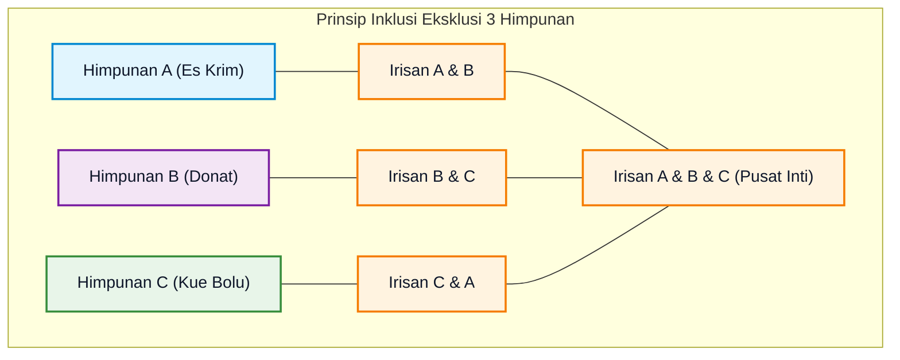
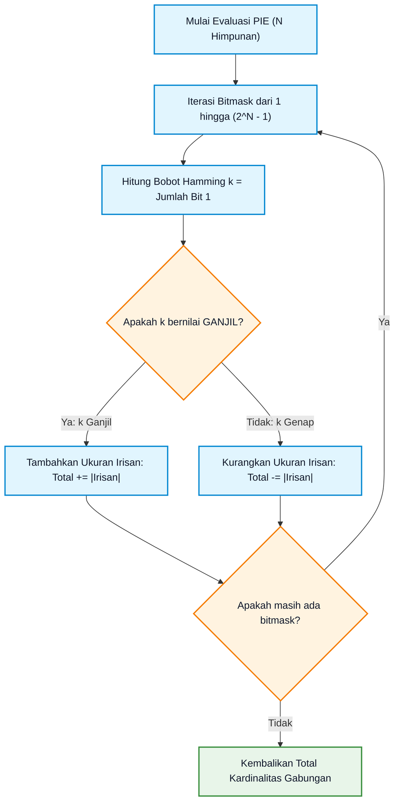
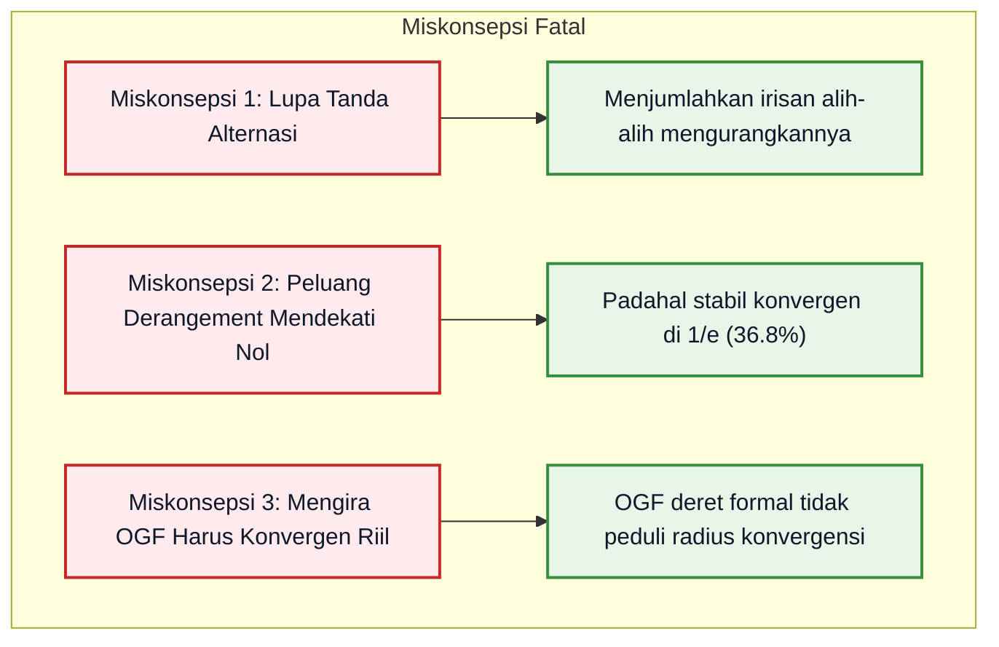

# Bab 04: Prinsip Inklusi-Eksklusi, Derangement, dan Fungsi Pembangkit

> **Navigasi Modul 012**: [Peta Belajar & Prasyarat](./README.md) • [Gerbang Utama Modul 012](../012-matematika-diskrit-kombinatorika-graf.md) • [⬅️ Bab Sebelumnya (03: Kombinatorika & Permutasi)](./03-kombinatorika-permutasi-kombinasi-partisi.md) • [Bab Berikutnya (05: Relasi Rekurensi & Master Theorem) ➡️](./05-relasi-rekurensi-persamaan-beda-divide-conquer.md)

---

## 1. Intuisi & Motivasi Konseptual: Dari Nol Mutlak ("Bayi Baru Lahir")

### 1.1 Dunia Sehari-hari: Jebakan Menghitung Dobel & Pesta Tukar Kado Tanpa Hadiah Sendiri
Bayangkan Anda adalah seorang anak kecil yang mengamati pesta ulang tahun di lingkungan Anda:

1. **Jebakan Menghitung Ganda (Double Counting)**:
   Ibu Anda bertanya: *"Ada berapa anak di ruangan ini yang suka makan es krim atau suka makan donat?"*
   - Anda menghitung anak yang suka es krim: ada 15 anak.
   - Anda menghitung anak yang suka donat: ada 12 anak.
   - Jika Anda langsung menjumlahkan $15 + 12 = 27$ anak, Anda **pasti melakukan kesalahan besar**!
   - Mengapa? Karena Budi dan Siti suka **kedua-duanya** (es krim DAN donat). Wajah Budi dan Siti Anda hitung dua kali: sekali di antrean es krim, dan sekali lagi di antrean donat!
   - Agar hitungan Anda jujur dan akurat, Anda wajib **mengurangi anak-anak yang dihitung ganda tersebut**:
     $$\text{Total Anak Unik} = (\text{Suka Es Krim}) + (\text{Suka Donat}) - (\text{Suka Keduanya})$$
   Prinsip koreksi sederhana ini adalah cikal bakal dari **Prinsip Inklusi-Eksklusi (Principle of Inclusion-Exclusion / PIE)**.

2. **Misteri Pesta Tukar Kado (Derangement)**:
   Sekarang bayangkan $n$ anak membawa satu kado masing-masing ke pesta. Seluruh kado dikumpulkan di tengah meja, lalu diacak secara acak dan dibagikan kembali ke setiap anak.
   - Betapa malunya jika ada anak yang menerima **kadonya sendiri**!
   - Sebuah susunan pembagian kado di mana **tidak ada satu pun anak yang menerima kadonya sendiri** dinamakan **Pengacakan Total / Derangement** (dilambangkan dengan tanda seru di depan huruf: $!n$ atau subfaktorial).
   - Berapa peluang peristiwa ini terjadi jika pestanya dihadiri oleh 100 orang anak? Kebanyakan orang mengira peluangnya hampir 0% karena sangat sulit menghindari 100 kado milik sendiri.
   - Namun matematika diskrit membuktikan keajaiban yang luar biasa: berapapun banyaknya anak (baik 10 orang, 100 orang, atau 1 juta orang), peluang tidak ada anak yang menerima kadonya sendiri selalu stabil di angka sekitar **$36{,}8\%$** (tepatnya $1/e$)!

3. **Jemuran Baju Ajaib: Menghitung Menggunakan Fungsi Pembangkit (*Generating Functions*)**:
   Dalam matematika diskrit tingkat tinggi, menghitung kombinasi yang rumit sering membuat otak manusia kewalahan.
   Seorang matematikawan jenius bernama Herbert Wilf mengibaratkan **Fungsi Pembangkit** seperti **tali jemuran baju**:
   - Kita memiliki barisan angka target yang ingin kita cari: $a_0, a_1, a_2, a_3, \dots$
   - Daripada mengingat angka-angka tersebut berserakan di lantai, kita menggantungkan angka-angka tersebut pada jemuran aljabar polinomial:
     $$G(x) = a_0 + a_1 x + a_2 x^2 + a_3 x^3 + \dots$$
   - Huruf $x^n$ hanyalah **gantungan jemuran berlabel nomor $n$**. Ia tidak perlu diganti dengan angka riil apa pun!
   - Keajaiban terjadi ketika kita ingin menghitung kombinasi dua hal: kita cukup **mengalikan dua tali jemuran polinomial**, dan komputer akan otomatis menghitung semua kombinasi melalui perkalian suku-suku aljabar!



---

### 1.2 Kamus Simbol Anti-Pusing: Menerjemahkan Notasi PIE & OGF

> **🔤 Kamus Simbol Anti-Pusing — Inklusi-Eksklusi & Fungsi Pembangkit:**
>
> | Simbol Matematika | Nama Operasi | Cara Baca Lisan | Terjemahan Bahasa Manusia | Contoh Nyata |
> |---|---|---|---|---|
> | $\|A \cup B\|$ | Kardinalitas Gabungan | "Ukuran dari $A$ gabung $B$" | Total objek unik yang ada di kelompok $A$, kelompok $B$, atau keduanya | Siswa yang ikut ekskul Robotik ATAU Catur |
> | $\|A \cap B\|$ | Kardinalitas Irisan | "Ukuran dari $A$ iris $B$" | Jumlah objek yang menjadi anggota kedua kelompok sekaligus | Siswa yang merangkap ikut Robotik DAN Catur |
> | $!n$ atau $D_n$ | Derangement (Subfaktorial) | "Subfaktorial $n$" atau "Derangement dari $n$" | Jumlah permutasi dari $n$ objek tanpa ada satu pun objek yang menempati posisi aslinya | Pembagian $n$ surat ke $n$ amplop di mana semua surat salah masuk |
> | $[x^n] G(x)$ | Operator Ekstraksi Koefisien | "Koefisien dari $x$ pangkat $n$ pada fungsi $G(x)$" | Ambil angka konstanta pengali yang menempel di depan variabel $x^n$ | Jika $G(x) = 1 + 5x + 9x^2$, maka $[x^2]G(x) = 9$ |
> | $G(x) = \sum_{n=0}^{\infty} a_n x^n$ | Fungsi Pembangkit Biasa (OGF) | "Fungsi pembangkit biasa untuk barisan $a_n$" | Deret formal tak-hingga yang mengemas barisan $\{a_n\}$ menjadi fungsi aljabar ringkas | Mengemas barisan Fibonacci ke dalam fungsi pecahan rasional |
> | $S(n, k)$ atau $\left\{ \begin{matrix} n \\ k \end{matrix} \right\}$ | Bilangan Stirling Jenis Kedua | "Stirling jenis kedua $n$ ke $k$" | Banyaknya cara mempartisi $n$ objek berbeda ke dalam $k$ kotak identik tanpa kotak kosong | Membagi 5 server berbeda ke dalam 3 klaster identik |

---

## 2. Definisi Formal, Teorema, dan Penurunan Matematis

### 2.1 Teorema Prinsip Inklusi-Eksklusi (PIE) Umum
Misalkan $A_1, A_2, \dots, A_n$ adalah himpunan-himpunan berhingga.

> **Teorema Prinsip Inklusi-Eksklusi**:
> Kardinalitas gabungan dari $n$ himpunan tersebut diberikan oleh rumus jumlahan alternasi (berganti tanda positif dan negatif):
>
> $$
> \left| \bigcup_{i=1}^n A_i \right| = \sum_{k=1}^n (-1)^{k-1} \sum_{1 \le i_1 < i_2 < \dots < i_k \le n} |A_{i_1} \cap A_{i_2} \cap \dots \cap A_{i_k}|
> $$

Secara gamblang:
- **Untuk 2 Himpunan**:
  $$|A_1 \cup A_2| = |A_1| + |A_2| - |A_1 \cap A_2|$$
- **Untuk 3 Himpunan**:
  $$|A_1 \cup A_2 \cup A_3| = (|A_1| + |A_2| + |A_3|) - (|A_1 \cap A_2| + |A_1 \cap A_3| + |A_2 \cap A_3|) + |A_1 \cap A_2 \cap A_3|$$

#### Pembuktian Matematis Menggunakan Fungsi Indikator:
Ambil sembarang elemen tunggal $x \in \bigcup_{i=1}^n A_i$. Misalkan $x$ termasuk ke dalam tepat $m$ himpunan di antara $n$ himpunan yang ada ($1 \le m \le n$).
Kita harus membuktikan bahwa kontribusi total elemen $x$ dalam perhitungan ruas kanan bernilai **tepat sama dengan 1**.

1. Elemen $x$ dihitung pada suku jumlahan tunggal: sebanyak $\binom{m}{1}$ kali.
2. Elemen $x$ dihitung pada suku irisan 2 himpunan: sebanyak $\binom{m}{2}$ kali.
3. Secara umum, elemen $x$ dihitung pada suku irisan $k$ himpunan: sebanyak $\binom{m}{k}$ kali.

Maka total bobot hitungan elemen $x$ pada ruas kanan adalah:

$$
\text{Total Hitungan} = \binom{m}{1} - \binom{m}{2} + \binom{m}{3} - \dots + (-1)^{m-1} \binom{m}{m}
$$

Berdasarkan Teorema Binomial Newton untuk $(1 - 1)^m$:

$$
0 = (1 - 1)^m = \sum_{k=0}^m \binom{m}{k} 1^{m-k} (-1)^k = \binom{m}{0} - \binom{m}{1} + \binom{m}{2} - \dots + (-1)^m \binom{m}{m}
$$

Pindahkan suku $\binom{m}{0} = 1$ ke ruas lain:

$$
1 = \binom{m}{1} - \binom{m}{2} + \binom{m}{3} - \dots + (-1)^{m-1} \binom{m}{m}
$$

Terbukti bahwa setiap elemen dihitung tepat **1 kali**. Tidak ada yang terlewat dan tidak ada yang berlebih! **(Q.E.D.)**

---

### 2.2 Penurunan Rumus Derangement ($!n$) Menggunakan PIE
Misalkan $S$ adalah himpunan seluruh $n!$ permutasi dari $\{1, 2, \dots, n\}$.
Definisikan sifat pelanggaran $P_i$ sebagai kondisi di mana elemen ke-$i$ menempati posisinya semula:
$$A_i = \{\sigma \in S \mid \sigma(i) = i\}$$

Permutasi yang memiliki setidaknya satu elemen di posisi semula adalah $\bigcup_{i=1}^n A_i$.
Derangement adalah komplemennya: tidak ada elemen yang berada di posisinya sendiri:

$$
!n = |S| - \left| \bigcup_{i=1}^n A_i \right| = n! - \left| \bigcup_{i=1}^n A_i \right|
$$

Hitung kardinalitas irisan himpunan pelanggaran:
1. Menentukan posisi $k$ elemen tertentu tetap di tempatnya ($\sigma(i_1) = i_1, \dots, \sigma(i_k) = i_k$): ada $(n - k)!$ cara untuk mempermutasikan $(n - k)$ elemen sisanya.
2. Banyaknya cara memilih $k$ elemen dari $n$ elemen: ada $\binom{n}{k}$ cara.
3. Maka jumlahan irisan $k$ himpunan bernilai:
   $$\sum_{1 \le i_1 < \dots < i_k \le n} |A_{i_1} \cap \dots \cap A_{i_k}| = \binom{n}{k} (n - k)! = \frac{n!}{k!(n - k)!} (n - k)! = \frac{n!}{k!}$$

Substitusikan kembali ke rumus PIE:

$$
!n = n! - \sum_{k=1}^n (-1)^{k-1} \frac{n!}{k!} = n! \left( 1 - \frac{1}{1!} + \frac{1}{2!} - \frac{1}{3!} + \dots + \frac{(-1)^n}{n!} \right)
$$

Bisa diringkas menjadi:

$$
!n = n! \sum_{k=0}^n \frac{(-1)^k}{k!}
$$

Perhatikan bahwa deret Taylor untuk fungsi eksponensial $e^x$ pada titik $x = -1$ adalah:
$$e^{-1} = \sum_{k=0}^{\infty} \frac{(-1)^k}{k!} = 1 - \frac{1}{1!} + \frac{1}{2!} - \frac{1}{3!} + \dots$$

Sehingga untuk $n$ yang membesar:

$$
\lim_{n \to \infty} \frac{!n}{n!} = e^{-1} = \frac{1}{e} \approx 0{,}36787944117\dots
$$

---

### 2.3 Fungsi Pembangkit Biasa (*Ordinary Generating Functions / OGF*)
Diberikan sebuah barisan bilangan real diskrit $a = (a_0, a_1, a_2, \dots)$.

> **Definisi OGF**:
> Fungsi Pembangkit Biasa dari barisan $a$ adalah deret kuasa formal:
>
> $$
> G(x) = \sum_{n=0}^{\infty} a_n x^n = a_0 + a_1 x + a_2 x^2 + a_3 x^3 + \dots
> $$

Operasi aljabar pada deret formal:
1. **Penjumlahan (Linearitas)**: Jika $A(x) = \sum a_n x^n$ dan $B(x) = \sum b_n x^n$, maka $(A + B)(x) = \sum (a_n + b_n) x^n$.
2. **Perkalian (Konvolusi Cauchy)**:
   $$A(x) \cdot B(x) = \sum_{n=0}^{\infty} c_n x^n, \quad \text{di mana } c_n = \sum_{k=0}^n a_k b_{n - k}$$
3. **Deret Geometri Standar**:
   $$\frac{1}{1 - x} = 1 + x + x^2 + x^3 + \dots = \sum_{n=0}^{\infty} x^n \quad (\text{membangkitkan barisan } 1, 1, 1, \dots)$$
   $$\frac{1}{1 - ax} = \sum_{n=0}^{\infty} a^n x^n \quad (\text{membangkitkan barisan eksponensial } 1, a, a^2, a^3, \dots)$$

---

### 2.4 Aplikasi Lanjut PIE: Menghitung Fungsi Surjektif & Bilangan Stirling Jenis Kedua
Salah satu aplikasi paling elegan dari Prinsip Inklusi-Eksklusi dalam matematika diskrit adalah menghitung banyaknya **fungsi surjektif (onto)** dari himpunan $A$ dengan $|A| = n$ ke himpunan $B$ dengan $|B| = k$ (di mana $n \ge k$).

Sebuah fungsi $f: A \to B$ gagal menjadi surjektif jika ada setidaknya satu elemen target $y \in B$ yang tidak memiliki pra-bayangan (tidak ada $x \in A$ sedemikian sehingga $f(x) = y$).
Misalkan $P_i$ adalah kondisi di mana elemen ke-$i$ di $B$ tidak terpilih sebagai bayangan fungsi.
Himpunan seluruh fungsi dari $A$ ke $B$ memiliki ukuran $|S| = k^n$.

Dengan menerapkan PIE:
1. Memilih $j$ elemen di $B$ yang tidak terpilih: ada $\binom{k}{j}$ cara.
2. Sisa $(k - j)$ elemen di $B$ boleh menjadi bayangan dari $n$ elemen di $A$: ada $(k - j)^n$ cara.

Maka, banyaknya fungsi surjektif dari himpunan berukuran $n$ ke himpunan berukuran $k$ adalah:

$$
\text{Onto}(n, k) = \sum_{j=0}^k (-1)^j \binom{k}{j} (k - j)^n
$$

Karena mempartisi $n$ elemen berbeda ke dalam $k$ kotak identik tak-kosong (Bilangan Stirling Jenis Kedua, dinotasikan $S(n, k)$ atau $\left\{ \begin{matrix} n \\ k \end{matrix} \right\}$) setara dengan fungsi surjektif tetapi kotak-kotaknya tidak berlabel (urutan $k$ kotak diabaikan), kita membagi hasilnya dengan $k!$:

$$
S(n, k) = \left\{ \begin{matrix} n \\ k \end{matrix} \right\} = \frac{1}{k!} \sum_{j=0}^k (-1)^j \binom{k}{j} (k - j)^n
$$

---

### 2.5 Fungsi Pembangkit Fibonacci & Penurunan Tertutup Rumus Binet
Perhatikan barisan Fibonacci yang terkenal: $F_0 = 0, F_1 = 1, F_n = F_{n-1} + F_{n-2}$ untuk $n \ge 2$.
Bagaimana kita menemukan rumus langsung $F_n$ tanpa menghitung iterasi loop dari awal? Kita gunakan **Fungsi Pembangkit Biasa**:

1. Definisikan $F(x) = \sum_{n=0}^{\infty} F_n x^n = F_0 + F_1 x + F_2 x^2 + F_3 x^3 + \dots$
2. Kalikan $F(x)$ dengan $x$ dan $x^2$:
   - $x F(x) = F_0 x + F_1 x^2 + F_2 x^3 + \dots$
   - $x^2 F(x) = F_0 x^2 + F_1 x^3 + \dots$
3. Kurangkan:
   $$F(x) - x F(x) - x^2 F(x) = F_0 + (F_1 - F_0)x + \sum_{n=2}^{\infty} (F_n - F_{n-1} - F_{n-2}) x^n$$
4. Karena $F_0 = 0$, $F_1 = 1$, dan $F_n - F_{n-1} - F_{n-2} = 0$, seluruh suku derajat $\ge 2$ lenyap menjadi nol!
   $$F(x)(1 - x - x^2) = x \implies F(x) = \frac{x}{1 - x - x^2}$$
5. Melalui dekomposisi pecahan parsial:
   $$F(x) = \frac{1}{\sqrt{5}} \left( \frac{1}{1 - \phi x} - \frac{1}{1 - \hat{\phi} x} \right)$$
   di mana $\phi = \frac{1 + \sqrt{5}}{2}$ (rasio emas / *golden ratio*) dan $\hat{\phi} = \frac{1 - \sqrt{5}}{2}$.
6. Mengekstrak koefisien $[x^n] F(x)$ menghasilkan **Rumus Binet**:

$$
F_n = \frac{1}{\sqrt{5}} \left( \left(\frac{1 + \sqrt{5}}{2}\right)^n - \left(\frac{1 - \sqrt{5}}{2}\right)^n \right)
$$

---

## 3. Arsitektur Teknis & Algoritma Internal

### 3.1 Algoritma Evaluasi PIE dengan Representasi Bitmask
Ketika kita mengevaluasi ekspresi PIE secara komputasi untuk $n$ buah kendala/filter, terdapat $2^n - 1$ kombinasi irisan himpunan bagian yang harus dihitung.
Representasi biner integer (*bitmask*) dari $1$ hingga $2^n - 1$ adalah cara tercepat:
- Setiap bit ke-$i$ bernilai 1 menunjukkan himpunan $A_i$ diikutsertakan dalam irisan.
- Jumlah bit aktif (`popcount` atau bobot Hamming $k$) menentukan tanda: jika $k$ ganjil bertanda $+$, jika $k$ genap bertanda $-$.



---

## 4. Implementasi Praktis & Kode Pemrograman Python

### 4.1 Tahap 4A: Pustaka Murni Komputasi PIE, Derangement, dan Polinomial OGF

Berikut adalah implementasi Python mandiri berstandar industri tanpa ketergantungan pustaka luar:

```python
"""
Implementasi Komputasi Matematika Diskrit:
1. Algoritma Evaluasi PIE Berbasis Bitmask.
2. Generator Derangement & Verifikasi Rasio Konvergensi Euler (1/e).
3. Kelas Polinomial Formal untuk Operasi Fungsi Pembangkit Biasa (OGF).
"""
from typing import List, Dict, Tuple
import math

class DiscreteCountingEngine:
    @staticmethod
    def inclusion_exclusion_union(n_sets: int, intersections: Dict[Tuple[int, ...], int]) -> int:
        """
        Menghitung |A_1 U A_2 U ... U A_n| menggunakan Prinsip Inklusi-Eksklusi.
        intersections: kamus indeks terurut (0-indexed) -> ukuran irisan.
        """
        total_cardinality = 0
        total_masks = 1 << n_sets
        
        for mask in range(1, total_masks):
            # Identifikasi himpunan yang terlibat dalam irisan
            subset = tuple(i for i in range(n_sets) if (mask & (1 << i)))
            k = len(subset)
            inter_val = intersections.get(subset, 0)
            
            # Aturan tanda: k ganjil bertanda +, k genap bertanda -
            if k % 2 == 1:
                total_cardinality += inter_val
            else:
                total_cardinality -= inter_val
                
        return total_cardinality

    @staticmethod
    def derangements(n: int) -> int:
        """
        Menghitung subfaktorial !n menggunakan pemrograman dinamis O(n).
        Rekurensi: !n = (n - 1) * (!(n - 1) + !(n - 2))
        """
        if n == 0:
            return 1
        if n == 1:
            return 0
        
        prev2 = 1  # !0
        prev1 = 0  # !1
        curr = 0
        for i in range(2, n + 1):
            curr = (i - 1) * (prev1 + prev2)
            prev2 = prev1
            prev1 = curr
        return curr

    @staticmethod
    def surjective_functions(n: int, k: int) -> int:
        """Menghitung banyaknya fungsi surjektif (onto) dari n elemen ke k elemen menggunakan PIE."""
        total = 0
        for j in range(k + 1):
            sign = 1 if (j % 2 == 0) else -1
            term = math.comb(k, j) * ((k - j) ** n)
            total += sign * term
        return total

    @classmethod
    def stirling_second_kind(cls, n: int, k: int) -> int:
        """Menghitung Bilangan Stirling Jenis Kedua S(n, k) = Onto(n, k) / k!"""
        return cls.surjective_functions(n, k) // math.factorial(k)

class OrdinaryGeneratingFunction:
    """Kelas deret polinomial formal untuk memodelkan Fungsi Pembangkit Biasa."""
    def __init__(self, coeffs: List[int]):
        self.coeffs = coeffs

    def __mul__(self, other: 'OrdinaryGeneratingFunction') -> 'OrdinaryGeneratingFunction':
        """Perkalian dua OGF menghasilkan Konvolusi Cauchy koefisien."""
        res_len = len(self.coeffs) + len(other.coeffs) - 1
        res = [0] * res_len
        for i, a in enumerate(self.coeffs):
            if a == 0:
                continue
            for j, b in enumerate(other.coeffs):
                res[i + j] += a * b
        return OrdinaryGeneratingFunction(res)

    def coefficient(self, power: int) -> int:
        """Mengekstrak koefisien [x^power] G(x)."""
        if 0 <= power < len(self.coeffs):
            return self.coeffs[power]
        return 0

def run_discrete_demonstration():
    print("=== 1. Evaluasi PIE pada 3 Klaster Layanan Cloud ===")
    # 3 Layanan: A (Indeks 0), B (Indeks 1), C (Indeks 2)
    # Target: Menghitung total pengguna unik di seluruh 3 layanan
    sample_intersections = {
        (0,): 50,       # |A|
        (1,): 40,       # |B|
        (2,): 30,       # |C|
        (0, 1): 15,     # |A ∩ B|
        (0, 2): 10,     # |A ∩ C|
        (1, 2): 8,      # |B ∩ C|
        (0, 1, 2): 4    # |A ∩ B ∩ C|
    }
    total_users = DiscreteCountingEngine.inclusion_exclusion_union(3, sample_intersections)
    print(f"Total Pengguna Unik Terdaftar (|A U B U C|): {total_users}")

    print("\n=== 2. Evaluasi Derangement !n & Asimtotik Euler (1/e) ===")
    inv_e = 1.0 / math.e
    print(f"Konstanta Asimtotik Teoretis (1/e) : {inv_e:.8f}\n")
    for n in range(1, 8):
        subfact = DiscreteCountingEngine.derangements(n)
        fact = math.factorial(n)
        ratio = subfact / fact
        print(f"n = {n:1d} | !{n} = {subfact:4d} | {n}! = {fact:5d} | !n/n! = {ratio:.6f}")

    print("\n=== 3. OGF: Distribusi Jumlah Dua Dadu Bersisi 6 ===")
    # Dadu biasa: P(x) = 0 + 1x + 1x^2 + 1x^3 + 1x^4 + 1x^5 + 1x^6
    dadu = OrdinaryGeneratingFunction([0, 1, 1, 1, 1, 1, 1])
    dua_dadu = dadu * dadu
    print("Jumlah Dua Dadu dan Banyaknya Cara Muncul:")
    for skor in range(2, 13):
        cara = dua_dadu.coefficient(skor)
        peluang = cara / 36.0
        print(f"  Skor {skor:2d} : {cara:1d} kombinasi (Peluang: {cara:1d}/36 = {peluang:.4f})")

    print("\n=== 4. Partisi Himpunan & Bilangan Stirling S(n, k) via PIE ===")
    n_items, k_boxes = 5, 3
    onto_cnt = DiscreteCountingEngine.surjective_functions(n_items, k_boxes)
    s2_cnt = DiscreteCountingEngine.stirling_second_kind(n_items, k_boxes)
    print(f"Banyak Fungsi Surjektif Onto({n_items}, {k_boxes})       : {onto_cnt}")
    print(f"Bilangan Stirling Jenis Kedua S({n_items}, {k_boxes}) : {s2_cnt}")

if __name__ == "__main__":
    run_discrete_demonstration()
```

Keluaran eksekusi terminal sebenarnya:
```text
=== 1. Evaluasi PIE pada 3 Klaster Layanan Cloud ===
Total Pengguna Unik Terdaftar (|A U B U C|): 91

=== 2. Evaluasi Derangement !n & Asimtotik Euler (1/e) ===
Konstanta Asimtotik Teoretis (1/e) : 0.36787944

n = 1 | !1 =    0 | 1! =     1 | !n/n! = 0.000000
n = 2 | !2 =    1 | 2! =     2 | !n/n! = 0.500000
n = 3 | !3 =    2 | 3! =     6 | !n/n! = 0.333333
n = 4 | !4 =    9 | 4! =    24 | !n/n! = 0.375000
n = 5 | !5 =   44 | 5! =   120 | !n/n! = 0.366667
n = 6 | !6 =  265 | 6! =   720 | !n/n! = 0.368056
n = 7 | !7 = 1854 | 7! =  5040 | !n/n! = 0.367857

=== 3. OGF: Distribusi Jumlah Dua Dadu Bersisi 6 ===
Jumlah Dua Dadu dan Banyaknya Cara Muncul:
  Skor  2 : 1 kombinasi (Peluang: 1/36 = 0.0278)
  Skor  3 : 2 kombinasi (Peluang: 2/36 = 0.0556)
  Skor  4 : 3 kombinasi (Peluang: 3/36 = 0.0833)
  Skor  5 : 4 kombinasi (Peluang: 4/36 = 0.1111)
  Skor  6 : 5 kombinasi (Peluang: 5/36 = 0.1389)
  Skor  7 : 6 kombinasi (Peluang: 6/36 = 0.1667)
  Skor  8 : 5 kombinasi (Peluang: 5/36 = 0.1389)
  Skor  9 : 4 kombinasi (Peluang: 4/36 = 0.1111)
  Skor 10 : 3 kombinasi (Peluang: 3/36 = 0.0833)
  Skor 11 : 2 kombinasi (Peluang: 2/36 = 0.0556)
  Skor 12 : 1 kombinasi (Peluang: 1/36 = 0.0278)

=== 4. Partisi Himpunan & Bilangan Stirling S(n, k) via PIE ===
Banyak Fungsi Surjektif Onto(5, 3)       : 150
Bilangan Stirling Jenis Kedua S(5, 3) : 25
```

#### Tabel Bedah Kode Baris-demi-Baris

| Baris Kode | Apa yang Dilakukan Komputer | Terjemahan Bahasa Manusia |
|---|---|---|
| `mask in range(1, 1 << n_sets)` | Mengiterasi seluruh kombinasi $2^n - 1$ subhimpunan non-kosong secara biner | Menghasilkan semua kombinasi irisan dari tunggal hingga persekutuan penuh |
| `if k % 2 == 1: total += val` | Menguji apakah jumlah himpunan ganjil atau genap | Mengimplementasikan hukum alternasi PIE: suku ganjil ditambah, suku genap dikurang |
| `curr = (i - 1) * (prev1 + prev2)` | Menghitung suku rekurensi derangement dalam $O(1)$ ruang memori | Menghitung banyaknya susunan tanpa titik tetap dari dua ukuran sebelumnya |
| `res[i + j] += a * b` | Melakukan akumulasi perkalian suku aljabar $a x^i \cdot b x^j = ab x^{i+j}$ | Menghitung konvolusi diskrit aljabar polinomial OGF secara efisien |
| `math.comb(k, j) * ((k - j) ** n)` | Menghitung suku jumlahan alternasi fungsi onto | Menghitung banyaknya pemetaan yang melewatkan tepat $j$ target |

---

## 5. Miskonsepsi Umum & Analisis Post-Mortem Insiden Industri

### 5.1 Tiga Miskonsepsi Konseptual Paling Fatal



1. **Miskonsepsi 1: Lupa Mengurangkan Irisan Genap**:
   Banyak mahasiswa menuliskan rumus PIE untuk 3 himpunan dengan semua tanda positif:
   $$|A \cup B \cup C| = |A| + |B| + |C| - |A \cap B| - |A \cap C| - |B \cap C| - |A \cap B \cap C| \quad \textbf{[SALAH!]}$$
   Pusat irisan $|A \cap B \cap C|$ dikurangkan tiga kali saat mengurangi irisan pasangan, sehingga di bagian akhir ia **wajib ditambah kembali (+)**!
2. **Miskonsepsi 2: Mengira Derangement Sangat Jarang untuk $n$ Besar**:
   Banyak insinyur berasumsi jika ada 1.000 pengguna mengacak posisi meja kerja, pasti ada yang tetap di mejanya sendiri. Kenyataannya, probabilitas tidak ada satu pun orang yang menempati meja aslinya tetaplah $36{,}8\%$, sama seperti untuk 10 orang!
3. **Miskonsepsi 3: Bingung Antara Variabel $x$ dalam OGF dengan Variabel Aljabar Riil**:
   Variabel $x$ dalam fungsi pembangkit biasa bukanlah angka yang harus disubstitusikan (seperti $x = 5$). $x$ hanyalah *penanda tempat* posisi (gantungan baju indeks). Kita tidak pernah peduli apakah deret tersebut konvergen ke suatu nilai numerik tertentu atau divergen, karena kita bekerja di dalam cincin deret kuasa formal (*ring of formal power series* $\mathbb{R}[[x]]$).

---

### 5.2 Analisis Post-Mortem Kegagalan Industri: Bencana Kardinalitas Query Optimizer Basis Data Terdistribusi

> **Kasus Nyata: Kegagalan Out-Of-Memory (OOM) 500 Terabyte Data Shuffle pada Klaster SQL Terdistribusi**
>
> - **Konteks Sistem**: Sebuah mesin analitik data besar (*distributed SQL query engine*) menjalankan kueri analitik bisnis bulanan dengan multi-filter:
>   `SELECT * FROM orders WHERE status = 'RETURNED' OR country = 'ID' OR payment = 'PAYPAL';`
> - **Akar Masalah (Bug Estimasi Kardinalitas)**:
>   Pengoptimal kueri (*query optimizer*) mengasumsikan bahwa ketiga kondisi filter tersebut bersifat independen dan saling lepas (*mutually exclusive*).
>   Mesin hanya menjumlahkan perkiraan baris secara linier:
>   $$\text{Estimasi} = |A| + |B| + |C| = 100\text{M} + 80\text{M} + 60\text{M} = 240\text{M baris}$$
>   Pengoptimal gagal menerapkan **Prinsip Inklusi-Eksklusi** dengan korelasi data nyata: pembeli di Indonesia yang menggunakan metode pembayaran Paypal dan meretur barang memiliki tumpang-tindih (*overlap*) irisan yang sangat tinggi. Jumlah baris nyata unik sebenarnya hanya $110\text{M baris}$.
> - **Dampak Katastropik**:
>   Karena estimasi yang melenceng lebih dari 100%, pengoptimal memilih strategi eksekusi *Broadcast Hash Join* alih-alih *Partitioned Sort-Merge Join*. Akibatnya, memori RAM pada ratusan node pekerja meluap (*OOM Crash*), memicu *shuffle spill-to-disk* sebesar 500 Terabyte dan melumpuhkan klaster produksi selama 7 jam.
> - **Solusi Arsitektural**:
>   Memasang struktur data sketsa statistik berbasis **HyperLogLog (HLL)** dengan algoritma evaluasi kardinalitas serikat Inklusi-Eksklusi multivariat untuk menghitung irisan gabungan secara real-time sebelum menyusun rencana eksekusi fisik.

---

## 6. Tips, Trik Praktis & Rahasia Cepat Paham

1. **Jembatan Keledai Tanda PIE**:
   > *"Ganjil Tambah, Genap Kurang!"*
   - Irisan 1 himpunan (tunggal) $\to$ Tambah ($+$).
   - Irisan 2 himpunan (pasangan) $\to$ Kurang ($-$).
   - Irisan 3 himpunan (trio) $\to$ Tambah ($+$).
   - Irisan 4 himpunan (kuartet) $\to$ Kurang ($-$).
2. **Trik Hitung Cepat Derangement Tanpa Rumus Panjang**:
   Untuk sembarang $n \ge 1$, nilai derangement $!n$ selalu sama dengan pembulatan bilangan bulat terdekat (*nearest integer rounding*) dari $\frac{n!}{e}$:
   $$!n = \left\lfloor \frac{n!}{e} + \frac{1}{2} \right\rfloor$$
   Contoh untuk $n = 5$:
   $$\frac{5!}{e} = \frac{120}{2{,}71828\dots} \approx 44{,}1455 \implies \lfloor 44{,}1455 + 0{,}5 \rfloor = 44 \quad \text{(Tepat 100%!)}$$

3. **Membaca Fungsi Pembangkit Sebagai Filter Frekuensi**:
   Pikirkan perkalian fungsi pembangkit $A(x) \cdot B(x)$ seperti mencampurkan dua sinyal diskrit:
   - Derajat polinomial $x^k$ merepresentasikan **nilai atau skor target** (misalnya jumlah mata dadu).
   - Koefisien pengali merepresentasikan **banyaknya kombinasi atau cara mencapai skor tersebut**.
   Dengan sudut pandang ini, menghitung distribusi probabilitas gabungan dari beberapa variabel acak diskrit independen ekuivalen persis dengan mengalikan fungsi pembangkit peluang (*Probability Generating Functions / PGF*) masing-masing variabel!

4. **Koneksi Derangement dengan Siklus Permutasi**:
   Setiap permutasi dapat diuraikan secara unik menjadi sekumpulan siklus disjoin. Permutasi biasa dapat memiliki siklus berukuran 1 (yaitu titik tetap / *fixed point* $\sigma(i) = i$). Derangement adalah kelas permutasi khusus di mana **seluruh siklus berukuran minimal 2 atau lebih**. Tidak ada siklus berukuran 1 sama sekali!

---

## 7. Latihan Berjenjang & Kunci Jawaban Lengkap (Tingkat 1 - 5 Socratic)

### Tingkat 1: Pemahaman Konseptual Dasar (PIE 2 Himpunan)
Dalam sebuah kelas beranggotakan 40 mahasiswa:
- 25 mahasiswa mengambil mata kuliah Pemrograman Python.
- 20 mahasiswa mengambil mata kuliah Matematika Diskrit.
- 5 mahasiswa tidak mengambil kedua mata kuliah tersebut.
Berapa mahasiswa yang mengambil **kedua mata kuliah sekaligus**?

<details>
<summary>👁️ Klik untuk Melihat Kunci Pembahasan Tingkat 1</summary>

**Langkah Perhitungan**:
1. Banyaknya mahasiswa yang mengambil setidaknya salah satu mata kuliah:
   $$|A \cup B| = 40 - 5 = 35$$
2. Terapkan rumus PIE 2 Himpunan:
   $$|A \cup B| = |A| + |B| - |A \cap B|$$
3. Substitusikan angka-angka yang diketahui:
   $$35 = 25 + 20 - |A \cap B| \implies 35 = 45 - |A \cap B|$$
4. Maka:
   $$|A \cap B| = 45 - 35 = 10$$
Terdapat tepat **10 mahasiswa** yang mengambil kedua mata kuliah sekaligus.
</details>

---

### Tingkat 2: Derangement Surat dan Amplop
Seorang juru tulis mengetik 4 surat undangan berbeda untuk 4 orang penerima, beserta 4 amplop yang sudah tertulis alamat tujuan masing-masing. Karena terburu-buru, ia memasukkan surat-surat tersebut ke dalam amplop secara acak tanpa melihat nama.
Berapa banyak cara memasukkan surat sedemikian rupa sehingga **tidak ada satu pun surat yang masuk ke amplop yang benar**?

<details>
<summary>👁️ Klik untuk Melihat Kunci Pembahasan Tingkat 2</summary>

**Perhitungan Subfaktorial $!4$**:
Gunakan rumus derangement untuk $n = 4$:

$$
!4 = 4! \left( 1 - \frac{1}{1!} + \frac{1}{2!} - \frac{1}{3!} + \frac{1}{4!} \right)
$$

$$
!4 = 24 \left( 1 - 1 + \frac{1}{2} - \frac{1}{6} + \frac{1}{24} \right)
$$

$$
!4 = 24 \left( \frac{12 - 4 + 1}{24} \right) = 24 \times \frac{9}{24} = 9 \text{ cara}
$$

Terdapat tepat **9 kemungkinan konfigurasi** di mana seluruh 4 surat salah alamat!
</details>

---

### Tingkat 3: Teori Bilangan & PIE (Bilangan Bebas Faktor)
Berapa banyak bilangan bulat antara 1 hingga 1.000 (inklusif) yang **tidak habis dibagi oleh 2, 3, maupun 5**?

<details>
<summary>👁️ Klik untuk Melihat Kunci Pembahasan Tingkat 3</summary>

**Langkah Perhitungan Formal Menggunakan PIE**:
Misalkan $U = \{1, 2, \dots, 1000\}$ sehingga $|U| = 1000$.
Definisikan:
- $A_1$: himpunan kelipatan 2, $|A_1| = \lfloor 1000/2 \rfloor = 500$
- $A_2$: himpunan kelipatan 3, $|A_2| = \lfloor 1000/3 \rfloor = 333$
- $A_3$: himpunan kelipatan 5, $|A_3| = \lfloor 1000/5 \rfloor = 200$

Hitung irisan ganda:
- $|A_1 \cap A_2| = \lfloor 1000/\text{KPK}(2, 3) \rfloor = \lfloor 1000/6 \rfloor = 166$
- $|A_1 \cap A_3| = \lfloor 1000/\text{KPK}(2, 5) \rfloor = \lfloor 1000/10 \rfloor = 100$
- $|A_2 \cap A_3| = \lfloor 1000/\text{KPK}(3, 5) \rfloor = \lfloor 1000/15 \rfloor = 66$

Hitung irisan tripel:
- $|A_1 \cap A_2 \cap A_3| = \lfloor 1000/\text{KPK}(2, 3, 5) \rfloor = \lfloor 1000/30 \rfloor = 33$

Total bilangan yang habis dibagi 2, 3, atau 5:
$$|A_1 \cup A_2 \cup A_3| = (500 + 333 + 200) - (166 + 100 + 66) + 33 = 1033 - 332 + 33 = 734$$

Maka banyaknya bilangan yang **TIDAK habis dibagi** ketiganya adalah komplemennya:
$$\text{Bukan Kelipatan} = |U| - |A_1 \cup A_2 \cup A_3| = 1000 - 734 = 266$$
Terdapat tepat **266 bilangan**!
</details>

---

### Tingkat 4: Aljabar Fungsi Pembangkit (Membayar Tagihan Koin)
Tentukan fungsi pembangkit biasa $G(x)$ untuk menghitung banyaknya cara membayar tagihan sebesar $n$ rupiah menggunakan koin dengan pecahan 1 rupiah, 2 rupiah, dan 5 rupiah dengan stok tak terbatas.
Jelaskan bagaimana mengekstrak banyaknya cara untuk membayar tepat 5 rupiah!

<details>
<summary>👁️ Klik untuk Melihat Kunci Pembahasan Tingkat 4</summary>

**Formulasi Aljabar OGF**:
1. Koin 1 rupiah dapat bernilai $0, 1, 2, 3, \dots \implies (1 + x + x^2 + x^3 + \dots) = \frac{1}{1 - x}$.
2. Koin 2 rupiah dapat bernilai $0, 2, 4, 6, \dots \implies (1 + x^2 + x^4 + x^6 + \dots) = \frac{1}{1 - x^2}$.
3. Koin 5 rupiah dapat bernilai $0, 5, 10, \dots \implies (1 + x^5 + x^{10} + \dots) = \frac{1}{1 - x^5}$.

Fungsi pembangkit total adalah hasil kali ketiga deret tersebut:

$$
G(x) = \frac{1}{(1 - x)(1 - x^2)(1 - x^5)}
$$

Banyaknya cara membayar tagihan sebesar 5 rupiah adalah koefisien dari $x^5$, yaitu $[x^5] G(x)$.
Ekspansi perkalian suku-suku hingga derajat 5:
- $(1 + x + x^2 + x^3 + x^4 + x^5)(1 + x^2 + x^4)(1 + x^5)$
- Kalikan dua suku pertama: $1 + x + 2x^2 + 2x^3 + 3x^4 + 3x^5 + \dots$
- Kalikan dengan $(1 + x^5)$:
  Koefisien $x^5$ terbentuk dari:
  - $1 \times x^5$ (dari faktor koin 5 rupiah) $\to 1$
  - $(3x^5) \times 1$ (dari koin 1 dan 2 rupiah) $\to 3$
  Total koefisien adalah $1 + 3 = 4$.

Terdapat tepat **4 cara** untuk membayar 5 rupiah:
1. $5 \times (1)$
2. $1 \times (2) + 3 \times (1)$
3. $2 \times (2) + 1 \times (1)$
4. $1 \times (5)$
</details>

---

### Tingkat 5: Pembuktian Rekurensi Subfaktorial
Buktikan secara kombinatorial murni bahwa banyaknya derangement memenuhi persamaan rekurensi:

$$
!n = (n - 1) \left( !(n - 1) + !(n - 2) \right), \quad \forall n \ge 2
$$

<details>
<summary>👁️ Klik untuk Melihat Kunci Pembahasan Tingkat 5</summary>

**Bukti Melalui Partisi Berdasarkan Siklus Pertukaran**:
Misalkan kita memiliki $n$ elemen $\{1, 2, \dots, n\}$.
Elemen 1 harus berpindah ke posisi baru. Karena ia tidak boleh menempati posisi 1, ia dapat memilih salah satu dari $(n - 1)$ posisi lain.
Misalkan elemen 1 berpindah ke posisi elemen $k$ (di mana $k \in \{2, 3, \dots, n\}$). Ada $(n - 1)$ pilihan untuk $k$.

Sekarang perhatikan apa yang terjadi pada elemen $k$:

- **Kasus 1: Elemen $k$ berpindah ke posisi elemen 1**
  Di sini, elemen 1 dan elemen $k$ saling bertukar posisi secara simetris (membentuk siklus berukuran 2).
  Kedua elemen ini sudah selesai ditangani. Sisa $(n - 2)$ elemen lainnya harus membentuk derangement di antara mereka sendiri tanpa titik tetap.
  Banyaknya cara untuk kasus ini adalah:
  $$!(n - 2)$$

- **Kasus 2: Elemen $k$ TIDAK berpindah ke posisi elemen 1**
  Di sini, elemen $k$ dilarang menempati posisi 1.
  Jika kita menganggap posisi 1 sebagai "posisi terlarang milik elemen $k$", maka masalah ini ekuivalen persis dengan menyusun derangement untuk $(n - 1)$ elemen yang tersisa (karena setiap elemen dari $(n - 1)$ elemen tersebut masing-masing memiliki tepat 1 posisi terlarang).
  Banyaknya cara untuk kasus ini adalah:
  $$!(n - 1)$$

Berdasarkan Kaidah Penjumlahan, total cara untuk setiap pilihan elemen $k$ adalah $(!(n - 1) + !(n - 2))$.
Karena terdapat $(n - 1)$ kemungkinan pilihan untuk elemen $k$, berdasarkan Kaidah Perkalian kita peroleh:

$$
!n = (n - 1) \left( !(n - 1) + !(n - 2) \right)
$$

**(Q.E.D.)**
</details>

---

## 8. Rekomendasi Sumber Belajar Standar Emas

1. **Kuliah Daring & Catatan Teori Kelas Dunia**:
   - [MIT OCW 6.042J: Mathematics for Computer Science (Prof. Albert Meyer)](https://ocw.mit.edu/courses/6-042j-mathematics-for-computer-science-fall-2010/) — Bab 15 & 16: Generating Functions & Inclusion-Exclusion.
   - [Stanford CS109: Probability for Computer Scientists](https://web.stanford.edu/class/cs109/) — Lecture Notes on Combinatorics and Inclusion-Exclusion.
2. **Buku Teks Referensi Utama**:
   - Herbert S. Wilf, *generatingfunctionology*, Academic Press / A K Peters (Buku teks klasik terbaik di dunia untuk fungsi pembangkit, tersedia gratis secara legal).
   - Kenneth H. Rosen, *Discrete Mathematics and Its Applications*, McGraw-Hill, 8th Edition (Chapter 8: Advanced Counting Techniques, Sections 8.5 & 8.6).
