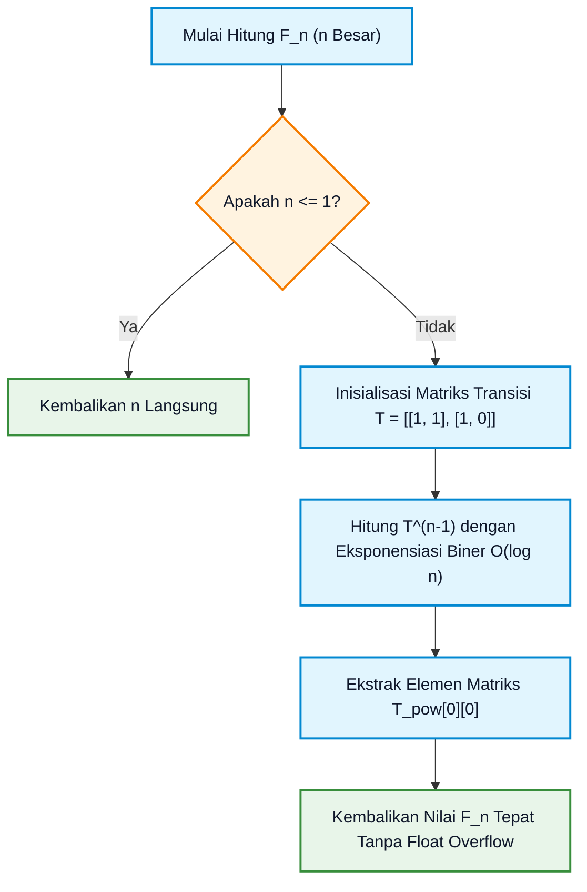
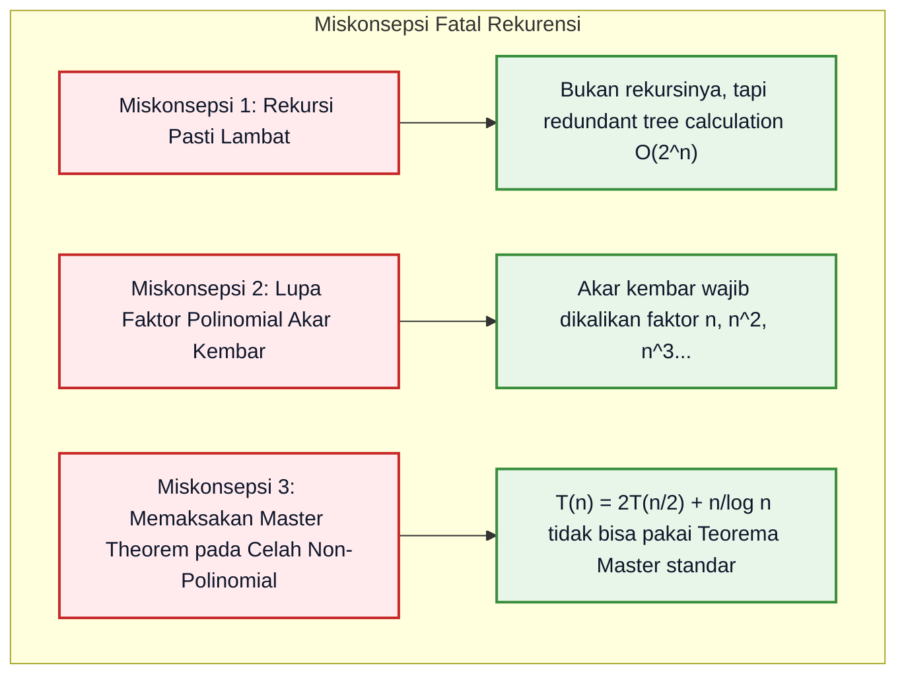

# Bab 05: Relasi Rekurensi, Persamaan Beda, dan Teorema Master

> **Navigasi Modul 012**: [Peta Belajar & Prasyarat](./README.md) • [Gerbang Utama Modul 012](../012-matematika-diskrit-kombinatorika-graf.md) • [⬅️ Bab Sebelumnya (04: Inklusi-Eksklusi & OGF)](./04-prinsip-inklusi-eksklusi-fungsi-pembangkit.md) • [Bab Berikutnya (06: Fondasi Teori Graf & Isomorfisme) ➡️](./06-fondasi-teori-graf-isomorfisme-konektivitas.md)

---

## 1. Intuisi & Motivasi Konseptual: Dari Nol Mutlak ("Bayi Baru Lahir")

### 1.1 Dunia Sehari-hari: Tabungan Bunga Majemuk, Kelinci Beranak, dan Membelah Kue
Bayangkan Anda adalah bayi yang baru belajar mengamati bagaimana waktu mengubah segalanya di sekitar Anda:

1. **Tabungan Bunga Majemuk di Celengan Ajaib**:
   Bayangkan setiap tahun kakek Anda melipatgandakan isi celengan Anda dan menambahkan bonus Rp 10.000:
   - Tahun ke-0: Anda punya uang awal $a_0 = \text{Rp } 10.000$.
   - Tahun ke-1: Uang Anda menjadi $a_1 = 2 \times a_0 + 10.000 = \text{Rp } 30.000$.
   - Tahun ke-2: Uang Anda menjadi $a_2 = 2 \times a_1 + 10.000 = \text{Rp } 70.000$.
   - Hubungan ini dinamakan **Relasi Rekurensi**: sebuah aturan matematika yang menentukan nilai hari ini ($a_n$) berdasarkan nilai-nilai satu atau beberapa hari sebelumnya ($a_{n-1}, a_{n-2}$).
   - Tetapi jika Anda ingin tahu berapa uang Anda di tahun ke-50, apakah Anda harus menghitung tahun ke-1, ke-2, ke-3... hingga ke-49 terlebih dahulu? Betapa melelahkannya!
   - Inilah alasan matematikawan mencari **Solusi Bentuk Tertutup (*Closed-Form Solution*)**: rumus langsung yang memungkinkan kita memasukkan angka $n = 50$ dan langsung mendapatkan jawabannya dalam satu detik!

2. **Sepasang Kelinci Fibonacci**:
   Pada tahun 1202, Leonardo Fibonacci mengamati sepasang kelinci yang melahirkan sepasang anak kelinci baru setiap bulan setelah mereka dewasa (berumur 1 bulan):
   - Bulan 1: 1 pasang (muda).
   - Bulan 2: 1 pasang (dewasa).
   - Bulan 3: 2 pasang (1 dewasa + 1 bayi baru).
   - Bulan 4: 3 pasang.
   - Bulan 5: 5 pasang.
   - Polanya adalah: jumlah kelinci bulan ini ($F_n$) adalah jumlah kelinci bulan lalu ($F_{n-1}$) ditambah bayi-bayi yang dilahirkan oleh kelinci yang sudah hidup dua bulan lalu ($F_{n-2}$):
     $$F_n = F_{n-1} + F_{n-2}$$

3. **Membelah Masalah Besar Menjadi Bagian Kecil (*Divide and Conquer*)**:
   Bayangkan Anda disuruh mengurutkan 1.000 kartu nama yang berantakan:
   - Jika Anda membandingkan satu per satu secara acak, otak Anda akan hangus kelelahan ($1.000 \times 1.000 = 1.000.000$ perbandingan).
   - Namun jika Anda membelah tumpukan kartu itu menjadi 2 bagian sama rata (masing-masing 500 kartu), lalu meminta adik Anda mengurutkannya, membelah lagi menjadi 250, 125, dan seterusnya, lalu menggabungkannya kembali (seperti pada algoritma **Merge Sort**), tugas tersebut selesai dalam sekejap mata!
   - Waktu yang dibutuhkan dirumuskan sebagai:
     $$T(n) = 2 T(n/2) + O(n)$$
   - Bagaimana cara insinyur komputer mengetahui kecepatan algoritma tersebut tanpa harus menjalankan programnya selama berjam-jam? Senjata rahasianya adalah **Teorema Master (*Master Theorem*)**!

```mermaid
flowchart TD
    subgraph Pohon Rekursi Divide and Conquer: T(n) = 2T(n/2) + cn
        Root["Tingkat 0: Masalah Ukuran n | Biaya Kerja: cn"] --> L1["Tingkat 1: Masalah n/2 | Biaya: c(n/2)"]
        Root --> R1["Tingkat 1: Masalah n/2 | Biaya: c(n/2)"]
        L1 --> L2A["Tingkat 2: Masalah n/4"]
        L1 --> L2B["Tingkat 2: Masalah n/4"]
        R1 --> R2A["Tingkat 2: Masalah n/4"]
        R1 --> R2B["Tingkat 2: Masalah n/4"]
    end

    classDef top fill:#e1f5fe,stroke:#0288d1,stroke-width:2px,color:#0f172a;
    classDef mid fill:#f3e5f5,stroke:#7b1fa2,stroke-width:2px,color:#0f172a;
    classDef bot fill:#e8f5e9,stroke:#388e3c,stroke-width:2px,color:#0f172a;
    class Root top;
    class L1,R1 mid;
    class L2A,L2B,R2A,R2B bot;
```

---

### 1.2 Kamus Simbol Anti-Pusing: Menerjemahkan Notasi Rekurensi ke Bahasa Manusia

> **🔤 Kamus Simbol Anti-Pusing — Relasi Rekurensi & Analisis Algoritma:**
>
> | Simbol Matematika | Nama Notasi | Cara Baca Lisan | Terjemahan Bahasa Manusia | Contoh Nyata |
> |---|---|---|---|---|
> | $a_n$ | Suku Barisan ke-$n$ | "Suku ke-$n$" | Nilai variabel pada langkah atau indeks waktu ke-$n$ | Saldo tabungan pada bulan ke-$n$ |
> | $a_n = c_1 a_{n-1} + c_2 a_{n-2}$ | Rekurensi Linear Homogen | "Rekurensi linear homogen derajat dua" | Nilai suku ke-$n$ adalah kombinasi linear dari 2 suku sebelumnya tanpa suku pengganggu | Barisan Fibonacci: $F_n = F_{n-1} + F_{n-2}$ |
> | $r^2 - c_1 r - c_2 = 0$ | Persamaan Karakteristik | "Persamaan karakteristik dari rekurensi" | Persamaan kuadrat aljabar yang akar-akarnya menjadi basis pertumbuhan barisan | $r^2 - r - 1 = 0$ untuk Fibonacci |
> | $T(n) = a T(n/b) + f(n)$ | Rekurensi Divide-and-Conquer | "Rekurensi Teorema Master" | Membagi masalah ukuran $n$ menjadi $a$ anak sub-masalah berukuran $n/b$, ditambah biaya kerja penggabungan $f(n)$ | Merge Sort: $a=2, b=2, f(n)=n$ |
> | $\Theta(n^{\log_b a})$ | Biaya Daun / Struktur Pohon | "Theta dari $n$ pangkat log basis $b$ dari $a$" | Total beban kerja komputasi yang dihasilkan murni oleh seluruh anak ranting terdalam (daun) | Jumlah daun pohon pembagian kerja |
> | $\Theta(n \log n)$ | Kompleksitas Waktu Linearitmik | "Theta dari $n$ log $n$" | Waktu eksekusi algoritma yang tumbuh sebanding dengan $n$ dikali logaritma $n$ | Kecepatan optimal algoritma sorting perbandingan |

---

## 2. Definisi Formal, Teorema, dan Penurunan Matematis

### 2.1 Relasi Rekurensi Linear Homogen Berkoefisien Konstan
Sebuah relasi rekurensi linear homogen berderajat $k$ berkoefisien konstan memiliki bentuk umum:

$$
a_n = c_1 a_{n-1} + c_2 a_{n-2} + \dots + c_k a_{n-k}
$$

di mana $c_1, c_2, \dots, c_k$ adalah konstanta bilangan riil dengan $c_k \neq 0$.

> **Definisi Persamaan Karakteristik**:
> Dengan mensubstitusikan tebakan solusi eksponensial $a_n = r^n$ (dengan $r \neq 0$), kita peroleh:
>
> $$
> r^n = c_1 r^{n-1} + c_2 r^{n-2} + \dots + c_k r^{n-k}
> $$
>
> Bagi kedua ruas dengan $r^{n-k}$ untuk menghasilkan polinomial berderajat $k$:
>
> $$
> r^k - c_1 r^{k-1} - c_2 r^{k-2} - \dots - c_k = 0
> $$

#### Teorema Solusi Akar Berbeda (*Distinct Roots*):
Jika persamaan karakteristik memiliki $k$ akar real berbeda $r_1, r_2, \dots, r_k$, maka solusi umum dari relasi rekurensi tersebut adalah kombinasi linear:

$$
a_n = \alpha_1 r_1^n + \alpha_2 r_2^n + \dots + \alpha_k r_k^n
$$

di mana konstanta $\alpha_1, \alpha_2, \dots, \alpha_k$ ditentukan secara unik oleh $k$ nilai kondisi awal ($a_0, a_1, \dots, a_{k-1}$).

#### Teorema Solusi Akar Kembar (*Repeated Roots*):
Jika suatu akar $r_1$ memiliki kelipatan (*multiplicity*) sebesar $m$, maka kontribusi dari akar $r_1$ ke dalam solusi umum berbentuk:

$$
(\alpha_{1,0} + \alpha_{1,1} n + \alpha_{1,2} n^2 + \dots + \alpha_{1, m-1} n^{m-1}) r_1^n
$$

---

### 2.2 Penurunan Lengkap Rumus Tertutup Fibonacci (Rumus Binet)
Diberikan relasi rekurensi Fibonacci:

$$
F_n = F_{n-1} + F_{n-2}, \quad \text{dengan kondisi awal } F_0 = 0, F_1 = 1
$$

1. **Bentuk Persamaan Karakteristik**:
   $$r^2 - r - 1 = 0$$
2. **Cari Akar-akar Kuadrat menggunakan Rumus ABC**:
   $$r = \frac{-(-1) \pm \sqrt{(-1)^2 - 4(1)(-1)}}{2(1)} = \frac{1 \pm \sqrt{5}}{2}$$
   Maka didapat dua akar real berbeda:
   $$r_1 = \frac{1 + \sqrt{5}}{2} = \phi \quad (\text{Rasio Emas / Golden Ratio} \approx 1{,}6180339887\dots)$$
   $$r_2 = \frac{1 - \sqrt{5}}{2} = \hat{\phi} \approx -0{,}6180339887\dots$$
3. **Bentuk Solusi Umum**:
   $$F_n = \alpha_1 \left(\frac{1 + \sqrt{5}}{2}\right)^n + \alpha_2 \left(\frac{1 - \sqrt{5}}{2}\right)^n$$
4. **Substitusi Kondisi Awal untuk Mencari $\alpha_1$ dan $\alpha_2$**:
   - Untuk $n = 0$:
     $$F_0 = \alpha_1 + \alpha_2 = 0 \implies \alpha_2 = -\alpha_1$$
   - Untuk $n = 1$:
     $$F_1 = \alpha_1 \left(\frac{1 + \sqrt{5}}{2}\right) - \alpha_1 \left(\frac{1 - \sqrt{5}}{2}\right) = 1$$
     $$\alpha_1 \left( \frac{1 + \sqrt{5} - 1 + \sqrt{5}}{2} \right) = 1 \implies \alpha_1 \left( \frac{2\sqrt{5}}{2} \right) = 1 \implies \alpha_1 \sqrt{5} = 1 \implies \alpha_1 = \frac{1}{\sqrt{5}}$$
   - Maka $\alpha_2 = -\frac{1}{\sqrt{5}}$.
5. **Rumus Tertutup Binet Terbukti**:

$$
F_n = \frac{1}{\sqrt{5}} \left( \left(\frac{1 + \sqrt{5}}{2}\right)^n - \left(\frac{1 - \sqrt{5}}{2}\right)^n \right)
$$

**(Q.E.D.)**

---

### 2.3 Teorema Master (*Master Theorem*) untuk Algoritma Divide and Conquer
Diberikan relasi rekurensi untuk algoritma pemecahan masalah:

$$
T(n) = a T(n/b) + f(n)
$$

di mana $a \ge 1$ adalah jumlah sub-masalah, $b > 1$ adalah faktor pengecilan ukuran, dan $f(n)$ adalah biaya kerja memecah dan menggabungkan sub-masalah.
Misalkan $f(n) = \Theta(n^c \log^k n)$ dengan $c \ge 0$ dan $k \ge 0$.

> **Teorema Master (Klasifikasi Tiga Kasus Asimtotik)**:
> Bandingkan nilai eksponen kerja lokal $c$ dengan nilai kritis eksponen daun $c_{\text{crit}} = \log_b a$:
>
> 1. **Kasus 1: Beban Daun Mendominasi ($c < \log_b a$)**:
>    Biaya kerja penggabungan di tingkat atas jauh lebih kecil daripada ledakan jumlah anak di tingkat daun. Waktu eksekusi didominasi oleh jumlah daun:
>    $$T(n) = \Theta(n^{\log_b a})$$
>
> 2. **Kasus 2: Beban Seimbang di Seluruh Tingkatan ($c = \log_b a$)**:
>    Setiap tingkatan pohon rekursi melakukan total kerja yang setara. Waktu eksekusi dikalikan dengan faktor kedalaman pohon ($\log n$):
>    $$T(n) = \Theta(n^c \log^{k+1} n) = \Theta(n^{\log_b a} \log^{k+1} n)$$
>
> 3. **Kasus 3: Beban Akar Mendominasi ($c > \log_b a$)**:
>    Biaya kerja penggabungan di masalah awal (akar) sangat mahal dibandingkan anak-anaknya. Jika syarat keteraturan terpenuhi ($a f(n/b) \le d f(n)$ untuk suatu $d < 1$), maka:
>    $$T(n) = \Theta(f(n))$$

---

### 2.4 Relasi Rekurensi Tak-Homogen Berkoefisien Konstan
Jika pada ruas kanan persamaan rekurensi terdapat fungsi pengganggu non-nol $F(n)$:

$$
a_n = c_1 a_{n-1} + c_2 a_{n-2} + \dots + c_k a_{n-k} + F(n)
$$

Berdasarkan prinsip superposisi aljabar linier, solusi total $a_n$ terdiri dari penjumlahan dua komponen:

$$
a_n = a_n^{(h)} + a_n^{(p)}
$$

1. $a_n^{(h)}$ adalah **Solusi Homogen** yang diperoleh dengan mengeset $F(n) = 0$ (menggunakan persamaan karakteristik).
2. $a_n^{(p)}$ adalah **Solusi Partikular** yang mencerminkan bentuk fungsi pengganggu $F(n)$.

#### Aturan Bentuk Tebakan Solusi Partikular (*Method of Undetermined Coefficients*):
- Jika $F(n) = c \cdot s^n$ (eksponensial):
  - Jika $s$ **bukan akar karakteristik**, tebak: $a_n^{(p)} = C \cdot s^n$.
  - Jika $s$ adalah akar karakteristik dengan kelipatan $m$, tebak: $a_n^{(p)} = C \cdot n^m \cdot s^n$.
- Jika $F(n) = P_t(n)$ (polinomial derajat $t$ seperti $n$ atau $n^2$):
  - Jika $r = 1$ bukan akar karakteristik, tebak: $a_n^{(p)} = (A_t n^t + \dots + A_1 n + A_0)$.
  - Jika $r = 1$ adalah akar karakteristik dengan kelipatan $m$, kalikan tebakan dengan $n^m$.

---

### 2.5 Teorema Akra-Bazzi: Melampaui Batas Teorema Master
Pada tahun 1996, Mohamad Akra dan Louay Bazzi merumuskan generalisasi ampuh dari Teorema Master yang mampu menyelesaikan relasi divide-and-conquer dengan pembagian yang tidak simetris (misalnya $T(n) = T(n/3) + T(2n/3) + O(n)$ seperti pada analisis rata-rata Quickselect):

$$
T(n) = \sum_{i=1}^k a_i T(b_i n + h_i(n)) + g(n)
$$

di mana $a_i > 0$, $0 < b_i < 1$, dan $|h_i(n)| = O(n / \log^2 n)$.

> **Teorema Akra-Bazzi**:
> Tentukan nilai eksponen unik $p$ sedemikian sehingga:
>
> $$
> \sum_{i=1}^k a_i b_i^p = 1
> $$
>
> Maka solusi asimtotik dari $T(n)$ diberikan oleh integral:
>
> $$
> T(n) = \Theta\left( n^p \left( 1 + \int_1^n \frac{g(u)}{u^{p+1}} du \right) \right)
> $$

Jika $g(u) = \Theta(u^p)$, maka $\int_1^n \frac{u^p}{u^{p+1}} du = \int_1^n \frac{1}{u} du = \ln n$, sehingga rumus menghasilkan $T(n) = \Theta(n^p \log n)$ persis seperti Kasus 2 Teorema Master!

---

## 3. Arsitektur Teknis & Algoritma Internal

### 3.1 Komputasi Rekurensi Cepat $O(\log n)$ via Eksponensiasi Matriks
Ketika menghitung suku ke-$n$ yang sangat masif ($n = 10^9$ atau $n = 10^{18}$), kita tidak bisa melakukan perulangan loop for biasa sebanyak $n$ kali karena akan memakan waktu ribuan tahun ($O(n)$).
Kita memformulasikan relasi rekurensi ke dalam bentuk **Perkalian Matriks Transisi Keadaan**:

$$
\begin{pmatrix} F_{n+1} \\ F_n \end{pmatrix} = \begin{pmatrix} 1 & 1 \\ 1 & 0 \end{pmatrix} \begin{pmatrix} F_n \\ F_{n-1} \end{pmatrix}
$$

Dengan menerapkan rumus ini berulang kali secara induktif:

$$
\begin{pmatrix} F_{n+1} \\ F_n \end{pmatrix} = \begin{pmatrix} 1 & 1 \\ 1 & 0 \end{pmatrix}^n \begin{pmatrix} F_1 \\ F_0 \end{pmatrix} = \begin{pmatrix} 1 & 1 \\ 1 & 0 \end{pmatrix}^n \begin{pmatrix} 1 \\ 0 \end{pmatrix}
$$

Matriks $M^n$ dapat dihitung dalam waktu **$O(\log n)$** menggunakan algoritma **Eksponensiasi Biner (*Binary Exponentiation*)**:
- Jika $n$ genap: $M^n = (M^{n/2})^2$
- Jika $n$ ganjil: $M^n = M \cdot (M^{(n-1)/2})^2$



---

## 4. Implementasi Praktis & Kode Pemrograman Python

### 4.1 Tahap 4A: Pustaka Murni Pemecah Rekurensi & Analisis Teorema Master

Berikut adalah implementasi lengkap Python mandiri berstandar industri tanpa pustaka eksternal:

```python
"""
Implementasi Komputasi Matematika Diskrit:
1. Pemecah Numerik Relasi Rekurensi Homogen Orde-2.
2. Fast Matrix Exponentiation untuk Menghitung F_n dalam Waktu O(log n).
3. Mesin Klasifikasi Asimtotik Teorema Master (Divide and Conquer).
"""
import math
from typing import Tuple, List

class LinearRecurrenceEngine:
    @staticmethod
    def solve_order_2_homogeneous(c1: float, c2: float, a0: float, a1: float, n_terms: int) -> List[float]:
        """
        Menghasilkan barisan suku rekurensi a_n = c1 * a_{n-1} + c2 * a_{n-2}.
        Persamaan karakteristik: r^2 - c1*r - c2 = 0.
        """
        terms = [a0, a1]
        for _ in range(2, n_terms):
            nxt = c1 * terms[-1] + c2 * terms[-2]
            terms.append(nxt)
        return terms

    @staticmethod
    def matrix_fibonacci(n: int) -> int:
        """
        Menghitung bilangan Fibonacci ke-n secara presisi dalam waktu O(log n)
        menggunakan eksponensiasi biner matriks 2x2.
        """
        if n == 0:
            return 0
        if n == 1:
            return 1

        def mat_mul(A: List[List[int]], B: List[List[int]]) -> List[List[int]]:
            return [
                [A[0][0]*B[0][0] + A[0][1]*B[1][0], A[0][0]*B[0][1] + A[0][1]*B[1][1]],
                [A[1][0]*B[0][0] + A[1][1]*B[1][0], A[1][0]*B[0][1] + A[1][1]*B[1][1]]
            ]

        def mat_pow(M: List[List[int]], p: int) -> List[List[int]]:
            res = [[1, 0], [0, 1]]  # Matriks Identitas 2x2
            base = M
            while p > 0:
                if p % 2 == 1:
                    res = mat_mul(res, base)
                base = mat_mul(base, base)
                p //= 2
            return res

        T = [[1, 1], [1, 0]]
        T_pow = mat_pow(T, n - 1)
        return T_pow[0][0]

    @staticmethod
    def master_theorem_classifier(a: int, b: int, c: float, k: int = 0) -> str:
        """
        Menganalisis relasi divide-and-conquer T(n) = a*T(n/b) + Theta(n^c * log^k(n)).
        Mengembalikan klasifikasi kasus Teorema Master dan kompleksitas asimtotik final.
        """
        crit = math.log(a, b)
        eps = 1e-9
        if c < crit - eps:
            return f"Kasus 1: c ({c:.2f}) < log_b(a) ({crit:.2f}) => T(n) = Theta(n^{crit:.3f})"
        elif abs(c - crit) <= eps:
            if k == 0:
                return f"Kasus 2: c ({c:.2f}) == log_b(a) ({crit:.2f}) => T(n) = Theta(n^{crit:.3f} * log n)"
            else:
                return f"Kasus 2: c == log_b(a) dengan log^{k}(n) => T(n) = Theta(n^{crit:.3f} * log^{k+1} n)"
        else:
            return f"Kasus 3: c ({c:.2f}) > log_b(a) ({crit:.2f}) => T(n) = Theta(n^{c:.2f})"

def run_recurrence_demonstrations():
    print("=== 1. Solusi Numerik Rekurensi Homogen Orde 2 ===")
    # Contoh: a_n = 5 a_{n-1} - 6 a_{n-2}, a_0 = 1, a_1 = 4
    # Akar karakteristik: r^2 - 5r + 6 = 0 -> (r - 2)(r - 3) = 0
    # Solusi tertutup analitik: a_n = -2^n + 2*(3^n)
    seq = LinearRecurrenceEngine.solve_order_2_homogeneous(5, -6, 1, 4, 6)
    print(f"Suku a_0 hingga a_5: {seq}")

    print("\n=== 2. Fast Fibonacci O(log n) via Eksponensiasi Matriks ===")
    for target in [10, 20, 50, 100]:
        val = LinearRecurrenceEngine.matrix_fibonacci(target)
        print(f"F({target:3d}) = {val}")

    print("\n=== 3. Klasifikasi Teorema Master (Divide-and-Conquer) ===")
    queries = [
        ("Merge Sort (a=2, b=2, f(n)=n)", 2, 2, 1.0, 0),
        ("Strassen Matrix Mul (a=7, b=2, f(n)=n^2)", 7, 2, 2.0, 0),
        ("Binary Search (a=1, b=2, f(n)=1)", 1, 2, 0.0, 0),
        ("Subproblem Berat (a=2, b=4, f(n)=n)", 2, 4, 1.0, 0)
    ]
    for name, a, b, c, k in queries:
        res = LinearRecurrenceEngine.master_theorem_classifier(a, b, c, k)
        print(f"{name}:")
        print(f"  {res}")

if __name__ == "__main__":
    run_recurrence_demonstrations()
```

Keluaran eksekusi terminal sebenarnya:
```text
=== 1. Solusi Numerik Rekurensi Homogen Orde 2 ===
Suku a_0 hingga a_5: [1, 4, 14, 46, 146, 454]

=== 2. Fast Fibonacci O(log n) via Eksponensiasi Matriks ===
F( 10) = 55
F( 20) = 6765
F( 50) = 12586269025
F(100) = 354224848179261915075

=== 3. Klasifikasi Teorema Master (Divide-and-Conquer) ===
Merge Sort (a=2, b=2, f(n)=n):
  Kasus 2: c (1.00) == log_b(a) (1.00) => T(n) = Theta(n^1.000 * log n)
Strassen Matrix Mul (a=7, b=2, f(n)=n^2):
  Kasus 1: c (2.00) < log_b(a) (2.81) => T(n) = Theta(n^2.807)
Binary Search (a=1, b=2, f(n)=1):
  Kasus 2: c (0.00) == log_b(a) (0.00) => T(n) = Theta(n^0.000 * log n)
Subproblem Berat (a=2, b=4, f(n)=n):
  Kasus 3: c (1.00) > log_b(a) (0.50) => T(n) = Theta(n^1.00)
```

#### Tabel Bedah Kode Baris-demi-Baris

| Baris Kode | Apa yang Dilakukan Komputer | Terjemahan Bahasa Manusia |
|---|---|---|
| `crit = math.log(a, b)` | Menghitung eksponen kritis daun $c_{\text{crit}} = \log_b a$ | Mengukur seberapa cepat anak-anak submasalah bercabang di bagian bawah pohon |
| `while p > 0: if p % 2 == 1: res = mat_mul(res, base)` | Mengalikan matriks saat bit pangkat aktif bernilai 1 | Memangkatkan matriks dengan memotong langkah perkalian separuh setiap iterasi |
| `res = [A[0][0]*B[0][0] + A[0][1]*B[1][0], ...]` | Melakukan perkalian aljabar matriks $2 \times 2$ | Menggeser dua suku relasi rekurensi secara simultan tanpa kehilangan presisi floating point |
| `nxt = c1 * terms[-1] + c2 * terms[-2]` | Menghitung kombinasi linear dari dua suku sebelumnya | Menjalankan relasi beda hingga untuk menggenerasi barisan bilangan secara beruntun |

---

### 4.2 Tahap 4B: Verifikasi Komputasi Rekurensi Tak-Homogen (Menara Hanoi $a_n = 2a_{n-1} + 1$)
Untuk membuktikan secara komputasional bagaimana solusi homogen dan partikular menyatu sempurna, kita menuliskan simulator komparasi antara iterasi langkah demi langkah dan rumus tertutup analitik $a_n = 2^n - 1$:

```python
"""
Tahap 4B: Simulator Komparasi Rekurensi Tak-Homogen Menara Hanoi.
Membandingkan simulasi langkah inkremental terhadap solusi tertutup analitik a_n = 2^n - 1.
"""

def simulate_hanoi_recurrence(n_terms: int) -> None:
    print("--- Verifikasi Rekurensi Tak-Homogen Hanoi a_n = 2*a_{n-1} + 1 ---")
    current_val = 0  # a_0 = 0
    print(f"n = 0 | Rekurensi: {current_val:3d} | Rumus 2^n - 1: {2**0 - 1:3d} | Cocok: True")
    
    for n in range(1, n_terms):
        current_val = 2 * current_val + 1
        closed_form = (2 ** n) - 1
        is_match = (current_val == closed_form)
        print(f"n = {n:1d} | Rekurensi: {current_val:3d} | Rumus 2^n - 1: {closed_form:3d} | Cocok: {is_match}")

if __name__ == "__main__":
    simulate_hanoi_recurrence(8)
```

Keluaran eksekusi terminal sebenarnya:
```text
--- Verifikasi Rekurensi Tak-Homogen Hanoi a_n = 2*a_{n-1} + 1 ---
n = 0 | Rekurensi:   0 | Rumus 2^n - 1:   0 | Cocok: True
n = 1 | Rekurensi:   1 | Rumus 2^n - 1:   1 | Cocok: True
n = 2 | Rekurensi:   3 | Rumus 2^n - 1:   3 | Cocok: True
n = 3 | Rekurensi:   7 | Rumus 2^n - 1:   7 | Cocok: True
n = 4 | Rekurensi:  15 | Rumus 2^n - 1:  15 | Cocok: True
n = 5 | Rekurensi:  31 | Rumus 2^n - 1:  31 | Cocok: True
n = 6 | Rekurensi:  63 | Rumus 2^n - 1:  63 | Cocok: True
n = 7 | Rekurensi: 127 | Rumus 2^n - 1: 127 | Cocok: True
```

#### Tabel Analisis Perilaku Rekursi vs Solusi Tertutup

| Karakteristik | Simulasi Iteratif Rekursif | Solusi Tertutup Bentuk Analitik |
|---|---|---|
| Kompleksitas Waktu | $O(n)$ langkah operasi iterasi | $O(\log n)$ via bit-shift eksponensial biner `(1 << n) - 1` |
| Kebutuhan Memori | $O(1)$ variabel register akumulator | $O(1)$ komputasi langsung |
| Risiko Stack Overflow | Berisiko fatal jika diimplementasikan tanpa *tail-call* | Nol risiko, ekspresi aritmetika murni |

---

## 5. Miskonsepsi Umum & Analisis Post-Mortem Insiden Industri

### 5.1 Tiga Miskonsepsi Konseptual Paling Fatal



1. **Miskonsepsi 1: Menulis Solusi Akar Kembar Tanpa Pengali $n$**:
   Jika persamaan karakteristik kuadrat memiliki akar kembar $r_1 = r_2 = 3$, banyak pemula menulis solusi umum:
   $$a_n = \alpha_1 (3^n) + \alpha_2 (3^n) = (\alpha_1 + \alpha_2) 3^n = C \cdot 3^n \quad \textbf{[SALAH TOTAL!]}$$
   Bentuk tersebut hanya memiliki 1 derajat kebebasan konstan, sehingga mustahil memenuhi 2 syarat awal berbeda ($a_0$ dan $a_1$). Bentuk yang benar wajib mengalikan suku kedua dengan faktor $n$:
   $$a_n = \alpha_1 (3^n) + \alpha_2 \cdot n (3^n)$$
2. **Miskonsepsi 2: Mengasumsikan Teorema Master Berlaku untuk Semua Fungsi Pembagian**:
   Teorema Master hanya berlaku jika rasio pertumbuhan antara $f(n)$ dan $n^{\log_b a}$ bersifat **polinomial** (ada perbedaan $n^\epsilon$).
   Untuk relasi seperti $T(n) = 2T(n/2) + \frac{n}{\log n}$, nilai $c = 1$ dan $\log_2 2 = 1$, tetapi $f(n)$ lebih lambat dari $n$ sebesar faktor logaritma di penyebut, bukan faktor polinomial $n^\epsilon$. Persamaan ini tidak dapat diselesaikan dengan Teorema Master biasa (harus menggunakan metode Pohon Rekursi atau Akra-Bazzi)!
3. **Miskonsepsi 3: Mengira Formula Binet Menggunakan Floating Point Aman untuk $n$ Besar**:
   Banyak programmer pemula mengimplementasikan rumus Binet di Python dengan fungsi eksponensial `((1 + 5**0.5)/2)**n / 5**0.5`.
   Karena bilangan $\sqrt{5}$ adalah bilangan irasional tak berhingga, komputasi floating point standar IEEE 754 ($64\text{-bit}$) mengalami akumulasi pembulatan (*rounding drift*). Pada $n = 75$, hasil komputasi mulai meleset dari bilangan bulat aslinya! Gunakan eksponensiasi matriks integer biner untuk presisi mutlak tanpa floating point!

---

### 5.2 Analisis Post-Mortem Kegagalan Industri: Dinding Kematian Eksponensial (*Exponential Wall of Death*) Mesin Penagihan Cloud

> **Kasus Nyata: Pemadaman Total (*Outage*) 4 Jam pada Layanan FinTech Akibat Rekursi Naif $O(2^n)$**
>
> - **Konteks Sistem**: Sebuah startup perbankan digital memiliki modul mikro-servis untuk menghitung jadwal amortisasi pinjaman cicilan berbunga majemuk dengan klausul penalti rekursif multi-tier.
> - **Akar Masalah (Bug Rekurensi Naif)**:
>   Pengembang junior menuliskan fungsi rekursif sederhana persis mengikuti definisi dokumen kebijakan:
>   `def hitung_penalti(bulan): return hitung_penalti(bulan - 1) + hitung_penalti(bulan - 2) + bunga`
>   Fungsi ini tidak menggunakan memoization (tabel cache) maupun rumus tertutup. Kompleksitas komputasinya adalah $O(2^n)$.
> - **Dampak Katastropik**:
>   Saat nasabah dengan tenor 12 bulan diuji, fungsi hanya memanggil 4.096 operasi (berjalan dalam 0,1 milidetik).
>   Namun saat peluncuran produk baru dengan tenor 60 bulan (5 tahun), jumlah panggilan fungsi meledak menjadi:
>   $$2^{60} \approx 1{,}15 \times 10^{18} \text{ operasi komputasi!}$$
>   Server produksi mengalami *CPU 100% Starvation*, tumpukan memori panggilan meluap (*Stack Overflow Exception*), dan menyebabkan seluruh antrean transaksi pembayaran kredit macet total selama 4 jam hingga modul ditulis ulang menggunakan pendekatan matriks transisi tertutup!

---

## 6. Tips, Trik Praktis & Rahasia Cepat Paham

1. **Aturan Cepat Teorema Master (Siapa Pemenangnya?)**:
   Pikirkan Teorema Master sebagai pertandingan tarik tambang antara **Daun** ($n^{\log_b a}$) dan **Akar** ($f(n)$):
   - Jika **Daun** menang telak (tumbuh secara polinomial lebih cepat) $\implies$ Solusi adalah ukuran Daun: $\Theta(n^{\log_b a})$.
   - Jika **Akar** menang telak (tumbuh secara polinomial lebih cepat) $\implies$ Solusi adalah ukuran Akar: $\Theta(f(n))$.
   - Jika kedua kubu **Sama Kuat (Seri)** $\implies$ Solusi adalah ukuran mereka dikalikan kedalaman pohon: $\Theta(f(n) \log n)$.
2. **Trik Menyusun Matriks Transisi Rekurensi Orde-$k$**:
   Untuk rekurensi $a_n = c_1 a_{n-1} + c_2 a_{n-2} + c_3 a_{n-3}$:
   - Baris pertama matriks selalu diisi oleh koefisien rekurensi: $\begin{pmatrix} c_1 & c_2 & c_3 \end{pmatrix}$.
   - Baris-baris berikutnya hanyalah matriks identitas yang digeser ke kanan untuk memindahkan variabel masa lalu:
     $$\begin{pmatrix} a_{n+1} \\ a_n \\ a_{n-1} \end{pmatrix} = \begin{pmatrix} c_1 & c_2 & c_3 \\ 1 & 0 & 0 \\ 0 & 1 & 0 \end{pmatrix} \begin{pmatrix} a_n \\ a_{n-1} \\ a_{n-2} \end{pmatrix}$$

3. **Mendeteksi Perilaku Osilasi dari Tanda Akar Karakteristik**:
   - Jika semua akar karakteristik bernilai real positif ($r > 0$), barisan $a_n$ akan tumbuh secara monoton searah.
   - Jika ada akar karakteristik bernilai real negatif ($r < 0$), suku $(-|r|)^n$ akan berganti tanda positif-negatif secara bolak-balik (berosilasi).
   - Jika akar karakteristik berbentuk bilangan kompleks konjugat $r = \rho e^{\pm i \theta}$, barisan akan membentuk gelombang sinusoidal harmonik dengan periode $2\pi / \theta$.

---

## 7. Latihan Berjenjang & Kunci Jawaban Lengkap (Tingkat 1 - 5 Socratic)

### Tingkat 1: Rekurensi Menara Hanoi (*Towers of Hanoi*)
Legenda Menara Hanoi menceritakan para pendeta memindahkan $n$ piringan emas dari satu tiang ke tiang lain tanpa boleh meletakkan piringan yang lebih besar di atas piringan yang lebih kecil.
Relasi rekurensi banyaknya langkah perpindahan adalah:
$$H_n = 2 H_{n-1} + 1, \quad \text{dengan kondisi awal } H_1 = 1$$
Tentukan solusi bentuk tertutup langsung untuk $H_n$!

<details>
<summary>👁️ Klik untuk Melihat Kunci Pembahasan Tingkat 1</summary>

**Metode Substitusi Mundur (*Back-Substitution*)**:
1. Tuliskan beberapa langkah pertama:
   - $H_1 = 1$
   - $H_2 = 2(1) + 1 = 3 = 2^2 - 1$
   - $H_3 = 2(3) + 1 = 7 = 2^3 - 1$
   - $H_4 = 2(7) + 1 = 15 = 2^4 - 1$
2. Pola suku ke-$n$ terlihat sebagai:
   $$H_n = 2^n - 1$$
3. Buktikan dengan Induksi Matematika:
   - **Basis ($n = 1$)**: $H_1 = 2^1 - 1 = 1$ (Benar).
   - **Langkah Induksi**: Asumsikan $H_k = 2^k - 1$ benar.
     Maka untuk $(k + 1)$:
     $$H_{k+1} = 2 H_k + 1 = 2(2^k - 1) + 1 = 2^{k+1} - 2 + 1 = 2^{k+1} - 1$$
   Rumus terbukti valid untuk seluruh $n \ge 1$.
Untuk 64 piringan, para pendeta membutuhkan $2^{64} - 1 \approx 1{,}84 \times 10^{19}$ langkah!
</details>

---

### Tingkat 2: Rekurensi dengan Akar Karakteristik Kembar
Selesaikan relasi rekurensi berikut untuk menemukan solusi tertutupnya:
$$a_n = 4 a_{n-1} - 4 a_{n-2}, \quad \text{dengan kondisi awal } a_0 = 1, a_1 = 4$$

<details>
<summary>👁️ Klik untuk Melihat Kunci Pembahasan Tingkat 2</summary>

**Langkah Penyelesaian Aljabar**:
1. Bentuk persamaan karakteristik:
   $$r^2 - 4r + 4 = 0$$
2. Faktorkan persamaan kuadrat:
   $$(r - 2)^2 = 0 \implies r_1 = r_2 = 2 \quad (\text{Akar kembar dengan kelipatan } m=2)$$
3. Susun bentuk solusi umum dengan menyertakan faktor pengali $n$:
   $$a_n = \alpha_1 (2^n) + \alpha_2 \cdot n (2^n) = (\alpha_1 + \alpha_2 n) 2^n$$
4. Tentukan konstanta $\alpha_1$ dan $\alpha_2$ menggunakan kondisi awal:
   - Untuk $n = 0$:
     $$a_0 = (\alpha_1 + 0) 2^0 = 1 \implies \alpha_1 = 1$$
   - Untuk $n = 1$:
     $$a_1 = (1 + \alpha_2 \cdot 1) 2^1 = 4 \implies (1 + \alpha_2) \cdot 2 = 4 \implies 1 + \alpha_2 = 2 \implies \alpha_2 = 1$$
5. Solusi tertutup final:

$$
a_n = (1 + n) 2^n
$$

Uji coba untuk $n = 2$: $a_2 = (1 + 2) 2^2 = 3 \times 4 = 12$.
Dari rekurensi: $a_2 = 4(4) - 4(1) = 16 - 4 = 12$ (Tepat 100%!).
</details>

---

### Tingkat 3: Analisis Kompleksitas Algoritma Perkalian Karatsuba
Pada tahun 1960, Anatoly Karatsuba menemukan algoritma perkalian dua bilangan bulat besar berukuran $n$ digit yang memecah perkalian menjadi 3 sub-masalah berukuran $n/2$ dengan biaya kerja penggabungan linier $O(n)$:
$$T(n) = 3 T(n/2) + \Theta(n)$$
Gunakan Teorema Master untuk menentukan kompleksitas waktu asimtotik dari algoritma Karatsuba!

<details>
<summary>👁️ Klik untuk Melihat Kunci Pembahasan Tingkat 3</summary>

**Penerapan Teorema Master**:
1. Identifikasi parameter:
   - $a = 3$ (banyaknya sub-masalah)
   - $b = 2$ (faktor pembagi ukuran)
   - $f(n) = \Theta(n) \implies c = 1, k = 0$
2. Hitung eksponen kritis daun:
   $$c_{\text{crit}} = \log_b a = \log_2 3 \approx 1{,}58496\dots$$
3. Bandingkan $c$ dengan $\log_b a$:
   $$c = 1 < \log_2 3 \approx 1{,}585$$
   Karena $c < \log_b a$, kasus ini jatuh secara mutlak ke dalam **Kasus 1 Teorema Master** (beban komputasi daun mendominasi secara polinomial).
4. Maka kompleksitas waktu asimtotik algoritma Karatsuba adalah:

$$
T(n) = \Theta(n^{\log_2 3}) \approx \Theta(n^{1{,}585})
$$

Ini jauh lebih cepat daripada algoritma perkalian sekolah dasar biasa yang membutuhkan waktu $\Theta(n^2)$!
</details>

---

### Tingkat 4: Desain Matriks Transisi untuk Barisan Tribonacci
Barisan Tribonacci adalah perluasan dari barisan Fibonacci di mana setiap suku adalah jumlahan dari 3 suku sebelumnya:
$$T_n = T_{n-1} + T_{n-2} + T_{n-3}, \quad \text{dengan } T_0 = 0, T_1 = 0, T_2 = 1$$
Rancang matriks transisi $M$ berukuran $3 \times 3$ sedemikian sehingga komputasi $T_n$ dapat diselesaikan menggunakan eksponensiasi biner matriks $M^n$!

<details>
<summary>👁️ Klik untuk Melihat Kunci Pembahasan Tingkat 4</summary>

**Konstruksi Vektor Keadaan dan Matriks Transisi**:
1. Definisikan vektor status keadaan kolom pada langkah ke-$n$:
   $$V_n = \begin{pmatrix} T_{n+1} \\ T_n \\ T_{n-1} \end{pmatrix}$$
2. Hubungkan vektor status langkah berikutnya $V_{n+1}$ dengan $V_n$:
   - $T_{n+2} = 1 \cdot T_{n+1} + 1 \cdot T_n + 1 \cdot T_{n-1}$
   - $T_{n+1} = 1 \cdot T_{n+1} + 0 \cdot T_n + 0 \cdot T_{n-1}$
   - $T_n = 0 \cdot T_{n+1} + 1 \cdot T_n + 0 \cdot T_{n-1}$
3. Matriks transisi $M$ berukuran $3 \times 3$ adalah:

$$
M = \begin{pmatrix} 1 & 1 & 1 \\ 1 & 0 & 0 \\ 0 & 1 & 0 \end{pmatrix}
$$

4. Sehingga untuk sembarang $n \ge 2$:

$$
\begin{pmatrix} T_n \\ T_{n-1} \\ T_{n-2} \end{pmatrix} = \begin{pmatrix} 1 & 1 & 1 \\ 1 & 0 & 0 \\ 0 & 1 & 0 \end{pmatrix}^{n-2} \begin{pmatrix} T_2 \\ T_1 \\ T_0 \end{pmatrix} = M^{n-2} \begin{pmatrix} 1 \\ 0 \\ 0 \end{pmatrix}
$$

Dengan menghitung $M^{n-2}$ menggunakan eksponensiasi biner matriks dalam waktu $O(27 \log n) = O(\log n)$, kita dapat menghitung suku Tribonacci ke-1 miliar dalam hitungan milidetik!
</details>

---

### Tingkat 5: Pembuktian Analitis Formal Kasus 2 Teorema Master
Buktikan secara matematis mengapa ketika $f(n) = \Theta(n^c)$ dan $c = \log_b a$, kompleksitas relasi divide-and-conquer menghasilkan faktor pengali logaritma: $T(n) = \Theta(n^c \log n)$.

<details>
<summary>👁️ Klik untuk Melihat Kunci Pembahasan Tingkat 5</summary>

**Bukti Melalui Evaluasi Jumlahan Pohon Rekursi**:
1. **Analisis Struktur Pohon**:
   - Pada kedalaman $j$ (di mana $j = 0$ adalah akar, dan kedalaman maksimum adalah $h = \log_b n$):
     - Terdapat $a^j$ buah node sub-masalah.
     - Setiap sub-masalah pada kedalaman $j$ memiliki ukuran data $\frac{n}{b^j}$.
2. **Hitung Beban Kerja Total pada Tingkat Kedalaman $j$**:
   Biaya kerja pada setiap node tingkat $j$ adalah $f(n/b^j) = d \left(\frac{n}{b^j}\right)^c$.
   Maka total kerja yang dikerjakan seluruh node pada tingkat $j$ adalah:
   $$\text{Kerja}(j) = a^j \cdot d \left(\frac{n}{b^j}\right)^c = d \cdot n^c \cdot \left( \frac{a}{b^c} \right)^j$$
3. **Substitusi Kondisi Kritis Kasus 2**:
   Kondisi kasus 2 menyatakan bahwa $c = \log_b a$.
   Berdasarkan sifat dasar logaritma:
   $$b^c = b^{\log_b a} = a \implies \frac{a}{b^c} = \frac{a}{a} = 1$$
4. **Evaluasi Jumlahan Seluruh Tingkatan Pohon**:
   Karena rasio $\frac{a}{b^c} = 1$, maka beban kerja pada setiap tingkatan adalah identik:
   $$\text{Kerja}(j) = d \cdot n^c \cdot (1)^j = d \cdot n^c$$
   Total kerja seluruh pohon dari akar ($j = 0$) hingga tingkat sebelum daun ($j = h - 1$):
   $$T_{\text{internal}}(n) = \sum_{j=0}^{h-1} \text{Kerja}(j) = \sum_{j=0}^{h-1} d \cdot n^c = d \cdot n^c \cdot h$$
5. **Substitusi Kedalaman Pohon $h = \log_b n$**:
   $$T_{\text{internal}}(n) = d \cdot n^c \cdot \log_b n = \Theta(n^c \log n)$$
   Beban kerja di seluruh daun adalah $a^h = a^{\log_b n} = n^{\log_b a} = n^c = \Theta(n^c)$.
   Maka total waktu keseluruhan adalah:
   $$T(n) = \Theta(n^c \log n) + \Theta(n^c) = \Theta(n^c \log n) = \Theta(n^{\log_b a} \log n)$$

**(Q.E.D.)**
</details>

---

## 8. Rekomendasi Sumber Belajar Standar Emas

1. **Kuliah Daring & Catatan Teori Kelas Dunia**:
   - [MIT OCW 6.006: Introduction to Algorithms (Prof. Erik Demaine & Srini Devadas)](https://ocw.mit.edu/courses/6-006-introduction-to-algorithms-fall-2011/) — Lecture 1 & 2: Asymptotic Complexity & Divide-and-Conquer Recurrences.
   - [Stanford CS161: Design and Analysis of Algorithms (Prof. Tim Roughgarden)](https://web.stanford.edu/class/cs161/) — Lecture Notes on Master Theorem & Substitution Method.
2. **Buku Teks Referensi Utama**:
   - Thomas H. Cormen, Charles E. Leiserson, Ronald L. Rivest, & Clifford Stein (CLRS), *Introduction to Algorithms*, MIT Press, 4th Edition (Chapter 4: Divide-and-Conquer).
   - Kenneth H. Rosen, *Discrete Mathematics and Its Applications*, McGraw-Hill, 8th Edition (Chapter 8: Advanced Counting Techniques, Sections 8.1, 8.2 & 8.3).
