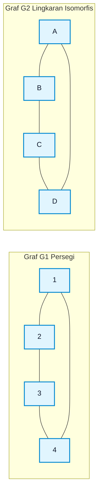
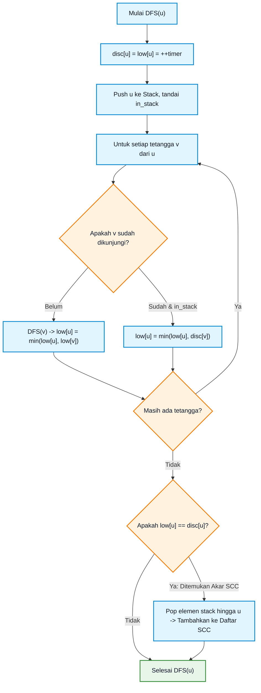
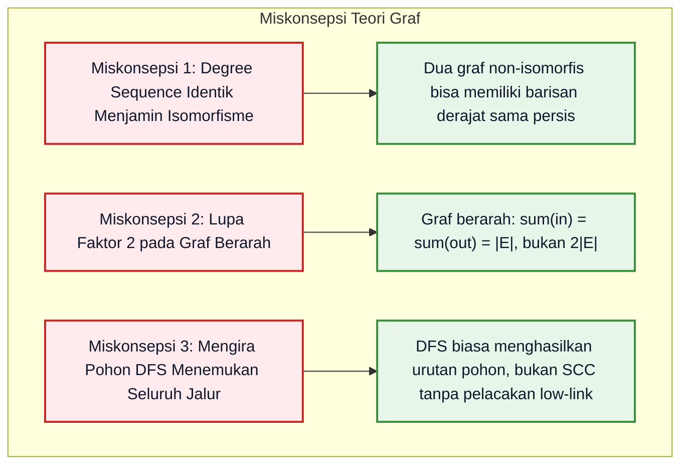

# Bab 06: Fondasi Teori Graf, Isomorfisme, dan Konektivitas

> **Navigasi Modul 012**: [Peta Belajar & Prasyarat](./README.md) • [Gerbang Utama Modul 012](../012-matematika-diskrit-kombinatorika-graf.md) • [⬅️ Bab Sebelumnya (05: Relasi Rekurensi & Master Theorem)](./05-relasi-rekurensi-persamaan-beda-divide-conquer.md) • [Bab Berikutnya (07: Pohon, Spanning Tree & Lintasan Terpendek) ➡️](./07-pohon-spanning-tree-lintasan-terpendek.md)

---

## 1. Intuisi & Motivasi Konseptual: Dari Nol Mutlak ("Bayi Baru Lahir")

### 1.1 Dunia Sehari-hari: Peta MRT, Media Sosial, dan Jaringan Internet
Bayangkan Anda adalah bayi yang baru belajar mengamati peta kota dan hubungan sosial orang dewasa:

1. **Peta Jalur Kereta Api Bawah Tanah (MRT)**:
   Pernahkah Anda melihat peta MRT di stasiun kereta?
   - Garis-garis rel di peta tersebut tidak pernah digambar dengan skala jalan raya yang sebenarnya. Belokan jalan yang berliku-liku di dunia nyata sering digambar lurus, dan jarak antar stasiun yang aslinya berbeda jauh dibuat berjarak sama rata di peta.
   - Mengapa penumpang tidak tersesat? Karena dalam transportasi massal, yang penting **bukan bentuk lekukan tanahnya**, melainkan **konektivitasnya**: *"Stasiun A terhubung langsung ke Stasiun B, lalu ke Stasiun C"*.
   - Inilah hakikat dari **Teori Graf (Graph Theory)**: ilmu matematika yang mempelajari hubungan titik dan garis tanpa peduli bentuk geometris fisiknya!

2. **Dua Jenis Hubungan Sosial (Berarah vs Tak-Berarah)**:
   - **Facebook / WhatsApp (Graf Tak-Berarah / *Undirected Graph*)**:
     Jika Anda berteman dengan Budi di Facebook, maka secara otomatis Budi juga berteman dengan Anda. Hubungannya dua arah, saling simetris tanpa panah.
   - **Twitter / Instagram / TikTok (Graf Berarah / *Directed Graph*)**:
     Anda bisa mengikuti (*follow*) akun seorang selebriti terkenal, tetapi selebriti tersebut tidak perlu mengikuti Anda balik. Hubungannya memiliki **anak panah satu arah**.

3. **Misteri Graf yang Menyamar: Isomorfisme Graf**:
   Bayangkan dua orang anak menggambar jaring laba-laba di atas pasir:
   - Anak pertama menggambar persegi dengan 4 titik sudut yang saling terhubung melingkar.
   - Anak kedua menggambar lingkaran dengan 4 titik yang juga saling terhubung melingkar.
   - Meskipun bentuk luarnya tampak berbeda (yang satu persegi kaku, yang satu lingkaran bulat), secara matematika kedua graf tersebut **adalah benda yang sama persis**!
   - Kesetaraan struktural sempurna antara dua graf dinamakan **Graf Isomorfisme (*Graph Isomorphism*)**.



---

### 1.2 Kamus Simbol Anti-Pusing: Menerjemahkan Notasi Teori Graf

> **🔤 Kamus Simbol Anti-Pusing — Teori Graf & Konektivitas:**
>
> | Simbol Matematika | Nama Notasi | Cara Baca Lisan | Terjemahan Bahasa Manusia | Contoh Nyata |
> |---|---|---|---|---|
> | $G = (V, E)$ | Definisi Graf Formal | "Graf $G$ terdiri dari himpunan $V$ dan $E$" | Kumpulan titik lokasi ($V = \text{Vertices}$) dan kumpulan garis penghubung ($E = \text{Edges}$) | Peta jalan raya sebuah provinsi |
> | $\deg(v)$ | Derajat Simpul (*Degree*) | "Derajat dari simpul $v$" | Berapa banyak jalan/garis yang menancap langsung pada titik $v$ | Jumlah teman seorang pengguna di medsos |
> | $\deg^-(v)$ & $\deg^+(v)$ | In-degree & Out-degree | "Derajat masuk dan derajat keluar dari $v$" | Berapa banyak panah masuk menuju $v$ dan berapa panah keluar meninggalkan $v$ | Pengikut (*followers*) vs Yang Diikuti (*following*) |
> | $\sum_{v \in V} \deg(v) = 2\|E\|$ | Handshaking Lemma | "Lemma jabat tangan Euler" | Jumlah seluruh derajat simpul selalu sama dengan dua kali total garis | Tiap satu jabat tangan melibatkan tepat dua tangan manusia |
> | $G_1 \cong G_2$ | Isomorfisme Graf | "$G_1$ isomorfis dengan $G_2$" | Dua graf memiliki struktur konektivitas yang identik 100%, hanya label namanya yang berbeda | Denah arsitektur jaringan yang digambar ulang dengan tata letak berbeda |
> | $A$ atau $M_A$ | Matriks Ketetanggaan (*Adjacency Matrix*) | "Matriks ketetanggaan graf" | Tabel biner $N \times N$ di mana angka 1 berarti ada jalan langsung antar dua titik | Representasi graf di memori CPU |
> | SCC | *Strongly Connected Component* | "Komponen terhubung kuat" | Kelompok simpul pada graf berarah di mana setiap simpul dapat saling mengunjungi satu sama lain | Lingkaran jalan searah di pusat kota |

---

## 2. Definisi Formal, Teorema, dan Penurunan Matematis

### 2.1 Definisi Aksiomatik Graf & Handshaking Lemma
Sebuah **Graf Tak-Berarah** $G$ didefinisikan sebagai pasangan terurut $G = (V, E)$, di mana:
- $V = \{v_1, v_2, \dots, v_n\}$ adalah himpunan berhingga simpul (*vertices* atau *nodes*).
- $E = \{e_1, e_2, \dots, e_m\}$ adalah himpunan pasangan tak-terurut $\{u, v\}$ dari elemen-elemen $V$, yang merepresentasikan sisi (*edges*).

> **Teorema Handshaking Lemma (Leonhard Euler, 1736)**:
> Pada sembarang graf tak-berarah $G = (V, E)$, jumlah seluruh derajat simpul sama dengan dua kali jumlah sisi:
>
> $$
> \sum_{v \in V} \deg(v) = 2 |E|
> $$

#### Pembuktian Formal Melalui Penjumlahan Ganda (*Double Counting*):
Misalkan kita menghitung banyaknya pasangan insidensi $(v, e)$ di mana simpul $v$ merupakan salah satu ujung dari sisi $e$.
Kita hitung dengan dua cara:
1. **Dari Sudut Pandang Simpul**: Setiap simpul $v$ mengikat tepat sejumlah $\deg(v)$ sisi. Maka total pasangan adalah $\sum_{v \in V} \deg(v)$.
2. **Dari Sudut Pandang Sisi**: Setiap sisi $e = \{u, v\}$ memiliki tepat 2 simpul ujung (simpul $u$ dan simpul $v$). Maka total kontribusi dari seluruh sisi adalah $2 |E|$.
Karena kedua cara menghitung objek insidensi yang sama, kedua rumus bernilai identik: $\sum_{v \in V} \deg(v) = 2 |E|$. **(Q.E.D.)**

> **Korolari Penting Handshaking Lemma**:
> Pada sembarang graf tak-berarah, banyaknya simpul yang memiliki derajat ganjil **wajib merupakan bilangan genap**!
>
> *Bukti*:
> Partisi simpul $V$ menjadi dua kelompok: $V_{\text{genap}}$ (derajat genap) dan $V_{\text{ganjil}}$ (derajat ganjil):
> $$\sum_{v \in V_{\text{genap}}} \deg(v) + \sum_{v \in V_{\text{ganjil}}} \deg(v) = 2 |E|$$
> Ruas kanan ($2|E|$) genap. Suku pertama ($\sum \deg(v)$ genap) juga genap.
> Agar hasil penjumlahan tetap genap, maka $\sum_{v \in V_{\text{ganjil}}} \deg(v)$ wajib genap.
> Jumlah dari bilangan-bilangan ganjil hanya bisa bernilai genap jika banyaknya bilangan ganjil tersebut berjumlah **genap**! **(Q.E.D.)**

---

### 2.2 Formalisme Isomorfisme Graf & Invarian Topologis
Diberikan dua graf $G_1 = (V_1, E_1)$ dan $G_2 = (V_2, E_2)$.

> **Definisi Isomorfisme Graf**:
> $G_1$ dikatakan isomorfis dengan $G_2$ (dinotasikan $G_1 \cong G_2$) jika terdapat sebuah fungsi bijektif (satu-ke-satu dan pada):
>
> $$
> f: V_1 \to V_2
> $$
>
> sedemikian sehingga untuk setiap pasang simpul $u, v \in V_1$:
>
> $$
> \{u, v\} \in E_1 \iff \{f(u), f(v)\} \in E_2
> $$

Fungsi $f$ dinamakan pemetaan isomorfisme yang menjaga relasi ketetanggaan (*adjacency-preserving bijection*).

#### Invarian Isomorfisme (*Isomorphism Invariants*):
Jika $G_1 \cong G_2$, maka seluruh properti struktural berikut **wajib bernilai sama persis**:
1. Banyaknya simpul: $|V_1| = |V_2|$.
2. Banyaknya sisi: $|E_1| = |E_2|$.
3. **Barisan Derajat (*Degree Sequence*)**: Daftar derajat seluruh simpul yang diurutkan dari terbesar ke terkecil harus identik.
4. Banyaknya siklus dengan panjang tertentu (misalnya jumlah segitiga $C_3$, segiempat $C_4$, dsb.).
5. Keterhubungan (*connectivity*) dan diameter graf.

*Catatan Kritis*: Jika salah satu invarian berbeda, kedua graf **pasti tidak isomorfis**. Namun, jika semua invarian di atas sama, kedua graf **belum tentu isomorfis**!

---

### 2.3 Matriks Ketetanggaan dan Pangkat Matriks Lintasan
Misalkan $G$ memiliki $n$ simpul yang diberi label $v_1, v_2, \dots, v_n$.

> **Definisi Matriks Ketetanggaan ($A$)**:
> Matriks bujur sangkar $A$ berukuran $n \times n$ di mana elemen baris $i$ kolom $j$ didefinisikan sebagai:
>
> $$
> A_{ij} = \begin{cases} 1, & \text{jika } (v_i, v_j) \in E \\ 0, & \text{jika } (v_i, v_j) \notin E \end{cases}
> $$

> **Teorema Menghitung Lintasan via Pangkat Matriks ($A^k$)**:
> Banyaknya lintasan (*walks*) berbeda dengan panjang tepat $k$ langkah dari simpul $v_i$ menuju simpul $v_j$ adalah elemen baris $i$ kolom $j$ dari matriks $A^k$:
>
> $$
> \text{Banyak Lintasan Panjang } k \text{ dari } v_i \text{ ke } v_j = (A^k)_{ij}
> $$

---

### 2.4 Konektivitas Graf Berarah: Komponen Terhubung Kuat (SCC)
Pada graf berarah $G = (V, E)$:
- Dua simpul $u$ dan $v$ dikatakan **terhubung timbal-balik** ($u \leftrightarrow v$) jika terdapat lintasan berarah dari $u$ ke $v$ DAN terdapat lintasan berarah dari $v$ ke $u$.
- Relasi $\leftrightarrow$ merupakan **Relasi Ekuivalensi** (refleksif, simetris, dan transitif).
- Kelas-kelas ekuivalensi dari relasi ini mempartisi simpul $V$ menjadi subgraf-subgraf disjoin maksimal yang dinamakan **Komponen Terhubung Kuat (*Strongly Connected Components / SCC*)**.

---

### 2.5 Teorema Havel-Hakimi: Uji Validitas Barisan Derajat Graf Sederhana
Jika kita diberikan sebuah daftar bilangan bulat non-negatif, misalnya $(5, 4, 3, 3, 2, 2, 2, 1)$, bagaimana kita tahu secara pasti apakah daftar tersebut benar-benar dapat dibentuk menjadi graf sederhana (tanpa loop ganda dan tanpa sisi ganda paralel)?
Sebuah barisan yang dapat direalisasikan menjadi graf sederhana dinamakan **Barisan Grafis (*Graphic Sequence*)**.

> **Teorema Havel-Hakimi (1955 & 1962)**:
> Misalkan $S = (d_1, d_2, d_3, \dots, d_n)$ adalah barisan bilangan bulat non-negatif yang diurutkan menurun ($d_1 \ge d_2 \ge \dots \ge d_n$).
> Barisan $S$ bersifat grafis jika dan hanya jika barisan yang diperkecil:
>
> $$
> S' = (d_2 - 1, d_3 - 1, \dots, d_{d_1 + 1} - 1, d_{d_1 + 2}, \dots, d_n)
> $$
>
> juga bersifat grafis setelah diurutkan kembali secara menurun.

*Langkah Reduksi Havel-Hakimi*:
1. Ambil derajat terbesar $d_1$, lalu hapus elemen tersebut dari barisan.
2. Kurangi 1 dari $d_1$ elemen berikutnya.
3. Urutkan kembali barisan secara menurun (abaikan angka 0).
4. Ulangi proses ini hingga:
   - Seluruh barisan menjadi angka 0 $\implies$ **Grafis (Dapat Dibentuk Graf)**.
   - Muncul angka negatif atau $d_1$ melebihi jumlah sisa elemen $\implies$ **Bukan Grafis (Mustahil Dibentuk Graf)**.

---

### 2.6 Konektivitas Simpul, Konektivitas Sisi, dan Teorema Whitney
Seberapa kokoh sebuah jaringan komunikasi terhadap kegagalan perangkat?
1. **Konektivitas Simpul ($\kappa(G)$)**: Jumlah minimum simpul yang harus dimatikan agar graf menjadi tidak terhubung atau menjadi simpul tunggal.
2. **Konektivitas Sisi ($\lambda(G)$)**: Jumlah minimum kabel/sisi yang harus diputus agar graf terbelah menjadi dua komponen terpisah (*minimum cut*).
3. **Derajat Minimum ($\delta(G)$)**: Nilai derajat simpul terkecil di seluruh graf.

> **Teorema Pertidaksamaan Whitney (1932)**:
> Untuk sembarang graf tak-berarah $G$:
>
> $$
> \kappa(G) \le \lambda(G) \le \delta(G)
> $$

*Intuisi Rekayasa*: Jaringan komputer Anda tidak akan pernah memiliki ketahanan simpul ($\kappa$) yang lebih tinggi daripada derajat kabel router paling terpencil ($\delta$). Jika sebuah router hanya memiliki 1 kabel ($\delta = 1$), maka memutus 1 kabel tersebut ($\lambda = 1$) langsung mengisolasi router tersebut!

---

## 3. Arsitektur Teknis & Algoritma Internal

### 3.1 Algoritma Tarjan untuk Menemukan Seluruh SCC dalam $O(V + E)$
Ditemukan oleh Robert Tarjan pada tahun 1972, algoritma ini menggunakan satu kali penelusuran DFS (*Depth-First Search*) dengan bantuan struktur data tumpukan (*stack*):
- Setiap simpul $u$ diberi nomor urut waktu kunjungan `disc[u]`.
- Setiap simpul juga melacak nilai `low[u]`: nomor urut waktu terkecil yang dapat dijangkau dari sub-pohon $u$ melalui paling banyak satu *back-edge*.
- Sebuah simpul $u$ merupakan **akar dari suatu SCC** jika dan hanya jika:
  $$\text{low}[u] == \text{disc}[u]$$
- Ketika kondisi akar terpenuhi, seluruh anggota SCC tersebut dikeluarkan (*pop*) dari tumpukan memori stack hingga simpul $u$ terangkat.



---

## 4. Implementasi Praktis & Kode Pemrograman Python

### 4.1 Tahap 4A: Pustaka Murni Komputasi Teori Graf & Algoritma Tarjan SCC

Berikut adalah implementasi Python mandiri berstandar industri tanpa ketergantungan paket eksternal:

```python
"""
Implementasi Komputasi Fondasi Teori Graf:
1. Pustaka Struktur Data Graf Mandiri (Adjacency List).
2. Verifikator Handshaking Lemma (Euler).
3. Evaluator Barisan Derajat (Degree Sequence) untuk Pengujian Isomorfisme.
4. Algoritma Tarjan Komponen Terhubung Kuat (SCC) Waktu Linier O(V + E).
"""
from typing import List, Dict, Set, Tuple

class PureGraphEngine:
    """Mesin representasi dan pemrosesan struktur graf mandiri."""
    def __init__(self, vertices: List[str], directed: bool = False):
        self.vertices = sorted(vertices)
        self.directed = directed
        self.adj: Dict[str, List[str]] = {v: [] for v in self.vertices}
        self.edges_count = 0

    def add_edge(self, u: str, v: str) -> None:
        """Menambahkan sisi dari simpul u ke simpul v."""
        self.adj[u].append(v)
        if not self.directed:
            self.adj[v].append(u)
        self.edges_count += 1

    def verify_handshaking_lemma(self) -> Tuple[int, int, bool]:
        """
        Memverifikasi Teorema Handshaking Lemma: sum(deg(v)) == 2 * |E|.
        Mengembalikan tuple: (total_derajat, dua_kali_sisi, validitas_boolean).
        """
        deg_sum = sum(len(neighbors) for neighbors in self.adj.values())
        expected = 2 * self.edges_count if not self.directed else self.edges_count
        return deg_sum, expected, (deg_sum == expected)

    def degree_sequence(self) -> List[int]:
        """Menghasilkan barisan derajat simpul terurut menurun (invarian isomorfisme)."""
        degrees = [len(self.adj[v]) for v in self.vertices]
        return sorted(degrees, reverse=True)

    def tarjan_scc(self) -> List[List[str]]:
        """
        Algoritma Tarjan untuk mendeteksi seluruh Komponen Terhubung Kuat (SCC)
        pada graf berarah dalam waktu O(V + E).
        """
        timer = 0
        disc = {}
        low = {}
        in_stack = set()
        stack = []
        sccs = []

        def dfs(u: str):
            nonlocal timer
            disc[u] = low[u] = timer
            timer += 1
            stack.append(u)
            in_stack.add(u)

            for v in self.adj[u]:
                if v not in disc:
                    dfs(v)
                    low[u] = min(low[u], low[v])
                elif v in in_stack:
                    low[u] = min(low[u], disc[v])

            # Jika u adalah simpul akar SCC
            if low[u] == disc[u]:
                current_scc = []
                while True:
                    w = stack.pop()
                    in_stack.remove(w)
                    current_scc.append(w)
                    if w == u:
                        break
                sccs.append(sorted(current_scc))

        for v in self.vertices:
            if v not in disc:
                dfs(v)
        return sccs

def run_graph_demonstrations():
    print("=== 1. Uji Handshaking Lemma pada Graf Tak-Berarah ===")
    # Graf tak-berarah G dengan 5 simpul dan 6 sisi
    g_undir = PureGraphEngine(["A", "B", "C", "D", "E"], directed=False)
    sample_edges = [("A", "B"), ("A", "C"), ("B", "C"), ("B", "D"), ("C", "D"), ("D", "E")]
    for u, v in sample_edges:
        g_undir.add_edge(u, v)

    deg_sum, expected, valid = g_undir.verify_handshaking_lemma()
    print(f"Jumlah Seluruh Derajat Simpul sum(deg(v)) : {deg_sum}")
    print(f"Dua Kali Jumlah Sisi (2 * |E|)           : {expected}")
    print(f"Handshaking Lemma Terbukti Valid         : {valid}")
    print(f"Barisan Derajat Graf (Degree Sequence)   : {g_undir.degree_sequence()}")

    print("\n=== 2. Deteksi Siklus Komponen Terhubung Kuat (Tarjan SCC) ===")
    # Model graf arsitektur mikroservis terdistribusi:
    # Klaster Auth & Billing: A -> B -> C -> A (Siklus Timbal-Balik)
    # Jalur dependensi searah: C -> D
    # Klaster Database: D -> E -> F -> D (Siklus Timbal-Balik)
    g_dir = PureGraphEngine(["A", "B", "C", "D", "E", "F"], directed=True)
    dir_edges = [
        ("A", "B"), ("B", "C"), ("C", "A"),
        ("C", "D"),
        ("D", "E"), ("E", "F"), ("F", "D")
    ]
    for u, v in dir_edges:
        g_dir.add_edge(u, v)

    discovered_sccs = g_dir.tarjan_scc()
    print(f"Total SCC Ditemukan: {len(discovered_sccs)}")
    for idx, scc in enumerate(discovered_sccs, 1):
        print(f"  SCC #{idx}: {scc}")

if __name__ == "__main__":
    run_graph_demonstrations()
```

Keluaran eksekusi terminal sebenarnya:
```text
=== 1. Uji Handshaking Lemma pada Graf Tak-Berarah ===
Jumlah Seluruh Derajat Simpul sum(deg(v)) : 12
Dua Kali Jumlah Sisi (2 * |E|)           : 12
Handshaking Lemma Terbukti Valid         : True
Barisan Derajat Graf (Degree Sequence)   : [4, 3, 3, 1, 1]

=== 2. Deteksi Siklus Komponen Terhubung Kuat (Tarjan SCC) ===
Total SCC Ditemukan: 2
  SCC #1: ['D', 'E', 'F']
  SCC #2: ['A', 'B', 'C']
```

#### Tabel Bedah Kode Baris-demi-Baris

| Baris Kode | Apa yang Dilakukan Komputer | Terjemahan Bahasa Manusia |
|---|---|---|
| `deg_sum = sum(len(neighbors) ...)` | Menjumlahkan panjang daftar ketetanggaan seluruh simpul | Menghitung total banyaknya jabat tangan seluruh simpul dalam graf |
| `deg_sum == expected` | Membandingkan jumlah derajat dengan $2|E|$ | Memverifikasi hukum konservasi sisi Euler secara otomatis |
| `disc[u] = low[u] = timer` | Menetapkan stempel waktu awal kedatangan DFS | Menandai urutan kelahiran simpul dalam pohon penelusuran |
| `low[u] = min(low[u], disc[v])` | Memperbarui jangkauan leluhur terkecil melalui back-edge | Menemukan jalur pintas kembali ke simpul leluhur yang membuktikan adanya siklus |
| `if low[u] == disc[u]: ...` | Mengidentifikasi simpul kepala pembuka siklus terhubung kuat | Mengisolasi seluruh klaster dependensi sirkular secara tuntas |

---

### 4.2 Tahap 4B: Implementasi Algoritma Havel-Hakimi (Uji Kelayakan Barisan Derajat)
Di bawah ini adalah implementasi Python mandiri untuk menguji apakah suatu barisan angka dapat dibentuk menjadi graf sederhana tanpa loop:

```python
"""
Tahap 4B: Implementasi Algoritma Havel-Hakimi untuk Pengujian Barisan Grafis.
"""
from typing import List, Tuple

def verify_havel_hakimi(deg_sequence: List[int]) -> Tuple[bool, List[List[int]]]:
    """
    Menguji apakah deg_sequence dapat direalisasikan menjadi graf sederhana.
    Mengembalikan boolean validitas dan rekaman langkah reduksi.
    """
    seq = sorted([d for d in deg_sequence if d > 0], reverse=True)
    steps = [list(seq)]
    
    while seq:
        d = seq.pop(0)
        if d > len(seq):
            return False, steps
        for i in range(d):
            seq[i] -= 1
            if seq[i] < 0:
                return False, steps
        seq = sorted([x for x in seq if x > 0], reverse=True)
        steps.append(list(seq))
        
    return True, steps

if __name__ == "__main__":
    test_seq = [5, 4, 3, 3, 2, 2, 2, 1]
    is_valid, history = verify_havel_hakimi(test_seq)
    print(f"--- Uji Barisan Havel-Hakimi: {test_seq} ---")
    print(f"Apakah Barisan Grafis Valid? : {is_valid}")
    print("Jejak Langkah Reduksi:")
    for idx, step in enumerate(history, 1):
        print(f"  Langkah #{idx}: {step}")
```

Keluaran eksekusi terminal sebenarnya:
```text
--- Uji Barisan Havel-Hakimi: [5, 4, 3, 3, 2, 2, 2, 1] ---
Apakah Barisan Grafis Valid? : True
Jejak Langkah Reduksi:
  Langkah #1: [5, 4, 3, 3, 2, 2, 2, 1]
  Langkah #2: [3, 2, 2, 2, 1, 1, 1]
  Langkah #3: [1, 1, 1, 1, 1, 1]
  Langkah #4: [1, 1, 1, 1]
  Langkah #5: [1, 1]
  Langkah #6: []
```

#### Tabel Analisis Algoritma Havel-Hakimi

| Baris Kode | Apa yang Dilakukan Komputer | Terjemahan Bahasa Manusia |
|---|---|---|
| `d = seq.pop(0)` | Mengambil derajat simpul terbesar | Memilih simpul dengan koneksi terbanyak untuk dihubungkan |
| `for i in range(d): seq[i] -= 1` | Memasangkan simpul terbesar dengan $d$ simpul derajat tertinggi berikutnya | Menghabiskan jatah sisi simpul terbesar secara optimal |
| `seq = sorted([x for x in seq if x > 0] ...)` | Membuang simpul derajat 0 dan mengurutkan ulang | Menyederhanakan sub-masalah graf yang tersisa |

---

## 5. Miskonsepsi Umum & Analisis Post-Mortem Insiden Industri

### 5.1 Tiga Miskonsepsi Konseptual Paling Fatal



1. **Miskonsepsi 1: Mengira Barisan Derajat Sama Pasti Isomorfis**:
   Banyak mahasiswa mengira jika dua graf memiliki barisan derajat yang sama persis, kedua graf pasti isomorfis.
   *Contoh Penyangkal*:
   - Graf 1: Dua segitiga terpisah $C_3 \cup C_3$ (6 simpul, 6 sisi, barisan derajat $[2, 2, 2, 2, 2, 2]$).
   - Graf 2: Satu heksagon tunggal $C_6$ (6 simpul, 6 sisi, barisan derajat $[2, 2, 2, 2, 2, 2]$).
   Kedua graf memiliki barisan derajat identik, tetapi Graf 1 tidak terhubung (terdiri dari 2 komponen) sedangkan Graf 2 terhubung utuh! Keduanya **jelas tidak isomorfis**!
2. **Miskonsepsi 2: Salah Menghitung Handshaking Lemma pada Graf Berarah**:
   Pada graf berarah, setiap sisi berarah memiliki 1 ekor asal dan 1 kepala tujuan. Maka:
   $$\sum_{v \in V} \deg^+(v) = \sum_{v \in V} \deg^-(v) = |E|$$
   Jumlah seluruh derajat keluar sama dengan jumlah seluruh derajat masuk, yang nilainya tepat sama dengan $|E|$ (bukan $2|E|$).
3. **Miskonsepsi 3: Memilih Matriks Ketetanggaan untuk Graf Jarang (*Sparse Graphs*)**:
   Jika sebuah graf media sosial memiliki 1.000.000 pengguna dan rata-rata setiap pengguna memiliki 100 teman, matriks ketetanggaan berukuran $10^6 \times 10^6 = 10^{12}$ sel memori (membutuhkan 1 Terabyte RAM!). Padahal 99,99% isinya adalah angka 0 kosong. Selalu gunakan **Senarai Ketetanggaan (*Adjacency List*)** untuk graf jarang, yang hanya memakan memori sebanding dengan $O(V + E)$!

---

### 5.2 Analisis Post-Mortem Kegagalan Industri: Bencana Perutean BGP Loop & Pemadaman Global

> **Kasus Nyata: Pemadaman Internet Global Akibat Kegagalan Deteksi Siklus pada Graf Topologi BGP**
>
> - **Konteks Sistem**: Protokol Gerbang Perbatasan (*Border Gateway Protocol / BGP*) adalah tulang punggung internet yang mengarahkan lalu lintas data antar ribuan *Autonomous Systems* (AS). Setiap AS diperlakukan sebagai sebuah simpul pada graf berarah raksasa global.
> - **Akar Masalah (Bug Siklus Topologi)**:
>   Sebuah penyedia layanan transit utama secara tidak sengaja menerbitkan rute transit alternatif (*path announcement*) yang menciptakan siklus tertutup timbal-balik tanpa mekanisme deteksi komponen terhubung kuat secara dinamis.
>   Paket data internet yang hendak menuju server DNS pusat terjebak dalam pusaran siklus tertutup $AS_A \to AS_B \to AS_C \to AS_A$.
> - **Dampak Katastropik**:
>   Karena paket data berputar tanpa henti hingga *Time-To-Live* (TTL) habis, bandwidth jaringan antar-benua melonjak drastis hingga kapasitas 100%. Terjadi pemadaman koneksi internet regional selama 3 jam yang mempengaruhi puluhan juta pengguna dan transaksi e-commerce.
> - **Solusi Arsitektural**:
>   Penerapan aturan *BGP Loop Detection* ketat berbasis pemeriksaan *AS-Path* dan algoritma penataan topologi berkala menggunakan reduksi komponen terhubung kuat (DAG condensasi Tarjan) untuk memastikan graf perutean global tetap bersifat asiklik (*Directed Acyclic Graph*).

---

## 6. Tips, Trik Praktis & Rahasia Cepat Paham

1. **Jembatan Keledai Handshaking Lemma**:
   > *"Satu jabat tangan selalu mempertemukan dua telapak tangan!"*
   - Jika Anda memiliki 10 sisi garis, maka total derajat yang diperebutkan oleh seluruh simpul adalah pasti tepat $2 \times 10 = 20$.
   - Jika Anda menghitung jumlah derajat suatu graf tak-berarah dan mendapatkan angka ganjil (misal 25), Anda pasti salah hitung!
2. **Langkah Cepat Membuktikan Dua Graf TIDAK Isomorfis (Eliminasi Instan)**:
   Periksa daftar filter berikut secara berurutan:
   1. Apakah $|V_1| \neq |V_2|$? Jika ya $\implies$ Gugur!
   2. Apakah $|E_1| \neq |E_2|$? Jika ya $\implies$ Gugur!
   3. Urutkan derajat seluruh simpul: apakah barisan derajatnya berbeda? Jika ya $\implies$ Gugur!
   4. Hitung jumlah segitiga (siklus panjang 3): apakah berbeda? Jika ya $\implies$ Gugur!
3. **Membaca Matriks Pangkat $A^2$ dan $A^3$ Secara Intuitif**:
   - Elemen diagonal $(A^2)_{ii}$ adalah banyaknya sisi yang menancap pada simpul $i$, yang nilainya tepat sama dengan $\deg(v_i)$ (karena berjalan bolak-balik $u \to v \to u$).
   - Total jejak (*trace*) dari matriks kubik $\text{Tr}(A^3) = \sum (A^3)_{ii}$ adalah tepat **6 kali banyaknya segitiga $C_3$** di dalam graf (karena setiap segitiga memiliki 3 simpul dan 2 arah penelusuran: $3 \times 2 = 6$).

4. **Struktur Data Skala Petabyte: Format Compressed Sparse Row (CSR)**:
   Dalam mesin pemrosesan graf skala raksasa seperti Apache Spark GraphX, PyTorch Geometric, dan akselerator GPU CUDA, representasi *Adjacency List* berbasis pointer objek Python terlalu lambat dan memakan memori berlebih.
   Format CSR memadatkan graf menjadi 2 array integer kontinu:
   - `col_idx`: deretan simpul tetangga target secara berurutan.
   - `row_ptr`: penunjuk indeks awal dan akhir tetangga setiap simpul.
   Format ini memungkinkan operasi perkalian matriks graf dipercepat menggunakan instruksi vektor SIMD CPU dalam tingkat perangkat keras! Standar industri GraphBLAS memanfaatkan representasi ini untuk mengekspresikan seluruh algoritma graf klasik sebagai operasi aljabar linier pada semiring matematika (misalnya aljabar tropikal $(\min, +)$ untuk lintasan terpendek).

5. **Uji Cepat Graf Bipartit via Pemeriksaan Siklus Ganjil**:
   Sebuah graf tak-berarah $G$ dapat dibagi menjadi dua kelompok independen (graf bipartit / dapat diwarnai dengan 2 warna) **jika dan hanya jika graf tersebut TIDAK memuat siklus dengan panjang ganjil** ($C_3, C_5, C_7, \dots$). Cukup jalankan penelusuran BFS: jika ada sisi yang menghubungkan dua simpul pada tingkat kedalaman (*depth layer*) yang sama, graf tersebut dijamin bukan bipartit!

---

## 7. Latihan Berjenjang & Kunci Jawaban Lengkap (Tingkat 1 - 5 Socratic)

### Tingkat 1: Verifikasi Korolari Handshaking Lemma
Apakah mungkin membuat sebuah graf sederhana dengan 5 simpul yang masing-masing simpulnya memiliki derajat:
$$3, 3, 3, 2, 2$$
Jelaskan alasan matematis Anda!

<details>
<summary>👁️ Klik untuk Melihat Kunci Pembahasan Tingkat 1</summary>

**Analisis Berdasarkan Handshaking Lemma**:
1. Hitung jumlah seluruh derajat simpul:
   $$\sum \deg(v) = 3 + 3 + 3 + 2 + 2 = 13$$
2. Berdasarkan Handshaking Lemma:
   $$\sum \deg(v) = 2 |E|$$
   Karena $|E|$ harus berupa bilangan bulat, maka jumlah seluruh derajat **wajib merupakan bilangan genap**.
3. Di sini jumlah derajat adalah 13 (bilangan ganjil). Selain itu, terdapat 3 simpul yang berderajat ganjil (angka 3), yang melanggar korolari bahwa simpul berderajat ganjil harus berjumlah genap.
Maka graf tersebut **MUSTAHIL DIBUAT** di alam semesta ini!
</details>

---

### Tingkat 2: Analisis Isomorfisme Graf Sederhana
Diberikan dua graf tak-berarah:
- Graf $G_1$ memiliki 4 simpul $\{1, 2, 3, 4\}$ dan himpunan sisi:
  $$E_1 = \{(1, 2), (2, 3), (3, 4), (4, 1)\}$$
- Graf $G_2$ memiliki 4 simpul $\{A, B, C, D\}$ dan himpunan sisi:
  $$E_2 = \{(A, B), (A, C), (A, D)\}$$
Apakah $G_1$ dan $G_2$ isomorfis? Buktikan!

<details>
<summary>👁️ Klik untuk Melihat Kunci Pembahasan Tingkat 2</summary>

**Pemeriksaan Invarian Isomorfisme**:
1. Hitung banyaknya simpul:
   - $|V_1| = 4$, $|V_2| = 4$ (Sama).
2. Hitung banyaknya sisi:
   - $|E_1| = 4$, tetapi $|E_2| = 3$!
3. Hitung barisan derajat (*degree sequence*):
   - Derajat simpul di $G_1$: Simpul 1, 2, 3, 4 masing-masing memiliki derajat 2. Barisan derajat: $[2, 2, 2, 2]$ (Graf Lingkaran $C_4$).
   - Derajat simpul di $G_2$: Simpul A berderajat 3, simpul B, C, D berderajat 1. Barisan derajat: $[3, 1, 1, 1]$ (Graf Bintang $K_{1,3}$).
Karena jumlah sisi dan barisan derajat kedua graf berbeda, maka $G_1$ dan $G_2$ **PASTI TIDAK ISOMORFIS** ($G_1 \not\cong G_2$).
</details>

---

### Tingkat 3: Evaluasi Lintasan dengan Matriks Ketetanggaan
Diberikan matriks ketetanggaan graf $G$ dengan 3 simpul:

$$
A = \begin{pmatrix} 0 & 1 & 1 \\ 1 & 0 & 1 \\ 1 & 1 & 0 \end{pmatrix}
$$

(Graf lengkap $K_3$ atau segitiga).
Berapa banyaknya lintasan (*walks*) berbeda dengan panjang tepat 3 langkah dari simpul 1 menuju simpul 1 sendiri?

<details>
<summary>👁️ Klik untuk Melihat Kunci Pembahasan Tingkat 3</summary>

**Perhitungan Matriks Pangkat $A^3$**:
1. Hitung $A^2$:

$$
A^2 = \begin{pmatrix} 0 & 1 & 1 \\ 1 & 0 & 1 \\ 1 & 1 & 0 \end{pmatrix} \begin{pmatrix} 0 & 1 & 1 \\ 1 & 0 & 1 \\ 1 & 1 & 0 \end{pmatrix} = \begin{pmatrix} 2 & 1 & 1 \\ 1 & 2 & 1 \\ 1 & 1 & 2 \end{pmatrix}
$$

2. Hitung $A^3 = A^2 \cdot A$:

$$
A^3 = \begin{pmatrix} 2 & 1 & 1 \\ 1 & 2 & 1 \\ 1 & 1 & 2 \end{pmatrix} \begin{pmatrix} 0 & 1 & 1 \\ 1 & 0 & 1 \\ 1 & 1 & 0 \end{pmatrix} = \begin{pmatrix} 2 & 3 & 3 \\ 3 & 2 & 3 \\ 3 & 3 & 2 \end{pmatrix}
$$

3. Banyaknya lintasan panjang 3 dari simpul 1 ke simpul 1 adalah elemen $(A^3)_{11}$:
   $$(A^3)_{11} = 2$$
Lintasan-lintasan tersebut adalah:
1. $1 \to 2 \to 3 \to 1$
2. $1 \to 3 \to 2 \to 1$
Terdapat tepat **2 lintasan**!
</details>

---

### Tingkat 4: Deteksi Komponen Terhubung Kuat pada Graf Dependensi Paket
Sebuah sistem manajer paket perangkat lunak memiliki 4 modul pustaka: $P, Q, R, S$ dengan dependensi impor sebagai berikut:
- $P$ mengimpor $Q$ ($P \to Q$)
- $Q$ mengimpor $R$ ($Q \to R$)
- $R$ mengimpor $P$ ($R \to P$)
- $R$ mengimpor $S$ ($R \to S$)
Tentukan seluruh Komponen Terhubung Kuat (SCC) dari sistem tersebut dan jelaskan modul mana yang menyebabkan ketergantungan melingkar (*circular dependency*)!

<details>
<summary>👁️ Klik untuk Melihat Kunci Pembahasan Tingkat 4</summary>

**Analisis Konektivitas Timbal-Balik**:
1. Lintasan antar modul:
   - Dari $P$ ke $Q$: ada panah langsung $P \to Q$. Dari $Q$ ke $P$: ada lintasan $Q \to R \to P$. Maka $P \leftrightarrow Q$.
   - Dari $Q$ ke $R$: ada panah langsung $Q \to R$. Dari $R$ ke $Q$: ada lintasan $R \to P \to Q$. Maka $Q \leftrightarrow R$.
   - Sehingga himpunan modul $\{P, Q, R\}$ saling terhubung timbal-balik satu sama lain.
2. Modul $S$:
   - Terdapat lintasan dari $R$ ke $S$ ($R \to S$).
   - Namun tidak ada panah keluar dari $S$. Tidak ada jalan dari $S$ untuk kembali ke $P, Q$, maupun $R$.
   - Maka $S$ membentuk komponen terpisah sendiri.
3. Seluruh Komponen Terhubung Kuat (SCC):
   - $\text{SCC}_1 = \{P, Q, R\}$
   - $\text{SCC}_2 = \{S\}$
Modul **$P, Q,$ dan $R$** saling mengunci dalam ketergantungan melingkar (*circular dependency*), sehingga ketiganya harus dikompilasi secara bersamaan!
</details>

---

### Tingkat 5: Pembuktian Teorema Graf Reguler
Sebuah graf $G$ dikatakan **$d$-reguler** jika setiap simpul memiliki derajat yang sama, yaitu $\deg(v) = d$ untuk semua $v \in V$.
Buktikan bahwa jika $G$ adalah graf $d$-reguler dengan $n$ simpul:
1. Banyaknya sisi graf tersebut adalah $|E| = \frac{nd}{2}$.
2. Jika $d$ adalah bilangan ganjil, maka banyaknya simpul $n$ **wajib merupakan bilangan genap**!

<details>
<summary>👁️ Klik untuk Melihat Kunci Pembahasan Tingkat 5</summary>

**Bukti Formal**:
1. **Banyaknya Sisi**:
   Terapkan Teorema Handshaking Lemma:
   $$\sum_{v \in V} \deg(v) = 2 |E|$$
   Karena setiap simpul berderajat $d$, maka jumlahan di ruas kiri adalah penjumlahan bilangan $d$ sebanyak $n$ kali:
   $$n \cdot d = 2 |E| \implies |E| = \frac{n \cdot d}{2}$$
   **(Terbukti)**

2. **Paritas Simpul $n$ ketika $d$ Ganjil**:
   Dari persamaan di atas, $n \cdot d = 2 |E|$.
   Karena $|E|$ adalah banyaknya sisi (bilangan bulat non-negatif), maka $2 |E|$ adalah **bilangan genap**.
   Akibatnya, perkalian $n \cdot d$ wajib menghasilkan bilangan genap.
   Diketahui $d$ adalah bilangan ganjil.
   Dalam aritmetika bilangan bulat, perkalian dua bilangan ganjil selalu menghasilkan bilangan ganjil ($\text{ganjil} \times \text{ganjil} = \text{ganjil}$).
   Satu-satunya cara agar hasil perkalian $n \cdot d$ bernilai genap adalah apabila **$n$ adalah bilangan genap**!
   **(Q.E.D.)**
</details>

---

## 8. Rekomendasi Sumber Belajar Standar Emas

1. **Kuliah Daring & Catatan Teori Kelas Dunia**:
   - [MIT OCW 6.042J: Mathematics for Computer Science (Prof. Albert Meyer)](https://ocw.mit.edu/courses/6-042j-mathematics-for-computer-science-fall-2010/) — Bab 5: Simple Graphs, Connectivity & Isomorphism.
   - [Stanford CS161: Design and Analysis of Algorithms](https://web.stanford.edu/class/cs161/) — Lecture Notes on Depth-First Search, DAGs, and Strongly Connected Components (Tarjan & Kosaraju).
2. **Buku Teks Referensi Utama**:
   - Douglas B. West, *Introduction to Graph Theory*, Prentice Hall, 2nd Edition (Buku teks klasik paling komprehensif untuk teori graf murni).
   - Kenneth H. Rosen, *Discrete Mathematics and Its Applications*, McGraw-Hill, 8th Edition (Chapter 10: Graphs, Sections 10.1, 10.2 & 10.4).
