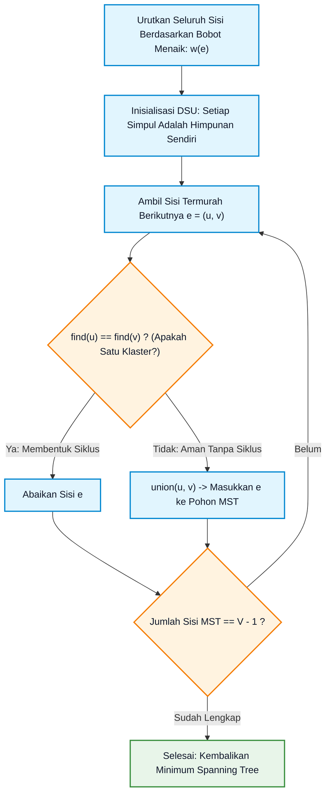
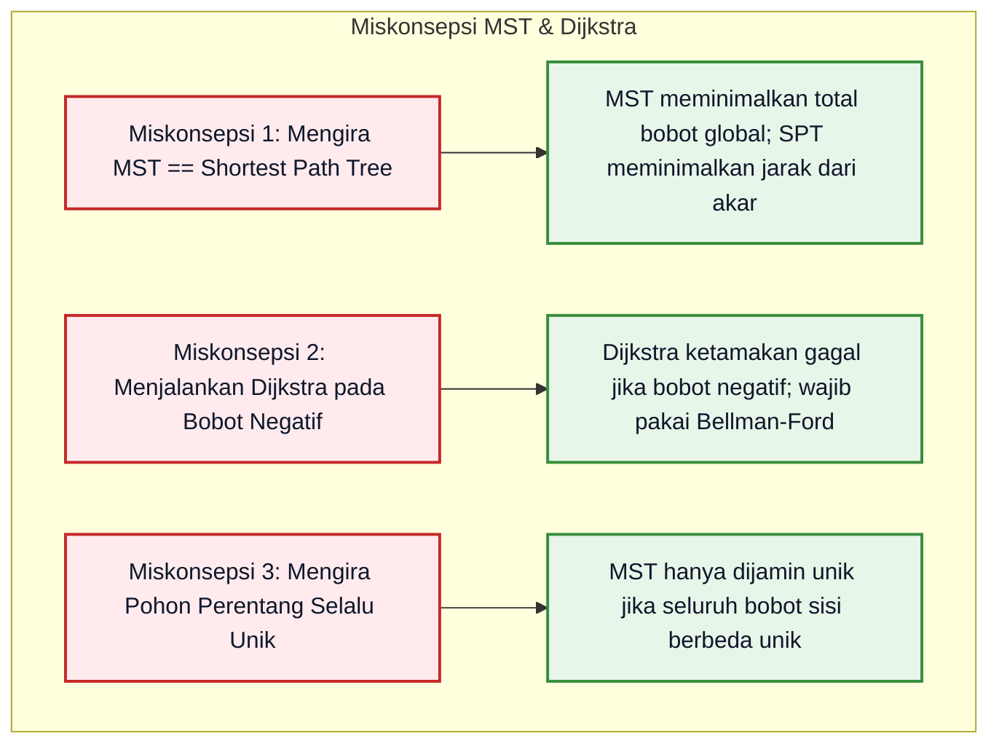

# Bab 07: Pohon, Spanning Tree, dan Lintasan Terpendek

> **Navigasi Modul 012**: [Peta Belajar & Prasyarat](./README.md) • [Gerbang Utama Modul 012](../012-matematika-diskrit-kombinatorika-graf.md) • [⬅️ Bab Sebelumnya (06: Fondasi Teori Graf & Isomorfisme)](./06-fondasi-teori-graf-isomorfisme-konektivitas.md) • [Bab Berikutnya (08: Graf Euler, Hamilton & Planaritas) ➡️](./08-graf-euler-hamilton-planaritas.md)

---

## 1. Intuisi & Motivasi Konseptual: Dari Nol Mutlak ("Bayi Baru Lahir")

### 1.1 Dunia Sehari-hari: Pohon Keluarga, Kabel Listrik Perumahan, dan Navigasi GPS
Bayangkan Anda adalah bayi yang baru belajar mengamati hubungan antar cabang dan jalan di sekitar Anda:

1. **Silsilah Pohon Keluarga**:
   Pernahkah Anda melihat diagram silsilah keluarga?
   - Kakek-nenek berada di puncak, menurunkan orang tua Anda, lalu orang tua menurunkan Anda dan saudara-saudara Anda.
   - Di dalam silsilah keluarga yang sehat, **mustahil ada siklus melingkar** (Anda tidak mungkin menjadi kakek dari diri Anda sendiri!).
   - Hubungan tanpa siklus ini dinamakan **Pohon (Tree)**: sebuah graf khusus yang terhubung erat tetapi **sama sekali tidak memiliki jalan melingkar (*loop / cycle*)**.

2. **Memasang Kabel Listrik di Kompleks Perumahan (Minimum Spanning Tree)**:
   Bayangkan seorang kontraktor PLN harus mengalirkan listrik ke 20 rumah baru di sebuah perumahan:
   - Kontraktor ingin seluruh 20 rumah menyala tanpa terkecuali.
   - Namun, kabel tembaga bawah tanah sangat mahal. Kontraktor ingin memasang kabel dengan **total panjang seminimal mungkin**.
   - Jika kontraktor memasang kabel melingkar tertutup (membentuk siklus), itu adalah **pemborosan uang**, karena memutus salah satu kabel pada lingkaran tersebut tidak akan memadamkan listrik di rumah mana pun!
   - Pohon yang menghubungkan seluruh simpul dengan biaya kabel termurah dinamakan **Pohon Perentang Minimum (*Minimum Spanning Tree / MST*)**.

3. **Mencari Rute Tercepat di Google Maps (Lintasan Terpendek)**:
   Ketika Anda menyalakan aplikasi navigasi GPS di ponsel Anda:
   - Ponsel tidak mencoba sembarang jalan secara acak.
   - Ponsel mengevaluasi persimpangan jalan menggunakan algoritma **Dijkstra**: secara bertahap memperluas area pencarian dari titik awal Anda menuju tujuan, selalu memilih persimpangan jalan terdekat berikutnya yang belum dikunjungi.

```mermaid
flowchart TD
    subgraph Pohon Sederhana: 5 Simpul dan 4 Sisi (V = 5, E = 4)
        Root["Akar (Root)"] --- B["Cabang B"]
        Root --- C["Cabang C"]
        B --- D["Daun D"]
        B --- E["Daun E"]
    end

    classDef rootStyle fill:#e1f5fe,stroke:#0288d1,stroke-width:2px,color:#0f172a;
    classDef branchStyle fill:#f3e5f5,stroke:#7b1fa2,stroke-width:2px,color:#0f172a;
    classDef leafStyle fill:#e8f5e9,stroke:#388e3c,stroke-width:2px,color:#0f172a;
    class Root rootStyle;
    class B,C branchStyle;
    class D,E leafStyle;
```

---

### 1.2 Kamus Simbol Anti-Pusing: Menerjemahkan Notasi Pohon & Algoritma Greedy

> **🔤 Kamus Simbol Anti-Pusing — Pohon & Lintasan Terpendek:**
>
> | Simbol Matematika | Nama Notasi | Cara Baca Lisan | Terjemahan Bahasa Manusia | Contoh Nyata |
> |---|---|---|---|---|
> | $T = (V, E)$ | Graf Pohon | "Pohon $T$ dengan simpul $V$ dan sisi $E$" | Graf terhubung yang tidak memiliki siklus sama sekali | Struktur folder direktori di komputer |
> | $\|E\| = \|V\| - 1$ | Teorema Keseimbangan Pohon | "Jumlah sisi sama dengan jumlah simpul dikurang satu" | Menghubungkan $N$ benda membutuhkan tepat $(N - 1)$ jembatan tali | 10 pulau butuh 9 jembatan agar semua terhubung |
> | MST | *Minimum Spanning Tree* | "Pohon perentang minimum" | Subgraf pohon yang mencakup seluruh simpul dengan total bobot sisi paling murah | Jaringan pipa air bersih terhemat |
> | $w(u, v)$ | Bobot Sisi (*Edge Weight*) | "Bobot atau biaya sisi dari $u$ ke $v$" | Angka yang menunjukkan jarak kilometer, waktu latensi, atau tarif tol jalan | Jarak 15 km antar dua kota |
> | $d(v)$ atau $\text{dist}[v]$ | Jarak Terpendek Sementara | "Estimasi jarak terpendek ke simpul $v$" | Catatan jarak termurah yang sudah ditemukan dari simpul asal | Estimasi waktu tiba di peta GPS |
> | $\alpha(n)$ | Fungsi Ackermann Terbalik | "Alpha dari $n$" | Fungsi matematika yang tumbuh sangat lambat, nilainya $\le 4$ untuk seluruh data di alam semesta | Efisiensi struktur data Disjoint Set Union |

---

## 2. Definisi Formal, Teorema, dan Penurunan Matematis

### 2.1 Definisi Aksiomatik Pohon & Enam Teorema Ekuivalen
Sebuah graf tak-berarah $T = (V, E)$ didefinisikan sebagai **Pohon** jika $T$ terhubung (*connected*) dan asiklik (*acyclic* / tidak memuat siklus).

> **Teorema Enam Karakterisasi Ekuivalen Pohon**:
> Misalkan $G = (V, E)$ adalah graf tak-berarah dengan $|V| = n$ simpul. Pernyataan-pernyataan berikut **saling ekuivalen secara mutlak** (jika salah satu benar, maka kelima lainnya otomatis benar):
>
> 1. $G$ adalah pohon.
> 2. Antara setiap pasang simpul yang berbeda di $G$, terdapat **tepat satu lintasan sederhana unik**.
> 3. $G$ terhubung, dan memiliki tepat $|E| = n - 1$ sisi.
> 4. $G$ asiklik, dan memiliki tepat $|E| = n - 1$ sisi.
> 5. $G$ asiklik, tetapi jika sembarang satu sisi baru ditambahkan antara dua simpul, graf langsung memuat tepat satu siklus.
> 6. $G$ terhubung, tetapi jika sembarang satu sisi dihapus, graf langsung terputus menjadi dua komponen terpisah.

#### Pembuktian Induktif Teorema $|E| = n - 1$:
Kita buktikan dengan Induksi Matematika pada banyaknya simpul $n$:
- **Basis Induksi ($n = 1$)**: Graf pohon dengan 1 simpul memiliki 0 sisi. $|E| = 1 - 1 = 0$ (Benar).
- **Langkah Induksi**: Asumsikan sembarang pohon dengan $k$ simpul memiliki $k - 1$ sisi.
  Ambil sebuah pohon $T$ dengan $k + 1$ simpul.
  Karena $T$ adalah pohon dan $k + 1 \ge 2$, $T$ pasti memiliki setidaknya satu simpul berderajat 1 (simpul daun $v$).
  Hapus simpul $v$ beserta 1 sisi yang menancap padanya. Graf yang tersisa $T' = T \setminus \{v\}$ tetap terhubung dan asiklik, sehingga $T'$ adalah pohon dengan $k$ simpul.
  Berdasarkan hipotesis induksi, $|E(T')| = k - 1$.
  Ketika kita mengembalikan simpul $v$, kita menambahkan tepat 1 simpul dan 1 sisi baru:
  $$|E(T)| = |E(T')| + 1 = (k - 1) + 1 = k = (k + 1) - 1$$
  Terbukti valid untuk seluruh bilangan bulat $n \ge 1$. **(Q.E.D.)**

---

### 2.2 Teorema Cayley: Banyaknya Pohon Berlabel
Berapa banyak pohon perentang berbeda yang dapat dibentuk dari sebuah graf lengkap $K_n$ dengan $n$ simpul berlabel?

> **Teorema Cayley (1889)**:
> Untuk sembarang bilangan bulat $n \ge 2$, banyaknya pohon berlabel dengan $n$ simpul adalah:
>
> $$
> T_n = n^{n - 2}
> $$

Contoh:
- Untuk $n = 3$: ada $3^{3 - 2} = 3^1 = 3$ pohon berbeda (garis lurus 1-2-3, 1-3-2, 2-1-3).
- Untuk $n = 4$: ada $4^{4 - 2} = 4^2 = 16$ pohon berbeda.
- Teorema ini dapat dibuktikan secara elegan melalui korespondensi bijektif satu-ke-satu dengan barisan kode Prüfer (*Prüfer sequence*) dengan panjang $(n - 2)$.

---

### 2.3 Prinsip Ketamakan (*Greedy Strategy*) pada Minimum Spanning Tree (MST)
Diberikan graf terhubung tak-berarah berbobot $G = (V, E, w)$.

> **Teorema Sifat Potongan (*The Cut Property*)**:
> Misalkan $(S, V \setminus S)$ adalah sembarang partisi potongan simpul pada graf $G$.
> Jika $e = (u, v)$ adalah sisi dengan **bobot paling ringan** yang melintasi potongan tersebut (menghubungkan simpul di $S$ dengan simpul di $V \setminus S$), maka sisi $e$ **dijamin pasti termasuk ke dalam Minimum Spanning Tree (MST)** dari $G$.

*Pembuktian via Argumentasi Pertukaran (Exchange Argument)*:
Misalkan ada MST $T$ yang tidak memuat sisi termurah $e$.
Jika kita menambahkan sisi $e$ ke dalam $T$, maka tercipta sebuah siklus unik $C$.
Karena sisi $e$ menyeberangi potongan $(S, V \setminus S)$, siklus $C$ pasti memiliki setidaknya satu sisi lain $e'$ yang juga menyeberangi potongan tersebut.
Hapus sisi $e'$ dan gantikan dengan $e$, membentuk pohon baru $T' = (T \setminus \{e'\}) \cup \{e\}$.
Bobot total pohon baru adalah:
$$w(T') = w(T) - w(e') + w(e)$$
Karena $e$ adalah sisi termurah yang melintasi potongan, maka $w(e) \le w(e')$, yang berarti $w(T') \le w(T)$.
Karena $T$ adalah MST, maka $w(T') = w(T)$, membuktikan bahwa $T'$ juga merupakan MST yang sah dan memuat sisi $e$! **(Q.E.D.)**

---

### 2.4 Algoritma Dijkstra: Lintasan Terpendek Sumber Tunggal
Diberikan graf berarah/tak-berarah dengan fungsi bobot non-negatif $w(u, v) \ge 0$ dan simpul awal $s$.

> **Invarian Ketamakan Dijkstra**:
> Pada setiap langkah, simpul $u$ yang belum dikunjungi dengan nilai estimasi jarak sementara $d(u)$ terkecil dijamin telah menemukan **jarak terpendek definitif sejati**:
>
> $$
> d(u) = \delta(s, u)
> $$
>
> Setelah simpul $u$ diproses, lakukan **Relaksasi Segitiga** untuk setiap tetangga $v$:
>
> $$
> \text{Jika } d(u) + w(u, v) < d(v) \implies d(v) = d(u) + w(u, v)
> $$

*Peringatan Kritis*: Algoritma Dijkstra **hanya berlaku jika seluruh bobot sisi non-negatif** ($w(e) \ge 0$). Jika ada bobot sisi bernilai negatif, strategi ketamakan Dijkstra runtuh dan dapat menghasilkan jawaban yang salah! Untuk graf dengan bobot negatif, kita wajib menggunakan **Algoritma Bellman-Ford** ($O(V \cdot E)$).

---

### 2.5 Perbandingan Mendalam: Algoritma Kruskal vs Algoritma Prim
Terdapat dua algoritma ketamakan klasik untuk menemukan Minimum Spanning Tree:

| Aspek Perbandingan | Algoritma Kruskal | Algoritma Prim |
|---|---|---|
| **Fokus Strategi** | Berorientasi pada **Sisi** (*Edge-centric*) | Berorientasi pada **Simpul** (*Vertex-centric*) |
| **Pola Pertumbuhan** | Menumbuhkan **Hutan** komponen terpisah yang saling menyatu di akhir | Menumbuhkan **Satu Pohon Tunggal** yang terus membesar dari satu simpul asal |
| **Struktur Data Kunci** | Disjoint Set Union (DSU / Union-Find) | Min-Heap / Priority Queue (mirip Dijkstra) |
| **Kompleksitas Waktu** | $O(E \log E) = O(E \log V)$ | $O(E \log V)$ dengan biner heap; $O(E + V \log V)$ dengan Fibonacci heap |
| **Paling Unggul Saat** | Graf Jarang (*Sparse Graph*, $E \ll V^2$) | Graf Sangat Padat (*Dense Graph*, $E \approx V^2$) |

---

### 2.6 Algoritma Bellman-Ford & Teorema Deteksi Siklus Negatif
Bagaimana jika graf memiliki bobot sisi negatif? Dijkstra gagal, tetapi **Algoritma Bellman-Ford** (1958) hadir sebagai penyelamat berbasis pemrograman dinamis:

> **Prinsip Relaksasi Lintasan Terpendek Bellman-Ford**:
> Pada sembarang graf dengan $|V|$ simpul yang bebas dari siklus negatif, sembarang lintasan terpendek sederhana memuat **paling banyak $|V| - 1$ sisi**.
> Dengan merelaksasi seluruh himpunan sisi $|E|$ sebanyak $|V| - 1$ putaran penuh:
>
> $$
> \forall (u, v) \in E: \quad \text{Jika } d(u) + w(u, v) < d(v) \implies d(v) = d(u) + w(u, v)
> $$
>
> seluruh jarak terpendek dijamin telah mencapai nilai optimal global!

> **Teorema Deteksi Siklus Negatif**:
> Jalankan putaran relaksasi ke-$|V|$ (putaran tambahan).
> Jika masih terdapat sisi $(u, v)$ sedemikian sehingga $d(u) + w(u, v) < d(v)$, maka graf tersebut **positif memuat setidaknya satu siklus berbobot negatif** yang dapat dijangkau dari simpul asal!

---

## 3. Arsitektur Teknis & Algoritma Internal

### 3.1 Struktur Data Disjoint Set Union (DSU) & Algoritma Kruskal
Algoritma Kruskal membangun MST dengan cara:
1. Mengurutkan seluruh sisi graf berdasarkan bobot secara menaik: $w(e_1) \le w(e_2) \le \dots \le w(e_m)$.
2. Mengambil sisi satu per satu: jika kedua simpul ujung sisi tersebut belum berada di klaster yang sama, gabungkan keduanya dan masukkan ke dalam MST. Jika sudah berada di klaster yang sama, lewati (karena akan membentuk siklus).

Untuk melakukan pengujian klaster dalam waktu mendekati $O(1)$, kita menggunakan struktur data **Disjoint Set Union (DSU / Union-Find)** dengan dua optimasi:
- **Path Compression**: Mengarahkan seluruh anak ranting langsung ke akar saat pemanggilan `find(x)`.
- **Union by Rank**: Menggabungkan pohon yang lebih pendek di bawah pohon yang lebih tinggi.
Kompleksitas operasi DSU menjadi $O(m \cdot \alpha(n))$, di mana $\alpha(n)$ adalah fungsi Ackermann terbalik yang praktis bernilai konstan $\le 4$.



---

## 4. Implementasi Praktis & Kode Pemrograman Python

### 4.1 Tahap 4A: Pustaka Murni DSU, Algoritma Kruskal, dan Dijkstra Teroptimasi

Berikut adalah kode Python standar industri tanpa modul eksternal:

```python
"""
Implementasi Komputasi Pohon & Lintasan Terpendek:
1. Struktur Data Disjoint Set Union (DSU) dengan Path Compression & Union-by-Rank.
2. Algoritma Kruskal untuk Minimum Spanning Tree (MST).
3. Algoritma Dijkstra Lintasan Terpendek Menggunakan Priority Queue (heapq).
"""
import heapq
from typing import List, Tuple, Dict

class DisjointSetUnion:
    """Struktur data himpunan saling lepas teroptimasi dengan kompresi lintasan."""
    def __init__(self, elements: List[str]):
        self.parent = {x: x for x in elements}
        self.rank = {x: 0 for x in elements}

    def find(self, x: str) -> str:
        """Mencari representasi akar klaster dengan kompresi lintasan rekursif."""
        if self.parent[x] != x:
            self.parent[x] = self.find(self.parent[x])
        return self.parent[x]

    def union(self, x: str, y: str) -> bool:
        """Menggabungkan dua klaster berdasarkan rank. Mengembalikan False jika sudah satu klaster."""
        root_x = self.find(x)
        root_y = self.find(y)
        if root_x == root_y:
            return False  # Terjadi siklus
        
        if self.rank[root_x] < self.rank[root_y]:
            self.parent[root_x] = root_y
        elif self.rank[root_x] > self.rank[root_y]:
            self.parent[root_y] = root_x
        else:
            self.parent[root_y] = root_x
            self.rank[root_x] += 1
        return True

def kruskal_mst(vertices: List[str], edges: List[Tuple[int, str, str]]) -> Tuple[int, List[Tuple[str, str, int]]]:
    """
    Algoritma Kruskal untuk mencari Minimum Spanning Tree.
    edges: daftar tuple (bobot, simpul_asal, simpul_tujuan).
    """
    dsu = DisjointSetUnion(vertices)
    sorted_edges = sorted(edges, key=lambda item: item[0])
    mst_tree = []
    total_cost = 0

    for weight, u, v in sorted_edges:
        if dsu.union(u, v):
            mst_tree.append((u, v, weight))
            total_cost += weight
            if len(mst_tree) == len(vertices) - 1:
                break
    return total_cost, mst_tree

def dijkstra_shortest_path(vertices: List[str], adj: Dict[str, List[Tuple[str, int]]], start: str) -> Dict[str, int]:
    """
    Algoritma Dijkstra untuk menghitung lintasan terpendek dari simpul asal ke seluruh simpul.
    adj: peta simpul -> daftar tuple (tetangga, bobot).
    """
    distances = {v: float('inf') for v in vertices}
    distances[start] = 0
    priority_queue = [(0, start)]

    while priority_queue:
        current_dist, u = heapq.heappop(priority_queue)
        
        # Jika jarak di antrean sudah usang (stale entry)
        if current_dist > distances[u]:
            continue
            
        for v, weight in adj[u]:
            new_distance = current_dist + weight
            if new_distance < distances[v]:
                distances[v] = new_distance
                heapq.heappush(priority_queue, (new_distance, v))
                
    return distances

def run_tree_and_path_demonstrations():
    print("=== 1. Algoritma Kruskal: Minimum Spanning Tree (MST) ===")
    # Topologi jaringan serat optik antar 6 kota: A, B, C, D, E, F
    nodes = ["A", "B", "C", "D", "E", "F"]
    network_cables = [
        (4, "A", "B"), (2, "A", "C"),
        (5, "B", "C"), (10, "B", "D"),
        (7, "C", "D"), (3, "C", "E"),
        (8, "D", "E"), (1, "D", "F"), (6, "E", "F")
    ]
    cost, mst_result = kruskal_mst(nodes, network_cables)
    print(f"Total Bobot Minimum Kabel Fiber Optik : {cost} km")
    print("Daftar Sisi Terpilih dalam Spanning Tree:")
    for u, v, w in mst_result:
        print(f"  Kabel {u} <---> {v} (Bobot: {w})")

    print("\n=== 2. Algoritma Dijkstra: Lintasan Terpendek dari Simpul A ===")
    graph_adjacency = {v: [] for v in nodes}
    for w, u, v in network_cables:
        graph_adjacency[u].append((v, w))
        graph_adjacency[v].append((u, w))

    min_distances = dijkstra_shortest_path(nodes, graph_adjacency, "A")
    print("Jarak Terpendek dari Pusat Jaringan 'A' ke Setiap Kota:")
    for target in sorted(min_distances.keys()):
        print(f"  Jarak ke Kota {target} : {min_distances[target]} ms")

if __name__ == "__main__":
    run_tree_and_path_demonstrations()
```

Keluaran eksekusi terminal sebenarnya:
```text
=== 1. Algoritma Kruskal: Minimum Spanning Tree (MST) ===
Total Bobot Minimum Kabel Fiber Optik : 16 km
Daftar Sisi Terpilih dalam Spanning Tree:
  Kabel D <---> F (Bobot: 1)
  Kabel A <---> C (Bobot: 2)
  Kabel C <---> E (Bobot: 3)
  Kabel A <---> B (Bobot: 4)
  Kabel E <---> F (Bobot: 6)

=== 2. Algoritma Dijkstra: Lintasan Terpendek dari Simpul A ===
Jarak Terpendek dari Pusat Jaringan 'A' ke Setiap Kota:
  Jarak ke Kota A : 0 ms
  Jarak ke Kota B : 4 ms
  Jarak ke Kota C : 2 ms
  Jarak ke Kota D : 9 ms
  Jarak ke Kota E : 5 ms
  Jarak ke Kota F : 10 ms
```

#### Tabel Bedah Kode Baris-demi-Baris

| Baris Kode | Apa yang Dilakukan Komputer | Terjemahan Bahasa Manusia |
|---|---|---|
| `if self.parent[x] != x: self.parent[x] = self.find(...)` | Melakukan pemadatan pohon (*Path Compression*) secara rekursif | Menghubungkan seluruh anak ranting langsung ke pemimpin klaster utama |
| `sorted(edges, key=lambda item: item[0])` | Mengurutkan seluruh sisi berdasarkan bobot terendah $O(E \log E)$ | Menyiapkan strategi ketamakan: prioritaskan kabel termurah terlebih dahulu |
| `heapq.heappop(priority_queue)` | Mengambil simpul dengan estimasi jarak minimum dalam waktu $O(\log V)$ | Memilih simpul berikutnya yang paling dekat secara optimal |
| `if current_dist > distances[u]: continue` | Melewati entri jarak usang yang tertinggal di min-heap | Mencegah komputasi berulang pada simpul yang sudah terelaksasi |

---

### 4.2 Tahap 4B: Implementasi Algoritma Bellman-Ford & Detektor Siklus Negatif
Ketika graf memuat bobot negatif (misalnya insentif tarif atau penghematan energi), algoritma Dijkstra runtuh. Di bawah ini adalah implementasi Bellman-Ford mandiri yang mampu menemukan lintasan terpendek sekaligus mendeteksi siklus negatif:

```python
"""
Tahap 4B: Algoritma Bellman-Ford dengan Deteksi Siklus Negatif.
Mendukung graf berarah dengan bobot sisi negatif.
"""
from typing import List, Tuple, Dict

def bellman_ford_shortest_path(vertices: List[str], edges: List[Tuple[str, str, int]], start: str) -> Tuple[Dict[str, int], bool]:
    """
    Menghitung lintasan terpendek dari simpul start menggunakan Bellman-Ford.
    Mengembalikan: (kamus_jarak, status_keberadaan_siklus_negatif).
    """
    distances = {v: float('inf') for v in vertices}
    distances[start] = 0
    n = len(vertices)

    # Relaksasi sisi sebanyak (V - 1) putaran
    for _ in range(n - 1):
        for u, v, weight in edges:
            if distances[u] != float('inf') and distances[u] + weight < distances[v]:
                distances[v] = distances[u] + weight

    # Putaran ke-V untuk mendeteksi siklus negatif
    has_negative_cycle = False
    for u, v, weight in edges:
        if distances[u] != float('inf') and distances[u] + weight < distances[v]:
            has_negative_cycle = True
            break

    return distances, has_negative_cycle

if __name__ == "__main__":
    nodes_sample = ["S", "A", "B", "C"]
    directed_edges = [
        ("S", "A", 4),
        ("S", "B", 5),
        ("A", "B", -2),  # Bobot negatif yang valid
        ("B", "C", 3),
        ("A", "C", 6)
    ]
    dist_map, neg_cycle_found = bellman_ford_shortest_path(nodes_sample, directed_edges, "S")
    print(f"--- Evaluasi Bellman-Ford dari Titik Awal 'S' ---")
    print(f"Terdeteksi Siklus Negatif : {neg_cycle_found}")
    print("Jarak Terpendek ke Setiap Simpul:")
    for dest in sorted(dist_map.keys()):
        print(f"  Jarak ke {dest} : {dist_map[dest]}")
```

Keluaran eksekusi terminal sebenarnya:
```text
--- Evaluasi Bellman-Ford dari Titik Awal 'S' ---
Terdeteksi Siklus Negatif : False
Jarak Terpendek ke Setiap Simpul:
  Jarak ke A : 4
  Jarak ke B : 2
  Jarak ke C : 5
  Jarak ke S : 0
```

#### Tabel Analisis Algoritma Bellman-Ford

| Baris Kode | Apa yang Dilakukan Komputer | Terjemahan Bahasa Manusia |
|---|---|---|
| `for _ in range(n - 1):` | Mengulang relaksasi seluruh sisi sebanyak $|V| - 1$ kali | Menjamin jarak terpendek merambat sejauh mungkin melintasi rantai simpul |
| `if distances[u] + weight < distances[v]:` | Menguji apakah ada rute alternatif yang lebih pendek melalui simpul $u$ | Menjalankan prinsip pertidaksamaan segitiga relaksasi |
| `has_negative_cycle = True` | Menangkap penurunan jarak pada putaran ekstra ke-$|V|$ | Mendeteksi adanya pusaran tak-hingga yang menguras jarak menuju minus tak hingga |

---

## 5. Miskonsepsi Umum & Analisis Post-Mortem Insiden Industri

### 5.1 Tiga Miskonsepsi Konseptual Paling Fatal



1. **Miskonsepsi 1: Mengira MST Menghasilkan Lintasan Terpendek Antar Simpul**:
   Banyak insinyur mengira jika mereka telah membangun Minimum Spanning Tree (MST), maka lintasan di dalam pohon tersebut otomatis merupakan lintasan terpendek antar sembarang dua kota.
   *Fakta*: MST meminimalkan **jumlah total biaya kabel seluruh dunia**, bukan jarak antar dua simpul tertentu!
   Contoh: Jarak langsung kota A ke B mungkin berbobot 10, tetapi di MST jalurnya harus memutar melalui C dan D dengan total bobot $3 + 4 + 5 = 12$. Jika tujuan Anda adalah rute tercepat dari A ke B, gunakan **Dijkstra (Shortest Path Tree)**, bukan MST!
2. **Miskonsepsi 2: Menjalankan Algoritma Dijkstra pada Graf dengan Bobot Negatif**:
   Dijkstra mengasumsikan bahwa begitu sebuah simpul dikeluarkan dari *Priority Queue*, jaraknya sudah final dan tidak akan pernah berkurang lagi.
   Jika ada sisi berbobot negatif, penjelajahan di kemudian hari bisa menemukan rute "diskon" yang memperpendek jarak simpul yang sudah ditutup. Dijkstra akan menghasilkan jawaban yang cacat!
3. **Miskonsepsi 3: Mengira Pohon Selalu Memiliki Akar Alami**:
   Dalam teori graf murni, pohon adalah graf tak-berarah yang bebas (tanpa arah dan tanpa akar). Anda bebas mengangkat sembarang simpul menjadi akar (*Rooted Tree*). Begitu satu simpul ditunjuk sebagai akar, seluruh simpul lainnya secara otomatis mendapatkan relasi hierarkis orang tua (*Parent*) dan anak (*Child*).

---

### 5.2 Analisis Post-Mortem Kegagalan Industri: Badai Siaran (*Broadcast Storm*) Melumpuhkan Pusat Data Perbankan

> **Kasus Nyata: Pemadaman Jaringan Pusat Data Utama Akibat Kegagalan Spanning Tree Protocol (STP)**
>
> - **Konteks Sistem**: Sebuah jaringan *Local Area Network* (LAN) perbankan menghubungkan ratusan switch jaringan lapisan 2 (Layer 2). Kabel fisik sengaja dipasang berlebih (*redundant links*) untuk cadangan jika ada kabel putus.
> - **Akar Masalah (Kegagalan Pembentukan Spanning Tree)**:
>   Protokol Jaringan Standar IEEE 802.1D **Spanning Tree Protocol (STP)** bertugas secara otomatis menonaktifkan (*block*) kabel cadangan agar topologi logis jaringan membentuk **Pohon (Tree) murni tanpa siklus tertutup**.
>   Saat seorang teknisi melakukan pergantian perangkat modul switch cadangan, parameter prioritas jembatan (*Bridge Priority*) terkonfigurasi salah secara tidak sengaja, memicu proses pemilihan ulang akar (*STP Re-convergence Loop*).
>   Selama masa rekonvergensi, kabel redundan sempat aktif bersamaan dan membentuk siklus fisik tertutup antar switch.
> - **Dampak Katastropik**:
>   Paket data siaran (*Ethernet Broadcast Frames / ARP requests*) yang dikirimkan satu server terduplikasi secara eksponensial di dalam siklus tertutup. Terjadi **Badai Siaran (*Broadcast Storm*)**: jutaan frame data berputar tanpa henti, membanjiri buffer switch dalam 3 detik, menyebabkan utilisasi CPU switch 100%, dan memutus seluruh transaksi ATM dan transfer antar bank selama 5 jam.
> - **Solusi Arsitektural**:
>   Mengaktifkan proteksi perangkat keras *STP Root Guard*, *BPDU Guard*, dan beralih ke arsitektur perutean Layer 3 (*Clos Topology / Leaf-Spine*) yang menggunakan protokol *Equal-Cost Multi-Path* (ECMP) bebas loop.

---

## 6. Tips, Trik Praktis & Rahasia Cepat Paham

1. **Jembatan Keledai Pohon**:
   > *"N Simpul, N - 1 Garis, Nol Siklus!"*
   - Jika Anda memiliki graf terhubung dengan 100 simpul, ia wajib memiliki tepat 99 sisi untuk menjadi sebuah pohon.
   - Jika ada 100 sisi $\implies$ Dijamin pasti memuat setidaknya 1 siklus!
   - Jika ada 98 sisi $\implies$ Dijamin pasti graf tersebut terputus (terbelah)!
2. **Kapan Memilih Kruskal vs Prim?**:
   - **Gunakan Kruskal**: Jika graf bersifat **Jarang (*Sparse Graph*, $|E| \ll |V|^2$)**. Mengurutkan sisi dalam $O(E \log E)$ sangat cepat dan mudah diimplementasikan dengan DSU.
   - **Gunakan Prim**: Jika graf bersifat **Padat (*Dense Graph*, $|E| \approx |V|^2$)**. Algoritma Prim berbasis matriks ketetanggaan dapat berjalan dalam $O(V^2)$ tanpa perlu mengurutkan jutaan sisi.
3. **Mendeteksi Siklus Negatif dengan Bellman-Ford**:
   Jalankan relaksasi sisi sebanyak $|V| - 1$ kali. Kemudian lakukan relaksasi satu kali lagi:
   - Jika pada putaran ke-$|V|$ masih ada jarak yang bisa diperpendek, maka graf tersebut **positif memuat Siklus Negatif (*Negative Weight Cycle*)**!

4. **Peluasan Dijkstra: Algoritma Pencarian Heuristik $A^*$**:
   Dalam industri pengembangan video game dan robotika otonom, Dijkstra murni terlalu lambat karena mengeksplorasi seluruh arah secara melingkar radial seperti riak air di danau.
   Algoritma $A^*$ menambahkan fungsi estimasi jarak masa depan $h(n)$ (misalnya jarak garis lurus Euclidean atau Manhattan):
   $$f(n) = g(n) + h(n)$$
   di mana $g(n)$ adalah jarak nyata dari start, dan $h(n)$ adalah estimasi jarak ke tujuan. Jika fungsi heuristik $h(n)$ bersifat *admissible* (tidak pernah melebih-lebihkan jarak nyata), $A^*$ dijamin menemukan rute terpendek dengan kecepatan hingga 10x lebih cepat daripada Dijkstra!

---

## 7. Latihan Berjenjang & Kunci Jawaban Lengkap (Tingkat 1 - 5 Socratic)

### Tingkat 1: Daun pada Pohon Non-Trivial
Buktikan bahwa setiap pohon $T = (V, E)$ dengan setidaknya 2 simpul ($|V| \ge 2$) **pasti memiliki setidaknya minimal 2 buah simpul daun (simpul berderajat 1)**!

<details>
<summary>👁️ Klik untuk Melihat Kunci Pembahasan Tingkat 1</summary>

**Bukti Melalui Handshaking Lemma & Kontradiksi**:
1. Misalkan pohon $T$ memiliki $n$ simpul dengan $n \ge 2$.
   Karena $T$ adalah pohon, maka banyaknya sisi adalah $|E| = n - 1$.
2. Berdasarkan Handshaking Lemma:
   $$\sum_{v \in V} \deg(v) = 2 |E| = 2(n - 1) = 2n - 2$$
3. Karena pohon terhubung dan $n \ge 2$, tidak ada simpul berderajat 0 ($\deg(v) \ge 1$ untuk semua $v$).
4. Andaikan pohon $T$ memiliki **kurang dari 2 daun** (artinya memiliki paling banyak 1 simpul berderajat 1):
   - Paling banyak ada 1 simpul berderajat 1.
   - Sisa $(n - 1)$ simpul lainnya harus memiliki derajat minimal 2 ($\deg(v) \ge 2$).
5. Hitung jumlah derajat minimum yang mungkin:
   $$\sum_{v \in V} \deg(v) \ge 1 \cdot (1) + (n - 1) \cdot (2) = 1 + 2n - 2 = 2n - 1$$
6. Terjadi **kontradiksi**:
   Jumlah derajat yang dihitung adalah $2n - 2$, tetapi pengandaian menghasilkan minimal $2n - 1$ ($2n - 2 < 2n - 1$).
Maka pengandaian salah: pohon $T$ **wajib memiliki setidaknya minimal 2 buah simpul daun**! **(Q.E.D.)**
</details>

---

### Tingkat 2: Perhitungan Manual Algoritma Kruskal
Diberikan graf dengan 5 simpul $\{A, B, C, D, E\}$ dan daftar sisi berbobot:
- $(A, B): 3$
- $(A, C): 1$
- $(B, C): 7$
- $(B, D): 5$
- $(C, D): 2$
- $(C, E): 4$
- $(D, E): 6$
Tentukan sisi-sisi yang terpilih dalam MST menggunakan algoritma Kruskal beserta total bobot minimumnya!

<details>
<summary>👁️ Klik untuk Melihat Kunci Pembahasan Tingkat 2</summary>

**Langkah Eksekusi Kruskal**:
1. Urutkan seluruh sisi berdasarkan bobot menaik:
   - $(A, C): 1$
   - $(C, D): 2$
   - $(A, B): 3$
   - $(C, E): 4$
   - $(B, D): 5$
   - $(D, E): 6$
   - $(B, C): 7$
2. Inisialisasi 5 klaster terpisah: $\{A\}, \{B\}, \{C\}, \{D\}, \{E\}$. Target memilih $n - 1 = 4$ sisi.
3. Evaluasi sisi satu per satu:
   - Pilih $(A, C): 1 \to$ Gabung klaster $\{A, C\}$. (Sisi #1 terpilih)
   - Pilih $(C, D): 2 \to$ Gabung klaster $\{A, C, D\}$. (Sisi #2 terpilih)
   - Pilih $(A, B): 3 \to$ Gabung klaster $\{A, B, C, D\}$. (Sisi #3 terpilih)
   - Pilih $(C, E): 4 \to$ Gabung klaster $\{A, B, C, D, E\}$. (Sisi #4 terpilih)
4. Karena sudah terpilih 4 sisi dan seluruh simpul terhubung, proses berhenti!
Total bobot MST: $1 + 2 + 3 + 4 = 10$.
Sisi terpilih: **$(A, C), (C, D), (A, B),$ dan $(C, E)$**.
</details>

---

### Tingkat 3: Mengapa Dijkstra Gagal pada Bobot Negatif?
Buatlah contoh penyangkal (*counterexample*) sederhana dengan 3 simpul yang menunjukkan kegagalan algoritma Dijkstra ketika terdapat sisi berbobot negatif!

<details>
<summary>👁️ Klik untuk Melihat Kunci Pembahasan Tingkat 3</summary>

**Konstruksi Graf Penyangkal 3 Simpul**:
Misalkan simpul awal adalah $S$, dan tujuannya adalah $T$:
- Simpul: $S, A, T$.
- Sisi berarah:
  - $S \to A$ dengan bobot $5$
  - $S \to T$ dengan bobot $3$
  - $A \to T$ dengan bobot $-4$ (bobot negatif!)

**Jalan Pikiran Algoritma Dijkstra**:
1. Jarak awal: $d(S) = 0, d(A) = 5, d(T) = 3$.
2. Antrean prioritas mengeluarkan simpul $T$ terlebih dahulu karena $d(T) = 3 < d(A) = 5$.
3. Dijkstra menandai simpul $T$ sebagai **selesai / permanen** dengan jarak terpendek $3$.
4. Selanjutnya Dijkstra memproses simpul $A$ ($d(A) = 5$).
5. Dari $A$, terdapat jalan ke $T$ dengan bobot $-4$. Jarak melalui $A$ adalah $d(A) + w(A, T) = 5 + (-4) = 1$.
6. Namun karena simpul $T$ sudah ditutup permanen oleh logika ketamakan Dijkstra pada langkah 2, Dijkstra **gagal memperbarui jarak $T$ menjadi 1**!
Dijkstra melaporkan jarak terpendek ke $T$ adalah 3, padahal rute sejati terpendek adalah $S \to A \to T$ dengan jarak **1**!
</details>

---

### Tingkat 4: Deteksi Arbitrase Valuta Asing Menggunakan Algoritma Bellman-Ford
Dalam pasar keuangan valuta asing, nilai tukar mata uang dapat dimodelkan sebagai graf berarah berbobot di mana bobot sisi adalah nilai tukar kurs $R(u, v)$.
Jelaskan bagaimana mentransformasikan perkalian kurs mata uang menjadi penjumlahan bobot pada graf sehingga peluang keuntungan arbitrase (memutar uang kembali ke mata uang awal dengan nilai lebih besar: $\prod R > 1$) dapat dideteksi sebagai **Siklus Negatif (*Negative Cycle*)** menggunakan algoritma Bellman-Ford!

<details>
<summary>👁️ Klik untuk Melihat Kunci Pembahasan Tingkat 4</summary>

**Transformasi Matematis Logaritma Negatif**:
1. Keuntungan arbitrase terjadi jika terdapat siklus mata uang $v_1 \to v_2 \to \dots \to v_k \to v_1$ sedemikian sehingga:
   $$R(v_1, v_2) \times R(v_2, v_3) \times \dots \times R(v_k, v_1) > 1$$
2. Terapkan fungsi logaritma natural ($\ln$) pada kedua ruas:
   $$\ln(R_1 \times R_2 \times \dots \times R_k) > \ln(1)$$
   $$\sum_{i=1}^k \ln(R_i) > 0$$
3. Kalikan kedua ruas dengan $-1$ (tanda pertidaksamaan berbalik):
   $$\sum_{i=1}^k (-\ln(R_i)) < 0$$
4. **Konstruksi Graf**:
   - Jadikan setiap mata uang sebagai simpul graf.
   - Berikan bobot pada sisi dari mata uang $u$ ke $v$ sebesar:
     $$w(u, v) = -\ln(R(u, v))$$
5. Dengan transformasi ini, kondisi keuntungan arbitrase ($\prod R > 1$) ekuivalen persis dengan **keberadaan siklus berbobot total negatif ($\sum w < 0$)**!
6. Jalankan algoritma Bellman-Ford pada graf berbobot baru ini: jika relaksasi ke-$|V|$ masih memperpendek jarak, siklus arbitrase langsung terdeteksi beserta rute pertukaran mata uangnya!
</details>

---

### Tingkat 5: Pembuktian Sifat Siklus (*The Cycle Property*) pada MST
Buktikan secara analitis bahwa jika $C$ adalah sembarang siklus pada graf terhubung berbobot $G$, dan $e$ adalah **sisi dengan bobot paling berat unik pada siklus $C$**, maka sisi $e$ **mustahil berada di dalam Minimum Spanning Tree (MST)** mana pun dari $G$!

<details>
<summary>👁️ Klik untuk Melihat Kunci Pembahasan Tingkat 5</summary>

**Bukti Formal via Kontradiksi dan Exchange Argument**:
1. Misalkan $e = (u, v)$ adalah sisi terberat unik pada siklus $C$ ($w(e) > w(e')$ untuk semua $e' \in C \setminus \{e\}$).
2. Andaikan sisi $e$ termasuk ke dalam suatu MST $T$ dari graf $G$.
3. Hapus sisi $e$ dari pohon $T$:
   $$T^* = T \setminus \{e\}$$
   Karena menghapus satu sisi dari sebuah pohon membelah pohon menjadi dua komponen terhubung terpisah, maka simpul-simpul $V$ terpartisi menjadi dua himpunan $S$ dan $V \setminus S$, di mana $u \in S$ dan $v \in V \setminus S$.
4. Perhatikan kembali siklus $C$ pada graf asli. Karena $C$ adalah siklus tertutup yang menghubungkan $u$ dan $v$, harus ada lintasan alternatif lain di dalam $C$ selain sisi $e$ yang menghubungkan simpul di $S$ dengan simpul di $V \setminus S$.
   Maka pasti terdapat setidaknya satu sisi $e'' \in C \setminus \{e\}$ yang menyeberangi potongan $(S, V \setminus S)$.
5. Tambahkan sisi $e''$ ke dalam $T^*$ untuk merekatkan kembali kedua komponen:
   $$T' = T^* \cup \{e''\} = (T \setminus \{e\}) \cup \{e''\}$$
   $T'$ adalah pohon perentang yang sah karena menghubungkan seluruh simpul tanpa siklus.
6. Hitung bobot total pohon baru $T'$:
   $$w(T') = w(T) - w(e) + w(e'')$$
7. Karena diketahui bahwa $e$ adalah sisi terberat unik pada siklus $C$, maka:
   $$w(e'') < w(e) \implies w(e'') - w(e) < 0$$
   Akibatnya:
   $$w(T') < w(T)$$
8. Terjadi **kontradiksi**: $T'$ memiliki total bobot yang lebih murah daripada $T$, padahal diawal diasumsikan bahwa $T$ adalah Minimum Spanning Tree!
Maka pengandaian salah: sisi terberat unik pada sembarang siklus **mustahil dapat menjadi bagian dari MST mana pun**! **(Q.E.D.)**
</details>

---

## 8. Rekomendasi Sumber Belajar Standar Emas

1. **Kuliah Daring & Catatan Teori Kelas Dunia**:
   - [MIT OCW 6.006: Introduction to Algorithms](https://ocw.mit.edu/courses/6-006-introduction-to-algorithms-fall-2011/) — Lecture 11: Dijkstra; Lecture 12: Bellman-Ford; Lecture 16: Minimum Spanning Trees (Kruskal & Prim).
   - [Stanford CS161: Design and Analysis of Algorithms](https://web.stanford.edu/class/cs161/) — Greedy Algorithms & Shortest Paths.
2. **Buku Teks Referensi Utama**:
   - Thomas H. Cormen, Charles E. Leiserson, Ronald L. Rivest, & Clifford Stein (CLRS), *Introduction to Algorithms*, MIT Press, 4th Edition (Chapters 23 & 24).
   - Kenneth H. Rosen, *Discrete Mathematics and Its Applications*, McGraw-Hill, 8th Edition (Chapter 11: Trees, Sections 11.1, 11.4 & 11.5).
