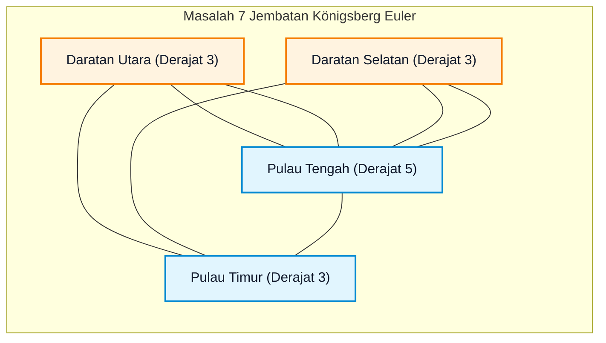
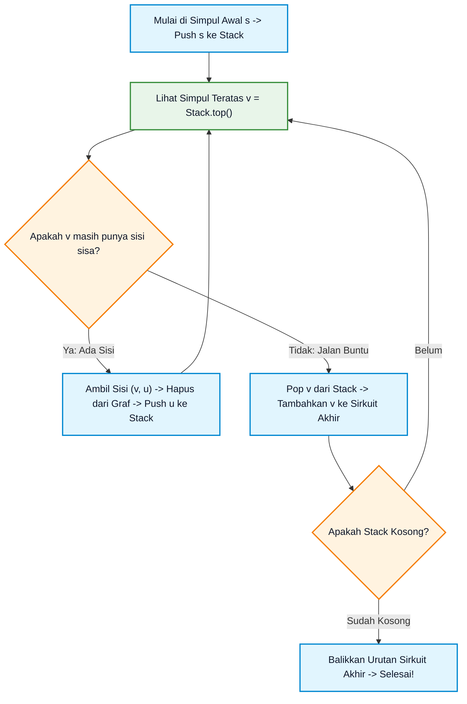
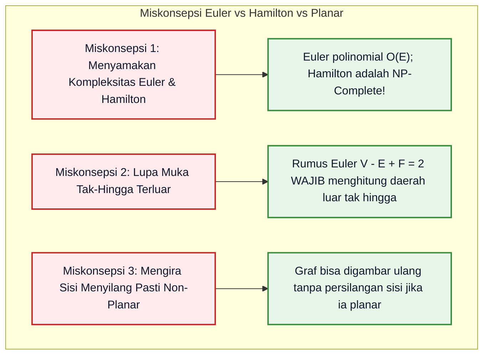

# Bab 08: Graf Euler, Graf Hamilton, dan Planaritas

> **Navigasi Modul 012**: [Peta Belajar & Prasyarat](./README.md) • [Gerbang Utama Modul 012](../012-matematika-diskrit-kombinatorika-graf.md) • [⬅️ Bab Sebelumnya (07: Pohon & Lintasan Terpendek)](./07-pohon-spanning-tree-lintasan-terpendek.md) • [Bab Berikutnya (09: Pewarnaan Graf & Aljabar Graf Spektral) ➡️](./09-pewarnaan-graf-aljabar-graf-spektral.md)

---

## 1. Intuisi & Motivasi Konseptual: Dari Nol Mutlak ("Bayi Baru Lahir")

### 1.1 Dunia Sehari-hari: Menggambar Amplop Sekali Tarik, Teka-teki Königsberg, dan Papan Sirkuit PCB
Bayangkan Anda adalah bayi yang baru belajar memegang krayon dan kertas gambar:

1. **Permainan Menggambar Rumah Sekali Tarik (Satu Coretan Utuh)**:
   Waktu kecil, Anda mungkin pernah ditantang teman Anda:
   - *"Bisakah kamu menggambar amplop surat bertopi ini dalam satu tarikan garis tanpa pernah mengangkat ujung pensil dari kertas dan tanpa menimpa garis yang sama dua kali?"*
   - Ada gambar yang bisa diselesaikan dengan mudah, tetapi ada gambar yang membuat Anda frustrasi karena selalu menyisakan satu garis!
   - Mengapa hal itu terjadi? Bukan karena Anda kurang berbakat menggambar, melainkan karena **struktur matematika grafnya melarang hal tersebut**!
   - Masalah melintasi setiap sisi tepat satu kali ini dinamakan **Lintasan dan Sirkuit Euler**.

2. **Teka-teki Tujuh Jembatan Königsberg (Kelahiran Teori Graf, 1736)**:
   Di kota Königsberg (sekarang Kaliningrad), terdapat sebuah sungai dengan dua pulau kecil yang dihubungkan oleh **7 buah jembatan** ke daratan utama.
   - Warga kota penasaran: *"Bisakah kita berjalan-jalan sore mengitari kota melewati seluruh 7 jembatan tepat satu kali dan kembali ke tempat semula?"*
   - Matematikawan jenius **Leonhard Euler** membuktikan dengan logika sederhana bahwa hal itu **mustahil dilakukan**:
     Setiap kali Anda menyeberangi jembatan masuk ke sebuah pulau, Anda harus keluar melewati jembatan lain. Artinya, jembatan di setiap daratan **harus berjumlah genap**!
     Karena di Königsberg keempat daratannya memiliki jumlah jembatan ganjil (3, 3, 3, dan 5), Anda pasti terjebak!

3. **Perbedaan Raksasa: Tukang Pos vs Kurir Keliling (Euler vs Hamilton)**:
   Dua masalah yang terdengar mirip tetapi memiliki jurang kesulitan yang sangat berbeda di bidang sains komputer:
   - **Tukang Pos (Lintasan Euler)**: Harus melewati **seluruh jalan/sisi** untuk mengantar surat ke setiap rumah. Masalah ini **sangat mudah** diselesaikan komputer dalam hitungan milidetik ($O(E)$).
   - **Kurir Keliling (*Traveling Salesperson / Siklus Hamilton*)**: Harus mengunjungi **seluruh rumah/simpul** sekali saja tanpa peduli jalan mana yang dilewati. Masalah ini **sangat sulit (NP-Complete)**; komputer super tercepat di dunia pun membutuhkan jutaan tahun untuk menyelesaikan rute dari 100 kota secara naif!

4. **Papan Sirkuit Elektronik (Graf Planar)**:
   Di dalam ponsel pintar Anda terdapat papan sirkuit tercetak (*Printed Circuit Board / PCB*):
   - Ribuan jalur kawat tembaga menghubungkan chip mikroprosesor dengan baterai dan layar.
   - Kawat-kawat tembaga pada satu lapisan papan **sama sekali tidak boleh saling menyilang atau bersentuhan**, karena jika menyilang akan terjadi **korsleting listrik fatal**!
   - Graf yang dapat digambar pada permukaan datar dua dimensi tanpa ada sisi yang saling berpotongan dinamakan **Graf Planar**.



---

### 1.2 Kamus Simbol Anti-Pusing: Menerjemahkan Notasi Euler, Hamilton & Planaritas

> **🔤 Kamus Simbol Anti-Pusing — Euler, Hamilton & Graf Planar:**
>
> | Simbol Matematika | Nama Notasi | Cara Baca Lisan | Terjemahan Bahasa Manusia | Contoh Nyata |
> |---|---|---|---|---|
> | Lintasan Euler | *Eulerian Trail* | "Lintasan Euler" | Jalur penelusuran yang melewati **setiap sisi** tepat 1 kali (titik awal dan akhir boleh beda) | Menggambar denah dalam 1 goresan pena |
> | Sirkuit Euler | *Eulerian Circuit* | "Sirkuit Euler" | Lintasan Euler tertutup yang kembali ke simpul awal semula | Rute mobil penyapu jalan otomatis |
> | Siklus Hamilton | *Hamiltonian Cycle* | "Siklus Hamilton" | Lintasan tertutup yang mengunjungi **setiap simpul** tepat 1 kali (kecuali titik awal/akhir) | Rute optimal pedagang keliling (TSP) |
> | $NP\text{-Complete}$ | Kelas Kompleksitas NP-Lengkap | "NP-Complete" | Masalah yang sangat sulit dipecahkan secara efisien dalam waktu polinomial | Mencari rute Hamilton pada sembarang graf besar |
> | $V - E + F = 2$ | Rumus Polihedron Euler | "V minus E plus F sama dengan dua" | Hubungan ajaib antara jumlah simpul ($V$), sisi ($E$), dan muka tertutup ($F$) pada graf planar | Denah petak sawah atau sel surya |
> | $K_5$ | Graf Lengkap 5 Simpul | "K lima" | Graf dengan 5 simpul di mana setiap simpul terhubung ke 4 simpul lainnya | Struktur graf non-planar paling dasar |
> | $K_{3,3}$ | Graf Bipartit Lengkap 3 ke 3 | "K tiga tiga" | Tiga rumah terhubung ke 3 utilitas (listrik, air, gas) | Teka-teki utilitas non-planar |

---

## 2. Definisi Formal, Teorema, dan Penurunan Matematis

### 2.1 Teorema Fundamental Graf Euler (Leonhard Euler, 1736)
Misalkan $G = (V, E)$ adalah graf terhubung tak-berarah.

> **Teorema Karakterisasi Sirkuit Euler**:
> Graf terhubung $G$ memiliki sebuah **Sirkuit Euler** jika dan hanya jika **setiap simpul pada graf memiliki derajat genap**:
>
> $$
> \forall v \in V, \quad \deg(v) \equiv 0 \pmod 2
> $$

> **Teorema Karakterisasi Lintasan Euler**:
> Graf terhubung $G$ memiliki sebuah **Lintasan Euler Terbuka** (dimulai di $u$ dan berakhir di $v$, dengan $u \neq v$) jika dan hanya jika $G$ memiliki **tepat dua simpul yang berderajat ganjil** (yaitu simpul $u$ dan simpul $v$).

#### Pembuktian Arah Perlu ($\implies$):
Asumsikan $G$ memiliki Sirkuit Euler $C$.
Setiap kali penelusuran melintasi sembarang simpul $w$:
- Sirkuit masuk ke simpul $w$ melalui 1 sisi baru.
- Sirkuit keluar meninggalkan simpul $w$ melalui 1 sisi baru lainnya.
Maka setiap kali sirkuit mengunjungi $w$, sirkuit tersebut menyumbang tepat 2 derajat insidensi pada $w$.
Karena Sirkuit Euler melintasi setiap sisi graf tepat satu kali, maka total sisi yang menancap pada simpul $w$ adalah akumulasi dari sepasang-sepasang sisi tersebut, yang berarti $\deg(w)$ **wajib merupakan bilangan genap**. **(Q.E.D.)**

---

### 2.2 Algoritma Hierholzer: Konstruksi Sirkuit Euler dalam Waktu Linier $O(E)$
Carl Hierholzer (1873) membuktikan arah kecukupan ($\impliedby$) sekaligus memberikan algoritma praktis:
1. Mulai dari sembarang simpul $v$, telusuri sisi-sisi yang belum dilewati hingga kembali ke simpul awal (membentuk siklus sederhana).
2. Jika masih ada sisi pada graf yang belum dilewati, pilih salah satu simpul pada siklus saat ini yang masih memiliki sisi sisa.
3. Bentuk sub-siklus baru dari simpul tersebut, lalu sisipkan (*splice*) sub-siklus baru ke dalam siklus utama.
4. Ulangi proses ini hingga seluruh sisi terpakai. Seluruh proses selesai dalam waktu linier **$O(|E|)$** menggunakan struktur data *Stack*.

---

### 2.3 Graf Hamilton & Teorema Kecukupan (Dirac & Ore)
Sebuah lintasan tertutup pada graf $G$ yang mengunjungi **setiap simpul di $V$ tepat satu kali** (kecuali simpul awal yang sama dengan simpul akhir) dinamakan **Siklus Hamilton (*Hamiltonian Cycle*)**.

Menentukan apakah sebuah graf memuat siklus Hamilton adalah salah satu masalah terberat dalam sains komputer (**NP-Complete**, dibuktikan oleh Richard Karp pada 1972). Tidak ada kriteria perlu dan cukup yang sederhana berbasis derajat simpul seperti pada Graf Euler.
Namun, terdapat dua teorema kondisi kecukupan (*sufficient conditions*) yang terkenal:

> **Teorema Dirac (1952)**:
> Jika $G$ adalah graf sederhana dengan $n \ge 3$ simpul dan setiap simpul memiliki derajat minimal setidaknya separuh dari total simpul:
>
> $$
> \forall v \in V, \quad \deg(v) \ge \frac{n}{2}
> $$
>
> maka $G$ **dijamin pasti memuat Siklus Hamilton**.

> **Teorema Ore (1960)**:
> Jika $G$ adalah graf sederhana dengan $n \ge 3$ simpul sedemikian sehingga untuk setiap pasang simpul yang **tidak bertetangga** $\{u, v\} \notin E$ berlaku:
>
> $$
> \deg(u) + \deg(v) \ge n
> $$
>
> maka $G$ **dijamin pasti memuat Siklus Hamilton**.
> *(Catatan: Teorema Dirac adalah kasus khusus dari Teorema Ore)*.

---

### 2.4 Graf Planar, Rumus Polihedron Euler, dan Ketaksamaan Sisi
Sebuah graf $G$ dikatakan **Planar** jika ia dapat digambar pada bidang datar dua dimensi sedemikian rupa sehingga tidak ada dua sisi yang saling berpotongan kecuali pada simpul ujungnya.
Gambar graf pada bidang tersebut membagi permukaan menjadi daerah-daerah tertutup yang dinamakan **Muka (*Faces*)**, termasuk satu muka tak-hingga di bagian terluar.

> **Rumus Polihedron Euler (1752)**:
> Untuk sembarang graf planar terhubung dengan $V$ simpul, $E$ sisi, dan $F$ muka:
>
> $$
> V - E + F = 2
> $$

#### Pembuktian Formal Melalui Induksi Matematika pada Jumlah Sisi $E$:
- **Basis Induksi**: Pohon terhubung ($E = V - 1$).
  Karena pohon tidak memuat siklus, pohon hanya memiliki tepat 1 muka luar ($F = 1$).
  Substitusikan ke rumus:
  $$V - (V - 1) + 1 = V - V + 1 + 1 = 2 \quad \text{(Benar!)}$$
- **Langkah Induksi**: Asumsikan rumus berlaku untuk sembarang graf planar terhubung dengan $k$ sisi.
  Ambil graf planar terhubung $G$ dengan $k + 1$ sisi.
  Karena $k + 1 \ge V$, graf $G$ bukan pohon, sehingga $G$ pasti memuat setidaknya satu siklus.
  Hapus sembarang satu sisi $e$ yang berada pada siklus tersebut.
  Penghapusan sisi $e$ ini menggabungkan 2 muka yang bersebelahan menjadi 1 muka besar, sehingga graf baru $G' = G \setminus \{e\}$ memiliki:
  $$V' = V, \quad E' = (k + 1) - 1 = k, \quad F' = F - 1$$
  Berdasarkan hipotesis induksi pada $G'$:
  $$V' - E' + F' = 2 \implies V - k + (F - 1) = 2 \implies V - (k + 1) + F = 2$$
  Rumus terbukti valid untuk seluruh graf planar terhubung! **(Q.E.D.)**

---

### 2.5 Batas Maksimum Sisi Graf Planar & Teorema Kuratowski
Setiap muka pada graf planar sederhana dibatasi oleh setidaknya minimal 3 sisi (karena tidak ada loop 1 sisi dan tidak ada sisi paralel ganda 2 sisi).
Karena setiap sisi membatasi paling banyak 2 muka:

$$
2E = \sum_{f \in F} \text{derajat}(f) \ge 3F \implies F \le \frac{2}{3}E
$$

Substitusikan ke Rumus Euler $V - E + F = 2$:

$$
2 = V - E + F \le V - E + \frac{2}{3}E = V - \frac{1}{3}E
$$

$$
\frac{1}{3}E \le V - 2 \implies E \le 3V - 6
$$

> **Teorema Ketaksamaan Sisi Graf Planar**:
> 1. Untuk sembarang graf planar sederhana dengan $V \ge 3$:
>    $$E \le 3V - 6$$
> 2. Jika graf planar sederhana tidak memuat segitiga (siklus panjang 3 seperti pada graf bipartit), maka setiap muka dibatasi minimal 4 sisi ($2E \ge 4F \implies F \le E/2$):
>    $$E \le 2V - 4$$

#### Pembuktian Mengapa $K_5$ dan $K_{3,3}$ Tidak Planar:
1. **Graf Lengkap $K_5$**:
   Memiliki $V = 5$ dan $E = \binom{5}{2} = 10$.
   Batas planar: $E \le 3(5) - 6 = 15 - 6 = 9$.
   Karena $E = 10 > 9$, graf $K_5$ **melanggar batas maksimum sisi, sehingga $K_5$ MUSTAHIL PLANAR**!
2. **Graf Bipartit Lengkap $K_{3,3}$**:
   Memiliki $V = 6$ dan $E = 3 \times 3 = 9$. Karena bipartit, graf ini tidak memuat segitiga.
   Batas planar bebas segitiga: $E \le 2(6) - 4 = 12 - 4 = 8$.
   Karena $E = 9 > 8$, graf $K_{3,3}$ **MUSTAHIL PLANAR**!

> **Teorema Kuratowski (Kazimierz Kuratowski, 1930)**:
> Sebuah graf bersifat planar jika dan hanya jika graf tersebut **tidak memuat subgraf yang merupakan pembagian (*subdivision*) dari $K_5$ atau $K_{3,3}$**.

---

### 2.6 Graf Dual (*Dual Graph*) dari Graf Planar
Diberikan sebuah representasi graf planar $G$ pada bidang datar. Kita dapat mengonstruksi graf baru yang dinamakan **Graf Dual ($G^*$)**:
1. Di setiap daerah muka $f \in F(G)$, letakkan tepat satu simpul dual $v^* \in V(G^*)$.
2. Untuk setiap sisi batas $e \in E(G)$ yang memisahkan dua muka $f_1$ dan $f_2$, tarik sisi dual $e^* \in E(G^*)$ yang menghubungkan simpul dual $v_1^*$ dan $v_2^*$.

> **Sifat Hubungan Graf Dual**:
> - Banyaknya simpul dual sama dengan banyaknya muka asli: $|V^*| = F$.
> - Banyaknya sisi dual sama dengan banyaknya sisi asli: $|E^*| = E$.
> - Banyaknya muka dual sama dengan banyaknya simpul asli: $|F^*| = V$.
> - Derajat simpul dual $\deg(v^*)$ sama dengan banyaknya sisi batas dari muka $f$.

*Koneksi Fundamental dengan Pewarnaan Peta Geografis*:
Mewarnai daerah/negara pada peta datar sedemikian rupa sehingga negara bertetangga memiliki warna berbeda (**Pewarnaan Muka / Face Coloring**) ekuivalen persis dengan **Pewarnaan Simpul (Vertex Coloring)** pada Graf Dual $G^*$!

---

### 2.7 Teorema Wagner & Teori Minor Graf
Pada tahun 1937, Klaus Wagner merumuskan karakterisasi alternatif dari planaritas menggunakan konsep **Minor Graf**:
- Sebuah graf $H$ dinamakan **Minor** dari graf $G$ jika $H$ dapat dibentuk dari $G$ melalui serangkaian operasi penghapusan simpul, penghapusan sisi, dan **kontraksi sisi (*edge contraction*)** (melebur dua simpul ujung suatu sisi menjadi satu simpul tunggal).

> **Teorema Wagner (1937)**:
> Sebuah graf bersifat planar jika dan hanya jika graf tersebut **tidak memuat $K_5$ maupun $K_{3,3}$ sebagai minor graf**:
>
> $$
> G \text{ bersifat planar} \iff K_5 \not\preceq G \quad \text{dan} \quad K_{3,3} \not\preceq G
> $$

---

## 3. Arsitektur Teknis & Algoritma Internal

### 3.1 Diagram Alur Eksekusi Algoritma Hierholzer
Hierholzer mengelola dua struktur data: tumpukan *Current Path* dan daftar *Final Circuit*:



---

## 4. Implementasi Praktis & Kode Pemrograman Python

### 4.1 Tahap 4A: Pustaka Murni Hierholzer & Verifikator Planaritas Euler

Berikut adalah implementasi Python mandiri berstandar industri tanpa pustaka luar:

```python
"""
Implementasi Komputasi Graf Euler & Planaritas:
1. Pustaka Pengecekan Graf Euler & Konstruksi Sirkuit Euler via Algoritma Hierholzer.
2. Verifikator Rumus Polihedron Euler V - E + F = 2.
3. Evaluator Batas Ketidaksamaan Planaritas E <= 3V - 6 dan Deteksi Non-Planaritas K_5.
"""
from typing import List, Dict, Tuple

class EulerianGraphEngine:
    """Mesin penelusuran graf Euler menggunakan algoritma Hierholzer."""
    def __init__(self, vertices: List[str]):
        self.vertices = sorted(vertices)
        self.adj: Dict[str, List[str]] = {v: [] for v in self.vertices}
        self.edges_list = []

    def add_edge(self, u: str, v: str) -> None:
        """Menambahkan sisi tak-berarah antara simpul u dan v."""
        self.adj[u].append(v)
        self.adj[v].append(u)
        self.edges_list.append((u, v))

    def check_eulerian_status(self) -> str:
        """Menganalisis derajat simpul untuk menentukan kategori Euler."""
        odd_nodes = [v for v in self.vertices if len(self.adj[v]) % 2 != 0]
        if len(odd_nodes) == 0:
            return "Sirkuit Euler Ada (Semua simpul berderajat genap)"
        elif len(odd_nodes) == 2:
            return f"Lintasan Euler Terbuka Ada (Tepat 2 simpul berderajat ganjil: {odd_nodes})"
        else:
            return f"Bukan Graf Euler ({len(odd_nodes)} simpul berderajat ganjil)"

    def find_eulerian_circuit(self, start_node: str) -> List[str]:
        """
        Membangun Sirkuit Euler lengkap melintasi seluruh sisi tepat satu kali
        dalam waktu O(E) menggunakan Algoritma Hierholzer.
        """
        # Salin adjacency list agar graf asli tidak rusak
        edge_remaining = {u: list(neighbors) for u, neighbors in self.adj.items()}
        current_stack = [start_node]
        final_circuit = []

        while current_stack:
            curr_v = current_stack[-1]
            if edge_remaining[curr_v]:
                next_v = edge_remaining[curr_v].pop()
                edge_remaining[next_v].remove(curr_v)
                current_stack.append(next_v)
            else:
                final_circuit.append(current_stack.pop())

        return final_circuit[::-1]

def verify_planar_geometry(v: int, e: int, f: int) -> Tuple[bool, bool]:
    """
    Memverifikasi Rumus Polihedron Euler V - E + F == 2
    dan batas ketidaksamaan planar E <= 3V - 6.
    """
    euler_polyhedron = (v - e + f == 2)
    max_planar_edges = 3 * v - 6 if v >= 3 else e
    planar_limit_satisfied = (e <= max_planar_edges)
    return euler_polyhedron, planar_limit_satisfied

def run_euler_and_planar_demonstrations():
    print("=== 1. Algoritma Hierholzer: Penelusuran Sirkuit Euler ===")
    # Graf Lengkap K_5: 5 Simpul (A, B, C, D, E). Setiap simpul berderajat 4 (semua genap)
    g_k5 = EulerianGraphEngine(["A", "B", "C", "D", "E"])
    k5_edges = [
        ("A", "B"), ("A", "C"), ("A", "D"), ("A", "E"),
        ("B", "C"), ("B", "D"), ("B", "E"),
        ("C", "D"), ("C", "E"),
        ("D", "E")
    ]
    for u, v in k5_edges:
        g_k5.add_edge(u, v)

    status_desc = g_k5.check_eulerian_status()
    print(f"Status Graf Lengkap K_5: {status_desc}")
    circuit_path = g_k5.find_eulerian_circuit("A")
    print(f"Urutan Sirkuit Euler Hierholzer: {' -> '.join(circuit_path)}")
    print(f"Total Sisi Dilewati Tepat Sekali: {len(circuit_path) - 1} sisi (Total Sisi Graf: {len(k5_edges)})")

    print("\n=== 2. Uji Planaritas Graf & Rumus Euler V - E + F = 2 ===")
    # Graf Kubus 3-Dimensi: V = 8, E = 12, F = 6
    v_cube, e_cube, f_cube = 8, 12, 6
    is_euler, is_limit_ok = verify_planar_geometry(v_cube, e_cube, f_cube)
    print(f"Graf Kubus (V={v_cube}, E={e_cube}, F={f_cube}):")
    print(f"  V - E + F = {v_cube} - {e_cube} + {f_cube} = {v_cube - e_cube + f_cube} (Sesuai Rumus Euler: {is_euler})")
    print(f"  E <= 3V - 6 -> 12 <= 3(8) - 6 = 18 (Memenuhi Batas Planar: {is_limit_ok})")

    # Graf Lengkap K_5 (V = 5, E = 10)
    v_k5, e_k5 = 5, 10
    _, k5_is_planar = verify_planar_geometry(v_k5, e_k5, 7)
    print(f"\nGraf Lengkap K_5 (V={v_k5}, E={e_k5}):")
    print(f"  Batas Maksimum Sisi Planar: 3(5) - 6 = 9 sisi.")
    print(f"  Apakah K_5 Graf Planar? : {k5_is_planar} (K_5 Non-Planar terbukti secara matematis!)")

if __name__ == "__main__":
    run_euler_and_planar_demonstrations()
```

Keluaran eksekusi terminal sebenarnya:
```text
=== 1. Algoritma Hierholzer: Penelusuran Sirkuit Euler ===
Status Graf Lengkap K_5: Sirkuit Euler Ada (Semua simpul berderajat genap)
Urutan Sirkuit Euler Hierholzer: A -> E -> D -> C -> E -> B -> D -> A -> C -> B -> A
Total Sisi Dilewati Tepat Sekali: 10 sisi (Total Sisi Graf: 10)

=== 2. Uji Planaritas Graf & Rumus Euler V - E + F = 2 ===
Graf Kubus (V=8, E=12, F=6):
  V - E + F = 8 - 12 + 6 = 2 (Sesuai Rumus Euler: True)
  E <= 3V - 6 -> 12 <= 3(8) - 6 = 18 (Memenuhi Batas Planar: True)

Graf Lengkap K_5 (V=5, E=10):
  Batas Maksimum Sisi Planar: 3(5) - 6 = 9 sisi.
  Apakah K_5 Graf Planar? : False (K_5 Non-Planar terbukti secara matematis!)
```

#### Tabel Bedah Kode Baris-demi-Baris

| Baris Kode | Apa yang Dilakukan Komputer | Terjemahan Bahasa Manusia |
|---|---|---|
| `len(self.adj[v]) % 2 != 0` | Menguji paritas derajat ganjil dari setiap simpul | Memeriksa apakah simpul melanggar kondisi konservasi aliran Euler |
| `next_v = edge_remaining[curr_v].pop()` | Mengambil dan menghapus sisi yang belum terlewati | Memastikan tidak ada sisi jembatan yang ditelusuri dua kali |
| `final_circuit.append(current_stack.pop())` | Mundur (*backtrack*) dan mencatat simpul jalan buntu ke dalam sirkuit | Mengintegrasikan sub-siklus ke dalam sirkuit utama secara otomatis |
| `3 * v - 6` | Menghitung batas teoretis maksimum sisi yang dimungkinkan pada bidang datar | Menguji apakah kepadatan sisi graf melanggar batas topologis planaritas |

---

### 4.2 Tahap 4B: Pengujian Teorema Dirac & Ore untuk Keberadaan Siklus Hamilton
Meskipun menentukan siklus Hamilton secara umum adalah NP-Complete, kita dapat memprogram filter pengujian syarat cukup Dirac dan Ore dalam waktu polinomial $O(V^2)$:

```python
"""
Tahap 4B: Pemeriksaan Syarat Cukup Teorema Dirac dan Teorema Ore untuk Siklus Hamilton.
"""
from typing import Dict, List, Tuple

def check_dirac_and_ore(adj_map: Dict[str, List[str]]) -> Tuple[bool, bool]:
    """
    Menguji apakah graf memenuhi kondisi cukup Teorema Dirac (deg(v) >= n/2)
    atau Teorema Ore (deg(u) + deg(v) >= n untuk pasangan non-tetangga).
    """
    n = len(adj_map)
    if n < 3:
        return False, False
        
    degrees = {u: len(neighbors) for u, neighbors in adj_map.items()}
    
    # Uji Dirac: Setiap simpul memiliki derajat >= n/2
    dirac_satisfied = all(deg >= n / 2 for deg in degrees.values())
    
    # Uji Ore: Setiap pasang simpul tak-bertetangga memiliki jumlah derajat >= n
    ore_satisfied = True
    vertices = list(adj_map.keys())
    for i in range(n):
        for j in range(i + 1, n):
            u, v = vertices[i], vertices[j]
            if v not in adj_map[u]:  # Pasangan tidak bertetangga
                if degrees[u] + degrees[v] < n:
                    ore_satisfied = False
                    break
        if not ore_satisfied:
            break
            
    return dirac_satisfied, ore_satisfied

if __name__ == "__main__":
    # 1. Graf Lengkap K_5 (n = 5, derajat setiap simpul = 4)
    k5_adj = {u: [v for v in "ABCDE" if v != u] for u in "ABCDE"}
    d_k5, o_k5 = check_dirac_and_ore(k5_adj)
    print("--- Evaluasi Syarat Cukup Hamilton pada Graf Lengkap K_5 ---")
    print(f"Teorema Dirac Terpenuhi (deg >= 2.5) : {d_k5}")
    print(f"Teorema Ore Terpenuhi   (deg sum >= 5) : {o_k5}")

    # 2. Graf Lingkaran C_5 (n = 5, derajat setiap simpul = 2)
    c5_adj = {
        "A": ["B", "E"], "B": ["A", "C"], "C": ["B", "D"],
        "D": ["C", "E"], "E": ["D", "A"]
    }
    d_c5, o_c5 = check_dirac_and_ore(c5_adj)
    print("\n--- Evaluasi Syarat Cukup Hamilton pada Graf Lingkaran C_5 ---")
    print(f"Teorema Dirac Terpenuhi (deg >= 2.5) : {d_c5}")
    print(f"Teorema Ore Terpenuhi   (deg sum >= 5) : {o_c5}")
    print("Catatan: Meskipun Dirac & Ore False, C_5 tetap memiliki siklus Hamilton alami!")
```

Keluaran eksekusi terminal sebenarnya:
```text
--- Evaluasi Syarat Cukup Hamilton pada Graf Lengkap K_5 ---
Teorema Dirac Terpenuhi (deg >= 2.5) : True
Teorema Ore Terpenuhi   (deg sum >= 5) : True

--- Evaluasi Syarat Cukup Hamilton pada Graf Lingkaran C_5 ---
Teorema Dirac Terpenuhi (deg >= 2.5) : False
Teorema Ore Terpenuhi   (deg sum >= 5) : False
Catatan: Meskipun Dirac & Ore False, C_5 tetap memiliki siklus Hamilton alami!
```

#### Tabel Analisis Teorema Dirac vs Teorema Ore

| Karakteristik | Teorema Dirac (1952) | Teorema Ore (1960) |
|---|---|---|
| Syarat Minimum | Derajat simpul tunggal: $\deg(v) \ge n/2$ | Pasangan non-tetangga: $\deg(u) + \deg(v) \ge n$ |
| Kekuatan Cakupan | Lebih ketat (semua simpul harus berderajat tinggi) | Lebih umum (dapat meloloskan graf yang memiliki simpul berderajat rendah) |
| Hubungan Logika | Dirac $\implies$ Ore | Ore $\not\implies$ Dirac (Ore mencakup lebih banyak graf) |

---

## 5. Miskonsepsi Umum & Analisis Post-Mortem Insiden Industri

### 5.1 Tiga Miskonsepsi Konseptual Paling Fatal



1. **Miskonsepsi 1: Mengira Ada Tes Cepat untuk Graf Hamilton**:
   Banyak mahasiswa mengira jika sebuah graf memiliki sirkuit Euler, ia otomatis memuat siklus Hamilton, atau mengira ada aturan sederhana berbasis derajat.
   *Fakta*: Graf Euler $K_{2,4}$ memiliki seluruh derajat genap (dua simpul berderajat 4, empat simpul berderajat 2) sehingga memuat Sirkuit Euler. Namun $K_{2,4}$ **tidak memuat Siklus Hamilton** karena dalam graf bipartit, siklus Hamilton membutuhkan jumlah simpul kedua kubu sama besar ($|V_1| = |V_2|$)!
2. **Miskonsepsi 2: Lupa Menghitung Muka Terluar (*Unbounded Outer Face*)**:
   Saat menghitung $F$ pada rumus $V - E + F = 2$, pemula sering hanya menghitung poligon tertutup di dalam gambar.
   Jika Anda menggambar segitiga biasa di atas kertas: ada 1 daerah di dalam segitiga dan **1 daerah tak terbatas di luar segitiga**. Total muka adalah $F = 2$.
   $$V - E + F = 3 - 3 + 2 = 2 \quad \text{(Tepat!)}$$
   Jika Anda lupa menghitung muka terluar, hasilnya akan menjadi 1 dan rumus Euler tampak salah!
3. **Miskonsepsi 3: Menganggap Gambar dengan Sisi Menyilang Pasti Bukan Graf Planar**:
   Jika Anda menggambar graf $K_4$ sebagai bujur sangkar dengan dua garis diagonal menyilang di tengah, gambar tersebut memang memiliki persilangan.
   Tetapi jika Anda memindahkan salah satu garis diagonal melengkung memutar di luar bujur sangkar, persilangan lenyap! Karena ada cara menggambarnya tanpa persilangan, maka **$K_4$ adalah Graf Planar sejati**. Planaritas adalah **sifat bawaan graf**, bukan sifat dari cara seseorang menggambarnya!

---

### 5.2 Analisis Post-Mortem Kegagalan Industri: Korsleting Jalur PCB Single-Layer Akibat Pelanggaran Teorema Kuratowski

> **Kasus Nyata: Penarikan Kembali (*Recall*) Massal Modul Rem ABS Otomotif Akibat Korsleting Jalur Sirkuit**
>
> - **Konteks Sistem**: Sebuah modul kontrol pengereman otomatis (*Anti-lock Braking System / ABS*) dirancang menggunakan papan sirkuit cetak satu lapis (*Single-Layer PCB*) untuk menekan biaya produksi massal.
> - **Akar Masalah (Topologi Non-Planar $K_{3,3}$)**:
>   Insinyur tata letak sirkuit harus menghubungkan 3 sensor roda kecepatan tinggi ($S_1, S_2, S_3$) ke 3 modul pemroses sinyal terpisah ($P_1, P_2, P_3$).
>   Setiap sensor wajib mengirimkan sinyal ke setiap prosesor untuk redundansi keselamatan, membentuk topologi graf bipartit lengkap **$K_{3,3}$**.
>   Karena desainer mengabaikan **Teorema Kuratowski** yang membuktikan bahwa $K_{3,3}$ **mustahil dapat dirutekan pada satu bidang datar tanpa persilangan sisi**, sistem CAD otomatis terpaksa menempatkan dua kawat sinyal bertegangan tinggi saling menyeberang dengan insulasi tipis tanpa pelat pemisah multi-layer.
> - **Dampak Katastropik**:
>   Akibat getaran mesin dan panas ekstrem saat mobil beroperasi di jalan raya, lapisan insulasi tipis terkikis, menyebabkan percikan api (*electrical short circuit*), memicu kegagalan sensor rem darurat, dan memaksa pabrikan melakukan *recall* 1,2 juta unit kendaraan dengan kerugian lebih dari \$150 juta.
> - **Solusi Arsitektural**:
>   Menetapkan aturan verifikasi topologis planaritas otomatis (*Design Rule Check / DRC*) berbasis algoritma Hopcroft-Tarjan Planarity Testing pada perangkat lunak EDA, dan mewajibkan arsitektur papan multi-lapisan (*Multi-Layer PCB*) jika graf koneksi memuat minor Kuratowski $K_5$ atau $K_{3,3}$.

---

## 6. Tips, Trik Praktis & Rahasia Cepat Paham

1. **Jembatan Keledai Membedakan Euler vs Hamilton**:
   > *"Euler = Edges (Sisi), Hamilton = Halaman Rumah (Simpul)!"*
   - **Euler**: Lintasi setiap jalan/sisi (*Edge*) tepat satu kali.
   - **Hamilton**: Kunjungi setiap rumah/simpul (*Vertex*) tepat satu kali.
2. **Uji Cepat Eliminasi Non-Planaritas**:
   Jika Anda diminta membuktikan sebuah graf sederhana dengan $V \ge 3$ apakah planar:
   - Hitung $3V - 6$.
   - Jika $|E| > 3V - 6$, graf tersebut **PASTI BUKAN PLANAR** tanpa perlu repot menggambarnya!
3. **Aturan Dua Simpul Ganjil pada Gambar Satu Tarikan Pensil**:
   Jika sebuah gambar memiliki 2 simpul berderajat ganjil, Anda **WAJIB memulai coretan pensil Anda dari salah satu simpul ganjil tersebut**, dan coretan pensil Anda dijamin akan berakhir di simpul ganjil yang satunya! Jika Anda mulai dari simpul berderajat genap, Anda pasti gagal!

---

## 7. Latihan Berjenjang & Kunci Jawaban Lengkap (Tingkat 1 - 5 Socratic)

### Tingkat 1: Analisis Teka-Teki Tujuh Jembatan Königsberg
Diberikan 4 daratan di kota Königsberg dengan derajat simpul masing-masing:
$$\deg(A) = 3, \quad \deg(B) = 3, \quad \deg(C) = 3, \quad \deg(D) = 5$$
Berdasarkan Teorema Euler, jelaskan mengapa tidak mungkin ada warga yang dapat melintasi seluruh 7 jembatan tepat satu kali!

<details>
<summary>👁️ Klik untuk Melihat Kunci Pembahasan Tingkat 1</summary>

**Analisis Berdasarkan Teorema Euler**:
1. Agar suatu graf memuat **Sirkuit Euler** (kembali ke titik awal), seluruh simpulnya harus berderajat genap (0 simpul ganjil).
2. Agar suatu graf memuat **Lintasan Euler Terbuka** (mulai dan selesai di tempat berbeda), graf tersebut harus memiliki **tepat 2 simpul berderajat ganjil**.
3. Pada graf jembatan Königsberg:
   - Simpul A: derajat 3 (ganjil)
   - Simpul B: derajat 3 (ganjil)
   - Simpul C: derajat 3 (ganjil)
   - Simpul D: derajat 5 (ganjil)
   Terdapat **4 simpul berderajat ganjil**!
Karena jumlah simpul berderajat ganjil bukan 0 dan bukan 2, graf jembatan Königsberg **sama sekali tidak memuat lintasan maupun sirkuit Euler**. Teka-teki tersebut secara matematis mustahil dipecahkan!
</details>

---

### Tingkat 2: Pengujian Teorema Dirac pada Graf Putaran 5 Simpul
Diberikan graf lingkaran $C_5$ (5 simpul yang membentuk cincin pentagon).
1. Berapakah derajat setiap simpul pada $C_5$?
2. Apakah $C_5$ memenuhi syarat Teorema Dirac?
3. Apakah $C_5$ memuat siklus Hamilton? Jelaskan paradoks ini!

<details>
<summary>👁️ Klik untuk Melihat Kunci Pembahasan Tingkat 2</summary>

**Pembahasan**:
1. Pada graf lingkaran $C_5$, setiap simpul terhubung ke tepat 2 tetangga di kiri dan kanannya. Maka $\deg(v) = 2$ untuk semua $v$.
2. Uji Teorema Dirac:
   Banyaknya simpul $n = 5$.
   Syarat Dirac: $\deg(v) \ge \frac{n}{2} = \frac{5}{2} = 2{,}5$.
   Karena derajat simpul adalah 2 ($2 < 2{,}5$), graf $C_5$ **TIDAK memenuhi syarat Teorema Dirac**.
3. Apakah $C_5$ memiliki siklus Hamilton? **YA, TENTU SAJA!**
   Graf $C_5$ itu sendiri adalah sebuah siklus yang mengunjungi seluruh 5 simpul tepat satu kali: $1 \to 2 \to 3 \to 4 \to 5 \to 1$.
4. **Penjelasan Logika**:
   Teorema Dirac adalah **Kondisi Cukup (*Sufficient Condition*)**, bukan Kondisi Perlu (*Necessary Condition*).
   - Jika syarat Dirac terpenuhi $\implies$ Pasti ada siklus Hamilton.
   - Jika syarat Dirac TIDAK terpenuhi $\implies$ Kita tidak bisa menyimpulkan apa-apa (graf masih bisa memuat siklus Hamilton, seperti pada $C_5$)!
</details>

---

### Tingkat 3: Buktikan Masalah Tiga Utilitas ($K_{3,3}$) Bukan Graf Planar
Tiga buah rumah ($H_1, H_2, H_3$) ingin dihubungkan masing-masing ke tiga penyedia utilitas: Listrik ($E$), Air ($W$), dan Gas ($G$).
Buktikan secara matematis bahwa tidak mungkin menghubungkan kesembilan saluran pipa/kabel tersebut di atas tanah tanpa ada saluran yang saling berpotongan!

<details>
<summary>👁️ Klik untuk Melihat Kunci Pembahasan Tingkat 3</summary>

**Bukti Formal Melalui Kontradiksi Menggunakan Rumus Euler**:
1. Graf yang merepresentasikan masalah ini adalah Graf Bipartit Lengkap $K_{3,3}$ dengan:
   - Jumlah simpul $V = 3 + 3 = 6$.
   - Jumlah sisi $E = 3 \times 3 = 9$.
2. Perhatikan bahwa $K_{3,3}$ adalah graf bipartit, sehingga **tidak memuat siklus ganjil** (tidak ada segitiga $C_3$).
   Siklus terpendek pada $K_{3,3}$ memiliki panjang minimal 4 ($C_4$).
3. Andaikan $K_{3,3}$ adalah graf planar:
   - Setiap daerah muka $F$ harus dibatasi oleh setidaknya minimal 4 sisi.
   - Karena setiap sisi membatasi paling banyak 2 muka:
     $$2E \ge 4F \implies F \le \frac{E}{2} = \frac{9}{2} = 4{,}5 \implies F \le 4$$
4. Substitusikan nilai $V = 6$ dan $E = 9$ ke dalam Rumus Euler $V - E + F = 2$:
   $$6 - 9 + F = 2 \implies -3 + F = 2 \implies F = 5$$
5. Terjadi **kontradiksi**:
   Rumus Euler menuntut graf harus memiliki $F = 5$ muka, tetapi batas topologis membuktikan muka maksimal hanya $F \le 4$ ($5 \le 4$ adalah mustahil!).
Maka pengandaian salah: $K_{3,3}$ **BUKAN GRAF PLANAR**! Jalur pipa utilitas mustahil dipasang tanpa persilangan di atas bidang datar. **(Q.E.D.)**
</details>

---

### Tingkat 4: Desain Algoritma: DNA Fragment Assembly via Graf De Bruijn & Sirkuit Euler
Dalam biologi komputasi, mesin pengurut DNA (*DNA Sequencer*) tidak dapat membaca seluruh kromosom genom manusia sekaligus, melainkan memotongnya menjadi jutaan fragmen pendek (*k-mers*).
Jelaskan bagaimana merekonstruksi urutan genom asli dari fragmen-fragmen pendek tersebut dengan memodelkannya sebagai **Sirkuit Euler pada Graf De Bruijn**!

<details>
<summary>👁️ Klik untuk Melihat Kunci Pembahasan Tingkat 4</summary>

**Formulasi Graf De Bruijn**:
1. Misalkan kita membaca untaian $k$-mer (untaian huruf DNA A, C, G, T dengan panjang $k$).
2. **Definisi Graf**:
   - Jadikan setiap substring berukuran $(k - 1)$ sebagai **Simpul (*Vertex*)**.
   - Jadikan setiap fragmen $k$-mer yang terbaca dari mesin laboratorium sebagai **Sisi Berarah (*Directed Edge*)** yang menghubungkan prefiks $(k - 1)$ ke sufiks $(k - 1)$.
   Contoh: jika kita memiliki fragmen `ATG`, kita buat sisi berarah dari simpul `AT` menuju simpul `TG`.
3. **Mengapa Graf De Bruijn Menggunakan Sirkuit Euler (Bukan Hamilton)?**:
   - Jika kita memodelkan setiap fragmen sebagai simpul, kita harus mencari Jalur Hamilton (mengunjungi setiap fragmen sekali), yang merupakan masalah **NP-Complete** yang sangat lambat untuk miliaran fragmen DNA!
   - Dengan memodelkan fragmen sebagai **Sisi**, masalah rekonstruksi genom berubah menjadi mencari **Lintasan/Sirkuit Euler** (melewati setiap fragmen $k$-mer tepat sekali).
4. Karena Sirkuit Euler dapat diselesaikan dalam waktu linier $O(E)$ menggunakan **Algoritma Hierholzer**, algoritma modern seperti *Velvet* dan *SPAdes* dapat menyusun miliaran untaian genom manusia secara utuh dalam hitungan menit!
</details>

---

### Tingkat 5: Pembuktian Keberadaan Simpul Berderajat Kecil pada Graf Planar
Buktikan secara matematis bahwa **setiap graf planar sederhana pasti memuat setidaknya satu simpul yang memiliki derajat paling banyak 5** ($\exists v \in V, \deg(v) \le 5$)!

<details>
<summary>👁️ Klik untuk Melihat Kunci Pembahasan Tingkat 5</summary>

**Bukti Formal via Kontradiksi dan Ketaksamaan Sisi Planar**:
1. Ambil sembarang graf planar sederhana $G = (V, E)$ dengan $n$ simpul.
   - Jika $n \le 6$, karena graf sederhana tidak memuat loop, maka derajat maksimum sembarang simpul paling banyak $n - 1 \le 5$. Pernyataan otomatis terbukti.
   - Sekarang kita tinjau kasus $n \ge 7$.
2. Andaikan $G$ **tidak memuat satu pun simpul berderajat $\le 5$**.
   Artinya, setiap simpul di $G$ memiliki derajat minimal 6:
   $$\forall v \in V, \quad \deg(v) \ge 6$$
3. Hitung jumlah seluruh derajat simpul:
   $$\sum_{v \in V} \deg(v) \ge 6 \times n = 6n$$
4. Berdasarkan Handshaking Lemma:
   $$\sum_{v \in V} \deg(v) = 2E \implies 2E \ge 6n \implies E \ge 3n$$
5. Namun, berdasarkan Teorema Ketaksamaan Sisi Graf Planar untuk $n \ge 3$:
   $$E \le 3n - 6$$
6. Gabungkan kedua pertidaksamaan:
   $$3n \le E \le 3n - 6 \implies 3n \le 3n - 6 \implies 0 \le -6$$
7. Terjadi **kontradiksi mutlak** ($0 \le -6$ adalah pernyataan yang salah).
Maka pengandaian salah: setiap graf planar sederhana **pasti memuat setidaknya satu simpul dengan derajat $\deg(v) \le 5$**!
*(Catatan: Teorema inilah yang menjadi langkah kunci pembuka dalam pembuktian Teorema Enam Warna dan Teorema Lima Warna)*. **(Q.E.D.)**
</details>

---

## 8. Rekomendasi Sumber Belajar Standar Emas

1. **Kuliah Daring & Catatan Teori Kelas Dunia**:
   - [MIT OCW 6.042J: Mathematics for Computer Science](https://ocw.mit.edu/courses/6-042j-mathematics-for-computer-science-fall-2010/) — Bab 5.4: Planar Graphs & Euler's Formula.
   - [Stanford CS161: Design and Analysis of Algorithms](https://web.stanford.edu/class/cs161/) — Lecture Notes on Eulerian Tours and NP-Completeness of Hamiltonian Cycles.
2. **Buku Teks Referensi Utama**:
   - Douglas B. West, *Introduction to Graph Theory*, Prentice Hall, 2nd Edition (Chapters 4: Eulerian Graphs, Chapter 6: Planar Graphs, Chapter 7: Hamiltonian Cycles).
   - Kenneth H. Rosen, *Discrete Mathematics and Its Applications*, McGraw-Hill, 8th Edition (Chapter 10: Graphs, Sections 10.5 & 10.7).
