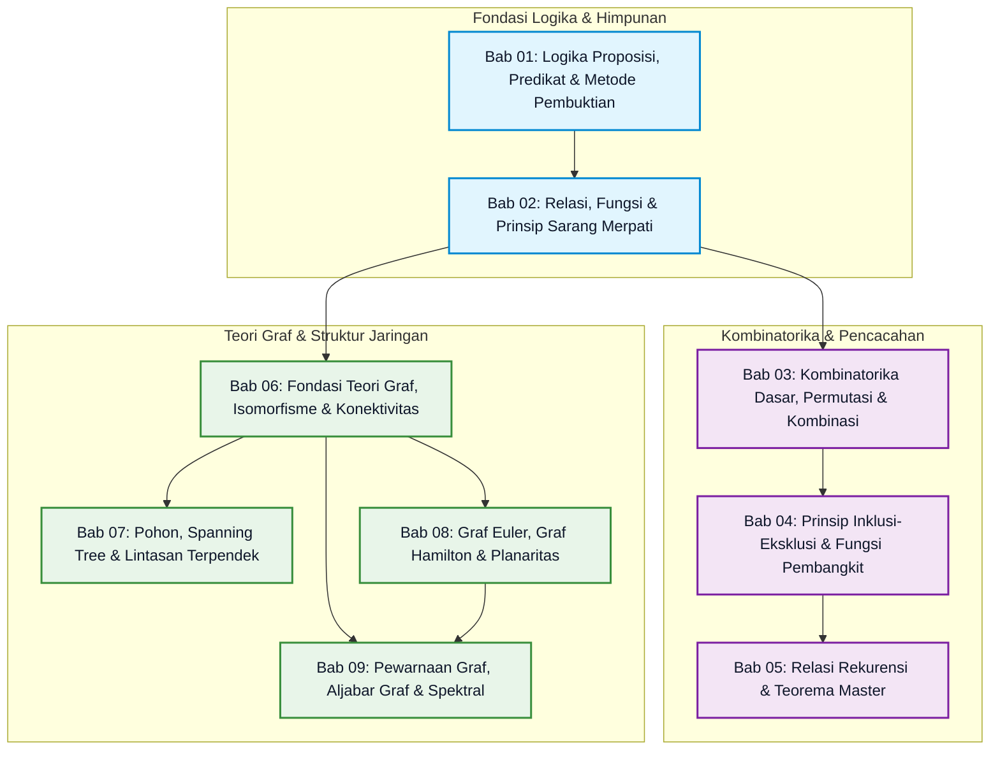

# Modul 012: Matematika Diskrit, Kombinatorika & Teori Graf

> **Panduan & Peta Belajar Modul**: Pintu gerbang utama menuju kurikulum modular terlengkap Matematika Diskrit, Kombinatorika, dan Algoritma Graf untuk sains komputer dan rekayasa perangkat lunak modern.

---

## 1. Ikhtisar & Visi Pedagogis ("Dari Nol Mutlak / Bayi Baru Lahir")

Matematika Diskrit adalah bahasa ibu dari seluruh sains komputer dan arsitektur perangkat lunak.
Berbeda dengan kalkulus yang mempelajari perubahan kontinu dan bilangan riil yang mulus mengalir seperti air sungai, **matematika diskrit mempelajari objek-objek terpisah (*discrete objects*)** yang dapat dihitung satu per satu seperti butiran kelereng, bit biner 0 dan 1, simpul server dalam jaringan cloud, atau baris basis data relasional.

Modul ini disusun dengan metodologi **7-Level Scaffolding (Bayi Baru Lahir hingga Mahir 100%)**:
1. **Intuisi Dunia Nyata Tanpa Jargon**: Memulai dari analogi sederhana sehari-hari (saklar lampu, janji orang tua, rak donat, peta kereta api bawah tanah).
2. **Definisi Formal & Teorema Aksiomatik**: Merumuskan simbol dan persamaan matematika presisi lengkap dengan bukti formal.
3. **Arsitektur Teknis & Algoritma Internal**: Membedah cara kerja internal algoritma diskrit langkah demi langkah.
4. **Implementasi Kode Pemrograman Python Murni**: Seluruh algoritma diimplementasikan dalam Python standar tanpa modul pihak ketiga, dan **wajib disertai blok keluaran eksekusi terminal sebenarnya** (` ```text `).
5. **Miskonsepsi Fatal & Analisis Post-Mortem Industri**: Membedah kegagalan nyata sistem industri berskala besar akibat kesalahan logika diskrit.
6. **Tips, Trik Cepat & Model Mental**: Jembatan keledai dan pola penyelesaian masalah efisien.
7. **Latihan Berjenjang Socratic (Tingkat 1 - 5)**: Soal latihan interaktif dari tingkat paling dasar hingga tantangan pembuktian analitis tingkat mahir.

---

## 2. Peta Pembelajaran Graf Berarah (Learning Dependency DAG)

Berikut adalah diagram ketergantungan dan alur belajar logis dari 9 bab subtopik dalam Modul 012:



---

## 3. Matriks Silabus & Direktori 9 Subtopik

| Nomor Bab | Berkas Subtopik | Topik Inti & Cakupan Teori | Implementasi Algoritma | Beban Waktu |
|:---:|---|---|---|:---:|
| **01** | [01-logika-proposisi-predikat-metode-pembuktian.md](./01-logika-proposisi-predikat-metode-pembuktian.md) | Logika proposisi, predikat kuantor, De Morgan, 4 metode pembuktian (langsung, kontraposisi, kontradiksi, induksi) | Evaluator Proposisi Boolean Murni & Tabel Kebenaran | 6-8 Jam |
| **02** | [02-relasi-fungsi-rekurensi-tata-urutan.md](./02-relasi-fungsi-rekurensi-tata-urutan.md) | 4 sifat relasi biner, relasi ekuivalensi, Poset, Diagram Hasse, Topological Sort, Pigeonhole Principle | Algoritma Warshall Penutup Transitif & Kahn Topological Sort | 7-9 Jam |
| **03** | [03-kombinatorika-permutasi-kombinasi-partisi.md](./03-kombinatorika-permutasi-kombinasi-partisi.md) | Kaidah penjumlahan & perkalian, $P(n, k)$, $C(n, k)$, Stars and Bars, Teorema Binomial, Identitas Vandermonde | Algoritma Permutasi Leksikografis Narayana Pandita & Modular Combinatorics | 7-9 Jam |
| **04** | [04-prinsip-inklusi-eksklusi-fungsi-pembangkit.md](./04-prinsip-inklusi-eksklusi-fungsi-pembangkit.md) | Prinsip Inklusi-Eksklusi (PIE), derangement ($!n$), subfaktorial, Ordinary Generating Functions (OGF), Stirling kedua | Evaluator PIE Bitmask, Derangement DP, & Konvolusi Cauchy Polinomial OGF | 8-10 Jam |
| **05** | [05-relasi-rekurensi-persamaan-beda-divide-conquer.md](./05-relasi-rekurensi-persamaan-beda-divide-conquer.md) | Rekurensi linear homogen & non-homogen, akar karakteristik, Teorema Master, Teorema Akra-Bazzi | Solver Orde-2, Fast Fibonacci $O(\log n)$ via Matriks Biner & Klasifikasi Master | 8-10 Jam |
| **06** | [06-fondasi-teori-graf-isomorfisme-konektivitas.md](./06-fondasi-teori-graf-isomorfisme-konektivitas.md) | Formalisme graf $G=(V, E)$, Handshaking Lemma, Isomorfisme graf, representasi matriks & CSR, Havel-Hakimi | Mesin Graf Murni, Verifikator Handshaking, Havel-Hakimi, & Tarjan SCC $O(V+E)$ | 8-10 Jam |
| **07** | [07-pohon-spanning-tree-lintasan-terpendek.md](./07-pohon-spanning-tree-lintasan-terpendek.md) | Karakterisasi pohon, Teorema Cayley, Minimum Spanning Tree (MST), Algoritma Dijkstra & Bellman-Ford | Disjoint Set Union (DSU) Path Compression, Kruskal MST, Dijkstra & Bellman-Ford | 8-10 Jam |
| **08** | [08-graf-euler-hamilton-planaritas.md](./08-graf-euler-hamilton-planaritas.md) | Jembatan Königsberg, Sirkuit Euler, Siklus Hamilton, Teorema Dirac & Ore, Graf Planar, Rumus Euler, Kuratowski | Algoritma Hierholzer $O(E)$, Verifikator Planaritas Euler, & Uji Syarat Dirac/Ore | 7-9 Jam |
| **09** | [09-pewarnaan-graf-aljabar-graf-spektral.md](./09-pewarnaan-graf-aljabar-graf-spektral.md) | Pewarnaan simpul, bilangan kromatik $\chi(G)$, Teorema Empat Warna, Matriks Laplacian $L = D - A$, Nilai Fiedler $\lambda_2$ | Heuristik DSATUR, Konstruktor Matriks Laplacian, & Teorema Pohon Kirchhoff | 8-10 Jam |

---

## 4. Tabel Konversi Notasi: Matematika Formal vs Bahasa Pemrograman Python

Banyak pemula merasa terintimidasi oleh simbol-simbol matematika Yunani. Gunakan tabel penerjemah kilat ini sebagai kamus saku Anda:

| Notasi Matematika | Nama Konsep | Sintaks Python Standar | Makna Operasional di Komputer |
|---|---|---|---|
| $p \land q$ | Konjungsi (AND) | `p and q` | Menghasilkan `True` hanya jika kedua variabel bernilai benar |
| $p \lor q$ | Disjungsi (OR) | `p or q` | Menghasilkan `True` jika salah satu atau keduanya benar |
| $\neg p$ atau $\sim p$ | Negasi (NOT) | `not p` | Membalikkan nilai boolean |
| $p \implies q$ | Implikasi | `(not p) or q` | Bernilai `True` kecuali premis benar dan konsekuensi salah |
| $p \iff q$ | Biimplikasi (XNOR) | `p == q` | Menguji kesetaraan nilai kebenaran |
| $\forall x \in S, P(x)$ | Kuantor Universal | `all(P(x) for x in S)` | Memeriksa apakah seluruh elemen memenuhi kondisi fungsi $P$ |
| $\exists x \in S, P(x)$ | Kuantor Eksistensial | `any(P(x) for x in S)` | Memeriksa apakah ada setidaknya satu elemen yang memenuhi $P$ |
| $A \cap B$ | Irisan Himpunan | `set_A & set_B` | Menghasilkan himpunan elemen yang ada di kedua himpunan |
| $A \cup B$ | Gabungan Himpunan | `set_A \| set_B` | Menghasilkan seluruh elemen gabungan tanpa duplikasi |
| $A \times B$ | Produk Kartesius | `itertools.product(A, B)` | Menghasilkan seluruh kemungkinan pasangan terurut $(a, b)$ |
| $n!$ | Faktorial | `math.factorial(n)` | Perkalian beruntun dari $n$ mundur hingga 1 |
| $P(n, k)$ | Permutasi | `math.perm(n, k)` | Banyaknya susunan $k$ objek dari $n$ di mana urutan berpengaruh |
| $\binom{n}{k}$ atau $C(n, k)$ | Kombinasi | `math.comb(n, k)` | Banyaknya kelompok $k$ objek dari $n$ di mana urutan bebas |
| $!n$ | Subfaktorial (Derangement) | `derangements(n)` | Banyaknya permutasi tanpa ada elemen di posisi aslinya |
| $T(n) = a T(n/b) + f(n)$ | Divide and Conquer | Rekursi fungsi terbagi | Pola pembagian kerja algoritma pengurutan dan pencarian |
| $\sum_{v} \deg(v) = 2\|E\|$ | Handshaking Lemma | `sum(len(adj[v]) for v in adj) == 2 * edges` | Konservasi jumlah derajat simpul terhadap total sisi graf |
| $V - E + F = 2$ | Rumus Polihedron Euler | `len(V) - len(E) + len(F) == 2` | Keseimbangan topologis pada sembarang graf planar di bidang |
| $L = D - A$ | Matriks Laplacian | `L[i][i] = deg; L[i][j] = -1` | Operator diferensial difusi pada jaringan graf |

---

## 5. Panduan 5 Menit: Menggunakan Python untuk Eksperimen Matematika Diskrit

Untuk membuktikan keindahan matematika diskrit secara langsung di komputer Anda, Anda tidak memerlukan instalasi perangkat lunak yang rumit. Cukup buka terminal komputer Anda dan jalankan skrip Python standar berikut:

```python
"""
Eksperimen Kilat 5 Menit: Fondasi Inti Matematika Diskrit.
Menguji kombinasi, bilangan Fibonacci, dan verifikasi Handshaking Lemma graf.
"""
import math

# 1. Eksperimen Kombinatorika
n, k = 10, 3
permutasi = math.perm(n, k)
kombinasi = math.comb(n, k)
print(f"--- 1. Pencacahan Objek (n={n}, k={k}) ---")
print(f"Banyaknya Cara Memilih Berurutan P(10, 3) : {permutasi}")
print(f"Banyaknya Cara Memilih Bebas     C(10, 3) : {kombinasi}")

# 2. Eksperimen Pertumbuhan Rekurensi Fibonacci
print("\n--- 2. Pertumbuhan Barisan Fibonacci ---")
fib = [0, 1]
for _ in range(2, 10):
    fib.append(fib[-1] + fib[-2])
print(f"10 Bilangan Fibonacci Pertama : {fib}")

# 3. Eksperimen Teori Graf (Handshaking Lemma Euler)
print("\n--- 3. Verifikasi Teori Graf Euler ---")
graf_sederhana = {
    "A": ["B", "C"],
    "B": ["A", "C", "D"],
    "C": ["A", "B", "D"],
    "D": ["B", "C"]
}
jumlah_derajat = sum(len(tetangga) for tetangga in graf_sederhana.values())
# Karena graf tak berarah, setiap sisi muncul 2 kali di adjacency list
jumlah_sisi = jumlah_derajat // 2
print(f"Total Derajat Seluruh Simpul sum(deg(v)) : {jumlah_derajat}")
print(f"Total Sisi Unik Graf |E|                 : {jumlah_sisi}")
print(f"Apakah sum(deg(v)) == 2 * |E|?           : {jumlah_derajat == 2 * jumlah_sisi}")
```

Keluaran eksekusi terminal sebenarnya:
```text
--- 1. Pencacahan Objek (n=10, k=3) ---
Banyaknya Cara Memilih Berurutan P(10, 3) : 720
Banyaknya Cara Memilih Bebas     C(10, 3) : 120

--- 2. Pertumbuhan Barisan Fibonacci ---
10 Bilangan Fibonacci Pertama : [0, 1, 1, 2, 3, 5, 8, 13, 21, 34]

--- 3. Verifikasi Teori Graf Euler ---
Total Derajat Seluruh Simpul sum(deg(v)) : 10
Total Sisi Unik Graf |E|                 : 5
Apakah sum(deg(v)) == 2 * |E|?           : True
```

---

## 6. Prasyarat & Jalur Belajar Berikutnya

### Prasyarat yang Dianjurkan:
- **Kemampuan Aritmetika Dasar**: Penjumlahan, perkalian, pangkat, faktorial, dan aljabar persamaan linier tingkat sekolah menengah.
- **Kemampuan Pemrograman Dasar**: Memahami konsep variabel, perulangan `for` dan `while`, fungsi, percabangan `if-else`, dan struktur data daftar (`list`) serta kamus (`dict`) pada bahasa pemrograman Python.

### Jalur Lanjutan Setelah Menyelesaikan Modul 012:
1. **Modul 013: Kalkulus Diferensial & Integral Satu Variabel**: Mempelajari fungsi kontinu, turunan gradien, dan integral luas untuk optimasi model pembelajaran mesin.
2. **Struktur Data & Algoritma Lanjutan**: Melanjutkan penerapan teori graf ke dalam algoritma aliran jaringan (*Maximum Flow / Ford-Fulkerson*), *Bipartite Matching (Hopcroft-Karp)*, dan algoritma *Geometric Graphs*.
3. **Kriptografi & Teori Informasi**: Mengembangkan konsep aritmetika modular dan bilangan prima ke dalam algoritma RSA, Diffie-Hellman, dan kurva eliptik (*Elliptic Curve Cryptography*).

---

## 7. Studi Kasus Penerapan Industri Rekayasa Perangkat Lunak (Top 5 Applications)

1. **Konsensus Sistem Terdistribusi (Distributed Consensus Raft & Paxos)**:
   - *Prinsip Matematika*: Prinsip Sarang Merpati (*Pigeonhole Principle*) dan Teori Irisan Himpunan Mayoritas (*Quorum Intersection*).
   - *Penerapan*: Dalam klaster server basis data terdistribusi (seperti Google Spanner, Apache Cassandra, atau etcd pada Kubernetes), untuk menjamin tidak terjadi *Split-Brain* (dua pemimpin aktif sekaligus), setiap kuorum pemungutan suara wajib beranggotakan mayoritas:
     $$Q_1, Q_2 \subseteq V, \quad |Q_1| > \frac{n}{2}, \quad |Q_2| > \frac{n}{2} \implies Q_1 \cap Q_2 \neq \emptyset$$
     Berdasarkan Prinsip Sarang Merpati, dua kuorum mayoritas dijamin pasti memiliki setidaknya 1 server persekutuan yang mencegah keputusan ganda yang saling bertentangan!

2. **Alokasi Register Kompiler (Compiler Register Allocation)**:
   - *Prinsip Matematika*: Pewarnaan Simpul Graf (*Graph Vertex Coloring*) dan Bilangan Kromatik $\chi(G)$.
   - *Penerapan*: Kompiler seperti LLVM dan GCC memodelkan masa hidup variabel program sebagai graf interferensi. Jika variabel $A$ dan $B$ aktif bersamaan, mereka dihubungkan oleh sisi. Kompiler memetakan variabel ke $k$ buah register fisik CPU menggunakan algoritma pewarnaan Chaitin-Briggs dan DSATUR. Jika $\chi(G) \le k$, seluruh variabel dapat disimpan di register perangkat keras tercepat tanpa melibatkan memori RAM!

3. **Perutean Jaringan Global & Internet Backbone (BGP & STP)**:
   - *Prinsip Matematika*: Pohon Perentang Minimum (*Spanning Tree Protocol*) dan Algoritma Dijkstra Lintasan Terpendek.
   - *Penerapan*: Protokol STP (IEEE 802.1D) secara dinamis mematikan link jaringan berlebih untuk membentuk topologi pohon asiklik murni pada lapisan 2 data center guna mencegah badai siaran (*broadcast storm*). Sementara itu, protokol perutean OSPF dan IS-IS menggunakan algoritma Dijkstra untuk menentukan rute paket data internet paling hemat latensi di seluruh dunia.

4. **Analisis Komunitas Jaringan Sosial & Mesin Rekomendasi**:
   - *Prinsip Matematika*: Aljabar Graf Spektral, Matriks Laplacian ($L = D - A$), dan Vektor Eigen Fiedler ($\lambda_2$).
   - *Penerapan*: Platform seperti LinkedIn dan Instagram memodelkan graf interaksi pengguna. Nilai eigen kedua Laplacian ($\lambda_2$) dan tanda positif/negatif dari elemen Vektor Fiedler digunakan untuk membagi graf pengguna skala petabyte menjadi kelompok-kelompok komunitas alami (*Spectral Clustering*) secara otomatis tanpa pengawasan (*unsupervised*).

5. **Bioinformatika: Rekonstruksi Genom Manusia (DNA Fragment Assembly)**:
   - *Prinsip Matematika*: Graf De Bruijn dan Sirkuit Euler (Algoritma Hierholzer).
   - *Penerapan*: Mesin sekuensing generasi baru memotong DNA menjadi miliaran fragmen pendek ($k$-mers). Alih-alih mencari Siklus Hamilton yang merupakan masalah NP-Complete, algoritma modern (seperti Velvet dan SPAdes) memodelkan fragmen sebagai sisi pada Graf De Bruijn, lalu menemukan urutan kromosom utuh manusia melalui Sirkuit Euler dalam waktu linier $O(E)$.

---

## 8. Strategi Belajar Efektif (Active Recall & Socratic Drills)

Agar seluruh konsep matematika diskrit ini melekat permanen dalam memori jangka panjang Anda dan dapat diaplikasikan secara refleks dalam wawancara kerja teknis (*coding interview*) maupun arsitektur sistem nyata, ikuti metode belajar berbasis sains kognitif berikut:

1. **Gunakan Flashcard Spaced Repetition (Anki / Brain Deck)**:
   - Buka berkas [deck-01-cognitive-logic-math.md](../../flashcards/deck-01-cognitive-logic-math.md) dan [deck-01-cognitive-logic-math.tsv](../../flashcards/deck-01-cognitive-logic-math.tsv).
   - Seluruh kartu Modul 012 telah disinkronkan 1:1 mencakup definisi aksiom, rumus tertutup, hukum De Morgan, Handshaking Lemma, rumus Euler $V - E + F = 2$, dan matriks Laplacian.
   - Uji diri Anda setiap hari selama 15 menit menggunakan teknik *Active Recall* (tutup jawaban, coba ingat secara lisan, baru buka kartu).

2. **Kerjakan Latihan Sokratik Berjenjang di Modul Latihan Mandiri**:
   - Buka berkas [drills/tier-01-mathematics-drills.md](../../drills/tier-01-mathematics-drills.md).
   - Kerjakan masalah 012.1 hingga 012.9 secara berurutan tanpa langsung membuka kunci jawaban yang tersembunyi di balik tag `<details>`.
   - Jalankan kode simulasi Python mandiri yang disertakan pada setiap soal untuk memverifikasi kebenaran jawaban analitis Anda secara empiris di terminal.

3. **Prinsip Feynman (Jelaskan Seperti pada Bayi Baru Lahir)**:
   - Jika Anda merasa sudah memahami suatu konsep (misalnya Prinsip Inklusi-Eksklusi atau Teorema Master), cobalah menjelaskannya kepada teman Anda atau tulis catatan kecil menggunakan bahasa sehari-hari yang bebas dari istilah teknis membingungkan.
   - Jika Anda masih terjebak menggunakan jargon tanpa bisa memberikan analogi sederhana, itu tanda Anda perlu membaca ulang Bab Jembatan Konseptual subtopik terkait!

---

## 9. Glosarium Singkat Istilah Kunci Matematika Diskrit (A-Z)

1. **Akar Karakteristik (*Characteristic Roots*)**: Solusi dari persamaan karakteristik polinomial yang menjadi basis eksponensial solusi relasi rekurensi linier.
2. **Bilangan Kromatik ($\chi(G)$)**: Jumlah warna minimum mutlak yang dibutuhkan untuk mewarnai seluruh simpul graf sedemikian sehingga tidak ada tetangga yang sewarna.
3. **Derangement ($!n$)**: Permutasi dari $n$ objek di mana tidak ada satu pun elemen yang menempati posisi aslinya (subfaktorial).
4. **Disjoint Set Union (DSU)**: Struktur data berefisiensi tinggi yang melacak partisi himpunan saling lepas menggunakan operasi *find* dan *union*.
5. **Fungsi Pembangkit Biasa (OGF)**: Deret kuasa formal di mana koefisien suku $x^n$ mengemas suku ke-$n$ dari suatu barisan bilangan diskrit.
6. **Graf Planar**: Graf yang dapat digambar pada bidang datar dua dimensi tanpa ada sisi yang saling berpotongan selain di titik simpul ujungnya.
7. **Handshaking Lemma**: Teorema dasar Euler yang menyatakan bahwa jumlah seluruh derajat simpul graf tak-berarah sama dengan dua kali jumlah sisinya.
8. **Isomorfisme Graf**: Pemetaan bijektif antar simpul dua graf yang menjaga struktur relasi ketetanggaan secara identik 100%.
9. **Konektivitas Aljabar (Nilai Fiedler $\lambda_2$)**: Nilai eigen terkecil kedua dari matriks Laplacian yang mengukur kekuatan konektivitas graf.
10. **Matriks Laplacian ($L = D - A$)**: Matriks kombinatorial selisih antara matriks derajat diagonal dan matriks ketetanggaan.
11. **Minimum Spanning Tree (MST)**: Subgraf pohon perentang yang mencakup seluruh simpul dengan total bobot sisi paling minimum.
12. **Prinsip Inklusi-Eksklusi (PIE)**: Teknik pencacahan gabungan beberapa himpunan dengan menjumlahkan irisan ganjil dan mengurangkan irisan genap.
13. **Prinsip Sarang Merpati (*Pigeonhole Principle*)**: Dalil bahwa jika $n$ objek dimasukkan ke dalam $k$ kotak dengan $n > k$, pasti ada minimal 1 kotak berisi minimal $\lceil n/k \rceil$ objek.
14. **Sirkuit Euler**: Lintasan tertutup pada graf yang melintasi setiap sisi graf tepat satu kali dan kembali ke simpul awal.
15. **Teorema Master**: Teorema penentu kompleksitas waktu asimtotik dari relasi rekurensi algoritma *divide-and-conquer* $T(n) = aT(n/b) + f(n)$.
16. **Topological Sort**: Pengurutan linier simpul-simpul pada Directed Acyclic Graph (DAG) di mana setiap simpul mendahului seluruh simpul tujuannya.
17. **Teorema Kuratowski**: Teorema yang menyatakan bahwa sebuah graf bersifat planar jika dan hanya jika tidak memuat subgraf subdivisi dari $K_5$ atau $K_{3,3}$.
18. **Algoritma Hierholzer**: Algoritma waktu linier $O(E)$ untuk menemukan Sirkuit atau Lintasan Euler pada graf yang memenuhi kondisi derajat Euler.
19. **Algoritma Dijkstra**: Algoritma ketamakan berbasis antrean prioritas untuk mencari lintasan terpendek dari satu simpul asal pada graf dengan bobot sisi non-negatif.
20. **Algoritma Kruskal**: Algoritma ketamakan berbasis Disjoint Set Union (DSU) untuk membangun Minimum Spanning Tree (MST) dengan mengurutkan sisi termurah.
21. **Teorema Dirac**: Kondisi cukup untuk siklus Hamilton bahwa $\deg(v) \ge n/2$ untuk setiap simpul $v$.
22. **Teorema Ore**: Kondisi cukup untuk siklus Hamilton bahwa $\deg(u) + \deg(v) \ge n$ untuk setiap pasang simpul tak-bertetangga.
23. **Graf Dual**: Graf yang dibentuk dengan menempatkan simpul pada setiap muka graf planar dan menghubungkan muka-muka yang bersebelahan.
24. **Algoritma DSATUR**: Algoritma heuristik pewarnaan simpul graf dinamis berdasarkan derajat saturasi warna tetangga.
25. **Teorema Matriks Pohon Kirchhoff**: Teorema yang menghitung total banyaknya pohon perentang $\tau(G)$ dari determinan submatriks minor Laplacian.
26. **Vektor Fiedler**: Vektor eigen yang bersesuaian dengan $\lambda_2$ Laplacian yang tandanya membagi simpul menjadi dua klaster alami optimal.
27. **Teorema Cayley**: Rumus kombinatorial bahwa graf lengkap $K_n$ memiliki tepat $n^{n-2}$ pohon perentang berlabel berbeda.
28. **Algoritma Tarjan SCC**: Algoritma waktu linier $O(V + E)$ berbasis DFS untuk menemukan seluruh Komponen Terhubung Kuat pada graf berarah.
29. **Identitas Vandermonde**: Identitas kombinatorial konvolusi $\binom{m+n}{r} = \sum_{k=0}^r \binom{m}{k}\binom{n}{r-k}$.
30. **Teorema Binomial Newton**: Ekspansi suku aljabar $(x+y)^n = \sum_{k=0}^n \binom{n}{k} x^{n-k} y^k$.

---

> *"Matematika Diskrit bukan tentang menghafal rumus rumit, melainkan seni melatih otak Anda untuk melihat pola, menyusun strategi pemecahan masalah yang efisien, dan membuktikan kebenaran tanpa celah keraguan sedikit pun!"*
