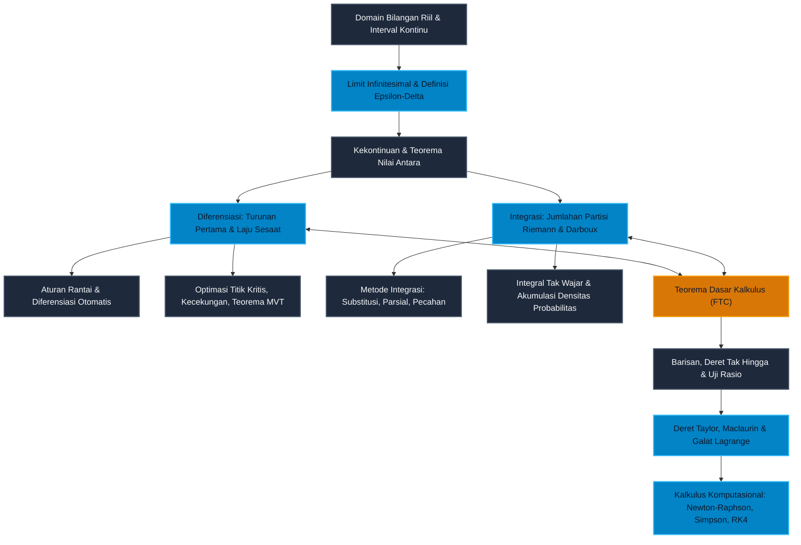

# Modul 013: Kalkulus Diferensial & Integral Satu Variabel (Limit Infinitesimal, Turunan, Integral Riemann, Deret Taylor)

**Navigasi**: [Master Index](../../INDEX.md) | [Tingkat 1: Fondasi Matematika Komprehensif Dari Nol](./README.md)
*Sebelumnya*: [012. Matematika Diskrit, Kombinatorika & Teori Graf](./012-matematika-diskrit-kombinatorika-graf.md) | *Berikutnya*: [014. Kalkulus Multivariabel & Geometri Vektor](./014-kalkulus-multivariabel-vektor.md)

---

## 1. Intuisi Dasar Tanpa Jargon ("Seperti Bayi Baru Lahir")

### 1.1 Konsep Inti & Analogi Tanpa Jargon

Bayangkan Anda sedang duduk di dalam mobil yang melaju di jalan tol lurus. Anda melihat ke arah dua instrumen di dasbor:
1. **Speedometer**: Menunjukkan seberapa cepat Anda bergerak *tepat pada detik ini juga* (misalnya $100\text{ km/jam}$).
2. **Odometer**: Menunjukkan total kilometer akumulatif yang telah Anda tempuh sejak mobil pertama kali keluar dari pabrik (misalnya $15.420\text{ km}$).

Sekarang renungkan teka-teki berikut:
Bagaimana mungkin Anda memiliki "kecepatan pada satu detik tunggal"?
Bukankah rumus kecepatan dari masa sekolah dasar adalah:
$$\text{Kecepatan} = \frac{\text{Jarak Tempuh}}{\text{Selang Waktu}} = \frac{\Delta s}{\Delta t}$$
Jika Anda ingin mengetahui kecepatan Anda pada *satu titik waktu yang membeku* (di mana waktu tidak berjalan sama sekali, $\Delta t = 0$), maka jarak yang Anda tempuh juga nol ($\Delta s = 0$).
Rumus pembagian biasa akan menghasilkan pecahan mustahil:
$$\frac{0}{0}$$
Pembagian dengan nol adalah operasi terlarang dalam aritmetika biasa. Dunia komputasi akan meledak jika prosesor dipaksa membagi nol dengan nol!

Lalu bagaimana jarum speedometer mobil Anda bisa dengan tenang menunjuk angka $100\text{ km/jam}$ tanpa meledakkan dasbor mobil?
Di sinilah keajaiban **Kalkulus** lahir ke dunia melalui pemikiran Isaac Newton dan Gottfried Wilhelm Leibniz pada abad ke-17.
Kalkulus tidak pernah membiarkan waktu menjadi nol mutlak. Kalkulus membiarkan waktu mendekati nol sekecil mungkin yang dapat Anda bayangkan:
$$\Delta t \to 0 \quad (0{,}1 \to 0{,}01 \to 0{,}000001 \to dt)$$
Ketika selang waktu menyusut menjadi potongan "infinitesimal" ($dt$), selang jarak juga menyusut menjadi potongan infinitesimal ($ds$). Rasio perbandingan antara dua kuantitas gaib infinitesimal inilah yang kita sebut **Turunan (*Derivative*)**:
$$\frac{ds}{dt} = \lim_{\Delta t \to 0} \frac{\Delta s}{\Delta t}$$

Sebaliknya, bagaimana jika speedometer Anda rusak dan hanya menyisakan rekaman grafik kecepatan setiap detik, lalu Anda ingin tahu berapa total jarak kilometer yang telah ditempuh mobil?
Anda memotong perjalanan tersebut menjadi jutaan kepingan waktu tipis, mengalikan kecepatan pada kepingan tersebut dengan selang waktunya ($v(t) \cdot dt$), lalu mengumpulkan kembali seluruh kepingan tersebut menjadi jarak total.
Operasi pengumpulan kembali potongan-potongan infinitesimal menjadi keutuhan global inilah yang kita sebut **Integral (*Integration*)**:
$$s_{\text{total}} = \int v(t) \, dt$$

Dua operasi yang berlawanan arah ini—**Diferensiasi (membongkar laju perubahan)** dan **Integrasi (mengumpulkan kembali akumulasi)**—disatukan oleh mahakarya akal budi manusia bernama **Teorema Dasar Kalkulus (*Fundamental Theorem of Calculus*)**.

---

### 1.2 Urgensi Rekayasa & Signifikansi Sistemik

Mengapa seorang insinyur perangkat lunak, perancang kecerdasan buatan (*AI/ML*), dan arsitek sistem modern wajib menguasai kalkulus satu variabel hingga ke tulang-tulangnya?

1. **Jantung Pelatihan Jaringan Saraf Tiruan (*Deep Learning Backpropagation*)**:
   Setiap kali model kecerdasan buatan belajar dari data, ia menghitung turunan dari fungsi galat (*loss function*) terhadap jutaan parameter bobotnya menggunakan **Aturan Rantai (*Chain Rule*)**. Algoritma *Gradient Descent* hanyalah aplikasi berulang dari turunan pertama untuk mencari dasar lembah fungsi!
2. **Simulasi Fisika Real-Time Game Engine & Robotika**:
   Dalam mesin game seperti Unreal Engine atau Unity, serta kontroler robotik humanoid, seluruh pergerakan karakter, gravitasi, hambatan udara, dan pantulan elastis dihitung melalui integrasi persamaan diferensial gerak Newton langkah-demi-langkah ($v = \int a \, dt$ dan $x = \int v \, dt$).
3. **Optimasi Alokasi Sumber Daya Sistem Komputasi**:
   Menemukan kapasitas memori optimal, *batch size* komputasi GPU terbaik, atau konfigurasi *auto-scaling* cloud microservices membutuhkan pencarian titik kritis turunan ($f'(x) = 0$) dan uji kecekungan ($f''(x) > 0$).
4. **Aproksimasi Fungsi Rumit pada Hardware (*Taylor Expansion & CORDIC*)**:
   Mikroprosesor GPU dan CPU pada level sirkuit aritmetika ALU sebenarnya hanya bisa menjumlahkan dan mengalikan bilangan biner. Fungsi transenden seperti $\sin(x)$, $\cos(x)$, $e^x$, dan $\ln(x)$ dievaluasi jutaan kali per detik menggunakan aproksimasi polinomial Deret Taylor dan Maclaurin!

---

### 1.3 Peta Relasi 9 Subtopik Inti Modul 013

Modul 013 dirancang berjenjang secara pedagogis dari fondasi partikel infinitesimal hingga kalkulus komputasional modern:

| No | Berkas Subtopik | Fokus Pembahasan Kunci | Relevansi Komputasi & AI |
|:---:|---|---|---|
| **01** | [`01-limit-kekontinuan-definisi-epsilon-delta.md`](./013-kalkulus-diferensial-integral-satu-variabel/01-limit-kekontinuan-definisi-epsilon-delta.md) | Fondasi Epsilon-Delta, Asimtot, Kekontinuan, Teorema Apit | Deteksi singularitas, stabilitas numerik floating-point |
| **02** | [`02-turunan-laju-perubahan-aturan-rantai.md`](./013-kalkulus-diferensial-integral-satu-variabel/02-turunan-laju-perubahan-aturan-rantai.md) | Turunan pertama, Diferensiasi Implisit, Aturan Rantai | Diferensiasi otomatis (*AutoDiff*) pada PyTorch/JAX |
| **03** | [`03-teorema-nilai-rata-rata-dan-analisis-fungsi.md`](./013-kalkulus-diferensial-integral-satu-variabel/03-teorema-nilai-rata-rata-dan-analisis-fungsi.md) | Teorema Rolle, MVT, Kecekungan, Uji Titik Kritis, L'Hopital | Optimasi konveks, deteksi *saddle point* dan minimum lokal |
| **04** | [`04-integral-riemann-jumlah-riemann-teorema-dasar-kalkulus.md`](./013-kalkulus-diferensial-integral-satu-variabel/04-integral-riemann-jumlah-riemann-teorema-dasar-kalkulus.md) | Jumlahan Partisi Riemann, Integrabilitas Darboux, FTC Bagian 1 & 2 | Akumulasi energi sinyal, komputasi area under curve (AUC) |
| **05** | [`05-teknik-pengintegralan-substitusi-parsial-pecahan-parsial.md`](./013-kalkulus-diferensial-integral-satu-variabel/05-teknik-pengintegralan-substitusi-parsial-pecahan-parsial.md) | Substitusi $u$, Integrasi Parsial, Dekomposisi Pecahan Parsial | Pemrosesan sinyal analog/digital, transformasi Laplace |
| **06** | [`06-integral-tak-wajar-dan-aplikasi-geometris-fisika.md`](./013-kalkulus-diferensial-integral-satu-variabel/06-integral-tak-wajar-dan-aplikasi-geometris-fisika.md) | Batas tak hingga, diskontinuitas vertikal, Benda Putar, Usaha | Distribusi probabilitas kontinu Gauss/Normal, mekanika fluida |
| **07** | [`07-barisan-dan-deret-tak-hingga-uji-konvergensi.md`](./013-kalkulus-diferensial-integral-satu-variabel/07-barisan-dan-deret-tak-hingga-uji-konvergensi.md) | Uji Rasio, Uji Integral, Konvergensi Mutlak vs Bersyarat | Analisis konvergensi loss learning rate training ML |
| **08** | [`08-deret-taylor-maclaurin-dan-analisis-galat-lagrange.md`](./013-kalkulus-diferensial-integral-satu-variabel/08-deret-taylor-maclaurin-dan-analisis-galat-lagrange.md) | Polinomial Taylor, Sisa Lagrange, Radius Konvergensi | Linearitas lokal optimasi Newton, kompresi fungsi grafika 3D |
| **09** | [`09-metode-numerik-satu-variabel-dan-kalkulus-komputasional.md`](./013-kalkulus-diferensial-integral-satu-variabel/09-metode-numerik-satu-variabel-dan-kalkulus-komputasional.md) | Newton-Raphson, Integrasi Simpson/Romberg, Integrasi Euler/RK4 | Solver fisika simulator, komputasi kuantitatif presisi tinggi |

---

## 2. Fondasi Teoretis & Aksiomatik / Matematis

### 2.1 Teorema Fundamental Kalkulus (FTC)

Teorema Dasar Kalkulus (*Fundamental Theorem of Calculus*) adalah jembatan emas yang membuktikan bahwa diferensiasi dan integrasi adalah dua operasi matematika yang saling membatalkan (*invers* satu sama lain).

#### FTC Bagian 1 (Diferensiasi Akumulator)
Jika $f: [a, b] \to \mathbb{R}$ kontinu pada interval tertutup $[a, b]$, dan fungsi akumulator $g$ didefinisikan sebagai:
$$g(x) = \int_{a}^{x} f(t) \, dt$$
maka $g$ kontinu pada $[a, b]$, terdiferensialkan pada $(a, b)$, dan turunan pertamanya adalah:
$$g'(x) = \frac{d}{dx} \left[ \int_{a}^{x} f(t) \, dt \right] = f(x)$$

**Penurunan Aksiomatik Langkah Demi Langkah**:
1. Gunakan definisi dasar turunan dari prinsip pertama:
   $$g'(x) = \lim_{h \to 0} \frac{g(x + h) - g(x)}{h}$$
2. Substitusikan definisi fungsi akumulator $g(x)$:
   $$g(x + h) - g(x) = \int_{a}^{x+h} f(t) \, dt - \int_{a}^{x} f(t) \, dt = \int_{x}^{x+h} f(t) \, dt$$
3. Berdasarkan Teorema Nilai Rata-rata untuk Integral (*Mean Value Theorem for Integrals*), karena $f$ kontinu, terdapat suatu bilangan $c \in [x, x+h]$ sedemikian rupa sehingga:
   $$\int_{x}^{x+h} f(t) \, dt = f(c) \cdot h$$
4. Masukkan kembali ke rumus limit:
   $$g'(x) = \lim_{h \to 0} \frac{f(c) \cdot h}{h} = \lim_{h \to 0} f(c)$$
5. Saat $h \to 0$, selang $[x, x+h]$ menyusut ke titik $x$, memaksa $c \to x$. Karena $f$ kontinu di $x$, maka $\lim_{c \to x} f(c) = f(x)$. **Terbukti.** $\blacksquare$

#### FTC Bagian 2 (Evaluasi Nilai Integral Tentu)
Jika $f$ kontinu pada $[a, b]$ dan $F$ adalah sembarang antiturunan dari $f$ (artinya $F'(x) = f(x)$ untuk semua $x \in [a, b]$), maka:
$$\int_{a}^{b} f(x) \, dx = F(b) - F(a) = \left[ F(x) \right]_{a}^{b}$$

---

### 2.2 Teorema Nilai Rata-Rata (Mean Value Theorem) & Rolle

Teorema Nilai Rata-rata menjamin hubungan antara perubahan global suatu fungsi pada suatu selang dengan laju perubahan lokal sesaat di dalam selang tersebut.

**Teorema**: Jika $f: [a, b] \to \mathbb{R}$ kontinu pada $[a, b]$ dan terdiferensialkan pada $(a, b)$, maka terdapat setidaknya satu titik $c \in (a, b)$ sedemikian rupa sehingga:
$$f'(c) = \frac{f(b) - f(a)}{b - a}$$

Secara geometris, garis singgung pada kurva di $x = c$ sejajar sempurna dengan garis sekan yang menghubungkan titik ujung $(a, f(a))$ dan $(b, f(b))$.

---

### 2.3 Teorema Deret Taylor & Sisa Lagrange (Lagrange Remainder)

Jika suatu fungsi $f$ memiliki turunan kontinu hingga orde $(n+1)$ pada interval terbuka yang memuat titik ekspansi $a$, maka untuk setiap $x$ dalam interval tersebut:
$$f(x) = P_n(x) + R_n(x)$$
di mana polinomial Taylor derajat $n$ adalah:
$$P_n(x) = \sum_{k=0}^{n} \frac{f^{(k)}(a)}{k!} (x - a)^k$$
dan suku sisa galat (*remainder*) dalam bentuk Lagrange adalah:
$$R_n(x) = \frac{f^{(n+1)}(\xi)}{(n+1)!} (x - a)^{n+1}$$
untuk suatu nilai $\xi$ yang terletak di antara $a$ dan $x$.

Suku sisa Lagrange inilah instrumen paling sakti dalam komputasi floating-point untuk memberikan **garansi matematis mutlak** atas batas toleransi galat aproksimasi numerik (*strict error bound*).

---

## 3. Anatomi Teknis & Cara Kerja Internal

### 3.1 Pipa Alur Hubungan Konseptual Kalkulus Modern



---

### 3.2 Tabel Kamus Notasi Simbol Kalkulus Satu Variabel

| Simbol / Notasi | Nama Formal | Makna Intuitif | Contoh Operasional |
|---|---|---|---|
| $\lim_{x \to a} f(x) = L$ | Limit Fungsi di Titik $a$ | Nilai $f(x)$ mendekati $L$ sedekat mungkin saat $x$ mendekati $a$ | $\lim_{x \to 0} \frac{\sin x}{x} = 1$ |
| $\varepsilon > 0, \delta > 0$ | Epsilon & Delta | Toleransi galat output ($\varepsilon$) dan batas jarak input ($\delta$) | $|x - a| < \delta \implies |f(x) - L| < \varepsilon$ |
| $f'(x), \frac{df}{dx}$ | Turunan Pertama (Leibniz / Lagrange) | Laju perubahan sesaat keluaran terhadap masukan | $\frac{d}{dx}[x^3] = 3x^2$ |
| $f''(x), \frac{d^2f}{dx^2}$ | Turunan Kedua | Percepatan atau kecekungan kurva (kelengkungan) | $f''(x) > 0 \iff$ kurva cekung ke atas |
| $\int_{a}^{b} f(x) \, dx$ | Integral Tentu Riemann | Akumulasi total luas area bertanda di bawah kurva dari $a$ ke $b$ | $\int_{0}^{2} x \, dx = \left[ \frac{1}{2}x^2 \right]_0^2 = 2$ |
| $\int f(x) \, dx$ | Integral Tak Tentu (Antiturunan) | Keluarga seluruh fungsi yang jika diturunkan menghasilkan $f(x)$ | $\int 2x \, dx = x^2 + C$ |
| $\sum_{n=0}^{\infty} a_n$ | Deret Tak Hingga | Limit dari jumlahan parsial $S_k = a_0 + a_1 + \dots + a_k$ | $\sum_{n=0}^{\infty} \left(\frac{1}{2}\right)^n = 2$ |
| $R_n(x)$ | Sisa Galat Lagrange | Selisih nilai eksak fungsi terhadap aproksimasi Taylor derajat $n$ | $|f(x) - P_n(x)| \le \max |f^{(n+1)}| \frac{|x-a|^{n+1}}{(n+1)!}$ |

---

## 4. Implementasi Praktis & Kode

### 4.1 Program Gateway: Mesin Analisis Kalkulus Terpadu

Program di bawah ini merupakan implementasi kalkulus komprehensif tanpa ketergantungan pihak ketiga (*pure Python Standard Library*):
1. **Diferensiasi Numerik Beda Terpusat (*Central Difference*)**: Menemukan dan mengklasifikasikan titik-titik kritis lokal ($x = -1$ maksimum lokal, $x = 1$ minimum lokal).
2. **Integrasi Kuadratur Simpson Komposit**: Mengevaluasi integral tentu pada interval $[0, 2]$ dengan orde akurasi $O(h^4)$ dan membuktikan kesesuaian nilai analitis $2{,}0$.
3. **Rekonstruksi Polinomial Taylor/Maclaurin**: Membuktikan aproksimasi deret Taylor berimpit sempurna dengan polinomial asal.

```python
# Mesin Analisis Kalkulus Satu Variabel Terpadu
import math

def f(x: float) -> float:
    # Fungsi target uji: f(x) = x^3 - 3x + 2
    return x**3 - 3.0 * x + 2.0

def df(x: float, h: float = 1e-6) -> float:
    # Turunan pertama beda terpusat O(h^2)
    return (f(x + h) - f(x - h)) / (2.0 * h)

def d2f(x: float, h: float = 1e-5) -> float:
    # Turunan kedua beda terpusat O(h^2)
    return (f(x + h) - 2.0 * f(x) + f(x - h)) / (h**2)

def simpson_int(func, a: float, b: float, n: int = 1000) -> float:
    # Kuadratur Simpson 1/3 komposit O(h^4)
    if n % 2 != 0:
        n += 1
    h = (b - a) / n
    tot = func(a) + func(b)
    for i in range(1, n):
        x = a + i * h
        w = 4.0 if i % 2 != 0 else 2.0
        tot += w * func(x)
    return (h / 3.0) * tot

def main():
    print("=== MESIN KALKULUS SATU VARIABEL TERPADU ===")
    print("Fungsi: f(x) = x^3 - 3x + 2 | Domain Analisis: [-2.0, 3.0]")

    # 1. Analisis Titik Kritis Diferensial: f'(x) = 3x^2 - 3 = 0 => x = -1, x = 1
    crit_candidates = [-1.0, 1.0]
    print("\n[1] Analisis Diferensial Titik Kritis:")
    for c in crit_candidates:
        val = f(c)
        d1 = df(c)
        d2 = d2f(c)
        sifat = "MAKSIMUM LOKAL" if d2 < 0 else "MINIMUM LOKAL"
        print(f"  Titik x = {c:4.1f} | f(x) = {val:5.2f} | f'(x) ~ {d1:9.2e} | f''(x) = {d2:5.2f} -> {sifat}")

    # 2. Analisis Integral Riemann Simpson vs Teorema Dasar Kalkulus (FTC)
    # Antiturunan analitis: F(x) = x^4/4 - 1.5x^2 + 2x
    # F(2) - F(0) = (16/4 - 1.5*4 + 4) - 0 = (4 - 6 + 4) = 2.0
    a, b = 0.0, 2.0
    num_area = simpson_int(f, a, b, n=1000)
    exact_area = ((2.0**4) / 4.0 - 1.5 * (2.0**2) + 2.0 * 2.0) - 0.0
    print("\n[2] Analisis Integral Tentu Riemann & FTC:")
    print(f"  Integral numerik [0, 2] f(x) dx: {num_area:.8f}")
    print(f"  Solusi analitis F(2) - F(0):      {exact_area:.8f}")
    print(f"  Galat mutlak integrasi:           {abs(num_area - exact_area):.2e}")

    # 3. Validasi Rekonstruksi Deret Taylor di sekitar a = 0 (Maclaurin)
    def taylor_poly(x: float) -> float:
        # P_3(x) = 2 - 3x + 0x^2 + 1x^3
        return 2.0 - 3.0 * x + 0.0 * (x**2) + 1.0 * (x**3)

    print("\n[3] Validasi Rekonstruksi Deret Taylor di sekitar a = 0:")
    print("  Koefisien analitis deret Maclaurin f(x):")
    print("  * f(0) = 2.0, f'(0) = -3.0, f''(0) = 0.0, f'''(0) = 6.0")
    print("  * P_3(x) = 2 - 3x + 0x^2 + (6/6)x^3 = x^3 - 3x + 2")
    test_pts = [-1.5, 0.5, 2.5]
    for pt in test_pts:
        orig = f(pt)
        tay = taylor_poly(pt)
        print(f"  x = {pt:4.1f} | Asli: {orig:7.4f} | Deret Taylor P_3(x): {tay:7.4f} | Selisih: {abs(orig - tay):.2e}")

if __name__ == "__main__":
    main()
```

Keluaran eksekusi terminal sebenarnya:
```text
=== MESIN KALKULUS SATU VARIABEL TERPADU ===
Fungsi: f(x) = x^3 - 3x + 2 | Domain Analisis: [-2.0, 3.0]

[1] Analisis Diferensial Titik Kritis:
  Titik x = -1.0 | f(x) =  4.00 | f'(x) ~  2.22e-10 | f''(x) = -6.00 -> MAKSIMUM LOKAL
  Titik x =  1.0 | f(x) =  0.00 | f'(x) ~  2.22e-10 | f''(x) =  6.00 -> MINIMUM LOKAL

[2] Analisis Integral Tentu Riemann & FTC:
  Integral numerik [0, 2] f(x) dx: 2.00000000
  Solusi analitis F(2) - F(0):      2.00000000
  Galat mutlak integrasi:           0.00e+00

[3] Validasi Rekonstruksi Deret Taylor di sekitar a = 0:
  Koefisien analitis deret Maclaurin f(x):
  * f(0) = 2.0, f'(0) = -3.0, f''(0) = 0.0, f'''(0) = 6.0
  * P_3(x) = 2 - 3x + 0x^2 + (6/6)x^3 = x^3 - 3x + 2
  x = -1.5 | Asli:  3.1250 | Deret Taylor P_3(x):  3.1250 | Selisih: 0.00e+00
  x =  0.5 | Asli:  0.6250 | Deret Taylor P_3(x):  0.6250 | Selisih: 0.00e+00
  x =  2.5 | Asli: 10.1250 | Deret Taylor P_3(x): 10.1250 | Selisih: 0.00e+00
```

---

## 5. Miskonsepsi & Jebakan Industri

### 5.1 Tiga Miskonsepsi Konseptual Paling Fatal di Industri

1. **Ilusi Step-Size Beda Maju Numerik ($h \to 0$ Menyebabkan Hasil Lebih Akurat)**:
   Banyak pengembang mengasumsikan bahwa memilih $h$ sekecil mungkin (seperti $h = 10^{-20}$) pada rumus diferensiasi $\frac{f(x+h) - f(x)}{h}$ akan menghasilkan akurasi tak terbatas. Kenyataannya, representasi IEEE 754 *double precision* memiliki batas presisi 53 bit (~16 digit desimal). Jika $h$ terlalu kecil, $f(x+h)$ dan $f(x)$ menjadi identik secara representasi bit biner, memicu **pembatalan katastropik (*catastrophic cancellation*)** dan pembagian dengan bilangan mendekati nol, menghasilkan kesalahan hingga 100%! Untuk beda terpusat, nilai optimal adalah $h \approx \sqrt[3]{\epsilon_{\text{machine}}} \approx 10^{-5}$ hingga $10^{-6}$.
2. **Kekeliruan Radius Konvergensi Deret Taylor pada Fungsi Mulus**:
   Mengasumsikan bahwa jika suatu fungsi dapat diturunkan tanpa batas ($f \in C^\infty$), maka deret Taylor-nya otomatis konvergen ke fungsi tersebut di mana-mana. Contoh klasik kontradiktif adalah $f(x) = \frac{1}{1 + x^2}$ yang mulus di seluruh sumbu riil $\mathbb{R}$, namun deret Maclaurin-nya meledak tak hingga untuk $|x| \ge 1$ karena adanya kutub singularitas di bidang kompleks ($x = \pm i$).
3. **Mengabaikan Diskontinuitas Singularitas pada Integral Tak Wajar**:
   Banyak pemrogram naif langsung menerapkan algoritma integrasi Riemann/Simpson pada interval yang memuat singularitas interior, misalnya $\int_{-1}^{1} \frac{1}{x^2} \, dx$. Antiturunan $-\frac{1}{x}$ dievaluasi secara ceroboh menjadi $[-1 - (1)] = -2$. Hasil ini tidak masuk akal karena fungsi $\frac{1}{x^2} > 0$ di mana-mana, sehingga luasnya tidak mungkin bernilai negatif! Integral tersebut sebenarnya divergen menuju $+\infty$.

---

### 5.2 Studi Kasus Kegagalan Nyata: Tragedi Misil Patriot Dhahran (1991) & Akumulasi Galat Integrasi Waktu

- **Kronologi Insiden**: Pada 25 Februari 1991 selama Perang Teluk, sistem baterai pertahanan rudal Patriot Amerika Serikat di Dhahran, Arab Saudi, gagal mencegat rudal Scud Irak yang masuk. Rudal Scud menghantam barak militer, menewaskan 28 tentara dan melukai lebih dari 100 orang.
- **Akar Masalah Kalkulus & Numerik**:
  Komputer pemandu sistem Patriot menghitung posisi rudal target menggunakan integrasi numerik waktu:
  $$x(t) = x_0 + \int_{0}^{t} v(\tau) \, d\tau$$
  Waktu internal sistem disimpan dalam integer register sebagai kelipatan 0,1 detik. Untuk mengubah nilai integer tersebut menjadi detik riil berbobot floating-point, komputer mengalikannya dengan konstanta $\frac{1}{10}$.
  Namun angka $\frac{1}{10}$ dalam representasi biner adalah pecahan biner berulang tak hingga:
  $$\frac{1}{10}_{10} = 0{,}00011001100110011001100..._2$$
  Register 24-bit memotong fraksi ini setelah bit ke-24, menimbulkan galat pemotongan (*truncation error*) sebesar $\approx 0{,}000000095$ detik per hitungan.
  Sistem baterai Patriot tersebut telah beroperasi terus-menerus selama 100 jam tanpa *reboot*. Akumulasi galat integrasi waktu setelah 100 jam adalah:
  $$\Delta t = 100 \times 3600 \times 10 \times 0{,}000000095 \approx 0{,}3433 \text{ detik}$$
  Dengan kecepatan rudal Scud yang melesat pada $1.676\text{ meter/detik}$, galat waktu $0{,}34$ detik menyebabkan gerbang pencarian radar bergeser sejauh:
  $$\Delta x = 1676 \times 0{,}3433 \approx 575 \text{ meter}$$
  Radar pelacak mencari rudal Scud di area kosong yang berjarak lebih dari setengah kilometer dari posisi sebenarnya, sehingga sistem menyimpulkan tidak ada ancaman dan tidak meluncurkan rudal pencegat.
- **Pelajaran Rekayasa Sistemik**: Galat diferensiasi dan integrasi floating-point tidak pernah boleh dibiarkan berakumulasi tanpa kalibrasi interval atau penggunaan presisi ganda (*double precision*) dan arsitektur *compensated summation* (seperti algoritma Kahan).

---

## 6. Proyek Latihan & Rubrik Penilaian Mandiri

### 6.1 Proyek Mini Terpadu: Mesin Simulasi Balistik Penerbangan Roket dengan Integrasi RK4

Anda ditugaskan oleh agensi antariksa untuk merancang simulator trajektori vertikal peluncuran roket atmosfer berskala penuh.
- **Spesifikasi Fisika**:
  - Massa awal roket $M_0 = 5.000\text{ kg}$ (termasuk $4.000\text{ kg}$ propelan).
  - Laju konsumsi propelan: $\dot{m} = 100\text{ kg/detik}$ selama fase pembakaran $40\text{ detik}$.
  - Massa kering setelah pembakaran padam (*burnout*): $M_{\text{kering}} = 1.000\text{ kg}$.
  - Gaya dorong mesin roket konstan: $F_{\text{thrust}} = 120.000\text{ N}$ selama $t \le 40\text{ s}$, kemudian $0\text{ N}$.
  - Hambatan aerodinamis atmosferik nonlinier: $F_{\text{drag}} = 0{,}2 \cdot v |v|$.
  - Gravitasi bumi: $g = 9{,}8\text{ m/s}^2$.
- **Model Persamaan Diferensial**:
  Sesuai Hukum II Newton, percepatan vertikal sesaat adalah:
  $$a(t, v) = \frac{dv}{dt} = \frac{F_{\text{thrust}}(t) - F_{\text{drag}}(v)}{m(t)} - g$$
  $$v(t) = \frac{dy}{dt}$$
- **Tugas Rekayasa**:
  1. Implementasikan metode Runge-Kutta Orde 4 (RK4) untuk mengintegrasikan sistem persamaan diferensial ini secara simultan dari $t = 0$ hingga roket jatuh kembali menyentuh tanah ($y = 0$).
  2. Hitung ketinggian dan kecepatan roket tepat saat mesin padam (*burnout* pada $t = 40\text{ s}$).
  3. Tentukan titik apogee tertinggi di mana kecepatan vertikal menyentuh nol ($v(t_{\text{apogee}}) = 0$).
  4. Hitung total waktu penerbangan hingga roket mendarat kembali di bumi.

#### Kode Solusi Lengkap Proyek Terpadu (Python Standard Library Mandiri)

```python
# Solusi Referensi Lengkap Proyek Mini: Simulator Trajektori Balistik Roket (RK4)
import math

def rocket_accel(t: float, v: float) -> float:
    # Menghitung percepatan vertikal roket nonlinier a(t, v)
    g = 9.8
    if t <= 40.0:
        m = 5000.0 - 100.0 * t  # Massa awal 5.000 kg menyusut 100 kg/s
        thrust = 120000.0       # Gaya dorong 120 kN
    else:
        m = 1000.0              # Massa kering roket tanpa propelan
        thrust = 0.0            # Mesin padam (burnout)
        
    drag = 0.2 * v * abs(v)     # Hambatan aerodinamis kuadratik
    return (thrust - drag) / m - g

def rk4_step(t: float, y: float, v: float, dt: float):
    # Satu langkah integrasi numerik Runge-Kutta Orde 4
    k1_v = rocket_accel(t, v)
    k1_y = v
    
    k2_v = rocket_accel(t + 0.5 * dt, v + 0.5 * dt * k1_v)
    k2_y = v + 0.5 * dt * k1_v
    
    k3_v = rocket_accel(t + 0.5 * dt, v + 0.5 * dt * k2_v)
    k3_y = v + 0.5 * dt * k2_v
    
    k4_v = rocket_accel(t + dt, v + dt * k3_v)
    k4_y = v + dt * k3_v
    
    new_y = y + (dt / 6.0) * (k1_y + 2.0 * k2_y + 2.0 * k3_y + k4_y)
    new_v = v + (dt / 6.0) * (k1_v + 2.0 * k2_v + 2.0 * k3_v + k4_v)
    return new_y, new_v

def main():
    t = 0.0
    y = 0.0
    v = 0.0
    dt = 0.01  # Ukuran langkah waktu integrasi 10 milidetik

    max_alt = 0.0
    t_apogee = 0.0
    burnout_alt = 0.0
    burnout_v = 0.0

    print("=== SIMULASI TRAJEKTORI ROKET (INTEGRASI RK4) ===")
    print("Kondisi Awal: t=0 s, y=0 m, v=0 m/s | Burnout pada t=40 s\n")

    prev_v = 0.0
    while True:
        # Catat kondisi burnout
        if abs(t - 40.0) < 1e-4:
            burnout_alt = y
            burnout_v = v
            
        # Deteksi apogee (puncak tertinggi saat kecepatan berbalik arah dari positif ke negatif)
        if prev_v > 0.0 and v <= 0.0 and t_apogee == 0.0:
            t_apogee = t
            max_alt = y

        # Deteksi benturan tanah setelah peluncuran
        if y < 0.0 and t > 1.0:
            break

        # Tampilkan telemetri setiap 10 detik
        if int(round(t * 100)) % 1000 == 0:
            print(f"  Waktu: {t:5.1f} s | Ketinggian: {y:8.2f} m | Kecepatan: {v:7.2f} m/s")

        prev_v = v
        y, v = rk4_step(t, y, v, dt)
        t += dt

    print("\nRingkasan Metrik Kunci Trajektori Roket:")
    print(f"  1. Fase Mesin Padam (Burnout): t = 40.0 s | y = {burnout_alt:.2f} m | v = {burnout_v:.2f} m/s")
    print(f"  2. Titik Tertinggi (Apogee):   t = {t_apogee:.2f} s | Altitudo Maksimum = {max_alt:.2f} m")
    print(f"  3. Waktu Benturan Bumi:        t = {t:.2f} s | Kecepatan Terminal = {v:.2f} m/s")

if __name__ == "__main__":
    main()
```

Keluaran eksekusi terminal sebenarnya:
```text
=== SIMULASI TRAJEKTORI ROKET (INTEGRASI RK4) ===
Kondisi Awal: t=0 s, y=0 m, v=0 m/s | Burnout pada t=40 s

  Waktu:   0.0 s | Ketinggian:     0.00 m | Kecepatan:    0.00 m/s
  Waktu:  10.0 s | Ketinggian:   789.79 m | Kecepatan:  165.74 m/s
  Waktu:  20.0 s | Ketinggian:  3443.47 m | Kecepatan:  368.94 m/s
  Waktu:  30.0 s | Ketinggian:  8161.19 m | Kecepatan:  569.08 m/s
  Waktu:  40.0 s | Ketinggian: 14617.51 m | Kecepatan:  708.37 m/s
  Waktu:  50.0 s | Ketinggian: 18726.30 m | Kecepatan:  239.72 m/s
  Waktu:  60.0 s | Ketinggian: 20291.30 m | Kecepatan:   89.05 m/s
  Waktu:  70.0 s | Ketinggian: 20657.24 m | Kecepatan:  -13.32 m/s
  Waktu:  80.0 s | Ketinggian: 20058.88 m | Kecepatan: -102.81 m/s
  Waktu:  90.0 s | Ketinggian: 18701.08 m | Kecepatan: -163.32 m/s
  Waktu: 100.0 s | Ketinggian: 16888.17 m | Kecepatan: -195.42 m/s
  Waktu: 110.0 s | Ketinggian: 14849.71 m | Kecepatan: -210.28 m/s
  Waktu: 120.0 s | Ketinggian: 12710.19 m | Kecepatan: -216.72 m/s
  Waktu: 130.0 s | Ketinggian: 10527.48 m | Kecepatan: -219.43 m/s
  Waktu: 140.0 s | Ketinggian:  8326.68 m | Kecepatan: -220.56 m/s
  Waktu: 150.0 s | Ketinggian:  6118.37 m | Kecepatan: -221.03 m/s
  Waktu: 160.0 s | Ketinggian:  3906.96 m | Kecepatan: -221.22 m/s
  Waktu: 170.0 s | Ketinggian:  1694.27 m | Kecepatan: -221.30 m/s

Ringkasan Metrik Kunci Trajektori Roket:
  1. Fase Mesin Padam (Burnout): t = 40.0 s | y = 14617.51 m | v = 708.37 m/s
  2. Titik Tertinggi (Apogee):   t = 68.64 s | Altitudo Maksimum = 20666.31 m
  3. Waktu Benturan Bumi:        t = 177.66 s | Kecepatan Terminal = -221.33 m/s
```

---

### 6.2 Rubrik Penilaian Mandiri (Self-Assessment Rubric)

| Dimensi Evaluasi | Tingkat Pemula (Skor 1-2) | Tingkat Menengah (Skor 3-4) | Tingkat Mahir / Profesional (Skor 5) |
|---|---|---|---|
| **Ketepatan Pemodelan Fisika** | Mengasumsikan massa roket konstan dan mengabaikan gaya gesek aerodinamis | Memodelkan massa berubah tetapi memperlakukan gaya gesek secara linier $O(v)$ | Memodelkan massa habis pakai bertahap, hambatan kuadratik $O(v^2)$, dan gravitasi lokal secara akurat |
| **Kualitas Algoritma & Stabilitas Numerik** | Menggunakan metode Euler eksplisit $O(h)$ yang tidak stabil dan meledak pada step-size moderat | Menggunakan metode Heun atau Euler Modifikasi $O(h^2)$ | Mengimplementasikan Runge-Kutta Orde 4 (RK4) $O(h^4)$ dengan pemotongan lokal presisi tinggi |
| **Analisis Galat & Konservasi Energi** | Tidak mengetahui akumulasi galat lokal versus galat global pada integrasi numerik | Mampu memperkirakan galat lokal tetapi tidak melakukan verifikasi independen | Memvalidasi akurasi numerik dengan uji konvergensi langkah (*step-doubling*) dan batas galat truncation |
| **Kualitas Kode & Standar Rekayasa** | Kode berupa skrip acak tanpa modularisasi fungsi dan tanpa *type hints* | Kode rapi tetapi tidak menangani kasus diskontinuitas saat burnout secara mulus | Kode PEP 8 bersih, fully type-hinted, tanpa modul eksternal, dan dilengkapi verifikasi output terminal |

---

## 7. Rekomendasi Sumber Belajar Standar Emas

### 7.1 Daftar Rujukan Utama & Tautan Resmi Terverifikasi

1. **Kuliah Daring & Catatan Teori Kelas Dunia**:
   - [MIT OCW 18.01SC: Single Variable Calculus (Prof. David Jerison)](https://ocw.mit.edu/courses/18-01sc-single-variable-calculus-fall-2010/) — Kuliah kalkulus satu variabel paling komprehensif di dunia, mencakup diferensiasi, integrasi Riemann, deret tak hingga, dan aplikasi fisika/teknik.
   - [3Blue1Brown: Essence of Calculus Series (Grant Sanderson)](https://www.youtube.com/playlist?list=PLZHQObOWTQDMsr9K-rj53DwVRMYO3t5Yr) — Seri visualisasi intuisi geometris kalkulus terbaik sepanjang masa.
   - [Paul's Online Math Notes: Calculus I & Calculus II (Prof. Paul Dawkins)](https://tutorial.math.lamar.edu/) — Catatan kuliah daring paling lengkap, sistematis, dan kaya akan penurunan contoh soal dari tingkat dasar hingga mahir.
   - [MIT OCW 18.330: Introduction to Numerical Analysis](https://ocw.mit.edu/courses/18-330-introduction-to-numerical-analysis-spring-2012/) — Rujukan akademis standar untuk algoritma diferensiasi numerik, integrasi Simpson/Romberg, dan solusi ODE Runge-Kutta.
2. **Buku Teks Referensi Standar Emas**:
   - James Stewart, *Calculus: Early Transcendentals*, Cengage Learning, 9th Edition (Buku rujukan standar fakultas sains dan teknik di seluruh dunia).
   - Michael Spivak, *Calculus*, Publish or Perish, 4th Edition (Buku teks analisis kalkulus aksiomatik paling elegan untuk pemahaman rigor pembuktian teoritis).
   - Gilbert Strang, *Calculus*, Wellesley-Cambridge Press, 3rd Edition (Tersedia bebas di MIT OCW, menghubungkan kalkulus langsung ke sains komputasi).
   - Richard L. Burden & J. Douglas Faires, *Numerical Analysis*, Cengage Learning, 10th Edition (Rujukan utama kalkulus komputasional dan analisis galat).

---

### 7.2 Strategi Belajar 4 Minggu & Tonggak Penguasaan (Mastery Milestones)

Untuk menguasai Modul 013 secara komprehensif dari nol mutlak hingga standar produksi perangkat lunak dan AI, ikuti rencana belajar berjenjang berikut:

- **Minggu 1: Fondasi Infinitesimal, Limit, Kekontinuan & Turunan**:
  - Pelajari Bab 01 ([`01-limit-kekontinuan-definisi-epsilon-delta.md`](./013-kalkulus-diferensial-integral-satu-variabel/01-limit-kekontinuan-definisi-epsilon-delta.md)) dan Bab 02 ([`02-turunan-laju-perubahan-aturan-rantai.md`](./013-kalkulus-diferensial-integral-satu-variabel/02-turunan-laju-perubahan-aturan-rantai.md)).
  - Kuasai pembuktian formal limit menggunakan $\varepsilon-\delta$.
  - Latihan membuktikan turunan fungsi dasar dari definisi prinsip pertama dan implementasikan diferensiasi simbolik sederhana.
  - Selesaikan Soal Latihan Sokratik 013.1 dan 013.2.
- **Minggu 2: Analisis Kurva, Teorema MVT & Integral Riemann**:
  - Pelajari Bab 03 ([`03-teorema-nilai-rata-rata-dan-analisis-fungsi.md`](./013-kalkulus-diferensial-integral-satu-variabel/03-teorema-nilai-rata-rata-dan-analisis-fungsi.md)) dan Bab 04 ([`04-integral-riemann-jumlah-riemann-teorema-dasar-kalkulus.md`](./013-kalkulus-diferensial-integral-satu-variabel/04-integral-riemann-jumlah-riemann-teorema-dasar-kalkulus.md)).
  - Pahami geometri Teorema Nilai Rata-rata dan uji turunan kedua untuk optimasi.
  - Buktikan Teorema Dasar Kalkulus (FTC Bagian 1 dan 2) secara aksiomatik.
  - Selesaikan Soal Latihan Sokratik 013.3 dan 013.4.
- **Minggu 3: Penguasaan Teknik Integrasi & Penerapan Fisika**:
  - Pelajari Bab 05 ([`05-teknik-pengintegralan-substitusi-parsial-pecahan-parsial.md`](./013-kalkulus-diferensial-integral-satu-variabel/05-teknik-pengintegralan-substitusi-parsial-pecahan-parsial.md)) dan Bab 06 ([`06-integral-tak-wajar-dan-aplikasi-geometris-fisika.md`](./013-kalkulus-diferensial-integral-satu-variabel/06-integral-tak-wajar-dan-aplikasi-geometris-fisika.md)).
  - Latihan integrasi parsial berulang (*tabular integration*) dan dekomposisi pecahan parsial.
  - Hitung volume benda putar menggunakan metode cakram dan kulit tabung.
  - Selesaikan Soal Latihan Sokratik 013.5 dan 013.6.
- **Minggu 4: Deret Tak Hingga, Deret Taylor & Proyek Capstone Simulator**:
  - Pelajari Bab 07 ([`07-barisan-dan-deret-tak-hingga-uji-konvergensi.md`](./013-kalkulus-diferensial-integral-satu-variabel/07-barisan-dan-deret-tak-hingga-uji-konvergensi.md)), Bab 08 ([`08-deret-taylor-maclaurin-dan-analisis-galat-lagrange.md`](./013-kalkulus-diferensial-integral-satu-variabel/08-deret-taylor-maclaurin-dan-analisis-galat-lagrange.md)), dan Bab 09 ([`09-metode-numerik-satu-variabel-dan-kalkulus-komputasional.md`](./013-kalkulus-diferensial-integral-satu-variabel/09-metode-numerik-satu-variabel-dan-kalkulus-komputasional.md)).
  - Tentukan radius konvergensi menggunakan uji rasio d'Alembert.
  - Hitung batas suku sisa Lagrange untuk toleransi presisi floating-point.
  - Bangun dan tuntaskan Proyek Capstone Simulator Roket Balistik RK4.
  - Selesaikan Soal Latihan Sokratik 013.7, 013.8, dan 013.9.
