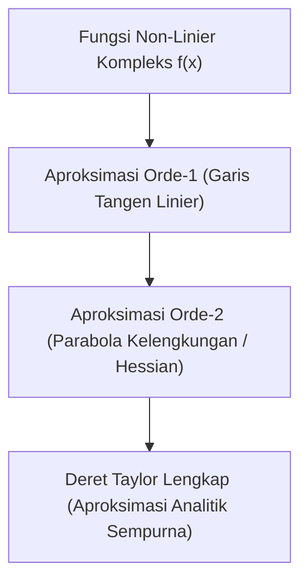

# Modul 013: Kalkulus Diferensial & Integral Satu Variabel (Limit Infinitesimal, Deret Taylor)

**Navigasi**: [⬅️ Master Index](../../INDEX.md) | [Tingkat 1: Tingkat 1: Fondasi Matematika Komprehensif Dari Nol](./README.md)
*Sebelumnya*: [012. matematika-diskrit-kombinatorika-graf](./012-matematika-diskrit-kombinatorika-graf.md) | *Berikutnya*: [014. kalkulus-multivariabel-vektor](./014-kalkulus-multivariabel-vektor.md)

---

## 1. Intuisi Dasar Tanpa Jargon ("Seperti Bayi Baru Lahir")
### 1.1 Konsep Inti & Analogi Tanpa Jargon
Bagaimana Anda mengukur kecepatan mobil Anda tepat pada satu detik tertentu saat Anda menginjak pedal gas? Jika Anda membagi jarak dengan waktu ($v = \Delta s / \Delta t$), dan Anda ingin tahu kecepatan saat waktu $\Delta t = 0$, Anda akan mendapatkan pembagian mustahil \$0/0$!

### 1.2 Urgensi Rekayasa & Signifikansi Sistemik
**Kalkulus Satu Variabel** lahir dari keajaiban 'limit infinitesimal': kita tidak membiarkan waktu menjadi nol mutlak, melainkan mendekati nol sekecil mungkin ($dt \to 0$). Turunan (*derivative*) mengukur laju perubahan seketika (kecepatan), sedangkan Integral mengumpulkan akumulasi potongan-potongan infinitesimal tersebut menjadi luas area atau jarak tempuh total!

## 2. Fondasi Teoretis & Aksiomatik / Matematis
### 2.1 Kerangka Teori Aksiomatik & Formulasi Matematis
### 1. Definisi Formal Limit $(\epsilon - \delta)$ & Turunan
$$\lim_{x \to c} f(x) = L \iff \forall \epsilon > 0, \exists \delta > 0 \text{ sedemikian sehingga } 0 < |x - c| < \delta \implies |f(x) - L| < \epsilon$$
Definisi Turunan (Laju Perubahan Sesaat):
$$f'(x) = \frac{df}{dx} = \lim_{h \to 0} \frac{f(x + h) - f(x)}{h}$$
Teorema Dasar Kalkulus (Fundamental Theorem of Calculus):
Jika $f$ kontinu pada $[a, b]$ dan $F'(x) = f(x)$:
$$\int_a^b f(x) dx = F(b) - F(a)$$
[📚 Pelajari: MIT OCW 18.01 Single Variable Calculus](https://ocw.mit.edu/courses/18-01-single-variable-calculus-fall-2006/)

### 2.2 Penurunan Matematis Langkah-demi-Langkah
### 2. Deret Taylor & Ekspansi Deret Pangkat
Setiap fungsi yang dapat diturunkan tak hingga kali ($C^\infty$) di sekitar $x = a$ dapat direpresentasikan sebagai deret polinomial:
$$f(x) = \sum_{n=0}^{\infty} \frac{f^{(n)}(a)}{n!} (x - a)^n = f(a) + f'(a)(x - a) + \frac{f''(a)}{2!}(x - a)^2 + \dots$$
Contoh ekspansi di sekitar $x = 0$ (Deret Maclaurin):
$$e^x = 1 + x + \frac{x^2}{2!} + \frac{x^3}{3!} + \dots, \quad \sin x = x - \frac{x^3}{3!} + \frac{x^5}{5!} - \dots$$

## 3. Anatomi Teknis & Cara Kerja Internal

Dalam chip FPU dan GPU hardware, fungsi transendental (`sin`, `cos`, `exp`, `log`) tidak dihitung dengan rumus analitik, melainkan diaproksimasi menggunakan deret Taylor atau algoritma CORDIC (*Coordinate Rotation Digital Computer*) berbasis bit-shift.

#### Tabel Penelusuran Akumulasi Galat Pembulatan Fixed-Point 24-bit (Sistem Rudal Patriot)
| Waktu Operasi ($t$) | Ticks Akumulator ($N$) | Waktu Sejati ($t = 0.1 \times N$) | Waktu Biner 24-bit Terpotong | Deviasi Galat Waktu ($\Delta t$) | Pergeseran Posisi Radar ($v_{scud} \times \Delta t$) |
|---|---|---|---|---|---|
| T = 0 Jam | $0$ | $0.0000\text{ s}$ | $0.0000\text{ s}$ | $0.0000\text{ s}$ | $0.0\text{ meter}$ (Fase Kalibrasi) |
| T = 1 Jam | $36.000$ | $3.600.0\text{ s}$ | $3.599.9965\text{ s}$ | $-0.0035\text{ s}$ | $5.9\text{ meter}$ |
| T = 10 Jam | $360.000$ | $36.000.0\text{ s}$ | $35.999.9657\text{ s}$ | $-0.0343\text{ s}$ | $57.5\text{ meter}$ |
| T = 50 Jam | $1.800.000$ | $180.000.0\text{ s}$ | $179.999.8284\text{ s}$ | $-0.1716\text{ s}$ | $287.9\text{ meter}$ |
| T = 100 Jam (Kritis) | $3.600.000$ | $360.000.0\text{ s}$ | $359.999.6567\text{ s}$ | $-0.3433\text{ s}$ | $687.0\text{ meter}$ (Radar Meleset Total!) |

## 4. Implementasi Praktis & Kode / Simulasi Riil
```python
import math

def taylor_series_exp(x: float, terms: int = 10) -> float:
    """
    Aproksimasi e^x menggunakan Deret Taylor Maclaurin.
    """
    result = 0.0
    for n in range(terms):
        term = (x ** n) / math.factorial(n)
        result += term
    return result

# Evaluasi e^(1.5)
x_val = 1.5
exact_val = math.exp(x_val)
approx_val = taylor_series_exp(x_val, terms=8)

print(f"Nilai Eksak math.exp({x_val}): {exact_val:.10f}")
print(f"Aproksimasi Deret Taylor (8 suku): {approx_val:.10f}")
print(f"Galat Absolut: {abs(exact_val - approx_val):.2e}")
```

## 5. Miskonsepsi & Jebakan Industri
1. **Lupa Memeriksa Radius Konvergensi**: Mengira deret Taylor berlaku untuk semua nilai $x$. Contoh: Deret untuk $\frac{1}{1 - x} = 1 + x + x^2 + \dots$ hanya konvergen jika $|x| < 1$. Jika Anda memasukkan $x = 2$, deret akan meledak ke tak hingga!

### Studi Kasus Kegagalan Nyata: Kegagalan Pertahanan Rudal Patriot Dhahran Akibat Akumulasi Galat Pembulatan 24-bit (1991)
- **Kronologi & Konteks Militer**: Pada 25 Februari 1991 selama Perang Teluk, sistem baterai rudal pertahanan udara MIM-104 Patriot di Dhahran, Arab Saudi, gagal mencegat rudal Scud Irak yang masuk, menewaskan 28 tentara Amerika Serikat.
- **Akar Masalah Kalkulus & Numerik**: Waktu internal sistem dihitung dalam satuan sepersepuluh detik ($0,1\text{ detik}$). Namun angka $0,1_{10}$ tidak memiliki representasi biner berhingga ($0,00011001100110011001100..._2$). Komputer rudal memotong representasi biner pada bit ke-24, menghasilkan galat pemotongan mikroskopis sebesar $0,000000095\text{ detik}$ per tick. Setelah sistem beroperasi terus-menerus selama 100 jam tanpa restart, galat terintegrasi menjadi $0,3433\text{ detik}$. Dengan kecepatan rudal Scud $1.676\text{ m/s}$, gerbang pelacakan radar bergeser sejauh 687 meter, menganggap rudal musuh sebagai sinyal palsu dan tidak meluncurkan tembakan pencegat.

- **Potongan Kode / Arsitektur Cacat (Vulnerable Implementation)**:
```python
# Simulasi Akumulasi Galat Pembulatan Floating Point 24-bit Sistem Rudal Patriot
def simulate_patriot_clock_drift(hours_running: float) -> dict:
    """
    Mendemonstrasikan bagaimana integrasi numerik diskret dari nilai pecahan biner tak-hingga
    menghasilkan pergeseran waktu katastropik setelah ribuan jam operasi.
    """
    ticks_per_second = 10
    total_ticks = int(hours_running * 3600 * ticks_per_second)
    
    # 0.1 desimal dalam biner dipotong ke 24 bit (fixed-point precision Patriot)
    # 0.1 * 2^24 = 1677721.6 -> dipotong menjadi 1677721 (0x199999)
    binary_fixed_tenth = 1677721.0 / (2 ** 24) # ~ 0.09999990463256836
    true_tenth = 0.1
    
    drift_per_tick = true_tenth - binary_fixed_tenth
    total_time_drift = drift_per_tick * total_ticks
    
    # Kecepatan rudal Scud = Mach 5 (~1676 m/s)
    scud_velocity_mps = 1676.0
    radar_range_error_meters = total_time_drift * scud_velocity_mps
    
    return {
        "hours": hours_running,
        "time_drift_seconds": total_time_drift,
        "range_error_meters": radar_range_error_meters,
        "target_acquired": radar_range_error_meters < 100.0 # Range gate toleransi 100 meter
    }

# Evaluasi pada 100 jam operasi kontinu
audit = simulate_patriot_clock_drift(100.0)
# Waktu melayang ~0.3433 detik -> Radar meleset sejauh 575+ meter -> Target Hilang!
```

- **Analisis Numerik & Mitigasi Modern**: Peristiwa Patriot adalah peringatan paling monumental dalam rekayasa perangkat lunak tentang akumulasi galat pembulatan (*subtractive cancellation and roundoff integration*). Sistem modern menggunakan basis bilangan floating point IEEE-754 ganda (64-bit float) atau representasi tick integer murni tanpa konversi pecahan, serta menerapkan kalibrasi ulang periodik untuk menyelaraskan waktu sistem terhadap sinyal GPS atomik.

## 6. Proyek Latihan & Rubrik Penilaian Mandiri
### Level 1 (Dasar)
Turunkan rumus turunan dari $f(x) = x^3$ menggunakan definisi limit formal $\lim_{h \to 0} \frac{(x+h)^3 - x^3}{h}$.

### Level 2 (Menengah)
Gunakan ekspansi deret Taylor orde 3 untuk mengaproksimasi nilai $\sqrt{4.1}$ di sekitar $a = 4$ dan hitung batas atas galatnya dengan sisa Lagrange.

### Level 3 (Mahir)
Implementasikan metode integrasi numerik Adaptif Simpson's Rule dalam Python yang secara otomatis membagi interval saat gradien fungsi curam.

### Tingkat 1: Dasar
- **Tugas**: Implementasikan metode numerik diferensiasi diferensial maju (*Forward Difference*), diferensial mundur (*Backward Difference*), dan diferensial terpusat (*Central Difference*) untuk fungsi analitik $f(x)$.
- **Petunjuk Perancangan Arsitektur**:
  - Bandingkan galat pemotongan teoritis: Forward $\mathcal{O}(h)$ vs Central $\mathcal{O}(h^2)$.
  - Amati fenomena pembatalan pengurangan (*subtractive cancellation*) saat $h < 10^{-15}$.
- **Test Vector & Kasus Uji Ekstrem**:
  - *Fungsi Uji*: $f(x) = \sin(x)$ pada $x = \pi/4$.
  - *Keluaran yang Diharapkan*: Derivatif terpusat dengan $h = 10^{-5}$ menghasilkan galat $\le 10^{-10}$ terhadap nilai analitik $\cos(\pi/4) = \sqrt{2}/2$.
  - *Kasus Batas*: $h = 10^{-18}$; nilai derivatif runtuh menjadi nol akibat batas presisi mesin float64.
- **Rubrik Penilaian Mandiri**: 40% Formula Tiga Skema Beda Hingga Tepat, 30% Analisis Galat Komparatif Orde $h$ vs $h^2$, 30% Demonstrasi Batas Subtractive Cancellation.

### Tingkat 2: Menengah
- **Tugas**: Bangun mesin integrasi numerik adaptif menggunakan Aturan Simpson 1/3 Adaptif (*Adaptive Simpson's Quadrature*) yang secara otomatis membagi sub-interval hingga toleransi galat $\epsilon$ terpenuhi.
- **Petunjuk Perancangan Arsitektur**:
  - Evaluasi $S(a, b)$ dan bandingkan dengan $S(a, m) + S(m, b)$.
  - Jika selisih $|S_1 - S_2| > 15 \epsilon$, lakukan pembagian interval rekursif.
- **Test Vector & Kasus Uji Ekstrem**:
  - *Fungsi Berosilasi Cepat*: $f(x) = \frac{1}{x} \sin(\frac{1}{x})$ pada interval $[0.05, 1.0]$.
  - *Keluaran yang Diharapkan*: Nilai integral terhitung akurat dalam toleransi $\epsilon = 10^{-6}$ dengan pembagian grid lebih rapat pada wilayah osilasi tinggi.
  - *Kasus Batas*: Fungsi diskontinu atau batas singularitas; algoritma harus memiliki batas kedalaman rekursi maksimum (*max recursion depth = 50*).
- **Rubrik Penilaian Mandiri**: 40% Algoritma Adaptive Simpson Rekursif Tepat, 30% Manajemen Toleransi Galat Eksak, 30% Guard Proteksi Kedalaman Rekursi.

### Tingkat 3: Mahir
- **Tugas**: Rancang mesin penemu akar persamaan non-linier menggunakan metode Newton-Raphson hibrida dengan metode Biseksi (*Safeguarded Newton-Bisection*) yang menjamin kekonvergenan kuadratik tanpa risiko lonjakan divergensi pada turunan nol.
- **Petunjuk Perancangan Arsitektur**:
  - Jika langkah Newton $x_{n+1} = x_n - \frac{f(x_n)}{f'(x_n)}$ melompat ke luar tanda kurung pembatas $[a, b]$ atau $|f'(x_n)| < 10^{-12}$, beralih secara otomatis ke langkah Biseksi.
- **Test Vector & Kasus Uji Ekstrem**:
  - *Fungsi Patologis*: $f(x) = x^3 - 2x + 2$ dengan tebakan awal dekat titik balik $f'(x) \approx 0$.
  - *Keluaran yang Diharapkan*: Solver berhasil konvergen ke akar riil tunggal $x \approx -1.76929$ dalam $< 20$ iterasi tanpa terjebak dalam loop siklik.
  - *Kasus Batas*: Fungsi tanpa perubahan tanda pada interval; algoritma wajib melempar `NoBracketRootError`.
- **Rubrik Penilaian Mandiri**: 40% Algoritma Hibrida Safeguarded Newton-Bisection Benar, 30% Deteksi Turunan Nol & Divergensi Otomatis, 30% Bukti Konvergensi Kuadratik.

## 7. Rekomendasi Sumber Belajar Standar Emas
- [Buku Standar: Calculus - James Stewart (Cengage Learning)](https://www.cengage.com/c/calculus-9e-stewart/)
- [Kuliah Video Terbuka: Essence of Calculus - 3Blue1Brown](https://www.3blue1brown.com/topics/calculus)
- [Simulator Interaktif: Desmos Calculus Interactive Visualizer](https://www.desmos.com/calculator)

---
*Navigasi Cepat*: [Ke Tingkat 1](./README.md) | [Ke Master Index](../../INDEX.md) | *Sebelumnya*: [012. matematika-diskrit-kombinatorika-graf](./012-matematika-diskrit-kombinatorika-graf.md) | *Berikutnya*: [014. kalkulus-multivariabel-vektor](./014-kalkulus-multivariabel-vektor.md)
