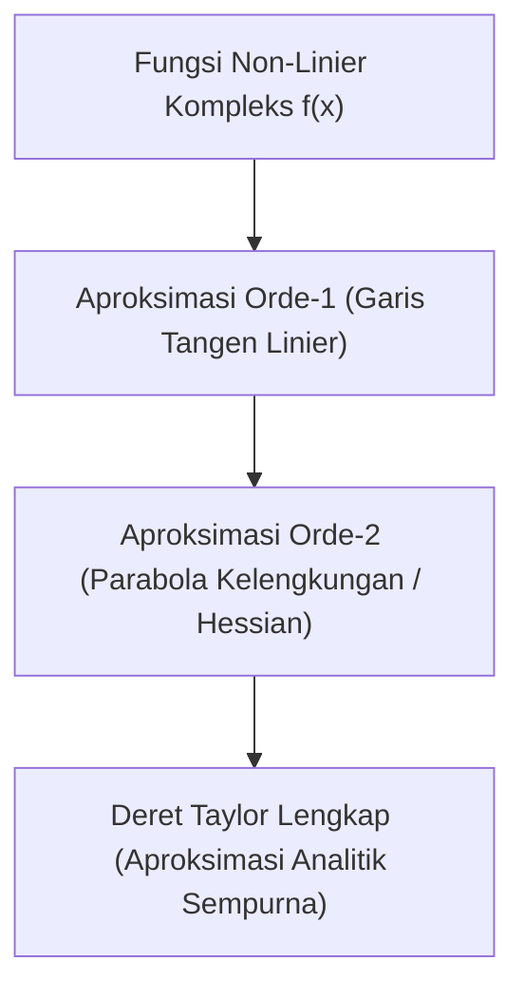

# Modul 013: Kalkulus Diferensial & Integral Satu Variabel (Limit Infinitesimal, Deret Taylor)

**Navigasi**: [⬅️ Master Index](../../INDEX.md) | [Tingkat 1: Tingkat 1: Fondasi Matematika Komprehensif Dari Nol](./README.md)
*Sebelumnya*: [012. matematika-diskrit-kombinatorika-graf](./012-matematika-diskrit-kombinatorika-graf.md) | *Berikutnya*: [014. kalkulus-multivariabel-vektor](./014-kalkulus-multivariabel-vektor.md)

---

## 1. Intuisi Dasar Tanpa Jargon ("Seperti Bayi Baru Lahir")
Bagaimana Anda mengukur kecepatan mobil Anda tepat pada satu detik tertentu saat Anda menginjak pedal gas? Jika Anda membagi jarak dengan waktu ($v = \Delta s / \Delta t$), dan Anda ingin tahu kecepatan saat waktu $\Delta t = 0$, Anda akan mendapatkan pembagian mustahil $0/0$! 

**Kalkulus Satu Variabel** lahir dari keajaiban 'limit infinitesimal': kita tidak membiarkan waktu menjadi nol mutlak, melainkan mendekati nol sekecil mungkin ($dt \to 0$). Turunan (*derivative*) mengukur laju perubahan seketika (kecepatan), sedangkan Integral mengumpulkan akumulasi potongan-potongan infinitesimal tersebut menjadi luas area atau jarak tempuh total!

## 2. Fondasi Teoretis & Aksiomatik / Matematis
### 1. Definisi Formal Limit $(\epsilon - \delta)$ & Turunan
$$\lim_{x \to c} f(x) = L \iff \forall \epsilon > 0, \exists \delta > 0 \text{ sedemikian sehingga } 0 < |x - c| < \delta \implies |f(x) - L| < \epsilon$$
Definisi Turunan (Laju Perubahan Sesaat):
$$f'(x) = \frac{df}{dx} = \lim_{h \to 0} \frac{f(x + h) - f(x)}{h}$$
Teorema Dasar Kalkulus (Fundamental Theorem of Calculus):
Jika $f$ kontinu pada $[a, b]$ dan $F'(x) = f(x)$:
$$\int_a^b f(x) dx = F(b) - F(a)$$
[📚 Pelajari: MIT OCW 18.01 Single Variable Calculus](https://ocw.mit.edu/courses/18-01-single-variable-calculus-fall-2006/)

### 2. Deret Taylor & Ekspansi Deret Pangkat
Setiap fungsi yang dapat diturunkan tak hingga kali ($C^\infty$) di sekitar $x = a$ dapat direpresentasikan sebagai deret polinomial:
$$f(x) = \sum_{n=0}^{\infty} \frac{f^{(n)}(a)}{n!} (x - a)^n = f(a) + f'(a)(x - a) + \frac{f''(a)}{2!}(x - a)^2 + \dots$$
Contoh ekspansi di sekitar $x = 0$ (Deret Maclaurin):
$$e^x = 1 + x + \frac{x^2}{2!} + \frac{x^3}{3!} + \dots, \quad \sin x = x - \frac{x^3}{3!} + \frac{x^5}{5!} - \dots$$

## 3. Anatomi Teknis & Cara Kerja Internal

Dalam chip FPU dan GPU hardware, fungsi transendental (`sin`, `cos`, `exp`, `log`) tidak dihitung dengan rumus analitik, melainkan diaproksimasi menggunakan deret Taylor atau algoritma CORDIC (*Coordinate Rotation Digital Computer*) berbasis bit-shift.

## 4. Implementasi Praktis & Kode / Simulasi Riil
```python
import math

def taylor_series_exp(x: float, terms: int = 10) -> float:
    """
    Aproksimasi e^x menggunakan Deret Taylor Maclaurin.
    """
    result = 0.0
    for n in range(terms):
        term = (x ** n) / math.factorial(n)
        result += term
    return result

# Evaluasi e^(1.5)
x_val = 1.5
exact_val = math.exp(x_val)
approx_val = taylor_series_exp(x_val, terms=8)

print(f"Nilai Eksak math.exp({x_val}): {exact_val:.10f}")
print(f"Aproksimasi Deret Taylor (8 suku): {approx_val:.10f}")
print(f"Galat Absolut: {abs(exact_val - approx_val):.2e}")
```

## 5. Miskonsepsi & Jebakan Industri
1. **Lupa Memeriksa Radius Konvergensi**: Mengira deret Taylor berlaku untuk semua nilai $x$. Contoh: Deret untuk $\frac{1}{1 - x} = 1 + x + x^2 + \dots$ hanya konvergen jika $|x| < 1$. Jika Anda memasukkan $x = 2$, deret akan meledak ke tak hingga!

## 6. Proyek Latihan & Rubrik Penilaian Mandiri
### Level 1 (Dasar)
Turunkan rumus turunan dari $f(x) = x^3$ menggunakan definisi limit formal $\lim_{h \to 0} \frac{(x+h)^3 - x^3}{h}$.

### Level 2 (Menengah)
Gunakan ekspansi deret Taylor orde 3 untuk mengaproksimasi nilai $\sqrt{4.1}$ di sekitar $a = 4$ dan hitung batas atas galatnya dengan sisa Lagrange.

### Level 3 (Mahir)
Implementasikan metode integrasi numerik Adaptif Simpson's Rule dalam Python yang secara otomatis membagi interval saat gradien fungsi curam.

## 7. Rekomendasi Sumber Belajar Standar Emas
- [Buku Standar: Calculus - James Stewart (Cengage Learning)](https://www.cengage.com/c/calculus-9e-stewart/)
- [Kuliah Video Terbuka: Essence of Calculus - 3Blue1Brown](https://www.3blue1brown.com/topics/calculus)
- [Simulator Interaktif: Desmos Calculus Interactive Visualizer](https://www.desmos.com/calculator)

---
*Navigasi Cepat*: [Ke Tingkat 1](./README.md) | [Ke Master Index](../../INDEX.md) | *Sebelumnya*: [012. matematika-diskrit-kombinatorika-graf](./012-matematika-diskrit-kombinatorika-graf.md) | *Berikutnya*: [014. kalkulus-multivariabel-vektor](./014-kalkulus-multivariabel-vektor.md)
