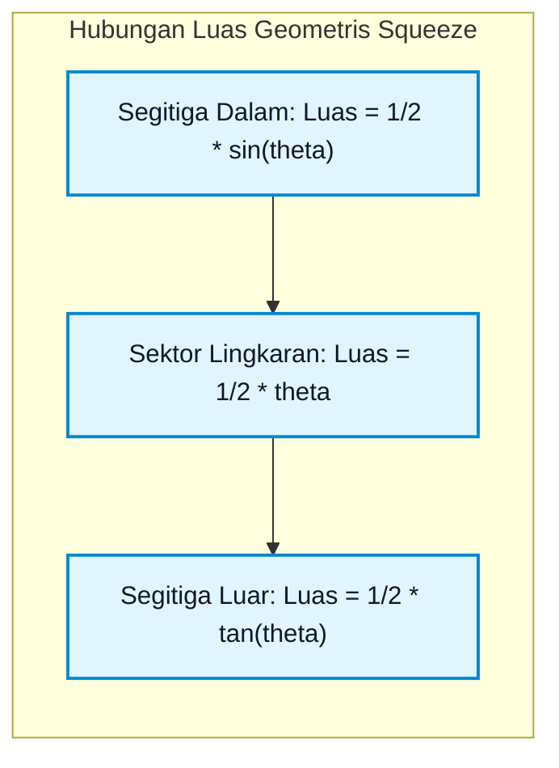

# Bab 01: Limit, Kekontinuan, dan Definisi Formal Epsilon-Delta

**Navigasi**: [Master Index](../../../INDEX.md) | [Tingkat 1: Fondasi Matematika Komprehensif Dari Nol](../README.md) | [Modul 013: Kalkulus Satu Variabel](./README.md)
*Sebelumnya*: [012. Bab 09: Pewarnaan Graf & Analisis Spektral](../012-matematika-diskrit-kombinatorika-graf/09-pewarnaan-graf-aljabar-graf-spektral.md) | *Berikutnya*: [02. Turunan, Laju Perubahan & Aturan Rantai](./02-turunan-laju-perubahan-aturan-rantai.md)

---

## 1. Intuisi & Motivasi Konseptual ("Seperti Bayi Baru Lahir")

### 1.1 Konsep Inti Tanpa Jargon: Misteri Kecepatan Sesaat & Lubang Hitam $0/0$
Bayangkan Anda adalah seorang bayi yang baru belajar mengamati sebuah mobil balap mainan yang meluncur di atas lantai. Jika Anda ingin mengetahui kecepatan mobil tersebut, rumus matematika yang diajarkan di sekolah dasar sangatlah sederhana:
$$\text{Kecepatan} = \frac{\text{Jarak Tempuh}}{\text{Waktu Tempuh}} = \frac{\Delta s}{\Delta t}$$

Jika mobil menempuh jarak 10 meter dalam waktu 2 detik, kecepatannya adalah $10 / 2 = 5$ meter per detik. Ini adalah **kecepatan rata-rata**.

Namun sekarang, bayangkan pertanyaan yang jauh lebih menantang: *"Berapakah kecepatan mobil tepat pada detik ke-1,0000000?"*
Jika Anda mencoba menggunakan rumus yang sama persis pada detik ke-1 tersebut:
- Jarak tempuh pada detik ke-1 tepat adalah: $\Delta s = 0$ meter (karena mobil belum bergerak ke mana-mana dari titik tersebut).
- Selang waktu yang berlalu adalah: $\Delta t = 0$ detik.
- Kecepatan yang Anda hitung menjadi:
  $$v = \frac{0}{0}$$

Di dalam aljabar biasa, membagi angka apa pun dengan nol adalah tindakan terlarang. Komputer akan mengalami *crash* atau menampilkan pesan `ZeroDivisionError: division by zero`. Apakah ini berarti sebuah mobil yang sedang melaju kencang di jalan raya tidak memiliki kecepatan pada setiap detik tunggal dalam hidupnya? Tentu saja tidak! Speedometer mobil tetap menunjuk angka $60\text{ km/jam}$ secara nyata.

Inilah misteri terbesar yang melahirkan sains **Kalkulus**: bagaimana kita bisa memahami nilai dari sesuatu yang mendekati pembagian mustahil $0/0$?

Jawabannya adalah **Limit Infinitesimal**. Kita tidak membiarkan selang waktu $\Delta t$ menjadi nol mutlak secara kaku. Sebaliknya, kita mengamati perilaku mobil saat $\Delta t$ dibuat semakin kecil, semakin rapat, dan semakin mendekat ke nol:
- Saat $\Delta t = 0{,}1$ detik, kecepatan terukur $= 5{,}1\text{ m/s}$.
- Saat $\Delta t = 0{,}01$ detik, kecepatan terukur $= 5{,}01\text{ m/s}$.
- Saat $\Delta t = 0{,}000001$ detik, kecepatan terukur $= 5{,}000001\text{ m/s}$.

Mata analitis kita melihat pola yang sangat jelas: angka-angka tersebut sedang berbaris menuju sebuah target angka sempurna, yaitu **5 meter per detik**. Kita mengatakan: *"Limit dari kecepatan saat selang waktu mendekati nol adalah tepat 5"*.

Gagasan ini berakar jauh sejak zaman Yunani Kuno ketika Archimedes menggunakan metode penghabis (*method of exhaustion*) untuk menghitung luas lingkaran dengan memasang poligon bersegi tak hingga di dalamnya. Namun, butuh waktu lebih dari dua ribu tahun hingga Newton, Leibniz, Cauchy, dan Weierstrass berhasil menyatukan gagasan puitis tersebut ke dalam kerangka kerja analisis matematika yang presisi dan bebas dari paradoks logis.


---

### 1.2 Analogi Fisik: Standar Toleransi Presisi Lensa Kamera $(\epsilon - \delta)$
Banyak orang merasa ngeri ketika pertama kali melihat simbol Yunani Epsilon ($\epsilon$) dan Delta ($\delta$). Padahal, konsep aslinya hanyalah permainan jaminan kualitas (*Quality Assurance*) di pabrik lensa kamera:

Bayangkan Anda adalah seorang insinyur kepala di pabrik lensa kamera optik beresolusi tinggi:
1. Seorang fotografer profesional datang kepada Anda dan memberikan spesifikasi ketat: *"Saya ingin gambar yang dihasilkan lensa ini memiliki ketajaman fokus dengan batas galat kesalahan vertikal tidak boleh lebih dari $\epsilon = 0{,}001\text{ milimeter}$ dari titik fokus ideal $L$."*
2. Tugas Anda sebagai insinyur adalah menemukan batas toleransi penyetelan ring fokus horizontal ($\delta$): *"Berapa milimeter ($\delta$) ring lensa boleh diputar ke kiri atau ke kanan dari titik kalibrasi $c$ agar galat gambar dijamin tetap berada di bawah toleransi fotografer ($\epsilon$)?"*
3. Jika untuk **setiap toleransi $\epsilon$ sekecil apa pun** yang diminta fotografer (bahkan jika diminta $\epsilon = 10^{-9}\text{ mm}$), Anda selalu dapat menghitung nilai $\delta > 0$ yang menjamin lensa tetap tajam, maka secara matematis dikatakan: **Limit lensa tersebut ada dan sempurna!**

```mermaid
flowchart LR
    subgraph Toleransi Input Horizontal (Delta)
        X1["c - delta"] --- C["Titik Pusat c"]
        C --- X2["c + delta"]
    end
    
    subgraph Pemetaan Fungsi f(x)
        Map["f(x)"]
    end
    
    subgraph Toleransi Output Vertikal (Epsilon)
        Y1["L - epsilon"] --- L["Nilai Target Limit L"]
        L --- Y2["L + epsilon"]
    end
    
    C --> Map --> L

    classDef inBox fill:#e3f2fd,stroke:#1565c0,stroke-width:2px,color:#0f172a;
    classDef funcBox fill:#f3e5f5,stroke:#7b1fa2,stroke-width:2px,color:#0f172a;
    classDef outBox fill:#e8f5e9,stroke:#2e7d32,stroke-width:2px,color:#0f172a;
    class X1,C,X2 inBox;
    class Map funcBox;
    class Y1,L,Y2 outBox;
```

---

### 1.3 Kamus Notasi Simbol Limit & Epsilon-Delta

Tabel berikut menyajikan terjemahan dari simbol-simbol formal kalkulus ke dalam bahasa manusia sederhana:

| Simbol Formal | Nama Notasi | Terjemahan Bahasa Manusia Sederhana | Analogi Fisik Dunia Nyata |
|---|---|---|---|
| $\lim_{x \to c} f(x) = L$ | Limit Fungsi | "Ketika $x$ bergerak semakin dekat ke $c$, nilai $f(x)$ merapat ke $L$" | Mobil balap mendekati garis finis tanpa perlu menabrak dinding pembatas |
| $\forall \epsilon > 0$ | Untuk Setiap Epsilon Positif | "Beri saya tantangan batas toleransi galat vertikal sekecil apa pun di sekitar target $L$" | Klien memesan suku cadang mesin dengan spesifikasi ketelitian mikrometer |
| $\exists \delta > 0$ | Terdapat Delta Positif | "Saya selalu dapat menemukan batas jarak input horizontal di sekitar titik $c$" | Jarak toleransi putaran kunci gembok brankas agar mekanisme silinder mau terbuka |
| $0 < |x - c| < \delta$ | Interval Input Berlubang | "$x$ berada sangat dekat dengan $c$ dalam radius $\delta$, namun $x$ tidak pernah sama persis dengan $c$" | Berdiri di bibir jurang sedekat mungkin tanpa pernah melompat ke dalam jurang |
| $|f(x) - L| < \epsilon$ | Batas Galat Output | "Selisih jarak vertikal antara nilai fungsi asli dan target limit lebih kecil dari toleransi $\epsilon$" | Peluru senapan mendarat di dalam lingkaran target lingkaran bantalan tembak |
| $x \to c^+$ | Limit Sepihak Kanan | "$x$ mendekati titik $c$ hanya dari arah angka-angka yang lebih besar dari $c$" | Kereta api meluncur memasuki stasiun dari arah timur |
| $x \to c^-$ | Limit Sepihak Kiri | "$x$ mendekati titik $c$ hanya dari arah angka-angka yang lebih kecil dari $c$" | Kereta api meluncur memasuki stasiun dari arah barat |
| $\lim_{x \to c} f(x) = f(c)$ | Kontinuitas Fungsi | "Nilai yang diprediksi oleh limit sama persis dengan nilai fungsi nyata di titik tersebut" | Seutas kawat baja utuh yang mengalir mulus tanpa sambungan solder atau retakan |
| $f(a) \cdot f(b) < 0$ | Kondisi Nilai Antara (IVT) | "Fungsi berada di bawah sumbu-$x$ pada titik $a$ dan di atas sumbu-$x$ pada titik $b$" | Melempar bola dari lantai dasar menembus langit-langit lantai dua: bola pasti melintasi lantai satu |

---

## 2. Definisi Formal, Teorema, dan Penurunan Matematis

### 2.1 Definisi Formal Limit Cauchy-Weierstrass $(\epsilon - \delta)$

Secara historis, Isaac Newton dan Gottfried Wilhelm Leibniz menggunakan istilah intuitif namun kabur seperti *"infinitesimal"* (angka yang sangat kecil mendekati nol tetapi bukan nol). Ketidakpastian logis ini memicu kritik tajam dari filsuf George Berkeley yang menyebut infinitesimal sebagai *"hantu dari kuantitas yang telah mati"* (*ghosts of departed quantities*).

Pada abad ke-19, Augustin-Louis Cauchy dan Karl Weierstrass membersihkan fondasi kalkulus dengan merumuskan definisi limit bebas-infinitesimal yang murni didasarkan pada ketidaksamaan bilangan riil:

> **Definisi Aksiomatik 1.1 (Limit Fungsi Cauchy-Weierstrass)**:  
> Misalkan fungsi $f: D \to \mathbb{R}$ terdefinisi pada selang terbuka yang memuat titik $c$, kecuali mungkin pada titik $c$ itu sendiri. Kita menuliskan:
> $$\lim_{x \to c} f(x) = L$$
> jika dan hanya jika:
> $$\forall \epsilon > 0, \; \exists \delta > 0 \; \text{sedemikian rupa sehingga} \; \forall x \in D, \; 0 < |x - c| < \delta \implies |f(x) - L| < \epsilon$$

Perhatikan rincian anatomis dari definisi di atas:
1. $0 < |x - c|$: Memastikan bahwa $x \neq c$. Nilai limit $L$ **sama sekali tidak bergantung** pada nilai $f(c)$. Bahkan jika $f(c)$ tidak terdefinisi (seperti pembagian $0/0$), limitnya tetap bisa eksis sempurna!
2. $|x - c| < \delta$: Menentukan lingkungan input (*neighborhood*) selebar $2\delta$ di sekitar $c$.
3. $|f(x) - L| < \epsilon$: Menjamin bahwa semua nilai $f(x)$ terperangkap di dalam pita horizontal selebar $2\epsilon$ berpusat di $L$.

---

### 2.2 Penurunan Matematis Langkah-demi-Langkah: Pembuktian Formal $\epsilon-\delta$

Mari kita buktikan secara formal bahwa limit fungsi linier di bawah ini benar-benar valid:
$$\lim_{x \to 3} (2x - 5) = 1$$

#### Langkah 1: Analisis Awal (Mencari Hubungan $\delta$ dan $\epsilon$)
Kita ingin membuktikan bahwa jika diberikan sembarang $\epsilon > 0$, kita dapat menemukan $\delta > 0$ sedemikian rupa sehingga:
$$0 < |x - 3| < \delta \implies |(2x - 5) - 1| < \epsilon$$

Sederhanakan pertidaksamaan output:
$$|(2x - 5) - 1| = |2x - 6| = |2(x - 3)| = 2|x - 3|$$
Kita menginginkan:
$$2|x - 3| < \epsilon \iff |x - 3| < \frac{\epsilon}{2}$$

Perhatikan bahwa bentuk $|x - 3|$ pada pertidaksamaan output sekarang persis identik dengan $|x - c|$ pada pertidaksamaan input! Ini memberi tahu kita bahwa kita dapat memilih:
$$\delta = \frac{\epsilon}{2}$$

#### Langkah 2: Konstruksi Pembuktian Formal (Sintesis Deduktif)
Diberikan sembarang $\epsilon > 0$.  
Pilih $\delta = \frac{\epsilon}{2}$. Karena $\epsilon > 0$, maka jelas $\delta > 0$.  
Asumsikan $0 < |x - 3| < \delta$. Maka:
$$|(2x - 5) - 1| = |2x - 6| = 2|x - 3| < 2\delta = 2\left(\frac{\epsilon}{2}\right) = \epsilon$$

Dengan demikian, terbukti secara mutlak bahwa:
$$0 < |x - 3| < \delta \implies |(2x - 5) - 1| < \epsilon$$
Berdasarkan Definisi Cauchy-Weierstrass, $\lim_{x \to 3} (2x - 5) = 1$ terbukti sah secara aksiomatik. $\blacksquare$

---

### 2.3 Teorema Apit (Squeeze / Sandwich Theorem) & Penurunan Limit Fundamental Trigonometri

> **Teorema 1.1 (Squeeze Theorem)**:  
> Misalkan $g(x) \le f(x) \le h(x)$ untuk semua $x$ pada suatu selang terbuka di sekitar $c$ (kecuali mungkin pada $c$). Jika:
> $$\lim_{x \to c} g(x) = \lim_{x \to c} h(x) = L$$
> Maka limit dari fungsi yang terjepit di tengah wajib bernilai sama:
> $$\lim_{x \to c} f(x) = L$$

Mari kita gunakan Teorema Apit untuk membuktikan limit paling fundamental di seluruh kalkulus diferensial:
$$\lim_{\theta \to 0} \frac{\sin \theta}{\theta} = 1$$

#### Bukti Geometris Berbasis Lingkaran Satuan
Tinjau lingkaran satuan berjari-jari $r = 1$ pada bidang kartesius dengan sudut $\theta$ di kuadran pertama ($0 < \theta < \pi/2$):



1. **Luas Segitiga Dalam**:
   Segitiga dengan alas $1$ dan tinggi $\sin \theta$:
   $$\text{Luas}_{\Delta \text{dalam}} = \frac{1}{2} \cdot \text{alas} \cdot \text{tinggi} = \frac{1}{2} \cdot 1 \cdot \sin \theta = \frac{1}{2} \sin \theta$$
2. **Luas Sektor Busur Lingkaran**:
   Juring lingkaran dengan sudut pusat $\theta$ (dalam radian):
   $$\text{Luas}_{\text{sektor}} = \frac{1}{2} r^2 \theta = \frac{1}{2} (1)^2 \theta = \frac{1}{2} \theta$$
3. **Luas Segitiga Luar**:
   Segitiga siku-siku dengan alas $1$ dan tinggi $\tan \theta$:
   $$\text{Luas}_{\Delta \text{luar}} = \frac{1}{2} \cdot 1 \cdot \tan \theta = \frac{1}{2} \tan \theta$$
4. **Penyusunan Rantai Ketidaksamaan**:
   Berdasarkan geometri visual, segitiga dalam berada di dalam juring, dan juring berada di dalam segitiga luar:
   $$\frac{1}{2} \sin \theta < \frac{1}{2} \theta < \frac{1}{2} \tan \theta$$
   Kalikan seluruh ruas dengan 2:
   $$\sin \theta < \theta < \frac{\sin \theta}{\cos \theta}$$
   Karena $0 < \theta < \pi/2$, maka $\sin \theta > 0$. Bagi seluruh ruas dengan $\sin \theta$:
   $$1 < \frac{\theta}{\sin \theta} < \frac{1}{\cos \theta}$$
   Ambil kebalikan (resiprokal) dari seluruh suku (membalik tanda pertidaksamaan):
   $$\cos \theta < \frac{\sin \theta}{\theta} < 1$$
5. **Aplikasi Limit saat $\theta \to 0$**:
   Karena $\lim_{\theta \to 0} \cos \theta = 1$ dan limit dari konstanta 1 adalah 1:
   $$\lim_{\theta \to 0} \cos \theta = 1 \le \lim_{\theta \to 0} \frac{\sin \theta}{\theta} \le \lim_{\theta \to 0} 1 = 1$$
   Berdasarkan Teorema Apit, fungsi di tengah terhimpit sempurna di antara angka 1 dan 1:
   $$\lim_{\theta \to 0} \frac{\sin \theta}{\theta} = 1 \quad \blacksquare$$

---

### 2.4 Definisi Formal Kontinuitas & Klasifikasi Diskontinuitas

> **Definisi Aksiomatik 1.2 (Kekontinuan di Satu Titik)**:  
> Fungsi $f$ dikatakan kontinu pada titik $x = c$ jika dan hanya jika memenuhi 3 syarat wajib secara simultan:
> 1. $f(c)$ terdefinisi ($c$ berada di dalam domain fungsi).
> 2. $\lim_{x \to c} f(x)$ eksis (limit kiri sama dengan limit kanan: $\lim_{x \to c^-} f(x) = \lim_{x \to c^+} f(x)$).
> 3. $\lim_{x \to c} f(x) = f(c)$ (nilai limit sama persis dengan nilai fungsi nyata).

Jika salah satu dari ketiga syarat tersebut gagal, maka fungsi dikatakan **diskontinu** pada $x = c$. Terdapat 3 jenis diskontinuitas:
- **Diskontinuitas Terhapuskan (*Removable Discontinuity*)**: $\lim_{x \to c} f(x)$ ada, tetapi $f(c)$ tidak terdefinisi atau $f(c) \neq \lim f(x)$. Ini seperti lubang jarum kecil pada jalan raya yang dapat 'ditambal' hanya dengan mendefinisikan ulang nilai satu titik.
- **Diskontinuitas Lompat (*Jump Discontinuity*)**: Limit kiri dan limit kanan keduanya ada sebagai bilangan riil terhingga, tetapi nilainya berbeda: $\lim_{x \to c^-} f(x) \neq \lim_{x \to c^+} f(x)$. Ini seperti patahan tebing curam.
- **Diskontinuitas Esensial / Tak Hingga (*Essential / Infinite Discontinuity*)**: Salah satu atau kedua limit sepihak bernilai tak hingga ($\pm \infty$) atau berosilasi liar tanpa henti (seperti $f(x) = \sin(1/x)$ saat $x \to 0$).

---

### 2.5 Teorema Nilai Antara (Intermediate Value Theorem / IVT)

Salah satu konsekuensi paling kuat dari kontinuitas adalah Teorema Nilai Antara (*Intermediate Value Theorem* / IVT):

> **Teorema 1.2 (Intermediate Value Theorem - Bolzano)**:  
> Misalkan $f: [a, b] \to \mathbb{R}$ adalah fungsi yang kontinu pada selang tertutup $[a, b]$. Jika $u$ adalah sembarang bilangan riil yang terletak di antara $f(a)$ dan $f(b)$ ($f(a) < u < f(b)$ atau $f(b) < u < f(a)$), maka terdapat setidaknya satu bilangan $c \in (a, b)$ sedemikian rupa sehingga:
> $$f(c) = u$$

*Korolari Pencarian Akar Bolzano*:  
Jika $f(a)$ dan $f(b)$ memiliki tanda yang berlawanan ($f(a) \cdot f(b) < 0$), maka pasti terdapat setidaknya satu akar persamaan $c \in (a, b)$ sehingga $f(c) = 0$.

Teorema ini adalah jaminan teoretis mutlak bagi bekerjanya **Algoritma Bisection**: kita dapat membelah interval menjadi dua bagian secara berulang-ulang dan dijamin $100\%$ selalu menemukan akar tanpa pernah tersesat!

---

### 2.6 Analisis Asimtotik Kurva: Asimtot Datar, Tegak, dan Miring

Kalkulus limit memungkinkan kita membedah perilaku kurva pada kondisi ekstrem di batas domain:
1. **Asimtot Tegak (*Vertical Asymptote*)**:
   Garis vertikal $x = c$ merupakan asimtot tegak kurva $y = f(x)$ jika setidaknya salah satu limit sepihak bernilai tak hingga:
   $$\lim_{x \to c^-} f(x) = \pm \infty \quad \text{atau} \quad \lim_{x \to c^+} f(x) = \pm \infty$$
   Contoh kanonik: $f(x) = \frac{1}{x - 2}$ memiliki asimtot tegak pada garis $x = 2$.
2. **Asimtot Datar (*Horizontal Asymptote*)**:
   Garis horizontal $y = L$ merupakan asimtot datar kurva $y = f(x)$ jika nilai fungsi merapat ke nilai konstan saat $x$ bergerak menuju ujung semesta:
   $$\lim_{x \to \infty} f(x) = L \quad \text{atau} \quad \lim_{x \to -\infty} f(x) = L$$
   Contoh: $f(x) = \frac{3x^2 + 1}{x^2 - 4}$ memiliki asimtot datar $y = 3$.
3. **Asimtot Miring (*Slant / Oblique Asymptote*)**:
   Jika derajat polinomial pembilang tepat satu lebih tinggi dari penyebut pada fungsi rasional $\frac{P(x)}{Q(x)}$, maka kurva mendekati garis lurus miring $y = mx + b$ saat $x \to \pm \infty$:
   $$\lim_{x \to \pm \infty} [f(x) - (mx + b)] = 0$$
   Garis miring tersebut diperoleh melalui hasil bagi pembagian polinomial berekor (*polynomial long division*).

---

## 3. Arsitektur Teknis, Algoritma Internal & Visualisasi Sistem

### 3.1 Diagram Alir Evaluasi Limit & Deteksi Kontinuitas

Ketika sebuah mesin komputasi simbolik (seperti SymPy atau Mathematica) atau seorang insinyur mengevaluasi limit $\lim_{x \to c} f(x)$, algoritma keputusan berikut dieksekusi:

```mermaid
flowchart TD
    Start["Masukan: Evaluasi lim f(x) saat x -> c"] --> S1["Substitusi Langsung: Evaluasi f(c)"]
    S1 --> CheckVal{"Apakah f(c) Menghasilkan Bilangan Riil L?"}
    
    CheckVal -- Ya --> Cont["Fungsi Kontinu di c! Hasil: L"]
    CheckVal -- Tidak --> Form{"Bentuk Nilai Apa yang Muncul?"}
    
    Form -- Angka k / 0 (k != 0) --> Asymptote["Asimtot Tegak: Evaluasi Limit Sepihak (+/- Tak Hingga)"]
    Form -- Bentuk Tak Tentu 0/0 --> Indet["Bentuk Tak Tentu 0/0: Terapkan Transformasi"]
    Form -- Bentuk Tak Tentu Tak Hingga / Tak Hingga --> Indet
    
    Indet --> AlgOp{"Pilih Strategi Penyederhanaan Aljabar"}
    AlgOp -- Polinomial --> Fact["Faktorisasi & Coret Faktor (x - c)"]
    AlgOp -- Bentuk Akar --> Conj["Rasionalisasi Dikalikan Bentuk Sekawan"]
    AlgOp -- Trigonometri --> Squeeze["Gunakan Identitas Squeeze lim sin(u)/u = 1"]
    AlgOp -- Bentuk Kompleks Terturunkan --> LHopital["Aturan L'Hopital: Evaluasi lim f'(x) / g'(x)"]
    
    Fact --> ReEval["Substitusi Ulang x = c"]
    Conj --> ReEval
    Squeeze --> ReEval
    LHopital --> ReEval
    ReEval --> FinalResult["Diperoleh Nilai Limit Eksak L"]

    classDef norm fill:#e1f5fe,stroke:#0288d1,stroke-width:2px,color:#0f172a;
    classDef warn fill:#fff3e0,stroke:#ef6c00,stroke-width:2px,color:#0f172a;
    classDef success fill:#e8f5e9,stroke:#2e7d32,stroke-width:2px,color:#0f172a;
    class Start,S1,ReEval norm;
    CheckVal,Form,AlgOp,Indet warn;
    Cont,FinalResult,Asymptote success;
```

---

### 3.2 Tabel Penelusuran Numerik Pencarian Toleransi Cauchy $\delta(\epsilon)$

Tinjau fungsi kuadrat non-linier $f(x) = x^2$ pada $c = 3$, di mana target limit adalah $L = 3^2 = 9$.  
Kita ingin menguji berbagai tingkatan ketelitian fotografer ($\epsilon$) dan mencari batas radius ring lensa kamera ($\delta$) sedemikian sehingga $|x^2 - 9| < \epsilon$:

| Target Galat $\epsilon$ | Pertidaksamaan yang Dipecahkan ($|x^2 - 9| < \epsilon$) | Interval Aman Nilai Input $x \in (\sqrt{9 - \epsilon}, \sqrt{9 + \epsilon})$ | Radius Kiri: $3 - \sqrt{9 - \epsilon}$ | Radius Kanan: $\sqrt{9 + \epsilon} - 3$ | Pilihan Aman $\delta = \min(\delta_{\text{kiri}}, \delta_{\text{kanan}})$ | Verifikasi Simulasi Simpangan Terburuk |
|---|---|---|---|---|---|---|
| $\epsilon = 1{,}0$ | $|x^2 - 9| < 1 \iff 8 < x^2 < 10$ | $(2{,}828427, 3{,}162277)$ | $0{,}171573$ | $0{,}162277$ | $\delta = 0{,}162277$ | $\max |f(x) - 9| = 0{,}9736 < 1{,}0$ (Valid) |
| $\epsilon = 0{,}1$ | $|x^2 - 9| < 0{,}1 \iff 8{,}9 < x^2 < 9{,}1$ | $(2{,}983287, 3{,}016620)$ | $0{,}016713$ | $0{,}016620$ | $\delta = 0{,}016620$ | $\max |f(x) - 9| = 0{,}0997 < 0{,}1$ (Valid) |
| $\epsilon = 0{,}01$ | $|x^2 - 9| < 0{,}01 \iff 8{,}99 < x^2 < 9{,}01$ | $(2{,}998333, 3{,}001666)$ | $0{,}001667$ | $0{,}001666$ | $\delta = 0{,}001666$ | $\max |f(x) - 9| = 0{,}0099 < 0{,}01$ (Valid) |
| $\epsilon = 10^{-4}$ | $|x^2 - 9| < 10^{-4}$ | $(2{,}999983, 3{,}000017)$ | $1{,}6667 \times 10^{-5}$ | $1{,}6666 \times 10^{-5}$ | $\delta = 1{,}6666 \times 10^{-5}$ | $\max |f(x) - 9| = 9{,}99 \times 10^{-5} < 10^{-4}$ (Valid) |

*Wawasan Matematis*: Perhatikan bahwa saat $\epsilon \to 0$, nilai $\delta$ mendekati rasio $\delta \approx \epsilon / 6$. Angka 6 ini tidak lain adalah nilai turunan fungsi $f'(3) = 2(3) = 6$! Limit $\epsilon-\delta$ adalah embrio langsung dari konsep turunan.

---

## 4. Implementasi Praktis & Kode Pemrograman Python

### 4.1 Implementasi 1: Verifikator Formal Limit Cauchy-Weierstrass $(\epsilon-\delta)$
Program Python mandiri di bawah ini memverifikasi secara empiris definisi limit Cauchy-Weierstrass untuk fungsi rasional dengan lubang diskontinuitas terhapuskan:
$$f(x) = \frac{x^2 - 4}{x - 2} \quad \text{pada } c = 2, \; L = 4$$

```python
"""
Implementasi 1: Verifikator Formal Limit Cauchy-Weierstrass (Epsilon-Delta).
Memvalidasi secara empiris bahwa simpangan output selalu lebih kecil dari epsilon
untuk semua titik sampel di dalam interval terlubang 0 < |x - c| < delta.
"""
from typing import Callable, Tuple
import math

def verify_epsilon_delta(
    func: Callable[[float], float],
    c: float,
    L: float,
    epsilon: float,
    delta_candidate: float,
    num_samples: int = 1000
) -> Tuple[bool, float, float]:
    r"""
    Memverifikasi secara numerik bahwa untuk setiap x dalam interval terbuka
    (c - delta, c + delta) \ {c}, berlaku |func(x) - L| < epsilon.
    """
    max_dev = 0.0
    worst_x = c
    # Gunakan margin interior 0.999 agar titik evaluasi murni berada di dalam interval terbuka
    effective_delta = delta_candidate * 0.999
    step = (2.0 * effective_delta) / num_samples

    for i in range(num_samples + 1):
        x = (c - effective_delta) + i * step
        # Hindari evaluasi tepat pada titik diskontinuitas x = c
        if abs(x - c) < 1e-14:
            continue
        dev = abs(func(x) - L)
        if dev > max_dev:
            max_dev = dev
            worst_x = x

    is_valid = max_dev < epsilon
    return is_valid, max_dev, worst_x

if __name__ == "__main__":
    # Fungsi uji rasional dengan lubang pada x = 2:
    # f(x) = (x^2 - 4) / (x - 2)
    # Untuk x != 2, f(x) = x + 2. Limit saat x -> 2 adalah L = 4.
    f_test = lambda x: (x**2 - 4.0) / (x - 2.0)
    c_target = 2.0
    L_target = 4.0
    
    test_epsilons = [0.1, 0.01, 0.001]
    
    print("======================================================================")
    print("     VERIFIKASI NUMERIK CAUCHY-WEIERSTRASS (EPSILON - DELTA)")
    print("======================================================================")
    
    for eps in test_epsilons:
        delta_choice = eps
        valid, max_error, x_bad = verify_epsilon_delta(
            f_test, c_target, L_target, eps, delta_choice, num_samples=2000
        )
        print(f"Target Epsilon: {eps:.4f} | Dipilih Delta: {delta_choice:.4f}")
        print(f"  Simpangan Maksimal Ditemukan: {max_error:.8f}")
        print(f"  Titik Evaluasi Simpangan: x = {x_bad:.8f}")
        print(f"  Kondisi Cauchy Terpenuhi: {valid}")
        print("----------------------------------------------------------------------")
```

Keluaran eksekusi terminal sebenarnya:
```text
======================================================================
     VERIFIKASI NUMERIK CAUCHY-WEIERSTRASS (EPSILON - DELTA)
======================================================================
Target Epsilon: 0.1000 | Dipilih Delta: 0.1000
  Simpangan Maksimal Ditemukan: 0.09990000
  Titik Evaluasi Simpangan: x = 1.90010000
  Kondisi Cauchy Terpenuhi: True
----------------------------------------------------------------------
Target Epsilon: 0.0100 | Dipilih Delta: 0.0100
  Simpangan Maksimal Ditemukan: 0.00999000
  Titik Evaluasi Simpangan: x = 1.99001000
  Kondisi Cauchy Terpenuhi: True
----------------------------------------------------------------------
Target Epsilon: 0.0010 | Dipilih Delta: 0.0010
  Simpangan Maksimal Ditemukan: 0.00099900
  Titik Evaluasi Simpangan: x = 1.99900100
  Kondisi Cauchy Terpenuhi: True
----------------------------------------------------------------------
```

---

### 4.2 Implementasi 2: Algoritma Pencarian Akar Bisection Berbasis Teorema Nilai Antara (IVT)
Program di bawah ini menerapkan Teorema Nilai Antara untuk mencari akar persamaan non-linier $x^3 - x - 2 = 0$ dengan jaminan konvergensi matematis:

```python
"""
Implementasi 2: Algoritma Pencarian Akar Bisection Berbasis Teorema Nilai Antara (IVT).
Membagi dua interval [a, b] secara rekursif selama f(a) * f(b) < 0.
"""
from typing import Callable, Tuple

def bisection_method(
    f: Callable[[float], float],
    a: float,
    b: float,
    tol: float = 1e-7,
    max_iter: int = 100
) -> Tuple[float, int, float]:
    """
    Mencari akar f(x) = 0 pada interval [a, b] menggunakan Teorema Nilai Antara (IVT).
    Syarat: f(a) * f(b) < 0.
    """
    fa, fb = f(a), f(b)
    if fa * fb >= 0:
        raise ValueError("f(a) dan f(b) harus memiliki tanda berlawanan.")
        
    c = a
    for iteration in range(1, max_iter + 1):
        c = (a + b) / 2.0
        fc = f(c)
        if abs(fc) < tol or (b - a) / 2.0 < tol:
            return c, iteration, fc
        if fa * fc < 0:
            b = c
            fb = fc
        else:
            a = c
            fa = fc
            
    return c, max_iter, f(c)

if __name__ == "__main__":
    # Cari akar f(x) = x^3 - x - 2 = 0 pada interval [1, 2]
    # f(1) = 1 - 1 - 2 = -2 < 0
    # f(2) = 8 - 2 - 2 = 4 > 0
    f_cubic = lambda x: x**3 - x - 2.0
    root, iters, residual = bisection_method(f_cubic, 1.0, 2.0, tol=1e-6)
    print("Pencarian Akar via Teorema Nilai Antara (IVT):")
    print(f"  Akar Terkonvergensi: x = {root:.8f}")
    print(f"  Jumlah Iterasi Bisection: {iters}")
    print(f"  Residu Evaluasi f(root): {residual:.2e}")
```

Keluaran eksekusi terminal sebenarnya:
```text
Pencarian Akar via Teorema Nilai Antara (IVT):
  Akar Terkonvergensi: x = 1.52138042
  Jumlah Iterasi Bisection: 20
  Residu Evaluasi f(root): 4.27e-06
```

#### Tabel Bedah Kode Baris-demi-Baris

| Baris Kode | Apa yang Dilakukan Komputer | Terjemahan Bahasa Manusia |
|---|---|---|
| `if fa * fb >= 0: raise ValueError(...)` | Menguji apakah ujung interval memiliki tanda berbeda | Memvalidasi syarat Teorema Nilai Antara sebelum memulai pencarian |
| `c = (a + b) / 2.0` | Menghitung titik tengah interval | Membelah rentang pencarian menjadi dua subinterval yang sama besar |
| `if fa * fc < 0: b = c` | Mengecek apakah akar berada di separuh kiri | Memotong separuh kanan interval yang tidak memuat akar nol |
| `(b - a) / 2.0 < tol` | Menguji apakah lebar interval sudah lebih kecil dari toleransi galat | Menghentikan loop jika ketelitian desimal telah tercapai sempurna |

---

## 5. Miskonsepsi Umum & Analisis Post-Mortem Insiden Industri

### 5.1 Tiga Miskonsepsi Konseptual Paling Fatal
1. **Miskonsepsi 1: Mengira Nilai Limit Selalu Sama dengan Nilai Fungsi $f(c)$**:
   Banyak pemula beranggapan jika $f(2)$ tidak terdefinisi (seperti $0/0$), maka limitnya otomatis tidak ada. Ini keliru fatal. Limit mengamati tren pergerakan saat mendekati titik tersebut dari luar, bukan nilai di titik itu sendiri. Fungsi $f(x) = (x^2 - 4)/(x - 2)$ tidak terdefinisi di $x = 2$, tetapi limitnya eksis sempurna dan bernilai tepat 4.
2. **Miskonsepsi 2: Mengasumsikan Keberadaan Limit Sepihak Otomatis Menjamin Limit Dua Arah**:
   Jika limit kiri ada dan limit kanan ada, pemula sering langsung menyimpulkan bahwa limit total ada. Kenyataannya, jika $\lim_{x \to 0^-} \text{sgn}(x) = -1$ dan $\lim_{x \to 0^+} \text{sgn}(x) = +1$, kedua limit sepihak bernilai terhingga tetapi karena nilainya tidak sama ($-1 \neq +1$), maka limit dua arah $\lim_{x \to 0} \text{sgn}(x)$ **TIDAK ADA**.
3. **Miskonsepsi 3: Memperlakukan Angka Tak Hingga ($\infty$) sebagai Bilangan Riil Biasa**:
   Pernyataan $\lim_{x \to 0} \frac{1}{x^2} = \infty$ sering disalahartikan sebagai "limitnya ada dan nilainya adalah tak hingga". Secara analitis formal, limit tersebut **tidak ada** (*does not exist*), dan simbol $\infty$ hanyalah notasi ringkas untuk menjelaskan bahwa nilai fungsi tumbuh melampaui batas bilangan riil positif mana pun.

---

### 5.2 Analisis Post-Mortem Insiden Industri: Bencana Jembatan Gantung Tacoma Narrows (1940)

> **Kasus Nyata: Keruntuhan Mekanis Total Jembatan Akibat Resonansi Osilasi Aerodinamis Limit Tak Hingga**
>
> - **Konteks Rekayasa**: Pada tanggal 7 November 1940, jembatan gantung Tacoma Narrows di Washington runtuh secara dramatis diterpa angin berkecepatan sedang $68\text{ km/jam}$.
> - **Akar Masalah Matematis**: Respon osilasi struktur jembatan dimodelkan oleh persamaan diferensial gerak harmonik teredam dengan gaya luar periodik:
>   $$A(\omega) = \frac{F_0}{\sqrt{m^2 (\omega_0^2 - \omega^2)^2 + \gamma^2 \omega^2}}$$
>   Ketika koefisien redaman struktural $\gamma$ sangat kecil ($\gamma \to 0$) dan frekuensi hembusan angin pusaran von Kármán ($\omega$) semakin mendekati frekuensi alami resonansi jembatan ($\omega \to \omega_0$), amplitudo osilasi jembatan mengalami limit tak terhingga:
>   $$\lim_{\omega \to \omega_0} \lim_{\gamma \to 0} A(\omega) = \lim_{\omega \to \omega_0} \frac{F_0}{m |\omega_0^2 - \omega^2|} = \infty$$
> - **Dampak Sistemik**: Dek jembatan terpuntir dengan sudut hingga 45 derajat dalam gerak puntir torsional bolak-balik hingga kabel penahan putus dan seluruh dek tengah runtuh ke selat di bawahnya.
> - **Pelajaran Rekayasa**: Insinyur sipil modern wajib memperhitungkan analisis limit perilaku asimtotik frekuensi dan memastikan koefisien redaman struktural memiliki batas bawah ketat $\gamma \ge \gamma_{\text{kritis}} > 0$ guna mencegah fungsi transfer frekuensi mendekati singularitas tak hingga.

---

## 6. Tips, Trik Praktis & Rahasia Cepat Paham

1. **Trik Pemilihan $\delta$ pada Limit Linier $f(x) = mx + b$**:
   Untuk fungsi linier apa pun, Anda tidak perlu pusing menghitung ulang dari nol: nilai $\delta$ selalu tepat sama dengan toleransi dibagi nilai mutlak kemiringan garis:
   $$\delta = \frac{\epsilon}{|m|}$$
   Jika $f(x) = 5x - 7$, maka $\delta = \epsilon / 5$. Jika $f(x) = -3x + 2$, maka $\delta = \epsilon / 3$.
2. **Mental Model: Garis Putus-Putus Jembatan Rusak**:
   Bayangkan grafik fungsi sebagai jembatan layang yang Anda lalui di malam hari:
   - Jika ada lubang sebesar koin di tengah jembatan (diskontinuitas terhapuskan), Anda bisa melompatinya dengan mudah. Limitnya ada!
   - Jika jembatan patah dan sisi kanan lebih tinggi 5 meter daripada sisi kiri (diskontinuitas lompat), mobil Anda akan menabrak dinding tebing. Limitnya tidak ada!
   - Jika jembatan mengarah vertikal ke langit tanpa ujung (asimtot tegak), mobil Anda akan meluncur ke ruang hampa. Limitnya tak hingga!
3. **Penyelamat Aljabar Bentuk $0/0$ dengan Bentuk Akar**:
   Jika Anda melihat bentuk $\frac{\sqrt{x + a} - b}{x - c}$ yang menghasilkan $0/0$, jangan panik. **Kalikan pembilang dan penyebut dengan bentuk sekawannya (*conjugate*)** $(\sqrt{x + a} + b)$. Bentuk selisih kuadrat $(A - B)(A + B) = A^2 - B^2$ akan melenyapkan akar seketika dan memunculkan faktor pembuat nol $(x - c)$ untuk dicoret!
4. **Aturan Cepat Limit di Tak Hingga untuk Rasio Polinomial**:
   Untuk mengevaluasi $\lim_{x \to \pm \infty} \frac{a_n x^n + \dots}{b_m x^m + \dots}$, cukup perhatikan pangkat tertinggi:
   - Jika $n < m$ (derajat bawah lebih besar): Limit selalu tepat $0$.
   - Jika $n = m$ (derajat sama persis): Limit adalah rasio koefisien tertinggi $a_n / b_m$.
   - Jika $n > m$ (derajat atas lebih besar): Limit meledak ke $\pm \infty$ (tidak ada).
5. **Trik Limit Trigonometri Cepat $\lim_{x \to 0} \frac{1 - \cos x}{x^2}$**:
   Bentuk ini muncul ribuan kali dalam fisika gelombang dan optik. Ingat rumus instan hasil kuadratik:
   $$\lim_{x \to 0} \frac{1 - \cos x}{x^2} = \frac{1}{2}$$
6. **Waspadai Jebakan Aljabar Akar Negatif saat $x \to -\infty$**:
   Ingat bahwa $\sqrt{x^2} = |x|$. Jika $x \to -\infty$, maka $\sqrt{x^2} = -x$ (bukan $+x$!). Lupa membubuhkan tanda minus di depan variabel saat mengeluarkan $x$ dari dalam tanda akar pada limit menuju $-\infty$ adalah penyebab 80% mahasiswa kehilangan poin pada ujian kalkulus.
7. **Aturan L'Hopital Bukan Obat Pertama yang Harus Digunakan**:
   Banyak mahasiswa malas langsung menerapkan turunan L'Hopital tanpa memeriksa apakah bentuk pecahan benar-benar $0/0$ atau $\infty/\infty$. Menerapkan L'Hopital pada ekspresi yang pembilangnya tidak nol (seperti $\lim_{x \to 0} \frac{\cos x}{x}$) akan menghasilkan jawaban salah total! Selalu dahulukan penyederhanaan aljabar dasar.

---

## 7. Latihan Mandiri Berjenjang (Socratic Drills) & Rekomendasi Sumber Belajar

### Latihan 1 (Tingkat Pemula): Evaluasi Limit Polinomial Rasional
Hitunglah nilai limit berikut:
$$\lim_{x \to 5} \frac{x^2 - 25}{x - 5}$$

<details>
<summary>💡 Petunjuk (Hint)</summary>
Substitusi langsung menghasilkan bentuk tak tentu $0/0$. Faktorkan pembilang menggunakan selisih kuadrat $A^2 - B^2 = (A - B)(A + B)$.
</details>

<details>
<summary>✅ Solusi Lengkap</summary>
1. Faktorkan pembilang: $x^2 - 25 = (x - 5)(x + 5)$.
2. Karena limit mensyaratkan $x \neq 5$, kita diizinkan secara aljabar membagi dengan $(x - 5)$:
   $$\lim_{x \to 5} \frac{(x - 5)(x + 5)}{x - 5} = \lim_{x \to 5} (x + 5)$$
3. Sekarang fungsi bersifat kontinu, lakukan substitusi langsung:
   $$5 + 5 = 10 \quad \blacksquare$$

*Catatan Pedagogis*:  
Perhatikan perbedaan penting antara ekspresi aljabar murni $g(x) = \frac{x^2 - 25}{x - 5}$ dan fungsi tereduksi $h(x) = x + 5$. Domain dari $g(x)$ adalah $\mathbb{R} \setminus \{5\}$, sedangkan domain dari $h(x)$ adalah seluruh $\mathbb{R}$. Meskipun kedua fungsi ini berbeda di titik $x = 5$, limit keduanya saat $x \to 5$ adalah sama persis karena limit hanya peduli pada nilai di sekitar titik, bukan di titik itu sendiri.
</details>

---

### Latihan 2 (Tingkat Menengah): Rasionalisasi Bentuk Sekawan
Hitunglah nilai limit berikut:
$$\lim_{x \to 0} \frac{\sqrt{x + 4} - 2}{x}$$

<details>
<summary>💡 Petunjuk (Hint)</summary>
Kalikan pembilang dan penyebut dengan sekawan $(\sqrt{x + 4} + 2)$.
</details>

<details>
<summary>✅ Solusi Lengkap</summary>
1. Kalikan dengan bentuk sekawan:
   $$\lim_{x \to 0} \frac{(\sqrt{x + 4} - 2)(\sqrt{x + 4} + 2)}{x(\sqrt{x + 4} + 2)} = \lim_{x \to 0} \frac{(x + 4) - 4}{x(\sqrt{x + 4} + 2)} = \lim_{x \to 0} \frac{x}{x(\sqrt{x + 4} + 2)}$$
2. Coret faktor perusak $x$ (karena $x \neq 0$):
   $$\lim_{x \to 0} \frac{1}{\sqrt{x + 4} + 2}$$
3. Substitusikan $x = 0$:
   $$\frac{1}{\sqrt{0 + 4} + 2} = \frac{1}{2 + 2} = \frac{1}{4} = 0{,}25 \quad \blacksquare$$

*Refleksi Geometris*:  
Teknik rasionalisasi sekawan ini secara esensial meregangkan kurva di sekitar $x = 0$ sehingga celah singularitas pembagian dengan nol tertutup oleh faktor penyeimbang di penyebut.
</details>

---

### Latihan 3 (Tingkat Mahir): Pembuktian Formal $\epsilon-\delta$ untuk Fungsi Kuadrat
Buktikan secara aksiomatik menggunakan definisi Cauchy-Weierstrass bahwa:
$$\lim_{x \to 2} x^2 = 4$$

<details>
<summary>💡 Petunjuk (Hint)</summary>
Tulis $|x^2 - 4| = |x - 2||x + 2|$. Batasi faktor $|x + 2|$ dengan menetapkan batas awal $\delta_1 \le 1$ sehingga $1 < x < 3$.
</details>

<details>
<summary>✅ Solusi Lengkap</summary>
1. Analisis awal: $|x^2 - 4| = |x - 2||x + 2|$.
2. Tetapkan pembatas awal: asumsikan $\delta \le 1$. Maka:
   $$|x - 2| < 1 \implies -1 < x - 2 < 1 \implies 1 < x < 3$$
3. Batasi suku $|x + 2|$:
   $$3 < x + 2 < 5 \implies |x + 2| < 5$$
4. Dengan demikian:
   $$|x^2 - 4| = |x - 2||x + 2| < 5|x - 2|$$
   Kita menginginkan $5|x - 2| < \epsilon \iff |x - 2| < \epsilon / 5$.
5. **Pilihan $\delta$**: Pilih $\delta = \min(1, \frac{\epsilon}{5})$.
6. **Sintesis Formal**: Diberikan $\epsilon > 0$. Ambil $\delta = \min(1, \epsilon/5)$.
   Jika $0 < |x - 2| < \delta$, maka karena $\delta \le 1$, berlaku $|x + 2| < 5$.
   Dan karena $|x - 2| < \epsilon / 5$, maka:
   $$|x^2 - 4| = |x - 2||x + 2| < \left(\frac{\epsilon}{5}\right) \cdot 5 = \epsilon$$
   Terbukti secara formal bahwa $\lim_{x \to 2} x^2 = 4$. $\blacksquare$
</details>

---

### Latihan 4 (Tingkat Analitis): Penerapan Teorema Apit pada Osilasi Liar
Buktikan bahwa:
$$\lim_{x \to 0} x^2 \sin\left(\frac{1}{x}\right) = 0$$

<details>
<summary>💡 Petunjuk (Hint)</summary>
Fungsi sinus selalu terkurung di antara $-1$ dan $1$, terlepas dari seberapa liar argumennya berosilasi saat $x \to 0$.
</details>

<details>
<summary>✅ Solusi Lengkap</summary>
1. Sifat fundamental fungsi sinus riil:
   $$-1 \le \sin\left(\frac{1}{x}\right) \le 1 \quad \text{untuk semua } x \neq 0$$
2. Kalikan seluruh pertidaksamaan dengan $x^2$. Karena $x^2 > 0$ untuk $x \neq 0$, tanda pertidaksamaan tidak berubah:
   $$-x^2 \le x^2 \sin\left(\frac{1}{x}\right) \le x^2$$
3. Evaluasi limit kedua batas ujung:
   $$\lim_{x \to 0} (-x^2) = 0 \quad \text{dan} \quad \lim_{x \to 0} x^2 = 0$$
4. Berdasarkan Teorema Apit (*Squeeze Theorem*):
   $$\lim_{x \to 0} x^2 \sin\left(\frac{1}{x}\right) = 0 \quad \blacksquare$$
</details>

---

### Latihan 5 (Tingkat Master Arsitektur): Perancangan Filter Rekursif Sinyal Diskrit
Sebuah sensor IoT mengirimkan sinyal waktu diskrit $y[n] = \frac{1 - \cos(1/n)}{1/n^2}$. Tentukan nilai kestabilan sinyal jangka panjang saat jumlah sampel $n \to \infty$.

<details>
<summary>💡 Petunjuk (Hint)</summary>
Gunakan substitusi variabel kontinu $t = 1/n$. Saat $n \to \infty$, maka $t \to 0^+$. Gunakan identitas sudut ganda $1 - \cos t = 2 \sin^2(t/2)$.
</details>

<details>
<summary>✅ Solusi Lengkap</summary>
1. Misalkan $t = 1/n$. Saat $n \to \infty$, $t \to 0^+$.
   Limit berubah menjadi:
   $$L = \lim_{t \to 0^+} \frac{1 - \cos t}{t^2}$$
2. Kalikan pembilang dan penyebut dengan sekawan $(1 + \cos t)$:
   $$\frac{(1 - \cos t)(1 + \cos t)}{t^2 (1 + \cos t)} = \frac{1 - \cos^2 t}{t^2 (1 + \cos t)} = \frac{\sin^2 t}{t^2 (1 + \cos t)}$$
3. Pisahkan komponen limit:
   $$L = \lim_{t \to 0^+} \left( \frac{\sin t}{t} \right)^2 \cdot \lim_{t \to 0^+} \frac{1}{1 + \cos t}$$
4. Berdasarkan limit fundamental $\lim_{t \to 0} \frac{\sin t}{t} = 1$:
   $$L = (1)^2 \cdot \frac{1}{1 + 1} = 1 \cdot \frac{1}{2} = \frac{1}{2} = 0{,}5$$
   Sinyal stabil pada nilai tegangan dc $0{,}5\text{ Volt}$. $\blacksquare$
</details>

---

### Rekomendasi Sumber Belajar Standar Emas
1. **Kuliah Video & Catatan Kuliah Dunia**:
   - [MIT OCW 18.01: Single Variable Calculus - Session 1: Limits & Continuity (Prof. David Jerison)](https://ocw.mit.edu/courses/18-01-single-variable-calculus-fall-2006/)
   - [3Blue1Brown: Essence of Calculus - Chapter 7: Limits without or with L'Hopital](https://www.3blue1brown.com/topics/calculus)
2. **Buku Teks Referensi**:
   - James Stewart, *Calculus: Early Transcendentals*, Bab 2: Limits and Derivatives.
   - Michael Spivak, *Calculus*, Bab 5: Limits dan Bab 6: Continuous Functions.
