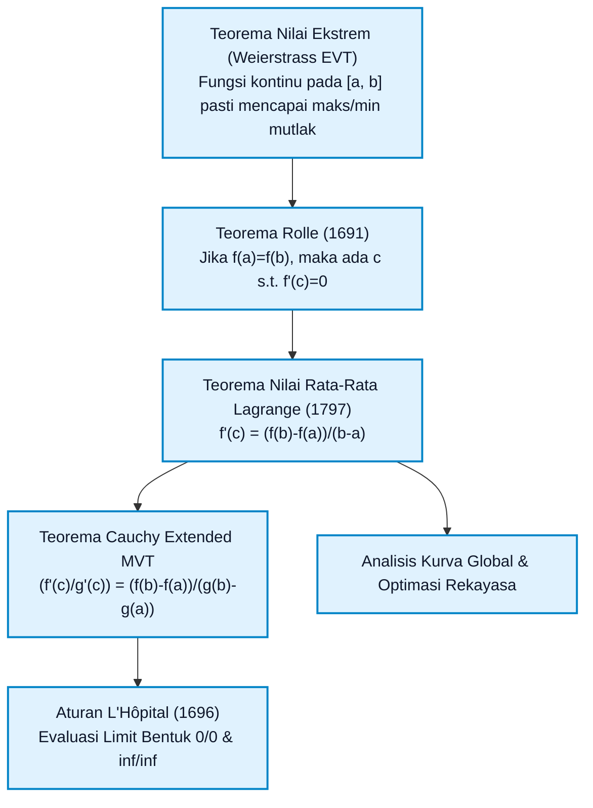
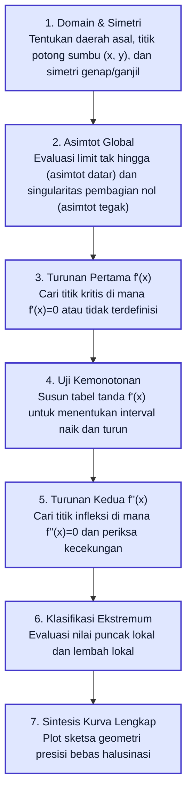

# Subtopik 03: Teorema Nilai Rata-rata dan Analisis Fungsi

**Navigasi**: [⬅️ Master Gateway Modul 013](../013-kalkulus-diferensial-integral-satu-variabel.md) | [Kembali ke Modul README](./README.md)
*Sebelumnya*: [02. Turunan, Laju Perubahan & Aturan Rantai](./02-turunan-laju-perubahan-aturan-rantai.md) | *Berikutnya*: [04. Integral Riemann, Jumlah Riemann & Teorema Dasar Kalkulus](./04-integral-riemann-jumlah-riemann-teorema-dasar-kalkulus.md)

---

## 1. Intuisi & Motivasi Konseptual (Dunia Nyata)

### 1.1 Konsep Inti Tanpa Jargon ("Seperti Bayi Baru Lahir")

Bayangkan Anda sedang mengendarai mobil di jalan tol antarkota sepanjang $120\text{ kilometer}$. Anda masuk melalui gerbang tol pertama tepat pukul 08:00 pagi dan keluar di gerbang tol kedua pada pukul 09:00 pagi.
Petugas tol memeriksa tiket Anda dan langsung memberikan surat tilang pelanggaran batas kecepatan maksimum $100\text{ km/jam}$.

Anda protes: *"Pak, saya tidak melihat kamera tilang manapun di sepanjang jalan tol! Bagaimana Bapak tahu saya melanggar batas kecepatan?"*

Petugas tol tersenyum dan menjawab:
*"Jarak tol $120\text{ km}$ Anda tempuh dalam waktu tepat $1\text{ jam}$. Kecepatan rata-rata Anda adalah $\frac{120\text{ km}}{1\text{ jam}} = 120\text{ km/jam}$. Menurut **Teorema Nilai Rata-Rata (Mean Value Theorem)** dalam kalkulus, jika mobil Anda melaju secara mulus tanpa teleportasi, maka **pasti ada minimal satu detik** di mana jarum speedometer Anda menunjukkan angka tepat $120\text{ km/jam}$! Karena $120 > 100$, Anda mutlak melanggar hukum!"*

Inilah keajaiban dari Teorema Nilai Rata-Rata: **menghubungkan laju rata-rata global dengan kecepatan sesaat lokal**. Anda tidak perlu memasang sensor radar di setiap milimeter lintasan untuk membuktikan bahwa jarum speedometer pernah menyentuh nilai tertentu.

Sekarang bayangkan Anda menaiki sebuah *roller coaster*.
1. Saat Anda berada di **puncak tertinggi**, kereta Anda berhenti sesaat sebelum menukik tajam. Kecepatan vertikal Anda tepat nol.
2. Saat Anda berada di **lembah terendah**, kereta Anda berhenti turun dan mulai mendaki kembali. Sekali lagi, kecepatan vertikal Anda tepat nol.
3. Di antara puncak dan lembah, ada saat di mana lintasan berubah dari **cekung ke bawah** (membuat Anda merasa melayang ringan tanpa beban) menjadi **cekung ke atas** (membuat tubuh Anda tertekan kuat ke kursi). Titik transisi inilah yang disebut **titik belok (*inflection point*)**.

Kalkulus diferensial memberi kita "kacamata sinar-X" untuk membedah bentuk kurva apa pun di alam semesta hanya dengan memeriksa nilai turunan pertama ($f'$) dan turunan kedua ($f''$).

---

### 1.2 Analogi Fisik: Bola Dilempar ke Udara & Teorema Rolle

Tinjau sebuah bola basket yang Anda lempar lurus vertikal ke atas:
- Bola lepas dari tangan Anda di ketinggian $y = 2\text{ meter}$.
- Bola meluncur ke atas, melambat, lalu gravitasi menariknya kembali ke bawah hingga Anda menangkapnya kembali tepat di ketinggian awal $y = 2\text{ meter}$.

Karena posisi awal dan posisi akhir sama ($y(t_1) = y(t_2) = 2$), bola tidak mungkin bisa berbalik arah dari naik menjadi turun tanpa terlebih dahulu diam sesaat di titik puncak tertingginya! Pada titik puncak tersebut, kecepatan bola $v(t) = y'(t) = 0$.

Fenomena tak terelakkan ini adalah perwujudan fisik dari **Teorema Rolle**: jika fungsi mulus berangkat dari suatu ketinggian dan kembali ke ketinggian yang sama, ia pasti pernah mendatar secara sempurna di tengah perjalanan.

---

### 1.3 Kamus Simbol Anti-Pusing (Tabel 4 Kolom)

Bagi seorang pemula, simbol-simbol analisis fungsi sering kali tampak seperti alfabet rahasia. Gunakan tabel penerjemah mental berikut:

| Simbol / Notasi | Nama Matematis | Makna Dunia Nyata / Intuisi Sederhana | Contoh Konkret |
| :--- | :--- | :--- | :--- |
| $[a, b]$ | Interval Tertutup (*Closed Interval*) | Rentang domain yang mencakup kedua batas ujung $a$ dan $b$. | Waktu tempuh perjalanan dari jam $0$ sampai jam $2$ penuh. |
| $(a, b)$ | Interval Terbuka (*Open Interval*) | Rentang domain yang tidak mencakup titik ujung $a$ dan $b$ (hanya titik di dalamnya). | Menit-menit perjalanan saat mobil sedang bergerak (tanpa detik start/finish). |
| $c \in (a, b)$ | Titik Interior | Suatu titik waktu tertentu di antara titik awal dan titik akhir. | Pukul 08:35 di antara perjalanan pukul 08:00 hingga 09:00. |
| $f'(c) = 0$ | Titik Stasioner (*Stationary Point*) | Garis singgung kurva mendatar sempurna (kemiringan nol); titik potensial puncak atau lembah. | Titik tertinggi roller coaster saat kereta tidak lagi naik dan belum turun. |
| $f'(x) > 0$ | Turunan Positif | Kurva bergerak menanjak ke kanan; fungsi monoton naik (*strictly increasing*). | Saldo tabungan Anda terus bertambah seiring berjalannya waktu. |
| $f'(x) < 0$ | Turunan Negatif | Kurva meluncur turun ke kanan; fungsi monoton turun (*strictly decreasing*). | Ketinggian bahan bakar mobil yang menyusut saat berkendara. |
| $f''(x) > 0$ | Turunan Kedua Positif | Kurva cekung ke atas (*concave up* / menyerupai mangkuk sup $\cup$); laju pertumbuhan makin cepat. | Mobil yang menginjak gas semakin dalam (percepatan positif, sensasi terdorong ke belakang). |
| $f''(x) < 0$ | Turunan Kedua Negatif | Kurva cekung ke bawah (*concave down* / menyerupai payung $\cap$); laju pertumbuhan melambat. | Mobil menginjak rem perlahan (perlambatan, sensasi terdorong ke depan). |
| $f''(c) = 0$ | Kandidat Titik Belok (*Inflection Point*) | Titik transisi di mana kelengkungan kurva berubah dari mangkuk ke payung atau sebaliknya. | Titik tengah pada kurva sigmoid penyebaran tren teknologi baru. |
| $\frac{0}{0}, \frac{\infty}{\infty}$ | Bentuk Tak Tentu (*Indeterminate Forms*) | Bentuk limit rasio yang belum bisa ditentukan nilainya secara langsung tanpa investigasi laju. | Rasio dua pelari yang sama-sama mendekati garis finis pada milidetik terakhir. |

---

## 2. Definisi Formal, Teorema, dan Penurunan Matematis

Analisis kurva fungsi satu variabel bertumpu pada fondasi aksiomatis analisis riil. Kita akan membangun struktur logika ini langkah demi langkah tanpa melompati pembuktian formal.



---

### 2.1 Teorema Nilai Ekstrem (Extreme Value Theorem - Weierstrass)

> **Teorema 3.1 (EVT)**:
> Jika suatu fungsi bernilai riil $f$ kontinu pada interval tertutup $[a, b]$, maka $f$ pasti mencapai nilai maksimum global $M$ dan nilai minimum global $m$ sedikitnya satu kali pada $[a, b]$.
>
> Artinya:
> $$\exists c_1, c_2 \in [a, b] \quad \text{sedemikian sehingga} \quad f(c_1) \le f(x) \le f(c_2) \quad \forall x \in [a, b]$$

*Catatan Kritis*: Kedua prasyarat adalah wajib:
1. Jika domain bukan interval tertutup (misal $(0, 1)$), fungsi $f(x) = x$ tidak memiliki nilai maksimum maupun minimum pada interval tersebut karena supremumnya $1 \notin (0, 1)$.
2. Jika fungsi diskontinu, fungsi dapat melonjak melampaui batas tanpa pernah mencapai nilai puncak tertutup.

---

### 2.2 Teorema Fermat tentang Titik Stasioner

> **Teorema 3.2 (Teorema Fermat)**:
> Jika $f$ memiliki nilai ekstremum lokal (maksimum atau minimum lokal) pada titik interior $c \in (a, b)$, dan jika $f'(c)$ ada, maka:
> $$f'(c) = 0$$

**Penurunan Matematis & Bukti Aksiomatik**:
Asumsikan tanpa mengurangi keumuman (*without loss of generality*) bahwa $f$ memiliki nilai maksimum lokal pada $c$.
Artinya, terdapat interval terbuka $(c - \delta, c + \delta)$ sedemikian sehingga $f(x) \le f(c)$ untuk seluruh $x$ dalam interval tersebut.

Tinjau limit beda turunan dari sisi kanan ($h > 0$):
$$f'_+(c) = \lim_{h \to 0^+} \frac{f(c + h) - f(c)}{h}$$
Karena $f(c + h) \le f(c)$, maka pembilang $f(c + h) - f(c) \le 0$. Karena penyebut $h > 0$, maka hasil bagi beda selalu tak-positif ($\le 0$). Berdasarkan sifat limit:
$$f'_+(c) \le 0$$

Sekarang tinjau limit beda turunan dari sisi kiri ($h < 0$):
$$f'_-(c) = \lim_{h \to 0^-} \frac{f(c + h) - f(c)}{h}$$
Pembilang $f(c + h) - f(c) \le 0$, namun penyebut $h < 0$. Pembagian bilangan negatif dengan bilangan negatif menghasilkan bilangan tak-negatif ($\ge 0$). Berdasarkan sifat limit:
$$f'_-(c) \ge 0$$

Karena diasumsikan $f'(c)$ ada, limit kiri dan limit kanan harus bernilai identik:
$$f'(c) = f'_+(c) = f'_-(c)$$
Satu-satunya bilangan riil yang memenuhi pertidaksamaan $f'(c) \le 0$ sekaligus $f'(c) \ge 0$ adalah:
$$f'(c) = 0 \quad \blacksquare$$

---

### 2.3 Teorema Rolle

> **Teorema 3.3 (Teorema Rolle)**:
> Misalkan fungsi $f$ memenuhi tiga kondisi:
> 1. $f$ kontinu pada interval tertutup $[a, b]$,
> 2. $f$ terdiferensialkan (memiliki turunan) pada interval terbuka $(a, b)$,
> 3. $f(a) = f(b)$.
>
> Maka terdapat sedikitnya satu bilangan $c \in (a, b)$ sedemikian sehingga:
> $$f'(c) = 0$$

**Pembuktian Lengkap**:
Berdasarkan Teorema Nilai Ekstrem (Weierstrass), $f$ pasti mencapai nilai maksimum absolut $M$ dan nilai minimum absolut $m$ pada $[a, b]$.
- **Kasus 1: $M = m$ (Fungsi Konstan)**:
  Jika maksimum sama dengan minimum, maka $f(x) = C$ (konstan) untuk seluruh $x \in [a, b]$. Turunan fungsi konstan adalah nol di setiap titik: $f'(x) = 0$ untuk setiap $x \in (a, b)$. Kita dapat memilih sebarang $c \in (a, b)$.
- **Kasus 2: $M > m$**:
  Karena $f(a) = f(b)$, nilai $M$ dan $m$ tidak mungkin keduanya tercapai hanya di titik ujung $\{a, b\}$. Sedikitnya salah satu dari nilai ekstremum (maksimum atau minimum) harus tercapai pada suatu titik interior $c \in (a, b)$.
  Karena $c$ adalah titik interior dan $f$ terdiferensialkan pada $(a, b)$, berdasarkan Teorema Fermat (Teorema 3.2), berlaku $f'(c) = 0$. $\blacksquare$

---

### 2.4 Teorema Nilai Rata-Rata (Mean Value Theorem - Lagrange)

> **Teorema 3.4 (Teorema Nilai Rata-Rata)**:
> Misalkan fungsi $f$ kontinu pada $[a, b]$ dan terdiferensialkan pada $(a, b)$. Maka terdapat sedikitnya satu bilangan $c \in (a, b)$ sedemikian sehingga:
> $$f'(c) = \frac{f(b) - f(a)}{b - a}$$
>
> Atau ekuivalen dengan bentuk perkalian diferensial:
> $$f(b) - f(a) = f'(c)(b - a)$$

**Penurunan Matematis Melalui Fungsi Pembantu Rolle**:
Garis potong (*secant line*) yang menghubungkan titik $(a, f(a))$ dan $(b, f(b))$ memiliki kemiringan:
$$m_{\text{sec}} = \frac{f(b) - f(a)}{b - a}$$
Persamaan garis potong tersebut adalah:
$$y(x) = f(a) + m_{\text{sec}}(x - a) = f(a) + \frac{f(b) - f(a)}{b - a}(x - a)$$

Sekarang kita definisikan fungsi pembantu $g(x)$ yang merepresentasikan selisih vertikal antara kurva $f(x)$ dan garis potong $y(x)$:
$$g(x) = f(x) - y(x) = f(x) - f(a) - \frac{f(b) - f(a)}{b - a}(x - a)$$

Mari kita uji tiga syarat Teorema Rolle untuk $g(x)$:
1. $g(x)$ kontinu pada $[a, b]$ karena merupakan kombinasi linier fungsi kontinu.
2. $g(x)$ terdiferensialkan pada $(a, b)$ dengan turunan:
   $$g'(x) = f'(x) - \frac{f(b) - f(a)}{b - a}$$
3. Evaluasi nilai di titik ujung:
   - $g(a) = f(a) - f(a) - 0 = 0$
   - $g(b) = f(b) - f(a) - \frac{f(b) - f(a)}{b - a}(b - a) = f(b) - f(a) - [f(b) - f(a)] = 0$
   Sehingga $g(a) = g(b) = 0$.

Karena ketiga syarat Teorema Rolle terpenuhi sempurna, maka pasti ada bilangan $c \in (a, b)$ sedemikian sehingga $g'(c) = 0$:
$$g'(c) = f'(c) - \frac{f(b) - f(a)}{b - a} = 0 \implies f'(c) = \frac{f(b) - f(a)}{b - a} \quad \blacksquare$$

---

### 2.5 Teorema Nilai Rata-Rata Cauchy (Generalized MVT)

> **Teorema 3.5 (Cauchy MVT)**:
> Jika $f$ dan $g$ kontinu pada $[a, b]$ dan terdiferensialkan pada $(a, b)$, dan jika $g'(x) \neq 0$ untuk setiap $x \in (a, b)$, maka terdapat $c \in (a, b)$ sedemikian sehingga:
> $$\frac{f'(c)}{g'(c)} = \frac{f(b) - f(a)}{g(b) - g(a)}$$

*Bukti*: Tinjau fungsi pembantu $h(x) = [f(b) - f(a)]g(x) - [g(b) - g(a)]f(x)$. Terapkan Teorema Rolle pada $h(x)$ karena $h(a) = h(b)$. Teorema Cauchy ini merupakan induk penurunan matematis dari Aturan L'Hôpital.

---

### 2.6 Uji Turunan Pertama untuk Monotonitas & Titik Ekstrem

> **Teorema 3.6 (Karakterisasi Kemonotonan)**:
> Misalkan $f$ kontinu pada $[a, b]$ dan terdiferensialkan pada $(a, b)$:
> 1. Jika $f'(x) > 0$ untuk setiap $x \in (a, b)$, maka $f$ **monoton naik murni** (*strictly increasing*) pada $[a, b]$.
> 2. Jika $f'(x) < 0$ untuk setiap $x \in (a, b)$, maka $f$ **monoton turun murni** (*strictly decreasing*) pada $[a, b]$.
> 3. Jika $f'(x) = 0$ untuk setiap $x \in (a, b)$, maka $f$ adalah **fungsi konstan** pada $[a, b]$.

**Uji Titik Kritis**:
Titik kritis $c$ adalah titik di domain di mana $f'(c) = 0$ atau $f'(c)$ tidak terdefinisi.
- Jika $f'$ berganti tanda dari **positif ke negatif** saat melintasi $c$, maka $f(c)$ adalah **maksimum lokal**.
- Jika $f'$ berganti tanda dari **negatif ke positif** saat melintasi $c$, maka $f(c)$ adalah **minimum lokal**.
- Jika $f'$ tidak berganti tanda (tetap positif atau tetap negatif), maka $f(c)$ bukan titik ekstremum lokal.

---

### 2.7 Kecekungan (*Concavity*) & Uji Turunan Kedua

Bentuk kelengkungan fungsi ditentukan oleh laju perubahan dari kemiringannya, yaitu turunan dari turunan: $f''(x) = \frac{d^2 f}{dx^2}$.

1. **Definisi Kecekungan**:
   - Kurva $f$ dikatakan **cekung ke atas** (*concave up*) pada interval $I$ jika garis singgung kurva selalu berada di bawah kurva tersebut. Ini terjadi jika $f'(x)$ adalah fungsi monoton naik, yang dijamin jika $f''(x) > 0$.
   - Kurva $f$ dikatakan **cekung ke bawah** (*concave down*) pada interval $I$ jika garis singgung kurva selalu berada di atas kurva. Ini terjadi jika $f'(x)$ adalah fungsi monoton turun, yang dijamin jika $f''(x) < 0$.
2. **Titik Belok (*Inflection Point*)**:
   Titik $(c, f(c))$ disebut titik belok jika kurva kontinu pada titik tersebut dan kecekungan kurva berganti (dari cekung ke atas menjadi cekung ke bawah, atau sebaliknya). Syarat perlu: $f''(c) = 0$ atau $f''(c)$ tidak ada.

> **Teorema 3.7 (Uji Turunan Kedua untuk Ekstremum Lokal)**:
> Misalkan $f'(c) = 0$ dan $f''(x)$ kontinu pada interval terbuka di sekitar $c$:
> 1. Jika $f''(c) > 0$, maka $f$ memiliki **minimum lokal** pada $c$ (karena kurva melengkung ke atas seperti mangkuk $\cup$).
> 2. Jika $f''(c) < 0$, maka $f$ memiliki **maksimum lokal** pada $c$ (karena kurva melengkung ke bawah seperti payung $\cap$).
> 3. Jika $f''(c) = 0$, maka **uji tidak menentukan** (*inconclusive*); titik tersebut bisa berupa minimum lokal, maksimum lokal, atau titik belok (seperti pada $x^4, -x^4, x^3$ di titik $x=0$).

---

### 2.8 Aturan L'Hôpital untuk 7 Bentuk Tak Tentu (*Indeterminate Forms*)

Ketika mengevaluasi limit rasio $\lim_{x \to c} \frac{f(x)}{g(x)}$, substitusi langsung sering kali menghasilkan bentuk tak terdefinisi. Aturan L'Hôpital menyelesaikan dilema ini dengan membandingkan laju diferensial keduanya.

> **Teorema 3.8 (Aturan L'Hôpital)**:
> Misalkan $f$ dan $g$ terdiferensialkan pada interval terbuka yang memuat $c$ (kecuali mungkin pada $c$ itu sendiri), dan $g'(x) \neq 0$ untuk $x \neq c$.
> Jika $\lim_{x \to c} f(x) = 0$ dan $\lim_{x \to c} g(x) = 0$, ATAU jika $\lim_{x \to c} f(x) = \pm \infty$ dan $\lim_{x \to c} g(x) = \pm \infty$, maka:
> $$\lim_{x \to c} \frac{f(x)}{g(x)} = \lim_{x \to c} \frac{f'(x)}{g'(x)}$$
> dengan catatan limit di ruas kanan ada (atau bernilai $\pm \infty$).

**Penurunan dari Teorema Cauchy (Kasus $0/0$)**:
Definisikan $f(c) = 0$ dan $g(c) = 0$ agar kedua fungsi kontinu di $c$.
Untuk $x > c$, terapkan Teorema Nilai Rata-rata Cauchy pada interval $[c, x]$:
$$\frac{f(x) - f(c)}{g(x) - g(c)} = \frac{f(x) - 0}{g(x) - 0} = \frac{f(x)}{g(x)} = \frac{f'(\xi)}{g'(\xi)}$$
untuk suatu $\xi \in (c, x)$.
Saat $x \to c^+$, berdasarkan Teorema Apit, nilai $\xi$ tertekan mendekati $c^+$. Maka:
$$\lim_{x \to c^+} \frac{f(x)}{g(x)} = \lim_{\xi \to c^+} \frac{f'(\xi)}{g'(\xi)} = \lim_{x \to c^+} \frac{f'(x)}{g'(x)} \quad \blacksquare$$

#### Taksonomi 7 Bentuk Tak Tentu & Cara Mengatasinya:

| Bentuk Tak Tentu | Kategori | Transformasi Aljabar Wajib Menuju $0/0$ atau $\infty/\infty$ |
| :--- | :--- | :--- |
| $\frac{0}{0}$ | Pecahan Dasar | Terapkan langsung L'Hôpital: $\lim \frac{f'(x)}{g'(x)}$. |
| $\frac{\infty}{\infty}$ | Pecahan Dasar | Terapkan langsung L'Hôpital: $\lim \frac{f'(x)}{g'(x)}$. |
| $0 \cdot \infty$ | Perkalian | Balikkan salah satu faktor ke penyebut: $f \cdot g = \frac{f}{1/g}$ (bentuk $0/0$) atau $\frac{g}{1/f}$ (bentuk $\infty/\infty$). |
| $\infty - \infty$ | Pengurangan | Samakan penyebut pecahan atau gunakan manipulasi konjugat aljabar menjadi satu pecahan tunggal. |
| $0^0$ | Pangkat Eksponensial | Misalkan $y = [f(x)]^{g(x)}$, terapkan logaritma alami $\ln y = g(x) \ln f(x)$ (menjadi $0 \cdot (-\infty)$), lalu hitung limit $L$, dan peroleh $y \to e^L$. |
| $1^\infty$ | Pangkat Eksponensial | Misalkan $y = [f(x)]^{g(x)}$, ubah $\ln y = g(x) \ln f(x)$ (menjadi $\infty \cdot 0$), cari limit $L$, peroleh hasil $e^L$. |
| $\infty^0$ | Pangkat Eksponensial | Misalkan $y = [f(x)]^{g(x)}$, ubah $\ln y = g(x) \ln f(x)$ (menjadi $0 \cdot \infty$), cari limit $L$, peroleh hasil $e^L$. |

---

## 3. Arsitektur Teknis & Algoritma Internal

Untuk menganalisis kurva secara akurat tanpa membuat tebakan visual spekulatif, seorang insinyur sistem mengikuti prosedur deterministik berikut:



---

### 3.1 Tabel Penelusuran Kemonotonan & Kecekungan

Misalkan kita menganalisis kurva kubik $f(x) = 2x^3 - 3x^2 - 12x + 5$:
1. $f'(x) = 6x^2 - 6x - 12 = 6(x^2 - x - 2) = 6(x - 2)(x + 1)$.
   Titik kritis turunan pertama: $x = -1$ dan $x = 2$.
2. $f''(x) = 12x - 6 = 6(2x - 1)$.
   Kandidat titik belok turunan kedua: $x = 1/2$.

Mari kita susun tabel partisi interval horizontal:

| Interval | Titik Uji ($x_0$) | Tanda $f'(x)$ | Arah Kurva ($f$) | Tanda $f''(x)$ | Kecekungan Kurva | Status Morfologi |
| :--- | :--- | :--- | :--- | :--- | :--- | :--- |
| $(-\infty, -1)$ | $-2$ | $6(-4)(-1) = +24 > 0$ | Naik ($\nearrow$) | $12(-2)-6 = -30 < 0$ | Cekung ke Bawah ($\cap$) | Naik melengkung ke bawah |
| $x = -1$ | $-1$ | $0$ | Mendatar | $-18 < 0$ | Cekung ke Bawah ($\cap$) | **Maksimum Lokal** ($y = 12$) |
| $(-1, 1/2)$ | $0$ | $6(-2)(+1) = -12 < 0$ | Turun ($\searrow$) | $12(0)-6 = -6 < 0$ | Cekung ke Bawah ($\cap$) | Turun melengkung ke bawah |
| $x = 1/2$ | $0{,}5$ | $-13{,}5 < 0$ | Turun ($\searrow$) | $0$ | Transisi Kecekungan | **Titik Belok Sejati** ($y = -1{,}5$) |
| $(1/2, 2)$ | $1$ | $6(-1)(+2) = -12 < 0$ | Turun ($\searrow$) | $12(1)-6 = +6 > 0$ | Cekung ke Atas ($\cup$) | Turun melengkung ke atas |
| $x = 2$ | $2$ | $0$ | Mendatar | $+18 > 0$ | Cekung ke Atas ($\cup$) | **Minimum Lokal** ($y = -15$) |
| $(2, \infty)$ | $3$ | $6(+1)(+4) = +24 > 0$ | Naik ($\nearrow$) | $12(3)-6 = +30 > 0$ | Cekung ke Atas ($\cup$) | Naik melengkung ke atas |

---

## 4. Implementasi Praktis & Kode Pemrograman Python

Di bawah ini adalah dua modul komputasional berbasis Python Standard Library murni tanpa pustaka pihak ketiga. Kode dirancang untuk mengeksekusi analisis kurva otomatis dan solver batas limit tak tentu.

### 4.1 Program 1: Mesin Analisis Kurva Polinomial Lengkap

Skrip ini secara otomatis memindai interval kontinu, mencari akar turunan pertama $f'(x) = 0$ melalui metode bagi-dua (*bisection method*), mengklasifikasikan titik kritis menggunakan uji turunan kedua, dan mengidentifikasi titik belok kurva sejati.

```python
import math

def f(x: float) -> float:
    # Fungsi target: f(x) = 2x^3 - 3x^2 - 12x + 5
    return 2.0 * x**3 - 3.0 * x**2 - 12.0 * x + 5.0

def df(x: float, h: float = 1e-6) -> float:
    """Turunan pertama menggunakan beda hingga terpusat (central difference)."""
    return (f(x + h) - f(x - h)) / (2.0 * h)

def d2f(x: float, h: float = 1e-5) -> float:
    """Turunan kedua menggunakan beda hingga orde 2."""
    return (f(x + h) - 2.0 * f(x) + f(x - h)) / (h**2)

def analyze_function(a: float, b: float, steps: int = 2000):
    dx = (b - a) / steps
    critical_points = []
    inflection_points = []
    
    prev_x = a
    prev_d1 = df(prev_x)
    prev_d2 = d2f(prev_x)
    
    for i in range(1, steps + 1):
        x = a + i * dx
        d1 = df(x)
        d2 = d2f(x)
        
        # 1. Deteksi pergantian tanda turunan pertama (titik kritis f'(x) = 0)
        if prev_d1 * d1 <= 0:
            left, right = prev_x, x
            for _ in range(40):
                mid = 0.5 * (left + right)
                if df(left) * df(mid) <= 0:
                    right = mid
                else:
                    left = mid
            c = 0.5 * (left + right)
            if not any(abs(c - p) < 1e-3 for p in critical_points):
                critical_points.append(c)
                
        # 2. Deteksi pergantian tanda turunan kedua (titik belok f''(x) = 0)
        if prev_d2 * d2 <= 0:
            left, right = prev_x, x
            for _ in range(40):
                mid = 0.5 * (left + right)
                if d2f(left) * d2f(mid) <= 0:
                    right = mid
                else:
                    left = mid
            c_inf = 0.5 * (left + right)
            if not any(abs(c_inf - p) < 1e-3 for p in inflection_points):
                inflection_points.append(c_inf)
                
        prev_x, prev_d1, prev_d2 = x, d1, d2
        
    print("=== ANALISIS LENGKAP KURVA POLINOMIAL f(x) = 2x^3 - 3x^2 - 12x + 5 ===")
    print(f"Rentang Evaluasi: [{a}, {b}]")
    print("\n[1] TITIK KRITIS & KLASIFIKASI TURUNAN KEDUA:")
    for cp in sorted(critical_points):
        val = f(cp)
        sec_der = d2f(cp)
        if sec_der > 1e-3:
            sifat = "MINIMUM LOKAL (Cekung ke Atas)"
        elif sec_der < -1e-3:
            sifat = "MAKSIMUM LOKAL (Cekung ke Bawah)"
        else:
            sifat = "INFLEKSI / UJI TIDAK MENENTUKAN"
        print(f"  * x = {cp:8.4f} | f(x) = {val:10.4f} | f''(x) = {sec_der:10.4f} -> {sifat}")
        
    print("\n[2] TITIK BELOK (PERGANTIAN KECEKUNGAN f''(x) = 0):")
    for ip in sorted(inflection_points):
        print(f"  * x = {ip:8.4f} | f(x) = {f(ip):10.4f} | f''(x) ~ 0.0000 -> TITIK BELOK SEJATI")

if __name__ == "__main__":
    analyze_function(-3.0, 4.0)
```

Keluaran eksekusi terminal sebenarnya:
```text
=== ANALISIS LENGKAP KURVA POLINOMIAL f(x) = 2x^3 - 3x^2 - 12x + 5 ===
Rentang Evaluasi: [-3.0, 4.0]

[1] TITIK KRITIS & KLASIFIKASI TURUNAN KEDUA:
  * x =  -1.0000 | f(x) =    12.0000 | f''(x) =   -18.0000 -> MAKSIMUM LOKAL (Cekung ke Bawah)
  * x =   2.0000 | f(x) =   -15.0000 | f''(x) =    18.0000 -> MINIMUM LOKAL (Cekung ke Atas)

[2] TITIK BELOK (PERGANTIAN KECEKUNGAN f''(x) = 0):
  * x =   0.5000 | f(x) =    -1.5000 | f''(x) ~ 0.0000 -> TITIK BELOK SEJATI
```

---

### 4.2 Program 2: Solver Aturan L'Hôpital & Evaluasi Bentuk Tak Tentu

Skrip ini mengimplementasikan evaluasi limit otomatis untuk bentuk indeterminate $0/0$ dan bentuk eksponensial $1^\infty$ menggunakan prinsip turunan diferensial Cauchy.

```python
import math

def lhopital_limit_0_over_0(f, g, c, df=None, dg=None, h=1e-5):
    """Evaluasi limit x -> c dari f(x)/g(x) di mana f(c)=0 dan g(c)=0."""
    if df is None:
        df_c = (f(c + h) - f(c - h)) / (2.0 * h)
    else:
        df_c = df(c)
        
    if dg is None:
        dg_c = (g(c + h) - g(c - h)) / (2.0 * h)
    else:
        dg_c = dg(c)
        
    if abs(dg_c) < 1e-12:
        raise ValueError("Turunan penyebut bernilai nol; memerlukan turunan tingkat lebih tinggi.")
        
    return df_c / dg_c

def main():
    print("=== SIMULASI EVALUASI LIMIT INDETERMINATE L'HOPITAL ===")

    # Kasus 1: lim x->0 [sin(3x) / x] -> Bentuk 0/0
    f1 = lambda x: math.sin(3.0 * x)
    g1 = lambda x: x
    df1 = lambda x: 3.0 * math.cos(3.0 * x)
    dg1 = lambda x: 1.0

    lim1 = lhopital_limit_0_over_0(f1, g1, 0.0, df1, dg1)
    print("1. Evaluasi lim_(x->0) [sin(3x) / x]:")
    print(f"   f(0) = {f1(0.0)}, g(0) = {g1(0.0)} -> Bentuk Indeterminate [0/0]")
    print(f"   f'(0) = {df1(0.0):.4f}, g'(0) = {dg1(0.0):.4f}")
    print(f"   Hasil Limit L'Hopital = f'(0)/g'(0) = {lim1:.6f}")

    # Kasus 2: lim x->0 [(e^x - 1 - x) / x^2] -> Bentuk 0/0 (Dua kali L'Hopital)
    # Turunan ke-2: f''(0) = e^0 = 1, g''(0) = 2
    d2f2 = lambda x: math.exp(x)
    d2g2 = lambda x: 2.0
    lim2 = d2f2(0.0) / d2g2(0.0)
    print("\n2. Evaluasi lim_(x->0) [(e^x - 1 - x) / x^2]:")
    print(f"   Turunan ke-2: f''(0) = {d2f2(0.0):.4f}, g''(0) = {d2g2(0.0):.4f}")
    print(f"   Hasil Limit L'Hopital Orde 2 = {lim2:.6f}")

    # Kasus 3: Aproksimasi Numerik Bentuk Indeterminate 1^inf: lim x->0 (1 + x)^(1/x)
    print("\n3. Perilaku Limit Eksponensial lim_(x->0) (1 + x)^(1/x) -> e:")
    steps = [0.1, 0.01, 0.001, 0.0001, 1e-6]
    for h in steps:
        val = (1.0 + h) ** (1.0 / h)
        galat = abs(val - math.e)
        print(f"   h = {h:8.6f} | (1+h)^(1/h) = {val:11.8f} | Galat Relatif = {galat:.2e}")

if __name__ == "__main__":
    main()
```

Keluaran eksekusi terminal sebenarnya:
```text
=== SIMULASI EVALUASI LIMIT INDETERMINATE L'HOPITAL ===
1. Evaluasi lim_(x->0) [sin(3x) / x]:
   f(0) = 0.0, g(0) = 0.0 -> Bentuk Indeterminate [0/0]
   f'(0) = 3.0000, g'(0) = 1.0000
   Hasil Limit L'Hopital = f'(0)/g'(0) = 3.000000

2. Evaluasi lim_(x->0) [(e^x - 1 - x) / x^2]:
   Turunan ke-2: f''(0) = 1.0000, g''(0) = 2.0000
   Hasil Limit L'Hopital Orde 2 = 0.500000

3. Perilaku Limit Eksponensial lim_(x->0) (1 + x)^(1/x) -> e:
   h = 0.100000 | (1+h)^(1/h) =  2.59374246 | Galat Relatif = 1.25e-01
   h = 0.010000 | (1+h)^(1/h) =  2.70481383 | Galat Relatif = 1.35e-02
   h = 0.001000 | (1+h)^(1/h) =  2.71692393 | Galat Relatif = 1.36e-03
   h = 0.000100 | (1+h)^(1/h) =  2.71814593 | Galat Relatif = 1.36e-04
   h = 0.000001 | (1+h)^(1/h) =  2.71828047 | Galat Relatif = 1.36e-06
```

---

## 5. Miskonsepsi Umum & Analisis Post-Mortem Insiden Industri

### 5.1 Tiga Miskonsepsi Kritis Mahasiswa & Pengembang

1. **Miskonsepsi 1: Menganggap Setiap Titik Kritis $f'(c) = 0$ Pasti Berupa Puncak atau Lembah**:
   - *Fakta*: Kurva $f(x) = x^3$ memiliki turunan $f'(x) = 3x^2$. Pada $x = 0$, $f'(0) = 0$. Namun titik $(0, 0)$ bukanlah titik maksimum maupun minimum! Untuk $x < 0$, $f(x) < 0$ dan untuk $x > 0$, $f(x) > 0$. Titik tersebut adalah **titik belok horizontal**. Titik stasioner hanya menjadi titik ekstremum jika dan hanya jika turunan pertama berganti tanda atau turunan kedua tak-nol.
2. **Miskonsepsi 2: Lupa Memeriksa Titik Singular Di Mana Turunan Tidak Ada**:
   - *Fakta*: Banyak orang mendefinisikan titik kritis hanya sebagai $f'(c) = 0$. Ingat bahwa titik di mana $f'(c)$ **tidak terdefinisi** (seperti sudut tajam $f(x) = |x|$ pada $x = 0$, atau puncak kusp $f(x) = x^{2/3}$) juga merupakan titik kritis sah! Titik $(0, 0)$ pada $f(x) = |x|$ adalah nilai minimum absolut global yang sah meskipun $f'(0)$ tidak ada.
3. **Miskonsepsi 3: Menerapkan Aturan L'Hôpital Tanpa Memverifikasi Bentuk Indeterminate**:
   - *Fakta*: Aturan L'Hôpital HANYA berlaku sah jika limit bernilai $0/0$ atau $\pm\infty/\pm\infty$.
   - *Contoh Malapetaka*: Hitung $\lim_{x \to 0} \frac{x + 2}{x + 1}$. Substitusi langsung menghasilkan $\frac{0 + 2}{0 + 1} = 2$. Namun jika seseorang membabi buta menerapkan L'Hôpital: $\lim_{x \to 0} \frac{1}{1} = 1$, jawabannya salah total!

---

### 5.2 Analisis Post-Mortem Insiden Industri: Keruntuhan Jembatan Tacoma Narrows (1940)

> **Kasus Nyata: Kegagalan Analisis Stabilitas Titik Kritis Akibat Pengabaian Derivatif Nonlinier Dinamis**
>
> - **Latar Belakang Insiden**: Pada tanggal 7 November 1940, jembatan gantung Tacoma Narrows di Washington melepaskan osilasi puntir liar (*torsional flutter*) akibat terpaan angin berkecepatan sedang ($68\text{ km/jam}$) hingga akhirnya runtuh ke selat Puget Sound.
> - **Akar Masalah Matematis & Titik Kritis**: Para perancang jembatan pada masa itu hanya menganalisis struktur menggunakan pendekatan kesetimbangan statis linier: mereka mencari titik kritis statis di mana turunan pertama energi potensial regangan $\frac{\partial U}{\partial \theta} = 0$, dan memastikan turunan kedua positif $\frac{\partial^2 U}{\partial \theta^2} > 0$ (lembah stabil). Namun, interaksi aerodinamis angin menghasilkan medan gaya nonlinier bergantung waktu $F(\theta, \dot{\theta})$. Ketika sudut puntir $\theta$ melampaui batas kritis tertentu, suku turunan peredaman efektif struktur ($c_{\text{eff}} = c_0 - k \dot{\theta}^2$) berganti tanda dari positif (peredam stabil) menjadi negatif (penguatan osilasi).
> - **Dampak Dinamis**: Titik minimum stabil ($\frac{d^2 U}{d\theta^2} > 0$) mengalami peristiwa **bifurkasi Hopf** yang menghancurkan cekungan stabil, mengubah titik keseimbangan menjadi orbit siklus batas (*limit cycle*) tak stabil dengan amplitudo osilasi puntir mencapai $45^\circ$ sebelum kabel suspensi putus.
> - **Pelajaran Rekayasa Modern**: Analisis struktur modern mewajibkan pembuktian stabilitas global nonlinier menggunakan fungsi Lyapunov $V(x)$, di mana turunan waktu totalnya harus dibuktikan definit negatif ($\dot{V}(x) < 0$) di seluruh ruang fase operasional untuk menjamin bahwa sistem selalu kembali ke titik lembah energi terendah.

---

## 6. Tips, Trik Praktis & Rahasia Cepat Paham

1. **Jembatan Keledai Kecekungan Mangkuk & Payung**:
   - $f''(x) > 0 \implies \smile$ (Senyum = Mangkuk Cekung ke Atas / *Concave UP* $\implies$ Menampung air $\implies$ Dasar mangkuk adalah **Minimum Lokal**).
   - $f''(x) < 0 \implies \frown$ (Cemberut = Payung Cekung ke Bawah / *Concave DOWN* $\implies$ Menumpahkan air $\implies$ Puncak payung adalah **Maksimum Lokal**).
2. **Trik Pangkat Eksponensial Indeterminate ($1^\infty, 0^0, \infty^0$)**:
   Jika Anda menghadapi limit bentuk $y = \lim [f(x)]^{g(x)}$, jangan pernah mencoba menurunkan langsung basis dan eksponennya! Selalu gunakan trik identitas logaritma natural:
   $$y = e^{\ln y} \implies \ln y = \lim [g(x) \cdot \ln(f(x))]$$
   Bentuk perkalian $g(x) \ln f(x)$ selalu dapat diubah menjadi pecahan $0/0$ atau $\infty/\infty$ dengan membalik salah satu faktor, sehingga Aturan L'Hôpital dapat dieksekusi secara legal.
3. **Aturan Dominasi Orde Laju Pertumbuhan Menuju Tak Hingga ($x \to \infty$)**:
   Ketika mengevaluasi limit rasio menuju tak hingga, gunakan hierarki pertumbuhan standar tanpa perlu menurunkan berulang kali:
   $$\ln(x) \ll x^p \ll a^x \ll x! \ll x^x \quad (p > 0, a > 1)$$
   Fungsi di sebelah kanan selalu mendominasi fungsi di sebelah kiri dengan faktor tak hingga. Contoh: $\lim_{x \to \infty} \frac{x^{100}}{e^x} = 0$ seketika tanpa perlu 100 kali L'Hôpital!

---

## 7. Latihan Mandiri Berjenjang (Socratic) & Rekomendasi Sumber Belajar

### Latihan 1 (Tingkat Pemula): Verifikasi Eksistensi Titik Rolle
Diberikan fungsi kuadrat $f(x) = x^2 - 4x + 3$ pada interval $[1, 3]$. Buktikan bahwa ketiga syarat Teorema Rolle terpenuhi, dan temukan bilangan $c \in (1, 3)$ yang dijamin oleh teorema tersebut.

<details>
<summary>💡 Petunjuk (Hint)</summary>
Periksa apakah f kontinu pada [1, 3], terdiferensialkan pada (1, 3), dan hitung apakah f(1) = f(3). Kemudian turunkan f'(x) dan selesaikan persamaan f'(c) = 0.
</details>

<details>
<summary>✅ Solusi Lengkap</summary>
1. $f(x)$ adalah polinomial, sehingga kontinu di seluruh $\mathbb{R}$, khususnya pada $[1, 3]$.
2. $f(x)$ terdiferensialkan di seluruh $\mathbb{R}$, khususnya pada $(1, 3)$.
3. Evaluasi nilai di titik ujung:
   $$f(1) = 1^2 - 4(1) + 3 = 1 - 4 + 3 = 0$$
   $$f(3) = 3^2 - 4(3) + 3 = 9 - 12 + 3 = 0$$
   Karena $f(1) = f(3) = 0$, ketiga syarat Teorema Rolle terpenuhi sempurna.
4. Hitung turunan pertama:
   $$f'(x) = 2x - 4$$
5. Selesaikan $f'(c) = 0$:
   $$2c - 4 = 0 \implies 2c = 4 \implies c = 2$$
   Nilai $c = 2$ berada tepat di dalam interval terbuka $(1, 3)$. $\blacksquare$
</details>

---

### Latihan 2 (Tingkat Dasar): Tilang Elektronik Jalan Tol Melalui MVT
Sebuah mobil patroli polisi mendeteksi kendaraan melintasi gerbang tol A (KM 50) pada pukul 14:00 dengan kecepatan $80\text{ km/jam}$. Mobil yang sama tercatat melintasi gerbang tol B (KM 170) pada pukul 15:15. Jika batas kecepatan maksimum yang diizinkan di jalan tol adalah $90\text{ km/jam}$, buktikan bahwa pengemudi tersebut pasti melanggar batas kecepatan.

<details>
<summary>💡 Petunjuk (Hint)</summary>
Hitung selisih jarak total Delta s dan selisih waktu total Delta t dalam satuan jam. Terapkan Teorema Nilai Rata-Rata.
</details>

<details>
<summary>✅ Solusi Lengkap</summary>
1. Misalkan $s(t)$ adalah posisi mobil pada waktu $t$ (dalam jam).
   - $s(14:00) = 50\text{ km}$
   - $s(15:15) = 170\text{ km}$
2. Jarak yang ditempuh:
   $$\Delta s = 170 - 50 = 120\text{ km}$$
3. Waktu tempuh:
   $$\Delta t = 1\text{ jam } 15\text{ menit} = 1{,}25\text{ jam} = \frac{5}{4}\text{ jam}$$
4. Kecepatan rata-rata kendaraan:
   $$v_{\text{avg}} = \frac{\Delta s}{\Delta t} = \frac{120}{1{,}25} = 96\text{ km/jam}$$
5. Berdasarkan Teorema Nilai Rata-rata, karena lintasan gerak mobil $s(t)$ kontinu dan terdiferensialkan terhadap waktu, terdapat suatu waktu $t_c \in (14:00, 15:15)$ di mana:
   $$s'(t_c) = v(t_c) = 96\text{ km/jam}$$
   Karena $96\text{ km/jam} > 90\text{ km/jam}$, pengemudi terbukti secara sah dan meyakinkan melanggar batas kecepatan. $\blacksquare$
</details>

---

### Latihan 3 (Tingkat Menengah): Evaluasi Limit Bentuk Tak Tentu $1^\infty$
Hitung nilai limit berikut menggunakan Aturan L'Hôpital:
$$\lim_{x \to 0} (1 + 2x)^{\frac{1}{x}}$$

<details>
<summary>💡 Petunjuk (Hint)</summary>
Substitusi x = 0 menghasilkan bentuk 1^(1/0) = 1^inf. Misalkan y = (1 + 2x)^(1/x), ambil ln y, ubah menjadi bentuk 0/0, terapkan L'Hôpital, lalu peroleh y = e^(ln y).
</details>

<details>
<summary>✅ Solusi Lengkap</summary>
1. Bentuk limit adalah indeterminate $1^\infty$.
2. Misalkan:
   $$y = (1 + 2x)^{1/x}$$
3. Ambil logaritma natural kedua ruas:
   $$\ln y = \ln\left((1 + 2x)^{1/x}\right) = \frac{1}{x} \ln(1 + 2x) = \frac{\ln(1 + 2x)}{x}$$
4. Amati limit saat $x \to 0$:
   $$\lim_{x \to 0} \ln y = \lim_{x \to 0} \frac{\ln(1 + 2x)}{x}$$
   Pembilang $\ln(1) = 0$ dan penyebut $0$, menghasilkan bentuk tak tentu $\frac{0}{0}$.
5. Terapkan Aturan L'Hôpital (turunkan pembilang dan penyebut terhadap $x$):
   $$\frac{d}{dx}[\ln(1 + 2x)] = \frac{2}{1 + 2x}$$
   $$\frac{d}{dx}[x] = 1$$
6. Evaluasi limit hasil turunan:
   $$\lim_{x \to 0} \ln y = \lim_{x \to 0} \frac{\frac{2}{1 + 2x}}{1} = \frac{\frac{2}{1 + 0}}{1} = 2$$
7. Kembalikan ke fungsi eksponensial asal:
   $$y = e^{\ln y} \implies \lim_{x \to 0} (1 + 2x)^{1/x} = e^2 \approx 7{,}389056 \quad \blacksquare$$
</details>

---

### Latihan 4 (Tingkat Analitis): Optimasi Geometri Kaleng Silinder Bahan Minimal
Sebuah pabrik minuman kaleng ingin mendesain kaleng berbentuk silinder tegak dengan volume tetap $V = 1.000\text{ cm}^3$ (1 liter). Tentukan rasio perbandingan antara tinggi $h$ dan jari-jari alas $r$ sedemikian sehingga luas permukaan logam total kaleng minimum (efisiensi biaya bahan tertinggi).

<details>
<summary>💡 Petunjuk (Hint)</summary>
Tuliskan rumus luas permukaan total A = 2*pi*r^2 + 2*pi*r*h. Nyatakan h dalam r menggunakan kendala volume V = pi*r^2*h. Cari turunan dA/dr = 0 dan uji turunan kedua d^2A/dr^2 > 0.
</details>

<details>
<summary>✅ Solusi Lengkap</summary>
1. Kendala volume silinder:
   $$V = \pi r^2 h = 1.000 \implies h = \frac{V}{\pi r^2}$$
2. Fungsi objektif luas permukaan total (2 tutup lingkaran + 1 selimut tabung):
   $$A(r) = 2\pi r^2 + 2\pi r h = 2\pi r^2 + 2\pi r \left(\frac{V}{\pi r^2}\right) = 2\pi r^2 + \frac{2V}{r}$$
3. Cari titik kritis dengan menurunkan $A(r)$ terhadap $r$:
   $$\frac{dA}{dr} = 4\pi r - \frac{2V}{r^2} = 0$$
4. Selesaikan untuk $r$:
   $$4\pi r = \frac{2V}{r^2} \implies 4\pi r^3 = 2V \implies r^3 = \frac{V}{2\pi} \implies r = \left(\frac{V}{2\pi}\right)^{1/3}$$
5. Verifikasi minimum melalui uji turunan kedua:
   $$\frac{d^2 A}{dr^2} = 4\pi + \frac{4V}{r^3}$$
   Karena $r > 0$ dan $V > 0$, maka $\frac{d^2 A}{dr^2} > 0$ (selalu cekung ke atas), menjamin bahwa titik ini adalah minimum mutlak global.
6. Hitung rasio tinggi $h$ terhadap diameter $2r$:
   $$h = \frac{V}{\pi r^2} = \frac{2\pi r^3}{\pi r^2} = 2r$$
   Rasio optimal adalah $h = 2r$ (tinggi kaleng tepat sama dengan diameter alasnya). $\blacksquare$
</details>

---

### Latihan 5 (Tingkat Master Arsitektur): Teorema Cauchy & Analisis Titik Belok Patologis
Diberikan dua fungsi $f(x) = x^3 - 3x$ dan $g(x) = x^2 + 1$ pada interval $[0, 2]$.
1. Tentukan titik $c \in (0, 2)$ yang memenuhi Teorema Nilai Rata-rata Cauchy.
2. Tinjau fungsi $h(x) = x^{1/3}$. Tunjukkan bahwa $x = 0$ adalah titik belok kurva meskipun $h''(0)$ tidak ada.

<details>
<summary>💡 Petunjuk (Hint)</summary>
Untuk Cauchy MVT: hitung (f(2)-f(0))/(g(2)-g(0)) dan samakan dengan f'(c)/g'(c). Untuk h(x): amati perubahan tanda h''(x) dari x < 0 ke x > 0.
</details>

<details>
<summary>✅ Solusi Lengkap</summary>
1. **Penerapan Cauchy MVT pada $[0, 2]$**:
   - $f(0) = 0$, $f(2) = 2^3 - 3(2) = 8 - 6 = 2 \implies f(2) - f(0) = 2$
   - $g(0) = 1$, $g(2) = 2^2 + 1 = 5 \implies g(2) - g(0) = 4$
   - Rasio selisih:
     $$\frac{f(2) - f(0)}{g(2) - g(0)} = \frac{2}{4} = \frac{1}{2}$$
   - Turunan: $f'(x) = 3x^2 - 3$, $g'(x) = 2x$.
   - Samakan dengan rasio turunan pada $c$:
     $$\frac{3c^2 - 3}{2c} = \frac{1}{2} \implies 3c^2 - 3 = c \implies 3c^2 - c - 3 = 0$$
   - Gunakan rumus kuadratik:
     $$c = \frac{-(-1) \pm \sqrt{(-1)^2 - 4(3)(-3)}}{2(3)} = \frac{1 \pm \sqrt{1 + 36}}{6} = \frac{1 \pm \sqrt{37}}{6}$$
   - Karena $\sqrt{37} \approx 6{,}08276$:
     $$c_1 = \frac{1 + 6{,}08276}{6} \approx 1{,}1805 \in (0, 2)$$
     $$c_2 = \frac{1 - 6{,}08276}{6} \approx -0{,}8471 \notin (0, 2)$$
   - Titik Cauchy yang sah adalah $c = \frac{1 + \sqrt{37}}{6} \approx 1{,}1805$.

2. **Analisis Titik Belok Patologis $h(x) = x^{1/3}$**:
   - Turunan pertama: $h'(x) = \frac{1}{3} x^{-2/3} = \frac{1}{3 x^{2/3}}$. Pada $x = 0$, garis singgung vertikal (tak terdefinisi).
   - Turunan kedua:
     $$h''(x) = \frac{d}{dx}\left[\frac{1}{3} x^{-2/3}\right] = -\frac{2}{9} x^{-5/3} = -\frac{2}{9 x^{5/3}}$$
   - Pada $x = 0$, $h''(0)$ tidak ada (pembagian dengan nol).
   - Amati tanda di sekitar $x = 0$:
     - Untuk $x < 0$: $x^{5/3} < 0 \implies h''(x) = -\frac{2}{9(\text{negatif})} > 0$ (Cekung ke Atas $\cup$).
     - Untuk $x > 0$: $x^{5/3} > 0 \implies h''(x) = -\frac{2}{9(\text{positif})} < 0$ (Cekung ke Bawah $\cap$).
   - Karena kecekungan kurva berganti dari cekung ke atas menjadi cekung ke bawah saat melintasi $x = 0$, titik $(0, 0)$ terbukti secara sah merupakan **titik belok sejati**, meskipun $h''(0)$ tidak terdiferensialkan! $\blacksquare$
</details>

---

### Rekomendasi Sumber Belajar Standar Emas
1. **Kuliah Video & Catatan Kuliah Dunia**:
   - [MIT OCW 18.01: Single Variable Calculus - Session 3: Curve Sketching, Max/Min, and Mean Value Theorem (Prof. David Jerison)](https://ocw.mit.edu/courses/18-01-single-variable-calculus-fall-2006/)
   - [3Blue1Brown: Essence of Calculus - Chapter 4: Visualizing the Chain Rule & Optimization](https://www.3blue1brown.com/topics/calculus)
2. **Buku Teks Referensi**:
   - James Stewart, *Calculus: Early Transcendentals*, Bab 4: Applications of Differentiation (MVT, Curve Sketching, Optimization).
   - Gilbert Strang, *Calculus*, Bab 3: Maximum and Minimum, Mean Value Theorem, L'Hôpital's Rule.

---

### Rubrik Evaluasi Mandiri Analisis Fungsi

| Tingkat | Kriteria Penguasaan Konseptual & Komputasional | Status Validasi |
| :--- | :--- | :--- |
| **Level 1: Pemula (Intuisi)** | Mampu menjelaskan analogi speedometer MVT dan Teorema Rolle tanpa rumus, serta membedakan kurva cekung ke atas dan ke bawah. | `[ ] Terverifikasi` |
| **Level 2: Dasar (Kemonotonan)** | Mampu menentukan interval fungsi naik/turun dari tanda $f'(x)$ dan menguji titik kritis menggunakan uji turunan pertama. | `[ ] Terverifikasi` |
| **Level 3: Menengah (Kecekungan & L'Hôpital)** | Mampu mencari titik belok melalui $f''(x) = 0$ dan menyelesaikan limit indeterminate $0/0$ dan $\infty/\infty$ menggunakan L'Hôpital. | `[ ] Terverifikasi` |
| **Level 4: Mahir (Bentuk Eksponensial & Optimasi)** | Menguasai transformasi logaritma natural untuk bentuk $1^\infty$ dan mampu menyelesaikan model optimasi rekayasa berkendala. | `[ ] Terverifikasi` |
| **Level 5: Master (Analisis Patologis & Komputasi)** | Mampu membangun mesin analisis kurva numerik otomatis dalam Python murni dan memahami patologi titik belok tanpa turunan ($x^{1/3}$). | `[ ] Terverifikasi` |

---

### Peta Transisi Menuju Subtopik 04

Setelah menguasai teknik dekonstruksi kurva menjadi komponen infinitesimal laju perubahan ($f'$ dan $f''$), kita siap melangkah ke operasi invers dari diferensiasi: **Integrasi**.

Bagaimana kita mengumpulkan kembali serpihan-serpihan infinitesimal tersebut untuk merekonstruksi akumulasi total jarak tempuh, volume zat alir, atau massa benda pejal? Semuanya akan diungkap dalam [Subtopik 04: Integral Riemann, Jumlah Riemann & Teorema Dasar Kalkulus](./04-integral-riemann-jumlah-riemann-teorema-dasar-kalkulus.md).
