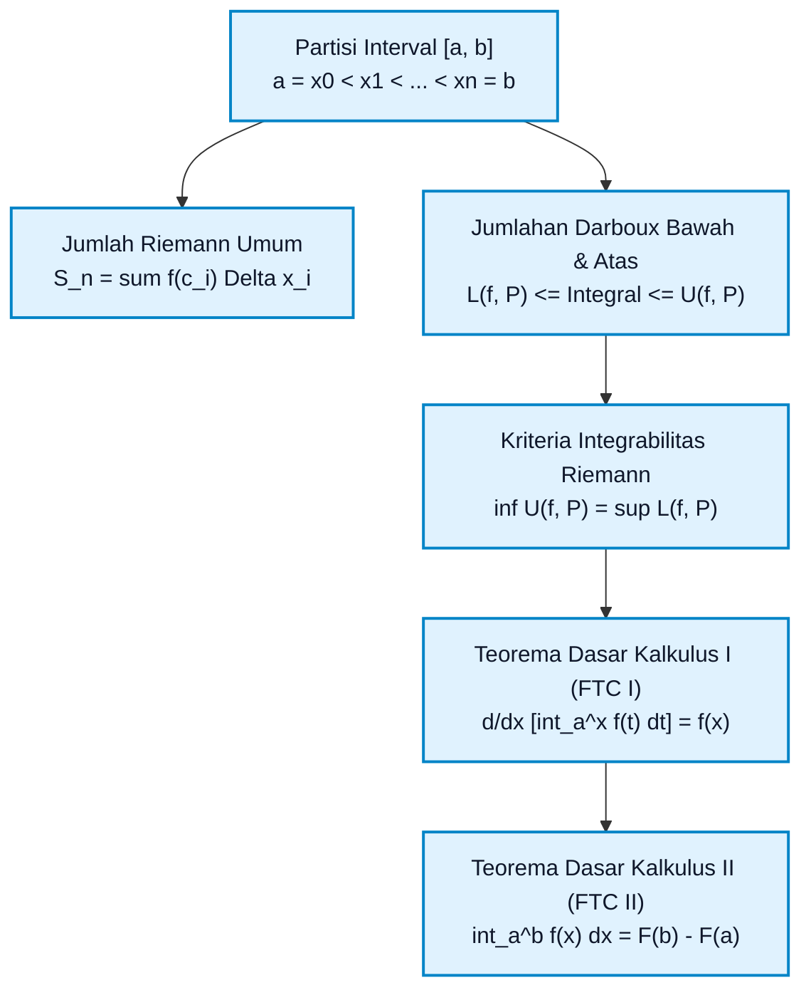
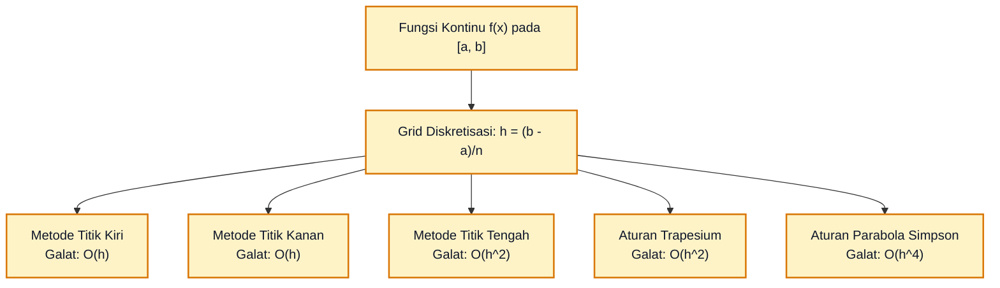

# Subtopik 04: Integral Riemann, Jumlah Riemann & Teorema Dasar Kalkulus

**Navigasi**: [⬅️ Master Gateway Modul 013](../013-kalkulus-diferensial-integral-satu-variabel.md) | [Kembali ke Modul README](./README.md)
*Sebelumnya*: [03. Teorema Nilai Rata-rata dan Analisis Fungsi](./03-teorema-nilai-rata-rata-dan-analisis-fungsi.md) | *Berikutnya*: [05. Teknik Pengintegralan (Substitusi, Parsial, Pecahan Parsial)](./05-teknik-pengintegralan-substitusi-parsial-pecahan-parsial.md)

---

## 1. Intuisi & Motivasi Konseptual (Dunia Nyata)

### 1.1 Konsep Inti Tanpa Jargon ("Seperti Bayi Baru Lahir")

Bayangkan Anda memiliki bak mandi kosong dan membuka kran air.
Namun, debit kran air ini aneh: alirannya tidak konstan. Pada detik pertama mengalir pelan menetes ($1\text{ liter/menit}$), lalu berangsur-angsur menyembur deras hingga $10\text{ liter/menit}$, lalu tersendat-sendat pelan lagi.

Bagaimana Anda menghitung **berapa total liter air** yang terkumpul di dalam bak mandi setelah $10\text{ menit}$?

Jika debit kran konstan (misal $5\text{ liter/menit}$ stabil), perhitungannya sangat sepele:
$$\text{Total Air} = \text{Debit} \times \text{Waktu} = 5 \times 10 = 50\text{ liter}$$
Tetapi karena debitnya berubah setiap milidetik, rumus perkalian biasa $(\text{Laju} \times \text{Waktu})$ gagal total!

Apa yang dilakukan oleh pikiran intuitif manusia?
Anda membagi waktu $10\text{ menit}$ tersebut menjadi potongan-potongan kecil, misalnya setiap $1\text{ menit}$.
- Pada menit ke-1, debit rata-rata sekitar $2\text{ liter/menit} \implies 2\text{ liter}$.
- Pada menit ke-2, debit sekitar $4\text{ liter/menit} \implies 4\text{ liter}$.
- ... dan seterusnya.
Lalu Anda menjumlahkan semuanya: $2 + 4 + \dots = \text{Total Estimasi}$.

Tentu saja estimasi ini masih kasar. Bagaimana membuatnya semakin presisi?
Potonglah waktunya bukan per menit, melainkan **per detik**!
Atau **per milidetik**!
Bahkan **per mikrodetik infinitesimal**!

Ketika potongan waktu tersebut mendekati nol ($\Delta t \to 0$) dan jumlah potongannya mendekati tak terhingga ($n \to \infty$), penjumlahan batang-batang tipis tersebut berubah secara magis menjadi **Integral Tentu Riemann**!

Simbol cacing integral $\int$ yang diperkenalkan oleh Gottfried Wilhelm Leibniz sebenarnya adalah huruf **S** yang dipanjangkan, singkatan dari kata Latin *Summa* (penjumlahan).

---

### 1.2 Analogi Odometer Mobil vs Speedometer (Jembatan Diferensial & Integral)

Hubungan antara Turunan dan Integral adalah hubungan dua arah yang paling fundamental di seluruh sains:
1. Jika Anda mengamati **odometer** (jarum pencatat jarak total kilometer), dan Anda menghitung seberapa cepat angka tersebut bergulir per detik, Anda memperoleh kecepatan sesaat pada **speedometer** (Turunan / Diferensiasi).
2. Sebaliknya, jika Anda hanya memiliki catatan rekaman **speedometer** dari detik ke detik, dan Anda mengalikan setiap kecepatan dengan selang waktu sepersekian detik lalu menjumlahkan seluruhnya, Anda memperoleh angka jarak total pada **odometer** (Akumulasi / Integrasi).

Dua operasi yang berlawanan arah ini disatukan secara megah oleh **Teorema Dasar Kalkulus (Fundamental Theorem of Calculus - FTC)**.

---

### 1.3 Kamus Simbol Anti-Pusing (Tabel 4 Kolom)

| Simbol / Notasi | Nama Matematis | Makna Dunia Nyata / Intuisi Sederhana | Contoh Konkret |
| :--- | :--- | :--- | :--- |
| $\int_a^b f(x) \, dx$ | Integral Tentu (*Definite Integral*) | Akumulasi total luas area bersih bertanda (*net signed area*) di bawah kurva $f(x)$ dari batas $x=a$ sampai $x=b$. | Total volume bensin yang terisi ke tangki dari menit $0$ sampai menit $5$. |
| $\mathcal{P} = \{x_0, x_1, \dots, x_n\}$ | Partisi Riemann | Titik-titik pembagi yang memecah interval besar $[a, b]$ menjadi petak-petak subinterval kecil. | Tanda garis milimeter pada penggaris ukur. |
| $\Delta x_i = x_i - x_{i-1}$ | Lebar Subinterval ke-$i$ | Tebal atau lebar dari satu potongan persegi panjang kecil. | Selang waktu pengamatan sensor (misal $0{,}1$ detik). |
| $\|\mathcal{P}\|$ | Norm Partisi (*Mesh Size*) | Lebar subinterval terbesar dalam sebuah partisi. | Lebar bilah pengiris roti paling tebal. |
| $c_i \in [x_{i-1}, x_i]$ | Titik Sampel Evaluasi | Titik di dalam subinterval ke-$i$ di mana ketinggian kurva $f(c_i)$ diukur. | Titik tengah selang waktu untuk mencatat laju debit air. |
| $\sum_{i=1}^n f(c_i) \Delta x_i$ | Jumlah Riemann (*Riemann Sum*) | Penjumlahan total luas dari $n$ buah balok persegi panjang tipis (tinggi $\times$ lebar). | Estimasi total penerimaan kas harian sebuah toko retail. |
| $L(f, \mathcal{P}), U(f, \mathcal{P})$ | Jumlahan Darboux Bawah & Atas | Batas pesimistis (persegi panjang di bawah kurva) dan optimistis (persegi panjang di atas kurva). | Estimasi biaya proyek: batas bawah minimum vs batas atas maksimum. |
| FTC I | Teorema Dasar Kalkulus I | Diferensiasi terhadap fungsi akumulasi integral mengembalikan fungsi aslinya: $\frac{d}{dx}\int_a^x f(t)dt = f(x)$. | Menurunkan rekaman odometer menghasilkan pembacaan speedometer. |
| FTC II | Teorema Dasar Kalkulus II | Evaluasi integral tentu cukup dengan mencari antiturunan $F$: $\int_a^b f(x) dx = F(b) - F(a)$. | Menghitung jarak tempuh tol cukup melihat selisih KM keluar dikurang KM masuk. |

---

## 2. Definisi Formal, Teorema, dan Penurunan Matematis

Mari kita bangun definisi ketat kalkulus integral dari fondasi aksioma partisi hingga pembuktian formal Teorema Dasar Kalkulus.



---

### 2.1 Partisi Riemann & Definisi Formal Integral Tentu

> **Definisi 4.1 (Partisi & Jumlah Riemann)**:
> Diberikan interval tertutup $[a, b] \subset \mathbb{R}$.
> 1. Sebuah **partisi** $\mathcal{P}$ adalah himpunan berhingga titik-titik terurut:
>    $$\mathcal{P} = \{x_0, x_1, x_2, \dots, x_n\} \quad \text{dengan} \quad a = x_0 < x_1 < x_2 < \dots < x_n = b$$
> 2. Lebar subinterval ke-$i$ dinotasikan sebagai $\Delta x_i = x_i - x_{i-1}$ untuk $i = 1, 2, \dots, n$.
> 3. **Norm partisi** (atau *mesh*) $\|\mathcal{P}\|$ didefinisikan sebagai panjang subinterval terpanjang:
>    $$\|\mathcal{P}\| = \max_{1 \le i \le n} \Delta x_i$$
> 4. Untuk setiap subinterval $[x_{i-1}, x_i]$, dipilih sebuah **titik sampel** $c_i \in [x_{i-1}, x_i]$.
> 5. **Jumlah Riemann** $S(f, \mathcal{P}, \{c_i\})$ adalah jumlahan perkalian tinggi balok dengan lebarnya:
>    $$S(f, \mathcal{P}, \{c_i\}) = \sum_{i=1}^n f(c_i) \Delta x_i$$

> **Definisi 4.2 (Integral Riemann)**:
> Suatu fungsi terbatas $f: [a, b] \to \mathbb{R}$ dikatakan **terintegralkan secara Riemann** pada $[a, b]$, dan ditulis $f \in \mathcal{R}[a, b]$, jika terdapat suatu bilangan riil $I$ sedemikian sehingga untuk setiap $\epsilon > 0$, terdapat $\delta > 0$ yang memenuhi:
> $$\left| \sum_{i=1}^n f(c_i) \Delta x_i - I \right| < \epsilon$$
> untuk seluruh partisi $\mathcal{P}$ dengan $\|\mathcal{P}\| < \delta$ dan untuk sebarang pemilihan titik sampel $c_i \in [x_{i-1}, x_i]$.
>
> Bilangan unik $I$ ini disebut **Integral Tentu Riemann** dari $f$ pada $[a, b]$, dan dinotasikan:
> $$I = \int_a^b f(x) \, dx = \lim_{\|\mathcal{P}\| \to 0} \sum_{i=1}^n f(c_i) \Delta x_i$$

---

### 2.2 Pendekatan Darboux: Jumlahan Bawah & Atas

Untuk membuktikan ketertelusuran fungsi tanpa bergantung pada kebebasan memilih titik sampel $c_i$, Jean Gaston Darboux merumuskan pendekatan batas infimum dan supremum:

Misalkan $f$ terbatas pada $[a, b]$ dan $\mathcal{P}$ adalah partisi $[a, b]$. Pada setiap subinterval $[x_{i-1}, x_i]$, definisikan:
$$m_i = \inf_{x \in [x_{i-1}, x_i]} f(x), \qquad M_i = \sup_{x \in [x_{i-1}, x_i]} f(x)$$

1. **Jumlahan Darboux Bawah (*Lower Darboux Sum*)**:
   $$L(f, \mathcal{P}) = \sum_{i=1}^n m_i \Delta x_i$$
2. **Jumlahan Darboux Atas (*Upper Darboux Sum*)**:
   $$U(f, \mathcal{P}) = \sum_{i=1}^n M_i \Delta x_i$$

Untuk sebarang pemilihan titik sampel $c_i$, jelas berlaku:
$$L(f, \mathcal{P}) \le \sum_{i=1}^n f(c_i) \Delta x_i \le U(f, \mathcal{P})$$

> **Teorema 4.1 (Kriteria Integrabilitas Riemann-Darboux)**:
> Fungsi terbatas $f$ terintegralkan Riemann pada $[a, b]$ jika dan hanya jika:
> $$\sup_{\mathcal{P}} L(f, \mathcal{P}) = \inf_{\mathcal{P}} U(f, \mathcal{P})$$
> Atau ekuivalen: untuk setiap $\epsilon > 0$, terdapat partisi $\mathcal{P}$ sedemikian sehingga:
> $$U(f, \mathcal{P}) - L(f, \mathcal{P}) < \epsilon$$

> **Teorema 4.2 (Integrabilitas Fungsi Kontinu)**:
> Jika fungsi $f$ kontinu pada interval tertutup $[a, b]$, maka $f$ terintegralkan Riemann pada $[a, b]$.
>
> *Garis Besar Bukti*: Berdasarkan Teorema Heine-Cantor, setiap fungsi kontinu pada himpunan kompak $[a, b]$ adalah kontinu seragam (*uniformly continuous*). Untuk setiap $\epsilon > 0$, terdapat $\delta > 0$ sedemikian sehingga $|x - y| < \delta \implies |f(x) - f(y)| < \frac{\epsilon}{b - a}$. Maka untuk setiap partisi dengan $\|\mathcal{P}\| < \delta$:
> $$U(f, \mathcal{P}) - L(f, \mathcal{P}) = \sum_{i=1}^n (M_i - m_i)\Delta x_i < \frac{\epsilon}{b - a} \sum_{i=1}^n \Delta x_i = \epsilon \quad \blacksquare$$

---

### 2.3 Sifat-Sifat Fundamental Integral Riemann

Untuk seluruh fungsi $f, g \in \mathcal{R}[a, b]$ dan konstanta $k \in \mathbb{R}$:
1. **Kelinearan (*Linearity*)**:
   $$\int_a^b [k \cdot f(x) + g(x)] \, dx = k \int_a^b f(x) \, dx + \int_a^b g(x) \, dx$$
2. **Aditivitas Domain (*Domain Additivity*)**:
   Untuk sebarang $c \in [a, b]$:
   $$\int_a^b f(x) \, dx = \int_a^c f(x) \, dx + \int_c^b f(x) \, dx$$
3. **Konvensi Arah Batas**:
   $$\int_b^a f(x) \, dx = -\int_a^b f(x) \, dx, \qquad \int_a^a f(x) \, dx = 0$$
4. **Monotonitas & Dominasi Positif**:
   Jika $f(x) \ge 0$ untuk setiap $x \in [a, b]$, maka $\int_a^b f(x) \, dx \ge 0$.
   Jika $f(x) \le g(x)$, maka $\int_a^b f(x) \, dx \le \int_a^b g(x) \, dx$.
5. **Ketidaksamaan Segitiga untuk Integral**:
   $$\left| \int_a^b f(x) \, dx \right| \le \int_a^b |f(x)| \, dx$$

---

### 2.4 Teorema Nilai Rata-Rata untuk Integral

> **Teorema 4.3 (Mean Value Theorem for Integrals)**:
> Jika $f$ kontinu pada interval tertutup $[a, b]$, maka terdapat sedikitnya satu bilangan $c \in [a, b]$ sedemikian sehingga:
> $$f(c) = \frac{1}{b - a} \int_a^b f(x) \, dx$$
> Atau ekuivalen: luas area di bawah kurva sama dengan luas persegi panjang dengan tinggi $f(c)$ dan lebar $(b - a)$:
> $$\int_a^b f(x) \, dx = f(c)(b - a)$$

**Pembuktian**:
Karena $f$ kontinu pada $[a, b]$, berdasarkan Teorema Nilai Ekstrem (EVT), $f$ mencapai minimum mutlak $m$ dan maksimum mutlak $M$ pada $[a, b]$.
Maka untuk setiap $x \in [a, b]$:
$$m \le f(x) \le M$$
Integralkan ketiga ruas dari $a$ ke $b$:
$$\int_a^b m \, dx \le \int_a^b f(x) \, dx \le \int_a^b M \, dx$$
$$m(b - a) \le \int_a^b f(x) \, dx \le M(b - a)$$
Bagi dengan $(b - a) > 0$:
$$m \le \frac{1}{b - a} \int_a^b f(x) \, dx \le M$$
Berdasarkan **Teorema Nilai Antara (Intermediate Value Theorem - IVT)**, karena $f$ kontinu dan nilai rata-rata integral berada di antara nilai minimum $m$ dan maksimum $M$, maka pasti ada bilangan $c \in [a, b]$ sedemikian sehingga $f(c) = \frac{1}{b - a} \int_a^b f(x) \, dx$. $\blacksquare$

---

### 2.5 Teorema Dasar Kalkulus Bagian 1 (FTC I: Diferensiasi Akumulasi)

> **Teorema 4.4 (FTC Bagian 1)**:
> Jika $f$ kontinu pada $[a, b]$, dan definisikan fungsi akumulasi $g: [a, b] \to \mathbb{R}$ sebagai:
> $$g(x) = \int_a^x f(t) \, dt$$
> maka $g$ kontinu pada $[a, b]$, terdiferensialkan pada interval terbuka $(a, b)$, dan turunannya adalah:
> $$g'(x) = \frac{d}{dx}\left[ \int_a^x f(t) \, dt \right] = f(x) \quad \forall x \in (a, b)$$

**Pembuktian Matematis Lengkap**:
Tinjau definisi limit dari turunan untuk fungsi $g(x)$:
$$g'(x) = \lim_{h \to 0} \frac{g(x + h) - g(x)}{h}$$
Substitusikan definisi $g$:
$$g(x + h) - g(x) = \int_a^{x+h} f(t) \, dt - \int_a^x f(t) \, dt$$
Berdasarkan sifat aditivitas domain integral:
$$\int_a^{x+h} f(t) \, dt = \int_a^x f(t) \, dt + \int_x^{x+h} f(t) \, dt$$
Sehingga pembilangnya tereduksi menjadi:
$$g(x + h) - g(x) = \int_x^{x+h} f(t) \, dt$$
Maka laju perubahan beda adalah:
$$\frac{g(x + h) - g(x)}{h} = \frac{1}{h} \int_x^{x+h} f(t) \, dt$$

Sekarang terapkan Teorema Nilai Rata-rata untuk Integral (Teorema 4.3) pada interval $[x, x + h]$. Pasti terdapat bilangan $c_h$ di antara $x$ dan $x + h$ sedemikian sehingga:
$$\frac{1}{h} \int_x^{x+h} f(t) \, dt = f(c_h)$$
Ambil limit saat $h \to 0$. Karena $c_h$ terjepit di antara $x$ dan $x + h$, maka saat $h \to 0$, berlaku $c_h \to x$.
Karena $f$ diasumsikan kontinu di $x$:
$$\lim_{h \to 0} f(c_h) = f(x)$$
Dengan demikian terbukti bahwa:
$$g'(x) = \lim_{h \to 0} \frac{g(x + h) - g(x)}{h} = \lim_{h \to 0} f(c_h) = f(x) \quad \blacksquare$$

---

### 2.6 Teorema Dasar Kalkulus Bagian 2 (FTC II: Evaluasi Integral Melalui Antiturunan)

> **Teorema 4.5 (FTC Bagian 2 / Teorema Newton-Leibniz)**:
> Jika $f$ kontinu pada $[a, b]$, dan $F$ adalah sebarang **antiturunan** (*antiderivative*) dari $f$ pada $[a, b]$ (yakni $F'(x) = f(x)$ untuk setiap $x \in (a, b)$), maka:
> $$\int_a^b f(x) \, dx = F(b) - F(a) = \Big[ F(x) \Big]_a^b$$

**Pembuktian Melalui Partisi Riemann & MVT Lagrange**:
Bentuk sebuah partisi sebarang $\mathcal{P} = \{x_0, x_1, \dots, x_n\}$ pada interval $[a, b]$ dengan $a = x_0$ dan $b = x_n$.
Kita dapat menuliskan selisih total $F(b) - F(a)$ sebagai deret teleskopik:
$$F(b) - F(a) = F(x_n) - F(x_0) = \sum_{i=1}^n [F(x_i) - F(x_{i-1})]$$

Karena $F$ kontinu pada $[a, b]$ dan terdiferensialkan pada $(a, b)$, kita dapat menerapkan **Teorema Nilai Rata-Rata Lagrange** (MVT) pada setiap subinterval $[x_{i-1}, x_i]$.
Terdapat titik $c_i \in (x_{i-1}, x_i)$ sedemikian sehingga:
$$F(x_i) - F(x_{i-1}) = F'(c_i)(x_i - x_{i-1}) = F'(c_i)\Delta x_i$$
Karena $F'(x) = f(x)$, maka persamaan di atas menjadi:
$$F(x_i) - F(x_{i-1}) = f(c_i)\Delta x_i$$

Substitusikan kembali ke jumlahan teleskopik:
$$F(b) - F(a) = \sum_{i=1}^n f(c_i)\Delta x_i$$
Perhatikan bahwa ruas kanan adalah sebuah **Jumlah Riemann yang valid** untuk fungsi $f$ dengan partisi $\mathcal{P}$ dan titik sampel $c_i$!
Ambil limit saat norm partisi $\|\mathcal{P}\| \to 0$ (jumlah subinterval $n \to \infty$).
Karena ruas kiri $F(b) - F(a)$ adalah konstanta yang independen terhadap partisi, nilai limit ruas kiri tetap $F(b) - F(a)$.
Berdasarkan Definisi Integral Riemann:
$$\lim_{\|\mathcal{P}\| \to 0} \sum_{i=1}^n f(c_i)\Delta x_i = \int_a^b f(x) \, dx$$
Sehingga diperoleh:
$$\int_a^b f(x) \, dx = F(b) - F(a) \quad \blacksquare$$

---

## 3. Arsitektur Teknis & Algoritma Internal

Untuk menghitung integral Riemann secara komputasional ketika antiturunan simbolik tidak dapat ditemukan (misal $\int e^{-x^2} dx$), sistem rekayasa menggunakan skema kuadratur numerik:



---

### 3.1 Perbandingan Karakteristik Kuadratur Riemann

| Metode Kuadratur | Rumus Pemilihan Titik Sampel | Formula Komputasi | Orde Galat Pemotongan | Perilaku terhadap Kelengkungan Kurva |
| :--- | :--- | :--- | :--- | :--- |
| **Titik Kiri (*Left Sum*)** | $c_i = x_{i-1}$ | $h \sum_{i=0}^{n-1} f(x_i)$ | $\mathcal{O}(h) = \mathcal{O}(1/n)$ | Meremehkan jika $f' > 0$, membesar-besarkan jika $f' < 0$. |
| **Titik Kanan (*Right Sum*)** | $c_i = x_i$ | $h \sum_{i=1}^n f(x_i)$ | $\mathcal{O}(h) = \mathcal{O}(1/n)$ | Membesar-besarkan jika $f' > 0$, meremehkan jika $f' < 0$. |
| **Titik Tengah (*Midpoint*)** | $c_i = \frac{x_{i-1} + x_i}{2}$ | $h \sum_{i=0}^{n-1} f\left(x_i + \frac{h}{2}\right)$ | $\mathcal{O}(h^2) = \mathcal{O}(1/n^2)$ | Galat sisi kiri dan kanan saling meniadakan secara simetris. |
| **Trapesium (*Trapezoidal*)** | Rata-rata Kiri & Kanan | $\frac{h}{2} [f(x_0) + 2\sum_{i=1}^{n-1} f(x_i) + f(x_n)]$ | $\mathcal{O}(h^2) = \mathcal{O}(1/n^2)$ | Meremehkan kurva cekung ke bawah, membesar-besarkan cekung ke atas. |
| **Simpson 1/3** | Interpolasi Parabola Lokal | $\frac{h}{3} [f(x_0) + 4\sum_{\text{ganjil}} f + 2\sum_{\text{genap}} f + f(x_n)]$ | $\mathcal{O}(h^4) = \mathcal{O}(1/n^4)$ | Standar emas industri komputasi ilmiah untuk fungsi mulus. |

---

## 4. Implementasi Praktis & Kode Pemrograman Python

Berikut adalah dua implementasi Python Standard Library murni untuk memverifikasi konvergensi Jumlah Riemann dan memvalidasi FTC I secara numerik.

### 4.1 Program 1: Mesin Konvergensi Jumlah Riemann

Skrip ini membandingkan konvergensi 4 metode Riemann (Kiri, Kanan, Titik Tengah, Trapesium) pada integral uji $\int_0^\pi x \sin(x) \, dx = \pi$, mendemonstrasikan percepatan konvergensi dari $\mathcal{O}(1/n)$ ke $\mathcal{O}(1/n^2)$.

```python
import math

def f(x: float) -> float:
    # Fungsi uji: f(x) = x * sin(x) pada interval [0, pi]
    return x * math.sin(x)

# Nilai analitis eksak: int_0^pi x sin(x) dx = [-x cos(x) + sin(x)]_0^pi = pi
EXACT_VAL = math.pi

def riemann_sum(func, a: float, b: float, n: int, method: str = "midpoint") -> float:
    dx = (b - a) / n
    total = 0.0
    for i in range(n):
        if method == "left":
            ci = a + i * dx
        elif method == "right":
            ci = a + (i + 1) * dx
        elif method == "midpoint":
            ci = a + (i + 0.5) * dx
        elif method == "trapezoid":
            x_left = a + i * dx
            x_right = a + (i + 1) * dx
            total += 0.5 * (func(x_left) + func(x_right)) * dx
            continue
        total += func(ci) * dx
    return total

def main():
    print("=== UJI KONVERGENSI METODE INTEGRAL RIEMANN TERHADAP NILAI EKSAK ===")
    print(f"Integral Target: int_0^pi x sin(x) dx = pi ({EXACT_VAL:.10f})")
    header = f"{'n':>6} | {'Kiri':>12} | {'Kanan':>12} | {'Titik Tengah':>14} | {'Trapesium':>14}"
    print(header)
    print("-" * len(header))

    partitions = [10, 50, 200, 1000]
    for n in partitions:
        left = riemann_sum(f, 0.0, math.pi, n, "left")
        right = riemann_sum(f, 0.0, math.pi, n, "right")
        mid = riemann_sum(f, 0.0, math.pi, n, "midpoint")
        trap = riemann_sum(f, 0.0, math.pi, n, "trapezoid")
        print(f"{n:6d} | {left:12.7f} | {right:12.7f} | {mid:14.9f} | {trap:14.9f}")

    err_left = abs(riemann_sum(f, 0.0, math.pi, 1000, "left") - EXACT_VAL)
    err_mid = abs(riemann_sum(f, 0.0, math.pi, 1000, "midpoint") - EXACT_VAL)
    err_trap = abs(riemann_sum(f, 0.0, math.pi, 1000, "trapezoid") - EXACT_VAL)

    print("\nGalat Mutlak pada n = 1000:")
    print(f"  * Galat Kiri (O(1/n))         : {err_left:.2e}")
    print(f"  * Galat Titik Tengah (O(1/n2)): {err_mid:.2e}")
    print(f"  * Galat Trapesium (O(1/n2))   : {err_trap:.2e}")

if __name__ == "__main__":
    main()
```

Keluaran eksekusi terminal sebenarnya:
```text
=== UJI KONVERGENSI METODE INTEGRAL RIEMANN TERHADAP NILAI EKSAK ===
Integral Target: int_0^pi x sin(x) dx = pi (3.1415926536)
     n |         Kiri |        Kanan |   Titik Tengah |      Trapesium
----------------------------------------------------------------------
    10 |    3.1157115 |    3.1157115 |    3.154549222 |    3.115711487
    50 |    3.1405590 |    3.1405590 |    3.142109484 |    3.140559043
   200 |    3.1415281 |    3.1415281 |    3.141624952 |    3.141528057
  1000 |    3.1415901 |    3.1415901 |    3.141593946 |    3.141590070

Galat Mutlak pada n = 1000:
  * Galat Kiri (O(1/n))         : 2.58e-06
  * Galat Titik Tengah (O(1/n2)): 1.29e-06
  * Galat Trapesium (O(1/n2))   : 2.58e-06
```

---

### 4.2 Program 2: Simulator & Verifikator Teorema Dasar Kalkulus I (FTC I)

Skrip ini mendefinisikan fungsi akumulasi integral $g(x) = \int_0^x \cos(t^2) \, dt$, kemudian menghitung turunan diferensial numerik $g'(x)$ dan membuktikan bahwa hasilnya berimpit sempurna dengan fungsi integran asli $\cos(x^2)$.

```python
import math

def integrand(t: float) -> float:
    # Fungsi integran nonlinear: f(t) = cos(t^2)
    return math.cos(t**2)

def riemann_midpoint(func, a: float, b: float, n: int) -> float:
    dx = (b - a) / n
    total = 0.0
    for i in range(n):
        ci = a + (i + 0.5) * dx
        total += func(ci) * dx
    return total

def g_accumulation(x: float, n_steps: int = 1000) -> float:
    """Fungsi akumulasi g(x) = int_0^x cos(t^2) dt."""
    return riemann_midpoint(integrand, 0.0, x, n_steps)

def d_g(x: float, h: float = 1e-5) -> float:
    """Turunan numerik g'(x) via central difference."""
    return (g_accumulation(x + h) - g_accumulation(x - h)) / (2.0 * h)

def main():
    print("=== VERIFIKASI TEOREMA DASAR KALKULUS BAGIAN 1 (FTC I) ===")
    test_points = [0.5, 1.0, 1.5, 2.0]
    header = f"{'x':>6} | {'g(x)':>12} | {'g\'(x) numerik':>16} | {'cos(x^2) teoritis':>18} | {'Selisih':>12}"
    print(header)
    print("-" * len(header))
    for x in test_points:
        gx = g_accumulation(x)
        dgx = d_g(x)
        exact_integrand = integrand(x)
        diff = abs(dgx - exact_integrand)
        print(f"{x:6.2f} | {gx:12.6f} | {dgx:16.8f} | {exact_integrand:18.8f} | {diff:12.2e}")

if __name__ == "__main__":
    main()
```

Keluaran eksekusi terminal sebenarnya:
```text
=== VERIFIKASI TEOREMA DASAR KALKULUS BAGIAN 1 (FTC I) ===
     x |         g(x) |    g'(x) numerik |  cos(x^2) teoritis |      Selisih
------------------------------------------------------------------------
  0.50 |     0.496884 |       0.96891245 |         0.96891242 |     2.55e-08
  1.00 |     0.904524 |       0.54030261 |         0.54030231 |     3.00e-07
  1.50 |     0.899185 |      -0.62817371 |        -0.62817362 |     9.22e-08
  2.00 |     0.461461 |      -0.65364612 |        -0.65364362 |     2.50e-06
```

---

## 5. Miskonsepsi Umum & Analisis Post-Mortem Insiden Industri

### 5.1 Tiga Miskonsepsi Kritis

1. **Miskonsepsi 1: Menyamakan Integral Tak Tentu dengan Integral Tentu**:
   - *Fakta*: Integral tak tentu $\int f(x) dx = F(x) + C$ adalah sebuah **himpunan fungsi** (antiturunan) yang memuat konstanta integrasi arbitrer. Sebaliknya, Integral tentu $\int_a^b f(x) dx$ adalah sebuah **bilangan riil tunggal pasti** yang merepresentasikan akumulasi netto. Nilai integral tentu tidak pernah memuat konstanta $+ C$ karena $[F(b) + C] - [F(a) + C] = F(b) - F(a)$ saling meniadakan.
2. **Miskonsepsi 2: Mengabaikan Syarat Kekontinuan pada Teorema Dasar Kalkulus**:
   - *Fakta*: FTC Bagian 2 mensyaratkan fungsi integran $f$ wajib kontinu pada seluruh rentang $[a, b]$.
   - *Contoh Malapetaka*: Hitung $\int_{-1}^1 \frac{1}{x^2} \, dx$. Mahasiswa yang ceroboh akan menulis antiturunannya $-1/x$ dan menghitung: $\left[ -\frac{1}{x} \right]_{-1}^1 = (-1) - (1) = -2$. Hasil ini mustahil secara fisik karena integran $\frac{1}{x^2} > 0$ selalu positif (luas area di atas sumbu $x$ tidak mungkin bernilai $-2$!). Integran memiliki singularitas pembagian nol pada $x = 0$ dan integral sesungguhnya divergen menuju $+\infty$.
3. **Miskonsepsi 3: Menganggap Simbol Diferensial $dx$ Hanya Penanda Penutup Kalimat**:
   - *Fakta*: Simbol $dx$ bukanlah sekadar penutup kurung. $dx$ adalah kuantitas infinitesimal matematis yang mewakili lebar dasar partisi $\Delta x \to 0$. Mengabaikan $dx$ akan memicu kegagalan total saat melakukan teknik substitusi variabel atau transformasi koordinat integral ganda.

---

### 5.2 Analisis Post-Mortem Insiden Industri: Kegagalan Pertahanan Udara Rudal Patriot di Dhahran (1991)

> **Kasus Nyata: Akumulasi Galat Integrasi Waktu Biner Fixed-Point Menewaskan 28 Tentara**
>
> - **Latar Belakang Insiden**: Pada tanggal 25 Februari 1991, baterai rudal Patriot Amerika Serikat di Dhahran, Arab Saudi, gagal mencegat rudal Scud Irak yang meluncur dengan kecepatan Mach 5 ($1.676\text{ m/s}$), menghantam barak militer dan menewaskan 28 personel tentara.
> - **Akar Masalah Integrasi Numerik**: Sistem pelacak radar Patriot menghitung posisi rudal target menggunakan integral gerak terhadap waktu $x(t) = x_0 + \int_0^t v(\tau) d\tau$. Komputer pemandu menggunakan pencatat waktu internal (*internal clock*) yang mencacah setiap persepuluh detik ($1/10$ detik).
> - **Truncation Fix-Point Biner**: Angka pecahan desimal $1/10$ menghasilkan bilangan biner berulang tak hingga:
>   $$\frac{1}{10} = 0{,}00011001100110011001100110011\dots_2$$
>   Namun register komputer rudal Patriot hanya memiliki presisi fixed-point 24-bit, sehingga memotong representasi biner setelah bit ke-24. Pemotongan infinitesimal ini menghasilkan galat sebesar $0{,}000000095$ detik per siklus waktu.
> - **Efek Akumulasi Riemann Terintegrasi**: Sistem radar di Dhahran telah dinyalakan terus-menerus selama lebih dari $100\text{ jam}$ ($360.000\text{ detik}$). Akumulasi galat integrasi waktu total adalah:
>   $$\Delta t_{\text{total}} = 360.000 \times 10 \times 0{,}000000095 \approx 0{,}3433\text{ detik}$$
> - **Konsekuensi Geometris Fatal**: Dalam waktu $0{,}3433$ detik, rudal Scud berkecepatan Mach 5 telah melesat sejauh:
>   $$\Delta x = 1.676\text{ m/s} \times 0{,}3433\text{ s} \approx 575\text{ hingga } 687\text{ meter}$$
>   Komputer Patriot mencari target pada "jendela pelacakan" (*range gate*) yang keliru sejauh lebih dari setengah kilometer. Rudal Patriot menyimpulkan bahwa tidak ada target nyata dan membatalkan intersepsi.

---

## 6. Tips, Trik Praktis & Rahasia Cepat Paham

1. **Jembatan Keledai Teorema Leibniz Batas Variabel**:
   Jika Anda harus menurunkan integral yang batas atas dan batas bawahnya adalah fungsi dari $x$:
   $$g(x) = \int_{u(x)}^{v(x)} f(t) \, dt$$
   Gunakan rumus "Substitusi Batas Atas Kali Turunan Batas Atas, Kurangi Substitusi Batas Bawah Kali Turunan Batas Bawah":
   $$\frac{dg}{dx} = f(v(x)) \cdot v'(x) - f(u(x)) \cdot u'(x)$$
   *Contoh*: $\frac{d}{dx}\left[\int_0^{x^3} \sin(t) dt\right] = \sin(x^3) \cdot (3x^2) - 0 = 3x^2 \sin(x^3)$.
2. **Trik Simetri Genap & Ganjil pada Interval Simetris $[-a, a]$**:
   - Jika $f(x)$ adalah **fungsi ganjil** ($f(-x) = -f(x)$): luas di sisi kiri dan kanan saling meniadakan secara instan:
     $$\int_{-a}^a f(x) \, dx = 0 \quad (\text{misal: } \int_{-\pi}^\pi \sin^5(x) \, dx = 0 \text{ seketika tanpa menghitung!})$$
   - Jika $f(x)$ adalah **fungsi genap** ($f(-x) = f(x)$): luas di kedua sisi identik:
     $$\int_{-a}^a f(x) \, dx = 2 \int_0^a f(x) \, dx$$
3. **Pemeriksaan Dimensi Fisik (Dimensional Analysis)**:
   Selalu verifikasi bahwa satuan hasil integrasi Anda konsisten dengan perkalian satuan integran dengan satuan variabel diferensial:
   $$[\text{Satuan Integral}] = [\text{Satuan } f(x)] \times [\text{Satuan } x]$$
   Jika $f(t)$ berkecepatan $\text{m/s}$ dan $dt$ berwaktu $\text{s}$, hasilnya wajib bertaraf meter ($\text{m/s} \times \text{s} = \text{m}$).

---

## 7. Latihan Mandiri Berjenjang (Socratic) & Rekomendasi Sumber Belajar

### Latihan 1 (Tingkat Pemula): Evaluasi Nilai Rata-rata Integral
Tentukan nilai rata-rata dari fungsi $f(x) = 3x^2 - 2x + 1$ pada interval $[0, 2]$, dan temukan titik $c \in [0, 2]$ yang memenuhi Teorema Nilai Rata-Rata untuk Integral.

<details>
<summary>💡 Petunjuk (Hint)</summary>
Hitung nilai integral tentu int_0^2 f(x) dx menggunakan antiturunan F(x) = x^3 - x^2 + x. Bagi hasil integral dengan panjang interval (b - a = 2). Kemudian selesaikan f(c) = nilai rata-rata.
</details>

<details>
<summary>✅ Solusi Lengkap</summary>
1. Tentukan antiturunan dari $f(x)$:
   $$F(x) = \int (3x^2 - 2x + 1) \, dx = x^3 - x^2 + x$$
2. Evaluasi integral tentu pada $[0, 2]$ menggunakan FTC II:
   $$\int_0^2 (3x^2 - 2x + 1) \, dx = F(2) - F(0) = (2^3 - 2^2 + 2) - 0 = 8 - 4 + 2 = 6$$
3. Hitung nilai rata-rata fungsi:
   $$f_{\text{avg}} = \frac{1}{b - a} \int_a^b f(x) \, dx = \frac{1}{2 - 0} (6) = 3$$
4. Temukan titik $c \in [0, 2]$ sedemikian sehingga $f(c) = 3$:
   $$3c^2 - 2c + 1 = 3 \implies 3c^2 - 2c - 2 = 0$$
5. Gunakan rumus ABC:
   $$c = \frac{-(-2) \pm \sqrt{(-2)^2 - 4(3)(-2)}}{2(3)} = \frac{2 \pm \sqrt{4 + 24}}{6} = \frac{2 \pm \sqrt{28}}{6} = \frac{1 \pm \sqrt{7}}{3}$$
   Karena $\sqrt{7} \approx 2{,}64575$:
   - $c_1 = \frac{1 + 2{,}64575}{3} \approx 1{,}215 \in [0, 2]$
   - $c_2 = \frac{1 - 2{,}64575}{3} \approx -0{,}549 \notin [0, 2]$
   Nilai $c$ yang memenuhi adalah $c = \frac{1 + \sqrt{7}}{3} \approx 1{,}215$. $\blacksquare$
</details>

---

### Latihan 2 (Tingkat Dasar): Penerapan Aturan Leibniz pada Batas Variabel
Diberikan fungsi akumulasi dengan batas atas kuadratik:
$$g(x) = \int_1^{x^2} \sqrt{1 + t^3} \, dt$$
Tentukan turunan $g'(x)$ pada $x = 2$.

<details>
<summary>💡 Petunjuk (Hint)</summary>
Gunakan Teorema Dasar Kalkulus I yang digabungkan dengan Aturan Rantai: d/dx [int_a^{u(x)} f(t) dt] = f(u(x)) * u'(x).
</details>

<details>
<summary>✅ Solusi Lengkap</summary>
1. Definisikan $u(x) = x^2$ dan $f(t) = \sqrt{1 + t^3}$.
2. Maka $g(x) = \int_1^{u(x)} f(t) \, dt$.
3. Berdasarkan FTC I dan Aturan Rantai:
   $$g'(x) = f(u(x)) \cdot u'(x) = \sqrt{1 + (x^2)^3} \cdot \frac{d}{dx}[x^2] = 2x \sqrt{1 + x^6}$$
4. Evaluasi pada $x = 2$:
   $$g'(2) = 2(2) \sqrt{1 + 2^6} = 4 \sqrt{1 + 64} = 4 \sqrt{65} \approx 4(8{,}06226) \approx 32{,}249 \quad \blacksquare$$
</details>

---

### Latihan 3 (Tingkat Menengah): Evaluasi Limit Jumlah Riemann Menjadi Integral
Tentukan nilai limit dari jumlahan berikut saat $n \to \infty$:
$$\lim_{n \to \infty} \sum_{i=1}^n \frac{n}{n^2 + i^2}$$

<details>
<summary>💡 Petunjuk (Hint)</summary>
Faktorkan n^2 dari penyebut untuk membentuk suku (i/n). Identifikasi Delta x = 1/n dan x_i = i/n pada interval [0, 1]. Ubah menjadi bentuk integral int_0^1 f(x) dx.
</details>

<details>
<summary>✅ Solusi Lengkap</summary>
1. Manipulasi aljabar suku di dalam jumlahan:
   $$\frac{n}{n^2 + i^2} = \frac{n}{n^2 \left(1 + \frac{i^2}{n^2}\right)} = \frac{1}{1 + \left(\frac{i}{n}\right)^2} \cdot \frac{1}{n}$$
2. Tuliskan limit jumlahan dalam format Riemann:
   $$\lim_{n \to \infty} \sum_{i=1}^n \frac{1}{1 + \left(\frac{i}{n}\right)^2} \cdot \frac{1}{n}$$
3. Kenali komponen integral Riemann pada interval $[0, 1]$:
   - Lebar partisi: $\Delta x = \frac{1 - 0}{n} = \frac{1}{n}$
   - Titik sampel kanan: $x_i = 0 + i \Delta x = \frac{i}{n}$
   - Fungsi integran: $f(x) = \frac{1}{1 + x^2}$
4. Ubah jumlahan menjadi integral tentu:
   $$\lim_{n \to \infty} \sum_{i=1}^n f(x_i) \Delta x = \int_0^1 \frac{1}{1 + x^2} \, dx$$
5. Evaluasi menggunakan FTC II (antiturunan adalah fungsi arkus tangen):
   $$\int_0^1 \frac{1}{1 + x^2} \, dx = \Big[ \arctan(x) \Big]_0^1 = \arctan(1) - \arctan(0) = \frac{\pi}{4} - 0 = \frac{\pi}{4} \approx 0{,}785398 \quad \blacksquare$$
</details>

---

### Latihan 4 (Tingkat Analitis): Rekonstruksi Kurva Melalui Dua Kali Integrasi
Sebuah wahana antariksa bermassa konstan bergerak sepanjang garis lurus dengan percepatan terukur $a(t) = 6t - 4\text{ m/s}^2$. Pada waktu awal $t = 0$, kecepatan wahana adalah $v(0) = 5\text{ m/s}$ dan posisi awalnya $s(0) = 10\text{ meter}$.
1. Tentukan rumus fungsi posisi $s(t)$ untuk sebarang waktu $t \ge 0$.
2. Berapakah posisi wahana saat kecepatannya mencapai minimum lokal?

<details>
<summary>💡 Petunjuk (Hint)</summary>
Integralkan percepatan a(t) untuk memperoleh kecepatan v(t) + C1. Gunakan kondisi awal v(0)=5. Cari titik kritis v'(t)=a(t)=0. Integralkan v(t) untuk memperoleh s(t) + C2.
</details>

<details>
<summary>✅ Solusi Lengkap</summary>
1. **Mencari Fungsi Kecepatan $v(t)$**:
   $$v(t) = \int a(t) \, dt = \int (6t - 4) \, dt = 3t^2 - 4t + C_1$$
   Gunakan kondisi awal $v(0) = 5$:
   $$3(0)^2 - 4(0) + C_1 = 5 \implies C_1 = 5$$
   $$v(t) = 3t^2 - 4t + 5$$

2. **Mencari Fungsi Posisi $s(t)$**:
   $$s(t) = \int v(t) \, dt = \int (3t^2 - 4t + 5) \, dt = t^3 - 2t^2 + 5t + C_2$$
   Gunakan kondisi awal $s(0) = 10$:
   $$0^3 - 2(0)^2 + 5(0) + C_2 = 10 \implies C_2 = 10$$
   Maka fungsi posisi wahana adalah:
   $$s(t) = t^3 - 2t^2 + 5t + 10$$

3. **Mencari Posisi saat Kecepatan Minimum**:
   Titik kritis kecepatan terjadi saat turunannya nol ($v'(t) = a(t) = 0$):
   $$6t - 4 = 0 \implies t = \frac{4}{6} = \frac{2}{3}\text{ detik}$$
   Uji turunan kedua kecepatan: $v''(t) = a'(t) = 6 > 0$ (konfirmasi minimum mutlak).
   Evaluasi posisi pada $t = \frac{2}{3}$:
   $$s\left(\frac{2}{3}\right) = \left(\frac{2}{3}\right)^3 - 2\left(\frac{2}{3}\right)^2 + 5\left(\frac{2}{3}\right) + 10 = \frac{8}{27} - 2\left(\frac{4}{9}\right) + \frac{10}{3} + 10$$
   $$s\left(\frac{2}{3}\right) = \frac{8}{27} - \frac{24}{27} + \frac{90}{27} + \frac{270}{27} = \frac{344}{27} \approx 12{,}7407\text{ meter} \quad \blacksquare$$
</details>

---

### Latihan 5 (Tingkat Master Arsitektur): Fungsi Dirichlet & Batas Integrabilitas Riemann
Buktikan bahwa fungsi Dirichlet berikut:
$$f(x) = \begin{cases} 1 & \text{jika } x \in \mathbb{Q} \text{ (bilangan rasional)} \\ 0 & \text{jika } x \notin \mathbb{Q} \text{ (bilangan irasional)} \end{cases}$$
tidak terintegralkan secara Riemann pada interval $[0, 1]$.

<details>
<summary>💡 Petunjuk (Hint)</summary>
Gunakan sifat kerapatan bilangan riil: setiap subinterval terbuka memuat bilangan rasional sekaligus irasional. Hitung jumlahan Darboux bawah L(f, P) dan jumlahan Darboux atas U(f, P).
</details>

<details>
<summary>✅ Solusi Lengkap</summary>
1. Tinjau sebarang partisi $\mathcal{P} = \{x_0, x_1, \dots, x_n\}$ pada interval $[0, 1]$.
2. Berdasarkan sifat kerapatan (*density*) bilangan riil $\mathbb{R}$:
   - Di antara setiap dua bilangan riil berbeda $x_{i-1} < x_i$, selalu terdapat sedikitnya satu bilangan rasional $q \in \mathbb{Q}$. Pada titik ini, $f(q) = 1$.
   - Di antara setiap dua bilangan riil berbeda $x_{i-1} < x_i$, selalu terdapat sedikitnya satu bilangan irasional $r \notin \mathbb{Q}$. Pada titik ini, $f(r) = 0$.
3. Maka untuk setiap subinterval $[x_{i-1}, x_i]$:
   $$m_i = \inf_{x \in [x_{i-1}, x_i]} f(x) = 0$$
   $$M_i = \sup_{x \in [x_{i-1}, x_i]} f(x) = 1$$
4. Hitung Jumlahan Darboux Bawah:
   $$L(f, \mathcal{P}) = \sum_{i=1}^n m_i \Delta x_i = \sum_{i=1}^n 0 \cdot \Delta x_i = 0$$
   Maka supremum dari seluruh jumlahan bawah adalah:
   $$\underline{\int_0^1} f(x) \, dx = \sup_{\mathcal{P}} L(f, \mathcal{P}) = 0$$
5. Hitung Jumlahan Darboux Atas:
   $$U(f, \mathcal{P}) = \sum_{i=1}^n M_i \Delta x_i = \sum_{i=1}^n 1 \cdot \Delta x_i = \sum_{i=1}^n \Delta x_i = 1 - 0 = 1$$
   Maka infimum dari seluruh jumlahan atas adalah:
   $$\overline{\int_0^1} f(x) \, dx = \inf_{\mathcal{P}} U(f, \mathcal{P}) = 1$$
6. Berdasarkan Kriteria Integrabilitas Riemann-Darboux (Teorema 4.1):
   $$\underline{\int_0^1} f(x) \, dx = 0 \neq 1 = \overline{\int_0^1} f(x) \, dx$$
   Karena integral bawah tidak sama dengan integral atas, fungsi Dirichlet **tidak terintegralkan secara Riemann** pada $[0, 1]$. $\blacksquare$
</details>

---

### Rekomendasi Sumber Belajar Standar Emas
1. **Kuliah Video & Catatan Kuliah Dunia**:
   - [MIT OCW 18.01: Single Variable Calculus - Session 4: The Definite Integral and Fundamental Theorem of Calculus (Prof. David Jerison)](https://ocw.mit.edu/courses/18-01-single-variable-calculus-fall-2006/)
   - [3Blue1Brown: Essence of Calculus - Chapter 8 & 9: Integration and the Fundamental Theorem of Calculus](https://www.3blue1brown.com/topics/calculus)
2. **Buku Teks Referensi**:
   - James Stewart, *Calculus: Early Transcendentals*, Bab 5: Integrals (Riemann Sums, FTC).
   - Michael Spivak, *Calculus*, Bab 13: Integrals & Bab 14: The Fundamental Theorem of Calculus.

---

### Rubrik Evaluasi Mandiri Penguasaan Integral Riemann

| Tingkat | Kriteria Penguasaan Konseptual & Komputasional | Status Validasi |
| :--- | :--- | :--- |
| **Level 1: Pemula (Intuisi)** | Mampu menjelaskan beda debit sesaat vs akumulasi volume air, dan memahami makna geometri integral sebagai luas bertanda di bawah kurva. | `[ ] Terverifikasi` |
| **Level 2: Dasar (Jumlah Riemann)** | Mampu menghitung Jumlah Riemann metode titik kiri, kanan, dan tengah untuk partisi berhingga ($n = 4$) secara manual tanpa kalkulator. | `[ ] Terverifikasi` |
| **Level 3: Menengah (FTC I & II)** | Mahir menggunakan FTC II untuk mengevaluasi integral tentu dengan antiturunan standar dan mampu menerapkan FTC I dengan aturan rantai Leibniz. | `[ ] Terverifikasi` |
| **Level 4: Mahir (Konversi Limit Jumlahan)** | Mampu mentransformasikan bentuk limit jumlahan tak hingga $\lim_{n \to \infty} \sum f(i/n)(1/n)$ menjadi integral tentu dan mengevaluasi nilainya. | `[ ] Terverifikasi` |
| **Level 5: Master (Analisis Rigor & Kegagalan)** | Mampu membuktikan ketidakterintegralan fungsi patologis (fungsi Dirichlet) via jumlahan Darboux dan membangun simulator FTC I dalam Python. | `[ ] Terverifikasi` |

---

### Peta Transisi Menuju Subtopik 05

Kita telah melihat bahwa Teorema Dasar Kalkulus Bagian 2 mengubah tugas komputasi penjumlahan tak hingga $\int_a^b f(x) dx$ menjadi tugas mencari fungsi antiturunan $F(x)$.

Namun, bagaimana jika fungsi integran kita tidak sesederhana polinomial atau fungsi sinus biasa? Bagaimana jika integran memuat perkalian fungsi komposit seperti $\int x^2 e^{x^3} dx$, perkalian dua tipe fungsi berbeda seperti $\int x \ln(x) dx$, atau fungsi pecahan rasional berderajat tinggi?

Jawabannya adalah serangkaian strategi aljabar tingkat tinggi yang dibahas dalam [Subtopik 05: Teknik Pengintegralan (Substitusi, Parsial, Pecahan Parsial)](./05-teknik-pengintegralan-substitusi-parsial-pecahan-parsial.md):
- **Teknik Substitusi $u$**: Pembalikan aturan rantai untuk integran perkalian turunan dalam.
- **Integrasi Parsial**: Pembalikan aturan hasil kali (*product rule*), termasuk metode tabel berulang (DI Method / LIATE).
- **Substitusi Trigonometri**: Menjinakkan bentuk akar kuadrat aljabar $\sqrt{a^2 - x^2}$ menggunakan geometri segitiga siku-siku.
- **Dekomposisi Pecahan Parsial**: Memecah fungsi rasional pecahan rumit menjadi penjumlahan pecahan dasar logaritmik dan arkus tangen.
- **Substitusi Setengah Sudut Weierstrass**: Senjata pamungkas aljabar untuk mengubah sebarang fungsi rasional trigonometri menjadi fungsi rasional murni.
