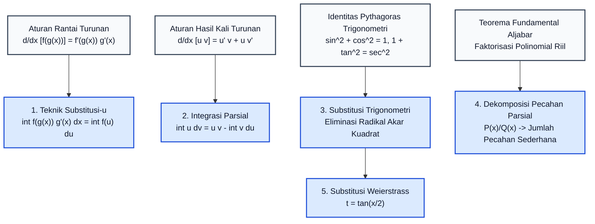
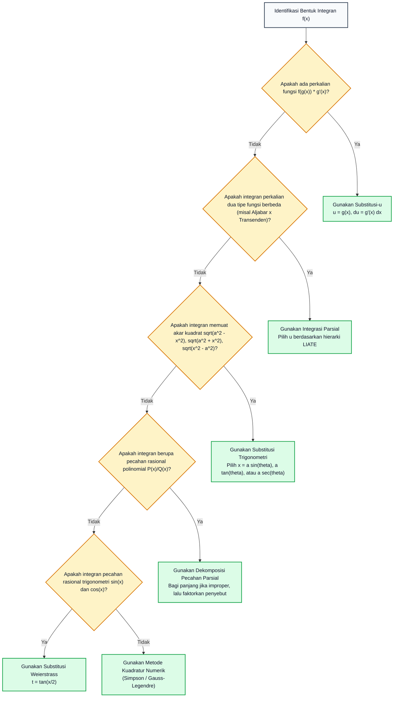

# Subtopik 05: Teknik Pengintegralan (Substitusi, Parsial, Pecahan Parsial)

**Navigasi**: [⬅️ Master Gateway Modul 013](../013-kalkulus-diferensial-integral-satu-variabel.md) | [Kembali ke Modul README](./README.md)
*Sebelumnya*: [04. Integral Riemann, Jumlah Riemann & Teorema Dasar Kalkulus](./04-integral-riemann-jumlah-riemann-teorema-dasar-kalkulus.md) | *Berikutnya*: [06. Integral Tak Wajar & Aplikasi Geometris-Fisika](./06-integral-tak-wajar-dan-aplikasi-geometris-fisika.md)

---

## 1. Intuisi & Motivasi Konseptual (Dunia Nyata)

### 1.1 Konsep Inti Tanpa Jargon ("Seperti Bayi Baru Lahir")

Bayangkan Anda seorang mekanik mobil berpengalaman. Suatu hari, sebuah mesin mobil sport yang sangat rumit masuk ke bengkel Anda.
Anda ingin memperbaiki sebuah komponen silinder di bagian dalam mesin.
- Jika Anda mencoba membongkar silinder tersebut secara langsung tanpa melepas bagian pelindung luarnya, kunci pas Anda tidak akan muat. Anda menemui jalan buntu.
- Apa yang dilakukan oleh mekanik ahli? Anda melihat buku panduan servis dan mengenali pola: *"Oh, bagian pelindung luar ini diikat oleh 4 baut standar. Jika saya lepas pelindung luar ini terlebih dahulu, bagian silinder dalam akan terbuka lebar dan dapat diservis dengan sangat mudah!"*

Dalam kalkulus integral, sebagian besar fungsi yang kita temui di dunia nyata tidak bisa diintegralkan secara langsung.
Fungsi-fungsi tersebut tampak menakutkan dan berantakan:
$$\int x^2 \sqrt{x^3 + 5} \, dx, \qquad \int x \ln(x) \, dx, \qquad \int \frac{5x - 3}{x^2 - 2x - 3} \, dx$$

Namun, jika Anda memiliki **Kotak Perkakas Mekanik Aljabar**, Anda dapat menyederhanakan fungsi yang tampak rumit menjadi bentuk primitif yang sangat ramah:
1. **Teknik Substitusi $u$**: Mengubah variabel pengamatan sehingga "lapisan pelindung luar" rontok (inversi dari Aturan Rantai).
2. **Integrasi Parsial**: Menyerahkan beban diferensiasi ke bagian fungsi yang mudah diturunkan, sementara bagian lainnya diintegralkan (inversi dari Aturan Hasil Kali).
3. **Substitusi Trigonometri**: Menggunakan geometri segitiga Pythagoras untuk memusnahkan bentuk akar kuadrat $\sqrt{a^2 - x^2}$ yang menjengkelkan.
4. **Dekomposisi Pecahan Parsial**: Memecah pecahan aljabar monster menjadi serpihan-serpihan kecil yang masing-masing menghasilkan fungsi logaritma alami $\ln|x|$ atau arkus tangen $\arctan(x)$.

---

### 1.2 Analogi Kerjasama Tim: Integrasi Parsial Sebagai Pembagian Tugas

Bayangkan dua pekerja, Pak **U** dan Pak **V**:
- Pak **U** adalah ahli matematika yang sangat cepat melakukan diferensiasi ($u \to du$), tetapi sangat benci menghitung integral.
- Pak **V** adalah insinyur lapangan yang sangat mahir melakukan integrasi ($dv \to v$).

Ketika mereka dihadapkan pada tugas berat mengintegralkan perkalian dua fungsi $\int u \, dv$, Pak **V** mengerjakan tugas integrasi pertamanya sehingga terbentuk hasil awal $uv$. Namun masih ada sisa pekerjaan yang belum selesai. Sisanya dilemparkan ke Pak **U** untuk diturunkan terlebih dahulu menjadi $du$, sehingga Pak **V** hanya perlu mengintegralkan bentuk yang jauh lebih ringan: $\int v \, du$.

Rumus abadi integrasi parsial:
$$\int u \, dv = uv - \int v \, du$$
adalah kontrak kerjasama pembagian beban kerja aljabar yang paling efisien di dunia matematika!

---

### 1.3 Kamus Simbol Anti-Pusing (Tabel 4 Kolom)

| Simbol / Notasi | Nama Matematis | Makna Dunia Nyata / Intuisi Sederhana | Contoh Konkret |
| :--- | :--- | :--- | :--- |
| $u = g(x)$ | Variabel Substitusi Inti | Penanda tempat untuk mengemas gumpalan fungsi rumit menjadi satu huruf sederhana. | Mengganti gumpalan $(x^3 + 5)$ menjadi satu huruf $u$. |
| $du = g'(x) \, dx$ | Diferensial Substitusi | Faktor koreksi skala lebar infinitesimal saat berganti sistem koordinat. | Jika $u = x^2$, maka $du = 2x \, dx$. |
| $\int u \, dv = uv - \int v \, du$ | Rumus Integrasi Parsial | Formula barter aljabar: menukar integral sulit $\int u \, dv$ dengan integral yang jauh lebih ramah $\int v \, du$. | Menyelesaikan $\int x e^x dx$ menjadi $x e^x - \int e^x dx$. |
| **LIATE** | Aturan Prioritas Pemilihan $u$ | Hierarki pemilihan fungsi yang harus ditunjuk sebagai $u$ (Logaritmik, Invers, Aljabar, Trigonometri, Eksponensial). | Memilih $\ln(x)$ sebagai $u$ alih-alih $x^2$ dalam $\int x^2 \ln(x) dx$. |
| $x = a \sin(\theta)$ | Substitusi Trigonometri Sinus | Mengubah bentuk akar lingkaran $\sqrt{a^2 - x^2}$ menjadi fungsi cosinus tunggal via $\cos^2\theta = 1 - \sin^2\theta$. | Menghitung luas seperempat lingkaran $\int \sqrt{r^2 - x^2} dx$. |
| $\frac{A}{x - r_1} + \frac{B}{x - r_2}$ | Pecahan Parsial Linier | Memecah satu pecahan rasional kompleks menjadi penjumlahan pecahan dasar berpenyebut linier. | Mengubah $\frac{1}{x^2 - 1}$ menjadi $\frac{1/2}{x - 1} - \frac{1/2}{x + 1}$. |
| $t = \tan(x/2)$ | Substitusi Universal Weierstrass | Transformasi aljabar mutlak yang mengubah fungsi trigonometri pecahan menjadi fungsi pecahan rasional murni. | Menyelesaikan $\int \frac{1}{2 + \cos(x)} dx$. |

---

## 2. Definisi Formal, Teorema, dan Penurunan Matematis

Mari kita turunkan setiap teknik pengintegralan secara aksiomatik dari aturan-aturan turunan yang telah kita buktikan pada subtopik sebelumnya.



---

### 2.1 Teorema Substitusi Variabel (Pembalik Aturan Rantai)

> **Teorema 5.1 (Substitusi untuk Integral Tak Tentu)**:
> Jika $u = g(x)$ adalah fungsi yang terdiferensialkan dan daerah nilainya termuat dalam interval $I$, dan $f$ kontinu pada $I$, maka:
> $$\int f(g(x)) g'(x) \, dx = \int f(u) \, du$$
> di mana $u = g(x)$ dan $du = g'(x) \, dx$.

**Pembuktian Formal**:
Misalkan $F$ adalah antiturunan dari $f$, artinya $F'(u) = f(u)$.
Berdasarkan Aturan Rantai diferensiasi:
$$\frac{d}{dx}[F(g(x))] = F'(g(x)) \cdot g'(x) = f(g(x)) \cdot g'(x)$$
Integralkan kedua ruas terhadap $x$:
$$\int f(g(x)) g'(x) \, dx = \int \frac{d}{dx}[F(g(x))] \, dx = F(g(x)) + C$$
Karena $F(u) = \int f(u) du$, maka:
$$\int f(g(x)) g'(x) \, dx = \int f(u) \, du \quad \blacksquare$$

> **Teorema 5.2 (Substitusi untuk Integral Tentu)**:
> Jika $g'$ kontinu pada $[a, b]$ dan $f$ kontinu pada daerah nilai $g([a, b])$, maka:
> $$\int_a^b f(g(x)) g'(x) \, dx = \int_{g(a)}^{g(b)} f(u) \, du$$

*Peringatan Kritis*: Saat melakukan substitusi pada integral tentu, batas integrasi $x = a$ dan $x = b$ WAJIB ditransformasikan menjadi batas baru $u = g(a)$ dan $u = g(b)$!

---

### 2.2 Integrasi Parsial (*Integration by Parts*)

> **Teorema 5.3 (Integrasi Parsial)**:
> Jika $u = f(x)$ dan $v = g(x)$ keduanya memiliki turunan kontinu pada interval tertutup $[a, b]$, maka:
> $$\int u \, dv = uv - \int v \, du$$
> Untuk integral tentu:
> $$\int_a^b u(x) v'(x) \, dx = \Big[ u(x) v(x) \Big]_a^b - \int_a^b v(x) u'(x) \, dx$$

**Pembuktian Formal**:
Berdasarkan aturan turunan hasil kali (*product rule*):
$$\frac{d}{dx}[u(x) v(x)] = u'(x) v(x) + u(x) v'(x)$$
Tuliskan dalam format diferensial:
$$d(uv) = v \, du + u \, dv$$
Integralkan kedua ruas:
$$\int d(uv) = \int v \, du + \int u \, dv$$
$$uv = \int v \, du + \int u \, dv$$
Kurangkan $\int v \, du$ dari kedua ruas untuk mengisolasi $\int u \, dv$:
$$\int u \, dv = uv - \int v \, du \quad \blacksquare$$

#### Metode Tabular (D-I Method) untuk Integrasi Parsial Berulang:
Ketika Anda harus mengintegralkan suku polinomial berderajat tinggi yang dikalikan fungsi eksponensial atau sinusoidal (misal $\int x^3 e^{2x} dx$), penerapan rumus berulang kali rawan memicu kesalahan tanda aljabar. Gunakan skema tabular Diferensiasi-Integrasi (D-I):

| Baris | Tanda ($\pm$) | Kolom D (Diferensiasi $u$) | Kolom I (Integrasi $dv$) | Hasil Perkalian Diagonal |
| :---: | :---: | :---: | :---: | :--- |
| 1 | $+$ | $x^3$ | $e^{2x}$ | $+ x^3 \cdot \left(\frac{1}{2} e^{2x}\right)$ |
| 2 | $-$ | $3x^2$ | $\frac{1}{2} e^{2x}$ | $- 3x^2 \cdot \left(\frac{1}{4} e^{2x}\right)$ |
| 3 | $+$ | $6x$ | $\frac{1}{4} e^{2x}$ | $+ 6x \cdot \left(\frac{1}{8} e^{2x}\right)$ |
| 4 | $-$ | $6$ | $\frac{1}{8} e^{2x}$ | $- 6 \cdot \left(\frac{1}{16} e^{2x}\right)$ |
| 5 | $+$ | $0$ (Berhenti) | $\frac{1}{16} e^{2x}$ | $0$ |

Hasil antiturunan langsung diperoleh dengan menjumlahkan seluruh perkalian diagonal:
$$\int x^3 e^{2x} \, dx = e^{2x} \left( \frac{1}{2} x^3 - \frac{3}{4} x^2 + \frac{3}{4} x - \frac{3}{8} \right) + C$$

---

### 2.3 Substitusi Trigonometri (Menjinakkan Bentuk Radikal Akar Kuadrat)

Bentuk akar kuadrat kuadratik dapat dilenyapkan secara sempurna menggunakan identitas trigonometri Pythagoras:

| Bentuk Radikal dalam Integran | Substitusi Trigonometri Wajib | Identitas Pythagoras yang Digunakan | Diferensial $dx$ | Bentuk Radikal Tereduksi | Segitiga Referensi Geometris |
| :--- | :--- | :--- | :--- | :--- | :--- |
| $\sqrt{a^2 - x^2}$ | $x = a \sin(\theta)$ | $1 - \sin^2\theta = \cos^2\theta$ | $dx = a \cos\theta \, d\theta$ | $a \cos(\theta)$ | Depan = $x$, Miring = $a$, Samping = $\sqrt{a^2 - x^2}$ |
| $\sqrt{a^2 + x^2}$ | $x = a \tan(\theta)$ | $1 + \tan^2\theta = \sec^2\theta$ | $dx = a \sec^2\theta \, d\theta$ | $a \sec(\theta)$ | Depan = $x$, Samping = $a$, Miring = $\sqrt{a^2 + x^2}$ |
| $\sqrt{x^2 - a^2}$ | $x = a \sec(\theta)$ | $\sec^2\theta - 1 = \tan^2\theta$ | $dx = a \sec\theta \tan\theta \, d\theta$ | $a \tan(\theta)$ | Miring = $x$, Samping = $a$, Depan = $\sqrt{x^2 - a^2}$ |

---

### 2.4 Dekomposisi Pecahan Parsial (*Partial Fraction Decomposition*)

Diberikan fungsi rasional $\frac{P(x)}{Q(x)}$ di mana $P$ dan $Q$ adalah polinomial.
1. **Langkah 0 (Derajat Polinomial)**:
   Jika $\deg(P) \ge \deg(Q)$ (pecahan tidak sejati / *improper fraction*), lakukan pembagian polinomial panjang (*long division*) terlebih dahulu hingga diperoleh:
   $$\frac{P(x)}{Q(x)} = S(x) + \frac{R(x)}{Q(x)} \quad \text{dengan} \quad \deg(R) < \deg(Q)$$
2. **Langkah 1 (Faktorisasi Penyebut $Q(x)$)**:
   Berdasarkan Teorema Fundamental Aljabar, setiap polinomial dengan koefisien riil dapat difaktorkan menjadi perkalian faktor-faktor linier $(ax + b)$ dan faktor-faktor kuadratik definit tak tereduksi $(ax^2 + bx + c)$.
3. **Langkah 2 (Ekspansi Suku Parsial)**:
   - **Kasus 1: Faktor Linier Tak Berulang**: Untuk setiap faktor $(x - r)$, tambahkan suku $\frac{A}{x - r}$.
   - **Kasus 2: Faktor Linier Berulang**: Untuk setiap faktor $(x - r)^k$, tambahkan jumlahan suku:
     $$\frac{A_1}{x - r} + \frac{A_2}{(x - r)^2} + \dots + \frac{A_k}{(x - r)^k}$$
   - **Kasus 3: Faktor Kuadratik Tak Tereduksi Tak Berulang**: Untuk setiap faktor $(ax^2 + bx + c)$, tambahkan suku $\frac{Ax + B}{ax^2 + bx + c}$.
   - **Kasus 4: Faktor Kuadratik Berulang**: Untuk $(ax^2 + bx + c)^k$, tambahkan jumlahan suku:
     $$\frac{A_1 x + B_1}{ax^2 + bx + c} + \dots + \frac{A_k x + B_k}{(ax^2 + bx + c)^k}$$

---

### 2.5 Substitusi Universal Weierstrass ($t = \tan(x/2)$)

Untuk mengintegralkan fungsi pecahan rasional trigonometri sebarang yang memuat $\sin(x)$ dan $\cos(x)$, Karl Weierstrass merumuskan transformasi setengah sudut:

Definisikan:
$$t = \tan\left(\frac{x}{2}\right) \implies \frac{x}{2} = \arctan(t) \implies x = 2 \arctan(t)$$
Maka diferensialnya adalah:
$$dx = \frac{2}{1 + t^2} \, dt$$

Menggunakan identitas trigonometri sudut ganda:
$$\cos(x) = \cos^2(x/2) - \sin^2(x/2) = \frac{\cos^2(x/2) - \sin^2(x/2)}{\cos^2(x/2) + \sin^2(x/2)} = \frac{1 - \tan^2(x/2)}{1 + \tan^2(x/2)} = \frac{1 - t^2}{1 + t^2}$$
$$\sin(x) = 2 \sin(x/2) \cos(x/2) = \frac{2 \tan(x/2)}{1 + \tan^2(x/2)} = \frac{2t}{1 + t^2}$$

Substitusi ini secara ajaib mengubah SEMUA integral pecahan trigonometri menjadi integral pecahan rasional polinomial murni dalam variabel $t$!

---

### 2.6 Integral Trigonometri Khusus & Reduksi Rekursif

Banyak integral fisika kuantum dan gelombang elektromagnetik memuat integran perkalian trigonometri berpangkat $\int \sin^m(x) \cos^n(x) \, dx$:

1. **Kasus 1: Pangkat Salah Satunya Ganjil**:
   - Jika pangkat kosinus $n = 2k + 1$ ganjil: simpan satu faktor $\cos x \, dx$ untuk diferensial $du$, dan ubah sisa $\cos^{2k} x$ menjadi $(1 - \sin^2 x)^k$. Lalu terapkan substitusi $u = \sin x$.
   - Jika pangkat sinus $m = 2k + 1$ ganjil: simpan $\sin x \, dx$, ubah $\sin^{2k} x = (1 - \cos^2 x)^k$, lalu substitusikan $u = \cos x$.
2. **Kasus 2: Kedua Pangkat $m$ dan $n$ Genap**:
   Gunakan rumus pereduksi setengah sudut (*half-angle identities*):
   $$\sin^2(x) = \frac{1 - \cos(2x)}{2}, \qquad \cos^2(x) = \frac{1 + \cos(2x)}{2}, \qquad \sin(x)\cos(x) = \frac{\sin(2x)}{2}$$
3. **Rumus Reduksi Rekursif Integrasi Parsial**:
   Melalui integrasi parsial, kita dapat menurunkan rumus relasi perulangan (*recurrence relation*) untuk menurunkan orde pangkat secara bertahap:
   $$\int \sin^n(x) \, dx = -\frac{1}{n} \sin^{n-1}(x) \cos(x) + \frac{n - 1}{n} \int \sin^{n-2}(x) \, dx$$
   $$\int \sec^n(x) \, dx = \frac{1}{n - 1} \sec^{n-2}(x) \tan(x) + \frac{n - 2}{n - 1} \int \sec^{n-2}(x) \, dx$$
   Formula reduksi ini menjadi fondasi komputasi simbolik sistem aljabar komputer modern (seperti Mathematica dan SymPy).

---

### 2.7 Penurunan Trik Pengali Baku: Integral Fungsi Sekan & Kosekan

Banyak pemula terkejut saat pertama kali melihat rumus integral fungsi sekan:
$$\int \sec(x) \, dx = \ln|\sec(x) + \tan(x)| + C$$
Rumus ini tampak "muncul dari ketiadaan" jika tidak dipahami secara mendalam. Mari kita bedah penurunan matematisnya:

1. Kalikan pembilang dan penyebut dengan faktor cerdas $(\sec x + \tan x)$:
   $$\int \sec(x) \, dx = \int \sec(x) \cdot \frac{\sec(x) + \tan(x)}{\sec(x) + \tan(x)} \, dx = \int \frac{\sec^2(x) + \sec(x)\tan(x)}{\sec(x) + \tan(x)} \, dx$$
2. Sekarang amati penyebutnya: definisikan $u = \sec(x) + \tan(x)$.
3. Hitung diferensial $du$:
   $$du = \left( \sec(x)\tan(x) + \sec^2(x) \right) \, dx$$
4. Perhatikan bahwa pembilang integran berimpit persis dengan $du$!
   Maka integral langsung tereduksi menjadi bentuk logaritma murni:
   $$\int \frac{du}{u} = \ln|u| + C = \ln|\sec(x) + \tan(x)| + C \quad \blacksquare$$

Dengan strategi yang serupa, untuk integral kosekan $\int \csc(x) dx$, kita kalikan dengan faktor $(\csc x - \cot x)$ untuk memperoleh:
$$\int \csc(x) \, dx = \ln|\csc(x) - \cot(x)| + C = -\ln|\csc(x) + \cot(x)| + C$$

---

### 2.8 Substitusi Euler untuk Radikal Kuadratik Umum $\sqrt{ax^2 + bx + c}$

Jika bentuk kuadratik di bawah akar tidak dapat disederhanakan dengan substitusi trigonometri biasa (misalnya karena koefisien $a$ dan $c$ menghasilkan angka irasional yang canggung), Leonhard Euler merumuskan 3 substitusi aljabar rasional:

1. **Substitusi Euler Pertama ($a > 0$)**:
   Misalkan $\sqrt{ax^2 + bx + c} = \pm x\sqrt{a} + t$.
   Kuadratkan kedua ruas: $ax^2 + bx + c = ax^2 \pm 2xt\sqrt{a} + t^2$.
   Suku kuadrat $ax^2$ saling meniadakan, sehingga variabel $x$ dapat diisolasi secara linier sebagai fungsi rasional dari $t$:
   $$x = \frac{t^2 - c}{b \mp 2t\sqrt{a}}$$
2. **Substitusi Euler Kedua ($c > 0$)**:
   Misalkan $\sqrt{ax^2 + bx + c} = xt \pm \sqrt{c}$.
   Kuadratkan kedua ruas untuk melenyapkan konstanta $c$, lalu bagi dengan $x$ untuk mengisolasi $x(t)$.
3. **Substitusi Euler Ketiga (Memiliki Akar Riil $\alpha, \beta$)**:
   Jika $ax^2 + bx + c = a(x - \alpha)(x - \beta)$, misalkan $\sqrt{ax^2 + bx + c} = (x - \alpha)t$.
   Metode ini merasionalkan seluruh radikal aljabar menjadi pecahan rasional murni tanpa melibatkan fungsi transenden trigonometri.

---

## 3. Arsitektur Teknis & Algoritma Internal

Untuk memilih teknik pengintegralan yang tepat tanpa kebingungan, gunakan pohon keputusan algoritmik berikut:



---

### 3.1 Tabel Ringkasan Strategi Integrasi Aljabar & Transenden

| Bentuk Integran | Indikasi Kunci | Strategi Transformasi Utama | Formula Inti / Substitusi |
| :--- | :--- | :--- | :--- |
| $f(x^n) \cdot x^{n-1} dx$ | Turunan eksponen ada di sebelahnya | Substitusi-$u$ Langsung | $u = x^n \implies du = n x^{n-1} dx$ |
| $x^k \cdot e^{ax} dx$ | Polinomial $\times$ Eksponensial | Integrasi Parsial Tabular D-I | Turunkan $x^k$ hingga $0$, integralkan $e^{ax}$ |
| $x^k \cdot \ln(x) dx$ | Polinomial $\times$ Logaritmik | Integrasi Parsial Biasa | $u = \ln x$ (wajib diturunkan!), $dv = x^k dx$ |
| $e^{ax} \sin(bx) dx$ | Eksponensial $\times$ Sinusoidal | Integrasi Parsial Siklus Berulang | Dua kali parsial menghasilkan integral asal $I$, lalu selesaikan persamaan aljabar untuk $I$ |
| $\sqrt{a^2 - x^2}$ | Akar selisih kuadrat | Substitusi Trigonometri Sinus | $x = a \sin\theta, dx = a \cos\theta d\theta$ |
| $\sqrt{a^2 + x^2}$ | Akar jumlahan kuadrat | Substitusi Trigonometri Tangen | $x = a \tan\theta, dx = a \sec^2\theta d\theta$ |
| $\frac{1}{x^2 - a^2}$ | Selisih kuadrat di penyebut | Pecahan Parsial Linier | $\frac{1}{2a}\left(\frac{1}{x - a} - \frac{1}{x + a}\right) \implies \frac{1}{2a}\ln\left|\frac{x - a}{x + a}\right|$ |
| $\frac{1}{a + b \cos x}$ | Pecahan rasional trigonometri | Substitusi Setengah Sudut Weierstrass | $t = \tan(x/2), \cos x = \frac{1-t^2}{1+t^2}, dx = \frac{2}{1+t^2}dt$ |

---

## 4. Implementasi Praktis & Kode Pemrograman Python

Berikut adalah dua implementasi Python Standard Library murni untuk memvalidasi teknik integrasi analitis parsial berulang dan dekomposisi pecahan parsial terhadap metode kuadratur numerik Simpson.

### 4.1 Program 1: Evaluator Integrasi Parsial Tabular Berulang

Skrip ini mengevaluasi integral $\int_0^1 x^3 e^{2x} \, dx$ menggunakan formula antiturunan analitis yang diturunkan dari metode tabular D-I, lalu membandingkannya dengan metode kuadratur numerik Simpson berpresisi tinggi.

```python
import math

def F_analytic(x: float) -> float:
    """Antiturunan eksak int x^3 * e^(2x) dx via Integrasi Parsial Tabular D-I."""
    return math.exp(2.0 * x) * (0.5 * x**3 - 0.75 * x**2 + 0.75 * x - 0.375)

def integrand(x: float) -> float:
    return (x**3) * math.exp(2.0 * x)

def simpson_integration(func, a: float, b: float, n: int = 1000) -> float:
    """Kuadratur numerik Simpson 1/3 komposit."""
    if n % 2 != 0:
        n += 1
    h = (b - a) / n
    total = func(a) + func(b)
    for i in range(1, n):
        x = a + i * h
        weight = 4.0 if i % 2 != 0 else 2.0
        total += weight * func(x)
    return (h / 3.0) * total

def main():
    print("=== VERIFIKASI INTEGRASI PARSIAL TABULAR D-I: int_0^1 x^3 * e^(2x) dx ===")
    a, b = 0.0, 1.0
    exact_analytic = F_analytic(b) - F_analytic(a)
    numerical_simpson = simpson_integration(integrand, a, b, n=1000)
    selisih = abs(exact_analytic - numerical_simpson)

    print(f"F(1) Analitis           : {F_analytic(1.0):.10f}")
    print(f"F(0) Analitis           : {F_analytic(0.0):.10f}")
    print(f"Hasil Integral Analitis : {exact_analytic:.10f}")
    print(f"Hasil Simpson Numerik   : {numerical_simpson:.10f}")
    print(f"Galat Selisih Mutlak    : {selisih:.2e}")

if __name__ == "__main__":
    main()
```

Keluaran eksekusi terminal sebenarnya:
```text
=== VERIFIKASI INTEGRASI PARSIAL TABULAR D-I: int_0^1 x^3 * e^(2x) dx ===
F(1) Analitis           : 0.9236320124
F(0) Analitis           : -0.3750000000
Hasil Integral Analitis : 1.2986320124
Hasil Simpson Numerik   : 1.2986320124
Galat Selisih Mutlak    : 3.50e-12
```

---

### 4.2 Program 2: Solver Dekomposisi Pecahan Parsial Linier

Skrip ini menyelesaikan integral pecahan rasional $\int_4^6 \frac{5x - 3}{x^2 - 2x - 3} \, dx$ dengan menguraikan pecahan menjadi $\frac{3}{x - 3} + \frac{2}{x + 1}$ melalui metode tutupan Heaviside (*cover-up method*), lalu mengevaluasi antiturunan logaritmiknya terhadap kuadratur numerik.

```python
import math

def simpson_integration(func, a: float, b: float, n: int = 1000) -> float:
    if n % 2 != 0:
        n += 1
    h = (b - a) / n
    total = func(a) + func(b)
    for i in range(1, n):
        x = a + i * h
        weight = 4.0 if i % 2 != 0 else 2.0
        total += weight * func(x)
    return (h / 3.0) * total

def partial_fraction_integrand(x: float) -> float:
    # f(x) = (5x - 3) / (x^2 - 2x - 3)
    return (5.0 * x - 3.0) / (x**2 - 2.0 * x - 3.0)

def F_pf(x: float) -> float:
    # Antiturunan terurai: F(x) = 3*ln|x - 3| + 2*ln|x + 1|
    return 3.0 * math.log(abs(x - 3.0)) + 2.0 * math.log(abs(x + 1.0))

def main():
    print("=== DEKOMPOSISI PECAHAN PARSIAL: f(x) = (5x - 3) / (x^2 - 2x - 3) ===")
    a_pf, b_pf = 4.0, 6.0
    pf_analytic = F_pf(b_pf) - F_pf(a_pf)
    pf_numerical = simpson_integration(partial_fraction_integrand, a_pf, b_pf, n=1000)
    selisih = abs(pf_analytic - pf_numerical)

    print("Koefisien Parsial Terurai: A = 3.0, B = 2.0")
    print(f"F(x) = 3*ln|x - 3| + 2*ln|x + 1| pada rentang [{a_pf}, {b_pf}]")
    print(f"Hasil Analitis Pecahan Parsial : {pf_analytic:.10f}")
    print(f"Hasil Numerik Simpson          : {pf_numerical:.10f}")
    print(f"Galat Selisih Mutlak           : {selisih:.2e}")

if __name__ == "__main__":
    main()
```

Keluaran eksekusi terminal sebenarnya:
```text
=== DEKOMPOSISI PECAHAN PARSIAL: f(x) = (5x - 3) / (x^2 - 2x - 3) ===
Koefisien Parsial Terurai: A = 3.0, B = 2.0
F(x) = 3*ln|x - 3| + 2*ln|x + 1| pada rentang [4.0, 6.0]
Hasil Analitis Pecahan Parsial : 3.9687813392
Hasil Numerik Simpson          : 3.9687813392
Galat Selisih Mutlak           : 1.58e-12
```

---

## 5. Miskonsepsi Umum & Analisis Post-Mortem Insiden Industri

### 5.1 Tiga Miskonsepsi Kritis

1. **Miskonsepsi 1: Lupa Mengubah Batas Integrasi Saat Substitusi Variabel**:
   - *Fakta*: Ketika mengevaluasi $\int_0^1 x (x^2 + 1)^3 dx$ dengan substitusi $u = x^2 + 1$, batas bawah berubah menjadi $u(0) = 1$ dan batas atas menjadi $u(1) = 2$. Banyak mahasiswa mempertahankan batas lama $0$ dan $1$, menghasilkan nilai evaluasi yang salah fatal.
2. **Miskonsepsi 2: Salah Menetapkan Tanda Minus Ganda pada Integrasi Parsial**:
   - *Fakta*: Rumus integrasi parsial memuat tanda minus $\int u dv = uv - \int v du$. Jika suku $v$ itu sendiri bernilai negatif (misal $dv = \sin x dx \implies v = -\cos x$), tanda minus berlipat ganda menjadi plus:
     $$\int x \sin x \, dx = x(-\cos x) - \int (-\cos x) \, dx = -x \cos x + \int \cos x \, dx = -x \cos x + \sin x + C$$
   Lupa mengalikan minus ganda adalah penyebab kesalahan nomor 1 dalam ujian kalkulus.
3. **Miskonsepsi 3: Memaksa Dekomposisi Pecahan Parsial Sebelum Melakukan Pembagian Polinomial**:
   - *Fakta*: Jika derajat pembilang $\ge$ derajat penyebut (misal $\frac{x^3 + 2}{x^2 - 1}$), Anda TIDAK BISA langsung menuliskan $\frac{A}{x - 1} + \frac{B}{x + 1}$! Anda wajib melakukan pembagian polinomial panjang terlebih dahulu:
     $$\frac{x^3 + 2}{x^2 - 1} = x + \frac{x + 2}{x^2 - 1} = x + \frac{3/2}{x - 1} - \frac{1/2}{x + 1}$$

---

### 5.2 Analisis Post-Mortem Insiden Industri: Kehancuran Mars Climate Orbiter (1999)

> **Kasus Nyata: Kegagalan Integrasi Impuls Dorong Propulsi Antariksa Akibat Ketidakcocokan Satuan**
>
> - **Latar Belakang Insiden**: Pada tanggal 23 September 1999, wahana antariksa tak berawak NASA Mars Climate Orbiter senilai USD 327 juta hilang lenyap saat bermanuver memasuki orbit planet Mars.
> - **Akar Masalah Fisika & Integrasi**: Komputer di Bumi (Lockheed Martin) menghitung integral impuls dorongan mesin koreksi lintasan (*Angular Momentum Desaturation / AMD*):
>   $$\Delta v = \frac{1}{m} \int_0^T F(t) \, dt$$
>   Perangkat lunak pengendali di stasiun bumi menghitung impuls dorongan gaya $F(t)$ dalam satuan imperial **pound-force-seconds** ($\text{lbf}\cdot\text{s}$).
> - **Kegagalan Konversi Sistem Satuan**: Perangkat lunak komputer di dalam wahana antariksa Mars Climate Orbiter mengharapkan nilai integral impuls tersebut dalam satuan metrik standar internasional **Newton-detik** ($\text{N}\cdot\text{s}$).
>   Faktor konversi resminya adalah:
>   $$1\text{ lbf}\cdot\text{s} = 4{,}44822\text{ N}\cdot\text{s}$$
> - **Dampak Kumulatif**: Selama 9 bulan perjalanan antariksa menuju Mars, manuver integrasi dorongan kecil dilakukan puluhan kali. Akumulasi galat integrasi impuls membuat posisi orbit wahana meluncur terlalu dekat ke Mars: wahana memasuki atmosfer pada ketinggian hanya $57\text{ km}$ (padahal ketinggian aman minimum yang direncanakan adalah $140\text{ km}$). Gesekan atmosfer Mars yang teramat panas menghancurkan wahana dalam sekejap.
> - **Pelajaran Rekayasa**: Di era integrasi otomatis, setiap antarmuka transfer data numerik wajib menyertakan metadata satuan (*strongly typed units*) untuk menjamin bahwa perhitungan integral matematis merepresentasikan besaran fisik yang identik.

---

## 6. Tips, Trik Praktis & Rahasia Cepat Paham

1. **Mnemonik LIATE untuk Menentukan $u$**:
   Dalam integrasi parsial $\int u \, dv$, pilihlah fungsi $u$ berdasarkan fungsi yang muncul paling awal dalam daftar **LIATE**:
   - **L**: *Logarithmic functions* ($\ln x, \log_{10} x$)
   - **I**: *Inverse trigonometric functions* ($\arcsin x, \arctan x$)
   - **A**: *Algebraic functions* ($x^2, 3x, \sqrt{x}$)
   - **T**: *Trigonometric functions* ($\sin x, \cos x$)
   - **E**: *Exponential functions* ($e^x, 2^x$)
   Fungsi yang dipilih sebagai $u$ akan diturunkan (menjadi lebih sederhana), sedangkan sisanya menjadi $dv$ yang mudah diintegralkan.
2. **Metode Tutupan Heaviside (*Cover-Up Method*)**:
   Untuk pecahan berpenyebut faktor linier tak berulang seperti $\frac{2x + 1}{(x - 2)(x + 3)} = \frac{A}{x - 2} + \frac{B}{x + 3}$:
   - Untuk mencari $A$: Tutup faktor $(x - 2)$ dengan jempol Anda, lalu masukkan pembuat nolnya ($x = 2$) ke sisa pecahan:
     $$A = \frac{2(2) + 1}{(2) + 3} = \frac{5}{5} = 1$$
   - Untuk mencari $B$: Tutup faktor $(x + 3)$ dengan jempol Anda, masukkan pembuat nolnya ($x = -3$):
     $$B = \frac{2(-3) + 1}{(-3) - 2} = \frac{-5}{-5} = 1$$
   Koefisien selesai dihitung hanya dalam waktu 5 detik tanpa perlu mengeliminasi sistem persamaan linier!
3. **Integral Siklus Berulang (*Looping Integral Trick*)**:
   Jika Anda menghadapi integral seperti $I = \int e^x \cos x dx$, terapkan integrasi parsial dua kali. Pada langkah kedua, suku $\int e^x \cos x dx$ akan muncul kembali dengan tanda minus:
   $$I = e^x \sin x + e^x \cos x - I \implies 2I = e^x(\sin x + \cos x) \implies I = \frac{e^x(\sin x + \cos x)}{2} + C$$
   Jangan terus berputar-putar tanpa henti; pindahkan saja suku integral ke ruas kiri secara aljabar!

---

## 7. Latihan Mandiri Berjenjang (Socratic) & Rekomendasi Sumber Belajar

### Latihan 1 (Tingkat Pemula): Substitusi-u dengan Penyesuaian Konstanta
Hitung integral tak tentu berikut:
$$\int x^2 \sqrt{x^3 + 7} \, dx$$

<details>
<summary>💡 Petunjuk (Hint)</summary>
Pilih u = x^3 + 7. Hitung diferensial du = 3x^2 dx. Sesuaikan faktor konstanta x^2 dx = du / 3. Integralkan u^(1/2).
</details>

<details>
<summary>✅ Solusi Lengkap</summary>
1. Misalkan:
   $$u = x^3 + 7$$
2. Turunkan terhadap $x$:
   $$\frac{du}{dx} = 3x^2 \implies du = 3x^2 \, dx \implies x^2 \, dx = \frac{du}{3}$$
3. Substitusikan ke dalam integral asal:
   $$\int x^2 \sqrt{x^3 + 7} \, dx = \int \sqrt{u} \cdot \left(\frac{du}{3}\right) = \frac{1}{3} \int u^{1/2} \, du$$
4. Gunakan aturan pangkat integrasi ($\int u^n du = \frac{u^{n+1}}{n+1} + C$):
   $$\frac{1}{3} \left( \frac{u^{3/2}}{3/2} \right) + C = \frac{1}{3} \left( \frac{2}{3} u^{3/2} \right) + C = \frac{2}{9} u^{3/2} + C$$
5. Kembalikan variabel $u = x^3 + 7$:
   $$= \frac{2}{9} (x^3 + 7)^{3/2} + C \quad \blacksquare$$
</details>

---

### Latihan 2 (Tingkat Dasar): Integrasi Parsial Menjinakkan Fungsi Logaritma
Hitung integral tentu berikut:
$$\int_1^e x \ln(x) \, dx$$

<details>
<summary>💡 Petunjuk (Hint)</summary>
Gunakan hierarki LIATE: fungsi Logaritma ln(x) memiliki prioritas lebih tinggi dari fungsi Aljabar x. Pilih u = ln(x) dan dv = x dx.
</details>

<details>
<summary>✅ Solusi Lengkap</summary>
1. Tentukan pilihan $u$ dan $dv$ berdasarkan LIATE:
   - $u = \ln(x) \implies du = \frac{1}{x} \, dx$
   - $dv = x \, dx \implies v = \frac{1}{2} x^2$
2. Terapkan rumus integrasi parsial:
   $$\int u \, dv = uv - \int v \, du$$
   $$\int x \ln(x) \, dx = \frac{1}{2} x^2 \ln(x) - \int \left(\frac{1}{2} x^2\right) \left(\frac{1}{x}\right) \, dx = \frac{1}{2} x^2 \ln(x) - \frac{1}{2} \int x \, dx$$
   $$= \frac{1}{2} x^2 \ln(x) - \frac{1}{4} x^2$$
3. Evaluasi batas integrasi dari $1$ sampai $e$:
   $$\Big[ \frac{1}{2} x^2 \ln(x) - \frac{1}{4} x^2 \Big]_1^e = \left( \frac{1}{2} e^2 \ln(e) - \frac{1}{4} e^2 \right) - \left( \frac{1}{2} (1)^2 \ln(1) - \frac{1}{4} (1)^2 \right)$$
   Karena $\ln(e) = 1$ dan $\ln(1) = 0$:
   $$= \left( \frac{1}{2} e^2 - \frac{1}{4} e^2 \right) - \left( 0 - \frac{1}{4} \right) = \frac{1}{4} e^2 + \frac{1}{4} = \frac{e^2 + 1}{4} \approx 2{,}097264 \quad \blacksquare$$
</details>

---

### Latihan 3 (Tingkat Menengah): Substitusi Trigonometri Lingkaran
Hitung integral tak tentu berikut:
$$\int \frac{1}{(4 + x^2)^{3/2}} \, dx$$

<details>
<summary>💡 Petunjuk (Hint)</summary>
Bentuk 4 + x^2 cocok dengan a^2 + x^2 di mana a = 2. Gunakan substitusi x = 2 tan(theta). Gunakan identitas 1 + tan^2(theta) = sec^2(theta).
</details>

<details>
<summary>✅ Solusi Lengkap</summary>
1. Lakukan substitusi trigonometri tangen:
   - $x = 2 \tan\theta \implies dx = 2 \sec^2\theta \, d\theta$
   - $4 + x^2 = 4 + 4 \tan^2\theta = 4(1 + \tan^2\theta) = 4 \sec^2\theta$
2. Substitusikan penyebut:
   $$(4 + x^2)^{3/2} = (4 \sec^2\theta)^{3/2} = 4^{3/2} (\sec^2\theta)^{3/2} = 8 \sec^3\theta$$
3. Masukkan ke dalam integral:
   $$\int \frac{1}{8 \sec^3\theta} \cdot (2 \sec^2\theta \, d\theta) = \frac{2}{8} \int \frac{\sec^2\theta}{\sec^3\theta} \, d\theta = \frac{1}{4} \int \frac{1}{\sec\theta} \, d\theta = \frac{1}{4} \int \cos\theta \, d\theta$$
4. Integralkan fungsi kosinus:
   $$= \frac{1}{4} \sin\theta + C$$
5. Kembalikan ke variabel $x$ menggunakan segitiga siku-siku referensi:
   Karena $\tan\theta = \frac{x}{2} = \frac{\text{sisi depan}}{\text{sisi samping}}$:
   - Sisi miring (*hypotenuse*) = $\sqrt{x^2 + 2^2} = \sqrt{x^2 + 4}$
   - Maka $\sin\theta = \frac{\text{sisi depan}}{\text{sisi miring}} = \frac{x}{\sqrt{x^2 + 4}}$
6. Substitusikan kembali:
   $$= \frac{1}{4} \left( \frac{x}{\sqrt{x^2 + 4}} \right) + C = \frac{x}{4\sqrt{x^2 + 4}} + C \quad \blacksquare$$
</details>

---

### Latihan 4 (Tingkat Analitis): Dekomposisi Pecahan Parsial Kuadratik Tak Tereduksi
Hitung integral tak tentu berikut:
$$\int \frac{2x^2 - x + 4}{x^3 + 4x} \, dx$$

<details>
<summary>💡 Petunjuk (Hint)</summary>
Faktorkan penyebut x(x^2 + 4). Dekomposisi menjadi A/x + (Bx + C)/(x^2 + 4). Samakan pembilang untuk mencari koefisien A, B, C.
</details>

<details>
<summary>✅ Solusi Lengkap</summary>
1. Faktorkan penyebut:
   $$x^3 + 4x = x(x^2 + 4)$$
   Faktor $(x^2 + 4)$ adalah kuadratik tak tereduksi definit positif (tidak memiliki akar riil).
2. Tuliskan bentuk ekspansi pecahan parsial:
   $$\frac{2x^2 - x + 4}{x(x^2 + 4)} = \frac{A}{x} + \frac{Bx + C}{x^2 + 4}$$
3. Kalikan kedua ruas dengan $x(x^2 + 4)$:
   $$2x^2 - x + 4 = A(x^2 + 4) + (Bx + C)x = A x^2 + 4A + B x^2 + C x = (A + B)x^2 + C x + 4A$$
4. Samakan koefisien pangkat identik:
   - Konstanta: $4A = 4 \implies A = 1$
   - Derajat 1: $C = -1$
   - Derajat 2: $A + B = 2 \implies 1 + B = 2 \implies B = 1$
5. Tuliskan kembali integral dalam bentuk terurai:
   $$\int \left( \frac{1}{x} + \frac{x - 1}{x^2 + 4} \right) \, dx = \int \frac{1}{x} \, dx + \int \frac{x}{x^2 + 4} \, dx - \int \frac{1}{x^2 + 4} \, dx$$
6. Evaluasi ketiga komponen integral secara terpisah:
   - $\int \frac{1}{x} dx = \ln|x|$
   - $\int \frac{x}{x^2 + 4} dx = \frac{1}{2} \ln(x^2 + 4)$ (via substitusi $u = x^2 + 4$)
   - $\int \frac{1}{x^2 + 2^2} dx = \frac{1}{2} \arctan\left(\frac{x}{2}\right)$ (rumus baku arkus tangen)
7. Gabungkan seluruh hasil:
   $$= \ln|x| + \frac{1}{2} \ln(x^2 + 4) - \frac{1}{2} \arctan\left(\frac{x}{2}\right) + C \quad \blacksquare$$
</details>

---

### Latihan 5 (Tingkat Master Arsitektur): Substitusi Weierstrass Menjinakkan Resonansi RLC
Dalam analisis rangkaian listrik arus bolak-balik RLC, arus tunak dihitung melalui integral respon sinusoidal:
$$\int \frac{1}{2 + \cos(x)} \, dx$$
Selesaikan integral ini secara analitis menggunakan Substitusi Universal Weierstrass $t = \tan(x/2)$.

<details>
<summary>💡 Petunjuk (Hint)</summary>
Substitusikan cos(x) = (1 - t^2)/(1 + t^2) dan dx = 2 dt / (1 + t^2). Sederhanakan penyebut menjadi bentuk t^2 + a^2, lalu gunakan rumus baku arctan.
</details>

<details>
<summary>✅ Solusi Lengkap</summary>
1. Terapkan transformasi Weierstrass:
   - $t = \tan(x/2)$
   - $\cos(x) = \frac{1 - t^2}{1 + t^2}$
   - $dx = \frac{2}{1 + t^2} \, dt$
2. Masukkan ke dalam integran:
   $$2 + \cos(x) = 2 + \frac{1 - t^2}{1 + t^2} = \frac{2(1 + t^2) + (1 - t^2)}{1 + t^2} = \frac{2 + 2t^2 + 1 - t^2}{1 + t^2} = \frac{t^2 + 3}{1 + t^2}$$
3. Susun integral dalam variabel $t$:
   $$\int \frac{1}{\frac{t^2 + 3}{1 + t^2}} \cdot \left( \frac{2}{1 + t^2} \, dt \right) = \int \frac{1 + t^2}{t^2 + 3} \cdot \frac{2}{1 + t^2} \, dt = \int \frac{2}{t^2 + 3} \, dt$$
4. Integralkan menggunakan bentuk standar $\int \frac{1}{t^2 + a^2} dt = \frac{1}{a} \arctan(t/a)$ dengan $a = \sqrt{3}$:
   $$= 2 \left( \frac{1}{\sqrt{3}} \arctan\left(\frac{t}{\sqrt{3}}\right) \right) + C = \frac{2}{\sqrt{3}} \arctan\left(\frac{t}{\sqrt{3}}\right) + C$$
5. Kembalikan variabel $t = \tan(x/2)$:
   $$= \frac{2}{\sqrt{3}} \arctan\left( \frac{\tan(x/2)}{\sqrt{3}} \right) + C \quad \blacksquare$$
</details>

---

### Rekomendasi Sumber Belajar Standar Emas
1. **Kuliah Video & Catatan Kuliah Dunia**:
   - [MIT OCW 18.01: Single Variable Calculus - Session 5: Techniques of Integration (Prof. David Jerison)](https://ocw.mit.edu/courses/18-01-single-variable-calculus-fall-2006/)
   - [3Blue1Brown: Essence of Calculus - Chapter 10: Taylor Series & Integration Techniques](https://www.3blue1brown.com/topics/calculus)
2. **Buku Teks Referensi**:
   - James Stewart, *Calculus: Early Transcendentals*, Bab 7: Techniques of Integration.
   - Gilbert Strang, *Calculus*, Bab 7: Techniques of Integration (Parts, Trig, Partial Fractions).

---

### Rubrik Evaluasi Mandiri Teknik Pengintegralan

| Tingkat | Kriteria Penguasaan Konseptual & Komputasional | Status Validasi |
| :--- | :--- | :--- |
| **Level 1: Pemula (Substitusi Sederhana)** | Mahir mengidentifikasi pasangan fungsi-turunan $f(g(x))g'(x)$ dan mengeksekusi substitusi-$u$ linier/polinomial. | `[ ] Terverifikasi` |
| **Level 2: Dasar (Integrasi Parsial)** | Mampu menerapkan rumus integrasi parsial satu langkah dan memilih $u$ secara konsisten mengikuti kaidah LIATE. | `[ ] Terverifikasi` |
| **Level 3: Menengah (Tabular & Trigonometri)** | Menguasai metode tabular D-I berulang untuk polinomial derajat tinggi dan substitusi trigonometri sinus/tangen. | `[ ] Terverifikasi` |
| **Level 4: Mahir (Pecahan Parsial)** | Mahir memfaktorkan penyebut, menggunakan metode tutupan Heaviside, dan mengintegralkan suku kuadratik definit. | `[ ] Terverifikasi` |
| **Level 5: Master (Weierstrass & Verifikasi)** | Mampu menyelesaikan integral trigonometri sudut ganda via substitusi Weierstrass dan memvalidasi keakuratan dengan kuadratur Simpson Python. | `[ ] Terverifikasi` |

*Evaluasi Kecepatan*: Seorang praktisi kalkulus tingkat mahir diharapkan mampu mengenali strategi integrasi yang tepat untuk 10 tipe fungsi berbeda dalam waktu kurang dari 30 detik tanpa ragu sebelum mulai menggoreskan pena. Jika Anda masih ragu di Level 3 atau 4, latih kembali pembongkaran pecahan parsial Heaviside dan substitusi trigonometri secara berkala.

---

### Peta Transisi Menuju Subtopik 06

Setelah menguasai seluruh senjata aljabar untuk mencari antiturunan fungsi, kita sekarang menghadapi dua batasan fisik yang baru:
1. *Bagaimana jika rentang integrasi membentang tanpa batas menuju tak terhingga, seperti menghitung gravitasi dari permukaan bumi hingga ke luar angkasa ($\int_R^\infty \frac{GM}{r^2} dr$)?*
2. *Bagaimana jika integran meledak menuju tak terhingga di dalam interval pengintegralan karena pembagian nol ($\int_0^1 \frac{1}{\sqrt{x}} dx$)?*
3. *Bagaimana kita memanfaatkan integral untuk menghitung volume benda putar 3 dimensi, panjang lintasan roket yang melengkung, dan kerja mekanik fluida?*

Semua batas tak terhingga dan aplikasi geometri-fisika tersebut akan diuraikan secara tuntas pada [Subtopik 06: Integral Tak Wajar & Aplikasi Geometris-Fisika](./06-integral-tak-wajar-dan-aplikasi-geometris-fisika.md).
