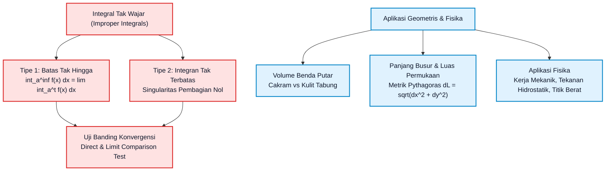
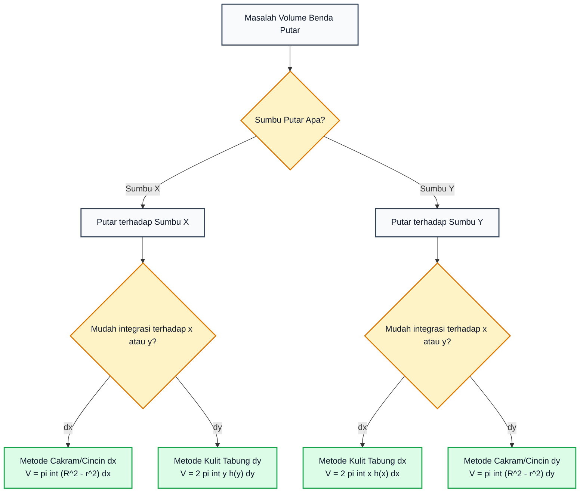

# Subtopik 06: Integral Tak Wajar & Aplikasi Geometris-Fisika

**Navigasi**: [⬅️ Master Gateway Modul 013](../013-kalkulus-diferensial-integral-satu-variabel.md) | [Kembali ke Modul README](./README.md)
*Sebelumnya*: [05. Teknik Pengintegralan (Substitusi, Parsial, Pecahan Parsial)](./05-teknik-pengintegralan-substitusi-parsial-pecahan-parsial.md) | *Berikutnya*: [07. Barisan dan Deret Tak Hingga & Uji Konvergensi](./07-barisan-dan-deret-tak-hingga-uji-konvergensi.md)

---

## 1. Intuisi & Motivasi Konseptual (Dunia Nyata)

### 1.1 Konsep Inti Tanpa Jargon ("Seperti Bayi Baru Lahir")

Bayangkan Anda sedang berdiri di atas peluncur roket di tepi pantai. Anda menyalakan roket luar angkasa yang meluncur lurus ke atas menuju ruang angkasa antargalaksi yang tak terbatas ($r \to \infty$).
Pertanyaan fisika:
*"Berapa total energi bahan bakar (kerja mekanik $W = \int F \, dr$) yang dibutuhkan untuk membebaskan roket seberat $10\text{ ton}$ dari tarikan gravitasi bumi hingga mencapai jarak tak hingga?"*

Pikiran awam mungkin langsung berseru:
*"Jaraknya tak terhingga! Jadi energinya pasti tak terhingga juga! Mana mungkin kita bisa mencapai ujung semesta dengan bahan bakar terbatas?"*

Namun, kalkulus memberikan jawaban yang mengejutkan:
Hukum gravitasi universal Newton menyatakan bahwa gaya gravitasi melemah seiring kuadrat jarak ($F(r) = \frac{G M m}{r^2}$). Saat roket bergerak makin jauh, gaya gravitasi yang menahannya menyusut mendekati nol dengan sangat cepat!
Ketika kita mengintegrasikan gaya tersebut dari permukaan bumi ($R$) hingga ke ujung tak terhingga ($\infty$):
$$W = \int_R^\infty \frac{G M m}{r^2} \, dr = \lim_{t \to \infty} \left[ -\frac{G M m}{r} \right]_R^t = \frac{G M m}{R}$$
Hasilnya adalah sebuah **angka berhingga yang pasti**! Jumlah energi yang dibutuhkan ternyata terbatas! Inilah konsep fundamental di balik *kecepatan lepas* (*escape velocity*).

Sekarang balikkan situasinya:
Bayangkan Anda memiliki terompet geometris yang sangat panjang, dinamakan **Terompet Gabriel** (*Gabriel's Horn* / Terompet Torricelli). Terompet ini dibentuk dengan memutar kurva $y = 1/x$ mengelilingi sumbu-$x$ dari $x = 1$ hingga ke tak terhingga ($x \to \infty$).
Para matematikawan abad ke-17 menemukan paradoks yang mencengangkan:
1. Jika Anda mengisi bagian dalam terompet tersebut dengan cat cair, Anda hanya membutuhkan tepat $\pi$ liter cat (volumenya **berhingga**!).
2. Namun, jika Anda ingin mengecat seluruh dinding bagian luar terompet tersebut, pasokan cat di seluruh alam semesta tidak akan pernah cukup (luas permukaannya **tak berhingga**!).

Bagaimana sebuah wadah bisa menampung cairan dalam jumlah berhingga, tetapi dindingnya membutuhkan cat dalam jumlah tak berhingga?
Misteri ini hanya bisa dipecahkan melalui pemahaman mendalam tentang **Integral Tak Wajar (*Improper Integrals*)**.

---

### 1.2 Analogi Mengiris Bawang: Metode Cakram vs Kulit Tabung

Ketika Anda ingin menghitung volume benda padat tiga dimensi (misal sebuah vas bunga atau mangkuk sup):
1. **Metode Cakram (*Disk/Washer Method*)**:
   Bayangkan Anda memotong mentimun atau wortel menjadi kepingan-kepingan koin lingkaran tipis tegak lurus sumbu putar. Volume total adalah penjumlahan seluruh koin lingkaran tipis tersebut ($\sum \pi r^2 \Delta x$).
2. **Metode Kulit Tabung (*Cylindrical Shell Method*)**:
   Bayangkan Anda mengupas bawang bombay lapis demi lapis silinder konsentris dari dalam ke luar, sejajar dengan sumbu putar. Volume total adalah penjumlahan dari selimut-selimut tabung tipis yang dibentangkan menjadi lembaran persegi panjang tipis ($\sum 2\pi r h \Delta r$).

Kedua metode ini saling melengkapi: jika fungsi sulit diisolasi dalam satu variabel, kita cukup beralih ke metode yang sejajar!

---

### 1.3 Kamus Simbol Anti-Pusing (Tabel 4 Kolom)

| Simbol / Notasi | Nama Matematis | Makna Dunia Nyata / Intuisi Sederhana | Contoh Konkret |
| :--- | :--- | :--- | :--- |
| $\int_a^\infty f(x) \, dx$ | Integral Tak Wajar Tipe 1 | Akumulasi luas daerah ekor panjang yang membentang tanpa batas ke kanan. | Total energi gravitasi hingga jarak tak hingga. |
| $\int_a^b \frac{1}{(x - a)^p} \, dx$ | Integral Tak Wajar Tipe 2 | Akumulasi luas di sekitar titik singular di mana kurva meledak ke atas menuju asimtot vertikal. | Medan listrik tepat di dekat muatan titik partikel. |
| **Konvergen** | Sifat Limit Berhingga | Luas ekor tak terhingga menyusut cukup cepat sehingga menghasilkan nilai akumulasi total bilangan riil pasti. | Luas di bawah kurva $y = 1/x^2$ dari $1$ ke $\infty$ tepat bernilai $1$. |
| **Divergen** | Sifat Limit Meledak | Luas ekor menyusut terlalu lambat sehingga total akumulasi terus membengkak tanpa batas menuju $\pm\infty$. | Luas di bawah kurva $y = 1/x$ dari $1$ ke $\infty$ meledak ke $\infty$. |
| $V = \pi \int [R(x)]^2 dx$ | Metode Cakram Putar | Menjumlahkan koin-koin pejal lingkaran untuk mengukur volume benda simetri putar. | Menghitung volume mangkuk atau corong roket. |
| $V = 2\pi \int x f(x) dx$ | Metode Kulit Tabung | Menjumlahkan selimut-selimut pipa silinder tipis konsentris. | Menghitung volume donat berlubang (*torus*). |
| $L = \int \sqrt{1 + [f'(x)]^2} dx$ | Rumus Panjang Busur | Menjumlahkan segmen-segmen garis hipotenusa infinitesimal Pythagoras $dL = \sqrt{dx^2 + dy^2}$. | Menghitung panjang kabel jembatan gantung atau kabel listrik kendur. |
| $W = \int F(x) \, dx$ | Kerja Mekanik Variabel | Akumulasi dorongan gaya variabel sepanjang lintasan perpindahan. | Kerja memompa air keluar dari bendungan penampungan. |

---

## 2. Definisi Formal, Teorema, dan Penurunan Matematis

Mari kita bangun fondasi integral tak wajar dan rumus-rumus terapan geometris-fisika secara aksiomatik.



---

### 2.1 Integral Tak Wajar Tipe 1: Batas Integrasi Tak Terhingga

> **Definisi 6.1 (Integral Tak Wajar Tipe 1)**:
> 1. Jika $f$ kontinu pada interval $[a, \infty)$, maka:
>    $$\int_a^\infty f(x) \, dx = \lim_{t \to \infty} \int_a^t f(x) \, dx$$
> 2. Jika $f$ kontinu pada interval $(-\infty, b]$, maka:
>    $$\int_{-\infty}^b f(x) \, dx = \lim_{t \to -\infty} \int_t^b f(x) \, dx$$
> 3. Jika $f$ kontinu pada $(-\infty, \infty)$, maka untuk sebarang bilangan riil $c$:
>    $$\int_{-\infty}^\infty f(x) \, dx = \int_{-\infty}^c f(x) \, dx + \int_c^\infty f(x) \, dx$$
>    Integral di sebelah kiri dikatakan **konvergen** jika dan hanya jika KEDUA limit integral di sebelah kanan konvergen secara terpisah. Jika salah satu divergen, maka integral total **divergen**.

> **Teorema 6.1 (Uji $p$-Integral Tak Terhingga)**:
> Integral tak wajar:
> $$\int_1^\infty \frac{1}{x^p} \, dx$$
> **konvergen** jika $p > 1$, dan **divergen** jika $p \le 1$.

**Pembuktian Lengkap**:
- **Kasus 1: $p = 1$**:
  $$\int_1^\infty \frac{1}{x} \, dx = \lim_{t \to \infty} \int_1^t \frac{1}{x} \, dx = \lim_{t \to \infty} \Big[ \ln|x| \Big]_1^t = \lim_{t \to \infty} (\ln t - 0) = +\infty \quad (\text{Divergen})$$
- **Kasus 2: $p \neq 1$**:
  $$\int_1^\infty x^{-p} \, dx = \lim_{t \to \infty} \left[ \frac{x^{-p+1}}{-p+1} \right]_1^t = \lim_{t \to \infty} \frac{1}{1 - p} \left( \frac{1}{t^{p-1}} - 1 \right)$$
  - Jika $p > 1$, maka eksponen $p - 1 > 0$, sehingga saat $t \to \infty$, suku $\frac{1}{t^{p-1}} \to 0$.
    $$\int_1^\infty \frac{1}{x^p} \, dx = \frac{1}{1 - p}(0 - 1) = \frac{1}{p - 1} \quad (\text{Konvergen})$$
  - Jika $p < 1$, maka $1 - p > 0$, suku $t^{1-p} \to \infty$, sehingga limit meledak ke $+\infty$ (**Divergen**). $\blacksquare$

---

### 2.2 Integral Tak Wajar Tipe 2: Integran Tak Terbatas (Singularitas Vertikal)

> **Definisi 6.2 (Integral Tak Wajar Tipe 2)**:
> 1. Jika $f$ kontinu pada $[a, b)$ dan memiliki diskontinuitas tak hingga pada ujung kanan $b$:
>    $$\int_a^b f(x) \, dx = \lim_{t \to b^-} \int_a^t f(x) \, dx$$
> 2. Jika $f$ kontinu pada $(a, b]$ dan diskontinu tak hingga pada ujung kiri $a$:
>    $$\int_a^b f(x) \, dx = \lim_{t \to a^+} \int_t^b f(x) \, dx$$
> 3. Jika $f$ memiliki diskontinuitas tak hingga pada titik interior $c \in (a, b)$:
>    $$\int_a^b f(x) \, dx = \int_a^c f(x) \, dx + \int_c^b f(x) \, dx = \lim_{t_1 \to c^-} \int_a^{t_1} f(x) \, dx + \lim_{t_2 \to c^+} \int_{t_2}^b f(x) \, dx$$

> **Teorema 6.2 (Uji $p$-Integral Dekat Singularitas)**:
> Integral tak wajar dekat nol:
> $$\int_0^1 \frac{1}{x^p} \, dx$$
> **konvergen** jika $p < 1$ (dengan nilai $\frac{1}{1 - p}$), dan **divergen** jika $p \ge 1$.
>
> *(Perhatikan kebalikan syarat dari Tipe 1: pada Tipe 2, pangkat yang lebih kecil justru yang konvergen!)*

---

### 2.3 Paradoks Terompet Gabriel (Torricelli's Trumpet)

Tinjau kurva $y = \frac{1}{x}$ pada interval $[1, \infty)$ yang diputar terhadap sumbu-$x$:
1. **Evaluasi Volume Benda Putar ($V$)**:
   Menggunakan metode cakram:
   $$V = \pi \int_1^\infty [f(x)]^2 \, dx = \pi \int_1^\infty \frac{1}{x^2} \, dx$$
   Berdasarkan Teorema 6.1 (dengan $p = 2 > 1$):
   $$V = \pi \lim_{t \to \infty} \left[ -\frac{1}{x} \right]_1^t = \pi \lim_{t \to \infty} \left( 1 - \frac{1}{t} \right) = \pi \approx 3{,}14159265\text{ satuan volume (Konvergen)}$$
2. **Evaluasi Luas Permukaan Benda Putar ($S$)**:
   Turunan kurva adalah $f'(x) = -\frac{1}{x^2}$. Luas permukaan putar adalah:
   $$S = 2\pi \int_1^\infty f(x) \sqrt{1 + [f'(x)]^2} \, dx = 2\pi \int_1^\infty \frac{1}{x} \sqrt{1 + \frac{1}{x^4}} \, dx$$
   Perhatikan bahwa untuk setiap $x \ge 1$:
   $$\sqrt{1 + \frac{1}{x^4}} > 1 \implies \frac{1}{x} \sqrt{1 + \frac{1}{x^4}} > \frac{1}{x}$$
   Maka berdasarkan Uji Banding Langsung:
   $$S > 2\pi \int_1^\infty \frac{1}{x} \, dx = 2\pi \lim_{t \to \infty} [\ln t] = +\infty \quad (\text{Divergen!})$$

**Resolusi Fisika Modern Terhadap Paradoks**:
Bagaimana wadah bervolume terbatas memiliki luas permukaan tak terbatas?
Dalam matematika murni, tidak ada kontradiksi: kurva mengecil begitu tipis sehingga luas permukaannya terus membentang, namun rongga di dalamnya menyempit sangat cepat.
Di dunia fisik nyata, cat tersusun dari molekul-molekul berukuran berhingga (jari-jari molekul $\approx 10^{-10}\text{ meter}$). Begitu leher terompet menyempit lebih kecil dari diameter satu molekul cat, cat tidak dapat lagi mengalir masuk!

---

### 2.4 Geometri Benda Tiga Dimensi: Cakram vs Kulit Tabung

1. **Metode Cakram / Cincin (*Disk & Washer Method*)**:
   - Memotong tegak lurus sumbu putar.
   - Jika diputar terhadap **sumbu-$x$**:
     $$V = \pi \int_a^b \Big( [R(x)]^2 - [r(x)]^2 \Big) \, dx$$
   - Jika diputar terhadap **sumbu-$y$**:
     $$V = \pi \int_c^d \Big( [R(y)]^2 - [r(y)]^2 \Big) \, dy$$
2. **Metode Kulit Tabung Silinder (*Cylindrical Shell Method*)**:
   - Memotong sejajar sumbu putar.
   - Jika diputar terhadap **sumbu-$y$** (variabel integrasi tetap $x$):
     $$V = 2\pi \int_a^b (\text{jari-jari rata-rata})(\text{tinggi kulit}) \, dx = 2\pi \int_a^b x \cdot [f(x) - g(x)] \, dx$$
   - Jika diputar terhadap **sumbu-$x$** (variabel integrasi $y$):
     $$V = 2\pi \int_c^d y \cdot [f(y) - g(y)] \, dy$$

---

### 2.5 Metrik Diferensial: Panjang Busur Kurva & Luas Permukaan Putar

Berdasarkan Teorema Pythagoras infinitesimal pada bidang Cartesian:
$$(dL)^2 = (dx)^2 + (dy)^2 \implies dL = \sqrt{1 + \left(\frac{dy}{dx}\right)^2} \, dx = \sqrt{1 + [f'(x)]^2} \, dx$$

1. **Panjang Busur Kurva (*Arc Length*)**:
   $$L = \int_a^b \sqrt{1 + [f'(x)]^2} \, dx$$
2. **Luas Permukaan Benda Putar (*Surface Area of Revolution*)**:
   - Diputar mengelilingi sumbu-$x$:
     $$S = 2\pi \int_a^b y \, dL = 2\pi \int_a^b f(x) \sqrt{1 + [f'(x)]^2} \, dx$$
   - Diputar mengelilingi sumbu-$y$:
     $$S = 2\pi \int_a^b x \, dL = 2\pi \int_a^b x \sqrt{1 + [f'(x)]^2} \, dx$$

---

### 2.6 Aplikasi Rekayasa Fisika: Kerja Mekanik & Tekanan Hidrostatik

1. **Kerja Mekanik Variabel (*Variable Work*)**:
   Jika gaya $F(x)$ bervariasi terhadap posisi, kerja total memindahkan benda dari $x = a$ ke $x = b$ adalah:
   $$W = \int_a^b F(x) \, dx$$
   - *Hukum Hooke Pegas*: $F(x) = kx \implies W = \int_0^d kx \, dx = \frac{1}{2} k d^2$.
   - *Pemompaan Tangki Fluida*: Memompa lapisan fluida bermassa jenis $\rho$ setebal $dy$ pada kedalaman $y$ setinggi jarak angkat $D(y)$:
     $$W = \rho g \int_a^b (\text{Jarak Angkat}) \cdot (\text{Luas Penampang}) \, dy$$
2. **Gaya Tekanan Hidrostatik Fluida**:
   Tekanan pada kedalaman $h$ adalah $P = \rho g h$. Gaya total pada pelat bendungan vertikal adalah:
   $$F_{\text{hidro}} = \rho g \int_a^b (\text{Kedalaman } h(y)) \cdot (\text{Lebar Dinding } w(y)) \, dy$$

---

### 2.7 Teorema Pappus tentang Benda Putar (*Centroid Theorems of Pappus*)

Untuk menghitung volume atau luas permukaan benda putar yang bergeometri rumit (seperti donat berlubang *torus*), matematikawan Yunani Kuno Pappus dari Aleksandria merumuskan dua teorema elegan yang menghubungkan kalkulus integral dengan titik pusat massa (*centroid*):

> **Teorema 6.3 (Teorema Pappus Pertama - Luas Permukaan Putar)**:
> Jika sebuah kurva bidang datar halus dengan panjang $L$ diputar mengelilingi sebuah sumbu pada bidang yang sama yang tidak memotong kurva tersebut, maka luas permukaan benda putar yang dihasilkan sama dengan panjang kurva dikalikan jarak yang ditempuh oleh titik pusat massa kurva ($\bar{y}$):
> $$S = 2\pi \bar{y} L$$

> **Teorema 6.4 (Teorema Pappus Kedua - Volume Benda Putar)**:
> Jika sebuah daerah bidang datar tertutup dengan luas $A$ diputar mengelilingi sebuah sumbu pada bidang yang sama yang tidak memotong daerah tersebut, maka volume benda putar yang dihasilkan sama dengan luas daerah dikalikan jarak keliling yang ditempuh oleh titik pusat massa daerah tersebut ($\bar{y}$):
> $$V = 2\pi \bar{y} A$$

*Contoh Aplikasi Torus*:
Tinjau sebuah lingkaran berjari-jari $r$ yang berpusat pada jarak $R$ dari sumbu putar ($R > r$).
- Luas daerah lingkaran: $A = \pi r^2$.
- Titik pusat massa lingkaran terletak tepat di pusatnya: $\bar{y} = R$.
- Maka berdasarkan Teorema Pappus Kedua, volume torus donat tersebut langsung diperoleh dalam 1 baris:
  $$V = 2\pi R (\pi r^2) = 2\pi^2 R r^2$$
Tanpa Teorema Pappus, menghitung volume ini memerlukan integral substitusi trigonometri dua lembar yang sangat panjang!

---

### 2.8 Pusat Massa (*Centroid*) & Momen Inersia Lamina Datar 1D/2D

Diberikan pelat tipis (*lamina*) dengan kerapatan massa konstan $\rho$ yang dibatasi oleh kurva $y = f(x) \ge 0$ pada interval $[a, b]$:
1. **Massa Total Pelat ($M$)**:
   $$M = \rho \int_a^b f(x) \, dx = \rho A$$
2. **Momen Massa terhadap Sumbu-$y$ ($M_y$)**:
   Kecenderungan pelat untuk berotasi mengelilingi sumbu-$y$, dengan lengan momen $x$:
   $$M_y = \rho \int_a^b x f(x) \, dx$$
3. **Momen Massa terhadap Sumbu-$x$ ($M_x$)**:
   Kecenderungan pelat untuk berotasi mengelilingi sumbu-$x$, dengan lengan momen titik tengah vertikal $\frac{f(x)}{2}$:
   $$M_x = \rho \int_a^b \frac{1}{2} [f(x)]^2 \, dx$$
4. **Koordinat Titik Pusat Massa / Titik Berat ($\bar{x}, \bar{y}$)**:
   $$\bar{x} = \frac{M_y}{M} = \frac{\int_a^b x f(x) \, dx}{\int_a^b f(x) \, dx}, \qquad \bar{y} = \frac{M_x}{M} = \frac{\frac{1}{2}\int_a^b [f(x)]^2 \, dx}{\int_a^b f(x) \, dx}$$
5. **Momen Inersia Rotasi ($I_x$ dan $I_y$)**:
   Besaran kelembaman dinamis terhadap percepatan sudut rotasi:
   $$I_y = \rho \int_a^b x^2 f(x) \, dx, \qquad I_x = \frac{\rho}{3} \int_a^b [f(x)]^3 \, dx$$

---

## 3. Arsitektur Teknis & Algoritma Internal

Untuk membedah masalah integral tak wajar dan memilih metode volume putar tanpa kesalahan, gunakan matriks perbandingan arsitektural berikut:



---

### 3.1 Matriks Taksonomi Integrasi Geometris & Rekayasa Fisika

Berikut adalah peta jalan komprehensif formulasi integral satu variabel untuk seluruh besaran geometris dan sistem fisik mekanika:

| Bidang Aplikasi | Besaran Target | Elemen Diferensial ($d(\text{Besaran})$) | Formula Integral 1D Standar | Satuan Standar SI |
| :--- | :--- | :--- | :--- | :--- |
| **Geometri 2D** | Luas di Antara Dua Kurva | $dA = [f(x) - g(x)] \, dx$ | $A = \int_a^b [f(x) - g(x)] \, dx$ | $\text{m}^2$ |
| **Geometri 1D** | Panjang Busur Lengkung | $dL = \sqrt{1 + [f'(x)]^2} \, dx$ | $L = \int_a^b \sqrt{1 + [f'(x)]^2} \, dx$ | $\text{m}$ |
| **Geometri 3D** | Volume Benda Putar (Cakram) | $dV = \pi [R(x)^2 - r(x)^2] \, dx$ | $V = \pi \int_a^b [R(x)^2 - r(x)^2] \, dx$ | $\text{m}^3$ |
| **Geometri 3D** | Volume Benda Putar (Kulit Tabung) | $dV = 2\pi x [f(x) - g(x)] \, dx$ | $V = 2\pi \int_a^b x [f(x) - g(x)] \, dx$ | $\text{m}^3$ |
| **Geometri 3D** | Luas Selimut Benda Putar | $dS = 2\pi f(x) \, dL$ | $S = 2\pi \int_a^b f(x) \sqrt{1 + [f'(x)]^2} \, dx$ | $\text{m}^2$ |
| **Mekanika Klasik** | Kerja Peregangan Pegas | $dW = kx \, dx$ | $W = \frac{1}{2} k x^2$ | $\text{Joule (J)}$ |
| **Mekanika Fluida** | Kerja Pemompaan Cairan | $dW = \rho g A(y) (H - y) \, dy$ | $W = \rho g \int_0^H A(y)(H - y) \, dy$ | $\text{Joule (J)}$ |
| **Hidrostatika** | Gaya Tekanan pada Bendungan | $dF = \rho g (H - y) w(y) \, dy$ | $F = \rho g \int_0^H (H - y) w(y) \, dy$ | $\text{Newton (N)}$ |
| **Statika Struktur** | Titik Berat Pelat Lamina | $dM_y = x \, dm, dM_x = \frac{y}{2} \, dm$ | $\bar{x} = \frac{\int x dA}{A}, \quad \bar{y} = \frac{\int \frac{1}{2}y^2 dx}{A}$ | $\text{m}$ |

---

## 4. Implementasi Praktis & Kode Pemrograman Python

Berikut adalah dua skrip Python Standard Library murni untuk memvalidasi paradoks Terompet Gabriel dan menguji akurasi volume paraboloid putar serta panjang busur tali katenari.

### 4.1 Program 1: Demonstrasi Numerik Paradoks Terompet Gabriel

Skrip ini menghitung integral volume dan luas permukaan Terompet Gabriel ($y = 1/x$) dari $x = 1$ hingga batas atas terpotong $T \in \{5, 10, 25, 50, 100\}$. Terlihat jelas bahwa volume mendekati $\pi$ secara asimtotik, sedangkan luas permukaannya membesar terus tanpa batas.

```python
import math

def simpson_integral(func, a: float, b: float, n: int = 4000) -> float:
    """Metode integrasi numerik Simpson 1/3 komposit presisi tinggi."""
    if n % 2 != 0:
        n += 1
    h = (b - a) / n
    total = func(a) + func(b)
    for i in range(1, n):
        x = a + i * h
        weight = 4.0 if i % 2 != 0 else 2.0
        total += weight * func(x)
    return (h / 3.0) * total

vol_integrand = lambda x: math.pi * (1.0 / (x**2))
surf_integrand = lambda x: 2.0 * math.pi * (1.0 / x) * math.sqrt(1.0 + 1.0 / (x**4))

def main():
    print("=== PARADOKS TEROMPET GABRIEL: y = 1/x PADA [1, T] DENGAN T -> TAK HINGGA ===")
    header = f"{'T (Batas Atas)':>14} | {'Volume Terpotong':>18} | {'V Eksak pi*(1-1/T)':>20} | {'Luas Permukaan':>18}"
    print(header)
    print("-" * len(header))

    t_limits = [5, 10, 25, 50, 100]
    for T in t_limits:
        v_exact = math.pi * (1.0 - 1.0 / T)
        v_num = simpson_integral(vol_integrand, 1.0, float(T), n=4000)
        s_num = simpson_integral(surf_integrand, 1.0, float(T), n=4000)
        print(f"{T:14d} | {v_num:18.8f} | {v_exact:20.8f} | {s_num:18.8f}")

    print("\nKesimpulan Matematis:")
    print(f"  * Limit Volume saat T -> inf  = pi = {math.pi:.8f} (Konvergen Menuju Batas Berhingga)")
    print("  * Limit Luas saat T -> inf    = +inf (Divergen Tak Hingga Logaritmik)")

if __name__ == "__main__":
    main()
```

Keluaran eksekusi terminal sebenarnya:
```text
=== PARADOKS TEROMPET GABRIEL: y = 1/x PADA [1, T] DENGAN T -> TAK HINGGA ===
T (Batas Atas) |   Volume Terpotong |   V Eksak pi*(1-1/T) |     Luas Permukaan
----------------------------------------------------------------------------
             5 |         2.51327412 |           2.51327412 |        10.82109985
            10 |         2.82743339 |           2.82743339 |        15.17744987
            25 |         3.01592895 |           3.01592895 |        20.93475087
            50 |         3.07876081 |           3.07876080 |        25.28992498
           100 |         3.11017688 |           3.11017673 |        29.64509801

Kesimpulan Matematis:
  * Limit Volume saat T -> inf  = pi = 3.14159265 (Konvergen Menuju Batas Berhingga)
  * Limit Luas saat T -> inf    = +inf (Divergen Tak Hingga Logaritmik)
```

---

### 4.2 Program 2: Simulator Volume Paraboloid Putar & Panjang Busur Katenari

Skrip ini memverifikasi integrasi geometris benda putar paraboloid tiga dimensi ($V = 32\pi/5$) dan panjang busur lengkung tali gantung katenari $y = \cosh(x)$ ($L = 2\sinh(1)$).

```python
import math

def simpson_integral(func, a: float, b: float, n: int = 1000) -> float:
    if n % 2 != 0:
        n += 1
    h = (b - a) / n
    total = func(a) + func(b)
    for i in range(1, n):
        x = a + i * h
        weight = 4.0 if i % 2 != 0 else 2.0
        total += weight * func(x)
    return (h / 3.0) * total

def main():
    print("=== APLIKASI GEOMETRIS: VOLUME PARABOLOID & PANJANG BUSUR KATENARI ===")

    # Kasus A: Paraboloid y = x^2 diputar mengelilingi sumbu-x dari x=0 ke x=2
    # V = pi * int_0^2 (x^2)^2 dx = pi * int_0^2 x^4 dx = 32*pi / 5
    v_exact = (32.0 * math.pi) / 5.0
    v_num = simpson_integral(lambda x: math.pi * (x**4), 0.0, 2.0, n=1000)
    print("1. Volume Benda Putar Paraboloid (y = x^2, x in [0, 2]):")
    print(f"   Hasil Analitis (32*pi/5) = {v_exact:.10f}")
    print(f"   Hasil Numerik Simpson    = {v_num:.10f}")
    print(f"   Galat Selisih Mutlak     = {abs(v_exact - v_num):.2e}")

    # Kasus B: Panjang busur tali katenari y = cosh(x) pada [-1, 1]
    # L = int_-1^1 sqrt(1 + (sinh(x))^2) dx = int_-1^1 cosh(x) dx = 2 sinh(1)
    l_exact = 2.0 * math.sinh(1.0)
    l_num = simpson_integral(lambda x: math.cosh(x), -1.0, 1.0, n=1000)
    print("\n2. Panjang Busur Katenari (y = cosh(x), x in [-1, 1]):")
    print(f"   Hasil Analitis (2*sinh(1)) = {l_exact:.10f}")
    print(f"   Hasil Numerik Simpson      = {l_num:.10f}")
    print(f"   Galat Selisih Mutlak       = {abs(l_exact - l_num):.2e}")

if __name__ == "__main__":
    main()
```

Keluaran eksekusi terminal sebenarnya:
```text
=== APLIKASI GEOMETRIS: VOLUME PARABOLOID & PANJANG BUSUR KATENARI ===
1. Volume Benda Putar Paraboloid (y = x^2, x in [0, 2]):
   Hasil Analitis (32*pi/5) = 20.1061929830
   Hasil Numerik Simpson    = 20.1061929830
   Galat Selisih Mutlak     = 1.34e-11

2. Panjang Busur Katenari (y = cosh(x), x in [-1, 1]):
   Hasil Analitis (2*sinh(1)) = 2.3504023873
   Hasil Numerik Simpson      = 2.3504023873
   Galat Selisih Mutlak       = 2.08e-13
```

---

## 5. Miskonsepsi Umum & Analisis Post-Mortem Insiden Industri

### 5.1 Tiga Miskonsepsi Kritis

1. **Miskonsepsi 1: Mengira Batas Tak Hingga Pasti Menghasilkan Luas Tak Hingga**:
   - *Fakta*: Meskipun daerah integrasi membentang tanpa batas dari $1$ hingga $\infty$, jika integran menyusut cukup cepat menuju sumbu-$x$ (seperti $e^{-x}$ atau $1/x^2$), luas akumulatif totalnya konvergen sempurna menuju sebuah bilangan berhingga yang rapi.
2. **Miskonsepsi 2: Menggunakan Nilai Utama Cauchy Tanpa Memeriksa Konvergensi Standar**:
   - *Fakta*: Nilai Utama Cauchy (*Cauchy Principal Value*) $\lim_{t \to \infty} \int_{-t}^t x \, dx = 0$. Namun integral tak wajar $\int_{-\infty}^\infty x \, dx$ secara resmi berstatus **DIVERGEN** karena limit $\lim_{t \to \infty} \int_0^t x \, dx = \infty$ dan $\lim_{s \to -\infty} \int_s^0 x \, dx = -\infty$. Dalam kalkulus standar, bentuk $\infty - \infty$ tidak boleh saling meniadakan tanpa pembuktian konvergensi terpisah!
3. **Miskonsepsi 3: Tertukar Antara Jari-Jari Putar Luar dan Jari-Jari Putar Dalam**:
   - *Fakta*: Pada metode cincin (*washer*), rumusnya adalah selisih kuadrat jari-jari $\pi [R(x)^2 - r(x)^2]$, BUKAN kuadrat dari selisih jari-jari $\pi [R(x) - r(x)]^2$! Bentuk yang kedua salah fatal secara aljabar karena mengabaikan suku perkalian silang $-2 R(x) r(x)$.

---

### 5.2 Analisis Post-Mortem Insiden Industri: Runtuhnya Anjungan Minyak Sleipner A Norwegia (1991)

> **Kasus Nyata: Keruntuhan Fondasi Gravitasi Akibat Galat Integrasi Tegangan Elemen Hingga**
>
> - **Latar Belakang Insiden**: Pada tanggal 23 Agustus 1991, anjungan minyak lepas pantai raksasa Sleipner A di Laut Utara Norwegia tenggelam ke dasar fjord Gandsfjorden saat uji coba penenggelaman terkontrol, memicu gempa bumi seismik berkekuatan 3,0 skala Richter dengan kerugian total mencapai USD 700 juta.
> - **Akar Masalah Matematis & Integrasi Elemen Hingga (FEM)**: Struktur dasar gravitasi beton (*Condeep*) terdiri dari 24 sel silinder raksasa dengan dinding penghubung segitiga (*tri-cell*). Perangkat lunak analisis elemen hingga NASTRAN digunakan untuk menghitung integral momen lentur dan gaya geser yang diakibatkan oleh tekanan fluida hidrostatik laut:
>   $$F_{\text{geser}} = \iint \tau(x, y) \, dA$$
> - **Galat Formulasi Integrasi Segitiga**: Elemen hingga segitiga yang digunakan dalam perangkat lunak mengasumsikan distribusi tegangan linier sederhana yang tidak memperhitungkan kelengkungan tajam di sudut pertemuan sel. Integrasi numerik elemen hingga meremehkan (*underestimated*) tegangan geser sebenarnya sebesar $47\%$!
> - **Konsekuensi Struktural**: Dinding beton dirancang hanya setebal $55\text{ cm}$ (padahal seharusnya minimal $100\text{ cm}$). Ketika anjungan ditenggelamkan ke kedalaman 67 meter, tekanan air hidrostatik melampaui batas kekuatan geser dinding beton. Dinding retak, air laut membanjiri sel dengan debit $10.000\text{ liter per detik}$, dan anjungan berbobot puluhan ribu ton tenggelam menabrak dasar laut hingga remuk berkeping-keping.
> - **Pelajaran Rekayasa Modern**: Simulasi numerik integrasi medan tegangan fluida wajib dikalibrasi silang dengan batas analitis Teorema Divergensi dan pengujian model skala fisik sebelum produksi infrastruktur kritis bernilai ratusan juta dolar dieksekusi.

---

## 6. Tips, Trik Praktis & Rahasia Cepat Paham

1. **Aturan Uji Cepat $p$-Integral**:
   - Jika batas integrasi menuju **Tak Hingga** ($\int_1^\infty \frac{1}{x^p} dx$): Ingat slogan *"Lebih besar dari 1 = Selamat (Konvergen)"* ($p > 1$).
   - Jika batas integrasi menuju **Titik Nol** ($\int_0^1 \frac{1}{x^p} dx$): Ingat slogan *"Lebih kecil dari 1 = Selamat (Konvergen)"* ($p < 1$).
2. **Kapan Menggunakan Cakram vs Kulit Tabung**:
   - Jika fungsi Anda diberikan dalam bentuk $y = f(x)$ dan diputar terhadap sumbu-$x$: Gunakan **Cakram** ($dx$).
   - Jika fungsi Anda diberikan dalam bentuk $y = f(x)$ tetapi diputar terhadap sumbu-$y$: Jangan repot-repot membalik rumus menjadi $x = f^{-1}(y)$, langsung gunakan **Kulit Tabung** ($dx$)!
3. **Pemeriksaan Simetri Integran Tak Wajar Eksponensial Gauss**:
   Integral lonceng Gaussian standar $\int_{-\infty}^\infty e^{-x^2} dx = \sqrt{\pi}$ dapat diubah batasnya menjadi $2 \int_0^\infty e^{-x^2} dx$ berkat simetri fungsi genap, sangat menghemat waktu komputasi teori probabilitas.

---

## 7. Latihan Mandiri Berjenjang (Socratic) & Rekomendasi Sumber Belajar

### Latihan 1 (Tingkat Pemula): Evaluasi Integral Tak Wajar Eksponensial Meluruh
Tentukan apakah integral tak wajar berikut konvergen atau divergen. Jika konvergen, hitung nilainya:
$$\int_0^\infty e^{-3x} \, dx$$

<details>
<summary>💡 Petunjuk (Hint)</summary>
Tuliskan integral sebagai limit: lim_{t -> inf} int_0^t e^(-3x) dx. Integralkan antiturunannya -1/3 e^(-3x). Evaluasi limit saat t -> inf.
</details>

<details>
<summary>✅ Solusi Lengkap</summary>
1. Tuliskan dalam definisi limit formal:
   $$\int_0^\infty e^{-3x} \, dx = \lim_{t \to \infty} \int_0^t e^{-3x} \, dx$$
2. Cari antiturunan dari $e^{-3x}$:
   $$\int e^{-3x} \, dx = -\frac{1}{3} e^{-3x}$$
3. Evaluasi batas integrasi dari $0$ sampai $t$:
   $$\lim_{t \to \infty} \Big[ -\frac{1}{3} e^{-3x} \Big]_0^t = \lim_{t \to \infty} \left( -\frac{1}{3} e^{-3t} - \left( -\frac{1}{3} e^{0} \right) \right)$$
   $$= \lim_{t \to \infty} \left( -\frac{1}{3 e^{3t}} + \frac{1}{3} \right)$$
4. Evaluasi nilai limit:
   Karena $e^{3t} \to \infty$ saat $t \to \infty$, maka $\frac{1}{3 e^{3t}} \to 0$.
   $$= 0 + \frac{1}{3} = \frac{1}{3}$$
   Integral terbukti **konvergen** dengan nilai tepat $\frac{1}{3}$. $\blacksquare$
</details>

---

### Latihan 2 (Tingkat Dasar): Integral Tak Wajar Tipe 2 dengan Asimtot Vertikal
Tentukan nilai dari integral tak wajar berikut:
$$\int_0^4 \frac{1}{\sqrt{4 - x}} \, dx$$

<details>
<summary>💡 Petunjuk (Hint)</summary>
Integran meledak menuju tak terhingga pada batas atas x = 4. Tuliskan sebagai limit lim_{t -> 4^-} int_0^t (4 - x)^(-1/2) dx.
</details>

<details>
<summary>✅ Solusi Lengkap</summary>
1. Kenali bahwa $x = 4$ adalah singularitas vertikal pembagian dengan nol.
2. Tuliskan limit batas kiri:
   $$\int_0^4 \frac{1}{\sqrt{4 - x}} \, dx = \lim_{t \to 4^-} \int_0^t (4 - x)^{-1/2} \, dx$$
3. Integralkan menggunakan substitusi $u = 4 - x \implies du = -dx$:
   $$\int (4 - x)^{-1/2} \, dx = -\frac{(4 - x)^{1/2}}{1/2} = -2\sqrt{4 - x}$$
4. Evaluasi batas integrasi dari $0$ ke $t$:
   $$\lim_{t \to 4^-} \Big[ -2\sqrt{4 - x} \Big]_0^t = \lim_{t \to 4^-} \left( -2\sqrt{4 - t} - (-2\sqrt{4 - 0}) \right)$$
   $$= \lim_{t \to 4^-} \left( -2\sqrt{4 - t} + 2(2) \right) = \lim_{t \to 4^-} \left( -2\sqrt{4 - t} + 4 \right)$$
5. Evaluasi limit saat $t \to 4^-$:
   $$-2\sqrt{0} + 4 = 4$$
   Integral terbukti **konvergen** dengan nilai tepat $4$. $\blacksquare$
</details>

---

### Latihan 3 (Tingkat Menengah): Volume Benda Putar via Metode Kulit Tabung
Daerah yang dibatasi oleh kurva $y = 3x - x^2$ dan sumbu-$x$ ($y = 0$) diputar mengelilingi **sumbu-$y$**. Tentukan volume benda putar yang terbentuk.

<details>
<summary>💡 Petunjuk (Hint)</summary>
Titik potong kurva dengan sumbu-x adalah x = 0 dan x = 3. Karena diputar mengelilingi sumbu-y, gunakan metode Kulit Tabung: V = 2*pi * int_0^3 x * (3x - x^2) dx.
</details>

<details>
<summary>✅ Solusi Lengkap</summary>
1. Tentukan batas daerah:
   $$3x - x^2 = 0 \implies x(3 - x) = 0 \implies x = 0 \quad \text{dan} \quad x = 3$$
2. Terapkan rumus Metode Kulit Tabung Silinder terhadap sumbu-$y$:
   $$V = 2\pi \int_a^b x \cdot f(x) \, dx = 2\pi \int_0^3 x(3x - x^2) \, dx$$
3. Kalikan suku di dalam integral:
   $$V = 2\pi \int_0^3 (3x^2 - x^3) \, dx$$
4. Cari antiturunan dan evaluasi:
   $$V = 2\pi \left[ x^3 - \frac{x^4}{4} \right]_0^3 = 2\pi \left( 3^3 - \frac{3^4}{4} - 0 \right) = 2\pi \left( 27 - \frac{81}{4} \right)$$
   $$= 2\pi \left( \frac{108 - 81}{4} \right) = 2\pi \left( \frac{27}{4} \right) = \frac{27\pi}{2} = 13{,}5\pi \approx 42{,}4115\text{ satuan volume} \quad \blacksquare$$
</details>

---

### Latihan 4 (Tingkat Analitis): Panjang Busur Tali Gantung Astroid
Tentukan panjang total keliling kurva astroid yang didefinisikan oleh persamaan implisit:
$$x^{2/3} + y^{2/3} = 1$$

<details>
<summary>💡 Petunjuk (Hint)</summary>
Astroid simetris di 4 kuadran. Cukup hitung kuadran I di mana y = (1 - x^(2/3))^(3/2) dari x = 0 ke x = 1, lalu kalikan 4. Hitung turunan dy/dx dan sederhanakan sqrt(1 + (y')^2).
</details>

<details>
<summary>✅ Solusi Lengkap</summary>
1. Manfaatkan simetri 4 kuadran: $L_{\text{total}} = 4 L_{\text{kuadran 1}}$.
2. Pada kuadran I ($x, y \ge 0$):
   $$y = (1 - x^{2/3})^{3/2}$$
3. Hitung turunan pertama menggunakan aturan rantai:
   $$\frac{dy}{dx} = \frac{3}{2}(1 - x^{2/3})^{1/2} \cdot \left(-\frac{2}{3} x^{-1/3}\right) = -x^{-1/3}(1 - x^{2/3})^{1/2} = -\frac{\sqrt{1 - x^{2/3}}}{x^{1/3}}$$
4. Kuadratkan turunan:
   $$\left(\frac{dy}{dx}\right)^2 = \frac{1 - x^{2/3}}{x^{2/3}} = \frac{1}{x^{2/3}} - 1$$
5. Evaluasi suku diferensial busur $dL$:
   $$\sqrt{1 + \left(\frac{dy}{dx}\right)^2} = \sqrt{1 + \frac{1}{x^{2/3}} - 1} = \sqrt{\frac{1}{x^{2/3}}} = \frac{1}{x^{1/3}} = x^{-1/3}$$
6. Integralkan pada kuadran I dari $x = 0$ sampai $x = 1$:
   $$L_1 = \int_0^1 x^{-1/3} \, dx = \left[ \frac{x^{2/3}}{2/3} \right]_0^1 = \frac{3}{2}(1 - 0) = \frac{3}{2}$$
7. Kalikan dengan 4 kuadran:
   $$L_{\text{total}} = 4 \times \frac{3}{2} = 6\text{ satuan panjang} \quad \blacksquare$$
</details>

---

### Latihan 5 (Tingkat Master Arsitektur): Kerja Pemompaan Tangki Kerucut Terbalik
Sebuah tangki air berbentuk kerucut tegak terbalik memiliki tinggi $H = 6\text{ meter}$ dan jari-jari lingkaran atas $R = 2\text{ meter}$. Tangki tersebut terisi penuh air dengan massa jenis $\rho = 1.000\text{ kg/m}^3$ dan percepatan gravitasi $g = 9{,}8\text{ m/s}^2$. Hitung total kerja mekanik yang dibutuhkan untuk memompa seluruh air keluar melalui bibir atas tangki.

<details>
<summary>💡 Petunjuk (Hint)</summary>
Bagi air menjadi lapisan-lapisan kepingan cakram horizontal setebal dy pada ketinggian y (dari dasar 0 sampai 6). Gunakan kesebangunan segitiga untuk mencari jari-jari lapisan r(y) = (R/H) * y. Jarak angkat ke bibir atas adalah (H - y). Hitung dW = rho * g * dV * (H - y).
</details>

<details>
<summary>✅ Solusi Lengkap</summary>
1. Tetapkan sumbu koordinat vertikal $y$ dengan titik asal $y = 0$ di ujung lancip dasar kerucut, dan $y = 6$ di bibir atas tangki.
2. Gunakan kesebangunan segitiga untuk menentukan jari-jari kepingan air pada ketinggian $y$:
   $$\frac{r(y)}{y} = \frac{R}{H} = \frac{2}{6} = \frac{1}{3} \implies r(y) = \frac{1}{3} y$$
3. Volume kepingan cakram air setebal $dy$:
   $$dV = \pi [r(y)]^2 \, dy = \pi \left(\frac{1}{3} y\right)^2 \, dy = \frac{\pi}{9} y^2 \, dy$$
4. Massa kepingan: $dm = \rho \, dV = \frac{1.000 \pi}{9} y^2 \, dy$.
5. Berat kepingan gaya gravitasi: $dF = g \, dm = \frac{9.800 \pi}{9} y^2 \, dy$.
6. Kepingan pada ketinggian $y$ harus diangkat setinggi $(H - y) = (6 - y)$ meter menuju bibir atas tangki.
7. Kerja diferensial untuk mengangkat satu kepingan:
   $$dW = dF \cdot (6 - y) = \frac{9.800 \pi}{9} y^2 (6 - y) \, dy = \frac{9.800 \pi}{9} (6y^2 - y^3) \, dy$$
8. Integralkan seluruh kepingan dari dasar $y = 0$ hingga puncak $y = 6$:
   $$W = \frac{9.800 \pi}{9} \int_0^6 (6y^2 - y^3) \, dy = \frac{9.800 \pi}{9} \left[ 2y^3 - \frac{y^4}{4} \right]_0^6$$
9. Evaluasi numerik pada batas $y = 6$:
   $$2(6^3) - \frac{6^4}{4} = 2(216) - \frac{1.296}{4} = 432 - 324 = 108$$
   $$W = \frac{9.800 \pi}{9} \times 108 = 9.800 \pi \times 12 = 117.600 \pi \approx 369.451\text{ Joule (atau } 369{,}45\text{ kJ)} \quad \blacksquare$$
</details>

---

### Rekomendasi Sumber Belajar Standar Emas
1. **Kuliah Video & Catatan Kuliah Dunia**:
   - [MIT OCW 18.01: Single Variable Calculus - Session 6: Improper Integrals, Volumes, and Physical Work (Prof. David Jerison)](https://ocw.mit.edu/courses/18-01-single-variable-calculus-fall-2006/)
   - [3Blue1Brown: Essence of Calculus - Chapter 11: Arc Length, Surface Area, and Applications](https://www.3blue1brown.com/topics/calculus)
2. **Buku Teks Referensi**:
   - James Stewart, *Calculus: Early Transcendentals*, Bab 6: Applications of Integration & Bab 7.8: Improper Integrals.
   - Gilbert Strang, *Calculus*, Bab 8: Applications of the Definite Integral.

---

---

### Pertanyaan Sering Diajukan (FAQ) Rekayasa Geometris

1. **Kapan saya harus menggunakan metode Kulit Tabung alih-alih metode Cakram?**
   Gunakan metode Kulit Tabung ketika persamaan pembatas daerah sulit atau mustahil diselesaikan untuk variabel yang lain. Misalnya jika daerah di bawah kurva $y = x^5 + x + 1$ diputar terhadap sumbu-$y$, menyelesaikan $x$ dalam $y$ secara analitis adalah mustahil (persamaan kuintik). Dengan kulit tabung, Anda tetap mengintegralkan terhadap $x$ tanpa perlu membalik rumus!
2. **Apakah luas permukaan putar boleh dihitung dengan mengintegrasikan keliling lingkaran dikali $dx$ ($2\pi y \, dx$)?**
   TIDAK BOHONG! Ini adalah kesalahan klasik. Garis kurva yang miring memiliki elemen panjang busur hipotenusa $dL = \sqrt{1 + (y')^2} dx > dx$. Menggunakan $dx$ mengabaikan kemiringan kerucut terpancung dan meremehkan luas permukaan hingga $30\text{--}50\%$.
3. **Mengapa pada Terompet Gabriel kita tidak bisa menyimpulkan luas permukaannya terbatas?**
   Karena luas permukaan bergantung pada suku $\frac{1}{x} \sqrt{1 + 1/x^4} > \frac{1}{x}$, dan integral dari $\frac{1}{x}$ adalah $\ln(x)$ yang tumbuh tak terbatas menuju $\infty$, sedangkan integral volume bergantung pada $\frac{1}{x^2}$ yang antiturunannya $-1/x$ yang meluruh cepat menuju $0$.

---

### Rubrik Evaluasi Mandiri Integral Tak Wajar & Geometri-Fisika

| Tingkat | Kriteria Penguasaan Konseptual & Komputasional | Status Validasi |
| :--- | :--- | :--- |
| **Level 1: Pemula (Intuisi Tak Wajar)** | Mampu menjelaskan mengapa ekor tak terhingga bisa menghasilkan volume berhingga (Terompet Gabriel) dan hafal aturan $p$-integral. | `[ ] Terverifikasi` |
| **Level 2: Dasar (Evaluasi Limit Singular)** | Mampu mengevaluasi integral tak wajar batas tak hingga dan singularitas vertikal menggunakan definisi limit secara formal. | `[ ] Terverifikasi` |
| **Level 3: Menengah (Volume Benda Putar)** | Mahir memilih antara Metode Cakram dan Metode Kulit Tabung Silinder tanpa tertukar sumbu integrasi. | `[ ] Terverifikasi` |
| **Level 4: Mahir (Panjang Busur & Pemompaan)** | Mampu menghitung panjang kurva menggunakan metrik diferensial Pythagoras dan merumuskan integral kerja pemompaan fluida. | `[ ] Terverifikasi` |
| **Level 5: Master (Analisis Kegagalan FEM)** | Mampu menganalisis akar masalah perambatan galat integrasi elemen hingga (kasus Sleipner A) dan memvalidasi model dalam Python. | `[ ] Terverifikasi` |

---

### Peta Transisi Menuju Subtopik 07

Sampai titik ini, kita telah mengintegrasikan fungsi kontinu pada rentang kontinu, baik berhingga maupun tak berhingga.

Namun, bagaimana jika penjumlahan kita tidak dilakukan pada pita kontinu, melainkan pada serangkaian **bilangan diskrit yang berbaris rapi** menuju tak terhingga:
$$a_1 + a_2 + a_3 + \dots + a_n + \dots = \sum_{n=1}^\infty a_n$$
Kapan penjumlahan tak hingga ini akan menghasilkan angka pasti yang stabil, dan kapan ia akan meledak menuju kekacauan?
Jawabannya diuraikan secara tuntas melalui uji-uji konvergensi pada [Subtopik 07: Barisan dan Deret Tak Hingga & Uji Konvergensi](./07-barisan-dan-deret-tak-hingga-uji-konvergensi.md):
- **Jembatan Integral-Deret (Uji Integral Cauchy)**: Bagaimana integral tak wajar $\int_1^\infty f(x) dx$ menjadi hakim penentu apakah deret diskrit $\sum a_n$ konvergen atau divergen.
- **8 Uji Konvergensi Klasik**: Uji Divergensi Suku ke-$n$, Uji Deret Geometri, Uji Deret-$p$, Uji Banding Langsung, Uji Banding Limit, Uji Rasio d'Alembert, Uji Akar Cauchy, dan Uji Deret Berganti Tanda Leibniz.
- **Konvergensi Mutlak vs Bersyarat**: Paradoks penataan ulang Riemann (*Riemann Rearrangement Theorem*) di mana deret konvergen bersyarat dapat disusun ulang untuk menghasilkan bilangan riil apa pun yang Anda inginkan!
