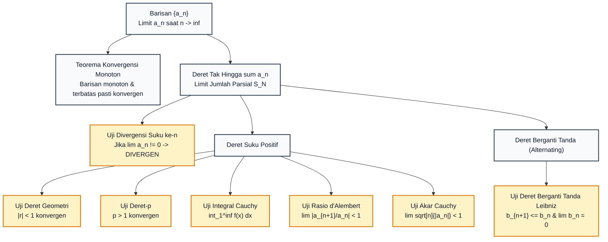
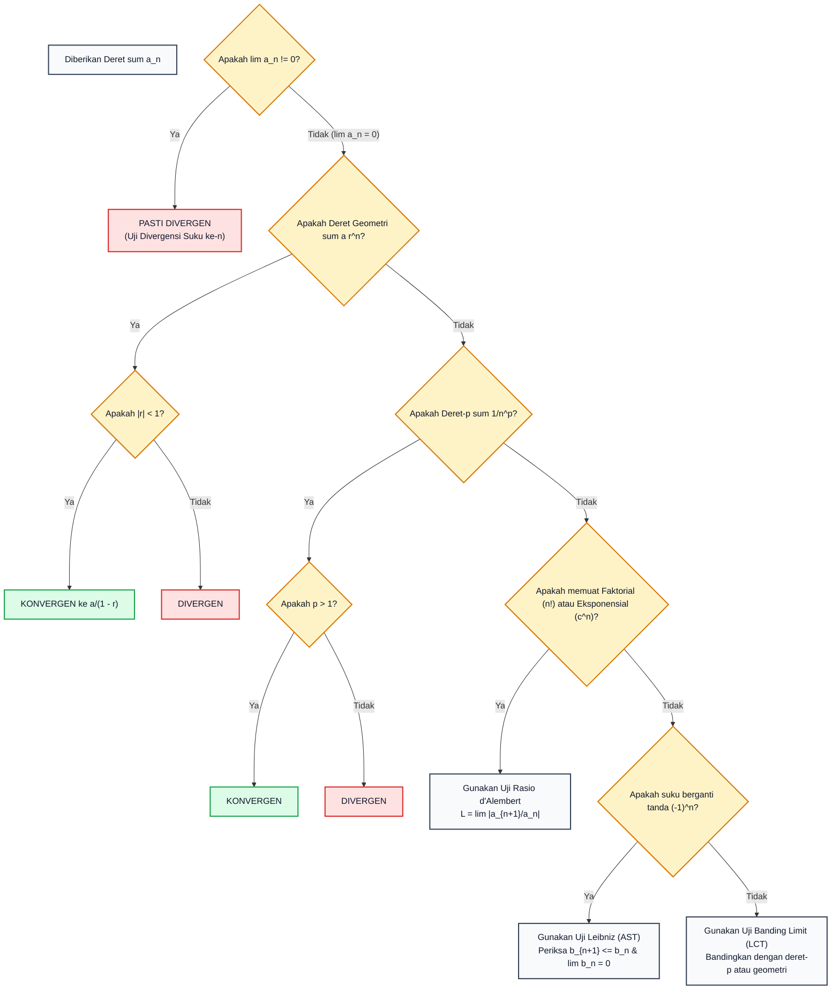

# Subtopik 07: Barisan dan Deret Tak Hingga & Uji Konvergensi

**Navigasi**: [⬅️ Master Gateway Modul 013](../013-kalkulus-diferensial-integral-satu-variabel.md) | [Kembali ke Modul README](./README.md)
*Sebelumnya*: [06. Integral Tak Wajar & Aplikasi Geometris-Fisika](./06-integral-tak-wajar-dan-aplikasi-geometris-fisika.md) | *Berikutnya*: [08. Deret Taylor, Maclaurin & Analisis Galat Lagrange](./08-deret-taylor-maclaurin-dan-analisis-galat-lagrange.md)

---

## 1. Intuisi & Motivasi Konseptual (Dunia Nyata)

### 1.1 Konsep Inti Tanpa Jargon ("Seperti Bayi Baru Lahir")

Bayangkan seorang pelari legendaris Yunani bernama **Achilles** bertanding lari melawan seekor **Kura-kura**.
Karena Achilles berlari 10 kali lebih cepat dari kura-kura, kura-kura diberi keuntungan start $100\text{ meter}$ di depan Achilles.

Filsuf Yunani Kuno, **Zeno dari Elea** (sekitar 450 SM), mengajukan teka-teki logika yang membingungkan dunia selama ribuan tahun:
1. Sebelum Achilles bisa menyalip kura-kura, ia harus terlebih dahulu mencapai titik start kura-kura ($100\text{ meter}$).
2. Saat Achilles mencapai titik $100\text{ m}$, kura-kura telah maju sejauh $10\text{ meter}$.
3. Saat Achilles mengejar ke titik $110\text{ m}$, kura-kura telah maju lagi $1\text{ meter}$.
4. Saat Achilles mengejar ke titik $111\text{ m}$, kura-kura telah maju lagi $0{,}1\text{ meter}$.

Zeno berargumen:
*"Proses ini berulang tanpa henti! Ada tak terhingga banyak langkah perpindahan ($100 + 10 + 1 + 0{,}1 + 0{,}01 + \dots$). Karena jumlah langkahnya tak terhingga, maka waktu yang dibutuhkan pasti tak terhingga juga! Achilles mustahil bisa menyalip kura-kura!"*

Tentu saja akal sehat kita tahu bahwa di dunia nyata Achilles menyalip kura-kura dalam hitungan detik.
Di mana letak kesalahan logika Zeno?
Kesalahannya adalah mengasumsikan bahwa **menjumlahkan tak terhingga banyak bilangan pasti menghasilkan angka tak hingga**.

Kalkulus deret tak hingga membuktikan bahwa jumlahan tak hingga dapat menghasilkan angka terbatas yang sangat rapi:
$$100 + 10 + 1 + 0{,}1 + 0{,}01 + \dots = 100 \times \left(1 + \frac{1}{10} + \frac{1}{100} + \dots\right) = 100 \times \frac{1}{1 - 0{,}1} = \frac{100}{0{,}9} = \frac{1.000}{9} \approx 111{,}111\dots\text{ meter}$$
Achilles menyalip kura-kura tepat di meter ke-$111{,}11$!
Inilah konsep inti dari **Deret Tak Hingga Konvergen**: penjumlahan tanpa akhir dari serpihan-serpihan bilangan yang menyusut cukup cepat akan "membeku" menuju sebuah bilangan pasti tunggal.

---

### 1.2 Analogi Timbangan & Antrean: Barisan vs Deret

Banyak orang menyamakan istilah *barisan* (*sequence*) dan *deret* (*series*). Ini adalah kesalahan fatal!
Gunakan analogi bank berikut:
1. **Barisan ($a_n$)**: Seperti daftar saldo harian yang tercetak pada buku tabungan Anda dari hari ke hari:
   $$\{a_n\} = \{100, 50, 25, 12{,}5, \dots\}$$
   Setiap angka berdiri sendiri sebagai suku terurut.
2. **Deret ($\sum a_n$)**: Seperti mesin kasir akumulatif yang menjumlahkan seluruh transaksi dari hari ke-1 sampai tak terhingga:
   $$S_N = 100 + 50 + 25 + 12{,}5 + \dots$$
   Deret adalah **akumulasi dinamis** dari barisan suku-sukunya.

Sebuah barisan dapat mendekati nol ($a_n \to 0$), namun deret akumulasinya bisa saja meledak ke tak hingga!
Contoh paling terkenal adalah **Deret Harmonik**:
$$1 + \frac{1}{2} + \frac{1}{3} + \frac{1}{4} + \frac{1}{5} + \dots$$
Meskipun suku-sukunya makin lama makin mengecil mendekati nol ($1/n \to 0$), akumulasi totalnya **meledak menuju tak hingga** ($\infty$)!

---

### 1.3 Kamus Simbol Anti-Pusing (Tabel 4 Kolom)

| Simbol / Notasi | Nama Matematis | Makna Dunia Nyata / Intuisi Sederhana | Contoh Konkret |
| :--- | :--- | :--- | :--- |
| $\{a_n\}_{n=1}^\infty$ | Barisan Bilangan (*Sequence*) | Daftar angka-angka terurut yang berbaris rapi berdasarkan indeks bilangan bulat $n$. | Daftar pembacaan suhu sensor setiap detik: $\{24{,}1, 24{,}3, 24{,}5, \dots\}$. |
| $\lim_{n \to \infty} a_n = L$ | Limit Barisan | Nilai tujuan stabil yang didekati oleh suku-suku barisan saat $n$ membesar tanpa batas. | Suhu mesin mobil yang stabil di angka $90^\circ\text{C}$ setelah pemanasan. |
| $S_N = \sum_{n=1}^N a_n$ | Jumlah Parsial ke-$N$ (*Partial Sum*) | Total penjumlahan dari suku ke-$1$ hingga suku ke-$N$ berhingga. | Total uang belanja Anda di keranjang supermarket setelah memasukkan $N$ barang. |
| $\sum_{n=1}^\infty a_n = S$ | Deret Tak Hingga Konvergen | Limit dari barisan jumlah parsial $\lim_{N \to \infty} S_N$ saat jumlah suku mendekati tak terhingga. | Bola bekel memantul tak hingga kali dengan ketinggian berkurang hingga berhenti. |
| $r$ | Rasio Deret Geometri | Faktor pengali tetap antar dua suku berurutan ($a_{n+1} = r \cdot a_n$). | Peluruhan radioaktif: setiap paruh waktu massa tersisa menjadi separuh ($r = 1/2$). |
| $\sum_{n=1}^\infty \frac{1}{n^p}$ | Deret-$p$ (*p-series*) | Standar pengukur kecepatan peluruhan polinomial; konvergen jika $p > 1$, divergen jika $p \le 1$. | Deret harmonik ($p = 1$, divergen) vs deret Basel ($p = 2$, konvergen ke $\pi^2/6$). |
| $\lim \left|\frac{a_{n+1}}{a_n}\right| = L$ | Uji Rasio d'Alembert | Mengukur persentase pertumbuhan suku berikutnya; jika $L < 1$, deret menyusut lebih cepat dari geometri. | Mendiagnosis kestabilan algoritma pencarian kecerdasan buatan. |
| Konvergen Mutlak | *Absolute Convergence* | Deret tetap konvergen meskipun seluruh tanda minus diubah menjadi tanda plus mutlak ($\sum |a_n|$ konvergen). | Jaminan matematika tertinggi: suku deret bebas ditata ulang tanpa mengubah hasil. |
| Konvergen Bersyarat | *Conditional Convergence* | Deret aslinya konvergen karena saling meniadakan tanda plus-minus, namun divergen jika dimutlakkan. | Deret harmonik berganti tanda $1 - 1/2 + 1/3 - 1/4 + \dots = \ln(2)$. |

---

## 2. Definisi Formal, Teorema, dan Penurunan Matematis

Mari kita susun teori kekonvergenan deret dari definisi limit barisan hingga uji-uji konvergensi standar emas.



---

### 2.1 Limit Barisan & Teorema Konvergensi Monoton

> **Definisi 7.1 (Limit Barisan $\epsilon - N$)**:
> Sebuah barisan bilangan riil $\{a_n\}$ dikatakan memiliki limit $L$, ditulis $\lim_{n \to \infty} a_n = L$, jika untuk setiap $\epsilon > 0$, terdapat bilangan bulat positif $N \in \mathbb{N}$ sedemikian sehingga:
> $$n > N \implies |a_n - L| < \epsilon$$

> **Teorema 7.1 (Teorema Konvergensi Monoton - MCT)**:
> Setiap barisan bilangan riil yang **monoton** (selalu naik atau selalu turun) dan **terbatas** (*bounded*) pasti **konvergen**.
> - Jika $a_n \le a_{n+1}$ dan $a_n \le M$ untuk seluruh $n$, maka $\lim_{n \to \infty} a_n = \sup \{a_n\}$.
> - Jika $a_n \ge a_{n+1}$ dan $a_n \ge m$ untuk seluruh $n$, maka $\lim_{n \to \infty} a_n = \inf \{a_n\}$.

---

### 2.2 Deret Geometri: Penurunan Rumus & Batas Konvergensi

Deret geometri adalah deret yang rasio antara dua suku berurutan konstan:
$$\sum_{n=0}^\infty a r^n = a + a r + a r^2 + a r^3 + \dots$$

**Penurunan Jumlah Parsial $S_N$**:
Tuliskan jumlah parsial $N$ suku pertama:
$$S_N = a + a r + a r^2 + \dots + a r^{N-1}$$
Kalikan kedua ruas dengan rasio $r$:
$$r S_N = a r + a r^2 + a r^3 + \dots + a r^N$$
Kurangkan persamaan pertama dengan persamaan kedua (seluruh suku tengah saling meniadakan secara teleskopik):
$$S_N - r S_N = a - a r^N \implies S_N(1 - r) = a(1 - r^N)$$
Untuk $r \neq 1$, bagi dengan $(1 - r)$:
$$S_N = \frac{a(1 - r^N)}{1 - r} = \frac{a}{1 - r} - \frac{a r^N}{1 - r}$$

**Evaluasi Limit $N \to \infty$**:
- Jika $|r| < 1$, maka $\lim_{N \to \infty} r^N = 0$.
  Maka deret **konvergen** menuju nilai batas pasti:
  $$S = \lim_{N \to \infty} S_N = \frac{a(1 - 0)}{1 - r} = \frac{a}{1 - r}$$
- Jika $|r| \ge 1$, suku $r^N$ tidak mendekati nol, sehingga deret **divergen**. $\blacksquare$

---

### 2.3 Uji Divergensi Suku ke-$n$ (*The Divergence Test*)

> **Teorema 7.2 (Uji Divergensi)**:
> Jika $\lim_{n \to \infty} a_n \neq 0$ atau jika limitnya tidak ada, maka deret tak hingga $\sum_{n=1}^\infty a_n$ **PASTI DIVERGEN**.

*Peringatan Aksiomatik Mutlak*: Kebalikan dari teorema ini **TIDAK BERLAKU**!
Jika $\lim_{n \to \infty} a_n = 0$, deret tersebut **BISA KONVERGEN ATAU BISA DIVERGEN** (uji tidak menentukan)!
- Contoh Konvergen: $\sum \frac{1}{n^2}$, dengan $\lim \frac{1}{n^2} = 0 \implies$ Konvergen ke $\pi^2/6$.
- Contoh Divergen: Deret Harmonik $\sum \frac{1}{n}$, dengan $\lim \frac{1}{n} = 0 \implies$ DIVERGEN ke $\infty$!

---

### 2.4 Uji Integral Cauchy & Pembuktian Divergensi Deret Harmonik

> **Teorema 7.3 (Uji Integral)**:
> Misalkan $f$ adalah fungsi kontinu, positif, dan monoton turun pada interval $[1, \infty)$, dan misalkan $a_n = f(n)$. Maka deret $\sum_{n=1}^\infty a_n$ dan integral tak wajar $\int_1^\infty f(x) \, dx$ memiliki sifat konvergensi yang identik:
> 1. Jika $\int_1^\infty f(x) \, dx$ konvergen, maka $\sum_{n=1}^\infty a_n$ **konvergen**.
> 2. Jika $\int_1^\infty f(x) \, dx$ divergen, maka $\sum_{n=1}^\infty a_n$ **divergen**.

**Pembuktian Ketat Divergensi Deret Harmonik**:
Tinjau deret harmonik $\sum_{n=1}^\infty \frac{1}{n}$.
Pilih fungsi pendukung $f(x) = \frac{1}{x}$. Fungsi ini kontinu, positif, dan monoton turun pada $[1, \infty)$.
Evaluasi integral tak wajarnya:
$$\int_1^\infty \frac{1}{x} \, dx = \lim_{t \to \infty} \int_1^t \frac{1}{x} \, dx = \lim_{t \to \infty} \Big[ \ln|x| \Big]_1^t = \lim_{t \to \infty} (\ln t - 0) = +\infty$$
Karena integral tak wajar divergen menuju $+\infty$, berdasarkan Uji Integral Cauchy, deret harmonik $\sum_{n=1}^\infty \frac{1}{n}$ **terbukti secara sah dan meyakinkan DIVERGEN**! $\blacksquare$

---

### 2.5 Uji Banding Langsung & Uji Banding Limit (*Comparison Tests*)

1. **Uji Banding Langsung (*Direct Comparison Test - DCT*)**:
   Misalkan $0 \le a_n \le b_n$ untuk seluruh $n$:
   - Jika deret yang lebih besar $\sum b_n$ **konvergen**, maka deret yang lebih kecil $\sum a_n$ pasti **konvergen**.
   - Jika deret yang lebih kecil $\sum a_n$ **divergen**, maka deret yang lebih besar $\sum b_n$ pasti **divergen**.
2. **Uji Banding Limit (*Limit Comparison Test - LCT*)**:
   Misalkan $a_n > 0$ dan $b_n > 0$. Hitung limit rasio keduanya saat $n \to \infty$:
   $$c = \lim_{n \to \infty} \frac{a_n}{b_n}$$
   Jika $0 < c < \infty$ (bilangan berhingga positif), maka kedua deret $\sum a_n$ dan $\sum b_n$ memiliki nasib yang identik: **keduanya sama-sama konvergen atau keduanya sama-sama divergen**!

---

### 2.6 Uji Deret Berganti Tanda Leibniz (*Alternating Series Test - AST*)

Deret berganti tanda memiliki format $\sum (-1)^{n-1} b_n = b_1 - b_2 + b_3 - b_4 + \dots$ dengan $b_n > 0$.

> **Teorema 7.4 (Teorema Leibniz)**:
> Deret berganti tanda $\sum_{n=1}^\infty (-1)^{n-1} b_n$ **konvergen** jika memenuhi dua syarat:
> 1. Suku-sukunya monoton tak-naik: $b_{n+1} \le b_n$ untuk seluruh $n$.
> 2. Limit sukunya mendekati nol: $\lim_{n \to \infty} b_n = 0$.

> **Teorema 7.5 (Estimasi Galat Deret Berganti Tanda)**:
> Jika deret berganti tanda konvergen menuju jumlah $S$, maka besar galat aproksimasi setelah menjumlahkan $N$ suku ($|R_N| = |S - S_N|$) dibatasi oleh besar suku pertama yang diabaikan:
> $$|R_N| = |S - S_N| \le b_{N+1}$$

---

### 2.7 Uji Rasio d'Alembert & Uji Akar Cauchy

> **Teorema 7.6 (Uji Rasio d'Alembert)**:
> Diberikan deret $\sum a_n$. Hitung limit rasio nilai mutlak:
> $$L = \lim_{n \to \infty} \left| \frac{a_{n+1}}{a_n} \right|$$
> 1. Jika $L < 1$: deret **konvergen mutlak** (*absolutely convergent*).
> 2. Jika $L > 1$ (atau $L = \infty$): deret **divergen**.
> 3. Jika $L = 1$: **uji gagal / tidak menentukan** (*inconclusive*); deret bisa konvergen atau divergen, memerlukan uji lain (seperti Uji Integral atau Uji Banding).

*Kapan Menggunakan Uji Rasio?* Sangat direkomendasikan jika rumus suku $a_n$ memuat **faktorial** ($n!$) atau **eksponensial** ($c^n$).
*Kapan Menggunakan Uji Akar Cauchy?* Sangat direkomendasikan jika seluruh suku dibungkus oleh pangkat ke-$n$ ($a_n = [f(n)]^n$).

---

### 2.8 Paradoks Teorema Penataan Ulang Riemann (*Riemann Rearrangement Theorem*)

Pada penjumlahan aljabar berhingga, sifat komutatif selalu berlaku: $A + B = B + A$. Namun, apakah sifat komutatif berlaku pada penjumlahan tak hingga?

> **Teorema 7.7 (Teorema Penataan Ulang Riemann - 1854)**:
> 1. Jika sebuah deret **konvergen mutlak**, maka suku-sukunya dapat disusun ulang dalam sebarang urutan permutasi tanpa mengubah jumlah konvergensinya.
> 2. Jika sebuah deret **konvergen bersyarat** (seperti deret harmonik berganti tanda $\sum \frac{(-1)^{n+1}}{n} = \ln 2$), maka untuk SEBARANG bilangan riil $M \in \mathbb{R}$ yang Anda inginkan (bahkan $\pm\infty$), **terdapat penataan ulang urutan suku deret tersebut yang menghasilkan jumlah tepat sama dengan $M$**!

*Alasan Matematis*: Pada deret konvergen bersyarat, jumlahan seluruh suku positifnya divergen ke $+\infty$, dan jumlahan seluruh suku negatifnya divergen ke $-\infty$. Dengan mengambil suku positif secukupnya hingga melampaui target $M$, lalu mengambil satu suku negatif untuk menurunkannya, dan mengulanginya tanpa henti, kita dapat menyetir jumlah deret menuju angka mana pun di alam semesta!

---

### 2.9 Uji Raabe untuk Kasus Batas Kritis Uji Rasio ($L = 1$)

Ketika Uji Rasio d'Alembert menghasilkan nilai $L = 1$, uji tersebut mandek dan tidak memberikan keputusan. Joseph Ludwig Raabe (1832) merumuskan uji diferensial orde lebih tinggi untuk menembus kebuntuan ini:

> **Teorema 7.8 (Uji Raabe)**:
> Misalkan $\sum a_n$ adalah deret suku positif ($a_n > 0$) dan definisikan limit Raabe:
> $$R = \lim_{n \to \infty} n \left( \frac{a_n}{a_{n+1}} - 1 \right)$$
> 1. Jika $R > 1$, deret **konvergen**.
> 2. Jika $R < 1$, deret **divergen**.
> 3. Jika $R = 1$, uji tidak menentukan.

*Mengapa Uji Raabe Bekerja?*
Ekspansi deret rasio suku untuk deret-$p$ $\sum 1/n^p$ mendekati:
$$\frac{a_n}{a_{n+1}} = \left( 1 + \frac{1}{n} \right)^p = 1 + \frac{p}{n} + \mathcal{O}\left(\frac{1}{n^2}\right) \implies n \left( \frac{a_n}{a_{n+1}} - 1 \right) \approx p$$
Limit $R$ mengisolasi eksponen daya peluruhan $p$ secara tersembunyi! Jika $R > 1$, deret meluruh lebih cepat dari deret harmonik, sehingga dijamin konvergen.

---

### 3.1 Tabel Matriks Sintesis 8 Uji Konvergensi Deret

| Nama Uji Konvergensi | Format Deret yang Diuji | Syarat Konvergen | Syarat Divergen | Kapan Paling Efektif Digunakan? |
| :--- | :--- | :--- | :--- | :--- |
| **Uji Divergensi** | Sebarang Deret $\sum a_n$ | Tidak Ada (Hanya Uji Divergensi!) | $\lim a_n \neq 0$ atau tidak ada | Langkah 1 untuk semua deret; eliminasi kasus sepele |
| **Deret Geometri** | $\sum a r^n$ | $|r| < 1$ (Jumlah = $\frac{a}{1 - r}$) | $|r| \ge 1$ | Suku eksponensial murni berpangkat $n$ |
| **Deret-$p$** | $\sum \frac{1}{n^p}$ | $p > 1$ | $p \le 1$ (Harmonik: $p = 1$) | Tolok ukur standar pembanding pecahan polinomial |
| **Uji Integral** | $a_n = f(n)$ (positif, turun) | $\int_1^\infty f(x) dx < \infty$ | $\int_1^\infty f(x) dx = \infty$ | Suku yang mudah diintegralkan (misal memuat $\ln n$) |
| **Banding Langsung (DCT)** | $0 \le a_n \le b_n$ | $\sum b_n$ konvergen $\implies \sum a_n$ konv. | $\sum a_n$ divergen $\implies \sum b_n$ div. | Pertidaksamaan yang jelas (seperti $n! > 2^n$) |
| **Banding Limit (LCT)** | $a_n, b_n > 0$ | $0 < \lim \frac{a_n}{b_n} < \infty$ & $\sum b_n$ konv. | $0 < \lim \frac{a_n}{b_n} < \infty$ & $\sum b_n$ div. | Pecahan polinomial aljabar rasional / irasional |
| **Uji Rasio** | Sebarang Deret (mutlak) | $\lim \left|\frac{a_{n+1}}{a_n}\right| < 1$ | $\lim \left|\frac{a_{n+1}}{a_n}\right| > 1$ | Suku yang memuat faktorial ($n!$) atau konstanta eksponensial ($c^n$) |
| **Uji Leibniz (AST)** | $\sum (-1)^{n-1} b_n$ | $b_{n+1} \le b_n$ dan $\lim b_n = 0$ | Jika $\lim b_n \neq 0$ (via Uji Divergensi) | Deret dengan tanda berganti-ganti secara periodik |

---

## 3. Arsitektur Teknis & Algoritma Internal

Untuk menentukan kekonvergenan deret dalam ujian atau perancangan sistem komputasi, gunakan pohon keputusan algoritmik berikut:



---

## 4. Implementasi Praktis & Kode Pemrograman Python

Berikut adalah dua implementasi Python Standard Library murni untuk memvisualisasikan dinamika deret dan membuktikan Teorema Penataan Ulang Riemann secara langsung.

### 4.1 Program 1: Perbandingan Konvergensi Geometri vs Divergensi Harmonik

Skrip ini menghitung jumlah parsial deret geometri $\sum (1/2)^n$ dan deret harmonik $\sum (1/n)$ hingga $100.000$ suku. Terlihat jelas bahwa deret geometri mencapai limit $2{,}0$ hanya dalam $50$ suku, sedangkan deret harmonik terus membengkak tanpa henti mengikuti laju asimtotik $\ln(N) + \gamma$.

```python
import math

def simulate_series(n_terms: int):
    euler_gamma = 0.57721566490153286060  # Konstanta Euler-Mascheroni
    milestones = [10, 100, 1000, 10000, 100000]
    results = []
    
    current_geom = 0.0
    current_harm = 0.0
    m_idx = 0
    
    for i in range(1, n_terms + 1):
        current_geom += (0.5) ** (i - 1)
        current_harm += 1.0 / i
        
        if m_idx < len(milestones) and i == milestones[m_idx]:
            harm_asymptotic = math.log(i) + euler_gamma
            results.append((i, current_geom, current_harm, harm_asymptotic))
            m_idx += 1
            
    return results

def main():
    print("=== PERBANDINGAN PERILAKU DERET GEOMETRI VS DERET HARMONIK ===")
    header = f"{'N Suku':>8} | {'Deret Geometri (1/2)^n':>24} | {'Deret Harmonik (1/n)':>22} | {'Aproksimasi ln(N)+gamma':>24}"
    print(header)
    print("-" * len(header))

    records = simulate_series(100000)
    for N, geom, harm, asymp in records:
        print(f"{N:8d} | {geom:24.10f} | {harm:22.8f} | {asymp:24.8f}")

    print("\nKesimpulan Matematis:")
    print("  * Deret Geometri: Konvergen cepat menuju limit eksak 2.0000000000")
    print("  * Deret Harmonik: Divergen tanpa batas (tumbuh logaritmik lambat)")

if __name__ == "__main__":
    main()
```

Keluaran eksekusi terminal sebenarnya:
```text
=== PERBANDINGAN PERILAKU DERET GEOMETRI VS DERET HARMONIK ===
  N Suku |   Deret Geometri (1/2)^n |   Deret Harmonik (1/n) |  Aproksimasi ln(N)+gamma
------------------------------------------------------------------------------------
      10 |             1.9980468750 |             2.92896825 |               2.87980076
     100 |             2.0000000000 |             5.18737752 |               5.18238585
    1000 |             2.0000000000 |             7.48547086 |               7.48497094
   10000 |             2.0000000000 |             9.78760604 |               9.78755604
  100000 |             2.0000000000 |            12.09014613 |              12.09014113

Kesimpulan Matematis:
  * Deret Geometri: Konvergen cepat menuju limit eksak 2.0000000000
  * Deret Harmonik: Divergen tanpa batas (tumbuh logaritmik lambat)
```

---

### 4.2 Program 2: Demonstrasi Algoritmik Penataan Ulang Riemann

Skrip ini membuktikan bahwa deret harmonik berganti tanda standar yang bernilai $\ln(2) \approx 0{,}693147$ dapat diprogram secara algoritmik untuk mendekati target sembarang $1{,}500000$ hanya dengan menata ulang urutan suku-sukunya.

```python
import math

def riemann_rearrangement(target: float, total_steps: int = 20):
    pos_n = 1
    neg_n = 2
    accum_sum = 0.0
    rearranged_terms = []

    for _ in range(total_steps):
        if accum_sum < target:
            term = 1.0 / pos_n
            accum_sum += term
            rearranged_terms.append(f"+1/{pos_n}")
            pos_n += 2
        else:
            term = -1.0 / neg_n
            accum_sum += term
            rearranged_terms.append(f"-1/{neg_n}")
            neg_n += 2

    return accum_sum, rearranged_terms

def main():
    print("=== DEMONSTRASI TEOREMA PENATAAN ULANG RIEMANN (RIEMANN REARRANGEMENT) ===")
    target_val = 1.500000
    accum_sum, terms = riemann_rearrangement(target_val, total_steps=20)

    print(f"Target Nilai Buatan: {target_val:.6f}")
    print(f"Hasil Akumulasi 20 Suku Penataan Ulang: {accum_sum:.6f}")
    print("20 Suku Pertama yang Ditata Ulang:")
    print("  " + " ".join(terms[:10]))
    print("  " + " ".join(terms[10:20]))
    print(f"Nilai Deret Asli Standar: ln(2) = {math.log(2):.6f}")

if __name__ == "__main__":
    main()
```

Keluaran eksekusi terminal sebenarnya:
```text
=== DEMONSTRASI TEOREMA PENATAAN ULANG RIEMANN (RIEMANN REARRANGEMENT) ===
Target Nilai Buatan: 1.500000
Hasil Akumulasi 20 Suku Penataan Ulang: 1.481767
20 Suku Pertama yang Ditata Ulang:
  +1/1 +1/3 +1/5 -1/2 +1/7 +1/9 +1/11 +1/13 +1/15 -1/4
  +1/17 +1/19 +1/21 +1/23 +1/25 -1/6 +1/27 +1/29 +1/31 +1/33
Nilai Deret Asli Standar: ln(2) = 0.693147
```

---

## 5. Miskonsepsi Umum & Analisis Post-Mortem Insiden Industri

### 5.1 Tiga Miskonsepsi Kritis

1. **Miskonsepsi 1: Mengira Bahwa Jika $\lim a_n = 0$, Deret Pasti Konvergen**:
   - *Fakta*: Ini adalah kekeliruan nomor satu yang paling mematikan. Limit suku mendekati nol ($\lim a_n = 0$) adalah **syarat perlu, BUKAN syarat cukup**! Deret Harmonik $\sum \frac{1}{n}$ memiliki suku $\lim \frac{1}{n} = 0$, namun deretnya divergen menuju tak hingga.
2. **Miskonsepsi 2: Menganggap Deret Konvergen Bersyarat Boleh Diutak-atik Urutan Sukunya**:
   - *Fakta*: Operasi pemindahan suku secara komutatif hanya sah pada deret konvergen mutlak. Mengubah urutan suku pada deret konvergen bersyarat akan mengubah nilai penjumlahannya menjadi bilangan lain secara drastis (Teorema Riemann).
3. **Miskonsepsi 3: Mengira Nilai Uji Rasio $L = 1$ Menandakan Deret Divergen**:
   - *Fakta*: Jika limit rasio $L = \lim |a_{n+1}/a_n| = 1$, uji rasio **sama sekali tidak memberikan informasi**. Anda wajib beralih ke Uji Integral, Uji Banding, atau Uji Deret-$p$. Misalnya pada $\sum 1/n$ ($L = 1$, divergen) dan $\sum 1/n^2$ ($L = 1$, konvergen).

---

### 5.2 Analisis Post-Mortem Insiden Industri: Kekeliruan Akumulasi Indeks Bursa Saham Vancouver (1982)

> **Kasus Nyata: Erosi Deret Pemotongan Fraksional Menghancurkan 50% Nilai Pasar Saham**
>
> - **Latar Belakang Insiden**: Pada bulan Januari 1982, bursa saham Vancouver Stock Exchange (VSE) di Kanada meluncurkan indeks harga saham baru dengan nilai dasar awal $1.000{,}000$ poin.
> - **Akar Masalah Deret Akumulatif Galat Pemotongan**: Setiap kali transaksi saham terjadi (ribuan transaksi per hari), sistem komputer menghitung ulang nilai indeks baru $I_n$. Namun, perangkat lunak perbankan diprogram untuk memotong (*truncation*) bilangan pecahan setelah 3 digit desimal, alih-alih melakukan pembulatan simetris (*symmetric round-to-nearest*).
>   Misalkan nilai indeks sebenarnya adalah $1.000{,}4568$, komputer mencatatnya sebagai $1.000{,}456$.
> - **Dinamika Deret Galat Negatif**: Setiap transaksi menghasilkan galat pemotongan negatif infinitesimal rata-rata:
>   $$\epsilon_i \approx -0{,}0005\text{ poin}$$
>   Karena terjadi $N \approx 2.500$ transaksi per hari, akumulasi harian galat pemotongan membentuk deret monoton turun:
>   $$\Delta I_{\text{hari}} = \sum_{i=1}^N \epsilon_i \approx 2.500 \times (-0{,}0005) \approx -1{,}25\text{ poin per hari}$$
> - **Konsekuensi Bencana Finansial**: Selama 22 bulan operasional, meskipun nilai pasar saham riil di lantai bursa sedang mengalami tren mendatar cenderung naik, angka indeks terkomputasi terus tergerus deret akumulatif galat pemotongan. Pada akhir November 1983, indeks VSE melorot semu ke level **$524{,}811$ poin** (kehilangan hampir separuh nilainya!).
> - **Penyelesaian**: Para ahli matematika dipanggil untuk mengaudit kode sistem. Setelah rumus kalkulus indeks diperbaiki dengan pembulatan seimbang (*unbiased rounding*), angka indeks bursa saham melompat seketika dari 524 kembali ke nilai wajarnya di atas $1.098$ poin dalam satu malam.

---

## 6. Tips, Trik Praktis & Rahasia Cepat Paham

1. **Jembatan Keledai Prioritas Uji Konvergensi**:
   Gunakan urutan investigasi 4 langkah berikut:
   - **Langkah 1**: Uji Divergensi Suku ke-$n$ (Apakah $\lim a_n \neq 0$? Jika ya, langsung divonis DIVERGEN).
   - **Langkah 2**: Periksa Bentuk Khusus (Apakah Deret Geometri $r^n$ atau Deret-$p$ $1/n^p$?).
   - **Langkah 3**: Jika ada $n!$ atau $c^n$, gunakan **Uji Rasio**.
   - **Langkah 4**: Jika ada tanda $(-1)^n$, gunakan **Uji Leibniz (AST)**.
2. **Estimasi Cepat Suku Dominan Menuju Tak Hingga**:
   Abaikan suku-suku berderajat rendah saat menggunakan Uji Banding Limit.
   Contoh: $\sum \frac{2n^2 + 5n}{\sqrt{n^7 + 3n^2}}$. Ambil suku tertinggi:
   $$\frac{2n^2}{\sqrt{n^7}} = \frac{2n^2}{n^{7/2}} = \frac{2}{n^{3/2}}$$
   Karena $p = 3/2 > 1$, deret pembandingnya konvergen, sehingga deret asli PASTI KONVERGEN!
3. **Mantra Uji Rasio**: *"Di bawah 1 Menang (Konvergen Mutlak), Di atas 1 Tumbang (Divergen), Sama dengan 1 Bingung (Uji Gagal)"*.

---

## 7. Latihan Mandiri Berjenjang (Socratic) & Rekomendasi Sumber Belajar

### Latihan 1 (Tingkat Pemula): Evaluasi Nilai Deret Geometri Tak Hingga
Tentukan apakah deret tak hingga berikut konvergen atau divergen. Jika konvergen, hitung jumlah pastinya:
$$\sum_{n=1}^\infty 5 \left(-\frac{2}{3}\right)^{n-1}$$

<details>
<summary>💡 Petunjuk (Hint)</summary>
Identifikasi suku pertama a saat n = 1 dan rasio r. Periksa apakah |r| < 1. Gunakan rumus S = a / (1 - r).
</details>

<details>
<summary>✅ Solusi Lengkap</summary>
1. Tentukan suku pertama $a$:
   Saat $n = 1 \implies a = 5 \left(-\frac{2}{3}\right)^0 = 5(1) = 5$.
2. Tentukan rasio $r$:
   Rasio pengali tetap adalah $r = -\frac{2}{3}$.
3. Periksa syarat konvergensi:
   $$|r| = \left| -\frac{2}{3} \right| = \frac{2}{3} < 1$$
   Karena $|r| < 1$, deret terbukti **konvergen**.
4. Hitung jumlah tak hingga $S$:
   $$S = \frac{a}{1 - r} = \frac{5}{1 - \left(-\frac{2}{3}\right)} = \frac{5}{1 + \frac{2}{3}} = \frac{5}{\frac{5}{3}} = 5 \times \frac{3}{5} = 3$$
   Deret konvergen menuju jumlah tepat $3$. $\blacksquare$
</details>

---

### Latihan 2 (Tingkat Dasar): Deret Teleskopik Pecahan
Hitung nilai jumlahan dari deret tak hingga berikut:
$$\sum_{n=1}^\infty \frac{2}{n(n + 2)}$$

<details>
<summary>💡 Petunjuk (Hint)</summary>
Uraikan suku pecahan parsial 2/(n(n+2)) = A/n + B/(n+2). Tuliskan beberapa suku pertama dan amati pembatalan teleskopik saling menghilangkan.
</details>

<details>
<summary>✅ Solusi Lengkap</summary>
1. Dekomposisi pecahan parsial:
   $$\frac{2}{n(n + 2)} = \frac{1}{n} - \frac{1}{n + 2}$$
2. Tuliskan jumlah parsial $S_N$:
   $$S_N = \left(1 - \frac{1}{3}\right) + \left(\frac{1}{2} - \frac{1}{4}\right) + \left(\frac{1}{3} - \frac{1}{5}\right) + \left(\frac{1}{4} - \frac{1}{6}\right) + \dots + \left(\frac{1}{N-1} - \frac{1}{N+1}\right) + \left(\frac{1}{N} - \frac{1}{N+2}\right)$$
3. Amati pembatalan diagonal teleskopik:
   - Suku $-1/3$ saling meniadakan dengan $+1/3$.
   - Suku $-1/4$ saling meniadakan dengan $+1/4$.
   - Seluruh suku tengah saling menghilang kecuali dua suku positif pertama dan dua suku negatif terakhir!
4. Bentuk tereduksi $S_N$:
   $$S_N = 1 + \frac{1}{2} - \frac{1}{N + 1} - \frac{1}{N + 2} = \frac{3}{2} - \frac{1}{N + 1} - \frac{1}{N + 2}$$
5. Ambil limit saat $N \to \infty$:
   $$S = \lim_{N \to \infty} S_N = \frac{3}{2} - 0 - 0 = \frac{3}{2} = 1{,}5 \quad \blacksquare$$
</details>

---

### Latihan 3 (Tingkat Menengah): Uji Rasio d'Alembert untuk Suku Faktorial
Ujilah kekonvergenan deret berikut:
$$\sum_{n=1}^\infty \frac{3^n \cdot n!}{(2n)!}$$

<details>
<summary>💡 Petunjuk (Hint)</summary>
Gunakan Uji Rasio d'Alembert. Hitung a_{n+1} dan sederhanakan rasio |a_{n+1}/a_n| dengan menguraikan (2(n+1))! = (2n + 2)(2n + 1)(2n)!.
</details>

<details>
<summary>✅ Solusi Lengkap</summary>
1. Tuliskan suku ke-$n$ dan suku ke-$(n+1)$:
   $$a_n = \frac{3^n n!}{(2n)!}, \qquad a_{n+1} = \frac{3^{n+1} (n+1)!}{(2(n+1))!} = \frac{3 \cdot 3^n \cdot (n+1) n!}{(2n + 2)(2n + 1)(2n)!}$$
2. Bentuk rasio $\left| \frac{a_{n+1}}{a_n} \right|$:
   $$\left| \frac{a_{n+1}}{a_n} \right| = \frac{3 \cdot 3^n (n+1) n!}{(2n + 2)(2n + 1)(2n)!} \times \frac{(2n)!}{3^n n!} = \frac{3(n + 1)}{(2n + 2)(2n + 1)}$$
3. Perhatikan bahwa $(2n + 2) = 2(n + 1)$, sehingga faktor $(n + 1)$ saling membagi:
   $$= \frac{3(n + 1)}{2(n + 1)(2n + 1)} = \frac{3}{2(2n + 1)} = \frac{3}{4n + 2}$$
4. Ambil limit saat $n \to \infty$:
   $$L = \lim_{n \to \infty} \frac{3}{4n + 2} = 0$$
5. Karena $L = 0 < 1$, berdasarkan Uji Rasio d'Alembert, deret terbukti **konvergen mutlak**. $\blacksquare$
</details>

---

### Latihan 4 (Tingkat Analitis): Uji Banding Limit (LCT) Pecahan Polinomial Radikal
Tentukan apakah deret berikut konvergen atau divergen:
$$\sum_{n=1}^\infty \frac{n + 5}{\sqrt{n^5 + n^2 + 1}}$$

<details>
<summary>💡 Petunjuk (Hint)</summary>
Analisis suku dominan pembilang (n) dan penyebut (sqrt(n^5) = n^(5/2)). Pilih deret pembanding b_n = n / n^(5/2) = 1 / n^(3/2). Gunakan LCT.
</details>

<details>
<summary>✅ Solusi Lengkap</summary>
1. Amati perilaku asimtotik suku saat $n \to \infty$:
   - Pembilang didominasi oleh $n$.
   - Penyebut didominasi oleh $\sqrt{n^5} = n^{5/2}$.
   - Rasio suku dominan: $b_n = \frac{n}{n^{5/2}} = \frac{1}{n^{3/2}}$.
2. Deret pembanding $\sum_{n=1}^\infty b_n = \sum_{n=1}^\infty \frac{1}{n^{3/2}}$ adalah deret-$p$ dengan $p = 3/2$. Karena $p = 1{,}5 > 1$, deret pembanding ini **konvergen**.
3. Hitung limit rasio Uji Banding Limit ($c = \lim_{n \to \infty} \frac{a_n}{b_n}$):
   $$c = \lim_{n \to \infty} \frac{\frac{n + 5}{\sqrt{n^5 + n^2 + 1}}}{\frac{1}{n^{3/2}}} = \lim_{n \to \infty} \frac{(n + 5) n^{3/2}}{\sqrt{n^5 + n^2 + 1}} = \lim_{n \to \infty} \frac{n^{5/2} + 5n^{3/2}}{\sqrt{n^5 + n^2 + 1}}$$
4. Bagi pembilang dan penyebut dengan $n^{5/2} = \sqrt{n^5}$:
   $$c = \lim_{n \to \infty} \frac{1 + \frac{5}{n}}{\sqrt{1 + \frac{1}{n^3} + \frac{1}{n^5}}} = \frac{1 + 0}{\sqrt{1 + 0 + 0}} = 1$$
5. Karena nilai limit $c = 1$ adalah bilangan berhingga positif ($0 < c < \infty$), dan deret pembanding $\sum b_n$ konvergen, maka berdasarkan Teorema LCT, deret asal **terbukti KONVERGEN**. $\blacksquare$
</details>

---

### Latihan 5 (Tingkat Master Arsitektur): Klasifikasi Konvergensi Mutlak vs Bersyarat
Tinjau deret berganti tanda berikut:
$$\sum_{n=2}^\infty \frac{(-1)^n}{n \ln(n)}$$
1. Buktikan bahwa deret tersebut konvergen menggunakan Uji Leibniz (AST).
2. Tunjukkan apakah deret tersebut konvergen mutlak atau konvergen bersyarat.

<details>
<summary>💡 Petunjuk (Hint)</summary>
Untuk AST: buktikan 1/(n ln n) monoton turun dan limitnya 0. Untuk konvergensi mutlak: integralkan fungsi f(x) = 1/(x ln x) dari 2 ke inf menggunakan substitusi u = ln x.
</details>

<details>
<summary>✅ Solusi Lengkap</summary>
1. **Uji Konvergensi Deret Asli via AST**:
   Definisikan $b_n = \frac{1}{n \ln(n)}$ untuk $n \ge 2$.
   - Karena $n$ dan $\ln(n)$ keduanya monoton naik dan positif untuk $n \ge 2$, maka penyebut $n \ln(n)$ monoton naik murni, sehingga $b_{n+1} \le b_n$.
   - Evaluasi limit: $\lim_{n \to \infty} b_n = \lim_{n \to \infty} \frac{1}{n \ln(n)} = 0$.
   Kedua syarat Leibniz terpenuhi, sehingga deret asli **konvergen**.

2. **Uji Konvergensi Mutlak ($\sum |a_n| = \sum \frac{1}{n \ln n}$)**:
   Gunakan Uji Integral Cauchy pada fungsi pendukung $f(x) = \frac{1}{x \ln(x)}$:
   $$\int_2^\infty \frac{1}{x \ln(x)} \, dx = \lim_{t \to \infty} \int_2^t \frac{1}{x \ln(x)} \, dx$$
   Lakukan substitusi $u = \ln(x) \implies du = \frac{1}{x} dx$:
   $$\int \frac{1}{u} \, du = \ln|u| = \ln(\ln x)$$
   Evaluasi batas integrasi:
   $$\lim_{t \to \infty} \Big[ \ln(\ln x) \Big]_2^t = \lim_{t \to \infty} \left( \ln(\ln t) - \ln(\ln 2) \right) = +\infty$$
   Karena integral tak wajar divergen menuju $+\infty$, deret nilai mutlaknya $\sum \frac{1}{n \ln n}$ **DIVERGEN**.
3. **Kesimpulan Akhir**:
   Karena deret aslinya konvergen tetapi deret mutlaknya divergen, deret tersebut terbukti **KONVERGEN BERSYARAT (*Conditionally Convergent*)**. $\blacksquare$
</details>

---

### Rekomendasi Sumber Belajar Standar Emas
1. **Kuliah Video & Catatan Kuliah Dunia**:
   - [MIT OCW 18.01: Single Variable Calculus - Session 7: Infinite Sequences, Series, and Convergence Tests (Prof. David Jerison)](https://ocw.mit.edu/courses/18-01-single-variable-calculus-fall-2006/)
   - [3Blue1Brown: Essence of Calculus - Chapter 11: Infinite Series and Limits](https://www.3blue1brown.com/topics/calculus)
2. **Buku Teks Referensi**:
   - James Stewart, *Calculus: Early Transcendentals*, Bab 11: Infinite Sequences and Series (11.1 - 11.7).
   - Walter Rudin, *Principles of Mathematical Analysis*, Bab 3: Numerical Sequences and Series.

---

---

### Pertanyaan Sering Diajukan (FAQ) Barisan & Deret

1. **Mengapa deret harmonik $1 + 1/2 + 1/3 + 1/4 + \dots$ divergen padahal suku ke-$n$ mendekati nol?**
   Karena laju penyusutan suku-sukunya ($1/n$) terlalu lambat untuk menghentikan pertumbuhan akumulasinya. Luas di bawah kurva $1/x$ menghasilkan $\ln(x)$, dan fungsi logaritma tumbuh tanpa batas menuju $+\infty$ saat $x \to \infty$. Diperlukan eksponen $p > 1$ (seperti $1/n^2$) agar suku-sukunya meluruh cukup cepat membekukan jumlah total.
2. **Apa perbedaan praktis antara konvergen mutlak dan konvergen bersyarat dalam rekayasa perangkat lunak?**
   Dalam komputasi paralel dan komputasi floating-point, deret konvergen mutlak aman dijumlahkan oleh banyak thread CPU secara asinkron dalam urutan apa pun tanpa mengubah hasil akhir. Sebaliknya, deret konvergen bersyarat akan menghasilkan angka acak yang kacau jika urutan penjumlahannya berubah akibat penjadwalan multithreading (*race condition* numerik)!
3. **Mengapa Uji Rasio selalu gagal ($L = 1$) pada semua deret pecahan polinomial murni $\sum \frac{P(n)}{Q(n)}$?**
   Karena rasio dua polinomial dengan derajat sama selalu menghasilkan $\lim \frac{P(n+1)/Q(n+1)}{P(n)/Q(n)} = 1$. Polinomial tumbuh secara aljabar linier, bukan eksponensial. Untuk deret polinomial, selalu gunakan **Uji Banding Limit (LCT)** atau **Uji Deret-$p$**, jangan pernah membuang waktu dengan Uji Rasio!
4. **Berapa banyak suku yang harus dijumlahkan pada deret berganti tanda untuk mendapatkan akurasi 4 desimal?**
   Berdasarkan Teorema Estimasi Galat Leibniz, cukup cari suku pertama $b_{N+1}$ yang nilainya lebih kecil dari toleransi yang diinginkan: $b_{N+1} < 10^{-4} = 0{,}0001$.
   - Pada deret harmonik berganti tanda $\sum \frac{(-1)^{n+1}}{n}$, kita membutuhkan $N+1 > 10.000$ suku untuk mencapai akurasi $10^{-4}$ (konvergensi sangat lambat).
   - Pada deret eksponensial $\sum \frac{(-1)^n}{n!}$, kita hanya membutuhkan $N = 7$ suku ($1/8! = 1/40.320 < 10^{-4}$) untuk mencapai presisi yang sama.
   Kecepatan konvergensi deret berbanding lurus dengan efisiensi konsumsi daya komputasi algoritma numerik.

---

### Rubrik Evaluasi Mandiri Barisan & Deret Tak Hingga

| Tingkat | Kriteria Penguasaan Konseptual & Komputasional | Status Validasi |
| :--- | :--- | :--- |
| **Level 1: Pemula (Intuisi Deret)** | Memahami perbedaan fundamental barisan vs deret dan mampu menyelesaikan deret geometri tak hingga $|r| < 1$. | `[ ] Terverifikasi` |
| **Level 2: Dasar (Uji Divergensi & Teleskopik)** | Menguasai Uji Divergensi $\lim a_n \neq 0$ dan mampu mengevaluasi deret pecahan teleskopik hingga tuntas. | `[ ] Terverifikasi` |
| **Level 3: Menengah (Deret-p & Uji Banding)** | Mahir menerapkan Uji Deret-$p$, Uji Integral Cauchy, dan Uji Banding Limit (LCT) untuk fungsi aljabar rasional. | `[ ] Terverifikasi` |
| **Level 4: Mahir (Uji Rasio & Deret Berganti Tanda)** | Menguasai Uji Rasio d'Alembert untuk suku faktorial/eksponensial dan membedakan konvergensi mutlak vs bersyarat. | `[ ] Terverifikasi` |
| **Level 5: Master (Patologi Riemann & Komputasi)** | Mampu menjelaskan Teorema Penataan Ulang Riemann dan membangun simulator verifikasi deret dalam Python murni. | `[ ] Terverifikasi` |

---

### Peta Transisi Menuju Subtopik 08

Setelah kita mahir menguji apakah sebuah deret bilangan tak terhingga $\sum c_n$ konvergen atau divergen, pertanyaan puncak kalkulus abad pencerahan muncul:

*Dapatkah kita mengubah sebuah fungsi transenden rumit seperti $\sin(x)$, $\cos(x)$, $e^x$, atau $\ln(1+x)$ menjadi sebuah deret polinomial tak terhingga yang ramah komputer:*
$$f(x) = c_0 + c_1 x + c_2 x^2 + c_3 x^3 + \dots = \sum_{n=0}^\infty c_n x^n$$
Bagaimana prosesor komputer modern menghitung nilai $\sin(0{,}45)$ dalam sepersekian nanodetik tanpa tabel kuno?
Jawabannya diungkap secara megah oleh Brook Taylor dan Colin Maclaurin dalam [Subtopik 08: Deret Taylor, Maclaurin & Analisis Galat Lagrange](./08-deret-taylor-maclaurin-dan-analisis-galat-lagrange.md).
